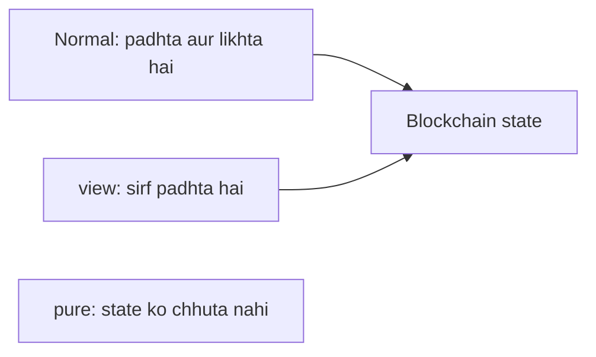
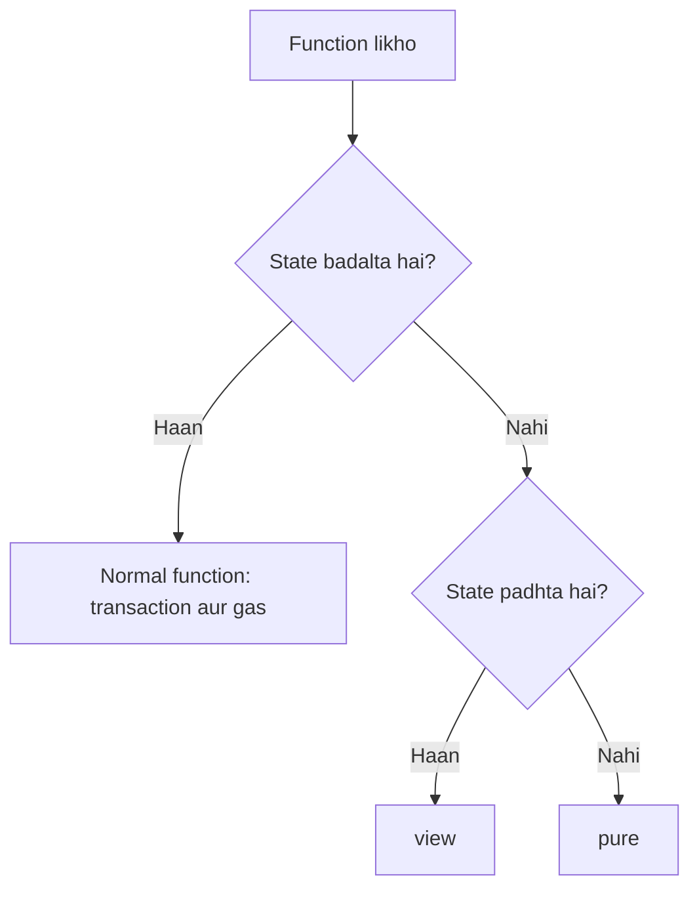

**Ek line mein:** <mark>View function blockchain state padh sakta hai lekin badal nahi sakta; pure function na padh sakta hai na badal sakta hai; dono ko bahar se bina gas ke call kiya ja sakta hai</mark>. <Cite id="solidity-docs-view-pure" />

<Box kind="key">

**View aur pure ke question mein ye points likho:**

- <mark>view</mark>: state <mark>padh</mark> sakta hai (storage variables, balance, block.timestamp, msg.sender), <mark>likh nahi</mark> sakta.
- <mark>pure</mark>: state <mark>na padh na likh</mark> sakta hai; sirf arguments aur local variables pe kaam karta hai.
- <mark>Normal function</mark>: state padhta aur likhta hai; transaction aur gas chahiye.
- Bahar se read-only call karne pe view aur pure <mark>free (gas nahi)</mark> hain; transaction ke andar unka computation gas leta hai.
- State badalna matlab: storage likhna, events emit karna, contracts banana, ether bhejna, non-view function call karna.
- View function likhe ya pure function state padhe to <mark>compiler error</mark> deta hai.

</Box>

## Core answer (5 marks, yahan ke har question ke liye)

<Box kind="definition">

**view** and **pure** are labels on a function that say what it may do with the blockchain's data. A **view** function may **read** state but not change it. A **pure** function may **neither read nor change** state; it works only on its own arguments and local variables. <Cite id="solidity-docs-view-pure" />

</Box>

**Kyun chahiye:**

1. Ye padhne wale aur compiler ko batate hain ki function kya kar sakta hai; compiler wo code reject karta hai jo promise todta hai.
2. Bahar se (jaise web app se) read-only call karne pe ye **gas nahi** lete, kyunki koi transaction mine nahi hota. Dusre transaction ke andar computation ke liye gas lagta hai. <Cite id="solidity-gfg-view-pure" />

| Point | view | pure | Normal |
|---|---|---|---|
| State padhna | Haan | Nahi | Haan |
| State badalna | Nahi | Nahi | Haan |
| Bahar se call pe gas | Free | Free | Transaction aur gas chahiye |
| Aam use | Getters | Maths helpers | Data set ya update |



```solidity
// SPDX-License-Identifier: MIT
pragma solidity ^0.8.0;

contract ViewPureDemo {
    uint public price = 100;

    // view: reads state, does not change it
    function priceWithTax(uint taxPercent) public view returns (uint) {
        return price + (price * taxPercent) / 100;
    }

    // pure: neither reads nor changes state
    function add(uint a, uint b) public pure returns (uint) {
        return a + b;
    }

    // normal function: changes state, costs gas
    function setPrice(uint newPrice) public {
        price = newPrice;
    }
}
```

**Explanation:** `priceWithTax` state variable `price` use karta hai, isliye `view` hona chahiye. `add` sirf apne do inputs use karta hai, isliye `pure` ho sakta hai. `setPrice` `price` likhta hai, isliye na view na pure, aur transaction chahiye. `view` function likhe ya `pure` function state padhe to compiler error deta hai.

<Box kind="verify">

`add(2, 3)` 5 deta hai bina state ke. `price = 100` ke saath `priceWithTax(10)` $100 + (100 \times 10) / 100 = 110$ deta hai. `setPrice(200)` ke baad `priceWithTax(10)` $200 + 20 = 220$ deta hai: view ka result state ko follow karta hai, jabki `add(2, 3)` ab bhi 5 hai.

</Box>

**Conclusion:** <mark>calculations ke liye pure, data padhne ke liye view, aur normal function tabhi jab state badalni ho</mark>. <Cite id="solidity-docs-functions" />

## Extended answer (10 marks): ye add karo

### 1. State padhna aur badalna kya hai

| State badalta hai (view ya pure mein allowed nahi) | State padhta hai (view mein allowed, pure mein nahi) |
|---|---|
| Storage variable likhna | Storage variable padhna |
| Events emit karna | `address(this).balance` |
| Dusre contracts banana | `block.timestamp`, `msg.sender` |
| Ether bhejna | Dusra view function call karna |
| Non-view function call karna | |

### 2. Counter ke saath dusra example

```solidity
// SPDX-License-Identifier: MIT
pragma solidity ^0.8.0;

contract Counter {
    uint public count = 5;

    function increase() public {            // changes state
        count = count + 1;
    }

    function double() public view returns (uint) {   // reads state
        return count * 2;
    }

    function square(uint x) public pure returns (uint) { // no state
        return x * x;
    }
}
```

<Box kind="verify">

`count` 5 se shuru hota hai. `double()` $5 \times 2 = 10$ deta hai aur `count` nahi badalta. `increase()` ke baad `double()` $6 \times 2 = 12$ deta hai. `square(4)` 16 deta hai, `count` kuch bhi ho.

</Box>



### 3. Kahan use hote hain

- **view:** getters, balance checks, stored values use karne wale price calculations.
- **pure:** maths helpers, hashing aur encoding helpers. <Cite id="solidity-by-example" />

## Har question mein kaise fit karein

- **"Explain view function and pure function in solidity with suitable examples."** (10 marks) <PYQ id="2024-05-ce/q4b" /> <PYQ id="2024-12-ce/q5b" />: **core answer** (definition, kyun, table, program, explanation, check), phir section 1 ka table aur section 2 ka counter example decision diagram ke saath.

## Exam tips

- **Teen-column table likho** view, pure, normal; ye answer ka dil hai.
- Har ek ka ek example: ek function jo padhta hai (`priceWithTax`) aur ek jo nahi (`add`).
- Yaad rakho: free sirf bahar se call karne pe; ye mat likho ki hamesha free hai.

Exam mein English mein likho.
