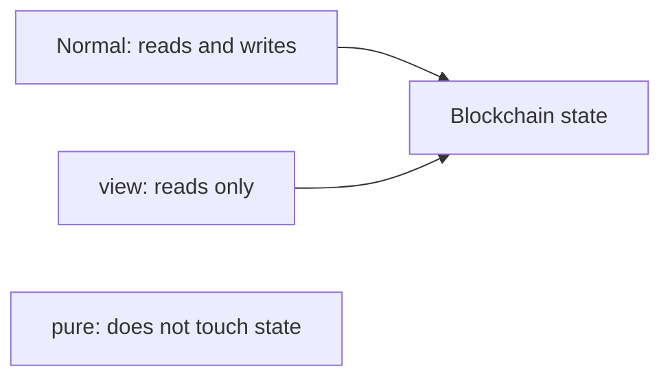
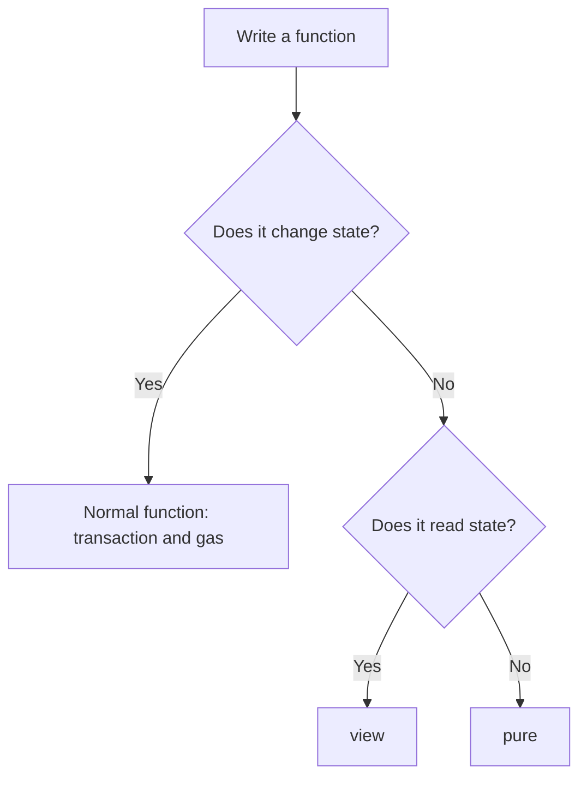

**In one line:** <mark>A view function can read blockchain state but not change it; a pure function can neither read nor change state; both can be called from outside without paying gas</mark>. <Cite id="solidity-docs-view-pure" />

<Box kind="key">

**Key points to write (view and pure):**

- <mark>view</mark>: may <mark>read</mark> state (storage variables, balance, block.timestamp, msg.sender), may <mark>not write</mark>.
- <mark>pure</mark>: may <mark>neither read nor write</mark> state; works only on arguments and local variables.
- <mark>Normal function</mark>: reads and writes state; needs a transaction and gas.
- Called from outside as a read-only call, view and pure are <mark>free (no gas)</mark>; inside a transaction they still use gas.
- Changing state means: writing storage, emitting events, creating contracts, sending ether, calling a non-view function.
- The <mark>compiler gives an error</mark> if a view function writes or a pure function reads state.

</Box>

## Core answer (5 marks, fits every question here)

<Box kind="definition">

**view** and **pure** are labels on a function that say what it may do with the blockchain's data. A **view** function may **read** state but not change it. A **pure** function may **neither read nor change** state; it works only on its own arguments and local variables. <Cite id="solidity-docs-view-pure" />

</Box>

**Why they are needed:**

1. They tell the reader and the compiler what the function can do; the compiler refuses code that breaks the promise.
2. When called from outside (for example from a web app) as a read-only call, they cost **no gas**, because no transaction is mined. Inside another transaction they still use gas for their computation. <Cite id="solidity-gfg-view-pure" />

| Point | view | pure | Normal |
|---|---|---|---|
| Read state | Yes | No | Yes |
| Change state | No | No | Yes |
| Gas when called from outside | Free | Free | Needs a transaction and gas |
| Typical use | Getters | Maths helpers | Set or update data |



```solidity
// SPDX-License-Identifier: MIT
pragma solidity ^0.8.0;

contract ViewPureDemo {
    uint public price = 100;

    // view: reads state, does not change it
    function priceWithTax(uint taxPercent) public view returns (uint) {
        return price + (price * taxPercent) / 100;
    }

    // pure: neither reads nor changes state
    function add(uint a, uint b) public pure returns (uint) {
        return a + b;
    }

    // normal function: changes state, costs gas
    function setPrice(uint newPrice) public {
        price = newPrice;
    }
}
```

**Explanation:** `priceWithTax` uses the state variable `price`, so it must be `view`. `add` uses only its two inputs, so it can be `pure`. `setPrice` writes `price`, so it can be neither and needs a transaction. If a `view` function writes, or a `pure` function reads state, the compiler gives an error.

<Box kind="verify">

`add(2, 3)` returns 5 using no state. With `price = 100`, `priceWithTax(10)` gives $100 + (100 \times 10) / 100 = 110$. After `setPrice(200)`, `priceWithTax(10)` gives $200 + 20 = 220$: the view result follows the state, while `add(2, 3)` is still 5.

</Box>

**Conclusion:** <mark>use pure for calculations, view for reading data, and a normal function only when the state must change</mark>. <Cite id="solidity-docs-functions" />

## Extended answer (10 marks): add these

### 1. What counts as reading and changing state

| Changes state (not allowed in view or pure) | Reads state (allowed in view, not in pure) |
|---|---|
| Writing a storage variable | Reading a storage variable |
| Emitting events | `address(this).balance` |
| Creating other contracts | `block.timestamp`, `msg.sender` |
| Sending ether | Calling another view function |
| Calling a non-view function | |

### 2. Second example with a counter

```solidity
// SPDX-License-Identifier: MIT
pragma solidity ^0.8.0;

contract Counter {
    uint public count = 5;

    function increase() public {            // changes state
        count = count + 1;
    }

    function double() public view returns (uint) {   // reads state
        return count * 2;
    }

    function square(uint x) public pure returns (uint) { // no state
        return x * x;
    }
}
```

<Box kind="verify">

`count` starts at 5. `double()` returns $5 \times 2 = 10$ and leaves `count` unchanged. After `increase()`, `double()` returns $6 \times 2 = 12$. `square(4)` returns 16 whatever `count` is.

</Box>



### 3. Where they are used

- **view:** getters, balance checks, price calculations that use stored values.
- **pure:** maths helpers, hashing and encoding helpers. <Cite id="solidity-by-example" />

## Fit it to each question

- **"Explain view function and pure function in solidity with suitable examples."** (10 marks) <PYQ id="2024-05-ce/q4b" /> <PYQ id="2024-12-ce/q5b" />: the **core answer** (definition, why, table, program, explanation, check), then section 1 table and the section 2 counter example with the decision diagram.

## Exam tips

- **Write the three-column table** view, pure, normal; it is the heart of the answer.
- Use one example for each: a function that reads (`priceWithTax`) and one that does not (`add`).
- Remember: free only when called from outside; do not claim it is always free.
