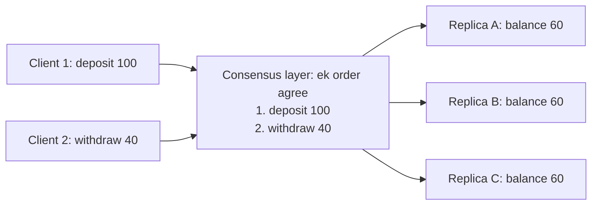
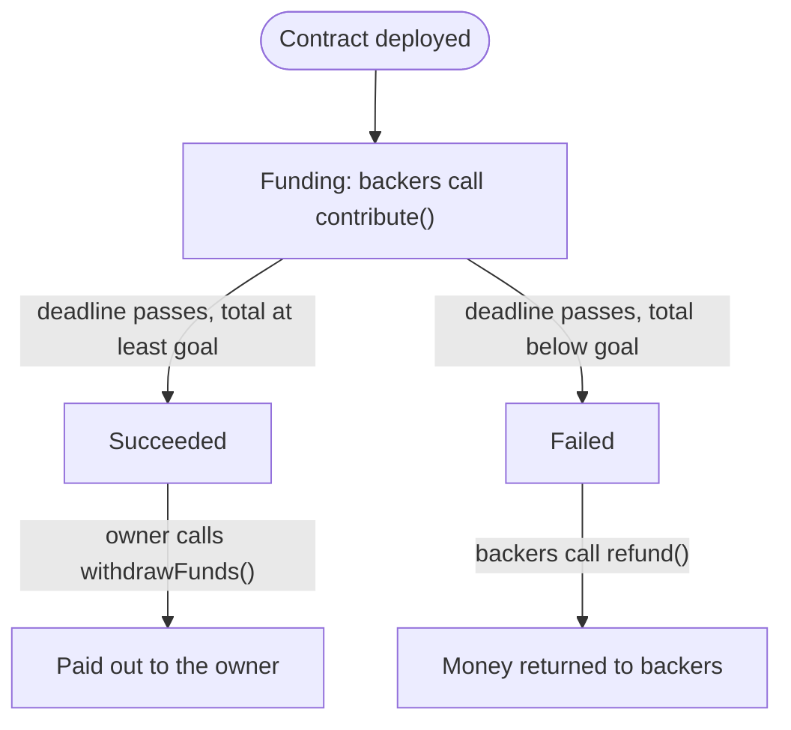
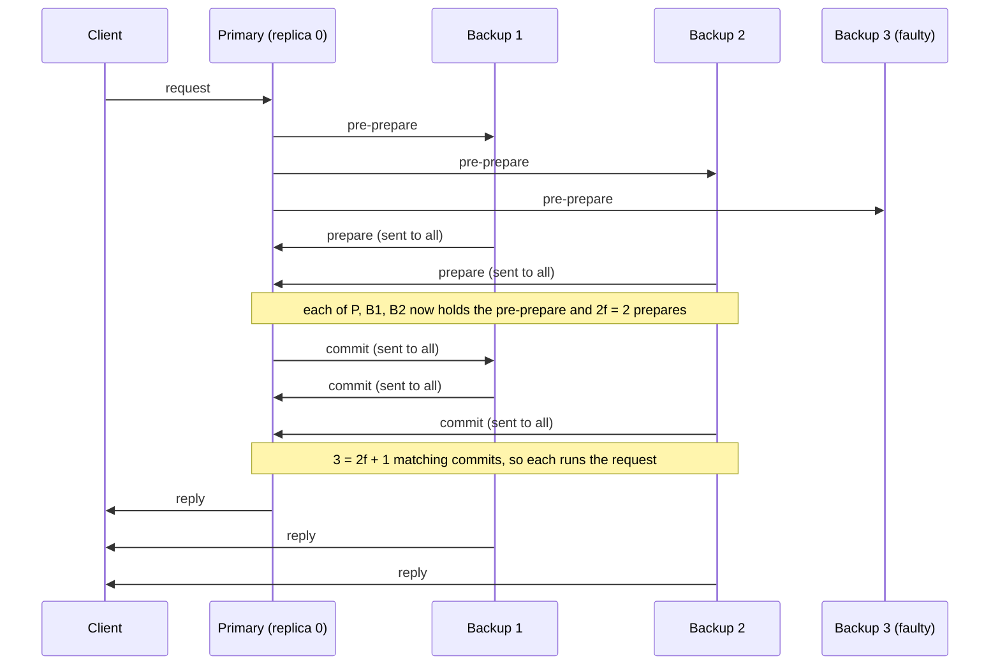
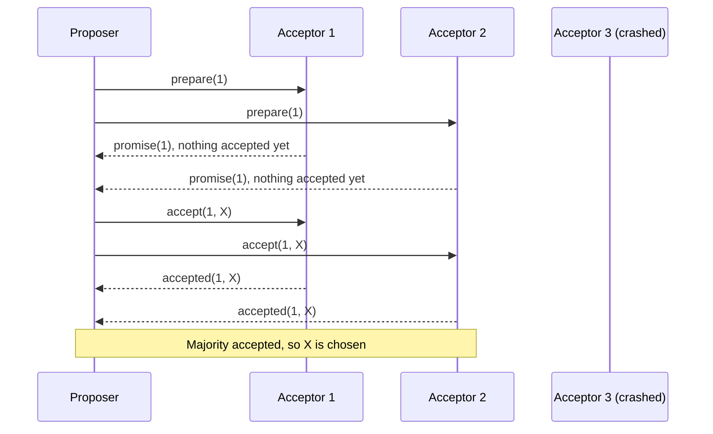
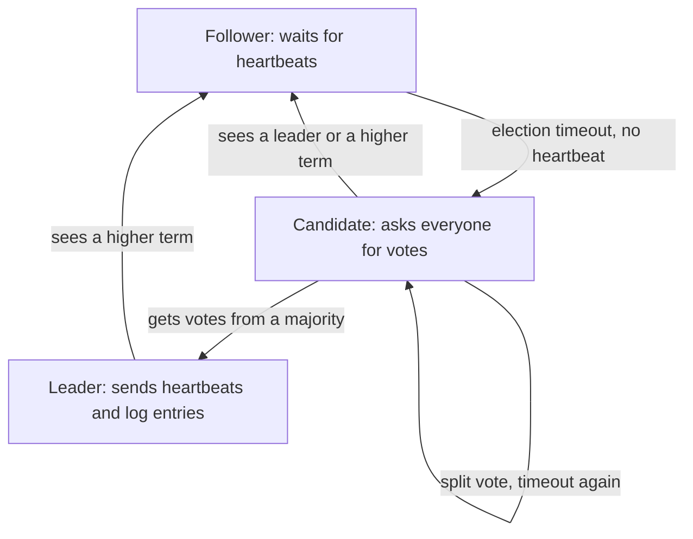
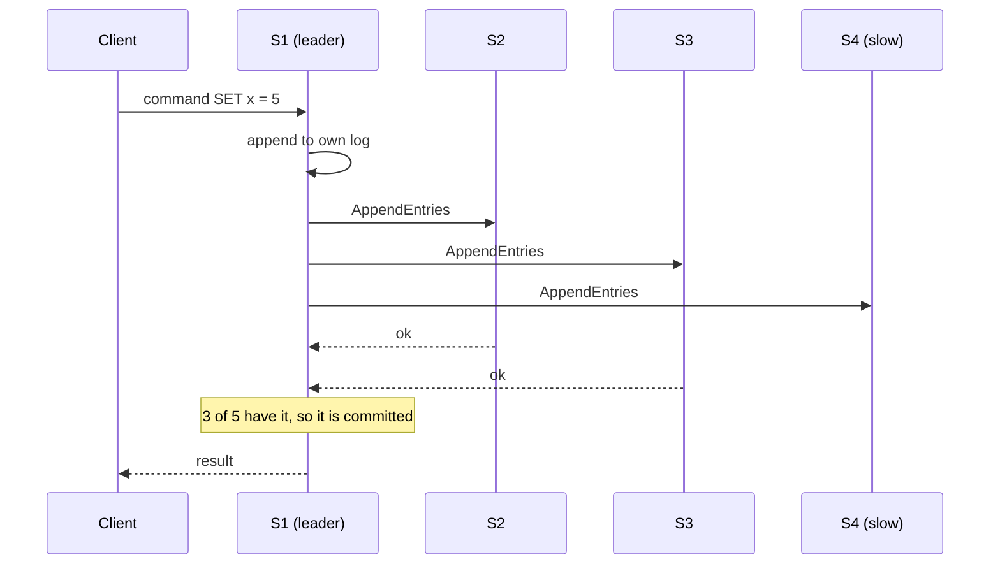

Ye note syllabus <Syl m="4" />, section 4.2 cover karta hai: Paxos aur Raft consensus, aur Byzantine faults ke saath Byzantine Fault Tolerance (BFT) aur Practical BFT (PBFT). Isme state machine replication ke wo questions bhi hain jo papers mein is topic ke under tag hain. Proof of work aur baaki public-chain algorithms consensus and mining note mein hain, aur Hyperledger Fabric ka apna note hai.

## Pehle basics

- **Node** (jise **replica** ya **server** bhi kehte hain) ek computer hai jiske paas data ki copy hai.
- **Fault** matlab node jaisa chahiye waisa behave nahi kar raha. Yahan do type important hain:
  - **Crash fault**: node ruk jaata hai aur kuch nahi bolta (power cut, software crash). Wo kabhi jhooth nahi bolta.
  - **Byzantine fault**: node kuch bhi kar sakta hai: ruk jaye, der se jawab de, ya alag alag nodes ko galat aur alag jawab bheje (hacked ya dishonest node). <Cite id="consensus-mining-wiki-byzantine" /> <Cite id="bft-paxos-raft-wiki-consensus" />
- **Consensus** matlab saare working nodes ek value pe agree karte hain (blockchain mein next block ya transaction ka order). Sahi consensus protocol teen cheezein deta hai: **agreement** (saare correct nodes same value decide karein), **validity** (value sach mein kisi ne propose ki thi) aur **termination** (har correct node end mein decide kar le). <Cite id="bft-paxos-raft-wiki-consensus" />
- **Quorum** nodes ka sabse chhota group hai jiska vote decision ke liye kaafi hai. **Majority quorum** matlab total nodes ke aadhe se zyada. <Cite id="bft-paxos-raft-wiki-quorum" />
- **Overlap rule.** Ek hi group ki koi bhi do majorities mein kam se kam ek node common hota hai, kyunki dono milkar poore group se zyada hoti hain. Wo common node pehla decision yaad rakhta hai, isliye doosri majority use contradict nahi kar sakti. Paxos aur Raft isi pe depend karte hain. <Cite id="bft-paxos-raft-wiki-quorum" />
- **State machine** wo cheez hai jo ek state mein hoti hai aur input aane pe doosri state mein jaati hai. Agar same state mein same input hamesha same nayi state deta hai to wo **deterministic** hai. Bank balance ek example hai: state balance hai, inputs deposits aur withdrawals hain.

Analogy: paanch dost message karke decide karte hain ki kahan khaana hai. Ek dost ka phone mar gaya (crash fault), to baaki chaar phir bhi decide kar sakte hain. Agar ek dost do logon ko "pizza" aur do ko "burger" bolke gadbad karta hai (Byzantine fault), to group ko smart rule chahiye.

## Private blockchains ko ye algorithms kyun chahiye

Bitcoin jaise public blockchain mein koi bhi join kar sakta hai, isliye kisi pe trust nahi kar sakte aur network ko proof of work chahiye, jo slow hai aur bahut energy leta hai. <Cite id="blockchain-fundamentals-nakamoto" /> **Private** ya **consortium** blockchain mein participants known aur approved hote hain (banks, hospitals, companies ka group). Identity pata hone se nodes seedha **vote** kar sakte hain. Isse milta hai:

- fast blocks aur **immediate finality** (vote hone ke baad block final hai, baad mein lambi chain se undo nahi hota),
- bahut kam energy,
- lekin ye sirf **chhote, fixed group** ke liye chalta hai, kyunki har vote ke liye nodes ke beech messages jaate hain. <Cite id="consensus-mining-gfg-crypto-consensus" /> <Cite id="bft-paxos-raft-gfg-bft" />

Kaun sa algorithm lena hai ye is pe depend karta hai ki members jhooth bol sakte hain ya nahi:

| Situation | Fault to survive | Algorithm family | Examples |
|---|---|---|---|
| Members trusted hain par servers crash ho sakte hain | Crash | Crash fault tolerant (CFT) | Paxos, Raft |
| Members hacked ya dishonest ho sakte hain | Byzantine | Byzantine fault tolerant (BFT) | PBFT, SmartBFT |
| Koi bhi join kar sakta hai | Byzantine plus fake identities | Open-network algorithms | PoW, PoS |

Hyperledger Fabric dono choices dikhata hai: uski ordering service Raft deti hai (crash fault tolerant, "production networks ke liye recommended") aur version 3.0 se SmartBFT library pe bani BFT service bhi. <Cite id="bft-paxos-raft-fabric-orderer" /> <Cite id="blockchain-fundamentals-fabric-docs" />

<PYQ id="2023-12/q6b" />

## State machine replication (SMR)

<Box kind="definition">

**State machine replication** fault-tolerant service banane ka tareeka hai: ek hi deterministic state machine ki kai copies (replicas) alag servers pe rakho aur sabko same client requests same order mein process karao. Ek copy fail ho to baaki same state mein hain aur kaam chalta rehta hai. <Cite id="smart-contracts-schneider-1990" /> <Cite id="smart-contracts-wiki-smr" />

</Box>

**Ye kyun zaroori hai.** Ek server single point of failure hai. Kai servers tabhi safe hain jab wo kabhi alag na hon, aur wo alag tab hote hain jab requests alag order mein dekhte hain (jaise balance 0 ho to "deposit 100" phir "withdraw 100" ulte order jaisa nahi hai).

**Ye kaise kaam karta hai.**

1. n servers mein se har ek pe state machine ki copy rakho.
2. Client service ko request (input) bhejta hai.
3. Servers **consensus protocol** (Paxos, Raft ya PBFT) chalate hain taaki requests ka **ek order** agree ho. Ye mushkil step hai.
4. Har server requests us order mein apply karta hai. Machine deterministic hai, isliye har server same state pe pahunchta hai.
5. Koi server (ya client replies compare karke) result lautata hai. <Cite id="smart-contracts-schneider-1990" />

<Cite id="smart-contracts-schneider-1990" /> <Cite id="smart-contracts-wiki-smr" />

**Fault limits.** Crash faults ke liye SMR n = 2f + 1 replicas se f failures survive karta hai. Byzantine faults ke liye n = 3f + 1 chahiye. <Cite id="bft-paxos-raft-wiki-paxos" /> <Cite id="consensus-mining-wiki-bft" />

**Blockchain SMR hai.** Nodes replicas hain, ledger plus contract storage state hai, transactions inputs hain, consensus se bana block order agreed order hai, aur EVM ya chaincode deterministic transition function hai. Isiliye contract code seedha random numbers ya outside data use nahi kar sakta.

### Smart contract as a state machine: crowdfunding

Crowdfunding contract ki teen states hain: **Funding** (open), **Succeeded** (deadline nikal gayi, goal pura) aur **Failed** (deadline nikal gayi, goal miss). Inputs `contribute()`, `withdrawFunds()` aur `refund()` jaise transactions hain.

<Cite id="smart-contracts-schneider-1990" />

Replication action mein: Asha ka `contribute(500)` aur Ravi ka `contribute(300)` alag nodes pe alag time pe pahunchte hain. Consensus protocol order decide karta hai (pehle Asha, phir Ravi), har node dono ko usi order mein chalata hai, aur har node total 800 dikhata hai. Jo node alag total dikhaye wo baaki se disagree karega aur uska result reject ho jaayega.

<Box kind="exam">

Exam mein English mein likho: "State machine replication keeps identical copies of a deterministic state machine on many nodes and gives them the same inputs in the same order, so they always reach the same state. Consensus fixes the order. In a blockchain, transactions are the inputs and a smart contract is the state machine."

</Box>

<PYQ id="2023-05-ce/q3a" /> <PYQ id="2023-12-ce/q2a" /> <PYQ id="2024-05-ce/q5a" /> <PYQ id="2024-12-ce/q3b" />

## Byzantine Generals Problem aur BFT

Kai generals ek shehar ko ghere hue hain. Wo tabhi jeette hain jab saare loyal generals ek saath attack karein (ya ek saath retreat). Wo sirf messenger se baat kar sakte hain, aur kuch generals traitors hain jo alag logon ko alag message bhejte hain. Kya loyal generals phir bhi agree kar sakte hain? <Cite id="bft-paxos-raft-byz-generals" /> <Cite id="consensus-mining-wiki-byzantine" />

Lamport, Shostak aur Pease ne dikhaya ki ordinary (unsigned) messages ke saath agreement tabhi possible hai jab **generals ke do-tihai se zyada loyal hon**, yaani f traitors ke liye $n \ge 3f + 1$. <Cite id="bft-paxos-raft-byz-generals" /> <Cite id="consensus-mining-wiki-bft" /> Signed messages is limit ko halka kar sakte hain, lekin PBFT jaise real systems $n \ge 3f + 1$ rakhte hain kyunki ye slow network ko bhi cover karta hai. <Cite id="bft-paxos-raft-pbft-paper" />

<Box kind="definition">

**Byzantine Fault Tolerance (BFT)** distributed system ki wo ability hai ki kuch nodes faulty ya malicious hon aur arbitrary ya conflicting messages bhejein, tab bhi system chalta rahe aur sahi agreement tak pahunche. <Cite id="bft-paxos-raft-gfg-bft" /> <Cite id="consensus-mining-wiki-bft" />

</Box>

**3f + 1 kyun? Simple argument.** Maan lo kam se kam f nodes faulty ho sakte hain aur total n nodes hain.

1. Ek node sirf $n - f$ replies ka wait kar sakta hai, kyunki f faulty nodes hamesha chup reh sakte hain.
2. Un $n - f$ replies mein se f tak jhooth ho sakte hain. To honest replies kam se kam $n - 2f$ hain.
3. Honest replies jhooth se zyada honi chahiye: $n - 2f > f$, yaani $n > 3f$, matlab $n \ge 3f + 1$.

**Classical BFT (simple idea).** Har node apni value sabko bhejta hai, jo sunta hai wo collect karta hai, aur majority ko follow karta hai. Isme honest nodes ki clear majority chahiye, aur kai rounds aur bahut messages lagte hain, isliye slow hai. <Cite id="bft-paxos-raft-gfg-bft" />

<PYQ id="2023-12-ce/q2b" />

## Practical Byzantine Fault Tolerance (PBFT)

<Box kind="definition">

**PBFT** Miguel Castro aur Barbara Liskov (1999) ka BFT consensus algorithm hai. Ye $3f + 1$ limit rakhta hai par real use ke liye kaafi fast hai: ye state machine replicate karta hai, requests ko order dene ke liye **primary** aur primary ko check karne ke liye **backups** use karta hai, aur slow (asynchronous) network mein bhi safe rehta hai (galat result nahi deta). <Cite id="bft-paxos-raft-pbft-paper" /> <Cite id="bft-paxos-raft-gfg-pbft" />

</Box>

### Roles

- **Client**: request bhejta hai aur jab kaafi replicas agree karein tab jawab accept karta hai.
- **Primary (leader)**: har **view** mein ek replica jo requests ka order chunta hai aur har round shuru karta hai.
- **Backup (secondary)**: baaki sab replicas. Backup primary ka proposal check karne ke baad hi accept karta hai, baaki replicas ko batata hai ki usne kya dekha, request chalata hai, client ko reply deta hai, aur primary pe nazar rakhta hai. Primary faulty ya chup ho to backups **view change** shuru karke naya primary chunte hain. <Cite id="bft-paxos-raft-gfg-pbft" /> <Cite id="bft-paxos-raft-pbft-paper" />

<PYQ id="2022-12-ce/q1c" />

### Phases

1. **Request**: client request primary ko bhejta hai.
2. **Pre-prepare**: primary request ko sequence number deta hai aur sab backups ko bhejta hai.
3. **Prepare**: jo backup accept karta hai wo baaki sab replicas ko prepare message bhejta hai. Replica "prepared" tab hota hai jab uske paas pre-prepare aur $2f$ alag backups ke matching prepares hon.
4. **Commit**: har prepared replica sabko commit message bhejta hai. Replica tab commit karta hai jab use $2f + 1$ matching commits mil jaayein (apna bhi gin ke).
5. **Reply**: har replica request chalata hai aur result client ko bhejta hai. Client result tab accept karta hai jab $f + 1$ replicas same jawab bhejein, kyunki unmein se kam se kam ek honest hoga. <Cite id="bft-paxos-raft-pbft-paper" /> <Cite id="bft-paxos-raft-gfg-pbft" />

<Cite id="bft-paxos-raft-gfg-pbft" loc="diagram" />

**View change.** Agar primary timer khatam hone se pehle progress nahi karta, to backups agle view ke liye vote karte hain, aur agla replica primary ban jaata hai. Isliye faulty primary system ko hamesha ke liye rok nahi sakta. <Cite id="bft-paxos-raft-gfg-pbft" /> <Cite id="bft-paxos-raft-pbft-paper" />

**Extra rounds kyun?** Prepare phase pakka karta hai ki saare honest replicas ne primary se same order dekha (jhootha primary alag backups ko alag order nahi de sakta). Commit phase pakka karta hai ki kaafi replicas ko pata hai ki baaki prepared hain, taaki order view change ke baad bhi bacha rahe.

### Advantages aur disadvantages

| Advantages | Disadvantages |
|---|---|
| 3f + 1 mein se f malicious nodes tak survive karta hai | Har round mein har replica har doosre se baat karta hai, isliye messages roughly n ke square ke hisaab se badhte hain; chhote groups ke liye best |
| Mining nahi, isliye bahut kam energy | Nodes badhne pe response time badhta hai |
| Final decision: baad mein fork nahi | Node set known aur fixed hona chahiye; fake identities (Sybil attack) ise tod sakti hain |
| Fast: confirmations ka wait nahi | View-change logic complex hai |

<Cite id="bft-paxos-raft-gfg-pbft" /> <Cite id="bft-paxos-raft-wiki-consensus" />

### BFT aur PBFT ki comparison

| Point | Classical BFT | PBFT |
|---|---|---|
| Ye kya hai | General idea aur problem: traitors ke bawajood agreement | Ek practical algorithm jo ise solve karta hai |
| Origin | Byzantine Generals Problem (Lamport, Shostak, Pease, 1982) | Castro aur Liskov, 1999 |
| Nodes chahiye | $n \ge 3f + 1$ | Same, $n \ge 3f + 1$ |
| Network model | Shuruaati solutions synchronous network maante hain (messages known time mein aate hain) | Asynchronous network pe chalta hai (messages slow hon tab bhi safe) |
| Speed | Message exchange ke kai rounds, impractical | Teen message phases, real services ke liye practical |
| Leader | Idea mein fixed nahi | Har view mein ek primary, view change se badalta hai |
| Decision rule | Honest values ki majority | $2f + 1$ matching votes; client $f + 1$ replies ka wait karta hai |
| Blockchain mein use | Baad ke sab protocols ke peeche ki theory | Permissioned chains, jaise Hyperledger Fabric ki BFT ordering service (SmartBFT) |

<Cite id="bft-paxos-raft-byz-generals" /> <Cite id="bft-paxos-raft-pbft-paper" /> <Cite id="bft-paxos-raft-gfg-pbft" /> <Cite id="bft-paxos-raft-fabric-orderer" />

<PYQ id="2023-12-ce/q2b" />

## Paxos

<Box kind="definition">

**Paxos** protocols ki family hai jo nodes ke group ko ek value pe agree karwati hai, even jab kuch nodes crash ho jaayein ya messages kho jaayein. Ise Leslie Lamport ne propose kiya aur "Paxos Made Simple" mein simple tareeke se samjhaya. Iska main promise **safety** hai: nodes kabhi do alag values pe agree nahi karte. Ye promise nahi karta ki agreement hamesha jaldi ho jaayega. <Cite id="bft-paxos-raft-paxos-simple" /> <Cite id="bft-paxos-raft-wiki-paxos" />

</Box>

**Ye kyun zaroori hai.** Replicas ko identical rakhne (SMR) ke liye nodes ko har agli command pe agree karna padta hai, chahe kuch servers mar jaayein. Paxos crash-fault-tolerant agreement deta hai. Ye private blockchains aur replicated databases mein use hota hai jahan nodes trusted hain par fail ho sakte hain. Ye jhooth bolne walon ko handle nahi karta. <Cite id="bft-paxos-raft-wiki-paxos" />

### Roles

- **Proposer**: value suggest karta hai aur use chosen karwane ki koshish karta hai.
- **Acceptor**: proposals pe vote karta hai. Value tab chosen hoti hai jab acceptors ki majority use accept kar le.
- **Learner**: pata lagata hai ki kaun si value chosen hui.

Practice mein ek hi server teeno roles nibhata hai. <Cite id="bft-paxos-raft-wiki-paxos" /> <Cite id="bft-paxos-raft-gfg-paxos" />

### Paxos ka ek round kaise chalta hai

Har proposal ka ek **number** n hota hai jo unique aur badhta hua hai, taaki naye proposals purane se alag pehchane jaayein.

1. **Prepare**: proposer number n chunta hai aur acceptors ki majority ko *prepare(n)* bhejta hai.
2. **Promise**: jis acceptor ne n se bada number promise nahi kiya, wo *promise(n)* se reply karta hai: n se chhote kisi proposal ko ignore karega. Wo apni already accepted value (agar hai) aur us proposal ka number bhi batata hai.
3. **Accept**: proposer ko majority se promises mil jaayein to wo *accept(n, v)* bhejta hai. Value v replies mein sabse bade number wali already-accepted value honi chahiye; agar kisi acceptor ne koi value nahi batayi to proposer apni value use kar sakta hai.
4. **Accepted**: acceptor *(n, v)* accept karta hai jab tak beech mein usne bada number promise na kar diya ho. Majority accept kar le to value **chosen** hai, aur learners ko bata diya jaata hai.

Agar round fail ho (kisi aur proposer ne bada number use kiya), to proposer bade number ke saath dobara try karta hai. <Cite id="bft-paxos-raft-paxos-simple" /> <Cite id="bft-paxos-raft-wiki-paxos" />

<Cite id="bft-paxos-raft-wiki-paxos" loc="diagram" />

**Ye safe kyun hai.** Jis majority ne X accept kiya aur jo majority baad mein naye proposer ko promise karti hai, unmein kam se kam ek acceptor common hai. Wo X report karta hai, isliye naya proposer ko X hi dobara propose karna padta hai. To chosen value kabhi badal nahi sakti. <Cite id="bft-paxos-raft-wiki-paxos" /> <Cite id="bft-paxos-raft-paxos-simple" />

**Private blockchain ka example.** Teen banks consortium ledger ke nodes chalate hain. Bank 1 chain pe "block 7 holds Tx1 and Tx2" daalna chahta hai. Wo proposer banta hai, banks 1 aur 2 se promises leta hai, aur accept bhejta hai. Banks 1 aur 2 accept karte hain, to block 7 chosen ho gaya. Bank 3 offline tha; wapas aane pe use pata chalta hai ki block 7 chosen ho chuka hai. Agar bank 2 ne bhi usi time bade number ke saath alag block 7 propose kiya hota, to overlap rule ke karan doosra round poora karne wale ko already-accepted value hi dobara propose karni padti, isliye banks kabhi do alag block 7 pe nahi pahunchte.

**Multi-Paxos.** Asli ledger ko kai decisions chahiye, har log slot ke liye ek. Multi-Paxos stable leader rakhta hai aur aage ke slots ke liye prepare phase skip karta hai, jisse delay kam hota hai. <Cite id="bft-paxos-raft-wiki-paxos" />

### Advantages aur disadvantages

| Advantages | Disadvantages |
|---|---|
| Hamesha safe: do alag values kabhi chosen nahi | Samajhna aur sahi implement karna mushkil, kai variants |
| Jab tak nodes ki majority zinda hai tab tak chalta hai | Kai message rounds, isliye slow aur heavy |
| Lost, late aur repeated messages handle karta hai | Khatam hone ki guarantee nahi (competing proposers restart karte reh sakte hain) |
| Energy-hungry mining nahi | Sirf crash faults; jhootha node ise tod sakta hai |

<Cite id="bft-paxos-raft-gfg-paxos" /> <Cite id="bft-paxos-raft-wiki-paxos" />

<PYQ id="2022-12-ce/q5a" /> <PYQ id="2024-12-ce/q6c" />

## Raft

<Box kind="definition">

**Raft** **replicated log** manage karne ka consensus algorithm hai, jo safety mein Paxos ke barabar hai par samajhne mein bahut aasaan banaya gaya. Ye problem ko teen hisson mein todta hai: **leader election**, **log replication** aur **safety**. Ise Diego Ongaro aur John Ousterhout ne 2014 mein publish kiya. <Cite id="bft-paxos-raft-raft-paper" /> <Cite id="bft-paxos-raft-wiki-raft" />

</Box>

**Ye kyun zaroori hai.** Paxos sahi hai par sikhana aur banana mushkil. Raft wahi crash fault tolerance ek clear rule ke saath deta hai: *ek time pe ek hi leader hota hai, aur sab kuch usi se guzarta hai.* Private blockchain mein leader block orderer ka kaam karta hai. Fabric ki Raft ordering service bilkul aise hi chalti hai. <Cite id="bft-paxos-raft-fabric-orderer" />

### Basics

- Har server teen **states** mein se ek mein hota hai: **follower** (passive, leader aur candidates ko jawab deta hai), **candidate** (votes maang raha hai) ya **leader** (saari client requests handle karta hai). <Cite id="bft-paxos-raft-gfg-raft" />
- Time **terms** mein bata hota hai, numbered 1, 2, 3... Har term election se shuru hota hai. Ek term mein zyada se zyada ek leader hota hai, aur jo server bada term number dekhta hai wo update karke step down ho jaata hai. <Cite id="bft-paxos-raft-raft-paper" loc="§5.2" />
- Har server ka ek **log** hota hai: commands ki ordered list, har command pe us term ka tag jisme leader ko mili.
- Do messages (RPCs): **RequestVote** (elections mein) aur **AppendEntries** (log entries copy karne ke liye, aur khaali **heartbeat** ke roop mein). <Cite id="bft-paxos-raft-gfg-raft" />

<Cite id="bft-paxos-raft-raft-site" loc="diagram" /> <Cite id="bft-paxos-raft-gfg-raft" />

### Leader election

1. Jo follower apne **election timeout** tak heartbeat nahi sunta wo maan leta hai ki leader chala gaya. Timeout har server ka random hota hai (paper 150 se 300 ms use karta hai), isliye aam taur pe ek hi server pehle time out hota hai. <Cite id="bft-paxos-raft-wiki-raft" /> <Cite id="bft-paxos-raft-raft-paper" loc="§5.2" />
2. Wo **candidate** banta hai, apna term 1 badhata hai, khud ko vote deta hai aur sabko **RequestVote** bhejta hai.
3. Server **ek term mein ek hi vote** deta hai, jo pehle aaya usko. Jis candidate ka log uske apne log se kam up to date hai use wo mana kar deta hai.
4. Outcomes: candidate ko votes ki **majority** milti hai aur wo leader ban ke turant heartbeats bhejta hai; ya wo same ya bade term ke leader ki baat sunta hai aur follower ban jaata hai; ya **koi nahi jeetta** (split vote), timeouts khatam hote hain, aur bade term mein nayi election shuru hoti hai. Random timeouts se baar baar split kam hota hai. <Cite id="bft-paxos-raft-wiki-raft" />

### Log replication

1. Client command leader ko bhejta hai. (Follower use forward ya redirect karta hai.)
2. Leader command ko apne log mein **append** karta hai.
3. Wo sab followers ko **AppendEntries** bhejta hai.
4. Followers entry append karke acknowledge karte hain.
5. Jab entry servers ki **majority** pe store ho jaati hai (leader khud ko gintaa hai), wo **committed** hoti hai. Leader use apni state machine pe apply karke client ko jawab deta hai.
6. Followers agle AppendEntries se commit point jaante hain aur entry apply kar lete hain. <Cite id="bft-paxos-raft-raft-paper" loc="§5.3" /> <Cite id="bft-paxos-raft-gfg-raft" />

Agar kisi follower ka log leader ke log se alag hai (jaise crash ke baad), to leader wapas us last entry tak jaata hai jo dono mein same hai aur uske baad ka sab overwrite kar deta hai. Leader ka log hamesha sahi maana jaata hai. <Cite id="bft-paxos-raft-wiki-raft" />

<Cite id="bft-paxos-raft-raft-site" loc="diagram" />

### Safety

Raft ye promises rakhta hai: ek term mein zyada se zyada ek leader; leader apni log entries kabhi overwrite ya delete nahi karta; agar do logs mein same index aur term wali entry hai to wahan tak logs identical hain; committed entry har future leader ke log mein hogi; aur koi do servers same index pe alag commands apply nahi karte. Iske peeche ka key rule **election restriction** hai: server sirf us candidate ko vote deta hai jiska log kam se kam utna up to date ho (bada last term, ya same last term aur lamba log). Jis majority ne entry commit ki aur jis majority ne naya leader chuna, dono mein overlap hota hai, isliye naye leader ke paas entry hoti hai. <Cite id="bft-paxos-raft-wiki-raft" /> <Cite id="bft-paxos-raft-raft-paper" loc="§5.4" />

### Example: leader fail ho jaata hai

Paanch servers ka cluster S1 se S5. S1 term 3 mein leader hai aur usne "SET x = 5" commit kar diya hai. S1 crash ho jaata hai.

1. S3 ka random timeout (maan lo 200 ms) pehle khatam hota hai. S3 term 4 mein candidate banta hai aur RequestVote bhejta hai.
2. S2, S4 aur S5 ke paas bhi wahi committed entry hai, isliye wo S3 ko vote dete hain. S3 ko 4 votes milte hain (apna milake), jo zaroori 3 se zyada hain.
3. S3 term 4 ka leader hai aur heartbeats bhejta hai. Client ki agli command S3 ko jaati hai.
4. S1 restart hota hai to term 4 dekhta hai, follower ban jaata hai aur S3 ke log se catch up karta hai.

### Advantages aur disadvantages

| Advantages | Disadvantages |
|---|---|
| Samajhna aur implement karna aasaan | Sirf crash faults: jhootha leader ya node ise tod deta hai |
| Strong consistency; ek clear leader | Saari writes ke liye leader bottleneck hai |
| Majority zinda rehne tak chalta hai | Performance stable leader aur achhe timeouts pe depend karti hai |
| Real systems mein use (etcd, CockroachDB, Fabric ordering) | Known, chhote set of nodes chahiye |

<Cite id="bft-paxos-raft-gfg-raft" /> <Cite id="bft-paxos-raft-wiki-raft" /> <Cite id="bft-paxos-raft-fabric-orderer" />

<PYQ id="2023-05-ce/q5a" /> <PYQ id="2024-05-ce/q5b" /> <PYQ id="2024-12-ce/q2b" /> <PYQ id="2025-05-ce/q6b" /> <PYQ id="2025-05/q3a" />

## Paxos, Raft aur PBFT side by side

| Point | Paxos | Raft | PBFT |
|---|---|---|---|
| Faults survived | Crash | Crash | Byzantine (liars) |
| f faults ke liye nodes | $2f + 1$ | $2f + 1$ | $3f + 1$ |
| Leader | Basic Paxos mein zaroori nahi; Multi-Paxos mein ek | Har term mein strong leader | Har view mein primary |
| Decision rule | Acceptors ki majority | Majority entry store kare | $2f + 1$ matching commits |
| Leader change | Bada proposal number | Random timeout ke saath election | View change |
| Ease | Follow karna mushkil | Easy banaya gaya | Complex |
| Messages | Normal case mein kam | Leader se followers, n ke saath linear | All to all, n ke square ke hisaab se badhta hai |
| Used for | Replicated databases, lock services | etcd, Fabric ordering service | Permissioned chains jinhe malicious-node protection chahiye |

<Cite id="bft-paxos-raft-wiki-paxos" /> <Cite id="bft-paxos-raft-wiki-raft" /> <Cite id="bft-paxos-raft-gfg-raft" /> <Cite id="bft-paxos-raft-gfg-pbft" /> <Cite id="bft-paxos-raft-fabric-orderer" />

**Conclusion.** Private blockchains mining ki jagah known nodes ke beech voting use karte hain. Paxos aur Raft tab fast agreement dete hain jab nodes sirf crash hote hain aur $2f + 1$ servers chahiye. PBFT tab bhi agreement deta hai jab kuch nodes jhooth bolte hain aur $3f + 1$ servers chahiye. Pehle do mein Raft aasaan hai; PBFT mein messages zyada lagte hain.

## Worked sums

### Sum 1: PBFT kitne faulty nodes tolerate karta hai?

<Sum>

<Given>

Ek permissioned blockchain $n = 10$ nodes pe PBFT chalata hai.

</Given>

<Find>

faulty nodes ki sabse badi sankhya $f$ jo wo tolerate kar sakta hai, zaroori matching votes, aur client ko kitni replies ka wait karna hai.

</Find>

<Steps>

1. BFT ko $n \ge 3f + 1$ chahiye, to $f \le (n - 1)/3 = 9/3 = 3$. *Reason: rule ko f ke liye rearrange kiya.*
2. Sabse bada whole f $3$ hai. *Reason: f whole number hona chahiye, aur 3 exactly fit hota hai.*
3. Commit ke liye votes: $2f + 1 = 2 \times 3 + 1 = 7$. *Reason: PBFT $2f + 1$ matching commits pe commit karta hai.*
4. Client kitni replies ka wait kare: $f + 1 = 4$. *Reason: zyada se zyada 3 liars hon to 4 equal replies mein kam se kam ek honest node hota hai.*

</Steps>

<Answer>

$f = 3$ faulty nodes, commit ke liye 7 matching votes, aur client 4 matching replies ka wait karta hai.

</Answer>

<Box kind="verify">

Node count check: $3 \times 3 + 1 = 10$, n ke barabar. Ek aur fault check: $f = 4$ ko $3 \times 4 + 1 = 13 > 10$ nodes chahiye, isliye 3 maximum hai. 10 mein se do 7-vote groups ka overlap: $7 + 7 - 10 = 4$ nodes common, aur unmein se zyada se zyada 3 faulty, to kam se kam 1 honest node dono groups mein hai.

</Box>

</Sum>

### Sum 2: kitne nodes chahiye?

<Sum>

<Given>

Ek consortium aisa BFT network chahta hai jo $f = 2$ tak malicious nodes ke saath chalta rahe.

</Given>

<Find>

minimum nodes, aur dikhao ki ek kam node kaafi kyun nahi.

</Find>

<Steps>

1. Minimum nodes: $n = 3f + 1 = 3 \times 2 + 1 = 7$. *Reason: BFT rule.*
2. Matching votes ka quorum: $2f + 1 = 5$. *Reason: PBFT ka commit rule.*
3. $n = 6$ try karo: best f $\lfloor (6 - 1)/3 \rfloor = 1$ hai, 2 nahi. *Reason: rule $f \le 5/3$ deta hai, yaani 1.*

</Steps>

<Answer>

kam se kam 7 nodes, 5 matching votes ke quorum ke saath.

</Answer>

<Box kind="verify">

$n = 6$ aur 2 liars test karo: system $n - f = 4$ replies ka wait karta hai. Un 4 mein 2 liars aur 2 honest ho sakte hain, 2 ke against 2 ka tie, to honest jawab pehchana nahi ja sakta. $n = 7$ mein wo 5 replies ka wait karta hai, jinme zyada se zyada 2 liars aur kam se kam 3 honest hain, yaani clear majority.

</Box>

</Sum>

### Sum 3: Paxos aur Raft mein crash faults

<Sum>

<Given>

Paxos ya Raft (sirf crash faults) use karne wale 5, 6 aur 7 servers ke clusters.

</Given>

<Find>

majority size aur har cluster kitne crashed servers survive kar sakta hai.

</Find>

<Steps>

1. Majority aadhe se zyada hai: $\lfloor n/2 \rfloor + 1$. 5 servers ke liye $2 + 1 = 3$, 6 ke liye $3 + 1 = 4$, 7 ke liye $3 + 1 = 4$. *Reason: majority aadhe se zyada honi chahiye.*
2. Survivable crashes $n - \text{majority}$ hain: $5 - 3 = 2$, $6 - 4 = 2$, $7 - 4 = 3$. *Reason: zinda servers ko phir bhi majority banana hai.*

</Steps>

<Answer>

5 servers: majority 3, 2 crashes survive. 6 servers: majority 4, 2 crashes survive. 7 servers: majority 4, 3 crashes survive.

</Answer>

<Box kind="verify">

Formula $f = \lfloor (n - 1)/2 \rfloor$ use karo: $n = 5$ se 2, $n = 6$ se $\lfloor 2.5 \rfloor = 2$, $n = 7$ se 3. Ye match karte hain. Isse ye bhi dikhta hai ki chhatha server cost badhata hai par extra fault tolerance nahi deta, isliye odd cluster sizes pasand kiye jaate hain.

</Box>

</Sum>

### Sum 4: Raft entry kab committed hoti hai, aur election kaun jeetta hai?

<Sum>

<Given>

5 servers ka Raft cluster. (a) Leader S1 ek entry append karke bhejta hai. S2 aur S3 acknowledge karte hain; S4 aur S5 nahi. (b) Baad mein leader crash ho jaata hai, to 4 servers zinda hain. Wo term 5 mein candidates ko vote dete hain: S2 ko kul 2 votes milte hain (apna aur S3 ka) aur S4 ko kul 2 votes milte hain (apna aur S5 ka).

</Given>

<Find>

(a) entry committed hai ya nahi. (b) term 5 mein leader elect hua ya nahi.

</Find>

<Steps>

1. 5 ki majority $\lfloor 5/2 \rfloor + 1 = 3$ hai. *Reason: dono sawaal poore cluster ki majority use karte hain, zinda servers ki nahi.*
2. (a) Entry ki copies: S1 (leader), S2 aur S3 se $1 + 2 = 3$. *Reason: leader khud ko gintaa hai.* $3 \ge 3$ hai, to entry committed hai.
3. (b) S2 ke 2 votes aur S4 ke 2 votes. Dono 3 se kam hain, to kisi candidate ke paas majority nahi. *Reason: candidate ko 3 votes chahiye.*
4. Isliye term 5 mein leader nahi. Timeouts khatam hote hain aur term 6 mein nayi election shuru hoti hai, naye random timeouts ke saath. *Reason: Raft split vote ko dobara try karke handle karta hai.*

</Steps>

<Answer>

(a) Haan, entry committed hai (5 mein se 3 ke paas hai). (b) Term 5 mein koi leader nahi (2 aur 2 ka split); term 6 mein nayi election hoti hai.

</Answer>

<Box kind="verify">

(a) ke liye, agar sirf S2 ne acknowledge kiya hota to count $1 + 1 = 2 < 3$ hota, entry committed nahi hoti; rule dono taraf chalta hai. (b) ke liye, dono vote counts ka jod 4 hai, zinda servers ki sankhya, aur kisi server ne do baar vote nahi diya, jo ek term mein allowed bhi nahi. Do candidates dono ke 3 votes nahi ho sakte, kyunki $3 + 3 = 6 > 4$ zinda voters.

</Box>

</Sum>

## Exam tips

- "Explain Paxos / Raft": definition, kyun zaroori, roles ya states, steps, labelled diagram, ek example, advantages aur disadvantages. Zaroor likho ki dono sirf crash faults survive karte hain aur majority chahiye.
- "Compare BFT and PBFT": upar ki table use karo. Saaf likho ki BFT problem aur general idea hai, aur PBFT primary, backups aur teen phases wala practical algorithm hai.
- "What is a backup in PBFT": primary ke alawa koi bhi replica; wo primary ka proposal validate karta hai, prepare aur commit mein hissa leta hai, client ko reply deta hai, aur primary fail ho to view change trigger karta hai.
- "State machine replication": definition, paanch steps, diagram, phir blockchain ya crowdfunding contract se jodo.

<Box kind="exam">

Exam mein English mein likho: "Paxos and Raft tolerate crash faults with 2f + 1 nodes using majority voting; PBFT tolerates Byzantine faults with 3f + 1 nodes using pre-prepare, prepare and commit phases."

</Box>
