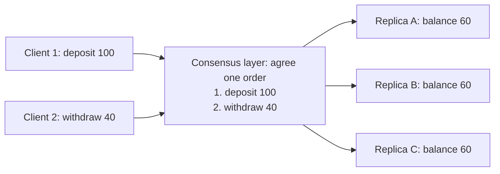
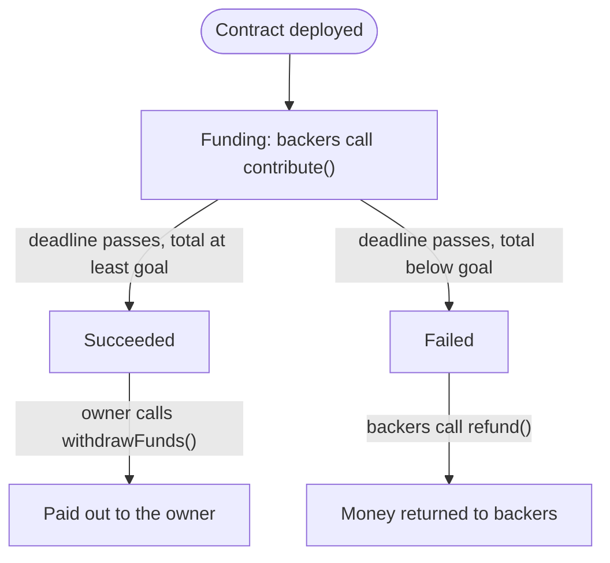
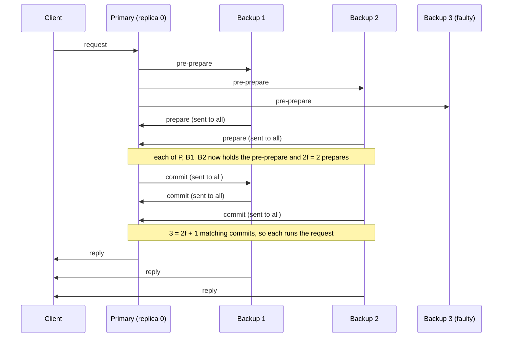
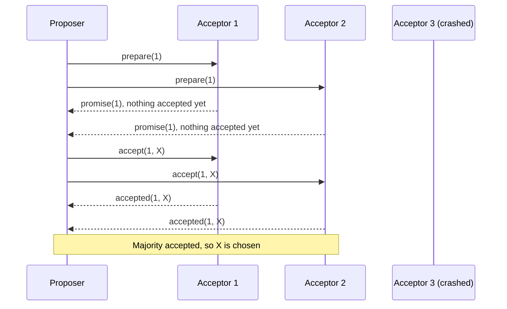
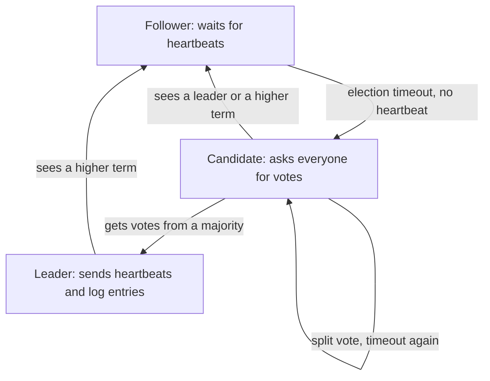
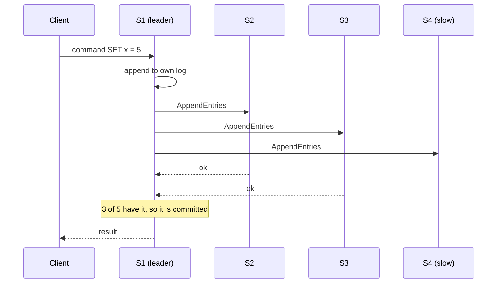

This note covers syllabus <Syl m="4" />, section 4.2: Paxos and Raft consensus, and Byzantine faults with Byzantine Fault Tolerance (BFT) and Practical BFT (PBFT). It also covers the state machine replication questions that the papers tag with this topic. Proof of work and the other public-chain algorithms are in the consensus and mining note, and Hyperledger Fabric itself is in its own note.

## The basics first

- A **node** (also called a **replica** or **server**) is one computer that holds a copy of the data.
- A **fault** is a node not behaving as it should. There are two kinds that matter here:
  - **Crash fault**: the node stops and says nothing more (power cut, software crash). It never lies.
  - **Byzantine fault**: the node can do anything: stop, answer late, or send wrong and different answers to different nodes (a hacked or dishonest node). <Cite id="consensus-mining-wiki-byzantine" /> <Cite id="bft-paxos-raft-wiki-consensus" />
- **Consensus** means all working nodes agree on one value (for a blockchain, the next block or the next transaction in the order). A correct consensus protocol gives three things: **agreement** (all correct nodes decide the same value), **validity** (the value was really proposed by someone) and **termination** (every correct node eventually decides). <Cite id="bft-paxos-raft-wiki-consensus" />
- A **quorum** is the smallest group of nodes whose vote is enough to take a decision. A **majority quorum** is more than half of all nodes. <Cite id="bft-paxos-raft-wiki-quorum" />
- **Overlap rule.** Any two majorities of the same group share at least one node, because together they hold more than the whole group. That shared node remembers the first decision, so the second majority cannot contradict it. Paxos and Raft depend on this. <Cite id="bft-paxos-raft-wiki-quorum" />
- A **state machine** is something that is in one state and moves to another when an input arrives. It is **deterministic** if the same input in the same state always gives the same new state. A bank balance is one: state is the balance, inputs are deposits and withdrawals.

Analogy: five friends decide where to eat by messaging each other. If one friend's phone dies (crash fault), the other four can still decide. If one friend tells two people "pizza" and two others "burger" to cause trouble (Byzantine fault), the group needs a smarter rule.

## Why private blockchains need these algorithms

In a public blockchain such as Bitcoin, anyone can join, so nobody can be trusted and the network needs proof of work, which is slow and uses a lot of energy. <Cite id="blockchain-fundamentals-nakamoto" /> In a **private** or **consortium** blockchain the participants are known and approved (banks, hospitals, a group of companies). Because identities are known, the nodes can simply **vote**. This gives:

- fast blocks and **immediate finality** (once the vote is done, the block is final and is not later undone by a longer chain),
- very little energy use,
- but it works only for a **small, fixed group**, because every vote needs messages between the nodes. <Cite id="consensus-mining-gfg-crypto-consensus" /> <Cite id="bft-paxos-raft-gfg-bft" />

Which algorithm to use depends on whether the members might lie:

| Situation | Fault to survive | Algorithm family | Examples |
|---|---|---|---|
| Members are trusted but servers may crash | Crash | Crash fault tolerant (CFT) | Paxos, Raft |
| Members may be hacked or dishonest | Byzantine | Byzantine fault tolerant (BFT) | PBFT, SmartBFT |
| Anyone can join | Byzantine plus fake identities | Open-network algorithms | PoW, PoS |

Hyperledger Fabric shows both choices: its ordering service offers Raft (crash fault tolerant, "the recommended choice for production networks") and, from version 3.0, a BFT service built on the SmartBFT library. <Cite id="bft-paxos-raft-fabric-orderer" /> <Cite id="blockchain-fundamentals-fabric-docs" />

<PYQ id="2023-12/q6b" />

## State machine replication (SMR)

<Box kind="definition">

**State machine replication** is a way to build a fault-tolerant service: keep several copies (replicas) of the same deterministic state machine on different servers and make all of them process the same client requests in the same order. If one copy fails, the others still hold the same state and carry on. <Cite id="smart-contracts-schneider-1990" /> <Cite id="smart-contracts-wiki-smr" />

</Box>

**Why it is needed.** One server is a single point of failure. Many servers are safe only if they never drift apart, and they drift apart if they see requests in different orders (for example, "deposit 100" then "withdraw 100" is not the same as the reverse when the balance is 0).

**How it works.**

1. Put a copy of the state machine on each of the n servers.
2. A client sends a request (an input) to the service.
3. The servers run a **consensus protocol** (Paxos, Raft or PBFT) to agree on **one order** for the requests. This is the hard step.
4. Every server applies the requests in that order. Because the machine is deterministic, every server reaches the same state.
5. A server (or the client, after comparing replies) returns the result. <Cite id="smart-contracts-schneider-1990" />

<Cite id="smart-contracts-schneider-1990" /> <Cite id="smart-contracts-wiki-smr" />

**Fault limits.** For crash faults, SMR survives f failures with n = 2f + 1 replicas. For Byzantine faults it needs n = 3f + 1. <Cite id="bft-paxos-raft-wiki-paxos" /> <Cite id="consensus-mining-wiki-bft" />

**A blockchain is SMR.** The nodes are the replicas, the ledger plus contract storage is the state, transactions are the inputs, the block order produced by consensus is the agreed order, and the EVM or chaincode is the deterministic transition function. This is why contract code cannot use random numbers or outside data directly.

### A smart contract as a state machine: crowdfunding

A crowdfunding contract has three states: **Funding** (open), **Succeeded** (deadline passed, goal reached) and **Failed** (deadline passed, goal missed). The inputs are transactions such as `contribute()`, `withdrawFunds()` and `refund()`.

<Cite id="smart-contracts-schneider-1990" />

Replication in action: Asha's `contribute(500)` and Ravi's `contribute(300)` reach different nodes at different times. The consensus protocol decides the order (Asha first, then Ravi), every node runs both in that order, and every node shows the total as 800. A node that showed another total would disagree with the rest and its result would be rejected.

<Box kind="exam">

Exam mein English mein likho: "State machine replication keeps identical copies of a deterministic state machine on many nodes and gives them the same inputs in the same order, so they always reach the same state. Consensus fixes the order. In a blockchain, transactions are the inputs and a smart contract is the state machine."

</Box>

<PYQ id="2023-05-ce/q3a" /> <PYQ id="2023-12-ce/q2a" /> <PYQ id="2024-05-ce/q5a" /> <PYQ id="2024-12-ce/q3b" />

## The Byzantine Generals Problem and BFT

Several generals surround a city. They win only if all loyal generals attack together (or all retreat together). They can talk only by messenger, and some generals are traitors who send different messages to different people. Can the loyal generals still agree? <Cite id="bft-paxos-raft-byz-generals" /> <Cite id="consensus-mining-wiki-byzantine" />

Lamport, Shostak and Pease showed that, with ordinary (unsigned) messages, agreement is possible only if **more than two thirds of the generals are loyal**, that is, $n \ge 3f + 1$ for $f$ traitors. <Cite id="bft-paxos-raft-byz-generals" /> <Cite id="consensus-mining-wiki-bft" /> Signed messages can relax this limit, but real systems like PBFT keep $n \ge 3f + 1$ because it also covers the network being slow. <Cite id="bft-paxos-raft-pbft-paper" />

<Box kind="definition">

**Byzantine Fault Tolerance (BFT)** is the ability of a distributed system to keep working and reach the correct agreement even when some of its nodes are faulty or malicious and send arbitrary or conflicting messages. <Cite id="bft-paxos-raft-gfg-bft" /> <Cite id="consensus-mining-wiki-bft" />

</Box>

**Why 3f + 1? A plain argument.** Suppose up to f nodes are faulty and n nodes exist.

1. A node can wait for only $n - f$ replies, because the f faulty nodes may stay silent forever.
2. Among those $n - f$ replies, up to f may be lies. So the honest replies are at least $n - 2f$.
3. The honest replies must outnumber the lies: $n - 2f > f$, which gives $n > 3f$, that is $n \ge 3f + 1$.

**Classical BFT (the simple idea).** Every node sends its value to all others, collects what it hears, and follows the majority. This needs a clear majority of honest nodes, and it needs many rounds and many messages, so it is slow. <Cite id="bft-paxos-raft-gfg-bft" />

<PYQ id="2023-12-ce/q2b" />

## Practical Byzantine Fault Tolerance (PBFT)

<Box kind="definition">

**PBFT** is a BFT consensus algorithm by Miguel Castro and Barbara Liskov (1999). It keeps the $3f + 1$ limit but is fast enough for real use: it replicates a state machine, uses a **primary** to order requests and **backups** to check the primary, and its safety holds even when the network is slow (asynchronous). <Cite id="bft-paxos-raft-pbft-paper" /> <Cite id="bft-paxos-raft-gfg-pbft" />

</Box>

### Roles

- **Client**: sends a request and accepts the answer when enough replicas agree.
- **Primary (leader)**: one replica in each **view** that picks the order of requests and starts each round.
- **Backup (secondary)**: every other replica. A backup accepts the primary's proposal only after checking it, tells the other replicas what it saw, runs the request, replies to the client, and watches the primary. If the primary is faulty or silent, backups start a **view change** to choose a new primary. <Cite id="bft-paxos-raft-gfg-pbft" /> <Cite id="bft-paxos-raft-pbft-paper" />

<PYQ id="2022-12-ce/q1c" />

### The phases

1. **Request**: the client sends its request to the primary.
2. **Pre-prepare**: the primary gives the request a sequence number and sends it to all backups.
3. **Prepare**: each backup that accepts it sends a prepare message to all other replicas. A replica is "prepared" when it has the pre-prepare and matching prepares from $2f$ different backups.
4. **Commit**: each prepared replica sends a commit message to all. A replica commits when it has $2f + 1$ matching commits (including its own).
5. **Reply**: every replica runs the request and sends the result to the client. The client accepts a result when $f + 1$ replicas send the same answer, because at least one of them must be honest. <Cite id="bft-paxos-raft-pbft-paper" /> <Cite id="bft-paxos-raft-gfg-pbft" />

<Cite id="bft-paxos-raft-gfg-pbft" loc="diagram" />

**View change.** If the primary does not make progress before a timer expires, the backups vote to move to the next view, and the next replica in turn becomes primary. So a faulty primary cannot block the system for ever. <Cite id="bft-paxos-raft-gfg-pbft" /> <Cite id="bft-paxos-raft-pbft-paper" />

**Why the extra rounds?** The prepare phase makes sure all honest replicas saw the same order from the primary (a lying primary cannot give different orders to different backups). The commit phase makes sure enough replicas know the others are prepared, so the order survives a view change.

### Advantages and disadvantages

| Advantages | Disadvantages |
|---|---|
| Survives up to f malicious nodes out of 3f + 1 | Every replica talks to every other in each round, so messages grow roughly with the square of n; works best for small groups |
| No mining, so very little energy | Response time rises as nodes are added |
| Final decision: no later fork | The node set must be known and fixed; fake identities (Sybil attack) can break it |
| Fast: no waiting for confirmations | Complex view-change logic |

<Cite id="bft-paxos-raft-gfg-pbft" /> <Cite id="bft-paxos-raft-wiki-consensus" />

### BFT and PBFT compared

| Point | Classical BFT | PBFT |
|---|---|---|
| What it is | The general idea and problem: agreement despite traitors | One practical algorithm that solves it |
| Origin | Byzantine Generals Problem (Lamport, Shostak, Pease, 1982) | Castro and Liskov, 1999 |
| Nodes needed | $n \ge 3f + 1$ | Same, $n \ge 3f + 1$ |
| Network model | Early solutions assume a synchronous network (messages arrive in known time) | Works on an asynchronous network (safe even if messages are slow) |
| Speed | Many rounds of message exchange, impractical | Three message phases, practical for real services |
| Leader | Not fixed by the idea | One primary per view, changed by view change |
| Decision rule | Majority of honest values | $2f + 1$ matching votes; client waits for $f + 1$ replies |
| Use in blockchain | The theory behind all later protocols | Permissioned chains, for example the BFT ordering service in Hyperledger Fabric (SmartBFT) |

<Cite id="bft-paxos-raft-byz-generals" /> <Cite id="bft-paxos-raft-pbft-paper" /> <Cite id="bft-paxos-raft-gfg-pbft" /> <Cite id="bft-paxos-raft-fabric-orderer" />

<PYQ id="2023-12-ce/q2b" />

## Paxos

<Box kind="definition">

**Paxos** is a family of protocols that lets a group of nodes agree on one value even if some nodes crash or messages are lost. It was proposed by Leslie Lamport, who explained it in simple terms in "Paxos Made Simple". Its main promise is **safety**: nodes never agree on two different values. It does not promise that agreement is always reached quickly. <Cite id="bft-paxos-raft-paxos-simple" /> <Cite id="bft-paxos-raft-wiki-paxos" />

</Box>

**Why it is needed.** To keep replicas identical (SMR), the nodes must agree on each next command, even when some servers die. Paxos gives crash-fault-tolerant agreement. It is used for private blockchains and replicated databases where nodes are trusted but may fail. It does not handle liars. <Cite id="bft-paxos-raft-wiki-paxos" />

### Roles

- **Proposer**: suggests a value and tries to get it chosen.
- **Acceptor**: votes on proposals. A value is chosen when a majority of acceptors accept it.
- **Learner**: finds out which value was chosen.

In practice one server plays all three roles. <Cite id="bft-paxos-raft-wiki-paxos" /> <Cite id="bft-paxos-raft-gfg-paxos" />

### How one round of Paxos works

Each proposal has a **number** n that is unique and increasing, so newer proposals can be told from older ones.

1. **Prepare**: the proposer picks a number n and sends *prepare(n)* to a majority of acceptors.
2. **Promise**: an acceptor that has not promised a higher number replies *promise(n)*: it will ignore any proposal numbered below n. It also reports the value it has already accepted (if any) and that proposal's number.
3. **Accept**: if the proposer gets promises from a majority, it sends *accept(n, v)*. The value v must be the already-accepted value with the highest number among the replies; if no acceptor reported one, the proposer may use its own value.
4. **Accepted**: an acceptor accepts *(n, v)* unless it has meanwhile promised a higher number. When a majority has accepted, the value is **chosen**, and learners are told.

If a round fails (another proposer used a higher number), the proposer tries again with a higher number. <Cite id="bft-paxos-raft-paxos-simple" /> <Cite id="bft-paxos-raft-wiki-paxos" />

<Cite id="bft-paxos-raft-wiki-paxos" loc="diagram" />

**Why it is safe.** The majority that accepted X and the majority that later promises to a new proposer overlap in at least one acceptor. That acceptor reports X, so the new proposer must propose X again. A chosen value can therefore never change. <Cite id="bft-paxos-raft-wiki-paxos" /> <Cite id="bft-paxos-raft-paxos-simple" />

**Example for a private blockchain.** Three banks run nodes of a consortium ledger. Bank 1 wants to put "block 7 holds Tx1 and Tx2" on the chain. It acts as proposer, gets promises from banks 1 and 2, and sends accept. Banks 1 and 2 accept, so block 7 is chosen. Bank 3 was offline; when it comes back it learns that block 7 was chosen. If bank 2 had also proposed a different block 7 at the same time with a higher number, the overlap rule forces whoever completes the second round to re-propose the value already accepted, so the banks never end with two different block 7s.

**Multi-Paxos.** A real ledger needs many decisions, one per log slot. Multi-Paxos keeps a stable leader and skips the prepare phase for later slots, which cuts the delay. <Cite id="bft-paxos-raft-wiki-paxos" />

### Advantages and disadvantages

| Advantages | Disadvantages |
|---|---|
| Always safe: no two different values chosen | Hard to understand and to implement correctly, with many variants |
| Works while a majority of nodes is alive | Several message rounds, so slower and heavier |
| Handles lost, late and repeated messages | Not guaranteed to finish (competing proposers can keep restarting) |
| No energy-hungry mining | Crash faults only; a lying node can break it |

<Cite id="bft-paxos-raft-gfg-paxos" /> <Cite id="bft-paxos-raft-wiki-paxos" />

<PYQ id="2022-12-ce/q5a" /> <PYQ id="2024-12-ce/q6c" />

## Raft

<Box kind="definition">

**Raft** is a consensus algorithm for managing a **replicated log**, designed to be equivalent to Paxos in safety but much easier to understand. It splits the problem into three parts: **leader election**, **log replication** and **safety**. It was published by Diego Ongaro and John Ousterhout in 2014. <Cite id="bft-paxos-raft-raft-paper" /> <Cite id="bft-paxos-raft-wiki-raft" />

</Box>

**Why it is needed.** Paxos is correct but hard to teach and build. Raft gives the same crash fault tolerance with one clear rule: *there is one leader at a time, and everything flows through it.* In a private blockchain, the leader plays the part of the block orderer. Fabric's Raft ordering service works exactly this way. <Cite id="bft-paxos-raft-fabric-orderer" />

### Basics

- Every server is in one of three **states**: **follower** (passive, answers the leader and candidates), **candidate** (asking for votes) or **leader** (handles all client requests). <Cite id="bft-paxos-raft-gfg-raft" />
- Time is cut into **terms**, numbered 1, 2, 3... Each term starts with an election. A term has at most one leader, and a server that sees a higher term number always updates and steps down. <Cite id="bft-paxos-raft-raft-paper" loc="§5.2" />
- Each server keeps a **log**: an ordered list of commands, each tagged with the term in which the leader received it.
- Two messages (RPCs): **RequestVote** (used in elections) and **AppendEntries** (used to copy log entries, and as an empty **heartbeat**). <Cite id="bft-paxos-raft-gfg-raft" />

<Cite id="bft-paxos-raft-raft-site" loc="diagram" /> <Cite id="bft-paxos-raft-gfg-raft" />

### Leader election

1. A follower that hears no heartbeat for its **election timeout** assumes the leader is gone. The timeout is random for each server (the paper uses 150 to 300 ms), so usually only one server times out first. <Cite id="bft-paxos-raft-wiki-raft" /> <Cite id="bft-paxos-raft-raft-paper" loc="§5.2" />
2. It becomes a **candidate**, adds 1 to its term, votes for itself and sends **RequestVote** to all others.
3. A server gives **one vote per term**, first come first served. It refuses a candidate whose log is less up to date than its own.
4. Outcomes: the candidate gets a **majority** of the votes and becomes leader and sends heartbeats at once; or it hears from a leader of the same or a higher term and goes back to follower; or **no one wins** (a split vote), the timeouts run out, and a new election starts in a higher term. The random timeouts make repeated splits rare. <Cite id="bft-paxos-raft-wiki-raft" />

### Log replication

1. The client sends a command to the leader. (A follower forwards or redirects it.)
2. The leader **appends** the command to its own log.
3. It sends **AppendEntries** to all followers.
4. Followers append the entry and acknowledge.
5. When the entry is stored on a **majority** of servers (the leader counts itself), it is **committed**. The leader applies it to its state machine and answers the client.
6. Followers learn the commit point from later AppendEntries and apply the entry too. <Cite id="bft-paxos-raft-raft-paper" loc="§5.3" /> <Cite id="bft-paxos-raft-gfg-raft" />

If a follower's log differs from the leader's (for example after a crash), the leader goes back to the last entry they share and overwrites everything after it. The leader's log is always treated as correct. <Cite id="bft-paxos-raft-wiki-raft" />

<Cite id="bft-paxos-raft-raft-site" loc="diagram" />

### Safety

Raft keeps these promises: at most one leader per term; a leader never overwrites or deletes its own log entries; if two logs hold an entry with the same index and term, the logs are identical up to there; a committed entry will be in the log of every future leader; and no two servers apply different commands at the same index. The key rule behind this is the **election restriction**: a server votes only for a candidate whose log is at least as up to date (higher last term, or same last term and longer log). Any majority that committed an entry overlaps any majority that elects a new leader, so the new leader has the entry. <Cite id="bft-paxos-raft-wiki-raft" /> <Cite id="bft-paxos-raft-raft-paper" loc="§5.4" />

### Example: a leader fails

A five-server cluster S1 to S5. S1 is leader in term 3 and has committed "SET x = 5". S1 crashes.

1. S3's random timeout (say 200 ms) ends first. S3 becomes a candidate in term 4 and sends RequestVote.
2. S2, S4 and S5 have the same committed entry, so they vote for S3. S3 has 4 votes (including its own), more than the 3 needed.
3. S3 is leader of term 4 and sends heartbeats. The client's next command goes to S3.
4. When S1 restarts, it sees term 4, becomes a follower and catches up from S3's log.

### Advantages and disadvantages

| Advantages | Disadvantages |
|---|---|
| Easy to understand and implement | Crash faults only: a lying leader or node breaks it |
| Strong consistency; one clear leader | The leader is a bottleneck for all writes |
| Keeps working while a majority is alive | Performance depends on a stable leader and good timeouts |
| Used in real systems (etcd, CockroachDB, Fabric ordering) | Needs a known, small set of nodes |

<Cite id="bft-paxos-raft-gfg-raft" /> <Cite id="bft-paxos-raft-wiki-raft" /> <Cite id="bft-paxos-raft-fabric-orderer" />

<PYQ id="2023-05-ce/q5a" /> <PYQ id="2024-05-ce/q5b" /> <PYQ id="2024-12-ce/q2b" /> <PYQ id="2025-05-ce/q6b" /> <PYQ id="2025-05/q3a" />

## Paxos, Raft and PBFT side by side

| Point | Paxos | Raft | PBFT |
|---|---|---|---|
| Faults survived | Crash | Crash | Byzantine (liars) |
| Nodes for f faults | $2f + 1$ | $2f + 1$ | $3f + 1$ |
| Leader | Not needed in basic Paxos; Multi-Paxos uses one | Strong leader per term | Primary per view |
| Decision rule | Majority of acceptors | Majority stores the entry | $2f + 1$ matching commits |
| Leader change | Higher proposal number | Election with random timeout | View change |
| Ease | Hard to follow | Designed to be easy | Complex |
| Messages | Few in the normal case | Leader to followers, linear in n | All to all, grows as n squared |
| Used for | Replicated databases, lock services | etcd, Fabric ordering service | Permissioned chains needing malicious-node protection |

<Cite id="bft-paxos-raft-wiki-paxos" /> <Cite id="bft-paxos-raft-wiki-raft" /> <Cite id="bft-paxos-raft-gfg-raft" /> <Cite id="bft-paxos-raft-gfg-pbft" /> <Cite id="bft-paxos-raft-fabric-orderer" />

**Conclusion.** Private blockchains replace mining by voting among known nodes. Paxos and Raft give fast agreement when nodes only crash and need $2f + 1$ servers. PBFT gives agreement even when some nodes lie and needs $3f + 1$ servers. Raft is the easier of the first two; PBFT costs more messages.

## Worked sums

### Sum 1: how many faulty nodes can PBFT tolerate?

<Sum>

<Given>

A permissioned blockchain runs PBFT on $n = 10$ nodes.

</Given>

<Find>

the largest number of faulty nodes $f$ it can tolerate, the number of matching votes needed, and the replies a client must wait for.

</Find>

<Steps>

1. BFT needs $n \ge 3f + 1$, so $f \le (n - 1)/3 = 9/3 = 3$. *Reason: rearranging the rule for f.*
2. Largest whole f is $3$. *Reason: f must be a whole number, and 3 fits exactly.*
3. Votes needed to commit: $2f + 1 = 2 \times 3 + 1 = 7$. *Reason: PBFT commits on 2f + 1 matching commits.*
4. Replies the client waits for: $f + 1 = 4$. *Reason: with at most 3 liars, 4 equal replies include at least one honest node.*

</Steps>

<Answer>

$f = 3$ faulty nodes, 7 matching votes to commit, and the client waits for 4 matching replies.

</Answer>

<Box kind="verify">

Check the node count: $3 \times 3 + 1 = 10$, equal to n. Check one more fault: $f = 4$ would need $3 \times 4 + 1 = 13 > 10$ nodes, so 3 is the maximum. Check the overlap of two 7-vote groups out of 10: $7 + 7 - 10 = 4$ nodes in common, and at most 3 of them are faulty, so at least 1 honest node is in both groups.

</Box>

</Sum>

### Sum 2: how many nodes are needed?

<Sum>

<Given>

A consortium wants a BFT network that keeps working with up to $f = 2$ malicious nodes.

</Given>

<Find>

the minimum number of nodes, and show why one fewer node is not enough.

</Find>

<Steps>

1. Minimum nodes: $n = 3f + 1 = 3 \times 2 + 1 = 7$. *Reason: the BFT rule.*
2. Quorum of matching votes: $2f + 1 = 5$. *Reason: PBFT's commit rule.*
3. Try $n = 6$: the best f is $\lfloor (6 - 1)/3 \rfloor = 1$, not 2. *Reason: the rule gives $f \le 5/3$, so 1.*

</Steps>

<Answer>

at least 7 nodes, with a quorum of 5 matching votes.

</Answer>

<Box kind="verify">

Test $n = 6$ with 2 liars: the system waits for $n - f = 4$ replies. Those 4 can hold 2 liars and 2 honest nodes, a 2 against 2 tie, so the honest answer cannot be told apart. With $n = 7$ it waits for 5 replies, which hold at most 2 liars and at least 3 honest nodes, a clear majority.

</Box>

</Sum>

### Sum 3: crash faults in Paxos and Raft

<Sum>

<Given>

Clusters of 5, 6 and 7 servers using Paxos or Raft (crash faults only).

</Given>

<Find>

the majority size and the number of crashed servers each cluster can survive.

</Find>

<Steps>

1. Majority is more than half: $\lfloor n/2 \rfloor + 1$. For 5 servers it is $2 + 1 = 3$, for 6 it is $3 + 1 = 4$, for 7 it is $3 + 1 = 4$. *Reason: a majority must be more than half.*
2. Survivable crashes are $n - \text{majority}$: $5 - 3 = 2$, $6 - 4 = 2$, $7 - 4 = 3$. *Reason: the live servers must still form a majority.*

</Steps>

<Answer>

5 servers: majority 3, survives 2 crashes. 6 servers: majority 4, survives 2 crashes. 7 servers: majority 4, survives 3 crashes.

</Answer>

<Box kind="verify">

Use the formula $f = \lfloor (n - 1)/2 \rfloor$: $n = 5$ gives 2, $n = 6$ gives $\lfloor 2.5 \rfloor = 2$, $n = 7$ gives 3. These match. This also shows a sixth server adds cost but no extra fault tolerance, which is why odd cluster sizes are preferred.

</Box>

</Sum>

### Sum 4: when is a Raft entry committed, and who wins an election?

<Sum>

<Given>

A Raft cluster of 5 servers. (a) The leader S1 appends an entry and sends it out. S2 and S3 acknowledge; S4 and S5 do not. (b) Later the leader crashes, so 4 servers are alive. They vote for candidates in term 5: S2 gets 2 votes in total (its own and S3's) and S4 gets 2 votes in total (its own and S5's).

</Given>

<Find>

(a) whether the entry is committed. (b) whether a leader is elected in term 5.

</Find>

<Steps>

1. Majority of 5 is $\lfloor 5/2 \rfloor + 1 = 3$. *Reason: both questions use a majority of the whole cluster, not of the live servers.*
2. (a) Copies of the entry: S1 (leader), S2 and S3 give $1 + 2 = 3$. *Reason: the leader counts itself.* Since $3 \ge 3$, the entry is committed.
3. (b) S2 has 2 votes and S4 has 2 votes. Both are below 3, so no candidate has a majority. *Reason: a candidate needs 3 votes.*
4. So there is no leader in term 5. The timeouts run out and a new election starts in term 6, with new random timeouts. *Reason: Raft handles a split vote by trying again.*

</Steps>

<Answer>

(a) Yes, the entry is committed (3 of 5 hold it). (b) No leader in term 5 (a 2 to 2 split); a new election is held in term 6.

</Answer>

<Box kind="verify">

For (a), if only S2 had acknowledged, the count would be $1 + 1 = 2 < 3$, so the entry would not be committed; the rule works both ways. For (b), the two vote counts add to 4, the number of live servers, and no server voted twice, which is allowed only once per term. Two candidates cannot both have 3 votes, because $3 + 3 = 6 > 4$ live voters.

</Box>

</Sum>

## Exam tips

- "Explain Paxos / Raft": definition, why needed, roles or states, steps, a labelled diagram, one example, advantages and disadvantages. Mention that both survive crash faults only and need a majority.
- "Compare BFT and PBFT": use the table above. Say clearly that BFT is the problem and general idea, and PBFT is the practical algorithm with primary, backups and three phases.
- "What is a backup in PBFT": any non-primary replica; it validates the primary's proposal, takes part in prepare and commit, replies to the client and triggers a view change if the primary fails.
- "State machine replication": definition, the five steps, the diagram, then link it to a blockchain or the crowdfunding contract.

<Box kind="exam">

Exam mein English mein likho: "Paxos and Raft tolerate crash faults with 2f + 1 nodes using majority voting; PBFT tolerates Byzantine faults with 3f + 1 nodes using pre-prepare, prepare and commit phases."

</Box>
