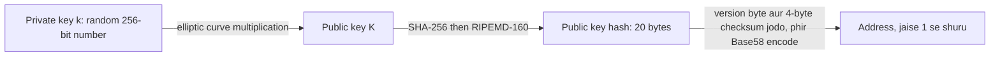
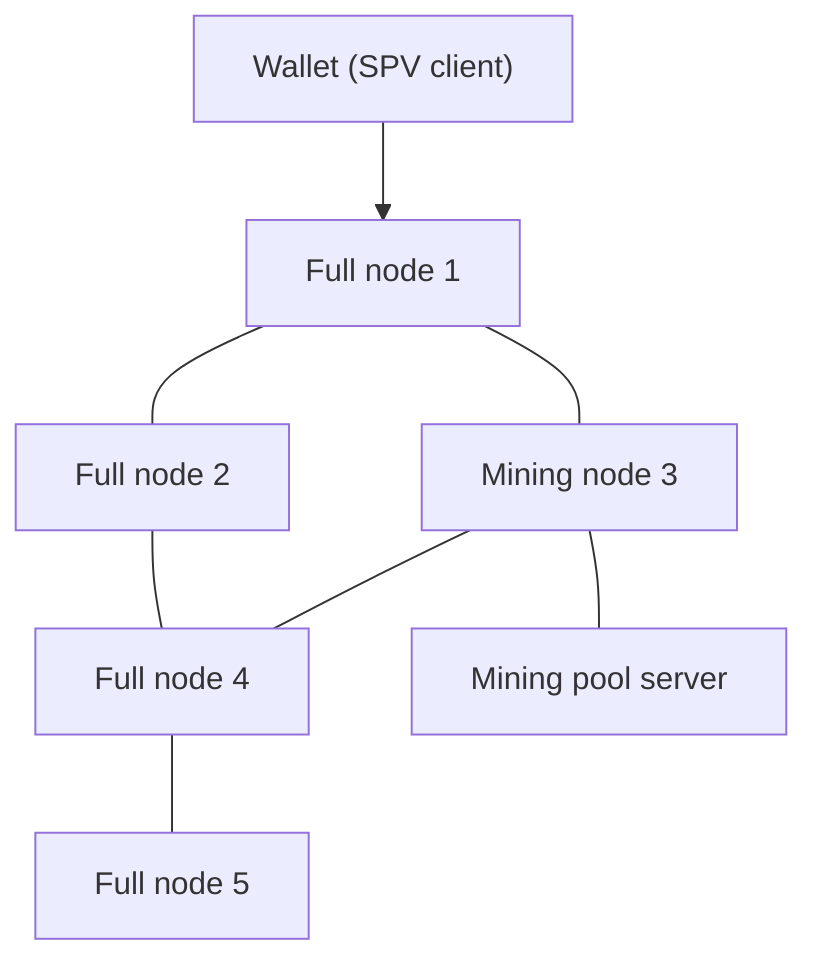
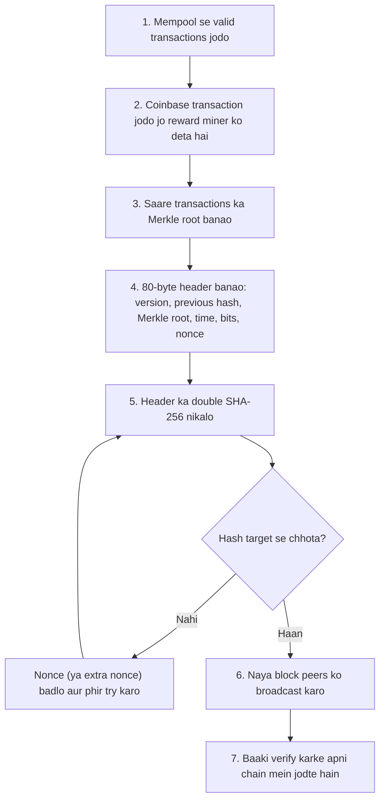
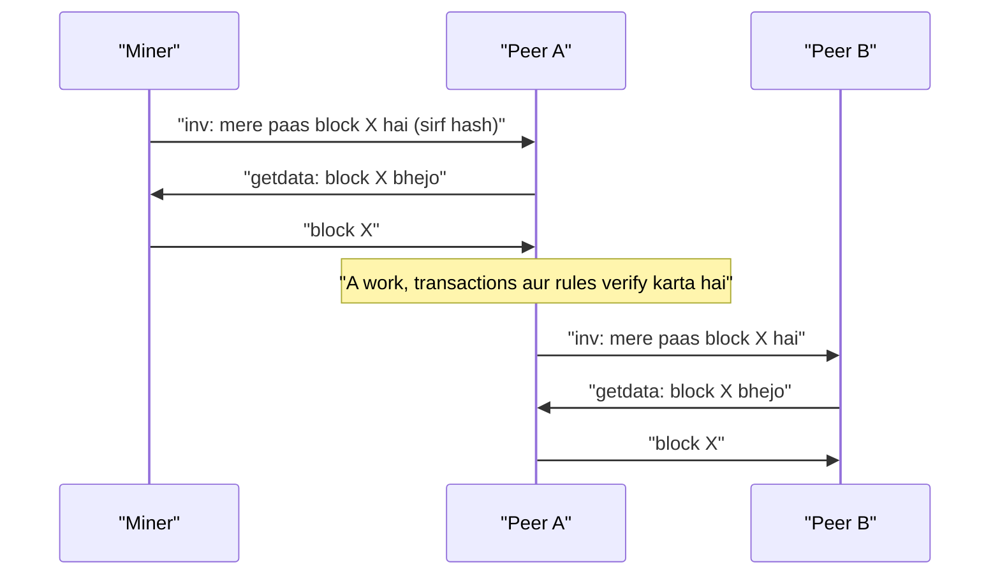
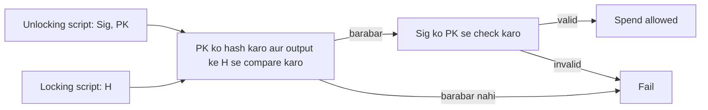
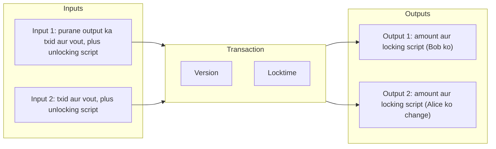
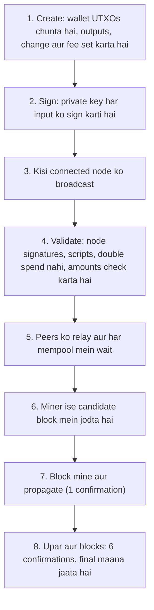
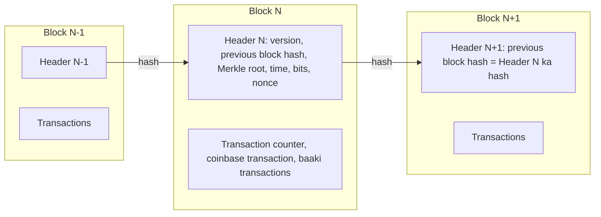

Ye note syllabus <Syl m="2" /> ka section 2.2 cover karta hai: Bitcoin kya hai, uski history, common terms (keys, addresses, nodes), mining, Hashcash, block propagation aur relay, Bitcoin scripts aur transactions. Consensus algorithms (PoW, PoS, pBFT wagairah) ka alag note hai; Merkle tree block-structure note mein hai.

## Pehle basics

- **Ledger** ek record hai ki kiske paas kya hai. **Blockchain** ek ledger hai jo blocks ki chain ki tarah rakha jaata hai, aur kai computers pe copy hota hai.
- **Hash function** kisi bhi input ko fixed-size "fingerprint" bana deta hai. Same input hamesha same hash deta hai; input mein chhota sa change poora alag hash deta hai; aur hash se input wapas nahi nikal sakte. Bitcoin **SHA-256** (256-bit output) aur **RIPEMD-160** (160-bit output) use karta hai. <Cite id="block-structure-merkle-wiki-hash" />
- **Public-key cryptography** mein keys ki jodi hoti hai: private key jo aap secret rakhte ho, aur public key jo share kar sakte ho. Private key se signed cheez ko public key wala koi bhi check kar sakta hai. <Cite id="block-structure-merkle-wiki-pubkey" />
- **Node** woh computer hai jo Bitcoin software chalata hai aur doosre nodes se juda hai.
- **1 bitcoin (BTC) = 100,000,000 satoshis (sat).** Satoshi sabse chhoti unit hai.

Analogy: Bitcoin gaon ki ek notebook jaisa hai jiski copy sabke paas hai. Payment us notebook ki ek line hai. Aapka signature batata hai ki line aapki hai, aur gaon agree karta hai ki agla page kaun sa judega.

## Bitcoin kya hai?

<Box kind="definition">

**Bitcoin** ek decentralized digital currency aur payment network hai. Log seedha ek doosre ko value bhejte hain (peer to peer) aur computers ka network, na ki bank, har payment ko ek shared public ledger (blockchain) mein record aur check karta hai. <Cite id="blockchain-fundamentals-nakamoto" /> <Cite id="bitcoin-wiki-bitcoin" />

</Box>

**Kaunsi problem solve karta hai.** Digital files copy ho jaati hain. Agar paisa sirf ek file hota, to aap use do baar kharch kar sakte the (**double-spending problem**). Bitcoin se pehle ise rokne ke liye trusted bank chahiye tha. Nakamoto ke paper ne bank ki jagah proof of work se surakshit, timestamped blocks ki chain rakh di. <Cite id="blockchain-fundamentals-nakamoto" loc="§1" />

**Key features.**

- Decentralized: koi ek owner ya server nahi.
- Limited supply: kul lagbhag 21 million bitcoins hi kabhi banenge. <Cite id="bitcoin-mb-ch12-mining" />
- Pseudonymous: aap addresses se pehchane jaate ho, naam se nahi (par saare transactions public hain).
- Tamper-resistant: purana block badalna matlab uske aur uske baad ke sab blocks ka kaam dobara karna.
- Open source: koi bhi node chala sakta hai.

**History short mein.**

| Year | Event |
|---|---|
| 1997 to 2002 | Adam Back ka Hashcash: email spam rokne ke liye proof-of-work stamps. <Cite id="bitcoin-wiki-hashcash" /> |
| 2008 (31 Oct) | "Bitcoin: A Peer-to-Peer Electronic Cash System" Satoshi Nakamoto naam se publish hua. <Cite id="blockchain-fundamentals-nakamoto" /> |
| 2009 (3 Jan) | Genesis block (block 0) mine hua; pehla software release hua. <Cite id="block-structure-merkle-btcwiki-genesis" /> |
| 2010 | Pehli real purchase (do pizza ke liye 10,000 BTC). <Cite id="bitcoin-wiki-bitcoin" /> |
| 2012, 2016, 2020, 2024 | Block reward 50 se 25, 12.5, 6.25 aur phir 3.125 BTC hua. <Cite id="bitcoin-mb-ch12-mining" /> |

<Box kind="exam">

Exam mein English mein likho: "Bitcoin is a decentralized peer-to-peer digital currency that uses cryptography and proof of work to let users transact without a trusted third party."

</Box>

Related PYQ: <PYQ id="2023-12/q1b" />.

## Hashcash aur Bitcoin mein uska role

<Box kind="definition">

**Hashcash** Adam Back ka proposed proof-of-work system hai. Sender ko ek number (**nonce**) dhoondhna padta hai taaki message plus nonce ka hash ek required number of zero bits se shuru ho. Dhoondhne mein bahut tries lagte hain; check karne mein sirf ek hash. <Cite id="bitcoin-hashcash-back" /> <Cite id="bitcoin-wiki-hashcash" />

</Box>

**Kyun banaya gaya.** Email spam ko costly banane ke liye. Ek mail bhejne mein normal user ka computer second ka chhota hissa lagata hai, par spammer jo lakhon mail bhejta hai use bahut zyada kharch padta hai.

**Kaise kaam karta hai (simple steps).**

1. Sender recipient, date aur ek counter (nonce) se stamp banata hai.
2. Sender stamp ka hash nikalta hai aur dekhta hai ki hash mein kaafi zero bits aage hain ya nahi (jaise 20).
3. Nahi hain, to counter ek se badhta hai aur step 2 dobara chalta hai. Ye pura trial and error hai.
4. Jab ek chal jaata hai, stamp email ke saath jaata hai. Receiver ek hi hash se confirm kar leta hai.

**Bitcoin mein role.** Bitcoin ki mining blocks pe lagaya gaya Hashcash hi hai. <Cite id="blockchain-fundamentals-nakamoto" loc="§4" />

| Point | Hashcash | Bitcoin mining |
|---|---|---|
| Purpose | Spam rokna | Agla block kaun jodega ye chunna, aur chain secure karna |
| Kya hash hota hai | Stamp (recipient, date, nonce) | 80-byte block header (version, previous hash, Merkle root, time, bits, nonce) |
| Success condition | Hash mein N leading zero bits | Hash (number ki tarah) target se chhota |
| Kaun check karta hai | Mail receiver | Har node, ek hash se |
| Reward | Koi nahi | Naye bitcoins plus fees |

To Hashcash ka role hai **proof of work ka idea** dena: aisa kaam jo karna mushkil, verify karna aasan, aur fake nahi kiya ja sakta. Bitcoin mein ye block banana costly bana deta hai, isliye attacker history ko sasta rewrite nahi kar sakta, aur "one IP, one vote" ki jagah "one CPU, one vote" ho jaata hai. <Cite id="blockchain-fundamentals-nakamoto" loc="§4" /> <Cite id="bitcoin-gfg-pow" />

Related PYQ: <PYQ id="2023-12/q1b" />.

## Keys, addresses aur nodes

### Keys

- **Private key**: ek random 256-bit number. Jo bhi ise jaanta hai wo coins kharch kar sakta hai, isliye ise secret rakhna hai. Bitcoin wallet mein "coins" store nahi hote; wallet keys store karta hai.
- **Public key**: private key se secp256k1 elliptic curve ke ek fixed point ko multiply karke nikalti hai. Private se public tak jaana aasan hai; wapas jaana practically impossible. <Cite id="bitcoin-mb-ch04-keys" loc="Public Key Cryptography" />
- **Digital signature**: private key se banaya proof ki aap ek specific transaction approve karte ho. Public key se koi bhi verify kar sakta hai, aur use kisi doosre transaction pe reuse nahi kiya ja sakta. <Cite id="block-structure-merkle-wiki-digsig" />

### Addresses

**Address** ek chhota, share karne layak identifier hai jahan coins bheje ja sakte hain, account number jaisa. Classic P2PKH address ke liye: <Cite id="bitcoin-mb-ch04-keys" loc="Legacy Addresses for P2PKH" /> <Cite id="bitcoin-btcwiki-address" />



1. Public key $K$ lo.
2. `RIPEMD160(SHA256(K))` nikalo. Ye 20-byte **public key hash** deta hai.
3. Aage version prefix lagao (legacy P2PKH address ke liye 0).
4. Checksum `SHA256(SHA256(prefix + hash))` ke pehle 4 bytes hain. Ise end mein jodo. Ye typing mistakes pakadta hai.
5. **Base58Check** mein encode karo (letters aur digits, confusing wale jaise 0, O, I, l ke bina). <Cite id="bitcoin-mb-ch04-keys" loc="Base58check Encoding" />

Common address styles: legacy P2PKH (1 se shuru), P2SH (3 se shuru) aur Bech32 SegWit (bc1 se shuru). <Cite id="bitcoin-mb-ch04-keys" />

**Public key ko hash kyun karte hain?** Address chhota ho jaata hai aur coins kharch hone tak public key chhupi rehti hai.

### Nodes

**Node** Bitcoin peer-to-peer network ka ek computer hai. Saare full nodes barabar peers hain; koi central server nahi. <Cite id="bitcoin-mb-ch10-network" loc="Node Types and Roles" /> <Cite id="bitcoin-devguide-p2p" />

| Node type | Kya karta hai |
|---|---|
| Full node | Har block aur transaction ko rules ke against download aur check karta hai, aur relay karta hai. Kisi pe trust nahi chahiye. |
| Archival full node | Full node jo poori block history rakhta hai; pruned node sirf recent blocks rakhta hai. |
| Mining node | Transactions jodta hai aur agla block dhoondhne ke liye compete karta hai (full node ho sakta hai ya pool se juda). |
| Lightweight (SPV) client | Sirf block headers rakhta hai aur apne transactions ke proofs full nodes se maangta hai. Phone wallets mein use hota hai. |



Naya node peers dhoondhne ke liye **DNS seeds** (known nodes ki lists) se poochta hai, phir unse aur peers seekhta hai. <Cite id="bitcoin-mb-ch10-network" loc="Network Discovery" />

## Bitcoin mining

<Box kind="definition">

**Mining** wo process hai jisme nodes (miners) pending transactions ko candidate block mein jodte hain aur uske header ko, badalte nonce ke saath, baar baar hash karte hain jab tak hash network ke target se chhota na ho. Jeetne wala block chain mein jodta hai aur **block reward** plus **transaction fees** kamata hai. <Cite id="bitcoin-mb-ch12-mining" /> <Cite id="bitcoin-btcwiki-mining" />

</Box>

Mining ke do kaam hain: ye **naye bitcoins banata hai** ek fair, rules-wale tareeke se aur **ledger ko secure karta hai** kyunki history rewrite karna bahut costly ho jaata hai.

### Mining ke steps (miner ki life)



1. **Transactions jodo.** Miner apne mempool se valid transactions chunta hai, aam taur pe jinki fee per byte sabse zyada ho.
2. **Coinbase transaction.** Block ka pehla transaction naye coins banata hai aur reward plus fees miner ke apne address ko deta hai.
3. **Merkle root.** Saare transactions pairwise hash hoke tree banate hain; top ka ek hash header mein jaata hai. <Cite id="block-structure-merkle-lmab-merkle" />
4. **Header.** Chhe fields bharo. Nonce sirf 32 bits ka hai (lagbhag 4.3 billion values), isliye fast miners ke paas values khatam ho jaati hain; tab wo coinbase transaction ka extra nonce badalte hain, jisse Merkle root badalta hai aur nonces ka poora naya set milta hai. <Cite id="bitcoin-mb-ch12-mining" loc="The Extra Nonce Solution" />
5. **Hash aur compare.** Header pe SHA-256 do baar chalao. Agar number target se chhota nahi hai, nonce badlo aur repeat karo. Ye lottery hai: har try ka chance same aur bahut chhota hai.
6. **Broadcast.** Winner block peers ko bhejta hai.
7. **Verify aur extend.** Har node work, transactions aur rules check karta hai, phir uske upar agla block banata hai.

### Mining difficulty

**Target** ek 256-bit number hai; valid block hash isse chhota hona chahiye. Chhota target matlab kam valid hashes, yaani zyada mushkil. **Difficulty** current target ko sabse aasan possible target (difficulty 1) se compare karti hai:

$$
\text{difficulty} = \frac{\text{difficulty-1 target}}{\text{current target}}
$$

<Cite id="bitcoin-btcwiki-difficulty" />

Total hash power chahe kuch bhi ho, har 10 minute mein ek block rakhne ke liye har **2016 blocks** (10 minute ke hisaab se lagbhag 2 hafte) pe network un 2016 blocks ke real time se target dobara calculate karta hai. Agar wo 14 din se jaldi bane, target girta hai (mushkil); dheere bane to target badhta hai (aasan). Ek baar mein change 4 ke factor tak limited hai. <Cite id="bitcoin-mb-ch12-mining" loc="Mining the Block" />

### Block reward aur halving

Reward 50 BTC se shuru hua aur **har 210,000 blocks (lagbhag 4 saal) pe aadha** hota hai. Lagbhag 32 halvings ke baad subsidy zero ho jaati hai, aur miners fees pe chalte hain. Isi wajah se kul supply lagbhag 21 million BTC pe capped hai. <Cite id="bitcoin-mb-ch12-mining" loc="Bitcoin Economics and Currency Creation" /> <Cite id="bitcoin-btcwiki-halving" />

$$
\text{reward} = \frac{50}{2^{h}} \text{ BTC}, \qquad h = \left\lfloor \frac{\text{block height}}{210{,}000} \right\rfloor
$$

Yahan $h$ ab tak hue halvings ki sankhya hai aur $\lfloor\ \rfloor$ ka matlab "neeche round karo".

<Sum>

<Given>

Height 700,000 pe ek block mine hota hai. Block ki fees ka total 0.5 BTC hai. Reward 50 BTC se shuru hua aur har 210,000 blocks pe aadha hota hai.

</Given>

<Find>

is block se miner ki total income, aur block 839,999 wale era ke ant tak minted total coins.

</Find>

<Steps>

1. **Halvings ki sankhya.** $700{,}000 / 210{,}000 = 3.33$, neeche round karke $h = 3$. *Reason: reward har poore 210,000 blocks ke baad hi badalta hai.*
2. **Subsidy.** $50 / 2^3 = 50 / 8 = 6.25$ BTC. *Reason: teen halvings matlab teen baar 2 se divide.*
3. **Income.** Subsidy plus fees: $6.25 + 0.5 = 6.75$ BTC.
4. **Har era ke coins.** Har era mein 210,000 blocks hain. Era 0 se 3 per block 50, 25, 12.5 aur 6.25 BTC dete hain.
5. **Total.** $210{,}000 \times (50 + 25 + 12.5 + 6.25) = 210{,}000 \times 93.75 = 19{,}687{,}500$ BTC. *Reason: chaaron eras ke per-block rewards jodo aur ek era ke blocks se multiply karo.*

</Steps>

<Answer>

miner income $= 6.75$ BTC; block 839,999 tak lagbhag $19{,}687{,}500$ BTC minted (real number thoda kam hai kyunki kuch rewards kabhi claim nahi hue).

</Answer>

<Box kind="verify">

Height check: era 3 blocks $630{,}000$ se $839{,}999$ tak hai ($3 \times 210{,}000 = 630{,}000$), aur 700,000 uske andar hai, isliye reward era-3 value 6.25 hai. Supply check: series ki limit $210{,}000 \times 100 = 21{,}000{,}000$ hai (kyunki $50 + 25 + \dots = 100$), aur $19{,}687{,}500$ usse neeche hai. Aane wale coins $21{,}000{,}000 - 19{,}687{,}500 = 1{,}312{,}500$ hain, aur ye $210{,}000 \times 6.25$ ke barabar hai, jo era 4 se aage ke saare halved rewards ka total hai (series $3.125 + 1.5625 + \dots = 6.25$ per block-slot). Dono match karte hain.

</Box>

</Sum>

### Ek miner ko kitne attempts chahiye?

Har hash try ek lottery ticket jaisa hai jisme jeetne ka bahut chhota chance $p$ hai. Expected tries $1/p$ hote hain. Difficulty $D$ ke saath, har try ka chance lagbhag $1/(D \times 2^{32})$ hai, isliye

$$
\text{expected hashes} \approx D \times 2^{32}
$$

Factor $2^{32} \approx 4.29$ billion isliye aata hai kyunki difficulty-1 target lagbhag $2^{224}$ hai, $2^{256}$ possible hash values mein se. <Cite id="bitcoin-btcwiki-difficulty" />

<Sum>

<Given>

Toy case: hash valid hai agar wo 4 zero hex digits (16 zero bits) se shuru ho. Ek chhota miner 2,000 hashes per second karta hai.

Real case: network difficulty $D = 8 \times 10^{13}$ aur target ek block per 600 seconds.

</Given>

<Find>

(a) toy case mein expected tries aur time; (b) real case ke liye zaroori network hash rate.

</Find>

<Steps>

1. **Toy chance.** Har hex digit 0 hone ka chance $1/16$ hai, to chaar digits ka $p = 1/16^4 = 1/65{,}536$. *Reason: digits independent hain.*
2. **Toy tries.** Expected tries $= 1/p = 65{,}536$.
3. **Toy time.** $65{,}536 / 2{,}000 = 32.8$ seconds.
4. **Real tries.** $8 \times 10^{13} \times 4.295 \times 10^{9} \approx 3.436 \times 10^{23}$ hashes per block.
5. **Real hash rate.** Block time se divide karo: $3.436 \times 10^{23} / 600 \approx 5.73 \times 10^{20}$ hashes per second, yaani lagbhag 573 exahashes per second (EH/s).

</Steps>

<Answer>

(a) $65{,}536$ tries, lagbhag $32.8$ s. (b) lagbhag $5.7 \times 10^{20}$ H/s.

</Answer>

<Box kind="verify">

Toy: $65{,}536 = 2^{16}$, jo 16 zero bits se match karta hai (har bit chance ko aadha karta hai). Real: wapas multiply karo, $5.73 \times 10^{20} \times 600 = 3.44 \times 10^{23}$, jo per block tries ke barabar hai. $2^{32}$ factor approximate hai (exact difficulty-1 target $2^{224}$ se thoda neeche hai), isliye real answer lagbhag 0.002 percent tak sahi hai.

</Box>

</Sum>

<Sum>

<Given>

Pichle 2016 blocks 12 din mein bane. Expected time $2016 \times 10$ minutes $= 14$ din hai. Purani difficulty $8 \times 10^{13}$ hai.

</Given>

<Find>

nayi difficulty.

</Find>

<Steps>

1. **Ratio.** Expected time bata actual time: $14 / 12 = 1.1667$. *Reason: blocks bahut jaldi bane, isliye puzzle usi ratio se mushkil hona chahiye.*
2. **Limit.** Ratio $1/4$ aur $4$ ke beech hai, isliye allowed hai.
3. **Nayi difficulty.** $8 \times 10^{13} \times 1.1667 \approx 9.33 \times 10^{13}$.

</Steps>

<Answer>

nayi difficulty $\approx 9.33 \times 10^{13}$ (lagbhag 17 percent zyada).

</Answer>

<Box kind="verify">

Same hash power ke saath, ab ek block ko $1.1667$ guna zyada tries chahiye, to 12 din $12 \times 1.1667 = 14$ din ban jaate hain, yaani intended period.

</Box>

</Sum>

### Mining pools

Solo mining ek lottery hai jo chhota miner shayad kabhi na jeete. **Mining pool** mein bahut se miners saath kaam karte hain; pool server kaam baantta hai, aur reward har miner ke dikhaye gaye kaam ke hisaab se baanta jaata hai. Income steady ho jaati hai par share chhota hota hai. <Cite id="bitcoin-mb-ch12-mining" /> <Cite id="bitcoin-tp-bitcoin-mining" />

| Method | Pool kaise pay karta hai |
|---|---|
| Pay-per-share (PPS) | Har valid share (partial proof of work) ke liye fixed payment, chahe pool block dhoondhe ya nahi. Luck ka risk pool uthata hai. |
| Proportional | Jab pool block dhoondhta hai, reward us round mein har member ke bheje shares ke hisaab se baanta jaata hai. |
| Pay-per-last-N-shares (PPLNS) | Reward last N shares mein baanta jaata hai, jo pools ke beech hopping rokta hai. |

Pros: steady income, kam variance. Cons: agar kuch pools ke paas zyada hash power ho to decentralization kam; pool operator pe trust. Hardware CPUs se GPUs se ASICs (sirf SHA-256 ke liye bani chips) tak gaya, jisme bijli bhi bahut lagti hai. <Cite id="bitcoin-tp-bitcoin-mining" />

Related PYQ: <PYQ id="2023-12/q2b" />.

## Bitcoin mein consensus

Consensus ka matlab hai saare nodes bina leader ke ledger ke ek hi version pe agree karein. Bitcoin ke version ko **Nakamoto consensus** kehte hain. <Cite id="bitcoin-mb-ch12-mining" loc="Decentralized Consensus" />

1. Har full node har transaction aur block ko rules ke against **khud independently verify** karta hai.
2. Miners agla block propose karne ke liye **proof of work se compete** karte hain.
3. Nodes us valid chain ko follow karte hain jisme **sabse zyada accumulated work** ho (aam taur pe ise longest chain kehte hain). <Cite id="blockchain-fundamentals-nakamoto" loc="§5" />
4. Agar do miners lagbhag ek saath block dhoondhte hain, chain thodi der ke liye fork ho jaati hai. Fork tab khatam hota hai jab agla block ek branch pe aata hai; doosri branch **orphan** (stale) block ban jaati hai aur uske transactions mempool mein wapas aate hain. <Cite id="block-structure-merkle-btcwiki-orphan" />
5. Jo block zyada blocks ke neeche dab jaata hai use replace karna exponentially mushkil ho jaata hai. Lagbhag 6 confirmations ke baad payment final maana jaata hai.

Security assumption: honest miners ke paas majority hash power hai. 50 percent se zyada wala attacker recent payments reverse kar sakta hai (**51 percent attack**) par doosron ke coins unki private keys ke bina chura nahi sakta. <Cite id="blockchain-fundamentals-nakamoto" loc="§11" />

PoS, PoA, pBFT jaise doosre consensus ideas ke liye consensus note dekho.

Related PYQ: <PYQ id="2023-12-ce/q6a" />.

## Block propagation aur relay

Jab miner ko block mil jaata hai, speed matter karti hai: jitni jaldi doosron ko milega, utna kam kaam stale blocks pe waste hoga.



1. Miner apne peers ko block hash ke saath ek **inv** (inventory) message bhejta hai. <Cite id="bitcoin-mb-ch10-network" loc="Exchanging Inventory" />
2. Jis peer ke paas nahi hai wo **getdata** se maangta hai.
3. Block bheja jaata hai. Peer use pehle **poori tarah validate** karta hai (proof of work, har transaction, size limits) aur tabhi forward karta hai. Invalid blocks drop ho jaate hain aur sender ban ho sakta hai.
4. Har peer apne peers ke saath ye repeat karta hai, to block kuch seconds mein lagbhag poore network tak pahunch jaata hai.
5. Jo peer peeche hai wo chhoote blocks download karne ke liye **getblocks**/**getheaders** use karta hai (initial sync). <Cite id="bitcoin-devguide-p2p" />

Speed-ups: **compact block relay** sirf block headers aur chhote transaction IDs bhejta hai, kyunki zyadatar nodes ke mempool mein transactions pehle se hote hain; **relay networks** miners ko seedha jodte hain. <Cite id="bitcoin-mb-ch10-network" loc="Compact Block Relay" />

Transactions bhi block mein aane se pehle isi tarah relay hote hain (inv, getdata, tx).

## Bitcoin Script

<Box kind="definition">

**Bitcoin Script** ek chhoti, stack-based programming language hai jo coins ko lock aur unlock karne ke liye use hoti hai. Har output mein ek **locking script** (scriptPubKey, spending condition) hoti hai aur har input mein ek **unlocking script** (scriptSig, ya witness data, jo use satisfy karta hai). <Cite id="bitcoin-mb-ch07-scripts" loc="Transaction Scripts and Script Language" /> <Cite id="bitcoin-btcwiki-script" />

</Box>

**Features.**

- **Stack-based**: values stack pe push hoti hain; operators (opcodes) values pop karke results push karte hain. Ye left to right padhi jaati hai.
- **Turing complete nahi**: loops nahi hain, isliye script hamesha khatam hoti hai aur network ko hang nahi kar sakti. Ethereum se contrast.
- **Stateless aur deterministic**: script sirf transaction dekhti hai; result har node pe same hota hai.
- Spend valid hai agar unlocking script phir locking script chalane ke baad stack ka top true (non-zero) ho.

Common opcodes:

| Opcode | Kya karta hai |
|---|---|
| `OP_DUP` | Top item ki copy banata hai |
| `OP_HASH160` | Top item ko RIPEMD160(SHA256(item)) se replace karta hai |
| `OP_EQUAL` / `OP_EQUALVERIFY` | Do items compare karta hai; VERIFY form agar alag hon to script failure ke saath rok deta hai |
| `OP_CHECKSIG` | Signature ko public key ke against is transaction ke liye check karta hai |
| `OP_CHECKMULTISIG` | m-of-n signatures check karta hai (multisig) |
| `OP_RETURN` | Output ko unspendable data ki tarah mark karta hai (chain pe chhota data rakhne ke liye) |

Standard script types: P2PK (pay to public key), **P2PKH** (pay to public key hash), P2SH (pay to script hash, multisig ke liye), P2WPKH/P2WSH (SegWit) aur P2TR (Taproot). <Cite id="bitcoin-mb-ch07-scripts" />

### Pay to Public Key Hash (P2PKH)

Alice Bob ko pay karna chahti hai. Wo coins ko **Bob ki public key ke hash** se lock karti hai (jo Bob ke address se milta hai). Kharch karne ke liye Bob ko apni public key dikhani hoti hai (jo us hash se match kare) aur apni private key se bana signature. <Cite id="bitcoin-lmab-p2pkh" /> <Cite id="bitcoin-og-p2pkh" />

- **Locking script (scriptPubKey)** jo Alice ke output mein jaati hai:

```text
OP_DUP OP_HASH160 <BobPubKeyHash> OP_EQUALVERIFY OP_CHECKSIG
```

- **Unlocking script (scriptSig)** jo Bob use kharch karne wale input mein daalta hai:

```text
<BobSignature> <BobPublicKey>
```

Bob ki unlocking script pehle chalti hai, phir locking script, ek hi stack pe. Yahan `Sig` Bob ka signature, `PK` uski public key, aur `H` stored hash hai.

| Step | Operation | Stack ke baad (top right mein) |
|---|---|---|
| 1 | `Sig` push | `Sig` |
| 2 | `PK` push | `Sig PK` |
| 3 | `OP_DUP` `PK` copy karta hai | `Sig PK PK` |
| 4 | `OP_HASH160` top copy ko hash karta hai | `Sig PK hash(PK)` |
| 5 | Locking script se `H` push | `Sig PK hash(PK) H` |
| 6 | `OP_EQUALVERIFY` dono hashes compare karta hai; barabar ho to dono hata deta hai, warna fail | `Sig PK` |
| 7 | `OP_CHECKSIG` `Sig` ko `PK` ke against is transaction ke liye check karta hai | `TRUE` |

Final top TRUE hai, isliye spend valid hai.

<Box kind="verify">

Naamon ke saath walk-through: Alice Bob ke address pe 1 BTC bhejti hai. Bob ka wallet address ko 20-byte hash $H$ mein decode karta hai aur Alice ke output ko upar wali script milti hai. Baad mein Bob ek naya transaction sign karta hai jo us output ko kharch karta hai. Step 6 pe node check karta hai $\text{hash}(PK) = H$. Agar Eve apni public key $PK_E$ de, to yahin fail ho jaata hai, kyunki $\text{hash}(PK_E) \ne H$. Agar Eve Bob ki $PK$ copy kare par uski key nahi, to step 7 fail hota hai kyunki wo matching signature nahi bana sakti. Sirf Bob dono checks pass karta hai.

</Box>



**P2PKH achha kyun hai:** public key kharch hone tak hash ke peeche chhupi rehti hai, address chhota hai, aur sirf key owner kharch kar sakta hai. Pay to Script Hash (P2SH) aise hi kaam karta hai par poori script ko hash karta hai, aur multisig addresses aise hi bante hain.

Related PYQ: <PYQ id="2025-05/q1b" />.

## Bitcoin mein transactions

Bitcoin transaction ye **nahi** kehta ki "Alice ke account se Bob ke account mein 1 BTC bhejo". Bitcoin mein accounts nahi hote. Transaction **purane outputs kharch karta hai aur naye outputs banata hai**. Jo output abhi tak kharch nahi hua use **UTXO** (unspent transaction output) kehte hain. Aapka balance un UTXOs ka sum hai jinhe aapki keys unlock kar sakti hain. <Cite id="bitcoin-mb-ch06-transactions" /> <Cite id="bitcoin-btcwiki-transaction" />

### Transaction ka structure

| Field | Matlab |
|---|---|
| Version | Kaunse transaction rules lagu hain |
| Input count aur inputs | Har input `txid` aur output number (`vout`) se ek purane output ko point karta hai aur unlocking script (aur sequence number) rakhta hai |
| Output count aur outputs | Har output mein ek **amount** (satoshis mein) aur ek **locking script** hoti hai |
| Witness (SegWit) | Signatures alag section mein rakhe jaate hain |
| Locktime | Sabse jaldi kab (time ya block) transaction mine ho sakta hai (0 = kabhi bhi) |



**Key rules.**

- Har input ko ek unspent output ki taraf point karna hota hai aur uski script satisfy karni hoti hai, aur ek output sirf ek baar kharch ho sakta hai. Yahi double spending rokta hai.
- Poora output ek saath kharch hota hai. Kam pay karna ho to apne aap ko ek **change output** wapas jodo.
- **Fee** koi field nahi hai. Wo bacha hua hissa hai: $\text{fee} = \text{sum of inputs} - \text{sum of outputs}$. Miners ise lete hain. <Cite id="bitcoin-mb-ch06-transactions" loc="Outputs" />
- Har block ka pehla transaction **coinbase transaction** hai: usme asli input nahi hota aur wo block reward banata hai. <Cite id="bitcoin-mb-ch06-transactions" loc="Coinbase Transactions" />

<Sum>

<Given>

Alice ke paas do UTXOs hain: 0.5 BTC aur 0.3 BTC. Wo Bob ko 0.6 BTC dena chahti hai aur 0.0001 BTC fee chhodna chahti hai. Transaction 250 virtual bytes (vB) lamba hai.

</Given>

<Find>

change output, aur fee rate satoshis per vB mein.

</Find>

<Steps>

1. **Inputs.** Dono UTXOs kharch karo: $0.5 + 0.3 = 0.8$ BTC. *Reason: sirf 0.5 se 0.6 nahi ho sakta, aur output poora kharch hota hai.*
2. **Change.** $\text{change} = \text{inputs} - \text{payment} - \text{fee} = 0.8 - 0.6 - 0.0001 = 0.1999$ BTC, Alice ke address pe wapas.
3. **Outputs.** $0.6 + 0.1999 = 0.7999$ BTC.
4. **Fee check.** $0.8 - 0.7999 = 0.0001$ BTC $= 10{,}000$ satoshis.
5. **Fee rate.** $10{,}000 / 250 = 40$ sat/vB. *Reason: miners total fee se nahi, fee per size se rank karte hain.*

</Steps>

<Answer>

change $= 0.1999$ BTC; fee $= 0.0001$ BTC $= 10{,}000$ sat, rate $40$ sat/vB.

</Answer>

<Box kind="verify">

Inputs outputs plus fee ke barabar hain: $0.8 = 0.6 + 0.1999 + 0.0001$. Agar outputs $0.6 + 0.2 = 0.8$ hote, to fee 0 hoti aur miners transaction ko shayad ignore kar dete; agar outputs inputs se zyada hote, to transaction invalid hota.

</Box>

</Sum>

### Transaction life cycle



1. **Creation.** Alice ka wallet kharch karne ke liye UTXOs chunta hai, outputs likhta hai (Bob ka payment aur uska change) aur fee set karta hai.
2. **Signing.** Har input ke liye wallet us private key se sign karta hai jo us UTXO ko unlock karti hai. Signature transaction data cover karta hai, isliye baad mein amount badalne se wo toot jaata hai.
3. **Broadcast.** Wallet ise ek ya zyada nodes ko bhejta hai.
4. **Validation.** Har node check karta hai: sahi format, inputs exist karte hain aur unspent hain, scripts true tak chalti hain, inputs outputs se kam nahi, aur transaction pehle se mempool mein nahi hai. <Cite id="bitcoin-mb-ch12-mining" loc="Independent Verification of Transactions" />
5. **Propagation aur mempool.** Valid transactions peers ko forward hote hain aur **mempool** (unconfirmed transactions ka waiting room) mein rakhe jaate hain. <Cite id="bitcoin-mb-ch10-network" loc="Mempools and Orphan Pools" />
6. **Mining.** Miners transactions chunte hain, aam taur pe sabse zyada fee rate wale, aur block mein jodte hain.
7. **Confirmation.** Jab wo block accept hota hai, transaction ke 1 confirmation hote hain. Har agla block ek aur jodta hai. Coinbase rewards ko kharch karne se pehle 100 confirmations chahiye. <Cite id="bitcoin-mb-ch12-mining" />
8. **Finality.** Lagbhag 6 confirmations (lagbhag ek ghanta) ke baad reversal practically impossible ho jaata hai. <Cite id="bitcoin-og-tx-lifecycle" />

Related PYQ: <PYQ id="2023-12-ce/q5a" />.

## Bitcoin block ka structure

Block mein chhota **header** (80 bytes) aur transactions ki lambi body hoti hai. <Cite id="block-structure-merkle-btcwiki-block" /> <Cite id="block-structure-merkle-devref" /> <Cite id="block-structure-merkle-mb-ch11" />



| Header field | Size | Matlab |
|---|---|---|
| Version | 4 bytes | Kaunse block rules lagu hain |
| Previous block hash | 32 bytes | Pichle block ke header ka hash; yahi chain ko jodta hai |
| Merkle root | 32 bytes | Block ke saare transactions ke tree ke top ka hash |
| Timestamp | 4 bytes | Block lagbhag kab mine hua |
| Bits | 4 bytes | Target compact form mein (difficulty) |
| Nonce | 4 bytes | Wo number jo miners valid hash dhoondhne ke liye badalte hain |

Body mein **transaction counter** aur transactions ki list hoti hai, coinbase sabse pehle. **Block hash** sirf header ka double SHA-256 hai; uski apni koi field nahi hoti aur use aage ke zeros se pehchana jaata hai. **Block height** block ki genesis block se doori hai (genesis = height 0). Merkle root har transaction ko commit karta hai, to koi ek transaction badalne se root, header hash badal jaata hai aur aage ke saare links toot jaate hain. Block weight 4 million weight units tak limited hai (practice mein lagbhag 1 se 2 MB data). <Cite id="block-structure-merkle-lmab-block" />

Related PYQ: <PYQ id="2025-05/q3b" />.

## Bitcoin mein cryptography

Bitcoin cryptography ke teen ideas use karta hai, aur data ki koi encryption nahi (chain pe sab kuch public hai). <Cite id="bitcoin-mb-ch04-keys" />

| Tool | Bitcoin mein kahan | Kya milta hai |
|---|---|---|
| Hash functions (SHA-256, RIPEMD-160) | Block hash, proof of work, Merkle tree, address creation | Integrity, tamper-evident chain, fair puzzle |
| Digital signatures (secp256k1 curve pe ECDSA aur Schnorr) | Har transaction input ko sign karna | Authentication (sirf owner kharch kare), transaction ki integrity, non-repudiation |
| Public-key pair (elliptic curve) | Wallet keys aur addresses | Secret share kiye bina ownership |
| Merkle tree | Header mein saare transactions ka summary | Transaction block mein hai ye jaldi prove karna (SPV) |

Pitfall: hashing encryption nahi hai. Hash se kuch chhupta nahi; wo sirf data ka fingerprint hai, aur transaction data sabke liye padhne layak rehta hai.

Related PYQ: <PYQ id="2023-12-ce/q6c" />.

## Bitcoin versus Ethereum

| Point | Bitcoin | Ethereum |
|---|---|---|
| Main purpose | Digital money, store of value | General platform: smart contracts aur decentralized apps |
| Founder aur year | Satoshi Nakamoto, 2009 | Vitalik Buterin aur doosre, 2013 mein propose, 2015 mein live |
| Currency | BTC | Ether (ETH) |
| Record model | UTXO (unspent outputs) | Account balances aur contract storage |
| Programmability | Limited, non-Turing-complete Script | EVM pe Turing-complete code, Solidity mein likha |
| Consensus | Proof of work | Proof of stake, September 2022 (The Merge) se |
| Hash algorithm | SHA-256 | Keccak-256 |
| Block time | Lagbhag 10 minutes | Lagbhag 12 seconds |
| Fees | Size (bytes) ke hisaab se fee | Gas used times gas price |
| Supply | Lagbhag 21 million pe capped | Koi fixed cap nahi |

<Cite id="bitcoin-gfg-bitcoin-vs-ethereum" /> <Cite id="bitcoin-educative-bitcoin-vs-ethereum" /> Table ka Ethereum wala hissa Ethereum note mein aur detail mein hai.

Related PYQs: <PYQ id="2024-05-ce/q1e" /> aur <PYQ id="2024-12-ce/q1b" />.

## Bitcoin ke advantages aur limitations

| Advantages | Limitations |
|---|---|
| Bank ya middleman nahi, poori duniya mein kaam karta hai | Slow: lagbhag 7 transactions per second aur 10 minute per block |
| Tamper karna bahut mushkil | Proof of work mein bahut bijli lagti hai |
| Kisi ke liye bhi open, transparent ledger | Price bahut volatile; private key kho gayi to coins kho gaye |
| Limited supply, predictable issuance | Transactions reverse nahi hote; network busy ho to fees badhti hain |
| Bade hash rate se strong security | Script limited hai, isliye complex contracts mushkil |

## Conclusion

Bitcoin chaar ideas jodta hai: ownership ke liye public-key cryptography, payments ke liye UTXO transaction model, spending rules ke liye stack-based script, aur agreement ke liye Hashcash-style proof of work with difficulty adjustment. Mil ke ye anjaan logon ko bina bank ke ek honest ledger rakhne dete hain.
