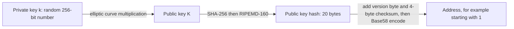
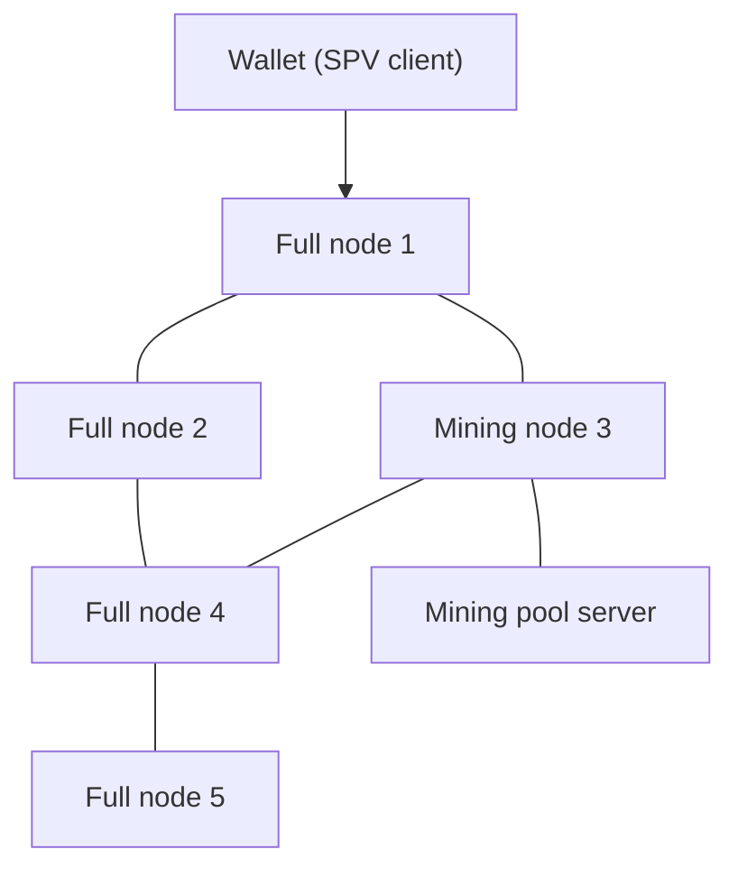
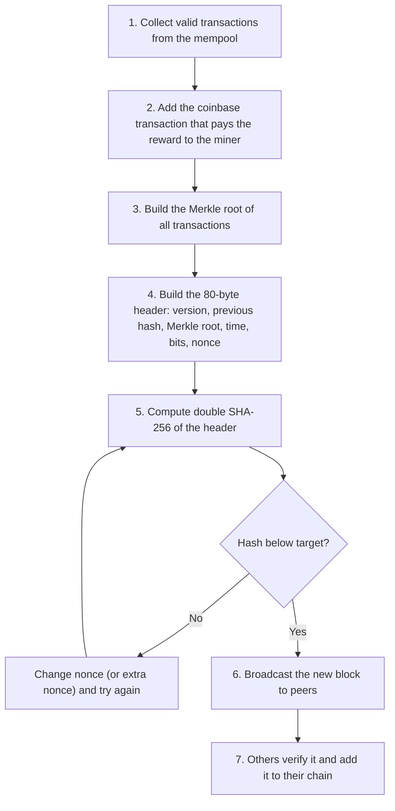
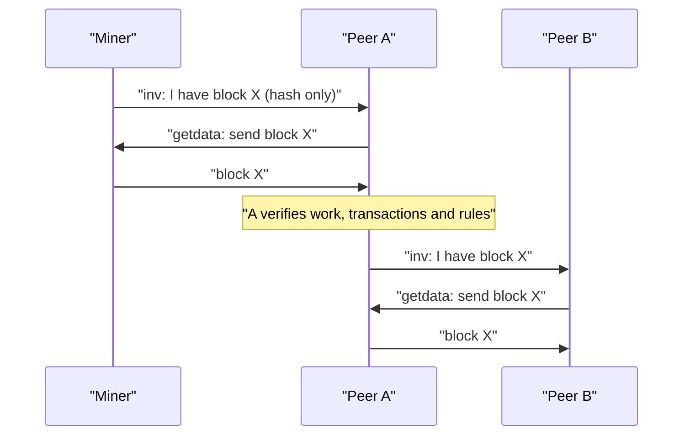
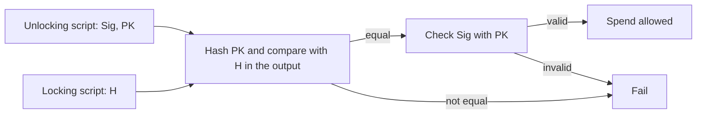
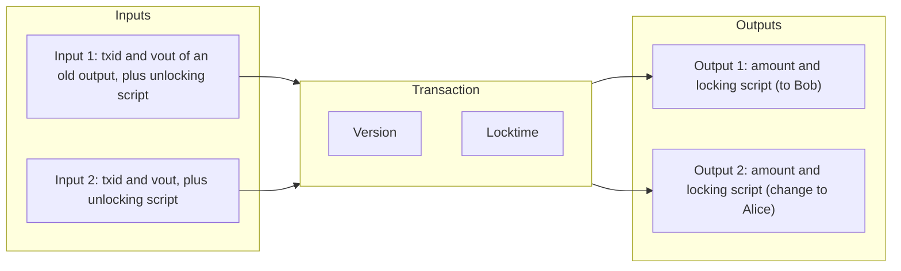
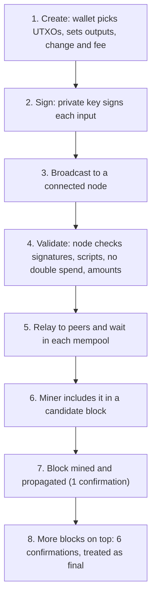
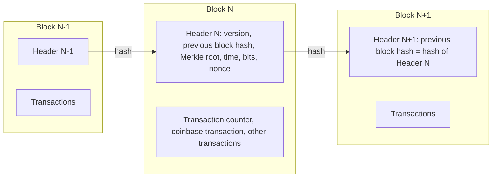

This note covers syllabus <Syl m="2" />, section 2.2: what Bitcoin is, its history, common terms (keys, addresses, nodes), mining, Hashcash, block propagation and relay, Bitcoin scripts and transactions. Consensus algorithms in general (PoW, PoS, pBFT and so on) have their own note; the Merkle tree is in the block-structure note.

## The basics first

- A **ledger** is a record of who owns what. A **blockchain** is a ledger kept as a chain of blocks, copied on many computers.
- A **hash function** turns any input into a fixed-size "fingerprint". The same input always gives the same hash; a tiny change gives a completely different hash; and you cannot go backwards from hash to input. Bitcoin uses **SHA-256** (256-bit output) and **RIPEMD-160** (160-bit output). <Cite id="block-structure-merkle-wiki-hash" />
- **Public-key cryptography** uses a pair of keys: a private key you keep secret and a public key you can share. Something signed with the private key can be checked by anyone with the public key. <Cite id="block-structure-merkle-wiki-pubkey" />
- A **node** is any computer running the Bitcoin software and connected to other nodes.
- **1 bitcoin (BTC) = 100,000,000 satoshis (sat).** The satoshi is the smallest unit.

Analogy: Bitcoin is like a village notebook that everyone holds a copy of. A payment is a line in the notebook. Your signature proves the line is yours, and the village agrees which new page is added next.

## What is Bitcoin?

<Box kind="definition">

**Bitcoin** is a decentralized digital currency and payment network. People send value directly to each other (peer to peer) and a network of computers, not a bank, records and checks every payment on a shared public ledger called the blockchain. <Cite id="blockchain-fundamentals-nakamoto" /> <Cite id="bitcoin-wiki-bitcoin" />

</Box>

**The problem it solves.** Digital files can be copied. If money were just a file, you could spend it twice (the **double-spending problem**). Before Bitcoin, a trusted bank was needed to prevent this. Nakamoto's paper replaced the bank with a timestamped chain of blocks protected by proof of work. <Cite id="blockchain-fundamentals-nakamoto" loc="§1" />

**Key features.**

- Decentralized: no single owner or server.
- Limited supply: at most about 21 million bitcoins will ever exist. <Cite id="bitcoin-mb-ch12-mining" />
- Pseudonymous: you are known by addresses, not by name (but all transactions are public).
- Tamper-resistant: changing an old block means redoing the work for it and all blocks after it.
- Open source: anyone can run a node.

**History in short.**

| Year | Event |
|---|---|
| 1997 to 2002 | Adam Back's Hashcash: proof-of-work stamps to fight email spam. <Cite id="bitcoin-wiki-hashcash" /> |
| 2008 (31 Oct) | "Bitcoin: A Peer-to-Peer Electronic Cash System" published under the name Satoshi Nakamoto. <Cite id="blockchain-fundamentals-nakamoto" /> |
| 2009 (3 Jan) | The genesis block (block 0) is mined; the first software is released. <Cite id="block-structure-merkle-btcwiki-genesis" /> |
| 2010 | First real purchase (two pizzas for 10,000 BTC). <Cite id="bitcoin-wiki-bitcoin" /> |
| 2012, 2016, 2020, 2024 | Block reward halves from 50 to 25, 12.5, 6.25 and then 3.125 BTC. <Cite id="bitcoin-mb-ch12-mining" /> |

<Box kind="exam">

Exam mein English mein likho: "Bitcoin is a decentralized peer-to-peer digital currency that uses cryptography and proof of work to let users transact without a trusted third party."

</Box>

Related PYQ: <PYQ id="2023-12/q1b" />.

## Hashcash and its role in Bitcoin

<Box kind="definition">

**Hashcash** is a proof-of-work system proposed by Adam Back. A sender must find a number (a **nonce**) so that the hash of a message plus the nonce starts with a required number of zero bits. Finding it takes many tries; checking it takes one hash. <Cite id="bitcoin-hashcash-back" /> <Cite id="bitcoin-wiki-hashcash" />

</Box>

**Why it was made.** To make email spam costly. One mail costs a normal user a fraction of a second of computing, but a spammer sending millions pays heavily.

**How it works (simple steps).**

1. The sender builds a stamp from the recipient, the date and a counter (the nonce).
2. The sender hashes the stamp and checks whether the hash begins with enough zero bits (for example 20).
3. If not, the counter goes up by one and step 2 repeats. It is pure trial and error.
4. When one works, the stamp goes with the email. The receiver hashes it once to confirm.

**Role in Bitcoin.** Bitcoin's mining is Hashcash applied to blocks. <Cite id="blockchain-fundamentals-nakamoto" loc="§4" />

| Point | Hashcash | Bitcoin mining |
|---|---|---|
| Purpose | Stop spam | Choose who adds the next block, and secure the chain |
| What is hashed | Stamp (recipient, date, nonce) | 80-byte block header (version, previous hash, Merkle root, time, bits, nonce) |
| Success condition | Hash has N leading zero bits | Hash (as a number) is below the target |
| Who checks | The mail receiver | Every node, with one hash |
| Reward | None | New bitcoins plus fees |

So the role of Hashcash is to give the **proof of work idea**: work that is hard to do, easy to verify, and cannot be faked. In Bitcoin it makes block creation costly, so an attacker cannot rewrite history cheaply, and it turns "one IP, one vote" into "one CPU, one vote". <Cite id="blockchain-fundamentals-nakamoto" loc="§4" /> <Cite id="bitcoin-gfg-pow" />

Related PYQ: <PYQ id="2023-12/q1b" />.

## Keys, addresses and nodes

### Keys

- **Private key**: a random 256-bit number. Whoever knows it can spend the coins, so it must stay secret. Bitcoin does not store "coins" in a wallet; the wallet stores keys.
- **Public key**: calculated from the private key by multiplying a fixed point on the secp256k1 elliptic curve. Going from private to public is easy; going back is practically impossible. <Cite id="bitcoin-mb-ch04-keys" loc="Public Key Cryptography" />
- **Digital signature**: a proof made with the private key that you approve a specific transaction. Anyone can verify it with the public key, and nobody can reuse it for a different transaction. <Cite id="block-structure-merkle-wiki-digsig" />


### Addresses

An **address** is a short, shareable identifier where coins can be sent, like an account number. For the classic P2PKH address: <Cite id="bitcoin-mb-ch04-keys" loc="Legacy Addresses for P2PKH" /> <Cite id="bitcoin-btcwiki-address" />



1. Take the public key $K$.
2. Compute `RIPEMD160(SHA256(K))`. This gives a 20-byte **public key hash**.
3. Add a version prefix (0 for a legacy P2PKH address) in front.
4. The checksum is the first 4 bytes of `SHA256(SHA256(prefix + hash))`. Add it at the end. It catches typing mistakes.
5. Encode in **Base58Check** (letters and digits without confusing ones such as 0, O, I, l). <Cite id="bitcoin-mb-ch04-keys" loc="Base58check Encoding" />

Common address styles: legacy P2PKH (starts with 1), P2SH (starts with 3) and Bech32 SegWit (starts with bc1). <Cite id="bitcoin-mb-ch04-keys" />

**Why hash the public key?** It makes the address shorter and hides the public key until the coins are spent.

### Nodes

A **node** is a computer on the Bitcoin peer-to-peer network. All full nodes are equal peers; there is no central server. <Cite id="bitcoin-mb-ch10-network" loc="Node Types and Roles" /> <Cite id="bitcoin-devguide-p2p" />

| Node type | What it does |
|---|---|
| Full node | Downloads and checks every block and transaction against the rules, and relays them. Needs no trust in others. |
| Archival full node | A full node that keeps the whole block history; a pruned node keeps only recent blocks. |
| Mining node | Collects transactions and competes to find the next block (can be a full node or connect to a pool). |
| Lightweight (SPV) client | Keeps only block headers and asks full nodes for proofs of its own transactions. Used by phone wallets. |



A new node finds peers by asking **DNS seeds** (lists of known nodes) and then learns more peers from them. <Cite id="bitcoin-mb-ch10-network" loc="Network Discovery" />

## Bitcoin mining

<Box kind="definition">

**Mining** is the process by which nodes (miners) collect pending transactions into a candidate block and repeatedly hash its header, with a changing nonce, until the hash is below the network's target. The winner adds the block to the chain and earns the **block reward** plus the **transaction fees**. <Cite id="bitcoin-mb-ch12-mining" /> <Cite id="bitcoin-btcwiki-mining" />

</Box>

Mining has two jobs: it **creates new bitcoins** in a fair, rule-bound way and it **secures the ledger** by making rewriting history very expensive.

### Steps of mining (life of a miner)



1. **Collect transactions.** The miner picks valid transactions from its mempool, usually the ones paying the highest fee per byte.
2. **Coinbase transaction.** The first transaction of the block creates new coins and pays reward plus fees to the miner's own address.
3. **Merkle root.** All transactions are hashed pairwise into a tree; the single top hash goes into the header. <Cite id="block-structure-merkle-lmab-merkle" />
4. **Header.** Fill in the six fields. The nonce is only 32 bits (about 4.3 billion values), so fast miners run out; they then change the extra nonce inside the coinbase transaction, which changes the Merkle root and gives a whole new set of nonces. <Cite id="bitcoin-mb-ch12-mining" loc="The Extra Nonce Solution" />
5. **Hash and compare.** Compute SHA-256 twice on the header. If the number is not below the target, change the nonce and repeat. It is a lottery: each try has the same tiny chance.
6. **Broadcast.** The winner sends the block to peers.
7. **Verify and extend.** Each node checks the work, the transactions and the rules, then builds the next block on top of it.

### Mining difficulty

The **target** is a 256-bit number; a valid block hash must be below it. A smaller target means fewer valid hashes, so it is harder. **Difficulty** compares the current target with the easiest possible target (difficulty 1):

$$
\text{difficulty} = \frac{\text{difficulty-1 target}}{\text{current target}}
$$

<Cite id="bitcoin-btcwiki-difficulty" />

To keep one block every 10 minutes whatever the total hash power, every **2016 blocks** (about 2 weeks at 10 minutes each) the network recalculates the target from the real time those 2016 blocks took. If they came faster than 14 days, the target falls (harder); if slower, the target rises (easier). One change is limited to a factor of 4. <Cite id="bitcoin-mb-ch12-mining" loc="Mining the Block" />


### Block reward and halving

The reward started at 50 BTC and is **halved every 210,000 blocks** (about 4 years). After about 32 halvings the subsidy reaches zero, and miners then live on fees. This is why the total supply is capped at almost 21 million BTC. <Cite id="bitcoin-mb-ch12-mining" loc="Bitcoin Economics and Currency Creation" /> <Cite id="bitcoin-btcwiki-halving" />


$$
\text{reward} = \frac{50}{2^{h}} \text{ BTC}, \qquad h = \left\lfloor \frac{\text{block height}}{210{,}000} \right\rfloor
$$

Here $h$ is the number of halvings that have already happened and $\lfloor\ \rfloor$ means "round down".

<Sum>

<Given>

A block at height 700,000 is mined. Fees in the block add up to 0.5 BTC. The reward started at 50 BTC and halves every 210,000 blocks.

</Given>

<Find>

the miner's total income from this block, and the total coins minted by the end of the era that holds block 839,999.

</Find>

<Steps>

1. **Number of halvings.** $700{,}000 / 210{,}000 = 3.33$, rounded down gives $h = 3$. *Reason: the reward only changes after each full 210,000 blocks.*
2. **Subsidy.** $50 / 2^3 = 50 / 8 = 6.25$ BTC. *Reason: three halvings divide by 2 three times.*
3. **Income.** Subsidy plus fees: $6.25 + 0.5 = 6.75$ BTC.
4. **Coins per era.** Each era has 210,000 blocks. Eras 0 to 3 pay 50, 25, 12.5 and 6.25 BTC per block.
5. **Total.** $210{,}000 \times (50 + 25 + 12.5 + 6.25) = 210{,}000 \times 93.75 = 19{,}687{,}500$ BTC. *Reason: add the per-block rewards of the four eras and multiply by the blocks in an era.*

</Steps>

<Answer>

miner income $= 6.75$ BTC; about $19{,}687{,}500$ BTC are minted by block 839,999 (the real number is a little lower because a few rewards were never claimed).

</Answer>

<Box kind="verify">

Check height: era 3 covers blocks $630{,}000$ to $839{,}999$ ($3 \times 210{,}000 = 630{,}000$), and 700,000 lies inside, so the reward is the era-3 value 6.25. Check supply: the limit of the series is $210{,}000 \times 100 = 21{,}000{,}000$ (since $50 + 25 + \dots = 100$), and $19{,}687{,}500$ is below it. The coins still to come are $21{,}000{,}000 - 19{,}687{,}500 = 1{,}312{,}500$, and that equals $210{,}000 \times 6.25$, which is what eras 4 onward add in total (the halved rewards form the series $3.125 + 1.5625 + \dots = 6.25$ per block-slot). Both match.

</Box>

</Sum>

### How many attempts does a miner need?

Each hash try is like a lottery ticket with a very small chance $p$ of winning. The expected number of tries is $1/p$. With difficulty $D$, the chance per try is about $1/(D \times 2^{32})$, so

$$
\text{expected hashes} \approx D \times 2^{32}
$$

The factor $2^{32} \approx 4.29$ billion comes from the difficulty-1 target being about $2^{224}$ out of $2^{256}$ possible hash values. <Cite id="bitcoin-btcwiki-difficulty" />

<Sum>

<Given>

Toy case: a hash is valid if it starts with 4 zero hex digits (16 zero bits). A small miner does 2,000 hashes per second.

Real case: network difficulty $D = 8 \times 10^{13}$ and a target of one block per 600 seconds.

</Given>

<Find>

(a) the expected number of tries and the time for the toy case; (b) the network hash rate needed for the real case.

</Find>

<Steps>

1. **Toy chance.** Each hex digit is 0 with chance $1/16$, so four digits give $p = 1/16^4 = 1/65{,}536$. *Reason: the digits are independent.*
2. **Toy tries.** Expected tries $= 1/p = 65{,}536$.
3. **Toy time.** $65{,}536 / 2{,}000 = 32.8$ seconds.
4. **Real tries.** $8 \times 10^{13} \times 4.295 \times 10^{9} \approx 3.436 \times 10^{23}$ hashes per block.
5. **Real hash rate.** Divide by the block time: $3.436 \times 10^{23} / 600 \approx 5.73 \times 10^{20}$ hashes per second, about 573 exahashes per second (EH/s).

</Steps>

<Answer>

(a) $65{,}536$ tries, about $32.8$ s. (b) about $5.7 \times 10^{20}$ H/s.

</Answer>

<Box kind="verify">

Toy: $65{,}536 = 2^{16}$, matching 16 zero bits (each bit halves the chance). Real: multiply back, $5.73 \times 10^{20} \times 600 = 3.44 \times 10^{23}$, equal to the tries per block. The $2^{32}$ factor is approximate (the exact difficulty-1 target is slightly below $2^{224}$), so the real answer is correct to about 0.002 percent.

</Box>

</Sum>

<Sum>

<Given>

The last 2016 blocks took 12 days. The expected time is $2016 \times 10$ minutes $= 14$ days. The old difficulty is $8 \times 10^{13}$.

</Given>

<Find>

the new difficulty.

</Find>

<Steps>

1. **Ratio.** Expected time over actual time: $14 / 12 = 1.1667$. *Reason: blocks came too fast, so the puzzle must get harder by the same ratio.*
2. **Limit.** The ratio is between $1/4$ and $4$, so it is allowed.
3. **New difficulty.** $8 \times 10^{13} \times 1.1667 \approx 9.33 \times 10^{13}$.

</Steps>

<Answer>

new difficulty $\approx 9.33 \times 10^{13}$ (about 17 percent higher).

</Answer>

<Box kind="verify">

With the same hash power, a block now needs $1.1667$ times as many tries, so 12 days becomes $12 \times 1.1667 = 14$ days again, the intended period.

</Box>

</Sum>

### Mining pools

Solo mining is a lottery that a small miner may never win. In a **mining pool**, many miners work together; the pool server hands out work, and the reward is shared in proportion to the work each miner shows. Income becomes steady but a small share. <Cite id="bitcoin-mb-ch12-mining" /> <Cite id="bitcoin-tp-bitcoin-mining" />

| Method | How the pool pays |
|---|---|
| Pay-per-share (PPS) | A fixed payment for every valid share (partial proof of work), whether or not the pool finds a block. The pool carries the luck risk. |
| Proportional | When the pool finds a block, the reward is split in proportion to the shares each member sent in that round. |
| Pay-per-last-N-shares (PPLNS) | Reward is split over the last N shares, which discourages hopping between pools. |

Pros: steady income, lower variance. Cons: less decentralization if a few pools hold a lot of hash power; trust in the pool operator. Hardware went from CPUs to GPUs to ASICs (chips made only for SHA-256), which also uses a lot of electricity. <Cite id="bitcoin-tp-bitcoin-mining" />

Related PYQ: <PYQ id="2023-12/q2b" />.

## Consensus in Bitcoin

Consensus means all nodes agree on one version of the ledger without a leader. Bitcoin's version is called **Nakamoto consensus**. <Cite id="bitcoin-mb-ch12-mining" loc="Decentralized Consensus" />

1. Every full node **independently verifies** each transaction and block against the rules.
2. Miners **compete with proof of work** to propose the next block.
3. Nodes follow the valid chain with the **most accumulated work** (usually called the longest chain). <Cite id="blockchain-fundamentals-nakamoto" loc="§5" />
4. If two miners find a block at almost the same time, the chain forks for a short while. The fork ends when the next block lands on one branch; the other becomes an **orphan** (stale) block and its transactions return to the mempool. <Cite id="block-structure-merkle-btcwiki-orphan" />
5. A block buried under more blocks is exponentially harder to replace. After about 6 confirmations the payment is treated as final.

Security assumption: honest miners hold the majority of hash power. An attacker with over 50 percent could reverse recent payments (a **51 percent attack**) but still cannot steal other people's coins without their private keys. <Cite id="blockchain-fundamentals-nakamoto" loc="§11" />

Bitcoin and some other chains also have other consensus ideas; for PoS, PoA, pBFT and so on see the consensus note.

Related PYQ: <PYQ id="2023-12-ce/q6a" />.

## Block propagation and relay

Once a miner finds a block, speed matters: the sooner others receive it, the less work is wasted on stale blocks.



1. The miner sends an **inv** (inventory) message with the block hash to its peers. <Cite id="bitcoin-mb-ch10-network" loc="Exchanging Inventory" />
2. A peer that does not have it asks with **getdata**.
3. The block is sent. The peer **fully validates** it first (proof of work, every transaction, size limits) and only then forwards it. Invalid blocks are dropped and the sender can be banned.
4. Each peer repeats this with its own peers, so the block reaches almost the whole network in seconds.
5. A peer that is behind uses **getblocks**/**getheaders** to download missing blocks (initial sync). <Cite id="bitcoin-devguide-p2p" />

Speed-ups: **compact block relay** sends only block headers and short transaction IDs, because most nodes already have the transactions in their mempool; **relay networks** connect miners directly. <Cite id="bitcoin-mb-ch10-network" loc="Compact Block Relay" />

Transactions are relayed the same way (inv, getdata, tx) before they are in any block.

## Bitcoin Script

<Box kind="definition">

**Bitcoin Script** is a small, stack-based programming language used to lock and unlock coins. Each output carries a **locking script** (scriptPubKey, the spending condition) and each input carries an **unlocking script** (scriptSig, or witness data, which satisfies it). <Cite id="bitcoin-mb-ch07-scripts" loc="Transaction Scripts and Script Language" /> <Cite id="bitcoin-btcwiki-script" />

</Box>

**Features.**

- **Stack-based**: values are pushed on a stack; operators (opcodes) pop values and push results. It reads left to right.
- **Not Turing complete**: no loops, so a script always ends and cannot hang the network. Contrast Ethereum.
- **Stateless and deterministic**: a script sees only the transaction; the result is the same on every node.
- A spend is valid if after running unlocking script then locking script, the top of the stack is true (non-zero).

Common opcodes:

| Opcode | What it does |
|---|---|
| `OP_DUP` | Copies the top item |
| `OP_HASH160` | Replaces the top item by RIPEMD160(SHA256(item)) |
| `OP_EQUAL` / `OP_EQUALVERIFY` | Compares two items; the VERIFY form stops the script with failure if they differ |
| `OP_CHECKSIG` | Checks the signature against the public key for this transaction |
| `OP_CHECKMULTISIG` | Checks m-of-n signatures (multisig) |
| `OP_RETURN` | Marks an output as unspendable data (used to store small data on chain) |

Standard script types: P2PK (pay to public key), **P2PKH** (pay to public key hash), P2SH (pay to script hash, used for multisig), P2WPKH/P2WSH (SegWit) and P2TR (Taproot). <Cite id="bitcoin-mb-ch07-scripts" />

### Pay to Public Key Hash (P2PKH)

Alice wants to pay Bob. She locks the coins to the **hash of Bob's public key** (found from his address). To spend them, Bob must show his public key (which must hash to that value) and a signature made with his private key. <Cite id="bitcoin-lmab-p2pkh" /> <Cite id="bitcoin-og-p2pkh" />

- **Locking script (scriptPubKey)** put in Alice's output:

```text
OP_DUP OP_HASH160 <BobPubKeyHash> OP_EQUALVERIFY OP_CHECKSIG
```

- **Unlocking script (scriptSig)** put by Bob in the input that spends it:

```text
<BobSignature> <BobPublicKey>
```

Bob's unlocking script runs first, then the locking script, on one stack. Here `Sig` is Bob's signature, `PK` his public key, and `H` the stored hash.

| Step | Operation | Stack after (top on the right) |
|---|---|---|
| 1 | Push `Sig` | `Sig` |
| 2 | Push `PK` | `Sig PK` |
| 3 | `OP_DUP` copies `PK` | `Sig PK PK` |
| 4 | `OP_HASH160` hashes the top copy | `Sig PK hash(PK)` |
| 5 | Push `H` from the locking script | `Sig PK hash(PK) H` |
| 6 | `OP_EQUALVERIFY` compares the two hashes; if equal, removes both, otherwise fails | `Sig PK` |
| 7 | `OP_CHECKSIG` checks `Sig` against `PK` for this transaction | `TRUE` |

Final top is TRUE, so the spend is valid.

<Box kind="verify">

Walk-through with names: Alice sends 1 BTC to Bob's address. Bob's wallet decodes the address to the 20-byte hash $H$ and Alice's output gets the script above. Later Bob signs a new transaction that spends that output. At step 6 the node checks $\text{hash}(PK) = H$. If Eve submits her own public key $PK_E$ it fails here, because $\text{hash}(PK_E) \ne H$. If Eve copies Bob's $PK$ but not his key, step 7 fails because she cannot create a matching signature. Only Bob passes both checks.

</Box>



**Why P2PKH is good:** the public key stays hidden behind a hash until spending, the address is short, and only the key owner can spend. Pay to Script Hash (P2SH) works the same way but hashes a whole script, which is how multisig addresses work.


Related PYQ: <PYQ id="2025-05/q1b" />.

## Transactions in Bitcoin

A Bitcoin transaction does **not** say "move 1 BTC from Alice's account to Bob's". Bitcoin has no accounts. A transaction **spends earlier outputs and creates new outputs**. An output that has not been spent yet is a **UTXO** (unspent transaction output). Your balance is the sum of the UTXOs your keys can unlock. <Cite id="bitcoin-mb-ch06-transactions" /> <Cite id="bitcoin-btcwiki-transaction" />


### Structure of a transaction

| Field | Meaning |
|---|---|
| Version | Which transaction rules apply |
| Input count and inputs | Each input points to an earlier output by `txid` and output number (`vout`) and carries the unlocking script (and a sequence number) |
| Output count and outputs | Each output has an **amount** (in satoshis) and a **locking script** |
| Witness (SegWit) | Signatures kept in a separate section |
| Locktime | Earliest time or block when the transaction may be mined (0 = any time) |



**Key rules.**

- Each input must refer to an unspent output and satisfy its script, and an output can be spent only once. This is what prevents double spending.
- A whole output is spent at once. To pay less than it holds, you add a **change output** back to yourself.
- The **fee** is not a field. It is the leftover: $\text{fee} = \text{sum of inputs} - \text{sum of outputs}$. Miners take it. <Cite id="bitcoin-mb-ch06-transactions" loc="Outputs" />
- The first transaction in each block is the **coinbase transaction**: it has no real input and creates the block reward. <Cite id="bitcoin-mb-ch06-transactions" loc="Coinbase Transactions" />

<Sum>

<Given>

Alice owns two UTXOs: 0.5 BTC and 0.3 BTC. She wants to pay Bob 0.6 BTC and leave a fee of 0.0001 BTC. The transaction is 250 virtual bytes (vB) long.

</Given>

<Find>

the change output, and the fee rate in satoshis per vB.

</Find>

<Steps>

1. **Inputs.** Spend both UTXOs: $0.5 + 0.3 = 0.8$ BTC. *Reason: 0.5 alone is not enough for 0.6, and an output must be spent whole.*
2. **Change.** $\text{change} = \text{inputs} - \text{payment} - \text{fee} = 0.8 - 0.6 - 0.0001 = 0.1999$ BTC, sent back to Alice's address.
3. **Outputs.** $0.6 + 0.1999 = 0.7999$ BTC.
4. **Fee check.** $0.8 - 0.7999 = 0.0001$ BTC $= 10{,}000$ satoshis.
5. **Fee rate.** $10{,}000 / 250 = 40$ sat/vB. *Reason: miners rank by fee per size, not by total fee.*

</Steps>

<Answer>

change $= 0.1999$ BTC; fee $= 0.0001$ BTC $= 10{,}000$ sat, a rate of $40$ sat/vB.

</Answer>

<Box kind="verify">

Inputs equal outputs plus fee: $0.8 = 0.6 + 0.1999 + 0.0001$. If the outputs were $0.6 + 0.2 = 0.8$, the fee would be 0 and miners would likely ignore the transaction; if outputs exceeded inputs, the transaction would be invalid.

</Box>

</Sum>

### Transaction life cycle



1. **Creation.** Alice's wallet chooses UTXOs to spend, writes the outputs (Bob's payment and her change) and sets the fee.
2. **Signing.** For each input the wallet signs with the private key that unlocks that UTXO. The signature covers the transaction data, so changing the amount later breaks it.
3. **Broadcast.** The wallet sends it to one or more nodes.
4. **Validation.** Each node checks: correct format, inputs exist and are unspent, scripts run to true, inputs are at least outputs, and the transaction is not already in the mempool. <Cite id="bitcoin-mb-ch12-mining" loc="Independent Verification of Transactions" />
5. **Propagation and mempool.** Valid transactions are forwarded to peers and stored in the **mempool** (the waiting room of unconfirmed transactions). <Cite id="bitcoin-mb-ch10-network" loc="Mempools and Orphan Pools" />
6. **Mining.** Miners pick transactions, usually by highest fee rate, into a block.
7. **Confirmation.** When that block is accepted, the transaction has 1 confirmation. Each later block adds one. Coinbase rewards need 100 confirmations before they can be spent. <Cite id="bitcoin-mb-ch12-mining" />
8. **Finality.** About 6 confirmations (roughly an hour) make a reversal practically impossible. <Cite id="bitcoin-og-tx-lifecycle" />

Related PYQ: <PYQ id="2023-12-ce/q5a" />.

## Structure of a Bitcoin block

A block has a small **header** (80 bytes) and a long body of transactions. <Cite id="block-structure-merkle-btcwiki-block" /> <Cite id="block-structure-merkle-devref" /> <Cite id="block-structure-merkle-mb-ch11" />



| Header field | Size | Meaning |
|---|---|---|
| Version | 4 bytes | Which block rules apply |
| Previous block hash | 32 bytes | Hash of the previous block's header; this is what links the chain |
| Merkle root | 32 bytes | Hash at the top of the tree of all transactions in the block |
| Timestamp | 4 bytes | Roughly when the block was mined |
| Bits | 4 bytes | The target in compact form (the difficulty) |
| Nonce | 4 bytes | The number miners change to find a valid hash |

The body holds the **transaction counter** and the list of transactions, the coinbase first. The **block hash** is the double SHA-256 of the header alone; it has no field of its own and is identified by the leading zeros it shows. **Block height** is the block's distance from the genesis block (genesis = height 0). The Merkle root commits to every transaction, so changing any one changes the root, the header hash, and breaks every later link. Block weight is limited to 4 million weight units (about 1 to 2 MB of data in practice). <Cite id="block-structure-merkle-lmab-block" />


Related PYQ: <PYQ id="2025-05/q3b" />.

## Cryptography in Bitcoin

Bitcoin uses three ideas from cryptography, and no encryption of data (everything on the chain is public). <Cite id="bitcoin-mb-ch04-keys" />

| Tool | Where Bitcoin uses it | What it gives |
|---|---|---|
| Hash functions (SHA-256, RIPEMD-160) | Block hash, proof of work, Merkle tree, address creation | Integrity, a tamper-evident chain, a fair puzzle |
| Digital signatures (ECDSA and Schnorr on the secp256k1 curve) | Signing each transaction input | Authentication (only the owner spends), integrity of the transaction, non-repudiation |
| Public-key pair (elliptic curve) | Wallet keys and addresses | Ownership without sharing a secret |
| Merkle tree | Summarizes all transactions in the header | Quick proof that a transaction is in a block (SPV) |

Pitfall: hashing is not encryption. Nothing is hidden by a hash; it only fingerprints data, and the transaction data stays readable by everyone.

Related PYQ: <PYQ id="2023-12-ce/q6c" />.

## Bitcoin versus Ethereum

| Point | Bitcoin | Ethereum |
|---|---|---|
| Main purpose | Digital money, store of value | General platform: smart contracts and decentralized apps |
| Founder and year | Satoshi Nakamoto, 2009 | Vitalik Buterin and others, proposed 2013, live 2015 |
| Currency | BTC | Ether (ETH) |
| Record model | UTXO (unspent outputs) | Account balances and contract storage |
| Programmability | Limited, non-Turing-complete Script | Turing-complete code on the EVM, written in Solidity |
| Consensus | Proof of work | Proof of stake since September 2022 (The Merge) |
| Hash algorithm | SHA-256 | Keccak-256 |
| Block time | About 10 minutes | About 12 seconds |
| Fees | Fee set by size in bytes | Gas used times gas price |
| Supply | Capped at about 21 million | No fixed cap |

<Cite id="bitcoin-gfg-bitcoin-vs-ethereum" /> <Cite id="bitcoin-educative-bitcoin-vs-ethereum" /> The Ethereum side of the table is expanded in the Ethereum note.

Related PYQs: <PYQ id="2024-05-ce/q1e" /> and <PYQ id="2024-12-ce/q1b" />.

## Advantages and limitations of Bitcoin

| Advantages | Limitations |
|---|---|
| No bank or middleman, works worldwide | Slow: about 7 transactions per second and 10 minutes per block |
| Very hard to tamper with | Proof of work uses a lot of electricity |
| Open to anyone, transparent ledger | Price is very volatile; lost private keys mean lost coins |
| Limited supply, predictable issuance | Transactions cannot be reversed; fees rise when the network is busy |
| Strong security from a large hash rate | Script is limited, so complex contracts are hard |

## Conclusion

Bitcoin joins four ideas: public-key cryptography for ownership, the UTXO transaction model for payments, a stack-based script for spending rules, and Hashcash-style proof of work with difficulty adjustment for agreement. Together they let strangers keep one honest ledger with no bank.
