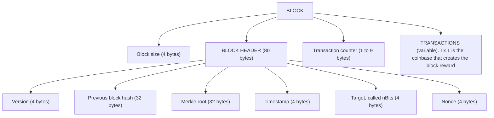
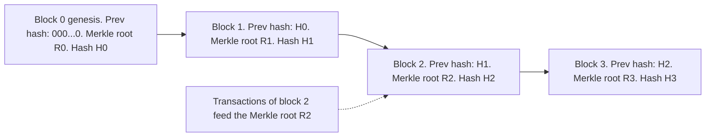
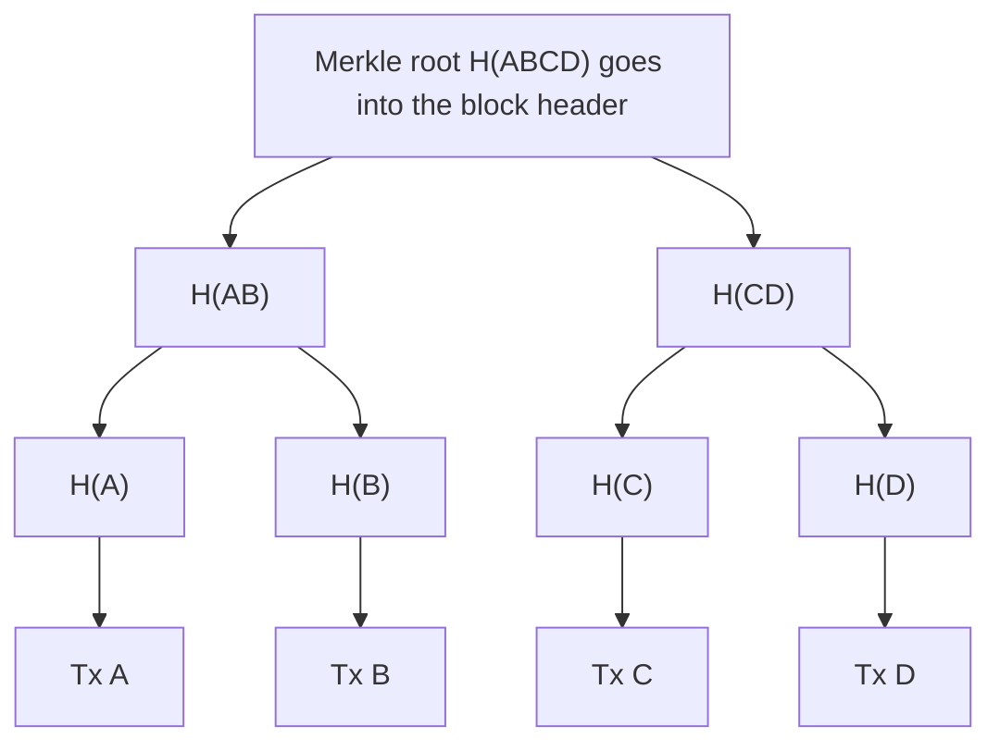
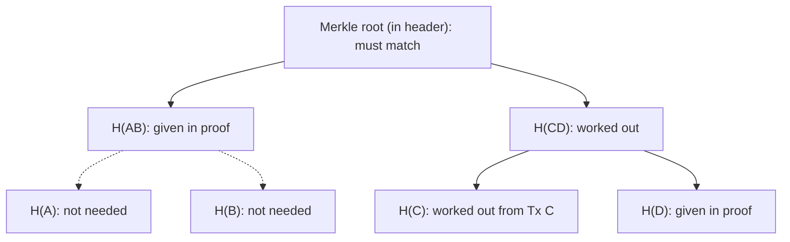
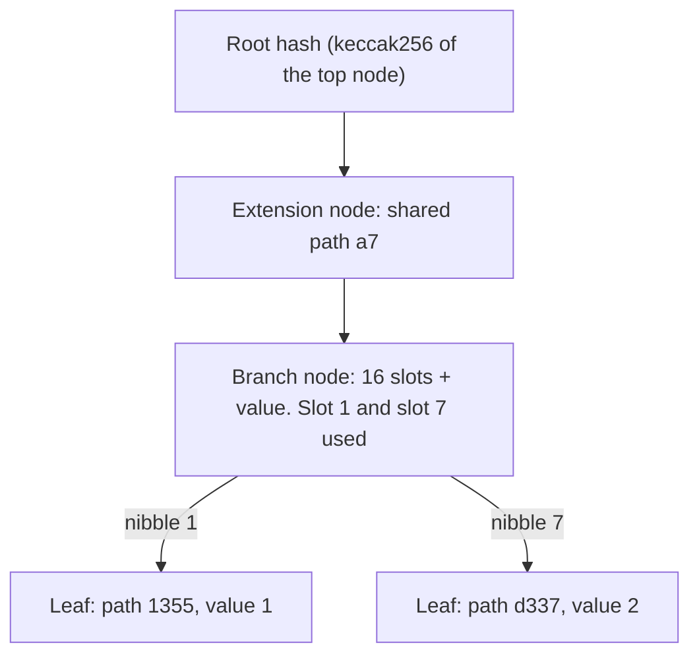
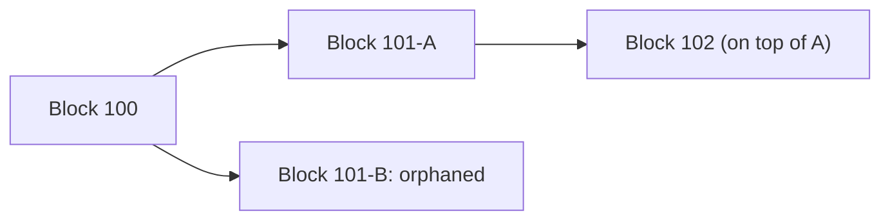

Ye note syllabus <Syl m="1" /> ke "Block in a Blockchain" part ko cover karta hai: block ka structure, block header hash aur block height, genesis block, blocks ko blockchain mein link karna, aur Merkle tree. Blockchain ka general idea fundamentals note mein hai.

## Pehle basics

- **Transaction** ek recorded event hota hai, jaise "Asha ne Ravi ko 500 rupaye diye".
- **Hash function** kisi bhi data ko fixed-size fingerprint mein badalta hai, jise **hash** kehte hain. Same data ka hash hamesha same aata hai; zara sa change karo to hash poora alag aata hai; aur hash se data wapas nahi nikal sakte. Bitcoin SHA-256 use karta hai, jo 256 bits (32 bytes) deta hai. <Cite id="block-structure-merkle-wiki-hash" /> <Cite id="block-structure-merkle-wiki-sha2" />
- **Block** transactions ka bundle hota hai jo network ek saath accept karta hai.
- **Binary tree** ek diagram hai jahan har node ke neeche maximum do children hote hain. **Leaf** wo node hai jiske children nahi, aur **root** sabse upar wala ek node.

Analogy: teacher 8 answer sheets ek folder mein rakhti hai aur cover pe ek "folder number" likhti hai jo saari sheets se nikala gaya hai. Agar koi ek bhi sheet badal de, to baad mein nikala gaya number cover wale number se match nahi karega. Block header aur Merkle root bilkul aise hi cover aur folder number ki tarah kaam karte hain.

## Structure of a block

<Box kind="definition">

**Block** ek container data structure hai jo transactions ko blockchain mein daalne ke liye group karta hai. Ismein ek **header** (block ke baare mein metadata) hota hai aur uske baad **transactions ki list**. <Cite id="block-structure-merkle-mb-ch11" loc="Structure of a Block" />

</Box>

**Header aur body alag kyun?** Header chhota aur fixed size ka hota hai, isliye hash karna, bhejna aur check karna tez hota hai. Body bada aur variable hota hai. Body ki saari zaroori baatein Merkle root ke through header mein dabaa di jaati hain. Bitcoin mein header 80 bytes ka hai jabki transactions kul lagbhag 4,000,000 bytes tak ho sakte hain, yaani poora block header se lagbhag 50,000 guna bada ho sakta hai. <Cite id="block-structure-merkle-mb-ch11" loc="Structure of a Block" />

<Cite id="block-structure-merkle-mb-ch11" loc="diagram" /> <Cite id="block-structure-merkle-gfg-merkle" loc="diagram" />

### Block header ke chhe fields

| Field | Size | Kis kaam ka |
| --- | --- | --- |
| Version | 4 bytes | Block kaun se validation rules follow karta hai. Upgrades ka support signal karne ke liye bhi use hua hai. |
| Previous block hash | 32 bytes | Parent block ke header ka hash. Yehi link chain banata hai. |
| Merkle root | 32 bytes | Ek hash jo block ke har transaction ka summary hai. |
| Timestamp | 4 bytes | Block banne ka approximate time (Unix time, 1 Jan 1970 se seconds). |
| Target (nBits) | 4 bytes | Proof-of-work target ka compact form; header hash iske barabar ya kam hona chahiye. |
| Nonce | 4 bytes | Ek number jo miner baar baar badalta hai valid hash dhoondhne ke liye. |

<Cite id="block-structure-merkle-mb-ch11" loc="Block Header" /> <Cite id="block-structure-merkle-devref" loc="block headers" /> <Cite id="block-structure-merkle-btcwiki-block" /> <Cite id="block-structure-merkle-lmab-block" />

Nonce, target aur timestamp mining mein use hote hain: miner nonce values try karta rehta hai jab tak header ka double SHA-256 hash target se chhota na aa jaaye. Ye consensus aur mining note mein cover hai. <Cite id="blockchain-fundamentals-nakamoto" loc="§4" />

Har block ka pehla transaction **coinbase transaction** hota hai. Isme koi real input nahi hota; ye miner ke liye naye coins (block reward) banata hai. Baaki normal payments hote hain, jinhe aam taur pe is tarah order kiya jaata hai ki miners best fee wale chun saken. <Cite id="block-structure-merkle-mb-ch11" />

<PYQ id="2023-05-ce/q2a" /> <PYQ id="2025-05/q3b" />

### Block header hash aur block height

Block ke do identifiers hote hain. <Cite id="block-structure-merkle-mb-ch11" loc="Block Identifiers" />

- **Block header hash.** 80-byte header ko SHA-256 se do baar hash karo. Result 32-byte fingerprint hai jo block ka naam ban jaata hai. Hash block ke *andar stored nahi hota*; nodes block receive karke use nikaalte hain. Valid hash kai zeros se shuru hota hai kyunki wo target se chhota hona chahiye.
- **Block height.** Chain mein block ki position, genesis block se ginti, jiski height 0 hoti hai. Uske baad wale block ki height 1, aur aage isi tarah. Height 5 wala block chhatha block hai.

Height unique identifier nahi hai. Do miners lagbhag ek hi time pe same height pe alag valid blocks dhoondh sakte hain, to thodi der ke liye do blocks ek position ke liye compete karte hain; hash hamesha unhe alag batata hai. <Cite id="block-structure-merkle-mb-ch11" loc="Block Identifiers" />

<Box kind="pitfall">

Block hash header ka field nahi hai. Log aksar kehte hain "block apna hash khud contain karta hai". Aisa nahi hai; wo *pichle* block ka hash contain karta hai, aur uska apna hash agle block mein aata hai.

</Box>

Header size aur saal bhar ke headers ka storage neeche sums mein solve kiya hai.

## The genesis block

<Box kind="definition">

**Genesis block** blockchain ka pehla block hai. Ise block 0 (height 0) kehte hain, iske peeche point karne ke liye koi previous block nahi hota, aur ye software mein hard-coded hota hai. <Cite id="block-structure-merkle-btcwiki-genesis" /> <Cite id="block-structure-merkle-mb-ch11" loc="The Genesis Block" />

</Box>

**Ye kyun zaroori hai.** Har block apne parent ko point karta hai, to chain ki shuruaat mein kuch to hona chahiye. Genesis block har block ka common ancestor hai: kisi bhi block se previous-hash links ke saath peeche jaao, to hamesha isi pe pahunchoge. Har node ke program mein ye block pehle se built-in hota hai, isliye sab nodes ek hi trusted root se shuru karte hain aur koi chupke se alag history shuru nahi kar sakta. <Cite id="block-structure-merkle-mb-ch11" loc="The Genesis Block" /> <Cite id="block-structure-merkle-gfg-genesis" />

**Bitcoin ke genesis block ke facts.**

| Item | Value |
| --- | --- |
| Created | 3 January 2009 (timestamp 1231006505) by Satoshi Nakamoto |
| Height | 0 |
| Hash | `000000000019d6689c085ae165831e934ff763ae46a2a6c172b3f1b60a8ce26f` |
| Previous block hash | all zeros (koi parent nahi) |
| Merkle root | `4a5e1e4baab89f3a32518a88c31bc87f618f76673e2cc77ab2127b7afdeda33b` (ismein ek hi transaction hai, to root usi transaction ka apna hash hai) |
| nBits / difficulty | `0x1d00ffff` / 1 |
| Nonce | 2083236893 |
| Transactions | 1 (coinbase), 50 BTC reward jo spend nahi ho sakta |
| Embedded message | "The Times 03/Jan/2009 Chancellor on brink of second bailout for banks" |

<Cite id="block-structure-merkle-btcwiki-genesis" /> <Cite id="block-structure-merkle-mb-ch11" loc="The Genesis Block" /> <Cite id="block-structure-merkle-core-chainparams" />

Times ki headline **timestamp proof** ki tarah kaam karti hai: block us akhbaar ke chhapne se pehle nahi ban sakta tha. Ye us banking crisis pe comment bhi hai jiske response mein Bitcoin aaya. <Cite id="block-structure-merkle-mb-ch11" loc="The Genesis Block" />

In simple words: genesis block ledger ka "page 1" hai jo har computer ke paas pehle se hai, aur har agla page usi se jodta hai.

<PYQ id="2024-12/q1b" />

## Linking blocks in the blockchain

Har header pichle block ke header ka hash store karta hai. To har block apne parent ko "peeche point" karta hai, aur poori chain in **hash pointers** se bandhi hoti hai. Full node incoming block ko check karta hai: uska previous-hash field dekhta hai aur apni copy mein wo parent dhoondhta hai. <Cite id="block-structure-merkle-mb-ch11" loc="Linking Blocks" />

<Cite id="block-structure-merkle-gfg-merkle" loc="diagram" /> <Cite id="blockchain-fundamentals-gfg-structure" loc="diagram" />

**Isse data badalna mushkil kyun hota hai.** Block 2 ka transaction edit karoge to R2 badlega, to H2 badlega. Phir block 3 ka "previous hash" galat ho jaayega, to block 3 dobara banana padega, phir block 4, aur aage; aur har ek ka proof of work dobara karna padega, wo bhi baaki network ke naye blocks jodne se tez. Isi wajah se purane blocks practically immutable hain. <Cite id="blockchain-fundamentals-nakamoto" loc="§4" />

<PYQ id="2024-12/q1a" />

### Blockchain as a data structure

"Blockchain define karo aur data structure explain karo" ke liye: blockchain blocks ki badhti hui list hai jahan har block pichle block ka hash rakhta hai (**hash pointers se bani linked list**), aur har block ke andar transactions ka summary **Merkle tree** deta hai. To do data structures saath kaam karte hain: bahar blocks ki linked list, andar hash tree. <Cite id="blockchain-fundamentals-wiki-blockchain" /> <Cite id="blockchain-fundamentals-gfg-structure" /> <Cite id="block-structure-merkle-gfg-merkle" />

<PYQ id="2024-12/q1a" />

## Merkle tree

<Box kind="definition">

**Merkle tree** (ise **hash tree** bhi kehte hain) ek binary tree hai jisme har leaf ek data item (yahan transaction) ka hash hota hai aur har parent node apne do children ka hash hota hai. Sabse upar wala single hash **Merkle root** kehlaata hai. <Cite id="block-structure-merkle-wiki-merkle" /> <Cite id="block-structure-merkle-gfg-merkle" />

</Box>

Iska naam Ralph Merkle ke naam pe hai, jinhone 1979 mein ye idea patent karaya. Bitcoin ise block ke saare transactions ka summary banane ke liye use karta hai. <Cite id="block-structure-merkle-wiki-merkle" /> <Cite id="block-structure-merkle-mb-ch11" loc="Merkle Trees" />

**Ye kyun zaroori hai.** Do problems:

1. *Poori list ki integrity.* Transactions ki bahut badi list ko ek saath hash karne ki jagah hume ek chhoti value chahiye jo kisi bhi transaction ke badalne par badal jaaye.
2. *Ek transaction ka sasta proof.* Phone wallet ko bina saare transactions download kiye check karna aana chahiye ki payment block mein hai. Merkle tree sirf lagbhag log2(N) hashes se ye karne deta hai. <Cite id="block-structure-merkle-mb-ch11" loc="Merkle Trees" />

### Merkle tree kaise banta hai (neeche se upar)

1. Har transaction ko hash karo. Ye **leaf nodes** hain (Bitcoin mein ye transaction ids, TXIDs, hote hain).
2. Hashes ko order mein rakho aur pair banao: pehla-doosra, teesra-chautha, aur aise.
3. Har pair ke dono hashes ko jodo (concatenate) aur result ko hash karo. Ye agla level deta hai, jismein nodes aadhe hote hain.
4. Agar kisi level mein hashes ki sankhya **odd** hai, to last hash ki copy bana ke usi ke saath pair karo.
5. Ye tab tak repeat karo jab tak ek hash bache. Wahi Merkle root hai. Use block header mein daalo.

Bitcoin har step mein SHA-256 do baar lagata hai. <Cite id="block-structure-merkle-devref" loc="merkle trees" /> <Cite id="block-structure-merkle-mb-ch11" loc="Merkle Trees" /> <Cite id="block-structure-merkle-tp-merkle" />

Yahan notation: `H(A)` transaction A ka hash hai, aur `H(AB)` ka matlab `H(A)` aur `H(B)` ko jodke unka hash.

<Cite id="block-structure-merkle-gfg-merkle" loc="diagram" /> <Cite id="block-structure-merkle-tp-merkle" loc="diagram" />

Transactions khud tree mein stored nahi hote; sirf unke hashes hote hain. Tree bas ek summary hai. <Cite id="block-structure-merkle-mb-ch11" loc="Merkle Trees" />

<Sum>

<Given>

Ek block mein 4 transactions A, B, C, D hain. Merkle root ko hashes ke terms mein likho. `H(X)` X ka hash hai aur `H(XY)` `H(X)` ko `H(Y)` ke saath jodke banaya hash hai.

</Given>

<Find>

tree ka har level, Merkle root, aur kitne hashes compute hue.

</Find>

<Steps>

1. Leaf level: har transaction ko hash karo: `H(A)`, `H(B)`, `H(C)`, `H(D)`. Ye 4 hashes hue. *Reason: leaves data items ke hashes hote hain.*
2. Order mein pair banao: (A, B) aur (C, D).
3. Level 1: `H(AB)` = (`H(A)` joda `H(B)`) ka hash, aur `H(CD)` = (`H(C)` joda `H(D)`) ka hash. Ye 2 hashes hue. *Reason: har parent apne do children ka hash hota hai.*
4. Level 2: `H(AB)` aur `H(CD)` ko pair karke hash karo: Merkle root = `H(ABCD)`. Ye 1 hash hua.
5. Kul hashes: $4 + 2 + 1 = 7$.

</Steps>

<Answer>

Levels: 4 leaves, phir `H(AB)` aur `H(CD)`, phir root `H(ABCD)`. Kul saat hashes; root block header mein jaata hai.

</Answer>

<Box kind="verify">

Har level mein pichle se aadhe nodes hain ($4 \to 2 \to 1$), to leaves ke upar $\log_2 4 = 2$ levels hain. $n$ leaves wale tree (n power of 2) mein $2n - 1 = 7$ nodes hote hain, jo match karta hai.

</Box>

</Sum>

### Jab transactions ki sankhya odd ho

Binary tree ko pairs chahiye. Bitcoin ka rule: agar level mein hashes odd hain, to last hash ko uski apni copy ke saath pair karo. <Cite id="block-structure-merkle-devref" loc="merkle trees" /> <Cite id="block-structure-merkle-gfg-merkle" />

<Sum>

<Given>

Ek block mein 5 transactions A, B, C, D, E hain.

</Given>

<Find>

Merkle root aur kitne hashes compute hue.

</Find>

<Steps>

1. Leaves: `H(A)`, `H(B)`, `H(C)`, `H(D)`, `H(E)`. Ye 5 hashes hue.
2. Level 1: pairs (A, B), (C, D) aur akela E. E ka partner nahi, to uski copy banao: (E, E). *Reason: tree binary hai, har node ko partner chahiye.* Level 1 hai `H(AB)`, `H(CD)`, `H(EE)`: 3 hashes.
3. Level 2: teen hashes phir odd hain, to `H(EE)` ko khud ke saath pair karo. Pairs hain (`H(AB)`, `H(CD)`) aur (`H(EE)`, `H(EE)`). Level 2 hai `H(ABCD)` aur `H(EEEE)`: 2 hashes.
4. Level 3: last do ko pair karo: root = `H(ABCDEEEE)`: 1 hash.
5. Kul hashes: $5 + 3 + 2 + 1 = 11$.

</Steps>

<Answer>

Merkle root `H(ABCDEEEE)`, 11 hashes se bana, jismein E pehle do levels mein duplicate hua.

</Answer>

<Box kind="verify">

Har level ke nodes pichle count ko 2 se bhaag karke round up karne se aate hain: $5 \to 3 \to 2 \to 1$. Jodne par 11. Root A se E tak sab ko cover karta hai; E do baar sirf padding rule ki wajah se aaya.

</Box>

</Sum>

<Box kind="pitfall">

Level odd hone par last hash copy karne mein ek known flaw hai. [1,2,3,4,5,6] aur [1,2,3,4,5,6,5,6] lists ka Merkle root same aata hai, to repeated transactions wala block original jaisa dikh sakta tha. Ye CVE-2012-2459 bug tha, aur Bitcoin Core ab aise blocks reject karta hai. <Cite id="block-structure-merkle-mb-ch11" loc="A Design Flaw in Bitcoin's Merkle Tree" />

</Box>

### Merkle tree se kya milta hai

- **Tamper detection.** Ek transaction badlo to uska leaf hash badalta hai, phir root tak upar ke har hash, phir header aur block hash, aur agle block ka previous-hash link toot jaata hai.
- **Efficient verification.** Block mein ek transaction ka proof dene ke liye sirf root tak jaate raaste mein uske bagal ke hashes (**Merkle path** ya **authentication path**) chahiye, poora block nahi.
- **Light clients (SPV).** Simplified-payment-verification client sirf block headers (har ek 80 bytes) rakhta hai aur full node se apne transaction ka Merkle path maangta hai. Satoshi ne whitepaper mein ye describe kiya, aur Bitcoin ka `merkleblock` message ise carry karta hai. <Cite id="blockchain-fundamentals-nakamoto" loc="§8" /> <Cite id="block-structure-merkle-bip37" /> <Cite id="block-structure-merkle-mb-ch11" loc="Merkle Trees and Lightweight Clients" />
- **Disk space bachana.** Transaction kaafi gehra dab jaaye to purane transactions prune kiye ja sakte hain aur sirf hashes rakhe jaate hain, kyunki header ka root phir bhi check ho sakta hai. <Cite id="blockchain-fundamentals-nakamoto" loc="§7" /> <Cite id="block-structure-merkle-tp-merkle" />

### Merkle proof

<Cite id="block-structure-merkle-mb-ch11" loc="diagram" /> <Cite id="block-structure-merkle-gfg-merkle-intro" loc="diagram" />

<Sum>

<Given>

Block mein pehle sum wale chaar transactions A, B, C, D hain. Light client ko sirf block header ka Merkle root `R` pata hai. Full node use transaction C aur proof bhejta hai: `H(D)` aur `H(AB)`.

</Given>

<Find>

client kaise check karta hai ki C block mein hai, aur bade blocks (16 transactions, 1,000 transactions) ke liye proof mein kitne hashes lagte hain.

</Find>

<Steps>

1. Transaction ko hash karo: `H(C)` nikaalo. *Reason: leaf data se hi aana chahiye, trust se nahi.*
2. Pair (C, D) mein C left child hai, to `H(CD)` = (`H(C)` joda `H(D)`) ka hash nikaalo. *Reason: order matter karta hai; galat order mein jodne se alag hash aata hai.*
3. Pair (C, D) tree ka right half hai, to `H(AB)` left mein jaayega: root = (`H(AB)` joda `H(CD)`) ka hash nikaalo.
4. Computed root ko `R` se compare karo. Barabar ho to C block mein hai. 4 transactions ke liye proof mein 2 hashes lage: $\log_2 4 = 2$.
5. 16 transactions ke liye: $\log_2 16 = 4$ hashes, yaani $4 \times 32 = 128$ bytes. Ye book ke A se P mein transaction K ke example se match karta hai.
6. 1,000 transactions ke liye: $\lceil \log_2 1000 \rceil = 10$ kyunki $2^{10} = 1024 \ge 1000$. Yaani $10 \times 32 = 320$ bytes, plus 80-byte header: 400 bytes, 1,000 transactions download karne ki jagah.

</Steps>

<Answer>

Agar recomputed root `R` ke barabar hai to C block mein hai. Proof size $\lceil \log_2 N \rceil$ hashes: 4 transactions ke liye 2, 16 ke liye 4 (128 bytes), aur 1,000 ke liye 10 (320 bytes).

</Answer>

<Box kind="verify">

Fake try karo: C ko C' kar do. Tab `H(C')` alag hoga, to `H(C'D)` alag, to computed root `R` se alag, aur check fail. Book ka known case: lagbhag 16,000 transactions ke liye $\lceil \log_2 16000 \rceil = 14$ hashes, $14 \times 32 = 448$ bytes, jo book ka 448-byte proof hai. <Cite id="block-structure-merkle-mb-ch11" loc="Merkle Trees" />

</Box>

</Sum>

### Merkle tree ke advantages aur limits

| Advantages | Limits |
| --- | --- |
| Ek chhota root kitne bhi transactions ki jagah khada hota hai | Root ye nahi batata ki transaction *valid* hai, sirf ye ki included hai |
| Inclusion ka proof $\log_2 N$ hashes mein | Odd-leaf duplication rule mein flaw tha (CVE-2012-2459) |
| Koi bhi change pakda jaata hai | Transactions ka fixed order chahiye |
| Light clients sirf headers se kaam kar sakte hain | Proof inclusion dikhata hai; transaction ke *missing* hone ka proof zyada kaam maangta hai |

<Cite id="block-structure-merkle-mb-ch11" loc="Merkle Trees" />

<Box kind="exam">

Exam mein English mein likho: "A Merkle tree is a binary hash tree in which each leaf is the hash of a transaction and each parent is the hash of its two children; the top hash, the Merkle root, is stored in the block header so that any change in any transaction changes the root and the block hash, and a transaction can be verified using only log N hashes."

</Box>

<PYQ id="2022-12-ce/q1d" /> <PYQ id="2023-05-ce/q1d" /> <PYQ id="2024-12-ce/q1a" /> <PYQ id="2024-05-ce/q3a" /> <PYQ id="2024-12/q5b" />

## Block header size aur storage

Whitepaper 80-byte header use karke dikhata hai ki light node ko kitna kam rakhna padta hai. <Cite id="blockchain-fundamentals-nakamoto" loc="§7" />

<Sum>

<Given>

Header fields: version 4 bytes, previous hash 32 bytes, Merkle root 32 bytes, timestamp 4 bytes, nBits 4 bytes, nonce 4 bytes. Lagbhag har 10 minute mein ek block milta hai (6 blocks per hour).

</Given>

<Find>

header size, aur ek saal ke headers ka storage.

</Find>

<Steps>

1. Header size $= 4 + 32 + 32 + 4 + 4 + 4 = 80$ bytes. *Reason: chhe fields jod do.*
2. Din mein blocks $= 6 \times 24 = 144$.
3. Saal mein blocks $= 144 \times 365 = 52{,}560$.
4. Storage $= 52{,}560 \times 80 = 4{,}204{,}800$ bytes, yaani lagbhag 4.2 MB per year.

</Steps>

<Answer>

Header 80 bytes ka hai, aur ek saal ke headers lagbhag 4.2 MB hain.

</Answer>

<Box kind="verify">

Doosre order mein dobara nikaalo: $80 \times 6 \times 24 \times 365$: $80 \times 6 = 480$; $480 \times 24 = 11{,}520$; $11{,}520 \times 365 = 4{,}204{,}800$. Match karta hai. Whitepaper ke "4.2MB per year" se bhi match.

</Box>

</Sum>

## Ethereum ka Merkle Patricia trie

Ethereum ko sirf transactions ki list nahi, **state** bhi store karni hoti hai: har account ka balance, nonce, contract code aur contract storage. Use aisa structure chahiye jo (a) key se searchable ho, (b) ek account badalne par update karna sasta ho, aur (c) ek hash mein summarise ho. Jawab hai **Merkle Patricia trie** (MPT). <Cite id="block-structure-merkle-eth-mpt" /> <Cite id="block-structure-merkle-me-ch14" />

**Step by step samjho.**

1. **Trie (radix tree).** Ek tree jahan key ko ek ek character karke padha jaata hai aur har step ek branch neeche jaata hai. Key `dog` (hex 64 6f 67) ke liye path 6, 4, 6, f, 6, 7 follow hota hai. Ethereum keys ko **nibbles** (ek hex digit, 4 bits) mein padhta hai, isliye har node ke 16 tak children ho sakte hain. <Cite id="block-structure-merkle-eth-mpt" /> <Cite id="block-structure-merkle-wiki-radix" />
2. **Merkle.** Har node apne content ke hash (encoding ka keccak256) ke under store hota hai. Parent child ka hash rakhta hai, bilkul Merkle tree ki tarah. To ek **root hash** poore trie ko pin kar deta hai. <Cite id="block-structure-merkle-eth-mpt" />
3. **Patricia.** Simple trie space waste karta hai, kyunki 64-nibble key ko 64 levels chahiye. Patricia lambe single-path hisson ko ek **extension node** mein compress kar deta hai. <Cite id="block-structure-merkle-eth-mpt" />

**Teen node types** (ethereum.org page inhe list karta hai): <Cite id="block-structure-merkle-eth-mpt" />

| Node | Shape | Kaam |
| --- | --- | --- |
| Branch | 17 items: 16 child slots plus one value | Fork, agle hex digit ke liye ek slot |
| Extension | 2 items: shared path, next node ka hash | Shared nibbles ki run ko skip karta hai |
| Leaf | 2 items: remaining path, value | Key ka end; data yahin hota hai |

<Cite id="block-structure-merkle-eth-mpt" loc="diagram" /> <Cite id="block-structure-merkle-me-ch14" loc="diagram" />

**Ethereum ke liye ye achha kyun hai.** Insert, lookup aur delete lagbhag O(log n) mein hote hain; do identical states ka root hamesha same aata hai; aur kisi bhi account ka change root badal deta hai, to node Merkle proof se value prove kar sakta hai. <Cite id="block-structure-merkle-eth-mpt" />

**Roots header mein kahan hain.** Ethereum block header (yellow paper) mein parent ka hash, beneficiary (jise fees milti hain), aur teen roots hote hain, har ek alag trie ka root: <Cite id="block-structure-merkle-eth-yellow" /> <Cite id="block-structure-merkle-eth-blocks" />

| Header mein root | Kis trie ka summary |
| --- | --- |
| `stateRoot` | Global state: block ke transactions chalne ke baad saare accounts |
| `transactionsRoot` | Is block ke transactions |
| `receiptsRoot` | Un transactions ke receipts (result, gas used, logs) |

Header mein block number, gas limit, gas used, timestamp, extra data aur logs bloom filter bhi hote hain. Bitcoin apne Merkle root mein sirf transactions summarise karta hai; Ethereum state bhi summarise karta hai, kyunki smart contracts ko uski zaroorat hai. <Cite id="block-structure-merkle-eth-yellow" /> <Cite id="block-structure-merkle-eth-blocks" />

| | Bitcoin Merkle tree | Ethereum Merkle Patricia trie |
| --- | --- | --- |
| Shape | List ke upar binary tree | Key-value pairs ke upar 16 branches wala radix tree |
| Hash | Double SHA-256 | Keccak-256 |
| Kya summarise karta hai | Ek block ke transactions | State, transactions aur receipts |
| Header mein roots | Ek (Merkle root) | Teen (state, transactions, receipts) |
| Key se lookup | Nahi (list hai) | Haan |

<Cite id="block-structure-merkle-devref" /> <Cite id="block-structure-merkle-eth-mpt" /> <Cite id="block-structure-merkle-me-ch4" loc="hash functions" />

<PYQ id="2023-12/q2a" />

## Orphaned blocks

<Box kind="definition">

**Orphaned block** ek valid block hai jo main (longest ya heaviest) chain ka hissa nahi hai, kyunki usi height pe doosra block accept ho gaya. Ab ise aam taur pe **stale block** kehte hain. <Cite id="block-structure-merkle-btcwiki-orphan" /> <Cite id="block-structure-merkle-gfg-conflicts" />

</Box>

**Ye kaise hota hai.** Network mein delay hota hai. Do miners lagbhag ek hi moment pe block solve kar sakte hain. Kuch nodes miner X ka block pehle sunte hain, kuch miner Y ka. Thodi der ke liye chain mein fork ho jaata hai. Phir agla block inmein se ek ke upar milta hai; nodes longer chain follow karte hain, aur jo block haara wo orphaned ho jaata hai. <Cite id="block-structure-merkle-gfg-conflicts" /> <Cite id="block-structure-merkle-mb-ch11" loc="Block Identifiers" />

<Cite id="block-structure-merkle-gfg-conflicts" loc="diagram" /> <Cite id="block-structure-merkle-btcwiki-orphan" loc="diagram" />

**Aage kya hota hai.**

- Orphaned block ke miner ko **koi reward ya fees nahi** milti, kyunki uska coinbase main chain pe nahi hai. <Cite id="block-structure-merkle-btcwiki-orphan" />
- Uske transactions ab bhi valid hain. Jo jeetne wale block mein nahi hain wo unconfirmed transactions ke pool mein wapas jaate hain aur dobara mine hote hain. <Cite id="block-structure-merkle-gfg-conflicts" />
- Isi wajah se merchants payment ko final maanne se pehle kai **confirmations** (upar ke blocks) ka wait karte hain.

**Ye kyun matter karte hain.** Ye mining ka kaam waste karte hain, bade blocks ya slow network mein zyada hote hain, aur security ko thoda kamzor karte hain kyunki honest power bant jaati hai. Precisely, "orphan" kabhi aise block ko kehte the jiska parent node ko pata nahi; aaj ye word stale blocks ke liye use hota hai. Proof of work wale Ethereum mein stale blocks ko baad ke blocks reference bhi kar sakte the (ommers ya uncles kehte the, aur header mein ommers hash hota hai). <Cite id="block-structure-merkle-btcwiki-orphan" /> <Cite id="block-structure-merkle-eth-yellow" />

<PYQ id="2024-05-ce/q1c" /> <PYQ id="2025-05-ce/q1a" />

## Cryptography in blockchain

Blockchain kuch cryptographic tools se bana hai. <Cite id="block-structure-merkle-me-ch4" /> <Cite id="block-structure-merkle-wiki-pubkey" />

| Tool | Kya deta hai | Yahan kahan use hota hai |
| --- | --- | --- |
| Cryptographic hash function (Bitcoin mein SHA-256, Ethereum mein Keccak-256) | Fixed-size fingerprint; one-way; kisi bhi change se bahut alag hash; collisions dhoondhna infeasible | Block header hash, previous-hash link, Merkle tree, proof-of-work puzzle, addresses |
| Public-key cryptography (key pair) | Private key secret rehti hai aur public key share hoti hai; ek se doosri nikaali nahi ja sakti | Coins aur accounts ki ownership |
| Digital signature | Proof ki private key ke owner ne transaction approve kiya, aur wo badla nahi gaya | Har transaction signed hota hai aur saare nodes check karte hain |
| Merkle tree | Kai items ke liye ek hash, aur inclusion ke chhote proofs | Block ke transactions; Ethereum state |

<Cite id="block-structure-merkle-wiki-hash" /> <Cite id="block-structure-merkle-wiki-digsig" /> <Cite id="block-structure-merkle-wiki-pubkey" /> <Cite id="block-structure-merkle-me-ch4" />

Simple picture: hash parcel ki tamper seal hai, signature label pe bhejne wale ke sign hain, aur Merkle root bahar chipki packing list hai.

<PYQ id="2023-12-ce/q6c" />

## Conclusion

Block ek chhota header plus transactions ki list hai. Header ka previous-hash field blocks ko chain mein jodta hai jo hard-coded genesis block se shuru hoti hai, aur uska Merkle root poori transaction list ko ek hash mein bandh deta hai, to kahin bhi change noticed ho jaata hai. Merkle tree light clients ko lagbhag $\log_2 N$ hashes se payment verify karne deta hai, Ethereum is idea ko state ke liye Merkle Patricia trie tak le jaata hai, aur orphaned blocks miners ki normal race ke harmless bache hue blocks hain.
