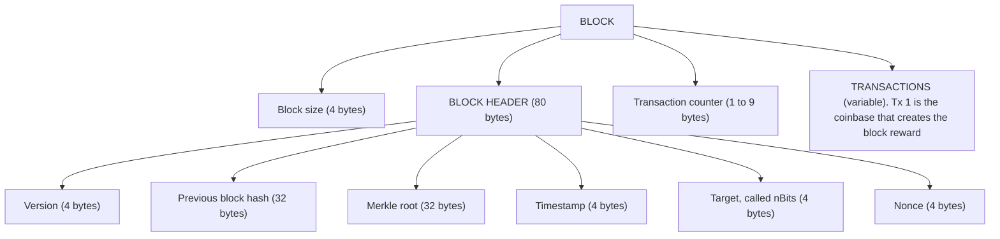
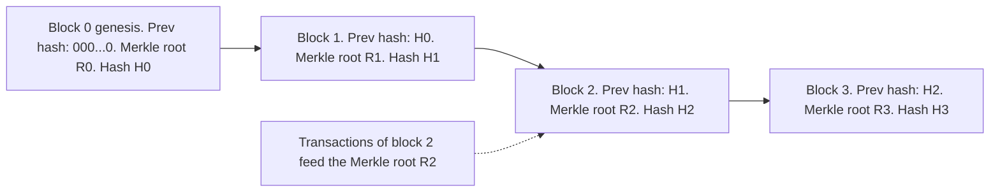
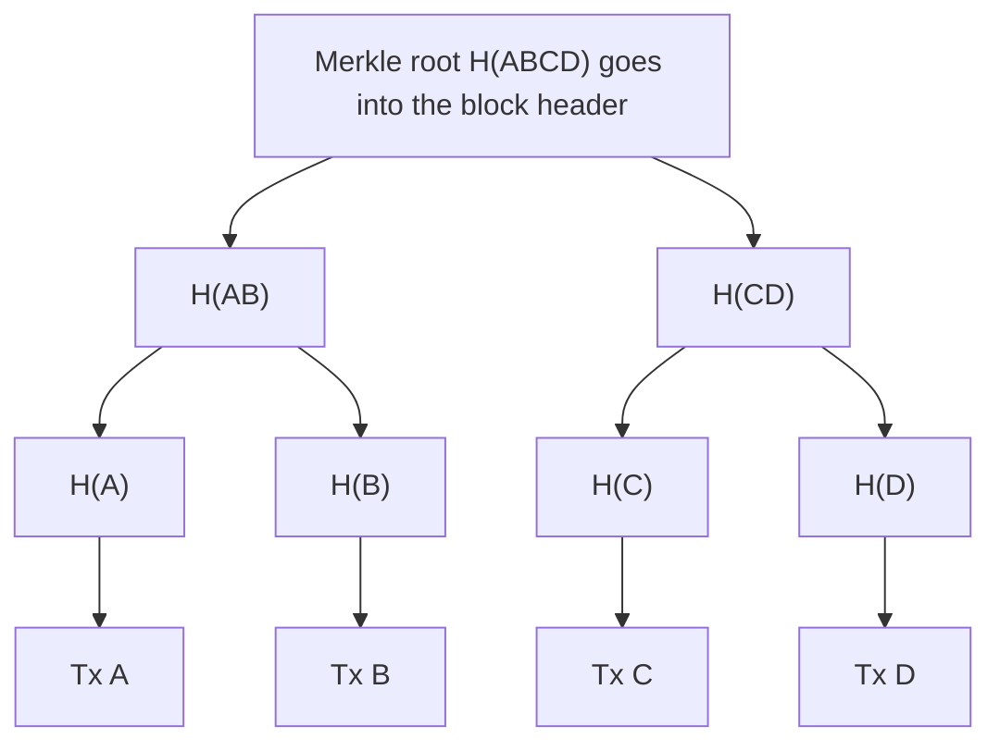
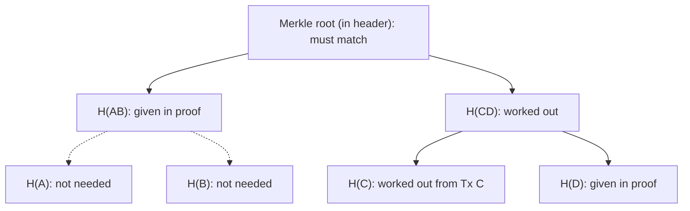
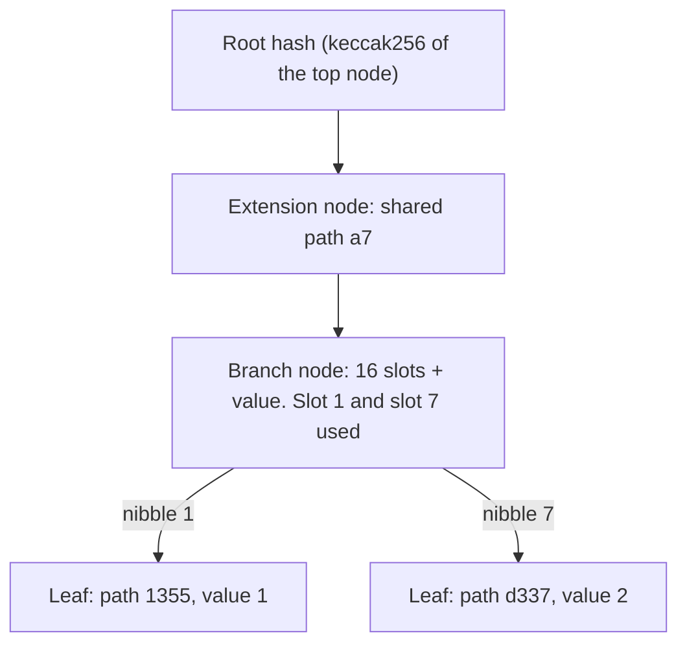
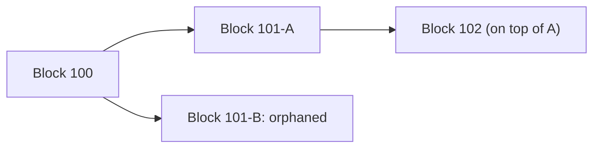

This note covers syllabus <Syl m="1" />, the part called "Block in a Blockchain": structure of a block, block header hash and block height, the genesis block, linking blocks in the blockchain, and the Merkle tree. The general idea of blockchain is in the fundamentals note.

## The basics first

- A **transaction** is one recorded event, for example "Asha pays Ravi 500 rupees".
- A **hash function** turns any data into a fixed-size fingerprint called a **hash**. The same data always gives the same hash; a tiny change gives a completely different hash; and you cannot get the data back from the hash. Bitcoin uses SHA-256, which gives 256 bits (32 bytes). <Cite id="block-structure-merkle-wiki-hash" /> <Cite id="block-structure-merkle-wiki-sha2" />
- A **block** is a bundle of transactions that the network accepts together.
- A **binary tree** is a diagram where each node has at most two children below it. A **leaf** is a node with no children and the **root** is the one node at the top.

Analogy: a teacher collects 8 answer sheets in a folder and writes a single "folder number" on the cover, worked out from all the sheets. If anyone swaps even one sheet, the number worked out later will not match the number on the cover. The block header and the Merkle root work like that cover and folder number.

## Structure of a block

<Box kind="definition">

A **block** is a container data structure that groups transactions for inclusion in the blockchain. It has a **header** (metadata about the block) followed by the **list of transactions**. <Cite id="block-structure-merkle-mb-ch11" loc="Structure of a Block" />

</Box>

**Why a header and a body?** The header is tiny and fixed in size, so it is quick to hash, to send and to check. The body is big and variable. Everything important about the body is squeezed into the header through the Merkle root. In Bitcoin the header is 80 bytes while the transactions can total about 4,000,000 bytes, so a full block can be nearly 50,000 times bigger than its header. <Cite id="block-structure-merkle-mb-ch11" loc="Structure of a Block" />

<Cite id="block-structure-merkle-mb-ch11" loc="diagram" /> <Cite id="block-structure-merkle-gfg-merkle" loc="diagram" />

### The six fields of the block header

| Field | Size | What it is for |
| --- | --- | --- |
| Version | 4 bytes | Which set of block-validation rules the block follows. It has been used also to signal support for upgrades. |
| Previous block hash | 32 bytes | Hash of the parent block's header. This is the link that makes a chain. |
| Merkle root | 32 bytes | One hash that summarises every transaction in the block. |
| Timestamp | 4 bytes | Approximate creation time (Unix time, seconds since 1 Jan 1970). |
| Target (nBits) | 4 bytes | Compact form of the proof-of-work target; the header hash must be at or below it. |
| Nonce | 4 bytes | A number the miner changes again and again to find a valid hash. |

<Cite id="block-structure-merkle-mb-ch11" loc="Block Header" /> <Cite id="block-structure-merkle-devref" loc="block headers" /> <Cite id="block-structure-merkle-btcwiki-block" /> <Cite id="block-structure-merkle-lmab-block" />

The nonce, target and timestamp are used in mining: the miner tries nonce values until the double SHA-256 hash of the header is lower than the target. That is covered in the consensus and mining note. <Cite id="blockchain-fundamentals-nakamoto" loc="§4" />

The first transaction in every block is the **coinbase transaction**. It has no real input; it creates the new coins (block reward) for the miner. The rest are ordinary payments, usually ordered so that miners can pick the ones with the best fees. <Cite id="block-structure-merkle-mb-ch11" />

<PYQ id="2023-05-ce/q2a" /> <PYQ id="2025-05/q3b" />

### Block header hash and block height

A block has two identifiers. <Cite id="block-structure-merkle-mb-ch11" loc="Block Identifiers" />

- **Block header hash.** Hash the 80-byte header twice with SHA-256. The result is a 32-byte fingerprint that works as the block's name. The hash is *not stored inside the block*; nodes work it out when they receive the block. A valid hash begins with many zeros because it must be below the target.
- **Block height.** The position of the block in the chain, counted from the genesis block, which has height 0. The block after it has height 1, and so on. A block at height 5 is the sixth block.

Height is not a unique identifier. Two miners can find different valid blocks at the same height at nearly the same time, so for a short while two blocks compete for one position; the hash always tells them apart. <Cite id="block-structure-merkle-mb-ch11" loc="Block Identifiers" />

<Box kind="pitfall">

The block hash is not a field in the header. People often say "the block contains its own hash". It does not; it contains the hash of the *previous* block, and its own hash appears in the next block.

</Box>

Header size and yearly header storage are worked in the sums below.

## The genesis block

<Box kind="definition">

The **genesis block** is the first block of a blockchain. It is numbered block 0 (height 0), has no previous block to point to, and is hard-coded into the software. <Cite id="block-structure-merkle-btcwiki-genesis" /> <Cite id="block-structure-merkle-mb-ch11" loc="The Genesis Block" />

</Box>

**Why it is needed.** Every block points to its parent, so something must be at the start of the chain. The genesis block is the common ancestor of every block: follow the previous-hash links backwards from any block and you always arrive at it. Every node starts with this block built into its program, so all nodes begin from the same, trusted root and nobody can quietly start a different history. <Cite id="block-structure-merkle-mb-ch11" loc="The Genesis Block" /> <Cite id="block-structure-merkle-gfg-genesis" />

**Facts about Bitcoin's genesis block.**

| Item | Value |
| --- | --- |
| Created | 3 January 2009 (timestamp 1231006505) by Satoshi Nakamoto |
| Height | 0 |
| Hash | `000000000019d6689c085ae165831e934ff763ae46a2a6c172b3f1b60a8ce26f` |
| Previous block hash | all zeros (no parent) |
| Merkle root | `4a5e1e4baab89f3a32518a88c31bc87f618f76673e2cc77ab2127b7afdeda33b` (it has one transaction, so the root is that transaction's own hash) |
| nBits / difficulty | `0x1d00ffff` / 1 |
| Nonce | 2083236893 |
| Transactions | 1 (the coinbase) with a 50 BTC reward that cannot be spent |
| Embedded message | "The Times 03/Jan/2009 Chancellor on brink of second bailout for banks" |

<Cite id="block-structure-merkle-btcwiki-genesis" /> <Cite id="block-structure-merkle-mb-ch11" loc="The Genesis Block" /> <Cite id="block-structure-merkle-core-chainparams" />

The Times headline works as a **timestamp proof**: the block cannot have been created before that newspaper was printed. It is also a comment on the banking crisis that Bitcoin was a reaction to. <Cite id="block-structure-merkle-mb-ch11" loc="The Genesis Block" />

In simple words: the genesis block is the "page 1" of the ledger that every computer already has, and every later page is tied back to it.

<PYQ id="2024-12/q1b" />

## Linking blocks in the blockchain

Each header stores the hash of the previous block's header. So each block "points back" to its parent, and the whole chain is tied together by these **hash pointers**. A full node checks an incoming block by looking at its previous-hash field and finding that parent in its own copy. <Cite id="block-structure-merkle-mb-ch11" loc="Linking Blocks" />

<Cite id="block-structure-merkle-gfg-merkle" loc="diagram" /> <Cite id="blockchain-fundamentals-gfg-structure" loc="diagram" />

**Why this makes data hard to change.** To edit a transaction in block 2 you change R2, which changes H2. Then block 3's "previous hash" is wrong, so you must redo block 3, then block 4, and so on, and redo the proof of work for each, faster than the rest of the network adds new blocks. That is why old blocks are practically immutable. <Cite id="blockchain-fundamentals-nakamoto" loc="§4" />

<PYQ id="2024-12/q1a" />

### Blockchain as a data structure

For "define blockchain and explain its data structure": a blockchain is a growing list of blocks where each block holds the hash of the previous one (a **linked list built with hash pointers**), and the transactions inside each block are summarised by a **Merkle tree**. So two data structures work together: the linked list of blocks outside, the hash tree inside. <Cite id="blockchain-fundamentals-wiki-blockchain" /> <Cite id="blockchain-fundamentals-gfg-structure" /> <Cite id="block-structure-merkle-gfg-merkle" />

<PYQ id="2024-12/q1a" />

## Merkle tree

<Box kind="definition">

A **Merkle tree** (also called a **hash tree**) is a binary tree in which every leaf is the hash of a data item (here, a transaction) and every parent node is the hash of its two children. The single hash at the top is the **Merkle root**. <Cite id="block-structure-merkle-wiki-merkle" /> <Cite id="block-structure-merkle-gfg-merkle" />

</Box>

It is named after Ralph Merkle, who patented the idea in 1979. Bitcoin uses it to summarise all the transactions in a block. <Cite id="block-structure-merkle-wiki-merkle" /> <Cite id="block-structure-merkle-mb-ch11" loc="Merkle Trees" />

**Why it is needed.** Two problems:

1. *Integrity of the whole list.* Instead of hashing a huge list of transactions in one go, we want one short value that changes if any transaction changes.
2. *Cheap proof of one transaction.* A phone wallet should be able to check that a payment is in a block without downloading all of its transactions. A Merkle tree allows this with only about log2(N) hashes. <Cite id="block-structure-merkle-mb-ch11" loc="Merkle Trees" />

### How a Merkle tree is built (bottom-up)

1. Hash each transaction. These are the **leaf nodes** (in Bitcoin they are the transaction ids, TXIDs).
2. Put the hashes in order and pair them: first with second, third with fourth, and so on.
3. Join each pair (concatenate the two hashes) and hash the result. This gives the next level, which has half as many nodes.
4. If a level has an **odd** number of hashes, copy the last one and pair it with itself.
5. Repeat until one hash remains. That is the Merkle root. Put it in the block header.

Bitcoin applies SHA-256 twice at each step. <Cite id="block-structure-merkle-devref" loc="merkle trees" /> <Cite id="block-structure-merkle-mb-ch11" loc="Merkle Trees" /> <Cite id="block-structure-merkle-tp-merkle" />

Notation used here: `H(A)` is the hash of transaction A, and `H(AB)` means the hash of the two hashes `H(A)` and `H(B)` joined together.

<Cite id="block-structure-merkle-gfg-merkle" loc="diagram" /> <Cite id="block-structure-merkle-tp-merkle" loc="diagram" />

The transactions themselves are not stored in the tree; only their hashes are. The tree is just a summary. <Cite id="block-structure-merkle-mb-ch11" loc="Merkle Trees" />

<Sum>

<Given>

A block has 4 transactions A, B, C, D. Write the Merkle root in terms of hashes. `H(X)` is the hash of X and `H(XY)` is the hash of `H(X)` joined with `H(Y)`.

</Given>

<Find>

each level of the tree, the Merkle root, and the number of hashes computed.

</Find>

<Steps>

1. Leaf level: hash each transaction: `H(A)`, `H(B)`, `H(C)`, `H(D)`. That is 4 hashes. *Reason: leaves are the hashes of the data items.*
2. Pair them in order: (A, B) and (C, D).
3. Level 1: `H(AB)` = hash of (`H(A)` joined with `H(B)`), and `H(CD)` = hash of (`H(C)` joined with `H(D)`). That is 2 hashes. *Reason: every parent is the hash of its two children.*
4. Level 2: pair `H(AB)` with `H(CD)` and hash them: Merkle root = `H(ABCD)`. That is 1 hash.
5. Total hashes computed: $4 + 2 + 1 = 7$.

</Steps>

<Answer>

Levels: 4 leaves, then `H(AB)` and `H(CD)`, then root `H(ABCD)`. Seven hashes in all; the root goes in the block header.

</Answer>

<Box kind="verify">

Each level has half as many nodes as the one below ($4 \to 2 \to 1$), so the tree has $\log_2 4 = 2$ levels above the leaves. A tree with $n$ leaves (a power of 2) has $2n - 1 = 7$ nodes, which matches.

</Box>

</Sum>

### When the number of transactions is odd

A binary tree needs pairs. Bitcoin's rule: if a level has an odd number of hashes, the last hash is paired with a copy of itself. <Cite id="block-structure-merkle-devref" loc="merkle trees" /> <Cite id="block-structure-merkle-gfg-merkle" />

<Sum>

<Given>

A block has 5 transactions A, B, C, D, E.

</Given>

<Find>

the Merkle root and the number of hashes computed.

</Find>

<Steps>

1. Leaves: `H(A)`, `H(B)`, `H(C)`, `H(D)`, `H(E)`. That is 5 hashes.
2. Level 1: pairs are (A, B), (C, D) and E alone. E has no partner, so copy it: (E, E). *Reason: the tree is binary, so every node needs a partner.* Level 1 is `H(AB)`, `H(CD)`, `H(EE)`: 3 hashes.
3. Level 2: three hashes is odd again, so `H(EE)` is paired with itself. Pairs are (`H(AB)`, `H(CD)`) and (`H(EE)`, `H(EE)`). Level 2 is `H(ABCD)` and `H(EEEE)`: 2 hashes.
4. Level 3: pair the last two: root = `H(ABCDEEEE)`: 1 hash.
5. Total hashes: $5 + 3 + 2 + 1 = 11$.

</Steps>

<Answer>

Merkle root `H(ABCDEEEE)`, built from 11 hashes, with E duplicated at both of the first two levels.

</Answer>

<Box kind="verify">

The number of nodes in each level is the previous count divided by 2, rounded up: $5 \to 3 \to 2 \to 1$. Adding gives 11. Also, the root covers A to E; E appears twice only because of the padding rule.

</Box>

</Sum>

<Box kind="pitfall">

Copying the last hash when a level is odd has a known flaw. The lists [1,2,3,4,5,6] and [1,2,3,4,5,6,5,6] give the same Merkle root, so a block with repeated transactions could pass for the original. This was the bug CVE-2012-2459, and Bitcoin Core now rejects such blocks. <Cite id="block-structure-merkle-mb-ch11" loc="A Design Flaw in Bitcoin's Merkle Tree" />

</Box>

### What the Merkle tree gives us

- **Tamper detection.** Change one transaction and its leaf hash changes, then every hash above it up to the root changes, then the header and block hash change, and the next block's previous-hash link breaks.
- **Efficient verification.** To prove one transaction is in a block you need only the hashes beside it on the way up to the root (a **Merkle path** or **authentication path**), not the whole block.
- **Light clients (SPV).** A simplified-payment-verification client stores only block headers (80 bytes each) and asks a full node for the Merkle path of its transaction. Satoshi described this in the whitepaper, and Bitcoin's `merkleblock` message carries it. <Cite id="blockchain-fundamentals-nakamoto" loc="§8" /> <Cite id="block-structure-merkle-bip37" /> <Cite id="block-structure-merkle-mb-ch11" loc="Merkle Trees and Lightweight Clients" />
- **Saving disk space.** After a transaction is buried deep enough, old transactions can be pruned and only the hashes kept, because the root in the header is still checkable. <Cite id="blockchain-fundamentals-nakamoto" loc="§7" /> <Cite id="block-structure-merkle-tp-merkle" />

### Merkle proof

<Cite id="block-structure-merkle-mb-ch11" loc="diagram" /> <Cite id="block-structure-merkle-gfg-merkle-intro" loc="diagram" />

<Sum>

<Given>

A block has the four transactions A, B, C, D of the first sum. A light client knows only the Merkle root `R` from the block header. A full node sends it transaction C and the proof: `H(D)` and `H(AB)`.

</Given>

<Find>

how the client checks that C is in the block, and how many hashes the proof needs for larger blocks (16 transactions, 1,000 transactions).

</Find>

<Steps>

1. Hash the transaction: compute `H(C)`. *Reason: the leaf must come from the data itself, not be trusted.*
2. C is the left child in the pair (C, D), so compute `H(CD)` = hash of (`H(C)` joined with `H(D)`). *Reason: order matters; joining in the wrong order gives a different hash.*
3. The pair (C, D) is the right half of the tree, so `H(AB)` goes on the left: compute root = hash of (`H(AB)` joined with `H(CD)`).
4. Compare the computed root with `R`. If equal, C is in the block. The proof used 2 hashes for 4 transactions: $\log_2 4 = 2$.
5. For 16 transactions: $\log_2 16 = 4$ hashes, so $4 \times 32 = 128$ bytes. This matches the book's example of proving transaction K among A to P with four hashes.
6. For 1,000 transactions: $\lceil \log_2 1000 \rceil = 10$ because $2^{10} = 1024 \ge 1000$. That is $10 \times 32 = 320$ bytes, plus the 80-byte header: 400 bytes instead of downloading all 1,000 transactions.

</Steps>

<Answer>

C is in the block if the recomputed root equals `R`. Proof size is $\lceil \log_2 N \rceil$ hashes: 2 for 4 transactions, 4 (128 bytes) for 16, and 10 (320 bytes) for 1,000.

</Answer>

<Box kind="verify">

Try a fake: change C to C'. Then `H(C')` differs, so `H(C'D)` differs and the computed root differs from `R`, so the check fails. Also a known case from the book: about 16,000 transactions need $\lceil \log_2 16000 \rceil = 14$ hashes, $14 \times 32 = 448$ bytes, which is the 448-byte proof the book quotes. <Cite id="block-structure-merkle-mb-ch11" loc="Merkle Trees" />

</Box>

</Sum>

### Advantages and limits of Merkle trees

| Advantages | Limits |
| --- | --- |
| One short root stands for any number of transactions | The root says nothing about whether a transaction is *valid*, only that it is included |
| Proof of inclusion in $\log_2 N$ hashes | The odd-leaf duplication rule had a flaw (CVE-2012-2459) |
| Any change is detected | Needs a fixed order of transactions |
| Lets light clients work with headers only | A proof shows inclusion; a proof that a transaction is *missing* needs more work |

<Cite id="block-structure-merkle-mb-ch11" loc="Merkle Trees" />

<Box kind="exam">

Exam mein English mein likho: "A Merkle tree is a binary hash tree in which each leaf is the hash of a transaction and each parent is the hash of its two children; the top hash, the Merkle root, is stored in the block header so that any change in any transaction changes the root and the block hash, and a transaction can be verified using only log N hashes."

</Box>

<PYQ id="2022-12-ce/q1d" /> <PYQ id="2023-05-ce/q1d" /> <PYQ id="2024-12-ce/q1a" /> <PYQ id="2024-05-ce/q3a" /> <PYQ id="2024-12/q5b" />

## Block header size and storage

The whitepaper uses the 80-byte header to show how little a light node must keep. <Cite id="blockchain-fundamentals-nakamoto" loc="§7" />

<Sum>

<Given>

Header fields: version 4 bytes, previous hash 32 bytes, Merkle root 32 bytes, timestamp 4 bytes, nBits 4 bytes, nonce 4 bytes. One block is found about every 10 minutes (6 blocks per hour).

</Given>

<Find>

the header size, and the storage needed for one year of headers.

</Find>

<Steps>

1. Header size $= 4 + 32 + 32 + 4 + 4 + 4 = 80$ bytes. *Reason: add the six fields.*
2. Blocks per day $= 6 \times 24 = 144$.
3. Blocks per year $= 144 \times 365 = 52{,}560$.
4. Storage $= 52{,}560 \times 80 = 4{,}204{,}800$ bytes, about 4.2 MB per year.

</Steps>

<Answer>

The header is 80 bytes, and a year of headers is about 4.2 MB.

</Answer>

<Box kind="verify">

Recompute in another order: $80 \times 6 \times 24 \times 365$: $80 \times 6 = 480$; $480 \times 24 = 11{,}520$; $11{,}520 \times 365 = 4{,}204{,}800$. It matches. It also matches the "4.2MB per year" in the whitepaper.

</Box>

</Sum>

## Merkle Patricia trie in Ethereum

Ethereum must store more than a list of transactions. It must store the **state**: every account's balance, nonce, contract code and contract storage. It needs a structure that is (a) searchable by key, (b) cheap to update when one account changes, and (c) summarised by one hash. The answer is the **Merkle Patricia trie** (MPT). <Cite id="block-structure-merkle-eth-mpt" /> <Cite id="block-structure-merkle-me-ch14" />

**Building up to it.**

1. **Trie (radix tree).** A tree where a key is read one character at a time and each step goes down one branch. For the key `dog` (hex 64 6f 67) you follow the path 6, 4, 6, f, 6, 7. Ethereum reads keys in **nibbles** (one hex digit, 4 bits), so each node can have up to 16 children. <Cite id="block-structure-merkle-eth-mpt" /> <Cite id="block-structure-merkle-wiki-radix" />
2. **Merkle.** Each node is stored under the hash of its content (keccak256 of its encoding). The parent holds the child's hash, exactly like a Merkle tree. So one **root hash** pins down the whole trie. <Cite id="block-structure-merkle-eth-mpt" />
3. **Patricia.** A plain trie wastes space, since a 64-nibble key needs 64 levels. Patricia compresses long single-path stretches into one **extension node**. <Cite id="block-structure-merkle-eth-mpt" />

**Three node types** (the ethereum.org page lists them): <Cite id="block-structure-merkle-eth-mpt" />

| Node | Shape | Job |
| --- | --- | --- |
| Branch | 17 items: 16 child slots plus one value | A fork, one slot per next hex digit |
| Extension | 2 items: shared path, hash of next node | Skips a shared run of nibbles |
| Leaf | 2 items: remaining path, value | End of a key; holds the data |

<Cite id="block-structure-merkle-eth-mpt" loc="diagram" /> <Cite id="block-structure-merkle-me-ch14" loc="diagram" />

**Why it is good for Ethereum.** Inserts, lookups and deletes cost about O(log n); two identical states always give the same root; and any change to any account changes the root, so a node can prove a value with a Merkle proof. <Cite id="block-structure-merkle-eth-mpt" />

**Where the roots live.** The Ethereum block header (yellow paper) holds the hash of the parent, the beneficiary (who gets fees), and three roots, each the root of a separate trie: <Cite id="block-structure-merkle-eth-yellow" /> <Cite id="block-structure-merkle-eth-blocks" />

| Root in header | Trie it summarises |
| --- | --- |
| `stateRoot` | The global state: all accounts after the block's transactions run |
| `transactionsRoot` | The transactions in this block |
| `receiptsRoot` | The receipts (result, gas used, logs) of those transactions |

The header also carries the block number, gas limit, gas used, timestamp and extra data, and the logs bloom filter. Bitcoin summarises only transactions in its Merkle root; Ethereum also summarises state, because smart contracts need it. <Cite id="block-structure-merkle-eth-yellow" /> <Cite id="block-structure-merkle-eth-blocks" />

| | Bitcoin Merkle tree | Ethereum Merkle Patricia trie |
| --- | --- | --- |
| Shape | Binary tree over a list | Radix tree with 16 branches over key-value pairs |
| Hash | Double SHA-256 | Keccak-256 |
| What it summarises | Transactions of one block | State, transactions and receipts |
| Roots in header | One (Merkle root) | Three (state, transactions, receipts) |
| Lookup by key | No (a list) | Yes |

<Cite id="block-structure-merkle-devref" /> <Cite id="block-structure-merkle-eth-mpt" /> <Cite id="block-structure-merkle-me-ch4" loc="hash functions" />

<PYQ id="2023-12/q2a" />

## Orphaned blocks

<Box kind="definition">

An **orphaned block** is a valid block that is not part of the main (longest or heaviest) chain, because another block at the same height was accepted instead. People now usually call it a **stale block**. <Cite id="block-structure-merkle-btcwiki-orphan" /> <Cite id="block-structure-merkle-gfg-conflicts" />

</Box>

**How it happens.** The network has delays. Two miners can solve a block at almost the same moment. Some nodes hear miner X's block first and others hear miner Y's. For a while the chain has a fork. Then the next block is found on top of one of them; the nodes follow the longer chain, and the block that lost is orphaned. <Cite id="block-structure-merkle-gfg-conflicts" /> <Cite id="block-structure-merkle-mb-ch11" loc="Block Identifiers" />

<Cite id="block-structure-merkle-gfg-conflicts" loc="diagram" /> <Cite id="block-structure-merkle-btcwiki-orphan" loc="diagram" />

**What happens next.**

- The miner of the orphaned block gets **no reward** or fees, because its coinbase is not on the main chain. <Cite id="block-structure-merkle-btcwiki-orphan" />
- Its transactions are still valid. Any that are not already in the winning block go back to the pool of unconfirmed transactions and are mined again. <Cite id="block-structure-merkle-gfg-conflicts" />
- This is the reason merchants wait for several **confirmations** (blocks on top) before treating a payment as final.

**Why they matter.** They waste mining work, they are more frequent when blocks are big or networks slow, and they weaken security slightly because honest power is split. Precisely, "orphan" once meant a block whose parent is unknown to the node; today the word is used for stale blocks. Ethereum under proof of work also allowed stale blocks to be referenced by later blocks (called ommers or uncles, and the header holds an ommers hash). <Cite id="block-structure-merkle-btcwiki-orphan" /> <Cite id="block-structure-merkle-eth-yellow" />

<PYQ id="2024-05-ce/q1c" /> <PYQ id="2025-05-ce/q1a" />

## Cryptography in blockchain

Blockchain is built from a few cryptographic tools. <Cite id="block-structure-merkle-me-ch4" /> <Cite id="block-structure-merkle-wiki-pubkey" />

| Tool | What it gives | Where it is used here |
| --- | --- | --- |
| Cryptographic hash function (SHA-256 in Bitcoin, Keccak-256 in Ethereum) | Fixed-size fingerprint; one-way; any change gives a very different hash; collisions are infeasible to find | Block header hash, previous-hash link, Merkle tree, proof-of-work puzzle, addresses |
| Public-key cryptography (key pair) | A private key kept secret and a public key shared; one cannot be worked out from the other | Ownership of coins and accounts |
| Digital signature | Proof that the owner of a private key approved a transaction, and that it was not altered | Every transaction is signed and checked by all nodes |
| Merkle tree | One hash for many items, and short proofs of inclusion | Transactions in a block; Ethereum state |

<Cite id="block-structure-merkle-wiki-hash" /> <Cite id="block-structure-merkle-wiki-digsig" /> <Cite id="block-structure-merkle-wiki-pubkey" /> <Cite id="block-structure-merkle-me-ch4" />

A simple picture: the hash is the tamper seal on the parcel, the signature is the sender's signature on the label, and the Merkle root is the packing list stuck on the outside.

<PYQ id="2023-12-ce/q6c" />

## Conclusion

A block is a small header plus a list of transactions. The header's previous-hash field links blocks into a chain that starts at the hard-coded genesis block, and its Merkle root ties the whole transaction list into one hash, so any change anywhere is noticed. The Merkle tree also lets light clients verify a payment with about $\log_2 N$ hashes, Ethereum extends the idea to a Merkle Patricia trie for state, and orphaned blocks are the harmless leftovers of normal races between miners.
