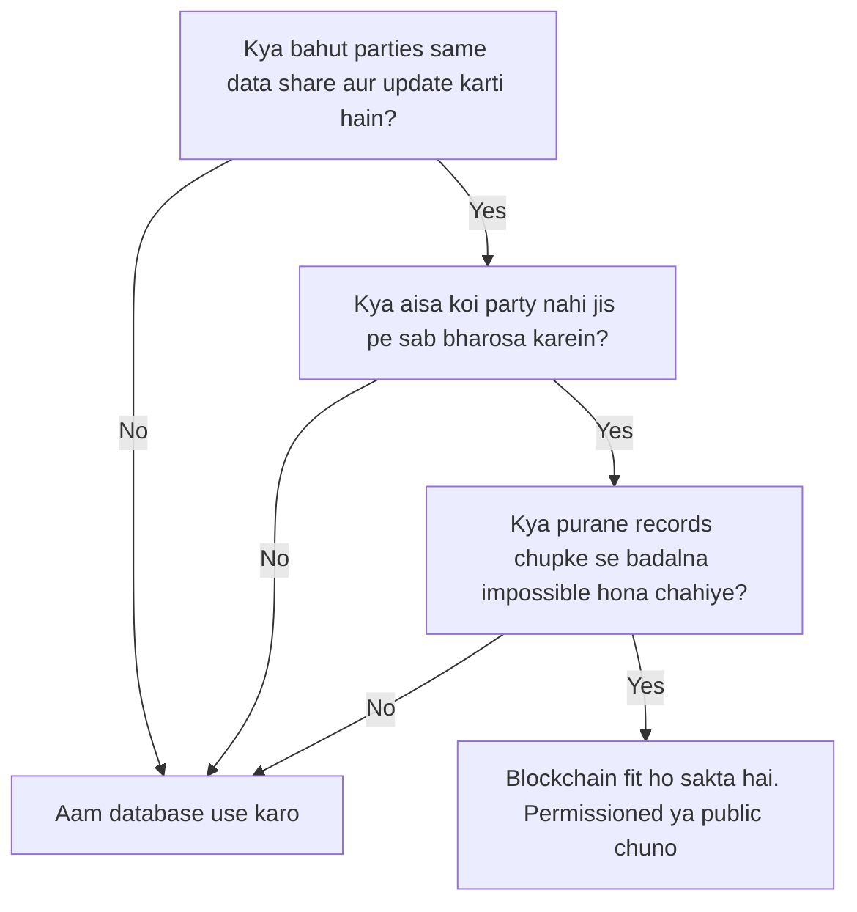
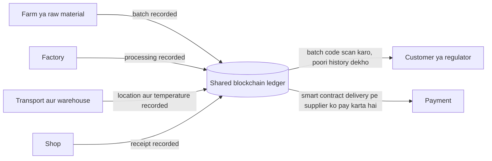
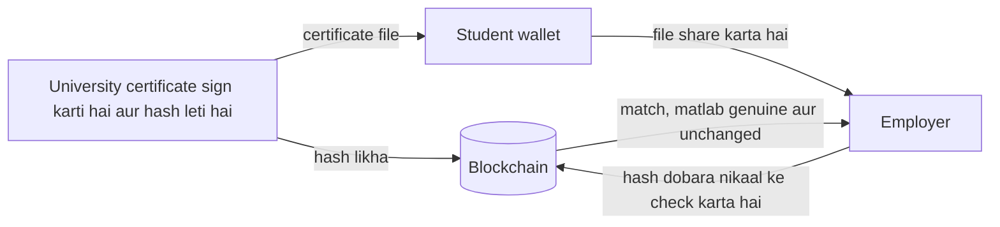
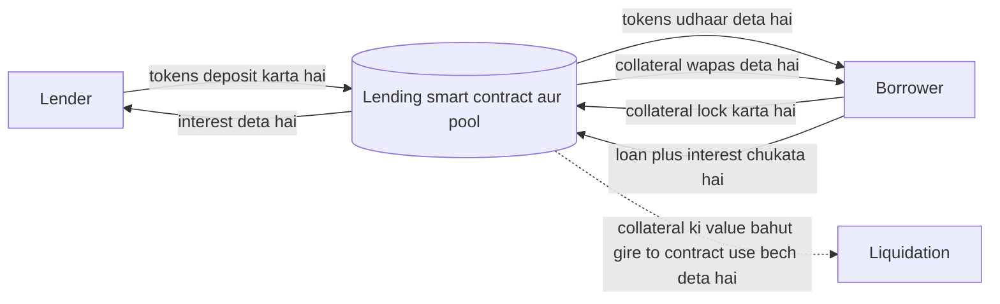
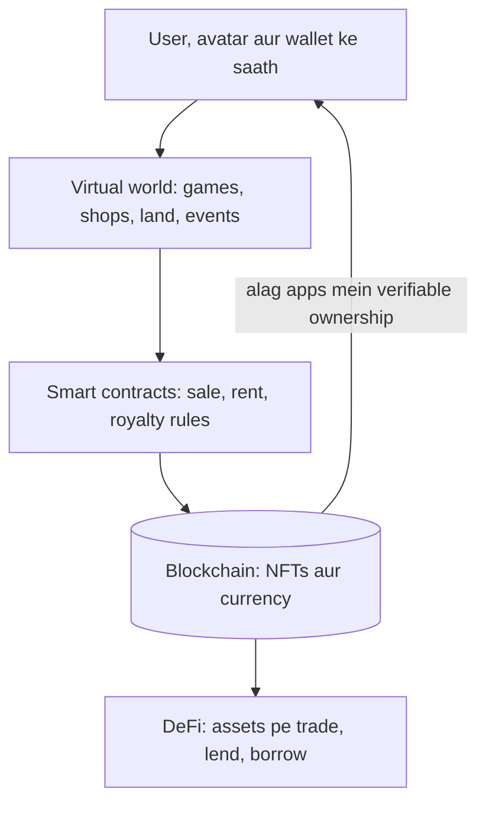

Ye note syllabus <Syl m="6" /> cover karta hai: education, energy, healthcare, real estate, logistics aur supply chain mein blockchain ke applications, aur DeFi aur metaverse jaise naye areas.

## Pehle basics

- **Blockchain** ek shared ledger hai jiski copy bahut saare computers (nodes) pe hoti hai. Records blocks mein group hote hain jo hashes se linked hain, isliye purana record badalna turant pakda jaata hai. <Cite id="blockchain-fundamentals-gfg-intro" /> <Cite id="blockchain-fundamentals-nist-8202" />
- **Smart contract** chain pe stored ek program hai jo apni conditions poori hone pe khud chal jaata hai (jaise "delivery confirm ho to pay karo").
- **Permissioned (private ya consortium) chains** mein sirf approved organisations join kar sakti hain; zyada tar business applications inhe use karte hain kyunki parties known hoti hain aur data public nahi hona chahiye. <Cite id="private-blockchain-gfg-consortium" /> <Cite id="blockchain-fundamentals-fabric-docs" />
- **Oracle** ek service hai jo real-world facts (temperature, delivery scan) chain mein daalti hai. Chain khud physical duniya check nahi kar sakti. <Cite id="smart-contracts-eth-oracles" />
- **On-chain** matlab blockchain mein stored; **off-chain** matlab kahin aur (normal database) stored, chain pe sirf hash ya pointer.

Analogy: ek shared notebook socho jiski copy business ke har partner ke paas hai. Koi bhi nayi line add kar sakta hai, purani line chupke se mita nahi sakta, aur saari copies match honi chahiye. Ye tab kaam aata hai jab bahut log, jo ek doosre pe poora bharosa nahi karte, ek hi record pe depend karte hain.

## Blockchain kab sense banata hai?

<Box kind="definition">

Blockchain application tab banane layak hai jab **bahut saari parties** data share karti hain, **koi ek party itni trusted nahi** ki record rakhe, **records baad mein badalne nahi chahiye**, aur **intermediaries (beech ke log) cost ya delay badhate hain**. Agar data ek hi organisation ka hai aur sab usse already trust karte hain, to normal database simple, fast aur sasta hai. <Cite id="blockchain-applications-wiki-supply" />

</Box>

Sab sectors mein typical benefits: ek shared version of the truth, tamper-evident audit trail, kam middlemen, smart contracts se fast settlement, aur easy verification. Typical limits: databases ke comparison mein kam speed aur scale, purane systems jodne ka cost aur effort, unclear laws, privacy (chain pe data delete karna mushkil) aur "garbage in, garbage out" problem (chain ye nahi bata sakti ki jo enter hua wo sach hai ya nahi). <Cite id="blockchain-applications-gfg-supply-revolution" /> <Cite id="blockchain-applications-gfg-industries" />

<Cite id="blockchain-fundamentals-nist-8202" /> <Cite id="blockchain-applications-gfg-beyond-crypto" />

## Supply chain management aur logistics

**Supply chain** product ka poora raasta hai: raw material, factory, warehouse, transport, shop, customer. **Logistics** uska moving aur storing wala hissa hai.

**Problem.** Bahut si companies apne alag records rakhti hain (paper, e-mail, alag databases). Wo match nahi karte, isliye product kahan se aaya ye trace karne mein din lag jaate hain, counterfeits ghus jaate hain, payments paperwork ka wait karte hain, aur disputes common hain. <Cite id="blockchain-applications-gfg-supply-revolution" />

**Blockchain kaise madad karta hai.**

1. Har partner (farmer, manufacturer, shipper, customs, retailer) ek shared, aam taur pe permissioned, ledger ka node hai.
2. Har hand-over pe partner ek event record karta hai: batch number, jagah, time, condition (kabhi IoT sensors ya barcode/RFID scans se, oracle ke through). <Cite id="smart-contracts-eth-oracles" />
3. Har record signed hota hai aur pichhle se linked, isliye history chupke se edit nahi ho sakti.
4. Allowed koi bhi batch number se product ka poora path dekh sakta hai.
5. Smart contracts records pe action lete hain: delivery hone aur temperature range mein rehne pe payment release, ya shipment late ho to alert.

<Cite id="blockchain-applications-gfg-supply-revolution" /> <Cite id="blockchain-applications-tp-use-cases" />

**Real examples.**

- **Food (Walmart aur IBM Food Trust).** Walmart aur IBM ne 2018 mein lettuce aur spinach ko blockchain pe trace karne ka trial kiya; saare nodes Walmart ne chalaye, IBM ke cloud pe hosted. Food item ko uske farm tak trace karna, jisme pehle din lagte the, seconds mein hone ki report hai. <Cite id="blockchain-applications-wiki-supply" /> <Cite id="blockchain-applications-gfg-industries" />
- **Diamonds (Everledger, IBM ke saath).** Diamonds ka origin record hota hai taaki "blood diamonds" aur fakes se ladein. <Cite id="blockchain-applications-wiki-supply" />
- **Cars (Mercedes-Benz).** Ek prototype contract aur ethical rules supplier tiers tak pahunchata hai, aur company ne battery cell supply chains mein emissions aur recycled content track karne ke liye blockchain use kiya hai. <Cite id="blockchain-applications-wiki-supply" />
- **Medicines (PharmaLedger).** Ek consortium project jo counterfeit dawaiyon ko rokne ke liye drugs trace karta hai. <Cite id="blockchain-applications-gfg-industries" />

**Doosre uses.** Food safety (contaminated batch jaldi alag ho jaata hai, isliye recalls chhote rehte hain), aur supply chain finance (invoices aur payments shared, trusted records pe based). <Cite id="blockchain-applications-tp-use-cases" /> <Cite id="blockchain-applications-gfg-beyond-crypto" />

| Benefit | Kyun |
|---|---|
| Traceability | Origin se shelf tak ek shared record |
| Kam fakes | Origin aur ownership history forge karna mushkil |
| Fast payment | Smart contract delivery confirm hone pe pay karta hai |
| Kam paperwork | Partners documents bhejne ki jagah ek record padhte hain |
| Trust | Koi partner history chupke se rewrite nahi kar sakta |

**Challenges.** Scalability (bahut zyada transactions), purane systems aur standards se jodna, unclear regulation, aur oracle problem: chain wahi jaanti hai jo enter hua, isliye galat scan ya shuru mein enter hua fake label hamesha galat rehta hai. Counterfeit detection ke liye physical item ko uske record se jodne ka secure tareeka (tamper-proof tag) bhi chahiye. <Cite id="blockchain-applications-gfg-supply-revolution" /> <Cite id="blockchain-applications-wiki-supply" />

<Box kind="exam">

Exam mein English mein likho: "Blockchain in supply chain gives every partner a shared, tamper-evident ledger of each hand-over of a product. This gives end-to-end traceability, reduces counterfeits and fraud, speeds up payments through smart contracts and cuts paperwork. Examples: Walmart and IBM Food Trust for food, Everledger for diamonds. Challenges: scalability, integration with old systems, regulation and the accuracy of data entered."

</Box>

<PYQ id="2024-12/q1f" /> <PYQ id="2025-05/q6c" />

## Healthcare

**Problem.** Patient ke records alag formats mein hospitals, labs aur clinics mein bikhre hote hain. Sharing slow hai, records kho ya leak ho sakte hain, aur patient ka control kam hai. Nakli dawaiyan bhi pharmacies tak pahunch jaati hain. <Cite id="blockchain-applications-tp-use-cases" /> <Cite id="blockchain-applications-gfg-industries" />

**Blockchain kaise madad karta hai.**

- **Patient-controlled records.** Keys patient ke paas hoti hain aur wahi approve karta hai kaun har record padh sakta hai; har access log hota hai. Medical data khud off-chain rehta hai (bahut bada aur private), aur chain pe uska hash hota hai jo prove karta hai ki badla nahi, aur permissions. (MedRec electronic medical records manage karne ka ek jaana-maana project hai.)
- **Interoperability.** Alag hospitals same record padhte hain, isliye doosre shehar ka doctor history dekh sakta hai.
- **Drug traceability.** Upar wala supply chain idea hi, counterfeit drugs pakadne ke liye (PharmaLedger).
- **Clinical trials aur credentials.** Tamper-resistant trial records; doctor ya nurse ke credentials ka quick verification.
- **IoT security.** Remote-monitoring devices ko secure karna. <Cite id="blockchain-applications-tp-use-cases" />

**Limits.** Patient data bahut private hai, aur chain data delete nahi kar sakti, isliye sirf proofs aur permissions chain pe jaate hain. Ab tak ki research zyada tar prototypes aur simulations hai, real-world mein lagataar use limited hai. <Cite id="blockchain-applications-wiki-supply" />

## Education

**Problem.** Degree aur mark-sheet fraud common hai, aur certificate check karne ke liye university ko likhna padta hai aur wait karna padta hai. Students paper copies bhi rakhte hain jo kho sakti hain. <Cite id="blockchain-applications-gfg-industries" /> <Cite id="blockchain-applications-tp-use-cases" />

**Ye kaise kaam karta hai.**

1. University certificate ko file ki tarah banati hai aur uska **hash** nikalti hai.
2. Wo record ko apni private key se sign karti hai aur hash (ya bahut saare certificates ka Merkle root) blockchain pe likhti hai.
3. Student ko file wallet ya app mein milti hai aur wo employer ke saath share kar sakta hai.
4. Employer file ka hash dobara nikalta hai aur chain aur university ki public key se match karta hai. Match ka matlab certificate genuine aur unchanged hai, university ko contact kiye bina.

<Cite id="blockchain-applications-blockcerts" /> <Cite id="blockchain-applications-gfg-industries" />

**Examples.** Blockcerts blockchain-based credentials (academic, professional aur civic) issue aur verify karne ka open standard hai, free verifier ke saath jo koi bhi use kar sakta hai. <Cite id="blockchain-applications-blockcerts" /> Doosre uses: grades aur attendance ka secure storage, institutions ke beech easy record transfer, content copyright, aur smart contracts se chalne wale course platforms. <Cite id="blockchain-applications-gfg-industries" /> <Cite id="blockchain-applications-tp-use-cases" />

### Education mein blockchain ke challenges

Ye seedha exam question hai. Ye points blockchain ke kaam karne ke tareeke se aur sources ki general limits se nikalte hain. <Cite id="blockchain-applications-gfg-industries" /> <Cite id="blockchain-applications-wiki-supply" />

1. **Privacy aur data protection.** Student data personal hai. Blockchain records erase nahi kar sakta, jo un privacy rules se takraata hai jo logon ko apna data delete karwane ka haq dete hain. Chain pe sirf hashes jaane chahiye.
2. **Galat data galat hi rehta hai.** Chain prove karti hai ki record badla nahi, ye nahi ki wo sach tha. Galat grade enter ho gaya to wahi rahega.
3. **Cost aur skills.** Nodes chalane ke liye paisa aur trained staff chahiye, jo chhote colleges ke paas nahi hota.
4. **Scalability aur speed.** Lakhon students aur records bahut chains ke liye heavy hain.
5. **Standards aur interoperability.** Universities aur countries alag formats use karti hain; Blockcerts jaise common standard ke bina certificates systems ke beech kaam nahi karte. <Cite id="blockchain-applications-blockcerts" />
6. **Legacy systems.** Maujooda admission, exam aur ERP software ko jodna padta hai.
7. **Lost keys.** Jo student private key kho de, wo apne hi certificates ka access kho sakta hai.
8. **Legal recognition.** Regulators aur employers ko blockchain certificate ko valid proof maanna padega.
9. **Kam awareness aur adoption.** Bahut kam institutions ne projects launch kiye hain; interest abhi practical se zyada academic hai. <Cite id="blockchain-applications-wiki-supply" />
10. **Energy use**, agar proof-of-work chain chuni jaaye.

<Box kind="exam">

Exam mein English mein likho: "Blockchain in education stores a hash of each certificate so employers can verify it without the university. Challenges: privacy and the right to delete data, entering wrong data, high cost and lack of skills, scalability, missing standards, integration with legacy systems, loss of private keys, legal recognition and low adoption."

</Box>

<PYQ id="2025-05/q4b" />

## Energy

**Problem.** Bijli ek hi disha mein behti hai, bade utility se gharon tak. Solar panel wala ghar extra bijli sirf utility ke through bech sakta hai, delay aur middlemen ke saath, aur ye prove karna mushkil hai ki bijli sach mein "green" hai. <Cite id="blockchain-applications-gfg-industries" />

**Blockchain kaise madad karta hai.**

- **Peer-to-peer energy trading.** Smart meter record karta hai ki ghar kitna produce karta hai; smart contract use us padosi se match karta hai jise bijli chahiye aur payment automatically settle karta hai. <Cite id="blockchain-applications-gfg-beyond-crypto" />
- **Renewable energy certificates.** Green energy ki har unit ka unique record hota hai, isliye wo do baar nahi bik sakti.
- **Grid monitoring** aur automated billing.
- Example: Energi Mine, ek decentralised energy marketplace jo kam bijli use karne pe users ko tokens deta hai. <Cite id="blockchain-applications-gfg-industries" />

**Limits.** Meter data pe trust karna padta hai (oracle problem), energy law aur grid rules alag hain, aur proof-of-work chain khud bahut bijli khaati hai (2021 mein Bitcoin ka andaaza saal mein lagbhag 121 TWh tha), isi wajah se Ethereum jaise networks proof of stake pe gaye. <Cite id="blockchain-applications-wiki-supply" />

## Real estate

**Problem.** Zameen ya flat kharidne mein bahut papers, lawyers, brokers aur offices lagte hain; title records forge ya dispute ho sakte hain, aur sale mein hafte lag jaate hain. <Cite id="blockchain-applications-tp-use-cases" />

**Blockchain kaise madad karta hai.**

- **Shared, tamper-evident title record**: kiska kya hai aur har purani sale, jo fraud kam karta hai. <Cite id="blockchain-applications-gfg-beyond-crypto" />
- **Smart-contract escrow:** title transfer record hote hi paisa automatically release hota hai, isliye kam intermediaries aur kam fees.
- **Tokenisation:** property digital tokens mein baat di jaati hai taaki bahut log chhota share rakh sakein aur trade kar sakein, jisse liquidity badhti hai. <Cite id="blockchain-applications-tp-use-cases" />
- Named examples: Propy (cross-border property deals) aur Uphold (real-estate assets tokenise karna). <Cite id="blockchain-applications-gfg-industries" />

**Limits.** Law ko on-chain record ko legal title maanna padega, chain ye check nahi karti ki physical property sach mein hai ya seller sach mein owner hai, aur original land records pehle sahi se digitise hone chahiye.

## Decentralised finance (DeFi)

<Box kind="definition">

**DeFi (decentralised finance)** financial services (lending, borrowing, trading, savings, insurance) ka group hai jo public blockchain, mainly Ethereum, pe smart contracts ki tarah bane hain, taaki koi bhi bank ya broker ke bina use kar sake. <Cite id="blockchain-applications-ethereum-org-defi" /> <Cite id="smart-contracts-wiki-defi" />

</Box>

**Ye kyun zaroori hai.** Traditional finance un institutions pe depend karti hai jo aapka paisa rakhti hain, fixed hours mein chalti hain, applications maangti hain aur settle karne mein din leti hain. DeFi institution ko code se replace karta hai jise koi bhi inspect kar sakta hai. <Cite id="blockchain-applications-ethereum-org-defi" />

| Point | Traditional finance | DeFi |
|---|---|---|
| Aapka paisa kaun rakhta hai | Ek company | Aap (apna wallet) |
| Access | Application, ID, approval | Internet wala koi bhi |
| Hours | Market hours | Hamesha on |
| Settlement | Aksar din | Aam taur pe minutes |
| Transparency | Zyada tar closed | Public code aur transactions |

<Cite id="blockchain-applications-ethereum-org-defi" />

**Main building blocks.**

- **Stablecoins:** tokens jo value steady rakhne ke liye bane hain, aam taur pe US dollar ke against (jaise Dai, USDC), taaki log bade price swings ke bina transact kar sakein. <Cite id="blockchain-applications-ethereum-org-defi" /> <Cite id="cryptocurrencies-tokens-wiki-stablecoin" />
- **Lending aur borrowing:** lenders tokens pool mein daalte hain aur interest kamaate hain; borrowers jitna udhaar lete hain usse zyada collateral lock karte hain, jo loan na chukane pe contract le sakta hai, isliye credit check nahi chahiye. Flash loans ek hi transaction ke andar borrow aur repay karte hain, aur repay fail hone pe sab undo ho jaata hai. <Cite id="blockchain-applications-ethereum-org-defi" />
- **Decentralised exchanges (DEXs):** users exchange company ki jagah smart contract (aksar liquidity pool) se apne wallets se seedhe tokens swap karte hain. <Cite id="blockchain-applications-ethereum-org-defi" />
- **Aur:** tokenised assets, insurance, yield earning, DAOs.

<Cite id="blockchain-applications-ethereum-org-defi" /> <Cite id="smart-contracts-eth-defi" />

**Advantages.** Sabke liye open, middleman fees nahi, fast settlement, transparent, custody aapke paas, services building blocks ki tarah jodi ja sakti hain.

**Disadvantages aur risks.** Contract code mein bugs aur exploits (aur live contracts aasani se badle nahi ja sakte), crypto assets ki price volatility, loan na chuka paaye to collateral ka loss, users ko code review karne wale logon pe trust karna padta hai, aur unclear regulation. <Cite id="blockchain-applications-ethereum-org-defi" />

<Box kind="exam">

Exam mein English mein likho: "DeFi is a set of financial services such as lending, borrowing, trading and stablecoins run by smart contracts on a blockchain instead of banks. It is open to anyone, works all the time, settles fast and is transparent, and users keep their own funds. Risks are smart-contract bugs, price volatility, loss of collateral and weak regulation."

</Box>

<PYQ id="2023-12/q6c" /> <PYQ id="2023-05-ce/q6d" />

## Metaverse

<Box kind="definition">

**Metaverse** ek shared virtual world hai, aam taur pe 3D, jahan log avatars ki tarah dikhte hain aur mil sakte hain, khel sakte hain, kaam kar sakte hain, shopping aur trade kar sakte hain. Ye shabd Neal Stephenson ke 1992 ke novel *Snow Crash* se aaya hai. <Cite id="cryptocurrencies-tokens-wiki-metaverse" />

</Box>

**Blockchain kya add karta hai.** Normal game company jo kuch aap game ke andar kharidte ho, uski owner khud hoti hai. Blockchain-based metaverse users ko asli ownership deta hai:

- **Digital assets NFTs ki tarah.** Non-fungible token (NFT) ek unique, provably scarce token hai. Items, avatars, kapde aur virtual land NFTs ho sakte hain jinki ownership koi bhi verify kar sakta hai aur jo ek company ke platform mein locked rehne ki jagah alag apps mein use ho sakte hain. <Cite id="blockchain-applications-ethereum-org-nft" /> <Cite id="cryptocurrencies-tokens-eth-nft" />
- **Cryptocurrency** kharidne, bechne aur creators ko pay karne ke paise ki tarah; kuch platforms crypto pe depend karte hain aur ownership track karne ke liye blockchain use karte hain. <Cite id="cryptocurrencies-tokens-wiki-metaverse" />
- **Smart contracts** rules ke liye: land sales, rentals, har resale pe creators ko royalties. <Cite id="blockchain-applications-ethereum-org-nft" />
- **Identity aur DAOs:** ek wallet alag worlds mein login ki tarah, aur communities jo rules pe vote karti hain.
- **DeFi link:** assets trade, lend ya collateral ki tarah use ho sakte hain, isliye virtual economy asli economy se jud jaati hai.

<Cite id="cryptocurrencies-tokens-gfg-metaverse" /> <Cite id="cryptocurrencies-tokens-wiki-metaverse" />

**Examples.** Decentraland blockchain pe bana ek self-described metaverse platform hai, haalaanki uske asli daily users ke numbers pe vivaad raha hai. <Cite id="cryptocurrencies-tokens-wiki-metaverse" />

**Advantages.** Sachchi ownership, transferable assets, creator earnings, open aur global economy, koi ek owner nahi jo aapke items delete kar de.

**Disadvantages aur criticism.** Bahut kuch hype hai aur technology claim se kam developed hai; in platforms ko bahut kam log use karte hain; hardware aur software gaps; privacy (data collection) aur safety (harassment, minors); NFTs mein scams aur price swings; kuch chains ka high cost; aur unclear regulation. <Cite id="cryptocurrencies-tokens-wiki-metaverse" />

<PYQ id="2023-12/q6c" />

## IoT, AI aur cyber security ke saath blockchain (short note)

Syllabus outcome in sabka zikr karta hai, haalaanki module text mein ye listed nahi hain. Jawab chhota rakho.

- **IoT:** sensors aur meters data banate hain (location, temperature, power use). Chain us data ka tamper-evident record rakh sakti hai aur devices ko smart contracts trigger karne de sakti hai. Limit: chain device ki report pe trust karti hai, isliye kharab ya hack hua sensor bhi galat data enter kar deta hai (oracle problem). <Cite id="smart-contracts-eth-oracles" /> <Cite id="blockchain-applications-tp-use-cases" />
- **Cyber security:** hash-linked records tamper-evident logs dete hain, aur keys aur signatures identity control dete hain, jo identity fraud ke khilaf madad karta hai. Limit: churaayi hui private keys sab bekaar kar deti hain. <Cite id="blockchain-applications-gfg-beyond-crypto" />
- **AI:** chain record kar sakti hai ki AI training data kahan se aaya aur model ne kya decide kiya, audit ke liye. Ye zyada tar experimental hai.

## Summary

- Blockchain tab use karo jab bahut distrusting parties ko ek shared, unchangeable record chahiye; warna database.
- Supply chain: traceability, kam fakes, automatic payment (Walmart aur IBM Food Trust). Healthcare: patient-controlled records aur drug tracking. Education: verifiable certificates, privacy, cost, standards aur legal challenges ke saath. Energy: peer-to-peer trading aur green certificates. Real estate: shared titles, escrow, tokenised shares.
- DeFi banks ko smart contracts se replace karta hai (lending, DEXs, stablecoins), bugs aur volatility ke risk ke saath. Metaverse ownership ke liye NFTs aur crypto use karta hai par abhi early hai aur criticise hota hai.
- Common limits: scale, purane systems, law, privacy aur oracle problem.

Related PYQ: <PYQ id="2024-12/q1f" />, <PYQ id="2025-05/q6c" />, <PYQ id="2025-05/q4b" />, <PYQ id="2023-12/q6c" />, <PYQ id="2023-05-ce/q6d" />.
