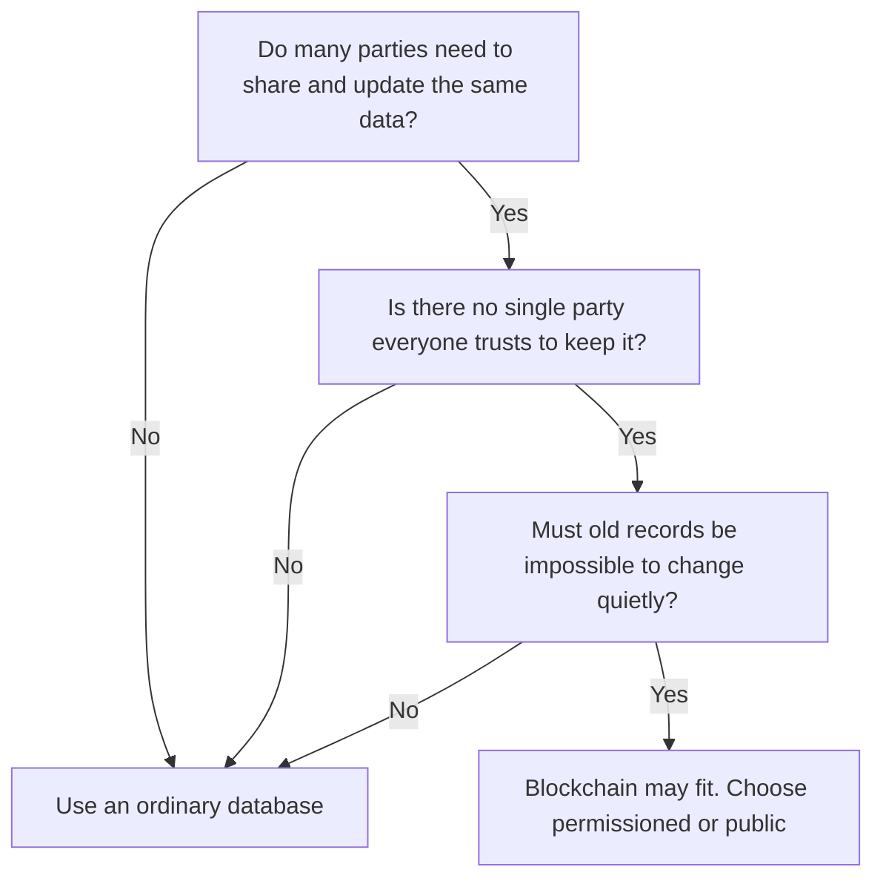
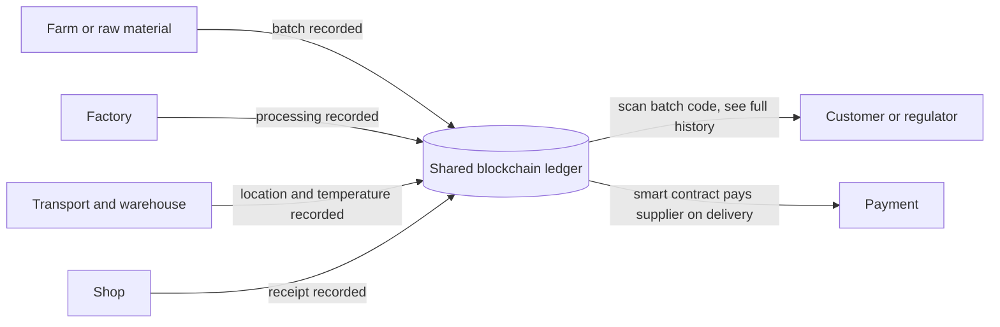
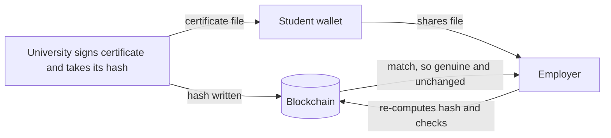
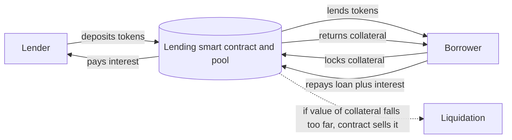
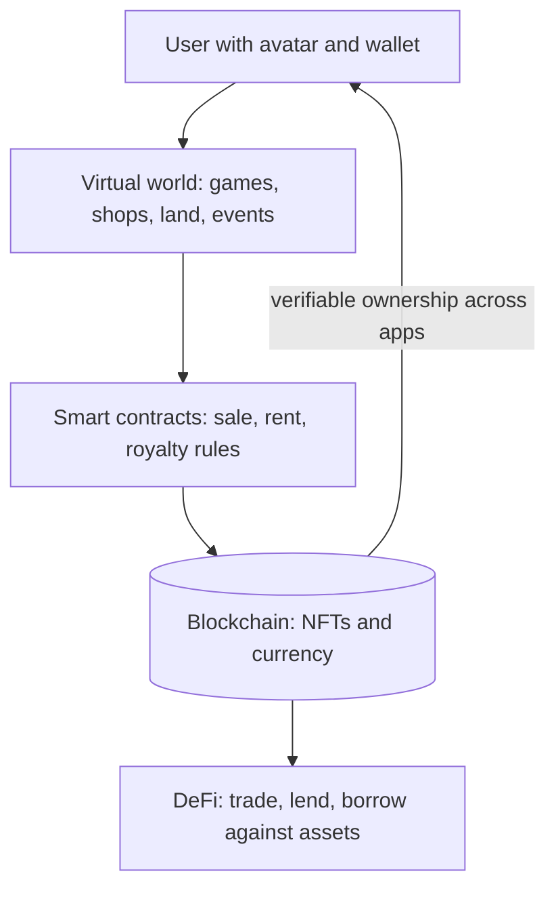

This note covers syllabus <Syl m="6" />: applications of blockchain in education, energy, healthcare, real estate, logistics and supply chain, and the newer areas of DeFi and the metaverse.

## The basics first

- A **blockchain** is a shared ledger copied on many computers (nodes). Records are grouped in blocks linked by hashes, so changing an old record is easy to detect. <Cite id="blockchain-fundamentals-gfg-intro" /> <Cite id="blockchain-fundamentals-nist-8202" />
- A **smart contract** is a program stored on the chain that runs by itself when its conditions are met (for example "pay when delivery is confirmed").
- **Permissioned (private or consortium) chains** let only approved organisations join; most business applications use them because the parties are known and data must not be public. <Cite id="private-blockchain-gfg-consortium" /> <Cite id="blockchain-fundamentals-fabric-docs" />
- An **oracle** is a service that feeds real-world facts (a temperature, a delivery scan) into the chain. A chain cannot check the physical world by itself. <Cite id="smart-contracts-eth-oracles" />
- **On-chain** means stored in the blockchain; **off-chain** means stored elsewhere (a normal database), with only a hash or a pointer on the chain.

Analogy: think of a shared notebook that every partner in a business holds a copy of. Anyone can add a line, nobody can quietly rub out an old line, and all copies must agree. That is useful whenever many people who do not fully trust one another depend on the same record.

## When does a blockchain make sense?

<Box kind="definition">

A blockchain application is worth building when **many parties** share data, **no single party is trusted** to keep it, **records must not be changed afterwards**, and **intermediaries (middlemen) add cost or delay**. If one organisation owns the data and everybody already trusts it, a normal database is simpler, faster and cheaper. <Cite id="blockchain-applications-wiki-supply" />

</Box>

Typical benefits across all sectors: a single shared version of the truth, a tamper-evident audit trail, fewer middlemen, faster settlement through smart contracts, and easy verification. Typical limits: low speed and scale compared with databases, cost and effort of joining old systems, unclear laws, privacy (data on a chain is hard to delete) and the "garbage in, garbage out" problem (the chain cannot tell whether what was entered is true). <Cite id="blockchain-applications-gfg-supply-revolution" /> <Cite id="blockchain-applications-gfg-industries" />

<Cite id="blockchain-fundamentals-nist-8202" /> <Cite id="blockchain-applications-gfg-beyond-crypto" />

## Supply chain management and logistics

A **supply chain** is the whole path of a product: raw material, factory, warehouse, transport, shop, customer. **Logistics** is the moving and storing part of it.

**The problem.** Many companies each keep their own records (paper, e-mail, separate databases). They do not match, so tracing where a product came from takes days, counterfeits slip in, payments wait for paperwork, and disputes are common. <Cite id="blockchain-applications-gfg-supply-revolution" />

**How blockchain helps.**

1. Every partner (farmer, manufacturer, shipper, customs, retailer) is a node on a shared, usually permissioned, ledger.
2. At each hand-over the partner records an event: batch number, place, time, condition (sometimes from IoT sensors or barcode/RFID scans through an oracle). <Cite id="smart-contracts-eth-oracles" />
3. Each record is signed and linked to the previous one, so history cannot be quietly edited.
4. Anyone allowed can look up the product's full path with its batch number.
5. Smart contracts act on the records: release payment when goods are delivered and the temperature stayed in range, or raise an alert if a shipment is delayed.

<Cite id="blockchain-applications-gfg-supply-revolution" /> <Cite id="blockchain-applications-tp-use-cases" />

**Real examples.**

- **Food (Walmart and IBM Food Trust).** Walmart and IBM ran a 2018 trial tracing lettuce and spinach on a blockchain; Walmart ran all the nodes, hosted on IBM's cloud. Tracing a food item back to its farm, which used to take days, was reported to take seconds. <Cite id="blockchain-applications-wiki-supply" /> <Cite id="blockchain-applications-gfg-industries" />
- **Diamonds (Everledger with IBM).** Origin of diamonds is recorded to fight "blood diamonds" and fakes. <Cite id="blockchain-applications-wiki-supply" />
- **Cars (Mercedes-Benz).** A prototype passes contract and ethical rules down through supplier tiers, and the company has used blockchain to track emissions and recycled content in battery cell supply chains. <Cite id="blockchain-applications-wiki-supply" />
- **Medicines (PharmaLedger).** A consortium project that traces drugs to stop counterfeits. <Cite id="blockchain-applications-gfg-industries" />

**Other uses.** Food safety (a contaminated batch can be isolated quickly, so recalls are narrow), and supply chain finance (invoices and payments based on shared, trusted records). <Cite id="blockchain-applications-tp-use-cases" /> <Cite id="blockchain-applications-gfg-beyond-crypto" />

| Benefit | Why |
|---|---|
| Traceability | One shared record from origin to shelf |
| Fewer fakes | Origin and ownership history is hard to forge |
| Faster payment | Smart contract pays when delivery is confirmed |
| Less paperwork | Partners read one record instead of exchanging documents |
| Trust | No partner can quietly rewrite history |

**Challenges.** Scalability (very many transactions), joining legacy systems and standards, unclear regulation, and the oracle problem: the chain only knows what is entered, so a wrong scan or a fake label entered at the start stays wrong forever. Counterfeit detection also needs a secure way to tie the physical item to its record (tamper-proof tag). <Cite id="blockchain-applications-gfg-supply-revolution" /> <Cite id="blockchain-applications-wiki-supply" />

<Box kind="exam">

Exam mein likho (English): "Blockchain in supply chain gives every partner a shared, tamper-evident ledger of each hand-over of a product. This gives end-to-end traceability, reduces counterfeits and fraud, speeds up payments through smart contracts and cuts paperwork. Examples: Walmart and IBM Food Trust for food, Everledger for diamonds. Challenges: scalability, integration with old systems, regulation and the accuracy of data entered."

</Box>

<PYQ id="2024-12/q1f" /> <PYQ id="2025-05/q6c" />

## Healthcare

**The problem.** A patient's records are scattered across hospitals, labs and clinics in different formats. Sharing is slow, records can be lost or leaked, and the patient has little control. Fake medicines also reach pharmacies. <Cite id="blockchain-applications-tp-use-cases" /> <Cite id="blockchain-applications-gfg-industries" />

**How blockchain helps.**

- **Patient-controlled records.** The patient holds the keys and approves who may read each record; every access is logged. The medical data itself is kept off-chain (it is too large and private), and the chain holds a hash to prove it was not changed and the permissions. (MedRec is a known project for managing electronic medical records.)
- **Interoperability.** Different hospitals read the same record, so a doctor in another city sees the history.
- **Drug traceability.** The same supply chain idea as above, to catch counterfeit drugs (PharmaLedger).
- **Clinical trials and credentials.** Tamper-resistant trial records; quick verification of a doctor's or nurse's credentials.
- **IoT security.** Securing remote-monitoring devices. <Cite id="blockchain-applications-tp-use-cases" />

**Limits.** Patient data is highly private, and a chain cannot delete data, so only proofs and permissions go on it. Research so far is mostly prototypes and simulations, with limited sustained real-world use. <Cite id="blockchain-applications-wiki-supply" />

## Education

**The problem.** Degree and mark-sheet fraud is common, and checking a certificate means writing to the university and waiting. Students also carry paper copies that can be lost. <Cite id="blockchain-applications-gfg-industries" /> <Cite id="blockchain-applications-tp-use-cases" />

**How it works.**

1. The university creates the certificate as a file and computes its **hash**.
2. It signs the record with its private key and writes the hash (or a Merkle root of many certificates) on a blockchain.
3. The student gets the file in a wallet or app and can share it with an employer.
4. The employer re-hashes the file and checks it against the chain and the university's public key. A match proves it is genuine and unchanged, without contacting the university.

<Cite id="blockchain-applications-blockcerts" /> <Cite id="blockchain-applications-gfg-industries" />

**Examples.** Blockcerts is an open standard for issuing and verifying blockchain-based credentials (academic, professional and civic) with a free verifier anyone can use. <Cite id="blockchain-applications-blockcerts" /> Other uses: secure storage of grades and attendance, easy record transfer between institutions, content copyright, and course platforms run by smart contracts. <Cite id="blockchain-applications-gfg-industries" /> <Cite id="blockchain-applications-tp-use-cases" />

### Challenges of blockchain in education

This is a direct exam question. These points follow from how blockchains work and from the general limits listed by the sources. <Cite id="blockchain-applications-gfg-industries" /> <Cite id="blockchain-applications-wiki-supply" />

1. **Privacy and data protection.** Student data is personal. A blockchain cannot erase records, which clashes with privacy rules that give people a right to delete their data. Only hashes should go on the chain.
2. **Wrong data stays wrong.** The chain proves a record was not changed, not that it was true. If a wrong grade is entered, it stays.
3. **Cost and skills.** Setting up and running nodes needs money and trained staff, which small colleges lack.
4. **Scalability and speed.** Millions of students and records are heavy for many chains.
5. **Standards and interoperability.** Universities and countries use different formats; without a common standard like Blockcerts, certificates do not work across systems. <Cite id="blockchain-applications-blockcerts" />
6. **Legacy systems.** Existing admission, exam and ERP software must be connected.
7. **Lost keys.** A student who loses the private key may lose access to their own certificates.
8. **Legal recognition.** Regulators and employers must accept a blockchain certificate as valid proof.
9. **Low awareness and adoption.** Few institutions have actually launched projects; interest is more academic than practical so far. <Cite id="blockchain-applications-wiki-supply" />
10. **Energy use** if a proof-of-work chain is chosen.

<Box kind="exam">

Exam mein likho (English): "Blockchain in education stores a hash of each certificate so employers can verify it without the university. Challenges: privacy and the right to delete data, entering wrong data, high cost and lack of skills, scalability, missing standards, integration with legacy systems, loss of private keys, legal recognition and low adoption."

</Box>

<PYQ id="2025-05/q4b" />

## Energy

**The problem.** Power flows one way, from a big utility to homes. A home with solar panels can sell extra power only through the utility, with delay and middlemen, and it is hard to prove that power is truly "green". <Cite id="blockchain-applications-gfg-industries" />

**How blockchain helps.**

- **Peer-to-peer energy trading.** A smart meter records how much a household produces; a smart contract matches it with a neighbour who needs power and settles the payment automatically. <Cite id="blockchain-applications-gfg-beyond-crypto" />
- **Renewable energy certificates.** Each unit of green energy gets a unique record, so it cannot be sold twice.
- **Grid monitoring** and automated billing.
- Example: Energi Mine, a decentralised energy marketplace that rewards users with tokens for using less. <Cite id="blockchain-applications-gfg-industries" />

**Limits.** Meter data must be trusted (oracle problem), energy law and grid rules differ, and a proof-of-work chain itself uses a lot of electricity (Bitcoin was estimated near 121 TWh a year in 2021), which is one reason networks such as Ethereum moved to proof of stake. <Cite id="blockchain-applications-wiki-supply" />

## Real estate

**The problem.** Buying land or a flat needs many papers, lawyers, brokers and offices; title records can be forged or disputed, and sales take weeks. <Cite id="blockchain-applications-tp-use-cases" />

**How blockchain helps.**

- **Shared, tamper-evident title record** of who owns what and every past sale, which reduces fraud. <Cite id="blockchain-applications-gfg-beyond-crypto" />
- **Smart-contract escrow:** money is released automatically when the title transfer is recorded, so fewer intermediaries and lower fees.
- **Tokenisation:** a property is split into digital tokens so many people can own a small share and trade it, which improves liquidity. <Cite id="blockchain-applications-tp-use-cases" />
- Examples named: Propy (cross-border property deals) and Uphold (tokenising real-estate assets). <Cite id="blockchain-applications-gfg-industries" />

**Limits.** The law must accept the on-chain record as the legal title, the chain does not check that a physical property exists or the seller really owns it, and the original land records must be digitised correctly first.

## Decentralised finance (DeFi)

<Box kind="definition">

**DeFi (decentralised finance)** is a group of financial services (lending, borrowing, trading, savings, insurance) built as smart contracts on a public blockchain, mainly Ethereum, so that anyone can use them without a bank or broker. <Cite id="blockchain-applications-ethereum-org-defi" /> <Cite id="smart-contracts-wiki-defi" />

</Box>

**Why it is needed.** Traditional finance depends on institutions that hold your money, work set hours, ask for applications and take days to settle. DeFi replaces the institution with code that anyone can inspect. <Cite id="blockchain-applications-ethereum-org-defi" />

| Point | Traditional finance | DeFi |
|---|---|---|
| Who holds your money | A company | You (your own wallet) |
| Access | Application, ID, approval | Anyone with internet |
| Hours | Market hours | Always on |
| Settlement | Often days | Typically minutes |
| Transparency | Mostly closed | Public code and transactions |

<Cite id="blockchain-applications-ethereum-org-defi" />

**Main building blocks.**

- **Stablecoins:** tokens designed to keep a steady value, usually against the US dollar (for example Dai, USDC), so people can transact without big price swings. <Cite id="blockchain-applications-ethereum-org-defi" /> <Cite id="cryptocurrencies-tokens-wiki-stablecoin" />
- **Lending and borrowing:** lenders put tokens in a pool and earn interest; borrowers post more collateral than they borrow, which the contract can claim if the loan is not repaid, so no credit check is needed. Flash loans borrow and repay inside one transaction and undo it if repayment fails. <Cite id="blockchain-applications-ethereum-org-defi" />
- **Decentralised exchanges (DEXs):** users swap tokens directly from their wallets with a smart contract (often a liquidity pool) instead of an exchange company. <Cite id="blockchain-applications-ethereum-org-defi" />
- **Others:** tokenised assets, insurance, yield earning, DAOs.

<Cite id="blockchain-applications-ethereum-org-defi" /> <Cite id="smart-contracts-eth-defi" />

**Advantages.** Open to all, no middleman fees, fast settlement, transparent, you keep custody, services can be combined like building blocks.

**Disadvantages and risks.** Bugs and exploits in contract code (and live contracts cannot easily be changed), price volatility of crypto assets, loss of collateral if you cannot repay, users must trust the people who review the code, and unclear regulation. <Cite id="blockchain-applications-ethereum-org-defi" />

<Box kind="exam">

Exam mein likho (English): "DeFi is a set of financial services such as lending, borrowing, trading and stablecoins run by smart contracts on a blockchain instead of banks. It is open to anyone, works all the time, settles fast and is transparent, and users keep their own funds. Risks are smart-contract bugs, price volatility, loss of collateral and weak regulation."

</Box>

<PYQ id="2023-12/q6c" /> <PYQ id="2023-05-ce/q6d" />

## The metaverse

<Box kind="definition">

The **metaverse** is a shared virtual world, usually 3D, where people appear as avatars and can meet, play, work, shop and trade. The word comes from Neal Stephenson's 1992 novel *Snow Crash*. <Cite id="cryptocurrencies-tokens-wiki-metaverse" />

</Box>

**What blockchain adds.** A normal game company owns everything you buy inside its game. A blockchain-based metaverse gives users real ownership:

- **Digital assets as NFTs.** A non-fungible token (NFT) is a unique, provably scarce token. Items, avatars, clothes and virtual land can be NFTs whose ownership anyone can verify and which can be used across apps rather than being locked to one company. <Cite id="blockchain-applications-ethereum-org-nft" /> <Cite id="cryptocurrencies-tokens-eth-nft" />
- **Cryptocurrency** as the money for buying, selling and paying creators; some platforms rely on crypto and use blockchain to track ownership. <Cite id="cryptocurrencies-tokens-wiki-metaverse" />
- **Smart contracts** for rules: land sales, rentals, royalties paid to creators on each resale. <Cite id="blockchain-applications-ethereum-org-nft" />
- **Identity and DAOs:** one wallet as login across worlds, and communities that vote on rules.
- **DeFi link:** assets can be traded, lent or used as collateral, so the virtual economy joins the real one.

<Cite id="cryptocurrencies-tokens-gfg-metaverse" /> <Cite id="cryptocurrencies-tokens-wiki-metaverse" />

**Examples.** Decentraland is a self-described metaverse platform built on blockchain, though its real daily user numbers have been disputed. <Cite id="cryptocurrencies-tokens-wiki-metaverse" />

**Advantages.** True ownership, transferable assets, creator earnings, open and global economy, no single owner who can delete your items.

**Disadvantages and criticism.** Much of it is hype and the technology is less developed than claimed; few people use these platforms; hardware and software gaps; privacy (data collection) and safety (harassment, minors); scams and price swings in NFTs; high cost of some chains; and unclear regulation. <Cite id="cryptocurrencies-tokens-wiki-metaverse" />

<PYQ id="2023-12/q6c" />

## Blockchain with IoT, AI and cyber security (short note)

The syllabus outcome mentions these, though the module text does not list them. Keep the answer short.

- **IoT:** sensors and meters produce data (location, temperature, power use). A chain can store a tamper-evident record of that data and let devices trigger smart contracts. Limit: the chain trusts what the device reports, so a faulty or hacked sensor still enters bad data (oracle problem). <Cite id="smart-contracts-eth-oracles" /> <Cite id="blockchain-applications-tp-use-cases" />
- **Cyber security:** hash-linked records give tamper-evident logs, and keys and signatures give identity control, which helps against identity fraud. Limit: stolen private keys defeat it. <Cite id="blockchain-applications-gfg-beyond-crypto" />
- **AI:** a chain can record where AI training data came from and what a model decided, for audit. This is mostly experimental.

## Summary

- Use a blockchain when many distrusting parties need one shared, unchangeable record; otherwise use a database.
- Supply chain: traceability, fewer fakes, automatic payment (Walmart and IBM Food Trust). Healthcare: patient-controlled records and drug tracking. Education: verifiable certificates, with privacy, cost, standards and legal challenges. Energy: peer-to-peer trading and green certificates. Real estate: shared titles, escrow, tokenised shares.
- DeFi replaces banks with smart contracts (lending, DEXs, stablecoins) with risks of bugs and volatility. The metaverse uses NFTs and crypto for ownership but is early and criticised.
- Common limits: scale, old systems, law, privacy and the oracle problem.

Related PYQ: <PYQ id="2024-12/q1f" />, <PYQ id="2025-05/q6c" />, <PYQ id="2025-05/q4b" />, <PYQ id="2023-12/q6c" />, <PYQ id="2023-05-ce/q6d" />.
