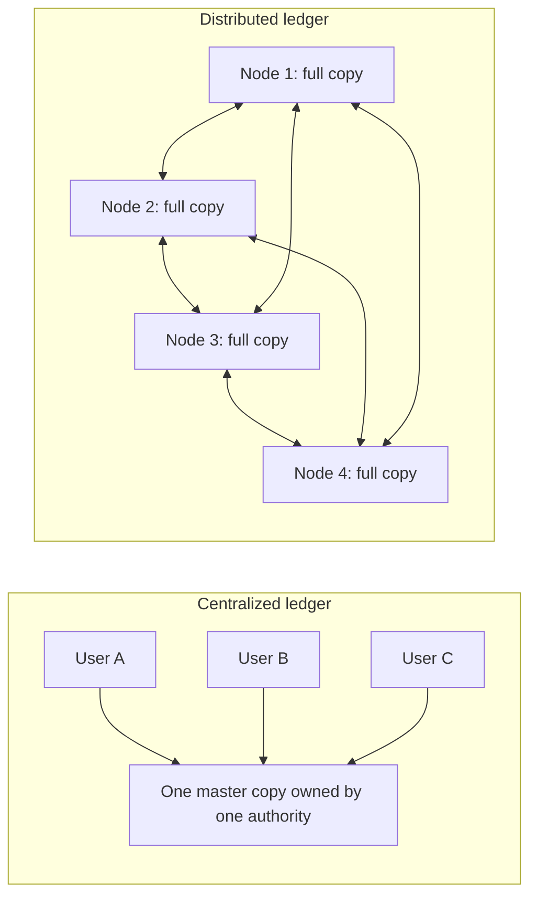
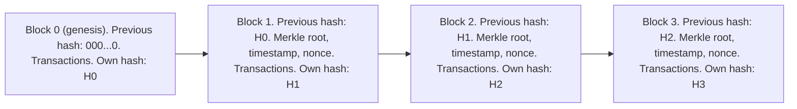
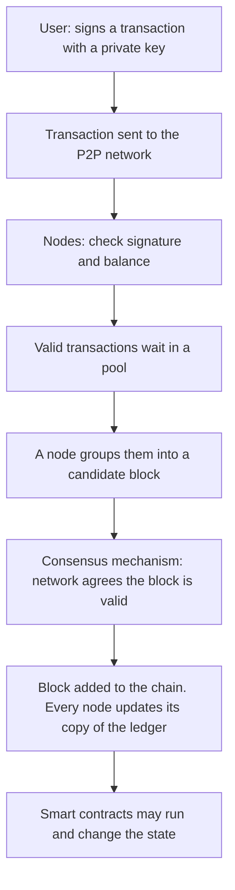
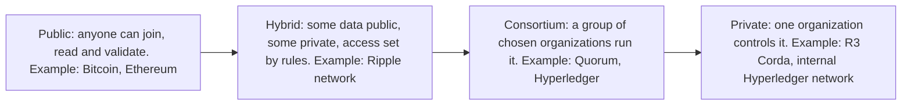

Ye note syllabus <Syl m="1" />, section 1.1 cover karta hai: blockchain ka introduction, history, fundamental concepts, components aur types. Block ka andar ka structure (header, hash, height, genesis block, Merkle tree) agle note mein hai.

## Pehle basics

- **Transaction** value ke move hone ka ek record hai, jaise "Asha ne Ravi ko 500 rupaye diye".
- **Ledger** wo book hai jisme transactions likhe jaate hain. Dukaan ki hisaab ki copy aur bank passbook ledgers hain.
- **Hash** kisi data ka fixed-size fingerprint hai, jo hash function banata hai. Same data ka hamesha same hash aata hai; ek letter bhi badlo to hash poora alag ho jaata hai; aur hash se data wapas nahi nikal sakte.
- **Digital signature** wo proof hai, jo person ki private key se banta hai, ki transaction sach mein usi ne kiya. Koi bhi matching public key se check kar sakta hai.
- **Node** wo computer hai jo network mein hissa leta hai.
- **Peer-to-peer (P2P)** matlab saare nodes barabar hain; koi boss server nahi.

Analogy: class ki attendance ek register mein hai jo class teacher ke paas hai. Register kho jaye ya teacher marks badal de, to sabko teacher pe bharosa karna padta hai. Ab socho har student ke paas same copy hai, aur nayi entry tabhi maani jaati hai jab zyada tar students agree karein. Distributed ledger ka idea yahi hai. <Cite id="blockchain-fundamentals-wiki-dlt" />

## Distributed ledger aur uski zaroorat

<Box kind="definition">

**Distributed ledger** (distributed ledger technology, DLT) wo ledger hai jiski copies kai computers, sites ya institutions pe replicate hoti hain aur sync mein rakhi jaati hain, bina kisi central administrator ke. <Cite id="blockchain-fundamentals-wiki-dlt" />

</Box>

**Centralized ledger ki problem.** Ek party (bank, registrar, land office) ke paas akeli master copy hoti hai.

- Hack ho jaye, corrupt ho jaye ya down ho jaye, to record kho jaata hai ya milta nahi (single point of failure).
- Owner ya koi insider chupke se records badal sakta hai.
- Baaki sab parties ko owner pe trust karna padta hai aur apne alag records rakhne padte hain, jinhe phir reconcile karna padta hai; ye slow hai aur galtiyan hoti hain. <Cite id="blockchain-fundamentals-fabric-docs" />

**Distributed ledger kaise madad karta hai.** Har participant ke paas ek copy hoti hai. Nayi entry tabhi accept hoti hai jab nodes agree karein (consensus), phir har copy update hoti hai.

<Cite id="blockchain-fundamentals-gfg-intro" loc="diagram" />

**Blockchain mein distributed ledger ki need** (5 marks ka usual answer):

1. **Single point of failure nahi.** Kuch nodes crash ho jaayein to baaki nodes ke paas poora record rehta hai.
2. **Ek owner pe trust nahi chahiye.** Trust ek authority se nahi, rules aur nodes ke agreement se aata hai.
3. **Tamper resistance.** Record badalne ke liye zyada tar copies ek saath badalni padengi.
4. **Sach ka ek shared version.** Sabko same data dikhta hai, alag books reconcile nahi karni padti.
5. **Bank ke bina double spending rokta hai.** Shared record dikhata hai ki coin pehle kharch hua ya nahi. <Cite id="blockchain-fundamentals-wiki-doublespend" />
6. **Transparency aur audit trail.** Har change record hota hai aur trace ho sakta hai.

Blockchain distributed ledger ka sabse common type hai, par akela nahi: kuch ledgers dusre structures use karte hain jaise directed acyclic graph (DAG). <Cite id="blockchain-fundamentals-wiki-dlt" />

<PYQ id="2023-12/q1a" /> <PYQ id="2025-05/q1a" />

<Box kind="exam">

Exam mein English mein likho: "A distributed ledger is a database that is replicated and synchronized across multiple nodes, with no central administrator. Its need in blockchain is to remove the single point of failure and the dependence on a trusted third party, and to make records transparent and tamper resistant."

</Box>

## Blockchain kya hai?

<Box kind="definition">

**Blockchain** ek distributed ledger hai jo transactions ko **blocks** mein store karta hai, jahan har block mein pichle block ka cryptographic hash hota hai, isliye blocks ek chain bana lete hain; purana block badalne ke liye har aage wala block badalna padega aur network ka agreement jeetna padega. <Cite id="blockchain-fundamentals-wiki-blockchain" /> <Cite id="blockchain-fundamentals-ibm-blockchain" />

</Box>

NIST blockchains ko aise digital ledgers kehta hai jo "tamper evident and tamper resistant" hain, participants mein bante hain aur aam taur pe koi central authority nahi hoti. <Cite id="blockchain-fundamentals-nist-8202" />

### Blockchain mein use hone wala data structure

Data structure **blocks ki linked list** hai jahan link ek **hash pointer** hai (pichle block ka hash), aur har block ke andar ek **Merkle tree** hota hai jo uske transactions ko ek hash (Merkle root) mein summarize karta hai. <Cite id="blockchain-fundamentals-gfg-structure" /> <Cite id="blockchain-fundamentals-wiki-blockchain" />

<Cite id="blockchain-fundamentals-gfg-structure" loc="diagram" />

Har block mein ek **header** (previous block hash, timestamp, nonce, Merkle root) aur **transactions** ki list hoti hai. Details agle note mein hain. <PYQ id="2024-12/q1a" />

<Box kind="exam">

Exam mein English mein likho: "A blockchain is a chain of blocks in which each block stores the hash of the previous block; the data structure is therefore a hash-linked list of blocks, with a Merkle tree used inside each block to summarize its transactions."

</Box>

## History aur evolution

| Year | Event |
|---|---|
| 1982 | David Chaum apni dissertation mein blockchain jaisa protocol propose karta hai |
| 1991 | Haber aur Stornetta documents ko timestamp karne ke liye cryptographically secured blocks ki chain describe karte hain taaki backdate na ho sake |
| 1992 | Merkle trees add hue taaki kai document certificates ek block share kar sakein |
| 2008 | Satoshi Nakamoto Bitcoin paper publish karta hai: trusted third party ke bina electronic cash, proof of work ke saath |
| 2009 | Bitcoin network live hota hai, pehle block (genesis block) ke saath |
| 2015 | Ethereum launch hota hai, smart contracts (chain pe stored programs) ke saath |
| 2015 ke baad | Businesses ke liye permissioned platforms, jaise Hyperledger Fabric, aate hain |

<Cite id="blockchain-fundamentals-wiki-blockchain" /> <Cite id="blockchain-fundamentals-nakamoto" /> <Cite id="blockchain-fundamentals-antonopoulos" loc="ch. 1" />

Stages ko aise bhi bolte hain: **Blockchain 1.0** digital money (Bitcoin), **2.0** smart contracts aur decentralized apps (Ethereum), **3.0** finance ke bahar business aur society mein use (supply chain, health, identity). <Cite id="blockchain-fundamentals-gfg-intro" />

Ethereum ke launch ki date (2015) general knowledge se hai, yahan cite kiye pages se nahi; Ethereum docs ise built-in computer (EVM) wala blockchain batate hain. <Cite id="blockchain-fundamentals-eth-intro" />

## Fundamental concepts

| Concept | Simple words mein matlab |
|---|---|
| Decentralization | Koi ek owner nahi; control kai nodes mein bata hota hai |
| Cryptographic hashing | Fingerprints jo blocks ko jodte hain aur changes dikha dete hain |
| Digital signatures (public/private keys) | Proof ki transaction kisne authorize kiya |
| Consensus | Wo rule jisse nodes agle block pe agree karte hain (proof of work, proof of stake etc.) |
| Immutability | Data sirf append hota hai; purani entries chupke se edit ya delete nahi hoti |
| Transparency | Participants shared record dekh aur verify kar sakte hain |
| Smart contracts | Chain pe programs jo condition poori hone pe apne aap chalte hain |

<Cite id="blockchain-fundamentals-gfg-intro" /> <Cite id="blockchain-fundamentals-ibm-blockchain" />

**Immutability practical hai, jaadu nahi.** Records badalna impossible nahi, bahut mehnga hai. Bitcoin pe bhi aadhi se zyada mining power wala attacker recent history rewrite kar sakta hai (51% attack), aur finality probabilistic hai: transaction ke upar jitne zyada blocks, utna safe. <Cite id="blockchain-fundamentals-wiki-doublespend" />

## Blockchain ke components

<Box kind="definition">

Blockchain ke **components** wo parts hain jo milke system chalate hain: nodes, transactions, blocks, ledger (chain), consensus mechanism, cryptography, aur aksar smart contracts aur native token. <Cite id="blockchain-fundamentals-gfg-intro" />

</Box>

<Cite id="blockchain-fundamentals-tp-basics" loc="diagram" />

1. **Nodes.** Computers jo chain store karte aur transactions validate karte hain. Full nodes poori history rakhte hain aur har rule check karte hain; lightweight clients data ke liye dusre nodes pe depend karte hain. <Cite id="blockchain-fundamentals-antonopoulos" loc="ch. 1" />
2. **Transactions.** Value ya data ke move hone ke records, har ek digital signature se protected.
3. **Blocks.** Transactions ke batches, header ke saath jo pichle block se link karta hai.
4. **Ledger (chain).** Blocks ki ordered, append-only list; har full node ke paas copy hoti hai.
5. **Consensus mechanism.** Wo method (proof of work, proof of stake etc.) jisse nodes agree karte hain ki agla block kaun sa hoga. Ye kaam karne wale miners ya validators ko reward mil sakta hai.
6. **Cryptography.** Hash functions tamper evidence dete hain; public aur private keys identity aur signatures dete hain.
7. **Smart contracts.** Chain pe stored self-executing programs (Ethereum jaise platforms pe).
8. **Native token ya coin** (optional). Fees dene aur participants ko reward karne ke liye value ki unit, jaise Bitcoin aur Ethereum mein.
9. **Network layer.** Peer-to-peer connections jo transactions aur blocks ko aage pass karte hain.

<PYQ id="2024-12-ce/q2a" />

## Blockchain ke types

Blockchains ko is hisaab se group karte hain ki **kaun join aur read kar sakta hai, aur kaun write (validate) kar sakta hai**. **Permissionless** (open) aur **permissioned** (sirf invitation) words bhi use hote hain. <Cite id="blockchain-fundamentals-gfg-types" /> <Cite id="blockchain-fundamentals-ibm-blockchain" />

<Cite id="blockchain-fundamentals-gfg-types" loc="diagram" />

- **Public blockchain.** Computer aur Internet wala koi bhi join, read aur consensus mein hissa le sakta hai. Proof of work ya proof of stake use hota hai. Examples: Bitcoin, Ethereum.
- **Private blockchain.** Ek organization tay karta hai kaun join karega aur consensus chalata hai. Aam taur pe company ke andar, aksar firewall ke peeche. GeeksforGeeks ke examples: Hyperledger, R3 Corda.
- **Consortium blockchain.** Pehle se chune hue organizations ka group network milke manage karta hai, aur tay karta hai kaun transactions submit karega aur data dekhega. Examples: Quorum, Hyperledger projects.
- **Hybrid blockchain.** Public aur private features ka mix: kuch data private rehta hai, kuch public, aur access rules aur smart contracts se control hota hai. GeeksforGeeks ka example: Ripple network.

<Cite id="blockchain-fundamentals-gfg-types" /> <Cite id="blockchain-fundamentals-wiki-blockchain" />

Sources examples pe poori tarah agree nahi karte: GeeksforGeeks Hyperledger aur Corda ko private mein, Tendermint aur Multichain ko consortium mein rakhta hai, jabki Wikipedia Quorum aur Hyperledger ko consortium kehta hai. Exam mein ek-do well-known examples do aur category pe bahas mat karo.

### Comparison: public, private aur consortium

| Point | Public | Private | Consortium |
|---|---|---|---|
| Who can join | Anyone (permissionless) | Only invited users of one organization (permissioned) | Only chosen member organizations (permissioned) |
| Who controls it | Nobody; fully decentralized | One organization (centralized) | Several organizations jointly (partly decentralized) |
| Who validates | Any node (miners or validators), often unknown to each other | Nodes chosen by the owner, known identities | Nodes of the member organizations, known identities |
| Consensus | Proof of work, proof of stake | Lightweight methods such as Raft, PBFT variants, proof of elapsed time | Voting or BFT-style agreement among members |
| Speed (transactions per second) | Low | High | High to medium |
| Energy use | High for proof of work | Low | Low |
| Privacy | Low; data visible to all | High | Medium to high; visible to members only |
| Security risk | 51% attack on small chains; very hard on large ones | Fewer nodes, so easier for the owner or an insider to tamper | Needs trust among members; a corrupt member can cause harm |
| Native token | Usually yes | Optional | Optional |
| Examples | Bitcoin, Ethereum | R3 Corda, Hyperledger (in one company) | Quorum, Hyperledger consortia |

<Cite id="blockchain-fundamentals-gfg-pubpriv" /> <Cite id="blockchain-fundamentals-gfg-types" /> <Cite id="blockchain-fundamentals-ibm-blockchain" />

**Kaun sa choose karein.** Public tab jab koi boss nahi chahiye aur open participation chahiye (digital cash). Private tab jab ek company ko audit trail aur speed chahiye. Consortium tab jab kai organizations jo ek dusre pe poora trust nahi karte, ek shared record chahte hain (banks, supply chain).

<PYQ id="2022-12-ce/q1a" /> <PYQ id="2023-05-ce/q1a" /> <PYQ id="2023-12-ce/q1d" /> <PYQ id="2024-05-ce/q2a" /> <PYQ id="2025-05-ce/q5a" /> <PYQ id="2025-05/q1e" />

Permissioned networks private aur consortium blockchain wale note mein detail se hain, Hyperledger Fabric main example ke saath. <Cite id="blockchain-fundamentals-fabric-docs" />

## Transaction chain mein kaise judta hai

1. Asha apni private key se transaction sign karti hai (Ravi ko pay karo) aur paas ke node ko bhejti hai.
2. Nodes signature check karte hain aur ye ki Asha ke paas sach mein funds hain, phir transaction aage pass karte hain.
3. Valid transactions pool mein wait karte hain. Ek miner ya validator kuch ko candidate block mein collect karta hai.
4. Network apna consensus rule chalata hai (jaise proof of work: ek nonce dhoondo jisse block hash kaafi chhota ho).
5. Dusre nodes naya block check karte hain aur valid ho to apni chain ki copy mein add karte hain.
6. Transaction ab "confirmed" hai. Upar har naya block ise reverse karna aur mushkil bana deta hai.

<Cite id="blockchain-fundamentals-tp-basics" /> <Cite id="blockchain-fundamentals-nakamoto" />

### Worked example: tampering pakda kyun jaata hai

<Sum>

<Given>

100 blocks ki chain, numbered 1 se 100. Har block pichle block ka hash store karta hai. Attacker block 40 ke andar ek transaction edit karta hai.

</Given>

<Find>

chain ko phir se valid dikhane ke liye kitne blocks recompute karne padenge.

</Find>

<Steps>

1. Transaction edit karne se block 40 ka Merkle root badalta hai, to block 40 ka hash badal jaata hai. *Reason: input zara bhi badle to hash poora badal jaata hai.*
2. Block 41 mein block 40 ka purana hash stored hai, to ab match nahi karta. Ise theek karne ke liye attacker ko block 41 ka stored "previous hash" badalna padega, jisse block 41 ka apna hash badal jaata hai.
3. Isse block 42 toot jaata hai, aur aise hi aage. Block 40 se 100 tak har block recompute karna padega: $100 - 40 + 1 = 61$ blocks.
4. Proof-of-work chain pe in 61 blocks mein se har ek ko naya valid nonce bhi chahiye, aur honest miners is beech naye blocks add karte rehte hain. *Reason: attacker ko honest network se aage bhi nikalna hai taaki uski chain sabse lambi ho.*
5. Honest nodes ke paas original, untouched copies hain, to wo dekh sakte hain ki block 40 ki kaun si copy alag hai.

</Steps>

<Answer>

61 blocks (block 40 se block 100) recompute karne padenge, aur badli hui copy reject ho jaati hai kyunki wo zyada tar nodes se match nahi karti.

</Answer>

<Box kind="verify">

Doosre tareeke se ginti: 40 se pehle ke blocks 1 se 39 hain, yaani 39 blocks, jo same rehte hain. Total 100, to badalne wale blocks $100 - 39 = 61$. Same answer.

</Box>

</Sum>

## Benefits aur limitations

<Box kind="definition">

Yahan **benefit** ka matlab hai wo cheez jo blockchain deta hai aur purane centralized systems nahi dete; **limitation** ka matlab hai wo cost ya kamzori jo uske badle mein leni padti hai.

</Box>

### Benefits

| Benefit | Why |
|---|---|
| Decentralization aur no middleman | Bank ya agent nahi chahiye, to fees aur delay kam |
| Security aur tamper resistance | Hash links aur cryptographic signatures; changes dikh jaate hain |
| Transparency aur traceability | Sabko same record dikhta hai; asset ka safar trace ho sakta hai (provenance ke liye useful) |
| Availability | Kai copies, to single point of failure nahi; censor karna mushkil |
| Efficiency | Shared ledger reconciliation hata deta hai; smart contracts steps automate karte hain |
| Kam fraud | Records ko administrator bhi chupke se delete ya badal nahi sakta, bahut mushkil hai |

<Cite id="blockchain-fundamentals-gfg-advantages" /> <Cite id="blockchain-fundamentals-ibm-blockchain" />

### Limitations

| Limitation | Why |
|---|---|
| Scalability | Bitcoin ka block size limited hai aur block lagbhag har 10 minute mein aata hai, to transactions per second kam; centralized systems kaafi zyada handle karte hain |
| Energy use | Proof of work mein heavy computing lagti hai; Cambridge Bitcoin ki electricity use ka index track karta hai |
| Storage | Har full node poori history rakhta hai, jo badhti rehti hai |
| Immutability dono taraf kaatti hai | Galti ya buggy smart contract ko aasani se undo nahi kar sakte |
| Immature aur complex | Skilled log kam, common standards nahi, purane systems ke saath integrate karna mushkil |
| Regulation unclear | Rules desh ke hisaab se alag hain aur smart contracts ki legal status uncertain hai |
| Privacy | Public chains mein sab kuch dikhta hai; ye GDPR jaise data-protection rules se takrata hai |
| Key loss | Private key kho gayi ya chori ho gayi to funds gaye; "forgot password" nahi hota |

<Cite id="blockchain-fundamentals-gfg-advantages" /> <Cite id="blockchain-fundamentals-wiki-blockchain" /> <Cite id="blockchain-fundamentals-ccaf-cbeci" /> <Cite id="blockchain-fundamentals-ibm-blockchain" />

<PYQ id="2023-12/q4a" />

## Blockchain implement karne ki challenges

Jab koi organization sach mein blockchain system banata hai, to ye common problems aati hain. Har ek upar ki limitations ka hi ek roop hai.

1. **Scalability aur performance.** Kam transactions per second aur badhta chain size; 2017 mein CryptoKitties game se Ethereum congest ho gaya tha. Fixes: bade blocks, sharding aur layer-2 networks. <Cite id="blockchain-fundamentals-wiki-blockchain" />
2. **Energy consumption.** Proof of work bahut bijli khaata hai; ek jawab proof of stake pe jaana hai, jaise Ethereum 2022 mein gaya. <Cite id="blockchain-fundamentals-wiki-blockchain" /> <Cite id="blockchain-fundamentals-ccaf-cbeci" />
3. **Regulation aur legal uncertainty.** Crypto assets, smart contract enforceability aur data protection (jaise right to erasure versus na badalne wala record) ke laws abhi settle nahi hain. <Cite id="blockchain-fundamentals-ibm-blockchain" />
4. **Interoperability aur standards.** Alag blockchains aur purane enterprise systems aasani se baat nahi karte, aur common standard nahi hai. <Cite id="blockchain-fundamentals-gfg-intro" />
5. **Security risks.** Chhoti public chains pe 51% attacks, smart contracts ke bugs jinka exploit ho sakta hai, aur chori hui private keys. <Cite id="blockchain-fundamentals-wiki-blockchain" /> <Cite id="blockchain-fundamentals-ibm-blockchain" />
6. **Privacy aur confidentiality.** Public ledgers data expose karte hain; businesses ko channels ya permissioned networks chahiye. <Cite id="blockchain-fundamentals-fabric-docs" />
7. **Storage aur cost.** Har node saara data store karta hai; set-up, integration aur running cost zyada ho sakti hai. <Cite id="blockchain-fundamentals-gfg-advantages" />
8. **Skills gap aur slow adoption.** Trained developers kam; technology complex hai aur organizations savdhaan rehte hain. <Cite id="blockchain-fundamentals-gfg-intro" />
9. **Governance.** Consortium chains mein rule badalne ke liye saare members ka agreement chahiye, jinke interests alag ho sakte hain. <Cite id="blockchain-fundamentals-gfg-types" />

<PYQ id="2022-12-ce/q2a" /> <PYQ id="2024-12-ce/q1e" />

## Conclusion

Blockchain ek distributed ledger hai jisme hash-linked blocks, cryptography aur consensus milke ek shared record dete hain jo koi ek party control nahi karti aur jise badalna bahut mushkil hai. Ye wahan fit hota hai jahan kai parties ko central authority ke bina data share aur trust karna ho, par iski keemat hai kam speed, zyada storage aur energy cost, aur khule legal aur technical issues.
