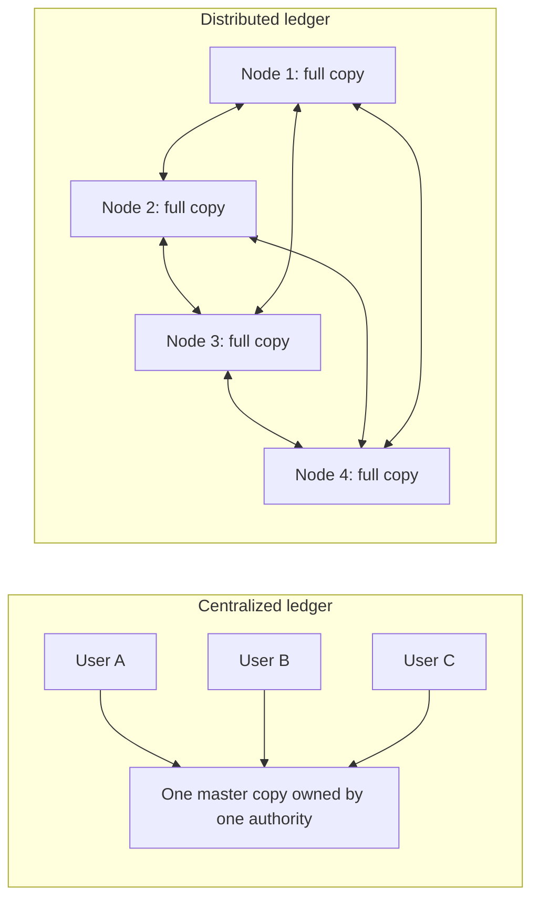
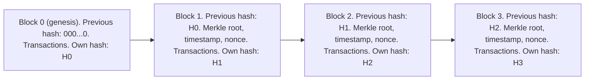
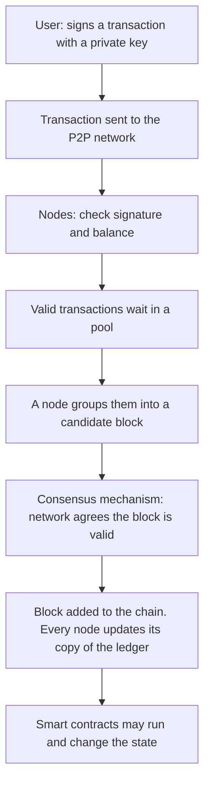
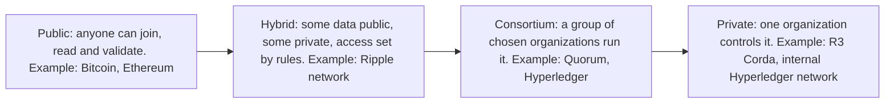

This note covers syllabus <Syl m="1" />, section 1.1: introduction to blockchain, its history, fundamental concepts, components and types. The block itself (header, hash, height, genesis block, Merkle tree) has its own note.

## The basics first

- A **transaction** is one recorded event of value moving, for example "Asha pays Ravi 500 rupees".
- A **ledger** is the book where transactions are written down. A shop's account book and a bank passbook are ledgers.
- A **hash** is a fixed-size fingerprint of some data, made by a hash function. The same data always gives the same hash; change even one letter and the hash becomes completely different; and you cannot get the data back from the hash.
- A **digital signature** is proof, made with a person's private key, that the transaction really came from them. Anyone can check it with the matching public key.
- A **node** is a computer that takes part in the network.
- **Peer-to-peer (P2P)** means all nodes are equals; there is no boss server.

Analogy: a class keeps attendance in one register held by the class teacher. If the register is lost or the teacher changes a mark, everyone must trust the teacher. Now imagine every student holds an identical copy, and a new entry counts only when most students agree on it. That is the idea behind a distributed ledger. <Cite id="blockchain-fundamentals-wiki-dlt" />

## Class introduction: what, why and where

<Box kind="definition">

"Blockchain is a digital record system where data is stored in blocks and connected in a chain. It is secure, transparent, and cannot be easily changed." <Cite id="class-bt-m1" loc="slide 2" />

</Box>

**Real-life example (the class notebook).** You and a friend keep a notebook of transactions. One page you write is a **block**; the next page is another block; all pages joined together are the **blockchain**. Once a page is written, nobody can erase or change it easily. <Cite id="class-bt-m1" loc="slide 3" />

**Why blockchain is needed.** In a normal system data is stored in one place (centralized). What if that system is hacked or fails? Blockchain solves this by storing the data in a **distributed way**, on many computers. <Cite id="class-bt-m1" loc="slide 4" /> <Cite id="class-bt-m1" loc="slide 5" />

**Applications (class list).** <Cite id="class-bt-m1" loc="slide 6" /> <Cite id="class-bt-m1" loc="slide 7" /> <Cite id="class-bt-m1" loc="slide 8" />

| Area | What blockchain does there |
|---|---|
| Cryptocurrency | Digital payments with no bank, peer-to-peer, secure and transparent (example: Bitcoin) |
| Banking and finance | Faster money transfers, cross-border payments, less fraud |
| Supply chain management | Track a product (food, medicine) from manufacturer to customer and check it is genuine or fake |
| Healthcare | Store patient records securely and share them between hospitals; medical history is hard to tamper with |
| Voting systems | Secure online voting; each vote is recorded as a block that cannot be changed |
| Real estate | Property buying and selling, ownership records, less fraud and paperwork |

**Class definition of a blockchain.** A blockchain is fundamentally an **immutable, distributed ledger**: a mathematical structure for storing data so that it is nearly impossible to fake, and a list of records called blocks that store data publicly and in chronological order. Cryptography is achieved with **hashing** (data integrity) and **public-key cryptography** with digital signatures (authentication, security and ownership of transactions). <Cite id="class-bt-m1" loc="slide 10" /> <Cite id="class-bt-m1" loc="slide 11" />

## Distributed ledger and why it is needed

<Box kind="definition">

A **distributed ledger** (distributed ledger technology, DLT) is a ledger whose copies are replicated and kept in step across many computers, sites or institutions, with no central administrator. <Cite id="blockchain-fundamentals-wiki-dlt" />

</Box>

**Problem with a centralized ledger.** One party (a bank, a registrar, a land office) keeps the only master copy.

- If it is hacked, corrupted or goes down, the record is lost or unavailable (single point of failure).
- The owner, or an insider, can change records quietly.
- Every other party must trust the owner and keep its own separate records, which then need to be reconciled; that is slow and error-prone. <Cite id="blockchain-fundamentals-fabric-docs" />

**How a distributed ledger helps.** Every participant holds a copy. A new entry is accepted only when the nodes agree (consensus), then every copy is updated.

<Cite id="blockchain-fundamentals-gfg-intro" loc="diagram" />

**Need for a distributed ledger in blockchain** (the usual 5-mark answer):

1. **No single point of failure.** If some nodes crash, others still hold the full record.
2. **No need to trust one owner.** Trust comes from rules and agreement among nodes instead of one authority.
3. **Tamper resistance.** To change a record you would have to change it on most copies at once.
4. **One shared version of the truth.** All parties see the same data, so there is no reconciliation of separate books.
5. **Prevents double spending without a bank.** The shared record shows whether a coin was already spent. <Cite id="blockchain-fundamentals-wiki-doublespend" />
6. **Transparency and audit trail.** Every change is recorded and can be traced.

Blockchain is the most common kind of distributed ledger, but not the only one: some ledgers use other structures such as a directed acyclic graph (DAG). <Cite id="blockchain-fundamentals-wiki-dlt" />

<PYQ id="2023-12/q1a" /> <PYQ id="2025-05/q1a" />

<Box kind="exam">

Exam mein English mein likho: "A distributed ledger is a database that is replicated and synchronized across multiple nodes, with no central administrator. Its need in blockchain is to remove the single point of failure and the dependence on a trusted third party, and to make records transparent and tamper resistant."

</Box>

## What is a blockchain?

<Box kind="definition">

A **blockchain** is a distributed ledger that stores transactions in **blocks**, where each block contains a cryptographic hash of the previous block, so the blocks form a chain; changing an old block would force changing every later block and winning agreement from the network. <Cite id="blockchain-fundamentals-wiki-blockchain" /> <Cite id="blockchain-fundamentals-ibm-blockchain" />

</Box>

NIST describes blockchains as digital ledgers that are "tamper evident and tamper resistant", spread across participants and usually with no central authority. <Cite id="blockchain-fundamentals-nist-8202" />

### Data structure used in a blockchain

The data structure is a **linked list of blocks** where the link is a **hash pointer** (the hash of the previous block), plus a **Merkle tree** inside each block that summarizes its transactions in one hash called the Merkle root. <Cite id="blockchain-fundamentals-gfg-structure" /> <Cite id="blockchain-fundamentals-wiki-blockchain" />

<Cite id="blockchain-fundamentals-gfg-structure" loc="diagram" />

Each block has a **header** (previous block hash, timestamp, nonce, Merkle root) and a list of **transactions**. Details are in the next note. <PYQ id="2024-12/q1a" />

<Box kind="exam">

Exam mein English mein likho: "A blockchain is a chain of blocks in which each block stores the hash of the previous block; the data structure is therefore a hash-linked list of blocks, with a Merkle tree used inside each block to summarize its transactions."

</Box>

## History and evolution

| Year | Event |
|---|---|
| 1982 | David Chaum proposes a blockchain-like protocol in his dissertation |
| 1991 | Haber and Stornetta describe a chain of cryptographically secured blocks to timestamp documents so they cannot be backdated |
| 1992 | Merkle trees added so many document certificates can share one block |
| 2000 | Stefan Konst proposes cryptographically secured chains |
| 2004 | Hal Finney introduces Reusable Proof of Work (RPoW) |
| 2008 | Satoshi Nakamoto publishes the Bitcoin paper: electronic cash with no trusted third party, using proof of work |
| 2009 | Bitcoin network goes live, with the first block (genesis block) |
| 2013 | Vitalik Buterin proposes Ethereum |
| 2014 | Blockchain separated from cryptocurrency (the "Blockchain 2.0" idea) |
| 2015 | Ethereum launches, adding smart contracts (programs stored on the chain) and dApps; the Hyperledger project starts |
| 2016 | The Ethereum DAO (Decentralized Autonomous Organization) hack |
| 2018 | Bitcoin completes 10 years; major platforms ban crypto ads |
| 2019 | Ethereum crosses 1 million daily transactions; Amazon Managed Blockchain launches |
| 2020 | Rise of stablecoins (for example United States Dollar Tether) |
| 2021 | Rapid growth of NFTs and DeFi applications |
| 2022 | The Ethereum Merge: shift from proof of work to proof of stake |
| 2015 onwards | Permissioned platforms for businesses, such as Hyperledger Fabric, appear |

<Cite id="blockchain-fundamentals-wiki-blockchain" /> <Cite id="blockchain-fundamentals-nakamoto" /> <Cite id="blockchain-fundamentals-antonopoulos" loc="ch. 1" /> <Cite id="class-bt-m1" loc="slide 12" /> <Cite id="class-bt-m1" loc="slide 13" /> <Cite id="class-bt-m1" loc="slide 14" />

A common way to describe the stages: **Blockchain 1.0** is digital money (Bitcoin), **2.0** is smart contracts and decentralized apps (Ethereum), **3.0** is use in business and society beyond finance (supply chain, health, identity). <Cite id="blockchain-fundamentals-gfg-intro" />

Our date for Ethereum's launch (2015) is from general knowledge, not from the pages cited here; the Ethereum docs describe it as a blockchain with a built-in computer, the EVM. <Cite id="blockchain-fundamentals-eth-intro" />

## Evolution of blockchain technology (phases)

| Phase | Years | What happened |
|---|---|---|
| 1. Genesis | 2008 to 2011 | Bitcoin whitepaper (2008); first block mined in 2009; decentralization, security and proof of work |
| 2. Expansion | 2011 to 2015 | Altcoins such as Litecoin; Ethereum (2015) brings smart contracts and decentralized applications (DApps) |
| 3. Adoption | 2016 to 2020 | Industries and institutions start using blockchain; ICOs (Initial Coin Offerings), scaling solutions and regulatory frameworks appear |
| 4. DeFi and NFTs | 2018 to 2021 | Decentralized Finance gives financial services without a middleman; NFTs give ownership of unique digital assets |
| 5. Web3 | 2021 to present | Decentralization of the internet, interoperability between blockchains, better privacy technologies |

<Cite id="class-bt-m1" loc="slide 15" /> <Cite id="class-bt-m1" loc="slide 16" /> <Cite id="class-bt-m1" loc="slide 17" />

## Characteristics of a blockchain network

- There is no centralized authority; the participants maintain the data and have the democratic authority to approve any transaction. Everyone with access to the network has access to the data and holds the **same copy of the ledger**. <Cite id="class-bt-m1" loc="slide 19" />
- If one node's data gets corrupted, the other participants are alerted at once and can rectify it. <Cite id="class-bt-m1" loc="slide 19" />
- It is a **peer-to-peer** system of transacting value with no trusted third party, a shared, decentralized and open ledger replicated across many nodes. The ledger is **append-only**: it cannot be changed, every entry is permanent, and a new entry shows up on all copies. <Cite id="class-bt-m1" loc="slide 20" />
- It is another layer on top of the Internet that can coexist with other Internet technologies. Just as TCP/IP was designed for an open system, blockchain was designed for true decentralization; the creators of Bitcoin open-sourced it. <Cite id="class-bt-m1" loc="slide 21" />
- Participants transfer value as simply as sending an SMS. In Bitcoin every node has a copy of the ledger and **miners** solve a cryptographic puzzle to reach a single source of truth. A **miner** is an actor who verifies transactions, adds new blocks to the chain and checks that the additions are accurate; in Bitcoin it also creates new coins. <Cite id="class-bt-m1" loc="slide 22" />

### Worked example: Alice, Bob, Charlie and Dave

<Sum>

<Given>

Four people (Alice, Bob, Charlie, Dave) each keep a copy of the ledger. Alice starts with USD 50, which every node knows (the genesis of all transactions). Alice pays USD 20 to Bob. Then Bob pays USD 10 to Charlie. <Cite id="class-bt-m1" loc="slide 23-26" />

</Given>

<Find>

the balances after each step and what every node's copy shows.

</Find>

<Steps>

1. Start: Alice 50, Bob 0, Charlie 0, Dave 0. Every node holds this same ledger.
2. Alice pays Bob USD 20: Alice USD 50 - USD 20 = USD 30, Bob USD 0 + USD 20 = USD 20. The new entry is added to every node's copy, not changed in place.
3. Bob pays Charlie USD 10: Bob USD 20 - USD 10 = USD 10, Charlie USD 0 + USD 10 = USD 10. This is another new entry on every copy.
4. Dave holds no coins, but his copy has all three entries, so he can verify them.

</Steps>

<Answer>

Alice 30, Bob 10, Charlie 10, Dave 0, and all four copies show the same three entries.

</Answer>

<Box kind="verify">

Total money is unchanged: USD 30 + USD 10 + USD 10 + USD 0 = USD 50, the starting amount.

</Box>

</Sum>

The transaction data in the blocks is immutable and every transaction is irreversible; a correction would be a new transaction, validated by all contributing nodes, and every node keeps its own copy of the blockchain. <Cite id="class-bt-m1" loc="slide 27" />

## Fundamental concepts

| Concept | Meaning in simple words |
|---|---|
| Decentralization | No single owner; control is spread over many nodes |
| Cryptographic hashing | Fingerprints that link blocks and expose changes |
| Digital signatures (public/private keys) | Prove who authorized a transaction |
| Consensus | The rule by which nodes agree on the next block (proof of work, proof of stake and so on) |
| Immutability | Data is only appended; past entries cannot be quietly edited or deleted |
| Transparency | Participants can see and verify the shared record |
| Smart contracts | Programs on the chain that run automatically when conditions are met |

<Cite id="blockchain-fundamentals-gfg-intro" /> <Cite id="blockchain-fundamentals-ibm-blockchain" />

**Immutability is practical, not magical.** Records are not impossible to change; they are very expensive to change. Even on Bitcoin, an attacker with more than half the mining power could rewrite recent history (a 51% attack), and finality is probabilistic: the more blocks pile on top of a transaction, the safer it is. <Cite id="blockchain-fundamentals-wiki-doublespend" />

### Hash function and proof of work (class view)

<Box kind="definition">

A **hash function** is a mathematical function that converts input data of any size into a fixed-length unique output called a hash value. <Cite id="class-bt-m1" loc="slide 32" />

</Box>

**Why hashing is used in blockchain:** (1) it ensures data integrity (detects any change), (2) it gives security (one-way, irreversible), (3) it generates unique identifiers, (4) it helps in linking blocks, (5) it supports consensus mechanisms such as mining. <Cite id="class-bt-m1" loc="slide 32" />

- **Hashing in transactions:** each transaction is hashed to make its Transaction ID (TxID), used for unique identification, to show the data was not altered, and for tracking and verification. <Cite id="class-bt-m1" loc="slide 33" />
- **Hashing in blocks:** the whole block data is hashed to give the block hash, which protects every transaction inside; each block stores the previous block's hash, which makes the chain; it is also used in mining. <Cite id="class-bt-m1" loc="slide 33" />

**Proof of work** (the class example of a consensus mechanism) is a competitive process that uses public transaction information to try to generate a hexadecimal number less than the network target for that mining period. Thousands of mining programs work on one block until the hash is solved, then move to the next block. <Cite id="class-bt-m1" loc="slide 35" /> <Cite id="class-bt-m1" loc="slide 36" />

**Smart contracts** are code written into a blockchain that executes the terms of an agreement automatically, so the two parties need not trust each other. <Cite id="class-bt-m1" loc="slide 42" />

## Components of a blockchain

<Box kind="definition">

The **components** of a blockchain are the parts that together make the system work: nodes, transactions, blocks, the ledger (the chain), a consensus mechanism, cryptography, and often smart contracts and a native token. <Cite id="blockchain-fundamentals-gfg-intro" />

</Box>

<Cite id="blockchain-fundamentals-tp-basics" loc="diagram" />

1. **Nodes.** Computers that store the chain and validate transactions. Full nodes keep the entire history and check every rule; lightweight clients depend on other nodes for data. <Cite id="blockchain-fundamentals-antonopoulos" loc="ch. 1" />
2. **Transactions.** The records of value or data being moved, each protected by a digital signature.
3. **Blocks.** Batches of transactions with a header that links to the previous block.
4. **The ledger (chain).** The ordered, append-only list of blocks; every full node has a copy.
5. **Consensus mechanism.** The method (proof of work, proof of stake and others) by which nodes agree on which block is next. Miners or validators who do this work may be rewarded.
6. **Cryptography.** Hash functions give tamper evidence; public and private keys give identity and signatures.
7. **Smart contracts.** Self-executing programs stored on the chain (on platforms such as Ethereum).
8. **Native token or coin** (optional). A unit of value used to pay fees and reward participants, as in Bitcoin and Ethereum.
9. **Network layer.** The peer-to-peer connections that pass transactions and blocks around.

## Types of blockchain

Blockchains are grouped by **who may join and read, and who may write (validate)**. The words **permissionless** (open) and **permissioned** (invitation only) are also used. <Cite id="blockchain-fundamentals-gfg-types" /> <Cite id="blockchain-fundamentals-ibm-blockchain" />

<Cite id="blockchain-fundamentals-gfg-types" loc="diagram" />

- **Public blockchain.** Anyone with a computer and Internet can join, read and take part in consensus. Uses proof of work or proof of stake. Examples: Bitcoin, Ethereum.
- **Private blockchain.** One organization decides who can join and runs the consensus. Usually used inside a company, often behind its firewall. Examples given by GeeksforGeeks: Hyperledger, R3 Corda.
- **Consortium blockchain.** A group of preselected organizations jointly manage the network, and decide who can submit transactions and see data. Examples: Quorum, Hyperledger projects.
- **Hybrid blockchain.** Mixes public and private features: some data stays private, some is public, and access is controlled by rules and smart contracts. Example given by GeeksforGeeks: the Ripple network.

<Cite id="blockchain-fundamentals-gfg-types" /> <Cite id="blockchain-fundamentals-wiki-blockchain" />

Sources are not fully consistent on examples: GeeksforGeeks lists Hyperledger and Corda under private and Tendermint and Multichain under consortium, while Wikipedia lists Quorum and Hyperledger as consortium. In an exam, give one or two well-known examples and do not argue over the category.

### Comparison: public, private and consortium

| Point | Public | Private | Consortium |
|---|---|---|---|
| Who can join | Anyone (permissionless) | Only invited users of one organization (permissioned) | Only chosen member organizations (permissioned) |
| Who controls it | Nobody; fully decentralized | One organization (centralized) | Several organizations jointly (partly decentralized) |
| Who validates | Any node (miners or validators), often unknown to each other | Nodes chosen by the owner, known identities | Nodes of the member organizations, known identities |
| Consensus | Proof of work, proof of stake | Lightweight methods such as Raft, PBFT variants, proof of elapsed time | Voting or BFT-style agreement among members |
| Speed (transactions per second) | Low | High | High to medium |
| Energy use | High for proof of work | Low | Low |
| Privacy | Low; data visible to all | High | Medium to high; visible to members only |
| Security risk | 51% attack on small chains; very hard on large ones | Fewer nodes, so easier for the owner or an insider to tamper | Needs trust among members; a corrupt member can cause harm |
| Native token | Usually yes | Optional | Optional |
| Examples | Bitcoin, Ethereum | R3 Corda, Hyperledger (in one company) | Quorum, Hyperledger consortia |

<Cite id="blockchain-fundamentals-gfg-pubpriv" /> <Cite id="blockchain-fundamentals-gfg-types" /> <Cite id="blockchain-fundamentals-ibm-blockchain" />

**How to choose.** Use public when you want no one in charge and open participation (digital cash). Use private when one company needs an audit trail and speed. Use consortium when several organizations that do not fully trust each other need one shared record (banks, a supply chain).

 <PYQ id="2025-05/q1e" />

Permissioned networks are covered in more depth in the private and consortium blockchain note, with Hyperledger Fabric as the main example. <Cite id="blockchain-fundamentals-fabric-docs" />

### Class classification of types

The class groups blockchains by two ideas. **First concept: who is allowed to participate** (permissionless or permissioned). **Second concept: who can access and control the network** (public, private, hybrid, consortium or federated). <Cite id="class-bt-m1" loc="slide 43" />

| Point | Permissionless | Permissioned |
|---|---|---|
| Meaning | Also called public blockchain; open to everyone to take part in validating transactions and data. Used where high transparency is needed <Cite id="class-bt-m1" loc="slide 46" /> | A closed network where only a set of groups may validate transactions and data. Used where high privacy and security are needed <Cite id="class-bt-m1" loc="slide 49" /> |
| Why needed | To remove dependence on a central authority and create trust in an open system; with a bank, government or platform in control the system can be biased, corrupted or hacked <Cite id="class-bt-m1" loc="slide 45" /> | Known users and limited access; developed by a private authority, for example a company organizing and controlling the network <Cite id="class-bt-m1" loc="slide 49" /> |
| Characteristics | No central authority, fully open source, full transparency, heavy use of tokens | Transparency set by the organization's aim, users are known so anonymity is not kept, developed by a private authority |
| Advantages | Anyone with hardware and internet can join; brings trust among users; high transparency; wider decentralization <Cite id="class-bt-m1" loc="slide 47" /> | Faster (few validating nodes); customizable; strong privacy; better performance and scalability <Cite id="class-bt-m1" loc="slide 50" /> |
| Disadvantages | Poor energy efficiency; lower scalability; less privacy <Cite id="class-bt-m1" loc="slide 48" /> | Not truly decentralized; risk of corruption with few participants; the owner can change the rules any time <Cite id="class-bt-m1" loc="slide 51" /> |

### Class view: advantages and disadvantages of each type

| Type | Class description | Advantages | Disadvantages |
|---|---|---|---|
| Public <Cite id="class-bt-m1" loc="slide 53-57" /> | No one in charge; anyone can read, write and audit; not owned by anyone; every computer holds a copy; examples Bitcoin, Litecoin, Ethereum | Trustable (algorithms detect fraud), secure (large and widely distributed), anonymous in nature, decentralized | Slow processing, high energy use (proof of work), slow government acceptance |
| Private <Cite id="class-bt-m1" loc="slide 58-61" /> | Property of one individual or organization that controls read and write access; only selected nodes take part; closed network; example Hyperledger, a "bank chain"; used for internal auditing, voting and asset management | Speed, adjustable scalability, privacy, balanced (few users have access) | Limited nodes so easier to manipulate, centralized so trust is hard, if few nodes go offline the system is endangered |
| Hybrid <Cite id="class-bt-m1" loc="slide 62-65" /> | Mix of private and public: some part controlled by an organization, the rest visible publicly; users get access through smart contracts; example Ripple network and XRP token | Customizable and still keeps integrity and security; cheap transactions (few nodes verify); the organization chooses participants and which transactions are public | Harder to run efficiently, possible lack of transparency, closed ecosystem lacks incentives |
| Consortium (federated) <Cite id="class-bt-m1" loc="slide 66-68" /> | More than one organization in charge; a group of companies decide for the benefit of the whole network; part public, part private; examples R3, Energy Web Foundation | Fast (limited users), decentralized authority across organizations, privacy, flexible | All members must approve protocols, so less flexible; can be hacked if an organization turns corrupt; a few compromised nodes raise risk |

## How a transaction becomes part of the chain

1. Asha signs a transaction (pay Ravi) with her private key and sends it to a nearby node.
2. Nodes check the signature and that Asha really has the funds, then pass the transaction on.
3. Valid transactions wait in a pool. A miner or validator collects some into a candidate block.
4. The network runs its consensus rule (for example proof of work: find a nonce that makes the block hash small enough).
5. Other nodes check the new block and, if valid, add it to their copy of the chain.
6. The transaction is now "confirmed". Each further block on top makes it harder to reverse.

<Cite id="blockchain-fundamentals-tp-basics" /> <Cite id="blockchain-fundamentals-nakamoto" />

### Worked example: why tampering is caught

<Sum>

<Given>

A chain of 100 blocks, numbered 1 to 100. Each block stores the hash of the block before it. An attacker edits one transaction inside block 40.

</Given>

<Find>

how many blocks must be recomputed to make the chain look valid again.

</Find>

<Steps>

1. Editing a transaction changes the Merkle root of block 40, so the hash of block 40 changes. *Reason: a hash changes completely if its input changes at all.*
2. Block 41 stores the old hash of block 40, so it no longer matches. To repair it, the attacker must change block 41's stored "previous hash", which changes block 41's own hash.
3. That breaks block 42, and so on. Every block from 40 to 100 must be recomputed: $100 - 40 + 1 = 61$ blocks.
4. On a proof-of-work chain each of those 61 blocks also needs a fresh valid nonce, and honest miners keep adding new blocks meanwhile. *Reason: the attacker must also out-run the honest network to have the longest chain.*
5. Honest nodes still have the original, untouched copies, so they can see which copy of block 40 differs.

</Steps>

<Answer>

61 blocks (block 40 to block 100) must be recomputed, and the altered copy is rejected because it disagrees with the majority of nodes.

</Answer>

<Box kind="verify">

Count the other way: blocks before 40 are 1 to 39, that is 39 blocks, which stay unchanged. Total 100, so blocks that change are $100 - 39 = 61$. Same answer.

</Box>

</Sum>

## Benefits and limitations

<Box kind="definition">

**Benefit** here means something blockchain gives you that older centralized systems do not; **limitation** means a cost or weakness you accept in return.

</Box>

### Benefits

| Benefit | Why |
|---|---|
| Decentralization and no middleman | No bank or agent needed, so fewer fees and less delay |
| Security and tamper resistance | Hash links and cryptographic signatures; changes are visible |
| Transparency and traceability | Everyone sees the same record; an asset's journey can be traced (useful for provenance) |
| Availability | Many copies, so no single point of failure; hard to censor |
| Efficiency | One shared ledger removes reconciliation; smart contracts automate steps |
| Lower fraud | Records are very hard to delete or alter quietly, even for an administrator |

<Cite id="blockchain-fundamentals-gfg-advantages" /> <Cite id="blockchain-fundamentals-ibm-blockchain" />

### Limitations

| Limitation | Why |
|---|---|
| Scalability | Bitcoin's block size is limited and a block comes about every 10 minutes, so few transactions per second; centralized systems handle far more |
| Energy use | Proof of work needs heavy computing; Cambridge tracks Bitcoin's electricity use in an index |
| Storage | Every full node keeps the whole history, which keeps growing |
| Immutability cuts both ways | A mistake or a bad smart contract cannot be simply undone |
| Immature and complex | Few skilled people, no common standards, hard to integrate with old systems |
| Regulation unclear | Rules differ from country to country and the legal status of smart contracts is uncertain |
| Privacy | In public chains everything is visible; this clashes with data-protection rules such as GDPR |
| Key loss | If a private key is lost or stolen, the funds are gone; there is no "forgot password" |

<Cite id="blockchain-fundamentals-gfg-advantages" /> <Cite id="blockchain-fundamentals-wiki-blockchain" /> <Cite id="blockchain-fundamentals-ccaf-cbeci" /> <Cite id="blockchain-fundamentals-ibm-blockchain" />

<PYQ id="2023-12/q4a" />

## Challenges of implementing blockchain

When an organization actually builds a blockchain system, these are the common problems. Each is a different face of the limits above.

1. **Scalability and performance.** Low transactions per second and growing chain size; Ethereum was congested by the CryptoKitties game in 2017. Fixes include larger blocks, sharding and layer-2 networks. <Cite id="blockchain-fundamentals-wiki-blockchain" />
2. **Energy consumption.** Proof of work uses a lot of electricity; one answer is to move to proof of stake, as Ethereum did in 2022. <Cite id="blockchain-fundamentals-wiki-blockchain" /> <Cite id="blockchain-fundamentals-ccaf-cbeci" />
3. **Regulation and legal uncertainty.** Laws on crypto assets, smart contract enforceability and data protection (for example the right to erasure versus an unchangeable record) are unsettled. <Cite id="blockchain-fundamentals-ibm-blockchain" />
4. **Interoperability and standards.** Different blockchains and old enterprise systems do not talk to each other easily, and there is no common standard. <Cite id="blockchain-fundamentals-gfg-intro" />
5. **Security risks.** 51% attacks on small public chains, bugs in smart contracts that can be exploited, and stolen private keys. <Cite id="blockchain-fundamentals-wiki-blockchain" /> <Cite id="blockchain-fundamentals-ibm-blockchain" />
6. **Privacy and confidentiality.** Public ledgers expose data; businesses need channels or permissioned networks. <Cite id="blockchain-fundamentals-fabric-docs" />
7. **Storage and cost.** Every node stores all data; set-up, integration and running costs can be high. <Cite id="blockchain-fundamentals-gfg-advantages" />
8. **Skills gap and slow adoption.** Few trained developers; the technology is complex and organizations are cautious. <Cite id="blockchain-fundamentals-gfg-intro" />
9. **Governance.** In consortium chains, changing a rule needs agreement from all members, who may have different interests. <Cite id="blockchain-fundamentals-gfg-types" />

## Conclusion

A blockchain is a distributed ledger in which hash-linked blocks, cryptography and consensus give a shared record that no single party controls and that is very hard to alter. It suits cases where several parties need to share and trust data without a central authority, but it pays for this with lower speed, higher storage and energy cost, and open legal and technical issues.
