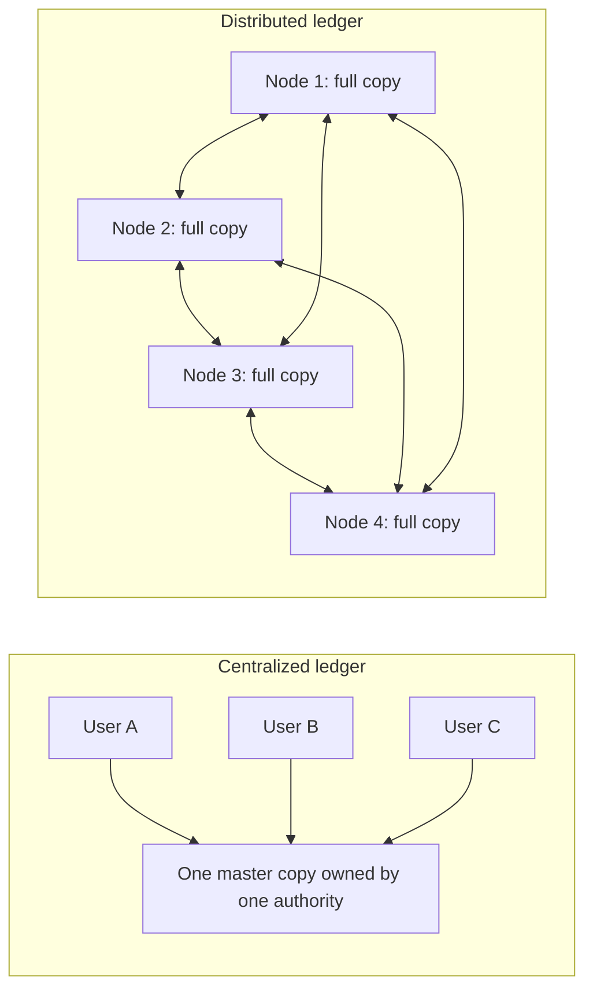
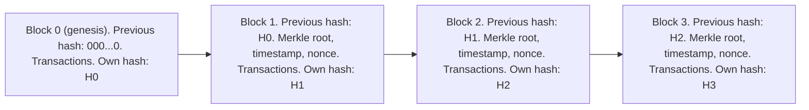
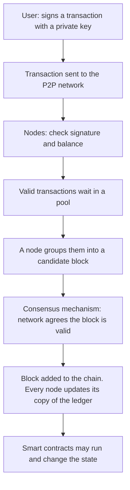
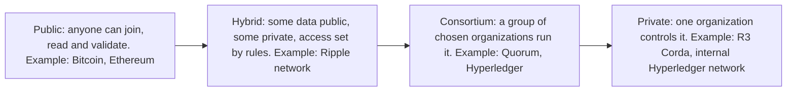

This note covers syllabus <Syl m="1" />, section 1.1: introduction to blockchain, its history, fundamental concepts, components and types. The block itself (header, hash, height, genesis block, Merkle tree) has its own note.

## The basics first

- A **transaction** is one recorded event of value moving, for example "Asha pays Ravi 500 rupees".
- A **ledger** is the book where transactions are written down. A shop's account book and a bank passbook are ledgers.
- A **hash** is a fixed-size fingerprint of some data, made by a hash function. The same data always gives the same hash; change even one letter and the hash becomes completely different; and you cannot get the data back from the hash.
- A **digital signature** is proof, made with a person's private key, that the transaction really came from them. Anyone can check it with the matching public key.
- A **node** is a computer that takes part in the network.
- **Peer-to-peer (P2P)** means all nodes are equals; there is no boss server.

Analogy: a class keeps attendance in one register held by the class teacher. If the register is lost or the teacher changes a mark, everyone must trust the teacher. Now imagine every student holds an identical copy, and a new entry counts only when most students agree on it. That is the idea behind a distributed ledger. <Cite id="blockchain-fundamentals-wiki-dlt" />

## Distributed ledger and why it is needed

<Box kind="definition">

A **distributed ledger** (distributed ledger technology, DLT) is a ledger whose copies are replicated and kept in step across many computers, sites or institutions, with no central administrator. <Cite id="blockchain-fundamentals-wiki-dlt" />

</Box>

**Problem with a centralized ledger.** One party (a bank, a registrar, a land office) keeps the only master copy.

- If it is hacked, corrupted or goes down, the record is lost or unavailable (single point of failure).
- The owner, or an insider, can change records quietly.
- Every other party must trust the owner and keep its own separate records, which then need to be reconciled; that is slow and error-prone. <Cite id="blockchain-fundamentals-fabric-docs" />

**How a distributed ledger helps.** Every participant holds a copy. A new entry is accepted only when the nodes agree (consensus), then every copy is updated.

<Cite id="blockchain-fundamentals-gfg-intro" loc="diagram" />

**Need for a distributed ledger in blockchain** (the usual 5-mark answer):

1. **No single point of failure.** If some nodes crash, others still hold the full record.
2. **No need to trust one owner.** Trust comes from rules and agreement among nodes instead of one authority.
3. **Tamper resistance.** To change a record you would have to change it on most copies at once.
4. **One shared version of the truth.** All parties see the same data, so there is no reconciliation of separate books.
5. **Prevents double spending without a bank.** The shared record shows whether a coin was already spent. <Cite id="blockchain-fundamentals-wiki-doublespend" />
6. **Transparency and audit trail.** Every change is recorded and can be traced.

Blockchain is the most common kind of distributed ledger, but not the only one: some ledgers use other structures such as a directed acyclic graph (DAG). <Cite id="blockchain-fundamentals-wiki-dlt" />

<PYQ id="2023-12/q1a" /> <PYQ id="2025-05/q1a" />

<Box kind="exam">

Exam mein English mein likho: "A distributed ledger is a database that is replicated and synchronized across multiple nodes, with no central administrator. Its need in blockchain is to remove the single point of failure and the dependence on a trusted third party, and to make records transparent and tamper resistant."

</Box>

## What is a blockchain?

<Box kind="definition">

A **blockchain** is a distributed ledger that stores transactions in **blocks**, where each block contains a cryptographic hash of the previous block, so the blocks form a chain; changing an old block would force changing every later block and winning agreement from the network. <Cite id="blockchain-fundamentals-wiki-blockchain" /> <Cite id="blockchain-fundamentals-ibm-blockchain" />

</Box>

NIST describes blockchains as digital ledgers that are "tamper evident and tamper resistant", spread across participants and usually with no central authority. <Cite id="blockchain-fundamentals-nist-8202" />

### Data structure used in a blockchain

The data structure is a **linked list of blocks** where the link is a **hash pointer** (the hash of the previous block), plus a **Merkle tree** inside each block that summarizes its transactions in one hash called the Merkle root. <Cite id="blockchain-fundamentals-gfg-structure" /> <Cite id="blockchain-fundamentals-wiki-blockchain" />

<Cite id="blockchain-fundamentals-gfg-structure" loc="diagram" />

Each block has a **header** (previous block hash, timestamp, nonce, Merkle root) and a list of **transactions**. Details are in the next note. <PYQ id="2024-12/q1a" />

<Box kind="exam">

Exam mein English mein likho: "A blockchain is a chain of blocks in which each block stores the hash of the previous block; the data structure is therefore a hash-linked list of blocks, with a Merkle tree used inside each block to summarize its transactions."

</Box>

## History and evolution

| Year | Event |
|---|---|
| 1982 | David Chaum proposes a blockchain-like protocol in his dissertation |
| 1991 | Haber and Stornetta describe a chain of cryptographically secured blocks to timestamp documents so they cannot be backdated |
| 1992 | Merkle trees added so many document certificates can share one block |
| 2008 | Satoshi Nakamoto publishes the Bitcoin paper: electronic cash with no trusted third party, using proof of work |
| 2009 | Bitcoin network goes live, with the first block (genesis block) |
| 2015 | Ethereum launches, adding smart contracts (programs stored on the chain) |
| 2015 onwards | Permissioned platforms for businesses, such as Hyperledger Fabric, appear |

<Cite id="blockchain-fundamentals-wiki-blockchain" /> <Cite id="blockchain-fundamentals-nakamoto" /> <Cite id="blockchain-fundamentals-antonopoulos" loc="ch. 1" />

A common way to describe the stages: **Blockchain 1.0** is digital money (Bitcoin), **2.0** is smart contracts and decentralized apps (Ethereum), **3.0** is use in business and society beyond finance (supply chain, health, identity). <Cite id="blockchain-fundamentals-gfg-intro" />

Our date for Ethereum's launch (2015) is from general knowledge, not from the pages cited here; the Ethereum docs describe it as a blockchain with a built-in computer, the EVM. <Cite id="blockchain-fundamentals-eth-intro" />

## Fundamental concepts

| Concept | Meaning in simple words |
|---|---|
| Decentralization | No single owner; control is spread over many nodes |
| Cryptographic hashing | Fingerprints that link blocks and expose changes |
| Digital signatures (public/private keys) | Prove who authorized a transaction |
| Consensus | The rule by which nodes agree on the next block (proof of work, proof of stake and so on) |
| Immutability | Data is only appended; past entries cannot be quietly edited or deleted |
| Transparency | Participants can see and verify the shared record |
| Smart contracts | Programs on the chain that run automatically when conditions are met |

<Cite id="blockchain-fundamentals-gfg-intro" /> <Cite id="blockchain-fundamentals-ibm-blockchain" />

**Immutability is practical, not magical.** Records are not impossible to change; they are very expensive to change. Even on Bitcoin, an attacker with more than half the mining power could rewrite recent history (a 51% attack), and finality is probabilistic: the more blocks pile on top of a transaction, the safer it is. <Cite id="blockchain-fundamentals-wiki-doublespend" />

## Components of a blockchain

<Box kind="definition">

The **components** of a blockchain are the parts that together make the system work: nodes, transactions, blocks, the ledger (the chain), a consensus mechanism, cryptography, and often smart contracts and a native token. <Cite id="blockchain-fundamentals-gfg-intro" />

</Box>

<Cite id="blockchain-fundamentals-tp-basics" loc="diagram" />

1. **Nodes.** Computers that store the chain and validate transactions. Full nodes keep the entire history and check every rule; lightweight clients depend on other nodes for data. <Cite id="blockchain-fundamentals-antonopoulos" loc="ch. 1" />
2. **Transactions.** The records of value or data being moved, each protected by a digital signature.
3. **Blocks.** Batches of transactions with a header that links to the previous block.
4. **The ledger (chain).** The ordered, append-only list of blocks; every full node has a copy.
5. **Consensus mechanism.** The method (proof of work, proof of stake and others) by which nodes agree on which block is next. Miners or validators who do this work may be rewarded.
6. **Cryptography.** Hash functions give tamper evidence; public and private keys give identity and signatures.
7. **Smart contracts.** Self-executing programs stored on the chain (on platforms such as Ethereum).
8. **Native token or coin** (optional). A unit of value used to pay fees and reward participants, as in Bitcoin and Ethereum.
9. **Network layer.** The peer-to-peer connections that pass transactions and blocks around.

<PYQ id="2024-12-ce/q2a" />

## Types of blockchain

Blockchains are grouped by **who may join and read, and who may write (validate)**. The words **permissionless** (open) and **permissioned** (invitation only) are also used. <Cite id="blockchain-fundamentals-gfg-types" /> <Cite id="blockchain-fundamentals-ibm-blockchain" />

<Cite id="blockchain-fundamentals-gfg-types" loc="diagram" />

- **Public blockchain.** Anyone with a computer and Internet can join, read and take part in consensus. Uses proof of work or proof of stake. Examples: Bitcoin, Ethereum.
- **Private blockchain.** One organization decides who can join and runs the consensus. Usually used inside a company, often behind its firewall. Examples given by GeeksforGeeks: Hyperledger, R3 Corda.
- **Consortium blockchain.** A group of preselected organizations jointly manage the network, and decide who can submit transactions and see data. Examples: Quorum, Hyperledger projects.
- **Hybrid blockchain.** Mixes public and private features: some data stays private, some is public, and access is controlled by rules and smart contracts. Example given by GeeksforGeeks: the Ripple network.

<Cite id="blockchain-fundamentals-gfg-types" /> <Cite id="blockchain-fundamentals-wiki-blockchain" />

Sources are not fully consistent on examples: GeeksforGeeks lists Hyperledger and Corda under private and Tendermint and Multichain under consortium, while Wikipedia lists Quorum and Hyperledger as consortium. In an exam, give one or two well-known examples and do not argue over the category.

### Comparison: public, private and consortium

| Point | Public | Private | Consortium |
|---|---|---|---|
| Who can join | Anyone (permissionless) | Only invited users of one organization (permissioned) | Only chosen member organizations (permissioned) |
| Who controls it | Nobody; fully decentralized | One organization (centralized) | Several organizations jointly (partly decentralized) |
| Who validates | Any node (miners or validators), often unknown to each other | Nodes chosen by the owner, known identities | Nodes of the member organizations, known identities |
| Consensus | Proof of work, proof of stake | Lightweight methods such as Raft, PBFT variants, proof of elapsed time | Voting or BFT-style agreement among members |
| Speed (transactions per second) | Low | High | High to medium |
| Energy use | High for proof of work | Low | Low |
| Privacy | Low; data visible to all | High | Medium to high; visible to members only |
| Security risk | 51% attack on small chains; very hard on large ones | Fewer nodes, so easier for the owner or an insider to tamper | Needs trust among members; a corrupt member can cause harm |
| Native token | Usually yes | Optional | Optional |
| Examples | Bitcoin, Ethereum | R3 Corda, Hyperledger (in one company) | Quorum, Hyperledger consortia |

<Cite id="blockchain-fundamentals-gfg-pubpriv" /> <Cite id="blockchain-fundamentals-gfg-types" /> <Cite id="blockchain-fundamentals-ibm-blockchain" />

**How to choose.** Use public when you want no one in charge and open participation (digital cash). Use private when one company needs an audit trail and speed. Use consortium when several organizations that do not fully trust each other need one shared record (banks, a supply chain).

<PYQ id="2022-12-ce/q1a" /> <PYQ id="2023-05-ce/q1a" /> <PYQ id="2023-12-ce/q1d" /> <PYQ id="2024-05-ce/q2a" /> <PYQ id="2025-05-ce/q5a" /> <PYQ id="2025-05/q1e" />

Permissioned networks are covered in more depth in the private and consortium blockchain note, with Hyperledger Fabric as the main example. <Cite id="blockchain-fundamentals-fabric-docs" />

## How a transaction becomes part of the chain

1. Asha signs a transaction (pay Ravi) with her private key and sends it to a nearby node.
2. Nodes check the signature and that Asha really has the funds, then pass the transaction on.
3. Valid transactions wait in a pool. A miner or validator collects some into a candidate block.
4. The network runs its consensus rule (for example proof of work: find a nonce that makes the block hash small enough).
5. Other nodes check the new block and, if valid, add it to their copy of the chain.
6. The transaction is now "confirmed". Each further block on top makes it harder to reverse.

<Cite id="blockchain-fundamentals-tp-basics" /> <Cite id="blockchain-fundamentals-nakamoto" />

### Worked example: why tampering is caught

<Sum>

<Given>

A chain of 100 blocks, numbered 1 to 100. Each block stores the hash of the block before it. An attacker edits one transaction inside block 40.

</Given>

<Find>

how many blocks must be recomputed to make the chain look valid again.

</Find>

<Steps>

1. Editing a transaction changes the Merkle root of block 40, so the hash of block 40 changes. *Reason: a hash changes completely if its input changes at all.*
2. Block 41 stores the old hash of block 40, so it no longer matches. To repair it, the attacker must change block 41's stored "previous hash", which changes block 41's own hash.
3. That breaks block 42, and so on. Every block from 40 to 100 must be recomputed: $100 - 40 + 1 = 61$ blocks.
4. On a proof-of-work chain each of those 61 blocks also needs a fresh valid nonce, and honest miners keep adding new blocks meanwhile. *Reason: the attacker must also out-run the honest network to have the longest chain.*
5. Honest nodes still have the original, untouched copies, so they can see which copy of block 40 differs.

</Steps>

<Answer>

61 blocks (block 40 to block 100) must be recomputed, and the altered copy is rejected because it disagrees with the majority of nodes.

</Answer>

<Box kind="verify">

Count the other way: blocks before 40 are 1 to 39, that is 39 blocks, which stay unchanged. Total 100, so blocks that change are $100 - 39 = 61$. Same answer.

</Box>

</Sum>

## Benefits and limitations

<Box kind="definition">

**Benefit** here means something blockchain gives you that older centralized systems do not; **limitation** means a cost or weakness you accept in return.

</Box>

### Benefits

| Benefit | Why |
|---|---|
| Decentralization and no middleman | No bank or agent needed, so fewer fees and less delay |
| Security and tamper resistance | Hash links and cryptographic signatures; changes are visible |
| Transparency and traceability | Everyone sees the same record; an asset's journey can be traced (useful for provenance) |
| Availability | Many copies, so no single point of failure; hard to censor |
| Efficiency | One shared ledger removes reconciliation; smart contracts automate steps |
| Lower fraud | Records are very hard to delete or alter quietly, even for an administrator |

<Cite id="blockchain-fundamentals-gfg-advantages" /> <Cite id="blockchain-fundamentals-ibm-blockchain" />

### Limitations

| Limitation | Why |
|---|---|
| Scalability | Bitcoin's block size is limited and a block comes about every 10 minutes, so few transactions per second; centralized systems handle far more |
| Energy use | Proof of work needs heavy computing; Cambridge tracks Bitcoin's electricity use in an index |
| Storage | Every full node keeps the whole history, which keeps growing |
| Immutability cuts both ways | A mistake or a bad smart contract cannot be simply undone |
| Immature and complex | Few skilled people, no common standards, hard to integrate with old systems |
| Regulation unclear | Rules differ from country to country and the legal status of smart contracts is uncertain |
| Privacy | In public chains everything is visible; this clashes with data-protection rules such as GDPR |
| Key loss | If a private key is lost or stolen, the funds are gone; there is no "forgot password" |

<Cite id="blockchain-fundamentals-gfg-advantages" /> <Cite id="blockchain-fundamentals-wiki-blockchain" /> <Cite id="blockchain-fundamentals-ccaf-cbeci" /> <Cite id="blockchain-fundamentals-ibm-blockchain" />

<PYQ id="2023-12/q4a" />

## Challenges of implementing blockchain

When an organization actually builds a blockchain system, these are the common problems. Each is a different face of the limits above.

1. **Scalability and performance.** Low transactions per second and growing chain size; Ethereum was congested by the CryptoKitties game in 2017. Fixes include larger blocks, sharding and layer-2 networks. <Cite id="blockchain-fundamentals-wiki-blockchain" />
2. **Energy consumption.** Proof of work uses a lot of electricity; one answer is to move to proof of stake, as Ethereum did in 2022. <Cite id="blockchain-fundamentals-wiki-blockchain" /> <Cite id="blockchain-fundamentals-ccaf-cbeci" />
3. **Regulation and legal uncertainty.** Laws on crypto assets, smart contract enforceability and data protection (for example the right to erasure versus an unchangeable record) are unsettled. <Cite id="blockchain-fundamentals-ibm-blockchain" />
4. **Interoperability and standards.** Different blockchains and old enterprise systems do not talk to each other easily, and there is no common standard. <Cite id="blockchain-fundamentals-gfg-intro" />
5. **Security risks.** 51% attacks on small public chains, bugs in smart contracts that can be exploited, and stolen private keys. <Cite id="blockchain-fundamentals-wiki-blockchain" /> <Cite id="blockchain-fundamentals-ibm-blockchain" />
6. **Privacy and confidentiality.** Public ledgers expose data; businesses need channels or permissioned networks. <Cite id="blockchain-fundamentals-fabric-docs" />
7. **Storage and cost.** Every node stores all data; set-up, integration and running costs can be high. <Cite id="blockchain-fundamentals-gfg-advantages" />
8. **Skills gap and slow adoption.** Few trained developers; the technology is complex and organizations are cautious. <Cite id="blockchain-fundamentals-gfg-intro" />
9. **Governance.** In consortium chains, changing a rule needs agreement from all members, who may have different interests. <Cite id="blockchain-fundamentals-gfg-types" />

<PYQ id="2022-12-ce/q2a" /> <PYQ id="2024-12-ce/q1e" />

## Conclusion

A blockchain is a distributed ledger in which hash-linked blocks, cryptography and consensus give a shared record that no single party controls and that is very hard to alter. It suits cases where several parties need to share and trust data without a central authority, but it pays for this with lower speed, higher storage and energy cost, and open legal and technical issues.
