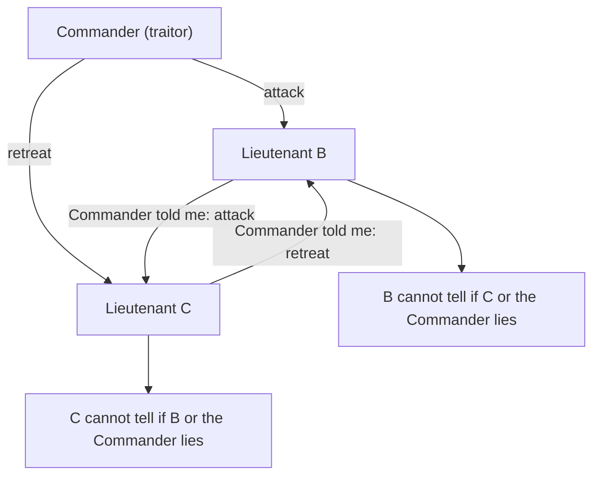
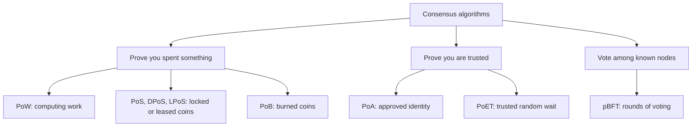
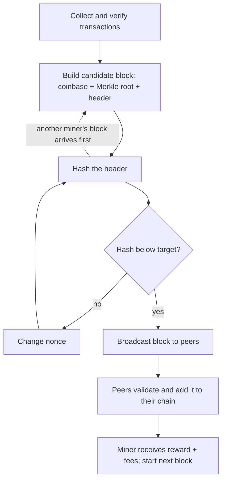
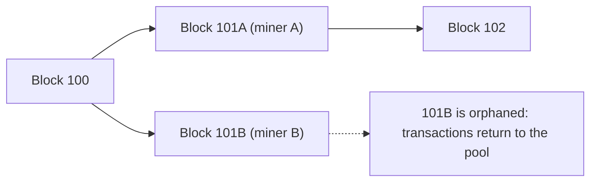
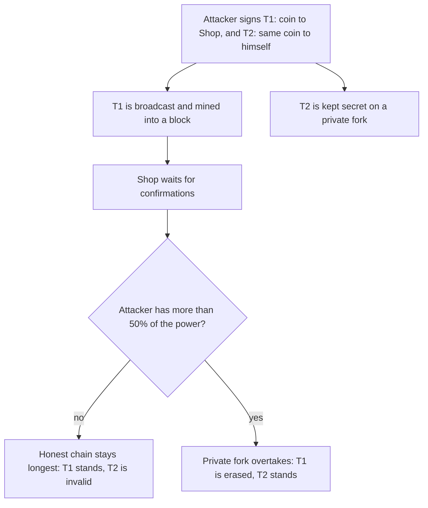
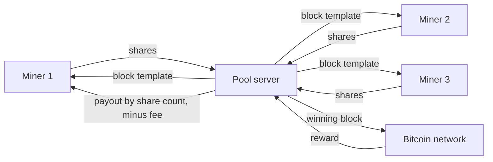
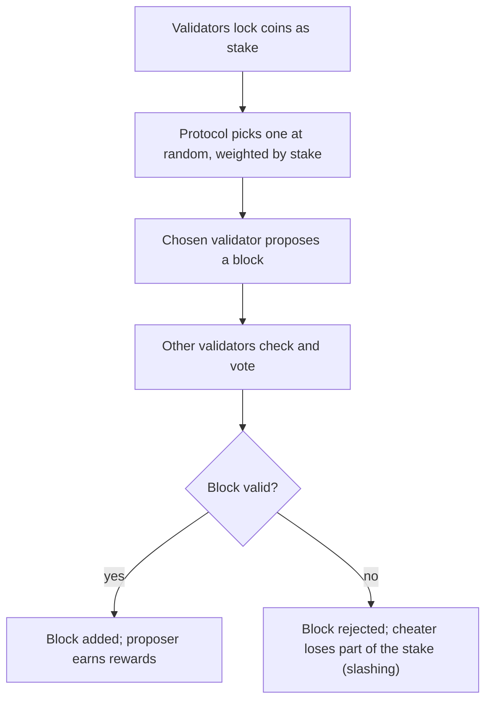

Ye note syllabus <Syl m="2" />, section 2.1 cover karta hai: Byzantine Generals Problem, consensus algorithms (PoW, PoS, PoET, PoA, LPoS, pBFT, Proof of Burn), life of a miner, mining difficulty, aur mining pools unke methods ke saath. Bitcoin ki baatein (keys, addresses, scripts, transactions) Bitcoin note mein hain, aur Paxos aur Raft fault-tolerant consensus note mein.

## Pehle basics

- **Node** wo computer hai jo blockchain software chala raha hai. **Miner** wo node hai jo naye blocks banane ki bhi koshish karta hai.
- **Block** mein transactions ki list aur ek **header** hota hai. Header mein pichle block ka hash, transactions ka Merkle root, timestamp, difficulty target aur ek **nonce** hota hai.
- **Hash function** (Bitcoin mein SHA-256) kisi bhi input ko fixed-size fingerprint bana deta hai. Same input ka same fingerprint, zara sa change karo to poora alag fingerprint, aur fingerprint se input wapas nahi nikal sakte. To special shape wala hash paane ka ek hi tarika hai: bahut saare inputs try karna.
- **Nonce** ek number hai jo miner badal sakta hai ("number used once"). Nonce badalne se header hash badal jaata hai.
- **Ledger** wo ek shared transactions list hai jis pe har node ko agree karna hai.

Analogy: 1,000 students ki class ko decide karna hai ki attendance register ka kaunsa version asli hai, aur koi teacher nahi hai. Koi bhi kuch bhi claim kar sakta hai. Class ko aisa rule chahiye jisme cheating mushkil ho; consensus algorithm yahi deta hai. <Cite id="consensus-mining-gfg-consensus" />

## Consensus kya hai aur ye mushkil kyun hai?

<Box kind="definition">

Blockchain mein **consensus** wo process hai jisse network ke saare honest nodes transactions ke same set aur same order (same ledger) pe agree karte hain, chahe kuch nodes slow, offline ya dishonest hon, aur koi central authority na ho. <Cite id="consensus-mining-gfg-consensus" /> <Cite id="consensus-mining-gfg-crypto-consensus" />

</Box>

**Ye kyun zaroori hai.** Agar do log ek hi coin kharch karne ki koshish karein, to har node ko same winner chunna hoga. Agreement ke bina alag alag nodes ke paas alag ledger hoga aur paise ka koi matlab nahi rahega.

**Ye mushkil kyun hai.**

1. Messages late ho sakte hain, kho sakte hain, ya alag alag nodes ko alag order mein pahunch sakte hain.
2. Nodes crash ho sakte hain, ya hack hoke alag alag logon ko galat information bhej sakte hain (ek "Byzantine" fault).
3. Open network mein "one node, one vote" kaam nahi karta, kyunki ek insaan hazaaron fake nodes chala sakta hai (**Sybil attack**). Isliye open network ko aisa vote chahiye jisme asli cost lage: computing power (PoW), coins (PoS) wagairah. <Cite id="consensus-mining-wiki-pow" /> <Cite id="consensus-mining-wiki-pos" />

### The Byzantine Generals Problem

Byzantine army ke kuch generals ek shahar ko gher lete hain. Wo tabhi jeet sakte hain jab **saare loyal generals ek saath attack karein** (ya saare ek saath retreat). Wo sirf messengers se baat kar sakte hain, aur kuch generals traitor ho sakte hain jo alag generals ko alag baat batate hain. Sawal: kya loyal generals phir bhi same decision tak pahunch sakte hain? <Cite id="consensus-mining-wiki-byzantine" />

Blockchain mein generals nodes hain, "attack ya retreat" matlab "ye block valid hai ya nahi", aur traitor matlab faulty ya malicious node.

<Cite id="consensus-mining-wiki-byzantine" loc="diagram" />

Key results (Lamport, Shostak aur Pease, 1982): unsigned messages ke saath loyal generals tabhi agree kar sakte hain jab total generals traitors ke **teen guna se zyada** hon, yaani $f$ traitors ke liye $n \ge 3f + 1$; signed messages (jinhe forge nahi kar sakte) ke saath problem theory mein aasaan ho jaata hai (messages time pe pahunchein to kitne bhi traitors ho sakte hain), lekin pBFT jaise practical protocols ko delayed messages sambhalne padte hain, isliye unhe abhi bhi $n \ge 3f + 1$ chahiye. <Cite id="consensus-mining-wiki-byzantine" /> <Cite id="consensus-mining-wiki-bft" />

Bitcoin ka proof of work classic guarantee nahi deta. Wo disagreement ko itna mehenga bana deta hai ki koi use chala nahi sakta; isiliye Wikipedia kehta hai ki blockchains "resource-intensive mechanisms" use karte hain "that make disagreements impractical to maintain". <Cite id="consensus-mining-wiki-bft" />

<PYQ id="2023-12/q4b" /> <PYQ id="2024-12/q2a" /> <PYQ id="2025-05/q2a" />

<Cite id="consensus-mining-gfg-consensus" loc="diagram" />

## Proof of work (PoW)

<Box kind="definition">

**Proof of work** ek consensus method hai jisme node ko dikhana padta hai ki usne bahut saari, napi ja sakne wali computation ("work") ki hai, tab use agla block jodne ka haq milta hai. Work karna mushkil hona chahiye par baaki sabke liye check karna bahut aasaan. <Cite id="consensus-mining-wiki-pow" /> <Cite id="blockchain-fundamentals-nakamoto" loc="§4" />

</Box>

**Idea kahan se aaya.** Hashcash, jo Adam Back ne 1997 mein propose kiya, email bhejne wale se kehta tha ki given number of leading zeros wala hash dhoondho, taaki lakhon spam mails bhejna costly ho jaye. Bitcoin ne ye idea blocks ke liye use kiya. <Cite id="consensus-mining-wiki-hashcash" />

**Bitcoin mein ye kaise kaam karta hai.** Miner block header ko baar baar hash karta hai, har baar nonce badalta hai, jab tak hash (number ki tarah padha jaye to) **target se chhota** na ho jaye. Chhota target matlab kam hashes qualify karte hain, to zyada attempts chahiye. Winner ko check karne ke liye sirf ek hash chahiye. <Cite id="consensus-mining-antonopoulos-mining" /> <Cite id="consensus-mining-tp-pow" />

<Sum>

<Given>

Ek toy block hai: text `Asha pays Ravi 5` ke baad ek nonce. Rule: SHA-256 hash, hexadecimal mein, **0 se start** hona chahiye. Phir sakht rule: **00 se start** hona chahiye.

</Given>

<Find>

wo nonce jo har rule satisfy kare, kitne attempts lage, aur kitne attempts expect karne chahiye.

</Find>

<Steps>

1. Nonce 0 try karo. `Asha pays Ravi 5|0` ka hash `8cb166...` se start hota hai. Pehla digit 8 hai, 0 nahi, to fail. *Reason: rule ko leading 0 chahiye.*
2. Nonce mein 1 jodte jao. Nonces 1 se 7 dete hain `f30140...`, `57b826...`, `92d506...`, `fd835b...`, `dafce4...`, `4a372f...`, `7f8e4e...`. Koi 0 se start nahi hota.
3. Nonce 8 deta hai `0a328e...`. Ye 0 se start hota hai, to rule 1 $8 + 1 = 9$ attempts (nonces 0 se 8) ke baad meet hota hai. *Reason: nonce 0 ko pehla attempt gina.*
4. Rule 1 ke liye expected attempts: har hex digit 16 values mein se ek hai, sab ki barabar chance, to leading 0 ka chance $1/16$ hai aur expected attempts $16$ hain. Humein 9 lage, jo normal luck hai.
5. Rule 2 (do zeros) ke liye: har attempt ka chance $1/16 \times 1/16 = 1/256$, to lagbhag 256 attempts expect karte hain. Hamare run mein pehla hash jo `00` se start hota hai nonce 112 pe hai (`0072802e...`), yaani 113 attempts. *Reason: luck average se better ya worse ho sakti hai.*
6. Dusre ke verify karne ke liye: `Asha pays Ravi 5|112` ko ek baar hash karo aur pehle do digits dekho. Ek hash, 113 nahi.

</Steps>

<Answer>

Nonce 8 "starts with 0" meet karta hai (9 attempts, expected 16). Nonce 112 "starts with 00" meet karta hai (113 attempts, expected 256). Koi bhi ek hash se verify kar sakta hai.

</Answer>

<Box kind="verify">

Ye hashes asli SHA-256 program se bane hain, to aap dobara bana sakte ho. Pattern rule of thumb se bhi match karta hai: har extra zero digit expected work ko 16 guna kar deta hai, aur $16 \times 16 = 256$.

</Box>

</Sum>

<Sum>

<Given>

Block tab valid hai jab uska hash **5 hex zeros** se start ho. Miner **500,000 hashes per second** compute karta hai.

</Given>

<Find>

expected attempts aur valid hash dhoondhne ka expected time.

</Find>

<Steps>

1. Har attempt ka chance $= (1/16)^5 = 1/1{,}048{,}576$. *Reason: paanch independent hex digits, har ek 0 hona chahiye.*
2. Expected attempts $= 1 / \text{chance} = 16^5 = 1{,}048{,}576$. *Reason: jo cheez average mein N tries mein ek baar hoti hai, uske liye N tries expect karte hain.*
3. Expected time $= 1{,}048{,}576 / 500{,}000 = 2.097$ seconds.

</Steps>

<Answer>

lagbhag 1,048,576 attempts, average mein lagbhag 2.1 seconds.

</Answer>

<Box kind="verify">

Bits mein, 5 hex zeros matlab 20 zero bits, aur $2^{20} = 1{,}048{,}576$. Same number. Multiplication se check: $500{,}000 \times 2.097 \approx 1{,}048{,}500$, match karta hai.

</Box>

</Sum>

**PoW chain ko kaise bachata hai.** Har block mein pichle block ka hash hota hai. Purana block badalne ke liye attacker ko us block aur uske baad ke har block ka work dobara karna padega, aur saath hi honest miners se aage rehna padega jo naye blocks jodte rehte hain. Saare nodes sabse zyada accumulated work wali chain follow karte hain, isliye attacker ko total mining power ke aadhe se zyada chahiye (ek "51% attack"). <Cite id="blockchain-fundamentals-nakamoto" loc="§11" /> <Cite id="consensus-mining-btcwiki-majority" />

**PoW ke advantages:** simple, das saal se zyada test hua, koi bhi join kar sakta hai, security asli cost se backed. **Disadvantages:** bahut zyada bijli, special hardware (ASICs) aur mining pools mining ko kuch bade players ki taraf dhakel dete hain, aur throughput kam hai (Bitcoin lagbhag 7 transactions per second, ye general knowledge hai, cited pages se nahi). <Cite id="consensus-mining-wiki-pow" /> <Cite id="consensus-mining-gfg-pow" />

## Life of a miner aur mining process

<Box kind="definition">

**Mining** wo process hai jisme miners pending transactions ko candidate block mein collect karte hain, uske liye proof-of-work puzzle solve karte hain, aur naye coins aur fees ke badle use blockchain mein jodte hain. <Cite id="consensus-mining-antonopoulos-mining" />

</Box>

Bitcoin miner ki life ke steps (yahan miner matlab mining software chalane wala node; bahut se pool se jude hote hain):

1. **Collect.** Network se naye transactions lo aur valid wale unconfirmed transactions ke pool (mempool) mein rakho.
2. **Verify.** Har transaction ko khud check karo: sahi format, valid signature, inputs unspent, amounts balance. Node kisi ki baat par bharosa nahi karta. <Cite id="consensus-mining-antonopoulos-mining" />
3. **Pick.** Kaunse transactions jaayenge ye chuno, aam taur pe jo sabse achhi fee dete hain, jab tak block full na ho.
4. **Coinbase.** Ek special pehla transaction jodo jo block subsidy plus saari fees miner ke apne address ko deta hai.
5. **Merkle root aur header.** Saare transactions ka Merkle tree banao aur uska root, pichla block hash, timestamp, target aur starting nonce header mein daalo. <Cite id="consensus-mining-btcdev-block-chain" />
6. **Search.** Header ko baar baar hash karo, nonce badalte hue (aur jab nonce range khatam ho jaye to coinbase mein ek "extra nonce"), jab tak hash target se chhota na ho.
7. **Broadcast.** Jeetne wala block peers ko bhejo. Har node accept karne aur aage badhane se pehle use poora dobara validate karta hai.
8. **Build on top.** Sab agle block par kaam shuru karte hain, naye block ke upar. Jab block kuch blocks gehra ho jaye to confirmed maana jaata hai, aur reward mature hone ke baad (100 blocks, general knowledge, cited pages se nahi) miner use kharch kar sakta hai.

<Cite id="consensus-mining-antonopoulos-mining" loc="diagram" />

<PYQ id="2023-12/q2b" /> <PYQ id="2023-12-ce/q6a" />

### Bitcoin mein consensus (Nakamoto consensus)

Bitcoin mein koi vote nahi hota. Agreement un chaar cheezon se "emerge" hota hai jo har node apne aap karta hai: (1) har transaction ko khud verify karna, (2) proof of work se unhe khud blocks mein bundle karna, (3) har naye block ko khud verify karna, aur (4) sabse zyada cumulative proof of work wali chain khud chunna. Kyunki saare nodes same chaar rules follow karte hain, wo same chain pe converge kar jaate hain. <Cite id="consensus-mining-antonopoulos-mining" />

<Box kind="exam">

Exam mein English mein likho: "Consensus in Bitcoin is achieved through proof of work. Miners collect and validate transactions, build a candidate block and repeatedly hash its header with different nonces until the hash is below the network target. The first miner to succeed broadcasts the block; other nodes verify it and add it to the longest valid chain (the chain with the most cumulative work). The winner gets the block reward and fees. Since rewriting history needs more than half the network's hash power, the ledger stays consistent and tamper resistant."

</Box>

## Block reward, halving aur fees

Winning miner ko do tarah se payment milta hai: **block subsidy** (coinbase transaction mein bane naye coins) aur **transaction fees** (har transaction ke inputs aur outputs ke beech ka bacha hua chhota hissa). Subsidy 2009 mein 50 BTC se shuru hui aur har 210,000 blocks (lagbhag chaar saal) mein aadhi ho jaati hai; ise **halving** kehte hain. Isiliye total supply 21 million coins ke paas ruk jaata hai, lagbhag saal 2140 mein, uske baad miners ko sirf fees milti hai. <Cite id="consensus-mining-antonopoulos-mining" />

<Sum>

<Given>

Shuru mein subsidy $= 50$ BTC, har $210{,}000$ blocks pe halving. Height $840{,}000$ ka block $0.375$ BTC fees collect karta hai.

</Given>

<Find>

(a) height 840,000 pe subsidy aur us block se miner ki total income; (b) height 840,000 se pehle kitne coins bane; (c) final supply.

</Find>

<Steps>

1. Ab tak kitni halvings hui: $\lfloor 840{,}000 / 210{,}000 \rfloor = 4$. *Reason: har 210,000 blocks pe ek halving.*
2. Subsidy $= 50 / 2^4 = 50 / 16 = 3.125$ BTC. *Reason: chaar baar aadhi hui.*
3. Income $= 3.125 + 0.375 = 3.5$ BTC. *Reason: miner subsidy plus fees rakhta hai.*
4. Ab tak bane coins: 210,000 blocks ke har period mein $210{,}000 \times$ subsidy bante hain. Height 840,000 se pehle ke chaar periods mein $210{,}000 \times (50 + 25 + 12.5 + 6.25) = 210{,}000 \times 93.75 = 19{,}687{,}500$ BTC bane. *Reason: har complete period ki subsidy jodo.*
5. Final supply: subsidies $50 + 25 + 12.5 + \dots = 100$ banti hain, to total $= 210{,}000 \times 100 = 21{,}000{,}000$ BTC. *Reason: halving series ka sum uske pehle term ka double hota hai.* (Practice mein thoda kam, kyunki subsidy poore satoshis tak neeche round hoti hai.)

</Steps>

<Answer>

(a) subsidy 3.125 BTC, income 3.5 BTC; (b) height 840,000 se pehle 19,687,500 BTC bane; (c) end mein lagbhag 21 million BTC.

</Answer>

<Box kind="verify">

Block 840,000 ke baad bante hue baaki coins: $21{,}000{,}000 - 19{,}687{,}500 = 1{,}312{,}500$. Ye $210{,}000 \times 6.25$ ke barabar hai, yaani $3.125$ se shuru hone wali series ($3.125 + 1.5625 + \dots = 6.25$) ke barabar, to dono tarike match karte hain. Book halving dates deti hai (pehli block 210,000 pe; May 2020 se reward 6.25 BTC), jo 2024 se pehle 3 halvings aur chauthi block 840,000 pe hone se match karta hai. <Cite id="consensus-mining-antonopoulos-mining" />

</Box>

</Sum>

## Mining difficulty

<Box kind="definition">

**Mining difficulty** ek number hai jo batata hai ki valid block hash dhoondhna kitna mushkil hai. Ye sabse aasaan allowed target aur current target ka ratio hai, to higher difficulty matlab chhota target aur zyada expected work. <Cite id="consensus-mining-btcwiki-difficulty" /> <Cite id="consensus-mining-antonopoulos-mining" />

</Box>

**Ye kyun zaroori hai.** Bitcoin chahta hai ki total mining power chahe kuch bhi ho, lagbhag har 10 minute mein ek block bane. Agar zyada miners join karein to blocks bahut tez bante aur coins bahut jaldi issue hote. Isliye difficulty mining power ke hisaab se adjust hoti hai. <Cite id="consensus-mining-antonopoulos-mining" />

**Ye kaise calculate hota hai.**

1. **Target.** Valid block hash ek 256-bit number, jise target kehte hain, se chhota hona chahiye. Header mein ye chhote form `bits` mein store hota hai. <Cite id="consensus-mining-btcdev-block-chain" />
2. **Difficulty.** $\text{difficulty} = \text{difficulty-1 target} / \text{current target}$. Sabse aasaan target (difficulty 1) wo hai jiska `bits` value `0x1d00ffff` hai. <Cite id="consensus-mining-btcwiki-difficulty" />
3. **Expected work.** Difficulty $D$ pe miner ko ek block dhoondhne ke liye average mein lagbhag $D \times 2^{32}$ hashes chahiye. (Kyun $2^{32}$: difficulty 1 pe target lagbhag $2^{224}$ hai, $2^{256}$ possible hashes mein se, to har hash ka chance lagbhag $2^{-32}$ hai.)
4. **Har 2,016 blocks pe retarget.** 10 minute per block pe 2,016 blocks mein $2{,}016 \times 10 = 20{,}160$ minutes = 2 hafte lagne chahiye. Har node asli time ko 2 hafte se compare karke adjust karta hai: <Cite id="consensus-mining-antonopoulos-mining" />

$$
\text{new target} = \text{old target} \times \frac{\text{actual time of the last 2,016 blocks}}{20{,}160 \text{ minutes}}
$$

   2 hafte se tez ho to target chhota (mushkil); slow ho to target bada (aasaan). Ek adjustment target ko zyada se zyada 4 guna badal sakta hai. Asli software 2,015 intervals ka time napta hai ek chhoti off-by-one galti ki wajah se, jisse difficulty lagbhag 0.05% zyada ho jaati hai; sums mein hum ise ignore karte hain. <Cite id="consensus-mining-antonopoulos-mining" />

<Sum>

<Given>

Ek block header ka `bits` $=$ `0x1903a30c` (book mein block 277,316). Target `coefficient x 2^(8 x (exponent - 3))` hai. Difficulty-1 ka `bits` `0x1d00ffff` hai.

</Given>

<Find>

is block ki difficulty, aur $10^{12}$ hashes per second (1 TH/s) karne wale miner ko is difficulty pe average mein ek block dhoondhne mein kitna time lagega.

</Find>

<Steps>

1. `0x1903a30c` ko todo: exponent `0x19` $= 25$ aur coefficient `0x03a30c` $= 238{,}348$. *Reason: pehle do hex digits exponent hain, agle chhe coefficient.*
2. Target $= 238{,}348 \times 2^{8 \times (25 - 3)} = 238{,}348 \times 2^{176}$.
3. `0x1d00ffff` se difficulty-1 target: exponent `0x1d` $= 29$, coefficient `0x00ffff` $= 65{,}535$. Target $= 65{,}535 \times 2^{8 \times (29 - 3)} = 65{,}535 \times 2^{208}$.
4. Difficulty $= \dfrac{65{,}535 \times 2^{208}}{238{,}348 \times 2^{176}} = \dfrac{65{,}535}{238{,}348} \times 2^{32} = 0.27495 \times 4{,}294{,}967{,}296 \approx 1.18 \times 10^{9}$. *Reason: dono targets ko divide karo; powers of two cancel hoke $2^{32}$ bachta hai.*
5. Expected hashes $= D \times 2^{32} \approx 1.18 \times 10^{9} \times 4.295 \times 10^{9} \approx 5.07 \times 10^{18}$.
6. $10^{12}$ hashes/second pe time $= 5.07 \times 10^{18} / 10^{12} = 5.07 \times 10^{6}$ seconds $= 5.07 \times 10^{6} / 86{,}400 \approx 58.7$ days.

</Steps>

<Answer>

difficulty lagbhag 1.18 billion (1,180,923,195); 1 TH/s miner ko average mein ek block ke liye lagbhag 59 din lagte hain.

</Answer>

<Box kind="verify">

Dusra tarika: target lagbhag $2^{17.8} \times 2^{176} = 2^{193.8}$ hai, to hash mein lagbhag $256 - 194 = 62$ leading zero bits hone chahiye, aur har hash ka chance lagbhag $2^{-62.2}$ hai, to lagbhag $2^{62.2} \approx 5.1 \times 10^{18}$ hashes expected hain. Ye step 5 se match karta hai. Book bhi yahi kehti hai: 60 se zyada leading zero bits aur 1 TH/s ke liye lagbhag 59 din mein ek block. <Cite id="consensus-mining-antonopoulos-mining" />

</Box>

</Sum>

<Sum>

<Given>

Current difficulty $D = 100$ (numbers chhote rakhne ke liye). Pichle 2,016 blocks planned 14 din ki jagah **12 din** mein bane. Case 2: unhe **70 din** lage.

</Given>

<Find>

dono cases mein retargeting ke baad nayi difficulty.

</Find>

<Steps>

1. Planned time $= 20{,}160$ minutes $= 14$ days. Case 1 ka actual time $= 12$ days $= 17{,}280$ minutes.
2. Ratio $= 17{,}280 / 20{,}160 = 12/14 = 6/7 \approx 0.857$. *Reason: network plan se tez tha, to target chhota hona chahiye.*
3. New target $= \text{old target} \times 6/7$. Difficulty target ke inversely proportional hai, to new $D = 100 \times 14/12 = 116.67$.
4. Case 2: ratio $= 70/14 = 5$. Ye allowed factor 4 se zyada hai, to adjustment 4 pe cap ho jaata hai. New target $= \text{old} \times 4$, to new $D = 100 / 4 = 25$. *Reason: cap ek change ko 4 guna tak limit karta hai; baaki agle cycle mein theek hota hai.*

</Steps>

<Answer>

Case 1: difficulty 100 se badhkar lagbhag 116.7. Case 2: difficulty 100 se ghatkar 25 (capped).

</Answer>

<Box kind="verify">

Case 1: blocks plan se $14/12 = 1.167$ guna tez aaye, aur difficulty theek utni hi badhi, to block phir lagbhag 10 minute mein banega. Case 2: capped drop ke saath bhi blocks ko 2,016 ke liye $70/4 = 17.5$ din lagenge, to ek aur retarget hoga, jaisa book kehti hai ki bade gap theek hone mein kai cycles lagte hain. <Cite id="consensus-mining-antonopoulos-mining" />

</Box>

</Sum>

<Box kind="exam">

Exam mein English mein likho: "Mining difficulty is a measure of how hard it is to find a block hash below the target. Difficulty = difficulty-1 target / current target. Bitcoin adjusts it every 2,016 blocks so that a block takes about 10 minutes (2 weeks for 2,016 blocks): new target = old target x (actual time / 20,160 minutes), limited to a factor of 4. If blocks came faster, difficulty goes up; if slower, it goes down."

</Box>

<PYQ id="2022-12-ce/q3a" /> <PYQ id="2024-05-ce/q3b" /> <PYQ id="2024-12/q1c" />

**Is point pe Bitcoin aur Ethereum.** Bitcoin ab bhi proof of work aur 2,016-block retarget use karta hai. Ethereum proof of work (Ethash) use karta tha, jisme lagbhag har 13.3 second mein ek naya block ka target tha, par 15 September 2022 (the Merge) ko mining band ho gayi aur ab proof of stake use hota hai, to Ethereum pe aaj mining difficulty nahi hai. <Cite id="consensus-mining-eth-pow" /> <Cite id="consensus-mining-eth-merge" /> Bitcoin versus Ethereum ka poora comparison Ethereum note mein hai.

## Forks aur orphaned blocks

Blocks poori duniya mein kuch seconds mein pahunchte hain, instantly nahi. Agar do miners lagbhag ek hi time pe valid block dhoondhein, to kuch nodes pehla dekhte hain aur kuch doosra. Thodi der ke liye chain ke do tips hote hain: ek **fork**. Dono blocks valid hain. Jab agla block inme se ek ke upar banta hai, us chain mein zyada cumulative work ho jaata hai aur har node us par switch kar leta hai. Dusra block hat jaata hai: wahi **orphaned block** hai, aur uske transactions wapas pool mein chale jaate hain dobara mine hone ke liye (agar wo winning chain mein pehle se na hon). <Cite id="consensus-mining-antonopoulos-mining" /> <Cite id="consensus-mining-gfg-conflicts" />

<Cite id="consensus-mining-gfg-conflicts" loc="diagram" />

**Terms.** Strictly, *orphan block* ka parent unknown hota hai, jabki *stale block* wo block hai jiski chain ab longest nahi rahi; roz ki baat mein log dono ke liye "orphan" bolte hain. <Cite id="consensus-mining-btcwiki-orphan" />

**Ye kyun hota hai aur kaise limit hota hai.** Forks propagation delay se aate hain. Ye lagbhag hamesha ek block ke andar settle ho jaate hain. Bitcoin ka 10-minute block time ek compromise hai: tez blocks se zyada forks aur zyada waste work hota, slow blocks se payments slow lagte hain. Orphaned block ke miner ka us work ka reward chala jaata hai, isiliye miners ko network se fast link chahiye. <Cite id="consensus-mining-antonopoulos-mining" />

**Confirmations.** Transaction "1 confirmation" tab hota hai jab wo ek block mein ho, "2 confirmations" jab uske upar ek aur block ho, aur aise hi aage. Wallets traditionally transaction ko tab tak unconfirmed dikhate hain jab tak wo 6 blocks gehra na ho. <Cite id="consensus-mining-btcwiki-confirmation" />

<Box kind="exam">

Exam mein English mein likho: "An orphaned block is a valid block that is not part of the main chain. It happens when two miners solve the puzzle at almost the same time, causing a temporary fork. The network keeps the chain with the most cumulative work, so the block on the shorter branch is discarded and its transactions go back to the mempool. The miner of that block loses the reward."

</Box>

<PYQ id="2024-05-ce/q1c" /> <PYQ id="2025-05-ce/q1a" />

## Double spending aur proof of work ise kaise solve karta hai

**Double spending** matlab ek hi digital coin ko do baar use karna. Digital data copy ho sakta hai, to kuch to chahiye jo ek insaan ko ek hi coin se do dukaan pe payment karne se roke. Bank ye ek ledger rakh ke solve karta hai. Bitcoin mein bank nahi hai. <Cite id="blockchain-fundamentals-wiki-doublespend" />

**PoW ise kaise solve karta hai.**

1. Har transaction broadcast hota hai aur nodes check karte hain: jo coin (output) kharch ho raha hai wo unspent hona chahiye, aur signature sahi hona chahiye. Same coin use karne wala doosra transaction conflict ke roop mein reject ho jaata hai.
2. Agar do conflicting transactions ek saath bheje jaayein, to miners unme se ek ko block mein daalte hain. Jo bhi sabse zyada work wali chain mein hai wahi count hota hai; doosra drop ho jaata hai. To saare nodes ek order pe agree karte hain. <Cite id="blockchain-fundamentals-nakamoto" loc="§1-§2" />
3. Payment undo karne ke liye cheater ko us block aur uske baad ke saare blocks ka work honest network se tez dobara karna padega. Har extra confirmation ise exponentially kam sambhav banata hai (Nakamoto, §11). <Cite id="blockchain-fundamentals-nakamoto" loc="§11" />
4. Asli khatra sirf **majority (51%) attack** hai, jahan ek group aadhi se zyada mining power control karta hai, ek secret fork mine karta hai aur use release kar deta hai. Bade network pe ye bahut mehenga hai. <Cite id="consensus-mining-btcwiki-majority" />

<Cite id="consensus-mining-btcwiki-majority" loc="diagram" />

<PYQ id="2022-12-ce/q2b" /> <PYQ id="2024-12-ce/q5a" />

## Mining pools aur unke methods

<Box kind="definition">

**Mining pool** miners ka ek group hai jo apni hash power jodte hain, ek hi block pe saath kaam karte hain aur reward ko har ek ke kaam ke hisaab se baant lete hain. <Cite id="consensus-mining-wiki-pool" /> <Cite id="consensus-mining-btcwiki-pooled" />

</Box>

**Pools kyun hain.** Difficulty badhne par chhote miner ko block milne mein saalon lag sakte the ya kabhi nahi, to income lottery jaisi thi. Pools ise chhoti, regular income mein badal dete hain. Mastering Bitcoin ka example: network hash rate ka 0.0001% rakhne wala miner akele lagbhag 20 saal mein ek block dhoondhta, par network hash rate ke 1% wale pool mein pool din mein ek se zyada block dhoondhta hai. <Cite id="consensus-mining-antonopoulos-mining" />

**Pool kaise kaam karta hai.**

1. Pool server block template (transactions, coinbase, Merkle root, previous hash) banata hai aur miners ko bhejta hai.
2. Har miner nonces search karta hai, par ek **aasaan pool target** pe (jaise network se 1,000 guna aasaan). Is aasaan target ko meet karne wala hash ek **share** hai: proof ki miner ne asli kaam kiya. <Cite id="consensus-mining-antonopoulos-mining" />
3. Kabhi kabhi ek share network target bhi meet kar leta hai. Wo ek asli valid block hai. Reward pool ke address pe jaata hai.
4. Pool har miner ko uske shares ke hisaab se pay karta hai, operator ki fee ghata ke.

<Cite id="consensus-mining-antonopoulos-mining" loc="diagram" />

**Payout methods.** <Cite id="consensus-mining-wiki-pool" /> <Cite id="consensus-mining-btcwiki-pooled" />

| Method | Reward kaise baanta hai | Risk kiske paas |
| --- | --- | --- |
| Pay-per-share (PPS) | Har share ka fixed payment, pool ke balance se turant | Pool operator (miner ko sabse kam variance) |
| Proportional | Block milne par har miner ko reward $\times$ (apne shares / us round ke saare shares) | Miners |
| Pooled mining ("slush") | Proportional jaisa, par round mein purane shares ka weight kam, to round ke beech pool badalne se fayda nahi | Miners |
| Pay-per-last-N-shares (PPLNS) | Reward last N shares mein baanta hai, poore round mein nahi | Miners; loyal miners ko fayda |
| Solo pool | Poora reward us ek miner ko jo block dhoondhe | Miner |
| Peer-to-peer (P2Pool) | Koi server nahi: kam difficulty ki "share chain" sabke shares record karti hai; koi operator cheat nahi kar sakta, single point of failure nahi | Miners; chalana zyada complex |

**Managed pool ya P2Pool.** Managed pool mein ek operator server chalata hai, fee leta hai, aur cheat ya fail kar sakta hai. P2Pool operator ko hata deta hai. <Cite id="consensus-mining-antonopoulos-mining" />

**Pools ki problems.** Pools itne bade ho sakte hain ki total hash power ka bada hissa unke paas ho, jisse decentralization kamzor hota hai aur 51% ka khatra paas aata hai (Deepbit pool ke paas kabhi network hash rate ka aadhe se zyada tha). <Cite id="consensus-mining-wiki-pool" />

<Sum>

<Given>

Ek pool ko ek block milta hai jisme subsidy $3.125$ BTC aur fees $0.375$ BTC hain. Pool fee $2\%$ hai. Is round mein pool ne total $N = 10{,}000$ shares gine, aur Ravi ne unme se $n = 150$ submit kiye. Payout method: proportional.

</Given>

<Find>

Ravi ka payout.

</Find>

<Steps>

1. Block reward $B = 3.125 + 0.375 = 3.5$ BTC.
2. 2% fee ke baad pool $3.5 \times 0.98 = 3.43$ BTC baantta hai. *Reason: operator 2% rakhta hai.*
3. Ravi ka fraction $= n / N = 150 / 10{,}000 = 0.015$.
4. Ravi ka payout $= 3.43 \times 0.015 = 0.05145$ BTC. *Reason: proportional method: reward ko apne shares upon saare shares se multiply.*

</Steps>

<Answer>

Ravi ko $0.05145$ BTC milte hain.

</Answer>

<Box kind="verify">

Jodke check: agar saare 10,000 shares ko same rate pe pay karte, to total $0.05145 / 0.015 = 3.43$ BTC hota, jo bilkul wahi amount hai jo baanta ja raha hai, to na kuch kho raha hai na ban raha hai. Yaani $0.05145 \times (10{,}000/150) = 3.43$.

</Box>

</Sum>

<Sum>

<Given>

Ek miner ke paas network hash rate ka $0.0001\%$ hai, yaani fraction $10^{-6}$. Bitcoin har 10 minute mein ek block banata hai (din mein 144 blocks). Jis pool mein wo jud sakta hai uske paas network hash rate ka $1\%$ hai. Subsidy $3.125$ BTC, fees ignore karo. Pool fee $2\%$.

</Given>

<Find>

akele wo kitni der mein block dhoondhega, pool din mein kitne blocks dhoondhta hai; solo aur pool mein uski expected daily income.

</Find>

<Steps>

1. Solo: wo saare blocks ka $10^{-6}$ dhoondhta hai, to ek block per $10 / 10^{-6} = 10^{7}$ minutes $= 10^{7} / (60 \times 24 \times 365) \approx 19$ saal. *Reason: har block mein uska chance $10^{-6}$ hai.*
2. Pool: pool din mein $0.01 \times 144 = 1.44$ blocks dhoondhta hai.
3. Solo income per day (average): $10^{-6} \times 144 \times 3.125 = 0.00045$ BTC.
4. Pool ke kaam mein uska hissa: $0.0001\% / 1\% = 1/10{,}000$. Pool income per day $= 1.44 \times 3.125 \times 0.98 \times 1/10{,}000 = 0.000441$ BTC.

</Steps>

<Answer>

akele: lagbhag 19 saal mein ek block; pool din mein 1.44 blocks dhoondhta hai; average income solo 0.00045 BTC per din aur pool mein 0.000441 BTC per din, 2% fee steady payout ki keemat hai.

</Answer>

<Box kind="verify">

$0.00045 \times 0.98 = 0.000441$, jo pool wale figure ke barabar hai, to pool fee ghata ke wahi average income deta hai. 19 saal book ke "once every 20 years" se match karta hai. <Cite id="consensus-mining-antonopoulos-mining" />

</Box>

</Sum>

<PYQ id="2023-12-ce/q1c" /> <PYQ id="2024-05-ce/q6d" /> <PYQ id="2025-05-ce/q1e" />

## Proof of stake (PoS) aur uske variants

<Box kind="definition">

**Proof of stake** mein agla block banane ka haq ek **validator** ko milta hai jo chance se chuna jaata hai, par jitne coins usne **stake** ke roop mein lock kiye hain us hisaab se weight ke saath. Cheating karne wala validator apne stake ka kuch hissa kho sakta hai ("slashed"). <Cite id="consensus-mining-wiki-pos" /> <Cite id="consensus-mining-gfg-pos" /> <Cite id="consensus-mining-eth-pos" />

</Box>

**Ek line mein idea.** PoW kehta hai "apna bijli ka bill dikhao"; PoS kehta hai "apna risk pe lagaya hua paisa dikhao". Kyunki solve karne ko koi puzzle nahi, energy use bahut kam hai. Ethereum pe validator 32 ETH deposit karta hai aur protocol validators ko blocks propose aur vote karne ke liye chunta hai; equivocation jaisa bura behaviour stake ka kuch ya poora hissa nasht kar sakta hai. <Cite id="consensus-mining-eth-pos" />

<Cite id="consensus-mining-gfg-pos" loc="diagram" />

<Sum>

<Given>

Simple stake-weighted PoS mein teen validators: A ne 32 coins, B ne 64 coins, C ne 160 coins stake kiye hain.

</Given>

<Find>

agla block banane ke liye har ek ke chune jaane ka chance.

</Find>

<Steps>

1. Total stake $= 32 + 64 + 160 = 256$.
2. $P(A) = 32 / 256 = 1/8 = 12.5\%$.
3. $P(B) = 64 / 256 = 1/4 = 25\%$.
4. $P(C) = 160 / 256 = 5/8 = 62.5\%$. *Reason: chance apne stake ko total stake se divide karne ke barabar hai.*

</Steps>

<Answer>

A 12.5%, B 25%, C 62.5%.

</Answer>

<Box kind="verify">

Chances ka sum 100% hona chahiye: $12.5 + 25 + 62.5 = 100$. Aur C ka stake A ke coins ka 5 guna hai ($160 / 32 = 5$) aur uska chance bhi A ke chance ka 5 guna hai ($62.5 / 12.5 = 5$).

</Box>

</Sum>

**Advantages:** bahut kam energy, special hardware nahi, hissa lena sasta, attack ke liye bahut paisa risk pe lagana padta hai. **Disadvantages / criticism:** amir aur amir hota hai (zyada stake se zyada rewards), centralization ka risk, "nothing at stake" ki chinta (do forks pe vote karne mein validator ko kuch kharch nahi hota, isliye protocols slashing jodte hain), aur long-range attacks jahan attacker purani history rewrite karta hai. <Cite id="consensus-mining-wiki-pos" /> <Cite id="consensus-mining-gfg-pos" />

**Syllabus ke variants.**

- **Delegated proof of stake (DPoS).** Coin holders apne stake ke hisaab se vote karke witnesses (delegates) ki ek chhoti committee chunte hain. Witnesses baari baari se blocks banate hain. Validators kam hone se ye tez hai, par power kuch logon ke paas rehti hai. EOS, Lisk aur Tron mein use hota hai. <Cite id="consensus-mining-wiki-pos" />
- **Leased proof of stake (LPoS).** Chhote balance wala coin holder apne coins ek bade node ko *lease* karta hai taaki us node ke blocks banane ka chance badhe, aur badle mein rewards ka hissa paata hai. Coins owner ke wallet se kabhi nahi jaate. Waves ke hisaab se LPoS aisa hai (general knowledge; cited pages Waves cover nahi karte). Cited Wikipedia page ek milte-julte idea, *liquid* PoS (Tezos mein use), ko describe karta hai, jahan chhote holders apne voting rights bade validators ko delegate karte hain periodic payouts ke liye aur kabhi bhi switch kar sakte hain. <Cite id="consensus-mining-wiki-pos" />

## Proof of burn (PoB)

<Box kind="definition">

**Proof of burn** mein participants apne kuch coins ek aise address pe bhej dete hain (burn) jahan se wo kabhi kharch nahi ho sakte. Burn commitment dikhata hai, aur participant jitna zyada burn kare, agla block banane ke liye chune jaane ka chance utna zyada. <Cite id="consensus-mining-gfg-pob" /> <Cite id="consensus-mining-btcwiki-pob" />

</Box>

Soch ye hai ki burnt coins ek aisi mining machine ki tarah hain jise wapas nahi le sakte: roz bijli dene ki jagah aap coins mein ek baar pay karte ho. Examples: Slimcoin PoB ko apne main consensus ke roop mein use karta hai, aur Counterparty platform ne users se Bitcoin burn karwa ke apne XCP tokens diye. <Cite id="consensus-mining-gfg-pob" />

**Advantages:** PoW se bahut kam energy; burn ek long-term commitment hai. **Disadvantages:** asli wealth nasht hoti hai, amir zyada burn karke dominate kar sakte hain. GfG bhi yahi "wasted value" wali criticism karta hai. <Cite id="consensus-mining-gfg-pob" /> <Cite id="consensus-mining-gfg-crypto-consensus" />

## Proof of elapsed time (PoET)

**PoET** mostly private (permissioned) networks mein use hota hai. Har node ek **trusted hardware** (Intel ka SGX, CPU ka ek protected area) se random waiting time maangta hai. Har node apne time tak sota hai, aur jis node ka timer pehle khatam hota hai wo block banane ka haq jeet jaata hai. Hardware ek certificate deta hai ki wait sach mein hua, isliye koi chhota wait claim karke cheat nahi kar sakta. Energy lagbhag nahi lagti, aur har node ko fair chance milta hai. <Cite id="consensus-mining-gfg-crypto-consensus" /> <Cite id="consensus-mining-gfg-consensus" />

**Weakness:** security Intel ke hardware pe trust par tiki hai; agar hardware toot jaye to lottery ko game kiya ja sakta hai. Hyperledger Sawtooth wo sabse jaana-maana platform hai jisne PoET offer kiya (general knowledge; uski wiki overview ke hisaab se project 2024 mein archive ho gaya).

## Proof of authority (PoA)

**PoA** block banane ka haq chhote se **approved validators** ke set ko deta hai jinki asli duniya ki identity aur reputation daav pe lagi hoti hai. Koi puzzle nahi, koi coin lock nahi. Ethereum ke PoA standard (Clique) mein authorised signers ki fixed list baari baari se blocks banati hai, aur signers galat behave karne wale member ko vote karke bahar nikal sakte hain. Ye tez aur sasta hai, par permissioned hai aur isliye poori tarah trustless nahi. <Cite id="consensus-mining-wiki-poa" /> <Cite id="consensus-mining-eth-poa" />

Typical use: private ya consortium chains aur test networks, jahan participants ek dusre ko pehle se jaante hain. VeChain Wikipedia pe ek user ke roop mein listed hai. <Cite id="consensus-mining-wiki-poa" />

## Practical Byzantine Fault Tolerance (pBFT)

**pBFT** (Castro aur Liskov, 1999) ek jaane-pehchane, fixed nodes ke beech voting protocol hai. Ek round ke liye ek node leader (primary) hota hai; wo request propose karta hai, aur baaki nodes phases (pre-prepare, prepare, commit) mein messages exchange karte hain jab tak kaafi bada majority agree na kar le. Ye tab bhi chalta rehta hai jab kuch nodes faulty ya malicious hon, jab tak **$n$ mein se zyada se zyada $f$ nodes faulty hon aur $n \ge 3f + 1$**. Decision ke liye $2f + 1$ nodes ka agreement chahiye. Ek round mein final (koi fork nahi), tez, par messages ki sankhya $n$ ke saath tezi se badhti hai, isliye chhote permissioned networks ke liye theek. <Cite id="consensus-mining-wiki-bft" /> pBFT, Paxos aur Raft ki poori kahani agle module ke note mein hai.

<Sum>

<Given>

Ek permissioned network pBFT use karta hai aur uske $n = 10$ nodes hain.

</Given>

<Find>

wo sabse zyada faulty (Byzantine) nodes $f$ jo wo jhel sakta hai, agreement quorum ka size, aur $f = 2$ jhelne ke liye minimum nodes.

</Find>

<Steps>

1. Rule $n \ge 3f + 1$ hai, to $f \le (n - 1) / 3 = 9 / 3 = 3$. *Reason: rule ko rearrange kiya.*
2. Sabse bada $f = 3$. Quorum $= 2f + 1 = 7$ nodes. *Reason: standard pBFT quorum size.*
3. $f = 2$ ke liye: $n \ge 3 \times 2 + 1 = 7$ nodes.

</Steps>

<Answer>

10 nodes ke saath 3 tak faulty ho sakte hain, aur 7 ke quorum ko agree karna padta hai; 2 faulty nodes jhelne ke liye kam se kam 7 nodes chahiye.

</Answer>

<Box kind="verify">

$f = 3$ ke saath: $3f + 1 = 10 = n$, to rule bilkul fit hota hai. 4 faulty nodes ke saath $3 \times 4 + 1 = 13 > 10$, to rule fail. Generals ki kahani ke liye: 3 generals aur 1 traitor mein $3 < 3 \times 1 + 1 = 4$, jo is baat se match karta hai ki 3-general problem solve nahi ho sakti jabki 4 generals ho sakte hain. <Cite id="consensus-mining-wiki-byzantine" />

</Box>

</Sum>

## Consensus algorithms ka comparison

**PoW, PoS, PoB, PoET aur PoA ka comparison (exam mein ye table likho).**

| Point | PoW | PoS | PoB | PoET | PoA |
| --- | --- | --- | --- | --- | --- |
| Who creates the block | Miner who solves the hash puzzle first | Validator picked by chance, weighted by stake | Participant picked by chance, weighted by coins burned | Node whose random timer ends first | One of the approved authority validators in turn |
| What you must show | Computing work | Coins locked | Coins destroyed | A trusted wait certificate | Identity and reputation |
| Energy use | Very high | Very low | Low | Very low | Very low |
| Type of network | Public | Public (and others) | Public | Private / permissioned | Private / permissioned |
| Speed | Slow | Faster | Medium | Fast | Fast |
| Main weakness | Energy, mining centralization, 51% attack | Rich get richer, nothing at stake | Wastes value, rich dominate | Trust in special hardware | Centralized, needs trusted validators |
| Example | Bitcoin | Ethereum | Slimcoin | Hyperledger Sawtooth | VeChain, Clique networks |

Table ke sources: <Cite id="consensus-mining-gfg-crypto-consensus" /> <Cite id="consensus-mining-gfg-consensus" /> <Cite id="consensus-mining-wiki-poa" /> <Cite id="consensus-mining-wiki-pos" />

**PoW versus PoS ek nazar mein.**

| Point | Proof of work | Proof of stake |
| --- | --- | --- |
| Right to add a block | Earned by computing | Earned by locking coins |
| Cost of attack | Buy and run more than half of the hardware | Own more than half of the staked coins (and risk losing them) |
| Energy | Very high | Roughly 99.95% less when Ethereum moved (as reported by ethereum.org) |
| Hardware | ASICs | Ordinary computer |
| Punishment for cheating | Lose the electricity spent | Lose part of the stake (slashing) |
| Weak point | Pool and ASIC centralization | Wealth concentration |

<Cite id="consensus-mining-eth-merge" /> <Cite id="consensus-mining-eth-pos" />

<PYQ id="2024-05-ce/q2b" /> <PYQ id="2025-05-ce/q4a" /> <PYQ id="2024-12-ce/q1c" /> <PYQ id="2025-05/q2a" />

**Kaunsa chunein?** Trust ke bina open public network: PoW ya PoS. Business network mein jaane-pehchane members: PoA, PoET ya pBFT. Jahan energy cost matter karti hai: PoS, PoA ya pBFT. Forks ke bina fast final confirmation: pBFT.

## Quick summary

- Consensus = sab ek ledger pe agree karein; Byzantine Generals Problem dikhata hai ki jhoothe log ise mushkil kyun banate hain ($n \ge 3f + 1$).
- PoW: nonce dhoondho taaki header hash target se chhota ho; sabse zyada cumulative work jeetta hai; reward har 210,000 blocks pe aadha.
- Difficulty har 2,016 blocks pe retarget hoti hai taaki 10-minute blocks rahein, ek step mein 4 guna ki limit ke saath.
- Forks delay se hote hain; haarne wala block orphaned ho jaata hai. Confirmations double spending ko practically impossible bana dete hain.
- Pools shares se kaam baantte hain aur reward PPS, proportional, PPLNS ya P2Pool se baantte hain.
- PoS, DPoS, LPoS, PoB, PoET, PoA aur pBFT mehengi computing ki jagah locked coins, burned coins, trusted hardware, identity ya voting use karte hain.
