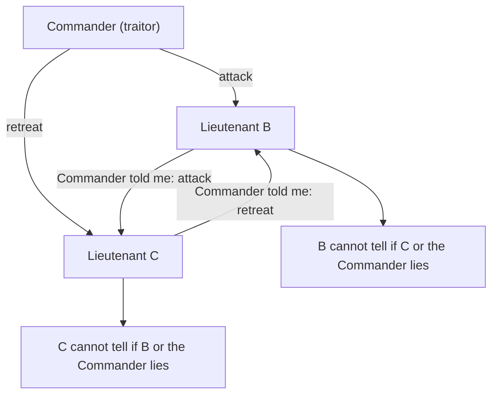
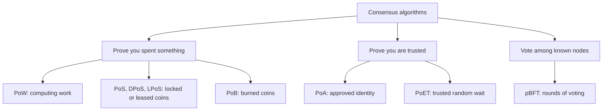
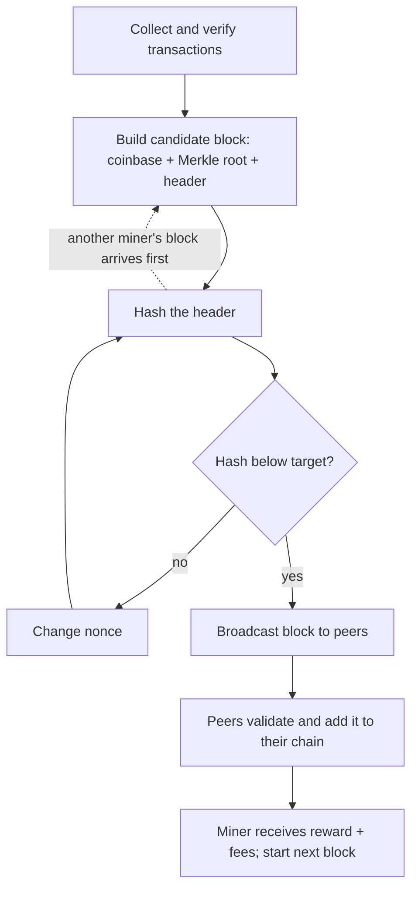
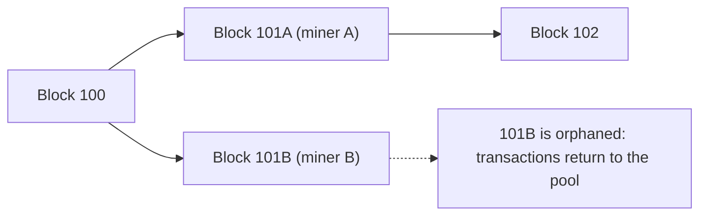
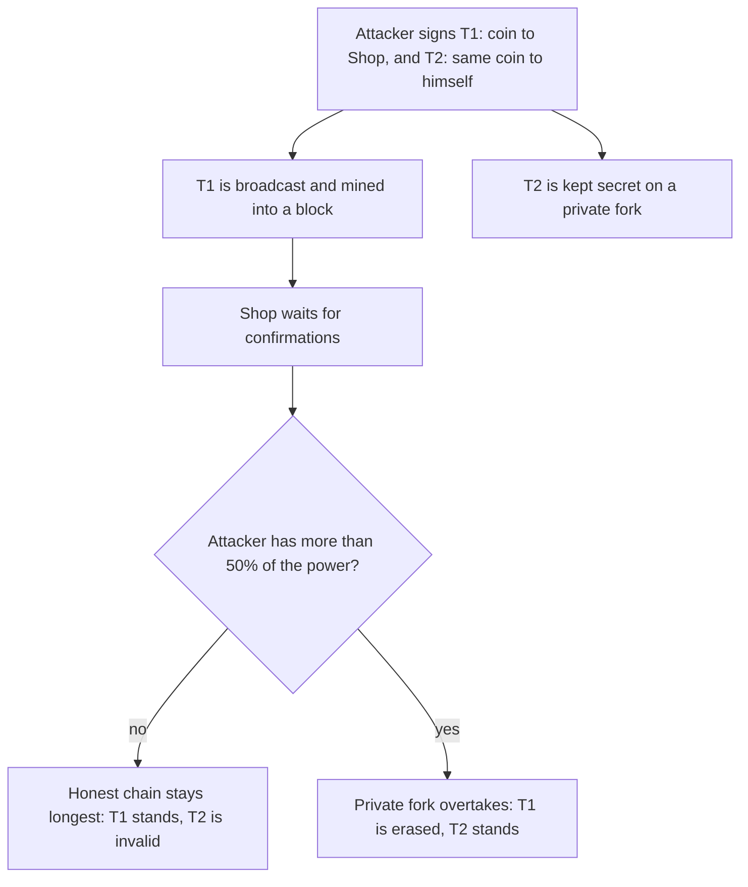
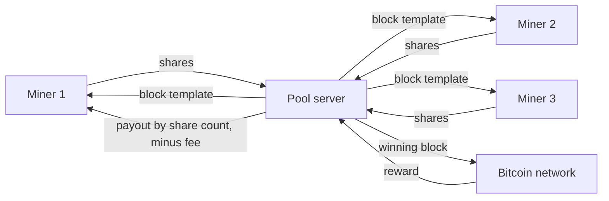
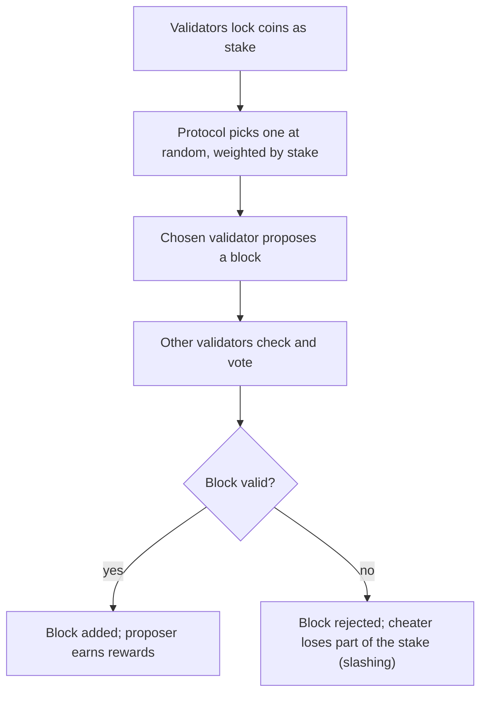

This note covers syllabus <Syl m="2" />, section 2.1: the Byzantine Generals Problem, the consensus algorithms (PoW, PoS, PoET, PoA, LPoS, pBFT, Proof of Burn), the life of a miner, mining difficulty, and mining pools with their methods. The Bitcoin-specific parts (keys, addresses, scripts, transactions) are in the Bitcoin note, and Paxos and Raft are in the fault-tolerant consensus note.

## The basics first

- A **node** is a computer running the blockchain software. A **miner** is a node that also tries to create new blocks.
- A **block** holds a list of transactions and a **header**. The header holds the previous block's hash, the Merkle root of the transactions, a timestamp, the difficulty target and a **nonce**.
- A **hash function** (SHA-256 in Bitcoin) turns any input into a fixed-size fingerprint. The same input always gives the same fingerprint, a tiny change gives a completely different one, and nobody can work backwards from the fingerprint to the input. So the only way to get a hash with a special shape is to try many inputs.
- A **nonce** is a number the miner is free to change ("number used once"). Changing it changes the header hash.
- The **ledger** is the one shared list of transactions that every node must agree on.

Analogy: a class of 1,000 students has to decide which version of the attendance register is the real one, with no teacher. Anyone can claim anything. The class needs a rule that is hard to cheat, which is what a consensus algorithm gives. <Cite id="consensus-mining-gfg-consensus" />

## What is consensus and why is it hard?

<Box kind="definition">

**Consensus** in a blockchain is the process by which all honest nodes of a network agree on the same set and the same order of valid transactions (the same ledger), even though some nodes may be slow, offline or dishonest, and there is no central authority. <Cite id="consensus-mining-gfg-consensus" /> <Cite id="consensus-mining-gfg-crypto-consensus" />

</Box>

**Why it is needed.** If two people each try to spend the same coin, every node must pick the same winner. Without agreement, different nodes would hold different ledgers and the money would be meaningless.

**Why it is hard.**

1. Messages can be delayed, lost or arrive in different orders at different nodes.
2. Nodes can crash, or be hacked and send wrong information to different people (a "Byzantine" fault).
3. Voting "one node, one vote" does not work in an open network, because one person can start thousands of fake nodes (a **Sybil attack**). So an open network needs a vote that costs something real: computing power (PoW), coins (PoS) and so on. <Cite id="consensus-mining-wiki-pow" /> <Cite id="consensus-mining-wiki-pos" />

### The Byzantine Generals Problem

Several generals of the Byzantine army surround a city. They can win only if **all loyal generals attack together** (or all retreat together). They can talk only through messengers, and some generals may be traitors who tell different generals different things. The problem: can the loyal generals still reach the same decision? <Cite id="consensus-mining-wiki-byzantine" />

In a blockchain, generals are nodes, "attack or retreat" is "is this block valid", and a traitor is a faulty or malicious node.

<Cite id="consensus-mining-wiki-byzantine" loc="diagram" />

Key results (Lamport, Shostak and Pease, 1982): with unsigned messages the loyal generals can agree only if the total number of generals is **more than three times** the number of traitors, that is $n \ge 3f + 1$ for $f$ traitors; with signed messages that cannot be forged the problem becomes easier in theory (it can be solved for any number of traitors if messages arrive on time), but practical protocols such as pBFT, which must cope with delayed messages, still need $n \ge 3f + 1$. <Cite id="consensus-mining-wiki-byzantine" /> <Cite id="consensus-mining-wiki-bft" />

Bitcoin's proof of work does not give the classic guarantee. It makes disagreement so expensive that nobody can keep it up, which is why Wikipedia notes that blockchains use "resource-intensive mechanisms that make disagreements impractical to maintain". <Cite id="consensus-mining-wiki-bft" />

<PYQ id="2023-12/q4b" /> <PYQ id="2024-12/q2a" /> <PYQ id="2025-05/q2a" />

<Cite id="consensus-mining-gfg-consensus" loc="diagram" />

## Proof of work (PoW)

<Box kind="definition">

**Proof of work** is a consensus method in which a node must show that it has done a large, measurable amount of computation (the "work") to earn the right to add the next block. The work must be hard to do but very easy for everyone else to check. <Cite id="consensus-mining-wiki-pow" /> <Cite id="blockchain-fundamentals-nakamoto" loc="§4" />

</Box>

**Where the idea came from.** Hashcash, proposed by Adam Back in 1997, asked an email sender to find a hash with a given number of leading zeros, so that sending millions of spam mails became costly. Bitcoin reuses this idea for blocks. <Cite id="consensus-mining-wiki-hashcash" />

**How it works in Bitcoin.** The miner hashes the block header again and again, changing the nonce each time, until the hash, read as a number, is **less than the target**. A lower target means fewer hashes qualify, so more attempts are needed. Checking a winner needs just one hash. <Cite id="consensus-mining-antonopoulos-mining" /> <Cite id="consensus-mining-tp-pow" />

<Sum>

<Given>

A toy block is the text `Asha pays Ravi 5` followed by a nonce. The rule is: the SHA-256 hash, written in hexadecimal, must **start with 0**. Then a stricter rule: it must start with **00**.

</Given>

<Find>

the nonce that satisfies each rule, how many attempts were needed, and how many attempts we should expect.

</Find>

<Steps>

1. Try nonce 0. The hash of `Asha pays Ravi 5|0` begins `8cb166...`. First digit is 8, not 0, so it fails. *Reason: the rule needs a leading 0.*
2. Keep adding 1 to the nonce. Nonces 1 to 7 give `f30140...`, `57b826...`, `92d506...`, `fd835b...`, `dafce4...`, `4a372f...`, `7f8e4e...`. None starts with 0.
3. Nonce 8 gives `0a328e...`. It starts with 0, so rule 1 is met after $8 + 1 = 9$ attempts (nonces 0 to 8). *Reason: we counted nonce 0 as the first attempt.*
4. Expected attempts for rule 1: each hex digit is one of 16 values with equal chance, so the chance of a leading 0 is $1/16$ and the expected number of attempts is $16$. We needed 9, which is normal luck.
5. Continue for rule 2 (two zeros). Chance per attempt is $1/16 \times 1/16 = 1/256$, so we expect about 256 attempts. In our run the first hash starting `00` is at nonce 112 (`0072802e...`), that is 113 attempts. *Reason: luck can be better or worse than the average.*
6. Verification by someone else: hash `Asha pays Ravi 5|112` once and look at the first two digits. One hash, not 113.

</Steps>

<Answer>

Nonce 8 meets "starts with 0" (9 attempts, expected 16). Nonce 112 meets "starts with 00" (113 attempts, expected 256). Anyone can verify with a single hash.

</Answer>

<Box kind="verify">

These hashes were produced with a real SHA-256 program, so you can reproduce them. The pattern also matches the rule of thumb: each extra zero digit multiplies the expected work by 16, and $16 \times 16 = 256$.

</Box>

</Sum>

<Sum>

<Given>

A block is valid if its hash starts with **5 hex zeros**. A miner computes **500,000 hashes per second**.

</Given>

<Find>

the expected number of attempts and the expected time to find a valid hash.

</Find>

<Steps>

1. Chance per attempt $= (1/16)^5 = 1/1{,}048{,}576$. *Reason: five independent hex digits, each must be 0.*
2. Expected attempts $= 1 / \text{chance} = 16^5 = 1{,}048{,}576$. *Reason: if a thing happens once in N tries on average, we expect N tries.*
3. Expected time $= 1{,}048{,}576 / 500{,}000 = 2.097$ seconds.

</Steps>

<Answer>

about 1,048,576 attempts, taking about 2.1 seconds on average.

</Answer>

<Box kind="verify">

In bits, 5 hex zeros are 20 zero bits, and $2^{20} = 1{,}048{,}576$. Same number. Check by multiplication: $500{,}000 \times 2.097 \approx 1{,}048{,}500$, which matches.

</Box>

</Sum>

**Why PoW protects the chain.** Each block contains the previous block's hash. To change an old block an attacker must redo the work for that block and every block after it, and keep ahead of the honest miners who keep adding new blocks. All nodes follow the chain with the most accumulated work, so the attacker needs more than half of the total mining power (a "51% attack"). <Cite id="blockchain-fundamentals-nakamoto" loc="§11" /> <Cite id="consensus-mining-btcwiki-majority" />

**Advantages of PoW:** simple, battle-tested for over a decade, open to anyone, security backed by real cost. **Disadvantages:** huge electricity use, specialised hardware (ASICs) and mining pools push mining toward a few big players, and throughput is low (Bitcoin is about 7 transactions per second as general knowledge, not from the pages cited here). <Cite id="consensus-mining-wiki-pow" /> <Cite id="consensus-mining-gfg-pow" />

## The life of a miner and the mining process

<Box kind="definition">

**Mining** is the process by which miners collect pending transactions into a candidate block, solve the proof-of-work puzzle for it, and add it to the blockchain in return for new coins and fees. <Cite id="consensus-mining-antonopoulos-mining" />

</Box>

Steps in the life of a Bitcoin miner (a miner here is a node running mining software; many connect to a pool):

1. **Collect.** Receive new transactions from the network and keep valid ones in the pool of unconfirmed transactions (the mempool).
2. **Verify.** Independently check each transaction: correct format, valid signature, inputs unspent, amounts balance. A node never takes anyone's word for it. <Cite id="consensus-mining-antonopoulos-mining" />
3. **Pick.** Choose which transactions go in, usually the ones paying the best fee, until the block is full.
4. **Coinbase.** Add a special first transaction that pays the block subsidy plus all fees to the miner's own address.
5. **Merkle root and header.** Build the Merkle tree of all transactions and put its root, the previous block hash, timestamp, target and a starting nonce into the header. <Cite id="consensus-mining-btcdev-block-chain" />
6. **Search.** Hash the header again and again, changing the nonce (and, when the nonce range runs out, an "extra nonce" in the coinbase), until the hash is below the target.
7. **Broadcast.** Send the winning block to peers. Each node re-validates it fully before accepting and passing it on.
8. **Build on top.** Everyone starts working on the next block, on top of the new one. When the block is a few blocks deep it is considered confirmed, and the miner can spend the reward after it has matured (100 blocks, general knowledge not from the cited pages).

<Cite id="consensus-mining-antonopoulos-mining" loc="diagram" />

<PYQ id="2023-12/q2b" /> <PYQ id="2023-12-ce/q6a" />

### Consensus in Bitcoin (Nakamoto consensus)

Bitcoin has no vote. Agreement "emerges" from four things that every node does on its own: (1) independently verify every transaction, (2) independently bundle them into blocks through proof of work, (3) independently verify every new block, and (4) independently pick the chain with the most cumulative proof of work. Because all nodes follow the same four rules, they converge on the same chain. <Cite id="consensus-mining-antonopoulos-mining" />

<Box kind="exam">

Write in the exam: "Consensus in Bitcoin is achieved through proof of work. Miners collect and validate transactions, build a candidate block and repeatedly hash its header with different nonces until the hash is below the network target. The first miner to succeed broadcasts the block; other nodes verify it and add it to the longest valid chain (the chain with the most cumulative work). The winner gets the block reward and fees. Since rewriting history needs more than half the network's hash power, the ledger stays consistent and tamper resistant."

</Box>

## Block reward, halving and fees

The winning miner is paid in two ways: the **block subsidy** (new coins created in the coinbase transaction) and the **transaction fees** (the small leftover between each transaction's inputs and outputs). The subsidy started at 50 BTC in 2009 and is cut in half every 210,000 blocks (about four years); this is called **halving**. This is why total supply stops near 21 million coins, around the year 2140, after which only fees pay miners. <Cite id="consensus-mining-antonopoulos-mining" />

<Sum>

<Given>

Subsidy at the start $= 50$ BTC, halving every $210{,}000$ blocks. A block at height $840{,}000$ collects $0.375$ BTC in fees.

</Given>

<Find>

(a) the subsidy at height 840,000 and the miner's total income from that block; (b) the number of coins created before height 840,000; (c) the final supply.

</Find>

<Steps>

1. Number of halvings that have happened: $\lfloor 840{,}000 / 210{,}000 \rfloor = 4$. *Reason: one halving per 210,000 blocks.*
2. Subsidy $= 50 / 2^4 = 50 / 16 = 3.125$ BTC. *Reason: halved four times.*
3. Income $= 3.125 + 0.375 = 3.5$ BTC. *Reason: the miner keeps subsidy plus fees.*
4. Coins created so far: each period of 210,000 blocks pays $210{,}000 \times$ subsidy. The four periods before height 840,000 paid $210{,}000 \times (50 + 25 + 12.5 + 6.25) = 210{,}000 \times 93.75 = 19{,}687{,}500$ BTC. *Reason: add the subsidy of each completed period.*
5. Final supply: the subsidies form $50 + 25 + 12.5 + \dots = 100$, so total $= 210{,}000 \times 100 = 21{,}000{,}000$ BTC. *Reason: a halving series adds up to double its first term.* (In practice slightly less, because the subsidy is rounded down to whole satoshis.)

</Steps>

<Answer>

(a) subsidy 3.125 BTC, income 3.5 BTC; (b) 19,687,500 BTC created before height 840,000; (c) about 21 million BTC in the end.

</Answer>

<Box kind="verify">

Remaining coins to be created after block 840,000: $21{,}000{,}000 - 19{,}687{,}500 = 1{,}312{,}500$. That equals $210{,}000 \times 6.25$, the same as a series starting at $3.125$ per block ($3.125 + 1.5625 + \dots = 6.25$), so the two methods agree. The book gives halving dates (first at block 210,000; reward 6.25 BTC from May 2020), consistent with 3 halvings before 2024 and the 4th at block 840,000. <Cite id="consensus-mining-antonopoulos-mining" />

</Box>

</Sum>

## Mining difficulty

<Box kind="definition">

**Mining difficulty** is a number that says how hard it is to find a valid block hash. It is the ratio between the easiest allowed target and the current target, so a higher difficulty means a smaller target and more expected work. <Cite id="consensus-mining-btcwiki-difficulty" /> <Cite id="consensus-mining-antonopoulos-mining" />

</Box>

**Why it is needed.** Bitcoin wants one block about every 10 minutes whatever the total mining power is. If more miners join, blocks would come too fast and coins would be issued too quickly. So the difficulty is adjusted to match the mining power. <Cite id="consensus-mining-antonopoulos-mining" />

**How it is calculated.**

1. **Target.** A valid block hash must be below a 256-bit number called the target. The header stores it in a short form called `bits`. <Cite id="consensus-mining-btcdev-block-chain" />
2. **Difficulty.** $\text{difficulty} = \text{difficulty-1 target} / \text{current target}$. The easiest target (difficulty 1) is the one with the `bits` value `0x1d00ffff`. <Cite id="consensus-mining-btcwiki-difficulty" />
3. **Expected work.** At difficulty $D$ a miner needs on average about $D \times 2^{32}$ hashes to find a block. (Why $2^{32}$: at difficulty 1 the target is about $2^{224}$, out of $2^{256}$ possible hashes, so the chance per hash is about $2^{-32}$.)
4. **Retarget every 2,016 blocks.** At 10 minutes per block, 2,016 blocks should take $2{,}016 \times 10 = 20{,}160$ minutes = 2 weeks. Every node compares the real time taken with 2 weeks and adjusts: <Cite id="consensus-mining-antonopoulos-mining" />

$$
\text{new target} = \text{old target} \times \frac{\text{actual time of the last 2,016 blocks}}{20{,}160 \text{ minutes}}
$$

   Faster than 2 weeks gives a smaller target (harder); slower gives a larger target (easier). One adjustment can change the target by at most a factor of 4. The real software measures the time across 2,015 intervals because of a small off-by-one quirk, which makes difficulty about 0.05% higher; we ignore it in sums. <Cite id="consensus-mining-antonopoulos-mining" />

<Sum>

<Given>

A block header has `bits` $=$ `0x1903a30c` (block 277,316 in the book). The target is `coefficient x 2^(8 x (exponent - 3))`. The difficulty-1 `bits` is `0x1d00ffff`.

</Given>

<Find>

the difficulty of this block, and how long a miner doing $10^{12}$ hashes per second (1 TH/s) needs on average to find a block at this difficulty.

</Find>

<Steps>

1. Split `0x1903a30c` into exponent `0x19` $= 25$ and coefficient `0x03a30c` $= 238{,}348$. *Reason: first two hex digits are the exponent, the next six the coefficient.*
2. Target $= 238{,}348 \times 2^{8 \times (25 - 3)} = 238{,}348 \times 2^{176}$.
3. Difficulty-1 target from `0x1d00ffff`: exponent `0x1d` $= 29$, coefficient `0x00ffff` $= 65{,}535$. Target $= 65{,}535 \times 2^{8 \times (29 - 3)} = 65{,}535 \times 2^{208}$.
4. Difficulty $= \dfrac{65{,}535 \times 2^{208}}{238{,}348 \times 2^{176}} = \dfrac{65{,}535}{238{,}348} \times 2^{32} = 0.27495 \times 4{,}294{,}967{,}296 \approx 1.18 \times 10^{9}$. *Reason: divide the two targets; the powers of two cancel to $2^{32}$.*
5. Expected hashes $= D \times 2^{32} \approx 1.18 \times 10^{9} \times 4.295 \times 10^{9} \approx 5.07 \times 10^{18}$.
6. Time at $10^{12}$ hashes/second $= 5.07 \times 10^{18} / 10^{12} = 5.07 \times 10^{6}$ seconds $= 5.07 \times 10^{6} / 86{,}400 \approx 58.7$ days.

</Steps>

<Answer>

difficulty about 1.18 billion (1,180,923,195); a 1 TH/s miner needs about 59 days on average per block.

</Answer>

<Box kind="verify">

Another way: the target is about $2^{17.8} \times 2^{176} = 2^{193.8}$, so the hash must have about $256 - 194 = 62$ leading zero bits, and the chance per hash is about $2^{-62.2}$, so about $2^{62.2} \approx 5.1 \times 10^{18}$ hashes are expected. This matches step 5. The book states the same figure: more than 60 leading zero bits and about one block every 59 days for 1 TH/s. <Cite id="consensus-mining-antonopoulos-mining" />

</Box>

</Sum>

<Sum>

<Given>

Current difficulty $D = 100$ (to keep numbers small). The last 2,016 blocks took **12 days** instead of the planned 14 days. Case 2: they took **70 days**.

</Given>

<Find>

the new difficulty after retargeting in each case.

</Find>

<Steps>

1. Planned time $= 20{,}160$ minutes $= 14$ days. Case 1 actual time $= 12$ days $= 17{,}280$ minutes.
2. Ratio $= 17{,}280 / 20{,}160 = 12/14 = 6/7 \approx 0.857$. *Reason: the network was faster than planned, so the target should shrink.*
3. New target $= \text{old target} \times 6/7$. Difficulty is inversely proportional to target, so new $D = 100 \times 14/12 = 116.67$.
4. Case 2: ratio $= 70/14 = 5$. This is more than the allowed factor of 4, so the adjustment is capped at 4. New target $= \text{old} \times 4$, so new $D = 100 / 4 = 25$. *Reason: the cap limits one change to a factor of 4; the rest is corrected in the next cycle.*

</Steps>

<Answer>

Case 1: difficulty rises from 100 to about 116.7. Case 2: difficulty falls from 100 to 25 (capped).

</Answer>

<Box kind="verify">

Case 1: blocks arrived $14/12 = 1.167$ times faster than planned, and difficulty rose by exactly that factor, so a block would again take about 10 minutes. Case 2: with the capped drop the blocks would still take $70/4 = 17.5$ days per 2,016 blocks, so another retarget follows, as the book says large gaps take several cycles to fix. <Cite id="consensus-mining-antonopoulos-mining" />

</Box>

</Sum>

<Box kind="exam">

Write in the exam: "Mining difficulty is a measure of how hard it is to find a block hash below the target. Difficulty = difficulty-1 target / current target. Bitcoin adjusts it every 2,016 blocks so that a block takes about 10 minutes (2 weeks for 2,016 blocks): new target = old target x (actual time / 20,160 minutes), limited to a factor of 4. If blocks came faster, difficulty goes up; if slower, it goes down."

</Box>

<PYQ id="2022-12-ce/q3a" /> <PYQ id="2024-05-ce/q3b" /> <PYQ id="2024-12/q1c" />

**Bitcoin and Ethereum on this point.** Bitcoin still uses proof of work and the 2,016-block retarget. Ethereum used proof of work (Ethash) with a target of a new block about every 13.3 seconds, but switched off mining on 15 September 2022 (the Merge) and now uses proof of stake, so there is no mining difficulty on Ethereum today. <Cite id="consensus-mining-eth-pow" /> <Cite id="consensus-mining-eth-merge" /> The full Bitcoin versus Ethereum comparison is in the Ethereum note.

## Forks and orphaned blocks

Blocks travel across the world in a few seconds, not instantly. If two miners find a valid block at nearly the same time, some nodes see one first and some see the other. For a moment the chain has two tips: a **fork**. Both blocks are valid. When the next block is found on top of one of them, that chain has more cumulative work and every node switches to it. The other block is dropped: it is the **orphaned block**, and its transactions go back to the pool to be mined again (unless they are already in the winning chain). <Cite id="consensus-mining-antonopoulos-mining" /> <Cite id="consensus-mining-gfg-conflicts" />

<Cite id="consensus-mining-gfg-conflicts" loc="diagram" />

**Terms.** Strictly, an *orphan block* has an unknown parent, while a *stale block* is a block whose chain is known to be no longer the longest; in everyday talk people use "orphan" for both. <Cite id="consensus-mining-btcwiki-orphan" />

**Why it happens and how it is limited.** Forks come from propagation delay. They are almost always settled within one block. Bitcoin's 10-minute block time is a compromise: faster blocks would give more forks and more wasted work, slower blocks make payments feel slow. The miner of the orphaned block loses the reward for the work, which is why miners want fast links to the network. <Cite id="consensus-mining-antonopoulos-mining" />

**Confirmations.** A transaction is "1 confirmation" when it is in a block, "2 confirmations" with one more block on top, and so on. Wallets traditionally show a transaction as unconfirmed until it is 6 blocks deep. <Cite id="consensus-mining-btcwiki-confirmation" />

<Box kind="exam">

Write in the exam: "An orphaned block is a valid block that is not part of the main chain. It happens when two miners solve the puzzle at almost the same time, causing a temporary fork. The network keeps the chain with the most cumulative work, so the block on the shorter branch is discarded and its transactions go back to the mempool. The miner of that block loses the reward."

</Box>

<PYQ id="2024-05-ce/q1c" /> <PYQ id="2025-05-ce/q1a" />

## Double spending and how proof of work solves it

**Double spending** means using the same digital coin twice. Digital data can be copied, so something must stop a person paying two shops with the same coin. A bank solves this by keeping the one ledger. Bitcoin has no bank. <Cite id="blockchain-fundamentals-wiki-doublespend" />

**How PoW solves it.**

1. Every transaction is broadcast and checked by nodes: the coin (output) being spent must be unspent, and the signature must be right. A second transaction using the same coin is rejected as a conflict.
2. If two conflicting transactions are sent at the same time, the miners put one of them in a block. Whichever is in the chain with the most work is the only one that counts; the other is dropped. So all nodes agree on one order. <Cite id="blockchain-fundamentals-nakamoto" loc="§1-§2" />
3. To undo a payment the cheater would have to redo the work for that block and all blocks after it, faster than the honest network. Every extra confirmation makes this exponentially less likely (Nakamoto, §11). <Cite id="blockchain-fundamentals-nakamoto" loc="§11" />
4. The only real danger is a **majority (51%) attack**, where one group controls more than half of the mining power, mines a secret fork and releases it. This is very expensive on a large network. <Cite id="consensus-mining-btcwiki-majority" />

<Cite id="consensus-mining-btcwiki-majority" loc="diagram" />

<PYQ id="2022-12-ce/q2b" /> <PYQ id="2024-12-ce/q5a" />

## Mining pools and their methods

<Box kind="definition">

A **mining pool** is a group of miners who combine their hash power, work together on the same block and share the reward in proportion to the work each one contributed. <Cite id="consensus-mining-wiki-pool" /> <Cite id="consensus-mining-btcwiki-pooled" />

</Box>

**Why pools exist.** As difficulty grew, a small miner might wait years or never find a block, so income was like a lottery. Pools turn this into a small, regular income. Example from Mastering Bitcoin: a miner with 0.0001% of the network hash rate would find a block about once every 20 years alone, but in a pool with 1% of the network hash rate the pool finds more than one block a day. <Cite id="consensus-mining-antonopoulos-mining" />

**How a pool works.**

1. The pool server builds the block template (transactions, coinbase, Merkle root, previous hash) and sends it to the miners.
2. Each miner searches nonces, but at an **easier pool target** (for example 1,000 times easier than the network). A hash that meets this easy target is a **share**: proof that the miner did real work. <Cite id="consensus-mining-antonopoulos-mining" />
3. Now and then one share also meets the real network target. That is a valid block. The reward goes to the pool's address.
4. The pool pays each miner in proportion to its shares, minus the operator's fee.

<Cite id="consensus-mining-antonopoulos-mining" loc="diagram" />

**Payout methods.** <Cite id="consensus-mining-wiki-pool" /> <Cite id="consensus-mining-btcwiki-pooled" />

| Method | How the reward is shared | Who carries the risk |
| --- | --- | --- |
| Pay-per-share (PPS) | Fixed payment for every share, paid at once from the pool's balance | The pool operator (miner gets the least variance) |
| Proportional | When a block is found, each miner gets reward $\times$ (own shares / all shares of that round) | The miners |
| Pooled mining ("slush") | Like proportional, but older shares in a round count less, so switching pools mid-round does not pay | The miners |
| Pay-per-last-N-shares (PPLNS) | Reward split over the last N shares, not the whole round | The miners; loyal miners gain |
| Solo pool | The whole reward goes to the one miner who finds the block | The miner |
| Peer-to-peer (P2Pool) | No server: a "share chain" at lower difficulty records everyone's shares; no operator can cheat or be a single point of failure | The miners; more complex to run |

**Managed pool or P2Pool.** In a managed pool one operator runs the server, takes a fee, and could cheat or fail. P2Pool removes the operator. <Cite id="consensus-mining-antonopoulos-mining" />

**Problems of pools.** Pools can grow so large that they hold a big share of the total hash power, which weakens decentralization and brings the 51% danger closer (the Deepbit pool once held over half of the network hash rate). <Cite id="consensus-mining-wiki-pool" />

<Sum>

<Given>

A pool finds a block with subsidy $3.125$ BTC and fees $0.375$ BTC. The pool fee is $2\%$. In this round the pool counted $N = 10{,}000$ shares in total, and Ravi submitted $n = 150$ of them. Payout method: proportional.

</Given>

<Find>

Ravi's payout.

</Find>

<Steps>

1. Block reward $B = 3.125 + 0.375 = 3.5$ BTC.
2. After the 2% fee the pool shares $3.5 \times 0.98 = 3.43$ BTC. *Reason: the operator keeps 2%.*
3. Ravi's fraction $= n / N = 150 / 10{,}000 = 0.015$.
4. Ravi's payout $= 3.43 \times 0.015 = 0.05145$ BTC. *Reason: proportional method: reward times own shares over all shares.*

</Steps>

<Answer>

Ravi receives $0.05145$ BTC.

</Answer>

<Box kind="verify">

Check by summing: if all 10,000 shares were paid at the same rate, the total would be $0.05145 / 0.015 = 3.43$ BTC, which is exactly the amount shared, so nothing is lost or created. In other words $0.05145 \times (10{,}000/150) = 3.43$.

</Box>

</Sum>

<Sum>

<Given>

A miner owns $0.0001\%$ of the network hash rate, that is a fraction $10^{-6}$. Bitcoin makes one block every 10 minutes (144 blocks a day). The pool he could join has $1\%$ of the network hash rate. Subsidy $3.125$ BTC, ignore fees. Pool fee $2\%$.

</Given>

<Find>

how often he would find a block alone, and how many blocks the pool finds per day; his expected income per day solo and in the pool.

</Find>

<Steps>

1. Solo: he finds $10^{-6}$ of all blocks, so one block per $10 / 10^{-6} = 10^{7}$ minutes $= 10^{7} / (60 \times 24 \times 365) \approx 19$ years. *Reason: his chance per block is $10^{-6}$.*
2. Pool: the pool finds $0.01 \times 144 = 1.44$ blocks per day.
3. Solo income per day (average): $10^{-6} \times 144 \times 3.125 = 0.00045$ BTC.
4. His share of the pool's work: $0.0001\% / 1\% = 1/10{,}000$. Pool income per day $= 1.44 \times 3.125 \times 0.98 \times 1/10{,}000 = 0.000441$ BTC.

</Steps>

<Answer>

alone: one block about every 19 years; the pool finds 1.44 blocks a day; average income is 0.00045 BTC a day solo and 0.000441 BTC a day in the pool, the 2% fee being the price of a steady payout.

</Answer>

<Box kind="verify">

$0.00045 \times 0.98 = 0.000441$, which equals the pool figure, so the pool pays the same average income minus the fee. The 19 years agrees with the book's "once every 20 years". <Cite id="consensus-mining-antonopoulos-mining" />

</Box>

</Sum>

<PYQ id="2023-12-ce/q1c" /> <PYQ id="2024-05-ce/q6d" /> <PYQ id="2025-05-ce/q1e" />

## Proof of stake (PoS) and its variants

<Box kind="definition">

In **proof of stake**, the right to create the next block is given to a **validator** chosen by chance but weighted by the amount of coins it has locked up as a **stake**. A validator that cheats can lose (be "slashed" of) part of its stake. <Cite id="consensus-mining-wiki-pos" /> <Cite id="consensus-mining-gfg-pos" /> <Cite id="consensus-mining-eth-pos" />

</Box>

**Idea in one line.** PoW says "show me your electricity bill"; PoS says "show me your money at risk". Because there is no puzzle to solve, the energy use is tiny. On Ethereum a validator deposits 32 ETH and the protocol picks validators to propose and vote on blocks; bad behaviour such as equivocation can destroy some or all of the stake. <Cite id="consensus-mining-eth-pos" />

<Cite id="consensus-mining-gfg-pos" loc="diagram" />

<Sum>

<Given>

Three validators in a simple stake-weighted PoS: A has 32 coins, B has 64 coins, C has 160 coins staked.

</Given>

<Find>

the chance that each is chosen to create the next block.

</Find>

<Steps>

1. Total stake $= 32 + 64 + 160 = 256$.
2. $P(A) = 32 / 256 = 1/8 = 12.5\%$.
3. $P(B) = 64 / 256 = 1/4 = 25\%$.
4. $P(C) = 160 / 256 = 5/8 = 62.5\%$. *Reason: chance equals own stake divided by total stake.*

</Steps>

<Answer>

A 12.5%, B 25%, C 62.5%.

</Answer>

<Box kind="verify">

The chances must add to 100%: $12.5 + 25 + 62.5 = 100$. Also C stakes 5 times A's coins ($160 / 32 = 5$) and has 5 times A's chance ($62.5 / 12.5 = 5$).

</Box>

</Sum>

**Advantages:** very low energy, no special hardware, cheaper to take part, attack needs a lot of money at risk. **Disadvantages / criticism:** the rich get richer (more stake gives more rewards), risk of centralization, the "nothing at stake" worry (nothing costs a validator to vote on two forks, so protocols add slashing), and long-range attacks where an attacker rewrites old history. <Cite id="consensus-mining-wiki-pos" /> <Cite id="consensus-mining-gfg-pos" />

**Variants in the syllabus.**

- **Delegated proof of stake (DPoS).** Coin holders vote, in proportion to their stake, to elect a small committee of witnesses (delegates). The witnesses take turns producing blocks. With few validators it is fast, but power sits with a few. Used in EOS, Lisk and Tron. <Cite id="consensus-mining-wiki-pos" />
- **Leased proof of stake (LPoS).** A coin holder with a small balance *leases* it to a bigger node to raise that node's chance of producing blocks, and gets a share of the rewards. The coins never leave the owner's wallet. This is how Waves describes LPoS (general knowledge; the cited pages do not cover Waves). The cited Wikipedia page describes a related idea, *liquid* PoS (used in Tezos), where small holders delegate their voting rights to larger validators for periodic payouts and can switch at any time. <Cite id="consensus-mining-wiki-pos" />

## Proof of burn (PoB)

<Box kind="definition">

In **proof of burn**, participants send (burn) some of their coins to an address from which they can never be spent. The burn shows commitment, and the more a participant burns, the higher the chance of being picked to create the next block. <Cite id="consensus-mining-gfg-pob" /> <Cite id="consensus-mining-btcwiki-pob" />

</Box>

The thinking is that burnt coins act like a mining machine you cannot take back: you pay once in coins instead of paying electricity every day. Examples: Slimcoin uses PoB as its main consensus, and the Counterparty platform asked users to burn Bitcoin to get its XCP tokens. <Cite id="consensus-mining-gfg-pob" />

**Advantages:** much less energy than PoW; a burn is a long-term commitment. **Disadvantages:** real wealth is destroyed, the rich can burn more and dominate. GfG makes the same "wasted value" criticism. <Cite id="consensus-mining-gfg-pob" /> <Cite id="consensus-mining-gfg-crypto-consensus" />

## Proof of elapsed time (PoET)

**PoET** is used mostly in private (permissioned) networks. Each node asks a **trusted piece of hardware** (Intel's SGX, a protected area of the CPU) for a random waiting time. Each node sleeps for its time, and the node whose timer ends first wins the right to create the block. The hardware gives a certificate that the wait really happened, so nobody can cheat by claiming a shorter wait. It uses almost no energy, and each node has a fair chance. <Cite id="consensus-mining-gfg-crypto-consensus" /> <Cite id="consensus-mining-gfg-consensus" />

**Weakness:** the security depends on trusting Intel's hardware; if the hardware is broken, the lottery can be gamed. Hyperledger Sawtooth is the best-known platform that offered PoET (general knowledge; project archived in 2024 per its wiki overview).

## Proof of authority (PoA)

**PoA** gives the right to create blocks to a small set of **approved validators** whose real-world identity and reputation are at stake. There is no puzzle and no coin lock. In Ethereum's PoA standard (Clique), a fixed list of authorised signers take turns to produce blocks, and the signers can vote a misbehaving member out. It is fast and cheap, but it is permissioned and therefore not fully trustless. <Cite id="consensus-mining-wiki-poa" /> <Cite id="consensus-mining-eth-poa" />

Typical use: private or consortium chains and test networks, where participants already know each other. VeChain is listed on Wikipedia as a user. <Cite id="consensus-mining-wiki-poa" />

## Practical Byzantine Fault Tolerance (pBFT)

**pBFT** (Castro and Liskov, 1999) is a voting protocol among a known, fixed set of nodes. One node is the leader (primary) for a round; it proposes a request, and the other nodes exchange messages in phases (pre-prepare, prepare, commit) until a large enough majority agree. It keeps working even when some nodes are faulty or malicious, as long as **at most $f$ of $n$ nodes are faulty and $n \ge 3f + 1$**. A decision needs agreement from $2f + 1$ nodes. Final in one round (no forks), fast, but the number of messages grows quickly with $n$, so it suits small permissioned networks. <Cite id="consensus-mining-wiki-bft" /> The full pBFT, Paxos and Raft story is in the next-module note.

<Sum>

<Given>

A permissioned network uses pBFT and has $n = 10$ nodes.

</Given>

<Find>

the largest number of faulty (Byzantine) nodes $f$ it can tolerate, the size of the agreement quorum, and the minimum nodes needed if we want to tolerate $f = 2$.

</Find>

<Steps>

1. The rule is $n \ge 3f + 1$, so $f \le (n - 1) / 3 = 9 / 3 = 3$. *Reason: rearranging the rule.*
2. Largest $f = 3$. Quorum $= 2f + 1 = 7$ nodes. *Reason: standard pBFT quorum size.*
3. For $f = 2$: $n \ge 3 \times 2 + 1 = 7$ nodes.

</Steps>

<Answer>

with 10 nodes, up to 3 can be faulty, and a quorum of 7 must agree; to tolerate 2 faulty nodes at least 7 nodes are needed.

</Answer>

<Box kind="verify">

With $f = 3$: $3f + 1 = 10 = n$, so the rule holds exactly. With 4 faulty nodes, $3 \times 4 + 1 = 13 > 10$, so the rule fails. For the generals' story: 3 generals and 1 traitor gives $3 < 3 \times 1 + 1 = 4$, which matches the fact that the 3-general problem cannot be solved, while 4 generals can. <Cite id="consensus-mining-wiki-byzantine" />

</Box>

</Sum>

## Comparing the consensus algorithms

**Comparison of PoW, PoS, PoB, PoET and PoA (write this table in the exam).**

| Point | PoW | PoS | PoB | PoET | PoA |
| --- | --- | --- | --- | --- | --- |
| Who creates the block | Miner who solves the hash puzzle first | Validator picked by chance, weighted by stake | Participant picked by chance, weighted by coins burned | Node whose random timer ends first | One of the approved authority validators in turn |
| What you must show | Computing work | Coins locked | Coins destroyed | A trusted wait certificate | Identity and reputation |
| Energy use | Very high | Very low | Low | Very low | Very low |
| Type of network | Public | Public (and others) | Public | Private / permissioned | Private / permissioned |
| Speed | Slow | Faster | Medium | Fast | Fast |
| Main weakness | Energy, mining centralization, 51% attack | Rich get richer, nothing at stake | Wastes value, rich dominate | Trust in special hardware | Centralized, needs trusted validators |
| Example | Bitcoin | Ethereum | Slimcoin | Hyperledger Sawtooth | VeChain, Clique networks |

Sources for the table: <Cite id="consensus-mining-gfg-crypto-consensus" /> <Cite id="consensus-mining-gfg-consensus" /> <Cite id="consensus-mining-wiki-poa" /> <Cite id="consensus-mining-wiki-pos" />

**PoW versus PoS in one view.**

| Point | Proof of work | Proof of stake |
| --- | --- | --- |
| Right to add a block | Earned by computing | Earned by locking coins |
| Cost of attack | Buy and run more than half of the hardware | Own more than half of the staked coins (and risk losing them) |
| Energy | Very high | Roughly 99.95% less when Ethereum moved (as reported by ethereum.org) |
| Hardware | ASICs | Ordinary computer |
| Punishment for cheating | Lose the electricity spent | Lose part of the stake (slashing) |
| Weak point | Pool and ASIC centralization | Wealth concentration |

<Cite id="consensus-mining-eth-merge" /> <Cite id="consensus-mining-eth-pos" />

<PYQ id="2024-05-ce/q2b" /> <PYQ id="2025-05-ce/q4a" /> <PYQ id="2024-12-ce/q1c" /> <PYQ id="2025-05/q2a" />

**Which to choose?** Open public network with no trust: PoW or PoS. Known members in a business network: PoA, PoET or pBFT. Where energy cost matters: PoS, PoA or pBFT. Fast final confirmation without forks: pBFT.

## Quick summary

- Consensus = everyone agrees on one ledger; the Byzantine Generals Problem shows why liars make it hard ($n \ge 3f + 1$).
- PoW: find a nonce so the header hash is below the target; most cumulative work wins; reward halves every 210,000 blocks.
- Difficulty is retargeted every 2,016 blocks to keep 10-minute blocks, with a limit of 4 times per step.
- Forks happen from delay; the losing block is orphaned. Confirmations make double spending practically impossible.
- Pools share work with shares and split rewards by PPS, proportional, PPLNS or P2Pool.
- PoS, DPoS, LPoS, PoB, PoET, PoA and pBFT replace expensive computing with locked coins, burned coins, trusted hardware, identity or voting.
