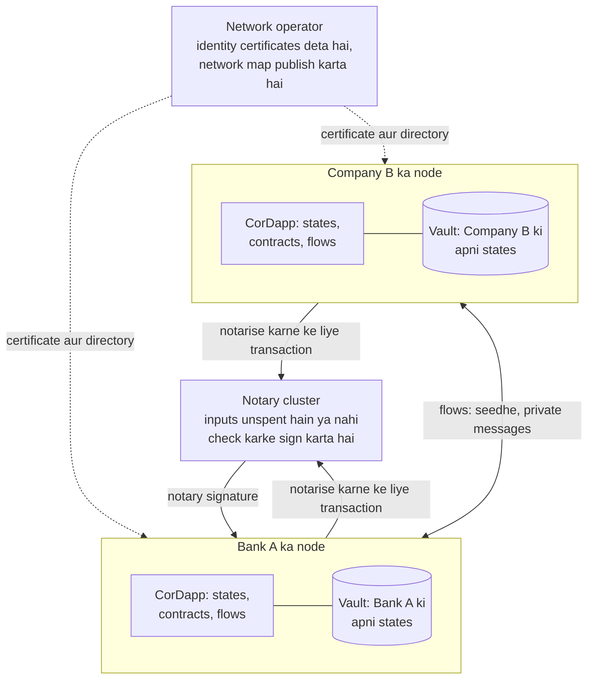
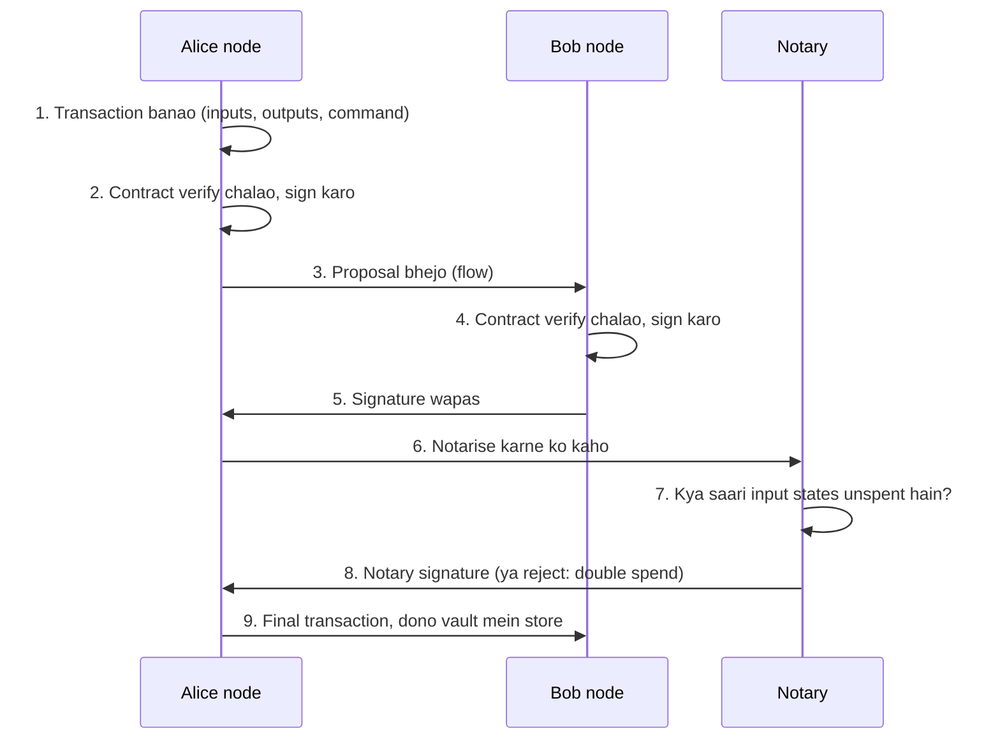
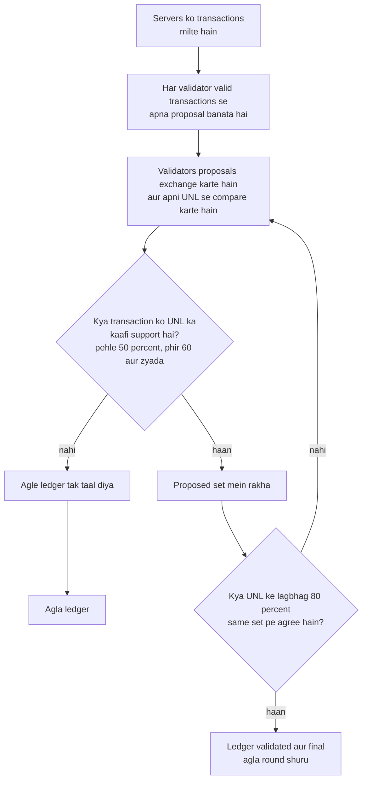
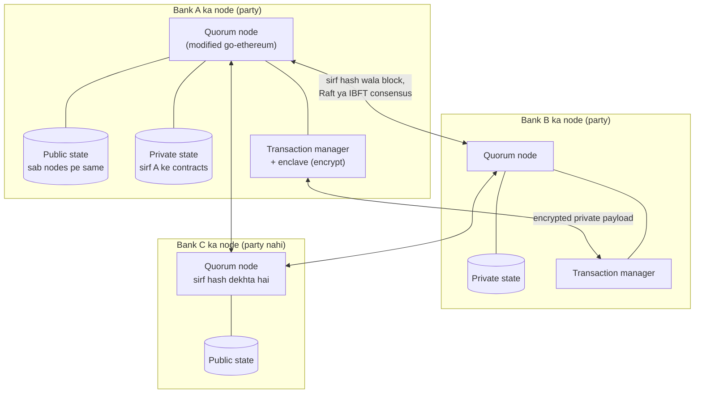
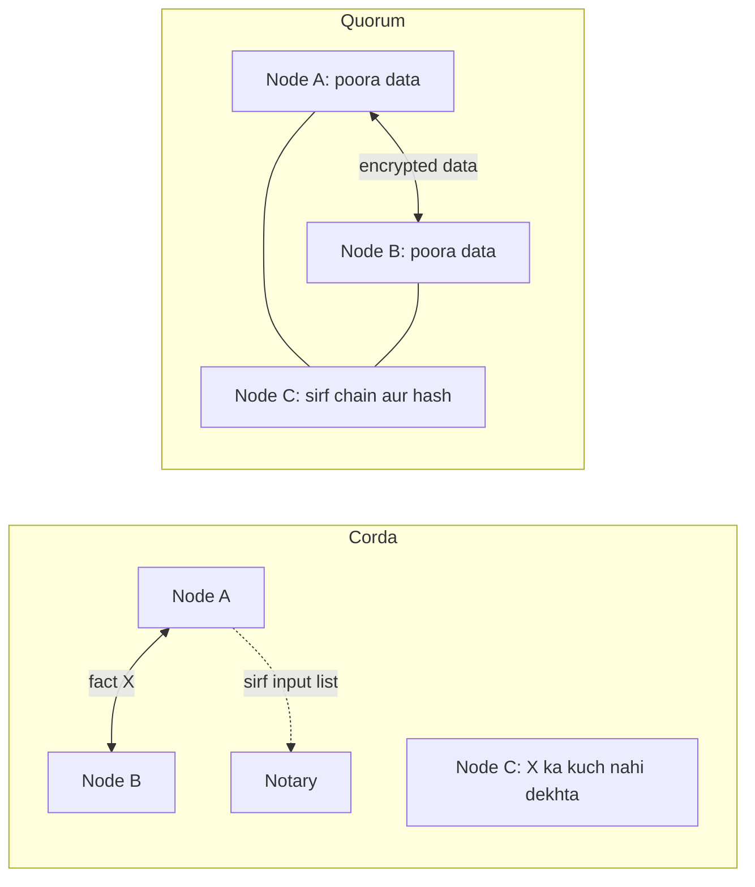
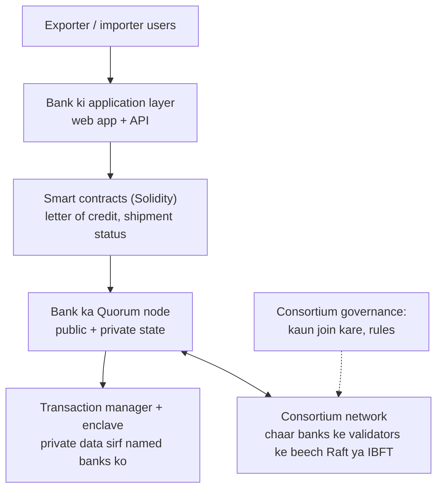

Ye note syllabus <Syl m="6" />, section 6.1 cover karta hai: tools Corda, Ripple aur Quorum, doosre emerging blockchain platforms, aur kisi bhi blockchain platform pe case study. Applications jaise education, energy, healthcare aur supply chain ka alag note hai. Fabric, Paxos, Raft aur PBFT ke bhi apne notes hain; yahan unhe sirf comparison ke liye use kiya hai.

## The basics first

- **Public blockchain** (Bitcoin, Ethereum) mein koi bhi join kar sakta hai aur har node har transaction dekhta hai. **Permissioned** (private ya consortium) ledger mein sirf known, approved members aate hain. <Cite id="private-blockchain-gfg-consortium" />
- **Banks Bitcoin ya Ethereum kyun nahi use kar sakte:** har transaction sabko dikhta hai, nodes anonymous hain, aur speed kam hai. Regulated firms ko privacy, known identities aur tez, final settlement chahiye. <Cite id="corda-ripple-quorum-corda-intro-wp" loc="Comparisons" />
- **Double spend** matlab same paisa do baar kharch karna. Neeche ke har platform ko decide karna padta hai ki do conflicting transactions mein pehla kaunsa hai. <Cite id="blockchain-fundamentals-wiki-doublespend" />
- **Fault** woh node hai jo crash ho jaata hai (crash fault) ya jhooth bolta hai (Byzantine fault). Jo systems jhooth bolne wale nodes ko survive karte hain unhe Byzantine fault tolerant (BFT) kehte hain. <Cite id="bft-paxos-raft-byz-generals" /> <Cite id="bft-paxos-raft-gfg-pbft" />
- **Consensus** matlab nodes ka group transactions ke ek order pe kaise agree karta hai. Is note ke teen platforms is sawaal ka teen alag tareeke se jawab dete hain.

Analogy: Bitcoin town square ka notice board hai jahan sab har notice padhte hain. Corda registered post hai: sirf sender, receiver aur ek trusted post office (notary) letter dekhte hain. Quorum wahi notice board hai, par private notices sealed envelope mein hote hain jo sirf named log khol sakte hain. Ripple ek clearing house hai jahan trusted referees ka group har kuch seconds mein payments ka order tay karta hai.

| Platform | Kiske liye bana | Kisne banaya | Ledger idea | Agreement |
|---|---|---|---|---|
| Corda | Regulated firms, mainly finance | R3 consortium | Facts sirf parties ke beech share, no blocks | Parties validity check karte hain, notary uniqueness |
| Ripple (XRP Ledger) | Tez cross-border payments | Ripple Labs aur XRPL community | Ek public ledger, har kuch seconds mein nayi version | UNL mein trust-based voting, 80 percent |
| Quorum | Known firms ke beech private contracts | J.P. Morgan, baad mein ConsenSys | Private state wali Ethereum chain | Raft ya Istanbul BFT |

## Corda

<Box kind="definition">

**Corda** open-source distributed ledger software hai jo known parties ke beech shared agreements record aur process karta hai. Ye "heavily inspired by blockchain systems" hai par un design choices ko chhod deta hai jo public chains ko business ke liye kharab banate hain: global broadcast nahi, mining nahi, blocks nahi. Ise pehle regulated financial institutions ke liye design kiya gaya tha. <Cite id="corda-ripple-quorum-corda-intro-wp" loc="Corda" /> <Cite id="corda-ripple-quorum-corda-github" />

</Box>

**Corda kyun chahiye tha?** Public chain mein har participant ko har transaction milta hai, jo privacy aur scale ke liye bura hai, aur result sirf probably final hota hai. Businesses ko data sirf unhe dikhana hai jinhe dikhna chahiye, pata hona chahiye ki samne kaun hai, aur final results chahiye jo legal contracts se match karein. Corda ke apne papers kehte hain ki transaction "only to them, and to those whose own view of the ledger in the future may depend on verifying the validity of this transaction" ko dikhna chahiye. <Cite id="corda-ripple-quorum-corda-intro-wp" loc="Concepts" />

### Main ideas of Corda

1. **State.** State object ek digital document hai jo ek agreement aur uski current condition record karta hai, jaise "ek bank mein 100 pounds ka deposit, jiska owner ek shipping company hai". States kabhi edit nahi hoti; ya to unspent hoti hain ya spent. Ledger in immutable states ka set hai. <Cite id="corda-ripple-quorum-corda-intro-wp" loc="Concepts" /> <Cite id="corda-ripple-quorum-corda-tech-wp" loc="Transaction structure" />
2. **Contract.** State badalne ke rules, Java Virtual Machine pe code ki tarah. Contract ek pure function hai: wo sirf proposed transaction ko accept ya reject karta hai, uska koi storage nahi hota aur same transaction pe hamesha same jawab deta hai. Transaction tabhi valid hai jab uski saari states ke contracts agree karein. <Cite id="corda-ripple-quorum-corda-intro-wp" loc="Business Logic" />
3. **Transaction.** Wo input states consume karta hai aur output states banata hai, isliye har state pichli se linked hoti hai. Isme commands (kya ho raha hai, jaise issue ya move), required signatures, chuna hua notary aur zaroorat ho to time window bhi hota hai. <Cite id="corda-ripple-quorum-corda-tech-wp" loc="Transaction structure" />
4. **Flow.** Chhota program jo nodes ke beech multi-step baatcheet chalata hai (transaction banao, signatures lo, notary ko bhejo, store karo). Corda mein nodes ke beech saari communication flows se hoti hai, global broadcast se nahi. <Cite id="corda-ripple-quorum-corda-tech-wp" loc="Flow framework" /> <Cite id="corda-ripple-quorum-xoriant-corda" />
5. **CorDapp.** States, contracts aur flows ka package (plus koi APIs aur user interface) jo ek Corda application banata hai. <Cite id="corda-ripple-quorum-corda-intro-wp" loc="Summary of the Corda Model" />
6. **Identity.** Har node ke paas network operator ka sign kiya X.509 certificate hota hai jo legal name ko public key se jodta hai. Real, alag identities hi notary clusters aur trust ko possible banati hain. <Cite id="corda-ripple-quorum-corda-intro-wp" loc="Identity" /> <Cite id="corda-ripple-quorum-corda-tech-wp" loc="The identity root" />
7. **Network map.** Nodes ki signed directory (addresses, protocol version, identity certificates). Ye node data distribute karti hai par use badalne ke liye trusted nahi hai. <Cite id="corda-ripple-quorum-corda-tech-wp" loc="The network map" />
8. **Vault.** Node ka apna database un states ka jo uske liye matter karti hain, wallet ki tarah. Isme keys bhi hoti hain aur ye batata hai ki kaunsi states spend karni hain aur kab change output add karna hai. <Cite id="corda-ripple-quorum-corda-tech-wp" loc="The vault" />
9. **Notary.** Wo service jo double spend rokti hai aur conflicting transactions ka order tay karti hai (neeche samjhaya hai).

### Corda architecture

<Cite id="corda-ripple-quorum-corda-tech-wp" loc="diagram" /> <Cite id="corda-ripple-quorum-xoriant-corda" loc="diagram" />

**Diagram ka walk through.** (1) Network operator har firm ko identity deta hai aur network map mein list karta hai. (2) Har firm ek node chalata hai: uske CorDapp mein rules aur flows hain, aur vault mein sirf wahi states jinke wo party hai. (3) Do nodes flow se seedhe baat karte hain; baaki nodes ko kuch broadcast nahi hota. (4) Finality ke liye transaction notary ke paas jaata hai, jo sign ya reject karta hai. (5) Notary signature add hota hai aur dono vaults update ho jaate hain. <Cite id="corda-ripple-quorum-xoriant-corda" />

### Corda transaction kaise agree hota hai

Corda do sawaal alag karta hai. <Cite id="corda-ripple-quorum-corda-intro-wp" loc="Consensus" />

- **Validity:** kya ye transaction allowed hai? Parties khud contract code chalate hain aur saari required signatures aur input states ki history check karte hain.
- **Uniqueness:** kya kisi input state ko kisi aur transaction ne pehle use kar liya? Ye **notary** batata hai, aur kuch nahi.

<Cite id="corda-ripple-quorum-corda-tech-wp" loc="diagram" />

Notary ya to transaction pe signature wapas deta hai ya rejection jo kehta hai ki double spend hua. Notary signature finality ka nishaan hai. **Validating** notary poora transaction check karta hai; **non-validating** notary sirf consumed states ki list dekhta hai, jisse privacy better hoti hai par agar transaction identifiers leak ho jaayein to defence kamzor hota hai. <Cite id="corda-ripple-quorum-corda-tech-wp" loc="Notaries and consensus" />

**Pluggable notaries.** Notary ek single machine ho sakta hai ya ek-doosre pe bharosa na karne wale nodes ka cluster jo Raft jaise crash fault tolerant ya kisi BFT algorithm ka use karta hai. Ek network mein global BFT notary aur speed ke liye regional Raft notaries bhi ho sakte hain. Har state apna notary batati hai. <Cite id="corda-ripple-quorum-corda-tech-wp" loc="Algorithmic agility" /> <Cite id="bft-paxos-raft-raft-paper" />

### Corda vs Bitcoin

| Point | Bitcoin | Corda |
|---|---|---|
| Transaction kaun dekhta hai | Har node | Sirf parties (aur wo jinhe history verify karni hai) |
| Blocks aur mining | Haan, proof of work | Nahi |
| Finality | Probabilistic | Notary sign karte hi final |
| Transaction mein data | Coins aur script | State mein koi bhi typed data |
| Contract | Inputs pe script | Inputs aur outputs pe JVM code |
| Time | Block time | Notary se attested exact time window |

Dono "inputs consume karo, outputs banao" (UTXO) idea use karte hain. <Cite id="corda-ripple-quorum-corda-tech-wp" loc="Comparisons" /> <Cite id="corda-ripple-quorum-corda-intro-wp" loc="Comparisons to Bitcoin" /> <Cite id="blockchain-fundamentals-nakamoto" />

### Corda ke advantages aur disadvantages

| Advantages | Disadvantages |
|---|---|
| Strong privacy: data sirf unhe jaata hai jinhe chahiye | Fact sabko nahi dikhta, isliye bahari auditing mushkil |
| Mining nahi, to kam energy aur per-transaction network fee nahi | Notary aur network operator chahiye, isliye unpe kuch trust |
| Notarise hote hi final; legal contracts aur exact timing ke liye fit | Participants identified hone chahiye, anonymous use ke liye nahi |
| Standard JVM languages (Java, Kotlin) | Ethereum se chhoti community; platform Corda 4 aur Corda 5 architectures mein split ho gaya |

<Cite id="corda-ripple-quorum-corda-tech-wp" loc="Notaries and consensus" /> <Cite id="corda-ripple-quorum-corda-github" />

**Use cases** jo Corda ke apne papers mein hain: cash aur payments, delivery-versus-payment trades aur future-dated obligations. <Cite id="corda-ripple-quorum-corda-intro-wp" loc="Summary of the Corda Model" />

<PYQ id="2022-12-ce/q6a" /> <PYQ id="2023-05-ce/q6c" /> <PYQ id="2024-12-ce/q6d" />

<Box kind="exam">

Exam mein English mein likho: "Corda is an open-source distributed ledger platform for business, developed by R3. Instead of broadcasting every transaction to all nodes, it shares each transaction only with the parties involved. Its main components are states, contracts, transactions, flows, the vault, the network map and notaries. A notary prevents double spending by signing a transaction only if its input states are unspent."

</Box>

## Ripple and the XRP Ledger

<Box kind="definition">

**Ripple** ek company (Ripple Labs) ka naam hai aur payment products ke family ka bhi. **XRP Ledger (XRPL)** decentralized, open-source ledger hai, jo 2012 mein shuru hua, aur accounts, balances aur trades record karta hai; **XRP** uska native digital asset hai. XRPL transactions ko consensus protocol se confirm karta hai, mining se nahi. <Cite id="corda-ripple-quorum-wiki-xrpl" /> <Cite id="corda-ripple-quorum-xrpl-whatis" />

</Box>

**Ye kyun chahiye tha?** Banks ke through videsh paisa bhejna slow aur mehenga hai, kyunki har bank ko doosre banks aur currencies mein pre-funded accounts rakhne padte hain. Ripple ka maqsad tez, sasta settlement aur currencies ke beech aasaan conversion hai. XRPL docs ise "a universal payment system" kehte hain jisme teen se chhe seconds mein near real-time settlement aur built-in exchange hai. <Cite id="corda-ripple-quorum-xrpl-principles" /> <Cite id="corda-ripple-quorum-gfg-ripple" />

**Chhoti history.** Trust-based payment network ka idea (RipplePay, 2004) Ryan Fugger ka tha. XRPL ka development 2011 mein David Schwartz, Jed McCaleb aur Arthur Britto ke saath "Bitcoin without mining" thread ke baad shuru hua. Company ka naam 2013 mein Ripple Labs pada. Bitcoin ke ulat, saare 100 billion XRP shuru mein hi bana diye gaye. <Cite id="corda-ripple-quorum-gfg-ripple" loc="History of Ripple" /> <Cite id="corda-ripple-quorum-wiki-xrpl" loc="History" />

### Ripple world ke parts

| Part | Ye kya hai |
|---|---|
| XRP Ledger | Shared ledger. Har nayi ledger version mein poora current state, apply hui transactions aur kuch metadata hota hai. <Cite id="corda-ripple-quorum-xrpl-consensus" loc="Ledger History" /> |
| XRP | Native asset. Ye currencies ke beech bridge ka kaam bhi karta hai. |
| Validators aur UNL | Servers jo consensus mein vote karte hain, aur har server jis validators ki list pe bharosa karta hai. |
| Tokens aur paths | Doosri currencies ki value tokens ki tarah hold hoti hai; payment kai steps se ja sakta hai, accounts se "rippling" karke ya exchange pe trade karke. <Cite id="corda-ripple-quorum-xrpl-paths" /> |
| RippleNet | Banks aur payment firms ke liye Ripple ka network aur software. |
| On-Demand Liquidity (ODL) | RippleNet service jo XRP se border-paar paisa bina pre-funding ke bhejti hai. <Cite id="corda-ripple-quorum-ripple-odl" /> |

### Ripple consensus step by step

Core idea: "a little trust goes a long way". Har server wo validators chunta hai jin pe bharosa hai (uski **Unique Node List, UNL**). Unhe alag-alag parties chalati hain jo saath milkar cheating karne ke unlikely hon. <Cite id="corda-ripple-quorum-xrpl-consensus" loc="Trust-Based Validation" /> <Cite id="corda-ripple-quorum-xrpl-unl" />

1. Har validator woh valid transactions jama karta hai jo usne dekhi hain. Ye uska pehla proposal hai.
2. Validators ek-doosre ko proposals bhejte hain aur compare karte hain. Jis transaction ko majority support mile wo andar rehta hai; jise na mile wo agle ledger tak taal diya jaata hai. Halki majority jaldi poori agreement ban jaati hai.
3. Aadhe pe atakne se bachne ke liye zaroori share badhta hai: pehle 50 percent, phir 60 percent aur usse zyada, jab tak sirf agreed transactions bachein.
4. Jab trusted validators ke lagbhag 80 percent set pe agree karte hain, ledger validated aur final declare hota hai.
5. Agla round shuru hota hai. Ek round sirf kuch seconds leta hai.

<Cite id="corda-ripple-quorum-xrpl-principles" loc="Consensus Rounds" /> <Cite id="corda-ripple-quorum-xrpl-whatis" />

<Cite id="corda-ripple-quorum-xrpl-consensus" loc="diagram" /> <Cite id="corda-ripple-quorum-xrpl-principles" loc="diagram" />

**Double spend kaise rukta hai.** Do conflicting payments dono agreed group mein ho sakte hain. Phir unhe ek fixed, known order mein apply kiya jaata hai, isliye pehla succeed hota hai aur doosra fail. Sabko sirf group pe agree karna hai, timing pe nahi. <Cite id="corda-ripple-quorum-xrpl-principles" loc="The Double Spend Problem" />

**Fault limits.** Jab tak trusted validators ke 20 percent se kam faulty hain, consensus chalta rehta hai. Invalid transaction confirm karne ke liye 80 percent se zyada ko collude karna padega. Agar 20 se zyada par 80 percent se kam faulty hon, to network split hone ke bajaye ruk jaata hai. <Cite id="corda-ripple-quorum-xrpl-consensus" loc="Trust-Based Validation" />

**UNL overlap.** Agar do servers ki UNLs bahut alag hon, to wo alag ledgers validate kar sakte hain aur fork ho sakta hai. Shuru mein socha gaya tha ki 60 percent overlap kaafi hai; baad ki research ne dikhaya ki worst case mein lagbhag 90 percent chahiye. Isliye zyadatar servers recommended list use karte hain (default lists XRP Ledger Foundation aur Ripple se aati hain). <Cite id="corda-ripple-quorum-xrpl-unl" loc="UNL Overlap" /> Mathematical analysis <Cite id="corda-ripple-quorum-chase-macbrough" /> mein hai; 2014 ka pehla paper sirf history ke liye rakha hai aur wo khud kehta hai ki use reference ki tarah use na karein. <Cite id="corda-ripple-quorum-ripple-rpca-2014" />

### RippleNet aur On-Demand Liquidity

```mermaid
%% caption: On-Demand Liquidity se cross-border payment. Sending bank apni currency se XRP kharidta hai, XRP ledger pe seconds mein move hota hai, aur receiving side XRP bechkar payout currency leti hai. Videsh mein pre-funded account nahi chahiye.
flowchart LR
  S["India ka sender<br/>INR mein pay karta hai"] --> B1["Sending bank<br/>(RippleNet)"]
  B1 -->|"1. INR becho, XRP kharido"| E1["Exchange"]
  E1 -->|"2. XRP Ledger pe XRP bhejo<br/>(kuch seconds)"| E2["Payout side ka exchange"]
  E2 -->|"3. XRP becho, PHP lo"| B2["Receiving bank<br/>(RippleNet)"]
  B2 --> R["Philippines ka receiver<br/>PHP paata hai"]
```

Banks aam taur par **nostro accounts** rakhte hain, yaani videsh ke bank mein videsh currency mein pre-fund kiya paisa, taaki payment turant paid-out ho sake. Ripple ka essay kehta hai ki ye accounts bahut capital phasaate hain (wo 2016 ki McKinsey report se lagbhag 5 trillion dollars quote karta hai). ODL payment ke waqt hi XRP mein convert karke payout currency mein badalti hai, isliye XRP bridge currency hai. <Cite id="corda-ripple-quorum-ripple-liquidity" /> <Cite id="corda-ripple-quorum-ripple-odl" />

<Cite id="corda-ripple-quorum-ripple-odl" loc="diagram" /> <Cite id="corda-ripple-quorum-gfg-ripple" loc="diagram" />

### Ripple ke advantages aur disadvantages

| Advantages | Disadvantages aur criticisms |
|---|---|
| Kuch seconds mein settlement, kam cost | UNL pe trust: critics kehte hain isse centralization hota hai. <Cite id="corda-ripple-quorum-wiki-xrpl" loc="Technical overview" /> |
| Mining nahi, isliye bahut kam energy | Ripple Labs ke paas XRP ka bada hissa hai, jisse power concentrate hoti hai. <Cite id="corda-ripple-quorum-wiki-xrpl" loc="Role of Ripple Labs" /> |
| Koi bhi currency hold aur trade ho sakti hai; built-in exchange sabse sasta path dhundhta hai | Servers ko high UNL overlap chahiye warna network fork ho sakta hai |
| Har ledger mein poora current state, isliye poori history padhne ki zaroorat nahi | XRP kaise becha jaata hai is par company ke saath legal disputes chale hain |

Aakhri cell ka legal point: July 2023 mein ek US court ne kaha ki XRP token khud security nahi hai, par use bechne ka tareeka security ho sakta hai. <Cite id="corda-ripple-quorum-wiki-xrpl" loc="History" /> "1,500 transactions per second" jaise speed aur cost figures Ripple ke apne pages se hain, isliye unhe company ke claims samjho. <Cite id="corda-ripple-quorum-ripple-liquidity" />

<PYQ id="2023-05-ce/q6a" /> <PYQ id="2024-05-ce/q6b" /> <PYQ id="2025-05-ce/q6c" />

<Box kind="exam">

Exam mein English mein likho: "Ripple is a payment platform built on the XRP Ledger. It does not use mining. Each server trusts a Unique Node List of validators, who agree on a set of transactions in rounds with a rising threshold; when about 80 percent agree, the ledger is validated. RippleNet and On-Demand Liquidity use XRP as a bridge currency for fast cross-border payments."

</Box>

## Quorum

<Box kind="definition">

**Quorum** ek permissioned blockchain hai jo Ethereum ke Go implementation (go-ethereum) pe bana hai. Ise J.P. Morgan ne financial uses ke liye shuru kiya aur baad mein ConsenSys ko de diya. Ye "private" transaction type se data privacy add karta hai, proof of work ke bajaye Raft ya Istanbul BFT use karta hai, aur sirf approved nodes ko allow karta hai. <Cite id="corda-ripple-quorum-quorum-wp" loc="Section 2" /> <Cite id="corda-ripple-quorum-gfg-quorum" />

</Box>

Code mein product ka naam **GoQuorum** hai. Uski GitHub repository kehti hai ki Consensys ab ise maintain nahi karta, ye 2026 mein archive ho gaya, aur naye projects ke liye recommended nahi hai. Phir bhi ye standard exam topic hai. <Cite id="corda-ripple-quorum-quorum-github" />

**Ye kyun chahiye tha?** Finance mein kai firms data share karti hain par ek-doosre ke deals nahi dekh sakti. Public Ethereum saare data ko saare nodes ko dikhata hai, gas charge karta hai aur mining ki wajah se slow hai. Quorum Ethereum smart contracts rakhta hai par privacy, permissions aur tez consensus add karta hai. <Cite id="corda-ripple-quorum-quorum-wp" loc="Section 1" /> <Cite id="corda-ripple-quorum-gfg-quorum" loc="Need For Quorum" />

### Features

1. **Privacy.** Ek chain pe public aur private transactions.
2. **Permissioned.** Sirf known, provisioned nodes join kar sakte hain. <Cite id="corda-ripple-quorum-quorum-github" />
3. **Pluggable consensus.** Raft (whitepaper mein default), Istanbul BFT, aur baad mein QBFT aur Clique, isliye mining nahi chahiye. <Cite id="corda-ripple-quorum-quorum-github" /> <Cite id="corda-ripple-quorum-quorum-wp" loc="Section 3" />
4. **Practically koi transaction fee nahi.** Gas mechanism code mein hai par uska price zero set hota hai. <Cite id="corda-ripple-quorum-gfg-quorum" loc="Features of Quorum" />
5. **Better speed.** Whitepaper "dozens to hundreds of transactions per second" report karta hai, set-up ke hisaab se. <Cite id="corda-ripple-quorum-quorum-wp" loc="Section 5" />
6. **Solidity contracts** Ethereum ki tarah chalte hain. <Cite id="ethereum-whitepaper" />

### Quorum architecture

<Cite id="corda-ripple-quorum-quorum-wp" loc="diagram" /> <Cite id="corda-ripple-quorum-gfg-quorum" loc="diagram" />

**Diagram ka walk through.**

- **Quorum node:** go-ethereum ka lightweight fork jisme block creation aur validation mein changes hain. <Cite id="corda-ripple-quorum-gfg-quorum" loc="Quorum Architecture" />
- **Transaction manager aur enclave:** ye private payloads encrypt aur decrypt karte hain aur parties ke beech seedhe exchange karte hain. GfG purane tool ko Constellation kehta hai; GoQuorum README Tessera kehta hai. <Cite id="corda-ripple-quorum-gfg-quorum" /> <Cite id="corda-ripple-quorum-quorum-github" />
- **Do states:** saare nodes public state pe agree karte hain. Private contract ki state sirf un nodes pe rehti hai jo uske party hain, isliye har node ki private state alag ho sakti hai. <Cite id="corda-ripple-quorum-quorum-wp" loc="Section 4" />

### Private transaction kaise kaam karta hai

1. App transaction ko `privateFor` list ke saath bhejti hai: un parties ki public keys jinhe dekhne ki permission hai.
2. Payload encrypt hota hai aur transaction manager use sirf un parties ko deliver karta hai.
3. Ek normal Ethereum transaction banta hai jiska data field sirf us encrypted data ka 256-bit hash hota hai. Ye saare nodes ko gossip hota hai aur block mein jaata hai.
4. Jo nodes party hain wo data lete hain, decrypt karte hain aur apni private state pe contract code chalate hain. Baaki nodes ise skip karte hain, kyunki wo padh nahi sakte.
5. Blocks sirf public state check karte hain, isliye saare nodes chain pe agree rehte hain.

<Cite id="corda-ripple-quorum-quorum-wp" loc="Section 4.1" />

Private transaction ki pehchaan signature value `v` ka 37 ya 38 hona hai, Ethereum ke usual 27 ya 28 ki jagah. Design ka ek rule: private contract public state nahi badal sakta. <Cite id="corda-ripple-quorum-quorum-wp" loc="Sections 4.1.1 and 6" />

### Quorum consensus

- **Raft.** Ek leader (jise minter kehte hain) bina proof of work ke blocks banata hai. Leader majority vote se chuna jaata hai; naya block chain head tabhi banta hai jab nodes ki majority use accept kare. Ye crash faults tolerate karta hai, jhooth bolne wale nodes nahi. <Cite id="corda-ripple-quorum-quorum-wp" loc="Section 3.1" /> <Cite id="bft-paxos-raft-raft-paper" />
- **Istanbul BFT (IBFT).** PBFT ke style ka teen-phase protocol (pre-prepare, prepare, commit). Ye validators ke ek-tihai tak faulty hone ko tolerate karta hai, aur blocks final hote hain, forks nahi. <Cite id="corda-ripple-quorum-quorum-wp" loc="Section 3.2" /> <Cite id="bft-paxos-raft-pbft-paper" /> Block period aur round timeout settings hain: defaults 1 second aur 10,000 ms hain. <Cite id="corda-ripple-quorum-quorum-ibft" />

### Quorum ke advantages aur disadvantages

| Advantages | Disadvantages |
|---|---|
| Ek network mein private aur public transactions | Privacy design applications ko limit karta hai (private public ko change nahi kar sakta) |
| Tez, final consensus, mining nahi | Known nodes ka trusted set chahiye |
| Ethereum tools aur Solidity reuse hote hain | Native token economy nahi bana sakta kyunki mining reward nahi hai |
| Open source | Original GoQuorum project ab archived hai, isliye support kam ho raha hai |

<Cite id="corda-ripple-quorum-gfg-quorum" loc="Disadvantages of Quorum" /> <Cite id="corda-ripple-quorum-quorum-github" />

**GeeksforGeeks ke listed projects aur uses:** Alastria (Spanish consortium), VAKT (post-trade processing), Kimlic (KYC), Komgo (trade finance), vaccination records aur supply-chain tracking. <Cite id="corda-ripple-quorum-gfg-quorum" loc="Project-based on Quorum" />

<PYQ id="2022-12-ce/q6c" /> <PYQ id="2024-12-ce/q6a" />

<Box kind="exam">

Exam mein English mein likho: "Quorum is a permissioned blockchain based on Ethereum, started by J.P. Morgan. It adds private transactions, where only a hash goes on the shared chain and the data is sent encrypted to the named parties. It uses Raft or Istanbul BFT consensus instead of mining, so it is faster and gives immediate finality."

</Box>

## Corda compared with Quorum

<Cite id="corda-ripple-quorum-corda-intro-wp" loc="diagram" /> <Cite id="corda-ripple-quorum-quorum-wp" loc="diagram" />

| Point | Corda | Quorum |
|---|---|---|
| Origin | Financial firms ka R3 consortium | J.P. Morgan, phir ConsenSys |
| Base | Naya JVM platform, Bitcoin ke inputs aur outputs se inspired | go-ethereum (Ethereum) ka fork |
| Ledger | Ek global ledger nahi; har node wahi facts rakhta hai jinka wo party hai | Sab nodes pe ek chain, public aur private state ke saath |
| Transaction kaun dekhta hai | Sirf parties (aur wo jinhe history verify karni hai) | Sab nodes dekhte hain, par private wala non-parties ke liye sirf hash hai |
| Blocks | Nahi | Haan |
| Consensus | Validity parties se, uniqueness notary se (single, Raft, BFT) | Sab nodes ke beech Raft ya Istanbul BFT |
| Smart contract | JVM code (Java, Kotlin), pure verify function, plus flows | EVM pe Solidity |
| Identity | Network operator ka X.509 legal identity | Approved nodes ka permissioned set |
| Coin aur fee | Native coin nahi chahiye, per-transaction fee nahi | Gas hai par zero set hai |
| Status | Corda 4 open source; Corda 5 naya architecture hai | GoQuorum 2026 mein archived |

Table ke sources: <Cite id="corda-ripple-quorum-corda-tech-wp" loc="Comparisons" /> <Cite id="corda-ripple-quorum-corda-github" /> <Cite id="corda-ripple-quorum-quorum-wp" /> <Cite id="corda-ripple-quorum-gfg-quorum" /> <Cite id="corda-ripple-quorum-quorum-github" />

R3 ka apna paper argue karta hai ki Quorum jaise Ethereum-based enterprise platforms har business solution ko alag network bana dete hain, jisse assets aur identity silos mein baant jaate hain. Ye Corda ka apne rival ke baare mein view hai, isliye ise ek side ki baat samjho. <Cite id="corda-ripple-quorum-corda-intro-wp" loc="Comparisons to Enterprise Blockchains" />

<PYQ id="2024-12/q4b" />

<Box kind="exam">

Exam mein English mein likho: "Corda shares each transaction only with its parties and uses a notary for uniqueness, with no blocks and with JVM contracts. Quorum keeps a single Ethereum-style chain on every node, hides private data by sending only a hash on-chain, and uses Raft or IBFT with Solidity contracts."

</Box>

## Case study: a consortium blockchain and its architecture

Papers "kisi bhi blockchain platform pe case study" aur "consortium blockchain pe case study, architecture ke saath" maangte hain. <Cite id="private-blockchain-gfg-consortium" /> Achha answer hamesha ek hi plan follow karta hai: problem, members, platform and why, architecture, flow, result, limits.

**Example: Quorum pe banks ka trade-finance consortium.** (Ye upar ke features se banaya teaching model hai; jin real projects se milta hai wo Komgo aur VAKT hain, jo GfG ne list kiye hain.) <Cite id="corda-ripple-quorum-gfg-quorum" loc="Project-based on Quorum" />

1. **Problem.** Banks, ek exporter aur ek importer ek trade ke apne-apne records rakhte hain. Unhe haath se match karna padta hai, jo slow hai, aur rivals ek-doosre ke deals nahi dekh sakte.
2. **Members.** Chaar banks, joint governance group ke saath consortium ki tarah. Har bank apna node chalata hai. Sirf approved nodes join kar sakte hain. <Cite id="private-blockchain-gfg-consortium" />
3. **Platform.** Quorum, kyunki firms ke paas Ethereum skills hain, private contracts chahiye aur known validators ke saath tez finality chahiye.
4. **Architecture.** Upar ke Quorum figure jaisa hi, plus upar application layer (web app) aur edge pe identity system.

<Cite id="corda-ripple-quorum-quorum-wp" loc="diagram" /> <Cite id="private-blockchain-gfg-consortium" loc="diagram" />

5. **Flow.** Importer ka bank letter of credit ko private contract ki tarah kholta hai jo sirf exporter ke bank ke saath shared hai. Shipment updates private transactions ki tarah add hote hain. Baaki sab sirf hashes dekhte hain.
6. **Result.** Har trade ka ek shared record, haath se matching nahi, aur rivals ke beech privacy.
7. **Limits.** Governance disputes, onboarding cost, aur ye ki GoQuorum archived hai; same design Corda ya Fabric pe bhi ban sakta hai. <Cite id="corda-ripple-quorum-quorum-github" /> <Cite id="hyperledger-fabric-gfg-fabric" />

Agar question kisi bhi platform ki izaazat deta hai, to wahi plan Corda (notary ke saath bank-to-bank payment) ya Ripple (ODL ke saath cross-border payment) ke liye kaam karta hai. Architecture ke liye upar ke diagrams use karo.

<PYQ id="2023-12/q6a" /> <PYQ id="2024-12/q5a" />

## Other emerging blockchain platforms

Syllabus line "other emerging blockchain platforms" pe khatam hoti hai. Sirf ye naam ek-ek line ke saath aane chahiye:

| Platform | Ek line |
|---|---|
| Hyperledger Fabric | Channels aur chaincode wala permissioned platform, Linux Foundation ke under. Iska apna note hai. |
| Hyperledger Sawtooth | Intel ka Hyperledger platform jisme consensus badla ja sakta tha; ab actively develop nahi hota. |
| Hyperledger Besu | Enterprise Ethereum client. |
| Hyperledger Indy | Decentralized identity. |
| Enterprise Ethereum Alliance | Wo group jo enterprise Ethereum ke common standard pe kaam karta hai. <Cite id="private-blockchain-wiki-eea" /> |

<Cite id="hyperledger-fabric-wiki-hyperledger" />

## Worked sums

### Sum 1: the XRP Ledger 80 percent rule

<Sum>

<Given>

Ek server ki UNL mein 35 validators hain.

</Given>

<Find>

ledger validate karne ke liye kitne validators agree karein, network kitne faulty validators survive kar sakta hai, aur invalid transaction confirm karne ke liye kitne collude karein.

</Find>

<Steps>

1. Agreement chahiye: $80\% \times 35 = 0.8 \times 35 = 28$ validators. *Reason: XRPL tab validate karta hai jab trusted validators ke lagbhag 80 percent agree karein.*
2. Faulty limit: $20\% \times 35 = 7$, aur rule kehta hai 20 percent se kam, isliye zyada se zyada $6$ faulty validators. *Reason: consensus tab tak chalta hai jab tak 20 percent se kam faulty hon.*
3. Collusion chahiye: 35 ka $80\%$ se zyada, matlab 28 se zyada, isliye kam se kam $29$ validators. *Reason: invalid transaction confirm karne ke liye 80 percent se zyada ko collude karna padega.*

</Steps>

<Answer>

28 validators agree karein; 6 tak faulty validators survive ho sakte hain; invalid transaction confirm karne ke liye kam se kam 29 ko collude karna padega.

</Answer>

<Box kind="verify">

6 faulty ke saath $35 - 6 = 29$ honest validators bachte hain, aur $29 \ge 28$, isliye agreement abhi bhi possible hai. 7 faulty (exactly 20 percent) ke saath sirf 28 honest bachte hain, bas kaafi, isliye 7 edge hai aur "20 percent se kam" rule 6 pe rukta hai. Ye bhi: $28 / 35 = 0.8$, jo pehle step ko confirm karta hai.

</Box>

</Sum>

Use hua rule: <Cite id="corda-ripple-quorum-xrpl-consensus" loc="Trust-Based Validation" />.

### Sum 2: a cross-currency payment through XRP (made-up rates)

<Sum>

<Given>

India ka ek bank On-Demand Liquidity se Philippines ke receiver ko 83,000 INR bhejta hai. Made-up rates: 1 XRP ki keemat 50 INR hai, aur 1 XRP 1.5 PHP mein bikta hai. Dono trades mein 0.5% fee rakhi jaati hai, isliye mile hue amount ka sirf 99.5% aage jaata hai.

</Given>

<Find>

receiver ko kitne PHP milte hain.

</Find>

<Steps>

1. XRP kharido: $83{,}000 / 50 = 1{,}660$ XRP. *Reason: INR ko per XRP price se divide karo.*
2. Pehli fee nikalo: $1{,}660 \times 0.995 = 1{,}651.7$ XRP. *Reason: 0.5% rakh liya jaata hai, to 99.5% bachta hai.*
3. XRP bechkar PHP lo: $1{,}651.7 \times 1.5 = 2{,}477.55$ PHP. *Reason: har XRP 1.5 PHP mein bikta hai.*
4. Doosri fee nikalo: $2{,}477.55 \times 0.995 = 2{,}465.16$ PHP (2 decimal tak round). *Reason: phir se 0.5% fee.*

</Steps>

<Answer>

Receiver ko lagbhag 2,465.16 PHP milte hain.

</Answer>

<Box kind="verify">

Ulta chalo: $2{,}465.16225 / 0.995 = 2{,}477.55$; $2{,}477.55 / 1.5 = 1{,}651.7$; $1{,}651.7 / 0.995 = 1{,}660$; $1{,}660 \times 50 = 83{,}000$ INR, jo starting amount hai. Fees ke bina receiver ko $1{,}660 \times 1.5 = 2{,}490$ PHP milte, aur $2{,}465.16 < 2{,}490$, jaisa hona chahiye.

</Box>

</Sum>

Route (currency becho, XRP se bridge karo, currency kharido) ka idea <Cite id="corda-ripple-quorum-ripple-odl" /> aur <Cite id="corda-ripple-quorum-xrpl-paths" /> mein hai. Yahan ke rates aur fees practice ke liye banaye gaye hain.

### Sum 3: Quorum fault tolerance

<Sum>

<Given>

$n = 10$ banks ka consortium, har ek ek validator chalata hai.

</Given>

<Find>

Istanbul BFT ke liye: zyada se zyada kitne Byzantine (jhooth bolne wale) validators $f$ survive hote hain aur commit ke liye kitne matching votes chahiye; Raft ke liye: majority aur zyada se zyada kitne crashed nodes survive hote hain.

</Find>

<Steps>

1. IBFT ko $n \ge 3f + 1$ chahiye, isliye $f \le (10 - 1)/3 = 3$. *Reason: IBFT PBFT ki tarah ek-tihai tak faulty tolerate karta hai.*
2. Commit ke liye votes: $2f + 1 = 2 \times 3 + 1 = 7$. *Reason: validators ke do-tihai ko matching PREPARE aur COMMIT messages bhejne padte hain.*
3. Raft majority: 10 ke aadhe se zyada, yaani $6$. *Reason: Raft ko leader chunne aur block accept karne ke liye majority chahiye.*
4. Raft crashes survive: $10 - 6 = 4$. *Reason: baaki nodes ko phir bhi majority banana chahiye.*

</Steps>

<Answer>

IBFT: $f = 3$ jhooth bolne wale validators, 7 matching votes. Raft: 6 ki majority, to 4 crashed nodes survive ho sakte hain (Raft jhooth bolne wale nodes ko survive nahi karta).

</Answer>

<Box kind="verify">

IBFT check: $3 \times 3 + 1 = 10 = n$, aur $f = 4$ ko 13 nodes chahiye. Do-tihai wali wording check: $\tfrac{2}{3} \times 10 = 6.67$, jo round up hoke $7$ hota hai. Raft check: 4 crashed hone pe 6 bachte hain, jo exactly majority hai; 5 crashed hone pe 5 bachte hain, jo 10 ke aadhe se zyada nahi, isliye 4 maximum hai.

</Box>

</Sum>

Use hue rules: <Cite id="corda-ripple-quorum-quorum-wp" loc="Section 3" />, <Cite id="bft-paxos-raft-pbft-paper" /> aur <Cite id="bft-paxos-raft-raft-paper" />. General PBFT aur Raft ke wahi sums Paxos, Raft and PBFT note mein worked hain.

### Sum 4: a Corda cash payment and a double spend

<Sum>

<Given>

Alice ke paas do cash states hain jo ek bank ne issue ki, dono transaction T1 se bani: S1 = (T1, 0) jiski value 60 pounds aur S2 = (T1, 1) jiski value 40 pounds. Wo transaction T2 mein Bob ko 70 pounds deti hai. Baad mein wo S1 ko dobara use karke transaction T3 mein Carol ko 60 pounds dene ki koshish karti hai. (T1, T2, T3 labels made-up hain.)

</Given>

<Find>

T2 ke outputs jo contract ko satisfy karein, aur notary T3 ke saath kya karta hai.

</Find>

<Steps>

1. T2 inputs: S1 aur S2, total $60 + 40 = 100$ pounds. *Reason: 60 ki ek state kaafi nahi, isliye Alice ka vault dono chunta hai.*
2. T2 outputs: Bob ko 70 pounds aur change $100 - 70 = 30$ pounds Alice ko wapas. *Reason: cash contract ko inputs aur outputs balance chahiye, aur vault change output add karta hai.*
3. Contract check: $60 + 40 = 100 = 70 + 30$. Contract accept karta hai, dono parties sign karte hain, aur notary S1 aur S2 ko T2 se consumed record karta hai. *Reason: notary yaad rakhta hai ki kaunsi input states use ho chuki hain.*
4. T3 S1 ko dobara consume karna chahta hai. Notary dekhta hai ki S1 pehle hi T2 se consumed hai aur T3 reject kar deta hai. *Reason: notary tabhi sign karta hai jab saari input states unspent hon.*

</Steps>

<Answer>

T2 ke outputs 70 pounds (Bob) aur 30 pounds (Alice ka change) hain. T3 ko notary double spend ki tarah reject karta hai, isliye Carol ko kuch nahi milta.

</Answer>

<Box kind="verify">

Paisa conserve hota hai: 100 pounds ke inputs 70 + 30 pounds ke outputs ke barabar hain. T2 ke baad Alice ki unspent states sirf 30-pound change hai, isliye wo Carol ko legitimately 60 pounds nahi de sakti, jo notary ke T3 reject karne se match karta hai.

</Box>

</Sum>

Balancing, change aur notary rules <Cite id="corda-ripple-quorum-corda-tech-wp" loc="The vault" /> aur <Cite id="corda-ripple-quorum-corda-tech-wp" loc="Notaries and consensus" /> mein describe hain.

## Exam tips

- "Explain Corda architecture": definition, kyun chahiye, components ki list (node, state, contract, flow, vault, network map, notary), architecture diagram, notary ke saath transaction sequence, phir advantages.
- "Compare Corda with Quorum": comparison table use karo; shuru mein batao ki data kaun dekhta hai aur agreement kaise hota hai.
- "Explain Ripple": pehle bolo ki ye company bhi hai aur ledger bhi, phir 80 percent rule ke saath UNL consensus, phir RippleNet aur ODL bridge diagram ke saath.
- "Explain Quorum": private transaction ke steps (chain pe hash, named parties ko encrypted data), do states, Raft vs IBFT.
- "Case study": plan use karo problem, members, platform, architecture, flow, result, limits, aur ek layered diagram banao.

<Box kind="pitfall">

Ye mat likho ki Ripple aur XRP ek hi cheez hain. Ripple company hai, XRP Ledger ledger hai, XRP asset hai. Ye mat likho ki Corda mein blocks ya mining hai. Ye mat likho ki Quorum ka private transaction transaction ko chain se chhupata hai; transaction har node pe hota hai, sirf uska data hash hota hai.

</Box>
