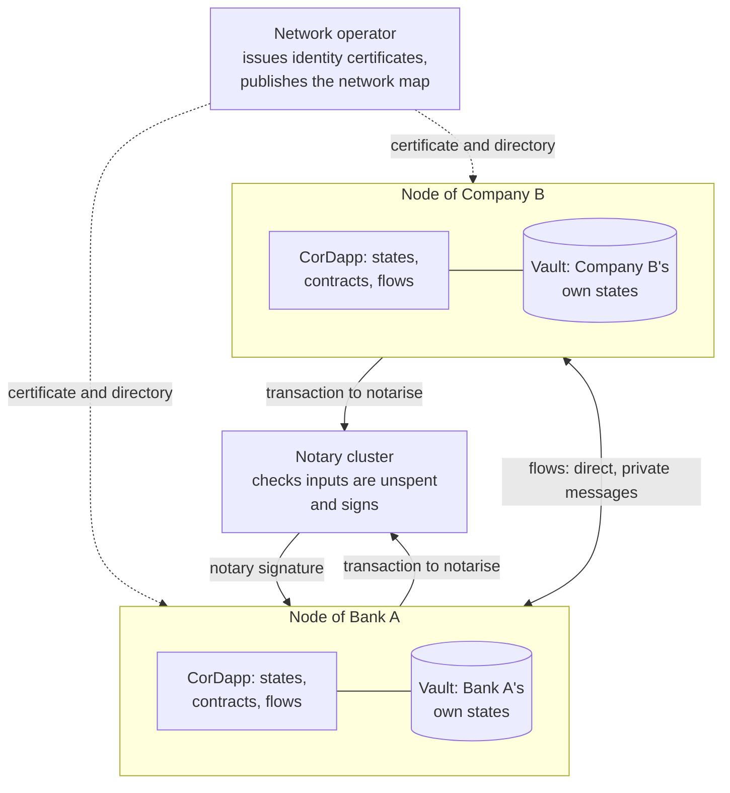
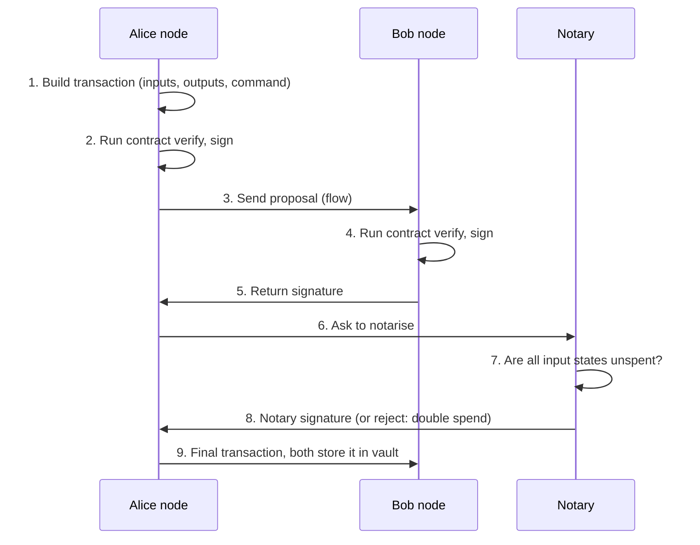
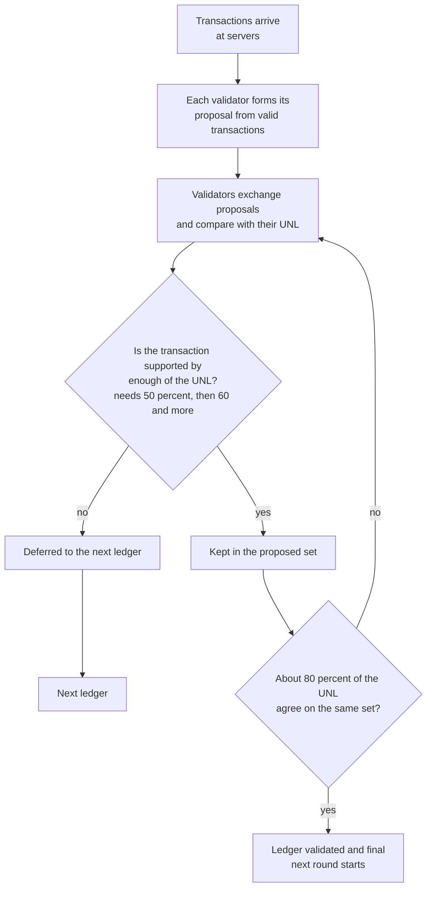
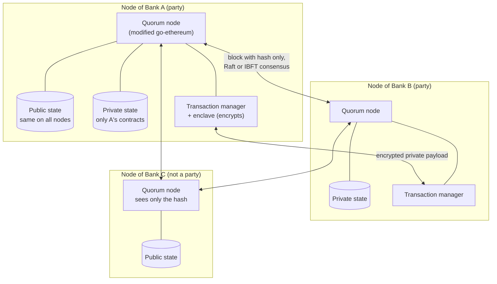
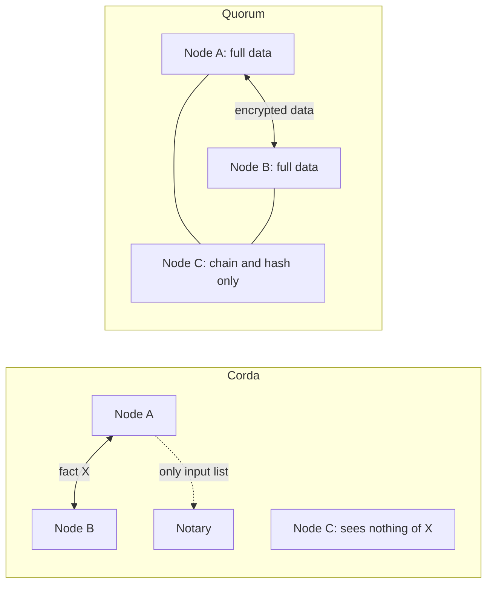
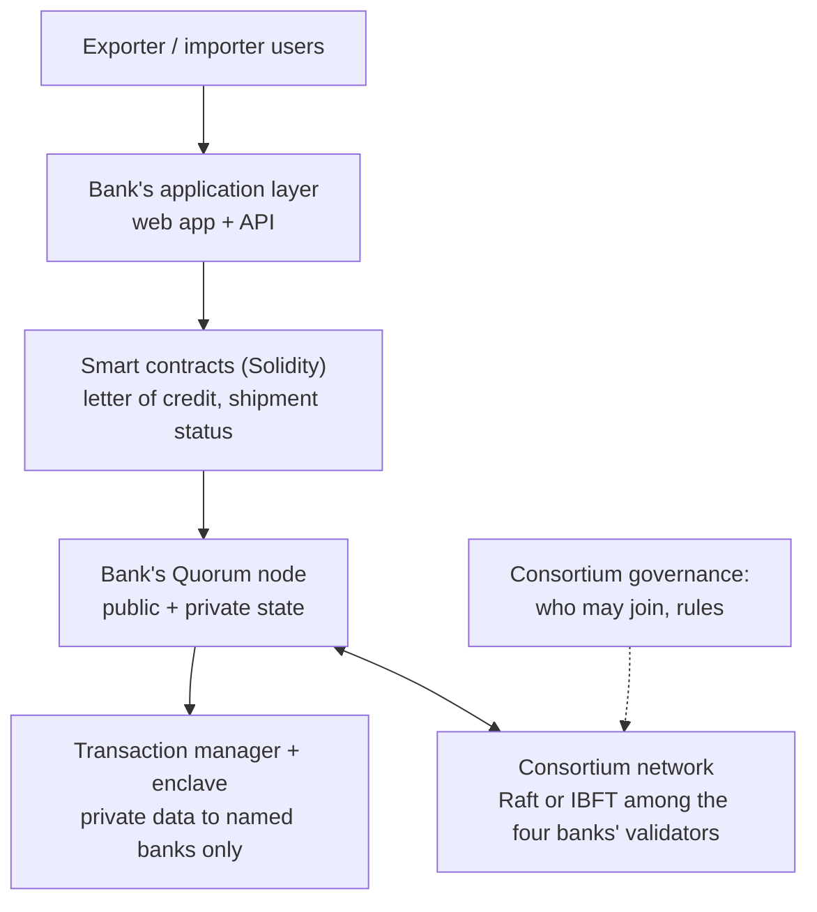

This note covers syllabus <Syl m="6" />, section 6.1: the tools Corda, Ripple and Quorum, other emerging blockchain platforms, and a case study on any blockchain platform. Applications such as education, energy, healthcare and supply chain have their own note. Fabric, Paxos, Raft and PBFT also have their own notes; here they are used only for comparison.

## The basics first

- A **public blockchain** (Bitcoin, Ethereum) lets anyone join and every node sees every transaction. A **permissioned** (private or consortium) ledger lets in only known, approved members. <Cite id="private-blockchain-gfg-consortium" />
- **Why banks cannot just use Bitcoin or Ethereum:** every transaction is visible to everyone, nodes are anonymous, and speed is low. Regulated firms need privacy, known identities and quick, final settlement. <Cite id="corda-ripple-quorum-corda-intro-wp" loc="Comparisons" />
- A **double spend** means spending the same money twice. Every platform below needs some way to decide which of two conflicting transactions comes first. <Cite id="blockchain-fundamentals-wiki-doublespend" />
- A **fault** is a node that crashes (crash fault) or lies (Byzantine fault). Systems that survive lying nodes are called Byzantine fault tolerant (BFT). <Cite id="bft-paxos-raft-byz-generals" /> <Cite id="bft-paxos-raft-gfg-pbft" />
- **Consensus** is how a group of nodes agrees on one order of transactions. The three platforms in this note answer this question in three different ways.

Analogy: Bitcoin is a notice board in the town square where everyone reads every notice. Corda is a registered post: only the sender, the receiver and a trusted post office (the notary) see the letter. Quorum is the same notice board, but the private notices are written in sealed envelopes that only the named people can open. Ripple is a clearing house where a group of trusted referees decide the order of payments every few seconds.

| Platform | Built for | Who made it | Ledger idea | Agreement |
|---|---|---|---|---|
| Corda | Regulated firms, mainly finance | R3 consortium | Facts shared only between parties, no blocks | Parties check validity, notary checks uniqueness |
| Ripple (XRP Ledger) | Fast cross-border payments | Ripple Labs and the XRPL community | One public ledger, new version every few seconds | Trust-based voting in a UNL, 80 percent |
| Quorum | Private contracts between known firms | J.P. Morgan, later ConsenSys | Ethereum chain with private state | Raft or Istanbul BFT |

## Corda

<Box kind="definition">

**Corda** is open-source distributed ledger software for recording and processing shared agreements between known parties. It is "heavily inspired by blockchain systems" but leaves out the design choices that suit public chains badly: there is no global broadcast, no mining and no blocks. It was designed first for regulated financial institutions. <Cite id="corda-ripple-quorum-corda-intro-wp" loc="Corda" /> <Cite id="corda-ripple-quorum-corda-github" />

</Box>

**Why was Corda needed?** In a public chain every participant gets every transaction, which is bad for privacy and scale, and the result is only probably final. Businesses need to share data only with those who should see it, to know who they are dealing with, and to have final results that fit legal contracts. Corda's own papers argue that a transaction should be visible "only to them, and to those whose own view of the ledger in the future may depend on verifying the validity of this transaction". <Cite id="corda-ripple-quorum-corda-intro-wp" loc="Concepts" />

### Main ideas of Corda

1. **State.** A state object is a digital document that records one agreement and its current condition, for example "a deposit of 100 pounds at a bank, owned by a shipping company". States are never edited; they are either unspent or spent. The ledger is the set of these immutable states. <Cite id="corda-ripple-quorum-corda-intro-wp" loc="Concepts" /> <Cite id="corda-ripple-quorum-corda-tech-wp" loc="Transaction structure" />
2. **Contract.** The rules for changing a state, written as code on the Java Virtual Machine. A contract is a pure function: it only accepts or rejects a proposed transaction, has no storage and gives the same answer for the same transaction. A transaction is valid only when the contracts of all its states agree. <Cite id="corda-ripple-quorum-corda-intro-wp" loc="Business Logic" />
3. **Transaction.** It consumes input states and creates output states, so each state links to the one before it. It also carries commands (what is being done, such as issue or move), the required signatures, the chosen notary and, if needed, a time window. <Cite id="corda-ripple-quorum-corda-tech-wp" loc="Transaction structure" />
4. **Flow.** A small program that runs the multi-step conversation between nodes (build the transaction, collect signatures, send to the notary, store). In Corda all communication between nodes is done by flows, not by global broadcast. <Cite id="corda-ripple-quorum-corda-tech-wp" loc="Flow framework" /> <Cite id="corda-ripple-quorum-xoriant-corda" />
5. **CorDapp.** The package of states, contracts and flows (plus any APIs and user interface) that forms one Corda application. <Cite id="corda-ripple-quorum-corda-intro-wp" loc="Summary of the Corda Model" />
6. **Identity.** Each node has an X.509 certificate signed by the network operator that links a legal name to a public key. Real, distinct identities are what make notary clusters and trust possible. <Cite id="corda-ripple-quorum-corda-intro-wp" loc="Identity" /> <Cite id="corda-ripple-quorum-corda-tech-wp" loc="The identity root" />
7. **Network map.** A signed directory of nodes (addresses, protocol version, identity certificates). It distributes node data but is not trusted to alter it. <Cite id="corda-ripple-quorum-corda-tech-wp" loc="The network map" />
8. **Vault.** The node's own database of the states that matter to it, like a wallet. It also holds keys and helps pick which states to spend and when to add a change output. <Cite id="corda-ripple-quorum-corda-tech-wp" loc="The vault" />
9. **Notary.** The service that stops double spends and fixes the order of conflicting transactions (explained below).

### Corda architecture

<Cite id="corda-ripple-quorum-corda-tech-wp" loc="diagram" /> <Cite id="corda-ripple-quorum-xoriant-corda" loc="diagram" />

**Walk through the diagram.** (1) The network operator gives each firm an identity and lists it in the network map. (2) Each firm runs one node: its CorDapp holds the rules and the flows, and its vault holds only the states it is party to. (3) Two nodes talk directly through a flow; nothing is broadcast to the other nodes. (4) For finality the transaction goes to the notary, which signs or rejects. (5) The notary signature is added and both vaults are updated. <Cite id="corda-ripple-quorum-xoriant-corda" />

### How a Corda transaction is agreed

Corda separates two questions. <Cite id="corda-ripple-quorum-corda-intro-wp" loc="Consensus" />

- **Validity:** is this transaction allowed? The parties run the contract code themselves and check all required signatures and the history of the input states.
- **Uniqueness:** has any input state already been used by another transaction? A **notary** answers this and nothing else.

<Cite id="corda-ripple-quorum-corda-tech-wp" loc="diagram" />

The notary returns either a signature over the transaction or a rejection that says a double spend happened. The notary signature is the sign of finality. A **validating** notary checks the whole transaction; a **non-validating** notary sees only the list of consumed states, which gives better privacy but a weaker defence if transaction identifiers leak. <Cite id="corda-ripple-quorum-corda-tech-wp" loc="Notaries and consensus" />

**Pluggable notaries.** A notary can be a single machine or a cluster of mutually distrusting nodes that use a crash fault tolerant algorithm such as Raft or a BFT algorithm. One network may have a global BFT notary and also regional Raft notaries for speed. Each state names its notary. <Cite id="corda-ripple-quorum-corda-tech-wp" loc="Algorithmic agility" /> <Cite id="bft-paxos-raft-raft-paper" />

### Corda compared with Bitcoin

| Point | Bitcoin | Corda |
|---|---|---|
| Who sees a transaction | Every node | Only the parties (and those who need to verify its history) |
| Blocks and mining | Yes, proof of work | None |
| Finality | Probabilistic | Final once the notary signs |
| Data in a transaction | Coins and a script | Any typed data in a state |
| Contract | Script on the inputs | JVM code on inputs and outputs |
| Time | Block time | An exact time window attested by a notary |

Both use the same "consume inputs, create outputs" idea (UTXO). <Cite id="corda-ripple-quorum-corda-tech-wp" loc="Comparisons" /> <Cite id="corda-ripple-quorum-corda-intro-wp" loc="Comparisons to Bitcoin" /> <Cite id="blockchain-fundamentals-nakamoto" />

### Advantages and disadvantages of Corda

| Advantages | Disadvantages |
|---|---|
| Strong privacy: data goes only to those who need it | A fact is not visible to all, so outside auditing is harder |
| No mining, so low energy use and no per-transaction network fee | Needs a notary and a network operator, so some trust in them |
| Final once notarised; fits legal contracts and exact timing | Participants must be identified, so it is not for anonymous use |
| Standard JVM languages (Java, Kotlin) | Smaller community than Ethereum; the platform has split into the Corda 4 and Corda 5 architectures |

<Cite id="corda-ripple-quorum-corda-tech-wp" loc="Notaries and consensus" /> <Cite id="corda-ripple-quorum-corda-github" />

**Use cases** named in Corda's own papers include cash and payments, delivery-versus-payment trades and future-dated obligations. <Cite id="corda-ripple-quorum-corda-intro-wp" loc="Summary of the Corda Model" />

<PYQ id="2022-12-ce/q6a" /> <PYQ id="2023-05-ce/q6c" /> <PYQ id="2024-12-ce/q6d" />

<Box kind="exam">

Exam mein English mein likho: "Corda is an open-source distributed ledger platform for business, developed by R3. Instead of broadcasting every transaction to all nodes, it shares each transaction only with the parties involved. Its main components are states, contracts, transactions, flows, the vault, the network map and notaries. A notary prevents double spending by signing a transaction only if its input states are unspent."

</Box>

## Ripple and the XRP Ledger

<Box kind="definition">

**Ripple** is the name of a company (Ripple Labs) and of a family of payment products. The **XRP Ledger (XRPL)** is the decentralized, open-source ledger, started in 2012, that records accounts, balances and trades; **XRP** is its native digital asset. XRPL confirms transactions with a consensus protocol, not with mining. <Cite id="corda-ripple-quorum-wiki-xrpl" /> <Cite id="corda-ripple-quorum-xrpl-whatis" />

</Box>

**Why was it needed?** Sending money abroad through banks is slow and costly, because each bank must hold pre-funded accounts in other banks and currencies. Ripple's aim is fast, low-cost settlement and easy conversion between currencies. The XRPL docs call it "a universal payment system" with near real-time settlement of three to six seconds and a built-in exchange. <Cite id="corda-ripple-quorum-xrpl-principles" /> <Cite id="corda-ripple-quorum-gfg-ripple" />

**Short history.** The idea of a trust-based payment network (RipplePay, 2004) came from Ryan Fugger. XRPL development began in 2011 with David Schwartz, Jed McCaleb and Arthur Britto after the thread "Bitcoin without mining". The company was named Ripple Labs in 2013. Unlike Bitcoin, all 100 billion XRP were created at the start. <Cite id="corda-ripple-quorum-gfg-ripple" loc="History of Ripple" /> <Cite id="corda-ripple-quorum-wiki-xrpl" loc="History" />

### The parts of the Ripple world

| Part | What it is |
|---|---|
| XRP Ledger | The shared ledger. Each new ledger version holds the whole current state, the transactions applied and some metadata. <Cite id="corda-ripple-quorum-xrpl-consensus" loc="Ledger History" /> |
| XRP | The native asset. It also acts as a bridge between currencies. |
| Validators and the UNL | Servers that vote in consensus, and the list of validators each server trusts. |
| Tokens and paths | Value in other currencies is held as tokens; a payment can flow through several steps, "rippling" through accounts or trading through the exchange. <Cite id="corda-ripple-quorum-xrpl-paths" /> |
| RippleNet | Ripple's network and software for banks and payment firms. |
| On-Demand Liquidity (ODL) | A RippleNet service that uses XRP to move money across borders without pre-funding. <Cite id="corda-ripple-quorum-ripple-odl" /> |

### Ripple consensus step by step

The core idea: "a little trust goes a long way". Each server picks validators it trusts (its **Unique Node List, UNL**). They should be run by different parties that are unlikely to cheat together. <Cite id="corda-ripple-quorum-xrpl-consensus" loc="Trust-Based Validation" /> <Cite id="corda-ripple-quorum-xrpl-unl" />

1. Each validator collects the valid transactions it has seen. This is its first proposal.
2. Validators send proposals to each other and compare. A transaction with majority support stays in; one without is put off to the next ledger. Slight majorities quickly become full agreement.
3. To avoid stalling near half, the needed share rises: first 50 percent, then 60 percent and higher, until only agreed transactions remain.
4. When about 80 percent of the trusted validators agree on the set, the ledger is declared validated, and it is final.
5. The next round starts. A round takes only a few seconds.

<Cite id="corda-ripple-quorum-xrpl-principles" loc="Consensus Rounds" /> <Cite id="corda-ripple-quorum-xrpl-whatis" />

<Cite id="corda-ripple-quorum-xrpl-consensus" loc="diagram" /> <Cite id="corda-ripple-quorum-xrpl-principles" loc="diagram" />

**How it stops double spends.** Two conflicting payments can both be in the agreed group. They are then applied in one fixed, known order, so the first succeeds and the second fails. Everyone must agree only on the group, not on timing. <Cite id="corda-ripple-quorum-xrpl-principles" loc="The Double Spend Problem" />

**Fault limits.** Consensus continues while fewer than 20 percent of trusted validators are faulty. Confirming an invalid transaction needs over 80 percent to collude. If more than 20 but less than 80 percent are faulty, the network stops instead of splitting. <Cite id="corda-ripple-quorum-xrpl-consensus" loc="Trust-Based Validation" />

**UNL overlap.** If two servers' UNLs differ a lot, they may validate different ledgers and fork. Early thinking said 60 percent overlap was enough; later research showed about 90 percent is needed in the worst case. So most servers use a recommended list (the default lists come from the XRP Ledger Foundation and Ripple). <Cite id="corda-ripple-quorum-xrpl-unl" loc="UNL Overlap" /> The mathematical analysis is in <Cite id="corda-ripple-quorum-chase-macbrough" />; the earlier 2014 paper is kept only for history and says it should not be used as a reference. <Cite id="corda-ripple-quorum-ripple-rpca-2014" />

### RippleNet and On-Demand Liquidity

```mermaid
%% caption: Cross-border payment with On-Demand Liquidity. The sending bank buys XRP with its own currency, XRP moves on the ledger in seconds, and the receiving side sells XRP for the payout currency. No pre-funded account abroad is needed.
flowchart LR
  S["Sender in India<br/>pays in INR"] --> B1["Sending bank<br/>(RippleNet)"]
  B1 -->|"1. sell INR, buy XRP"| E1["Exchange"]
  E1 -->|"2. send XRP on the XRP Ledger<br/>(a few seconds)"| E2["Exchange at payout end"]
  E2 -->|"3. sell XRP, get PHP"| B2["Receiving bank<br/>(RippleNet)"]
  B2 --> R["Receiver in the Philippines<br/>gets PHP"]
```

Banks normally keep **nostro accounts**, money pre-funded in a foreign currency at a foreign bank, so a payment can be paid out at once. Ripple's essay says these accounts tie up large amounts of capital (it quotes about 5 trillion dollars, from a 2016 McKinsey report). ODL instead converts to XRP and then to the payout currency at the moment of payment, so XRP is the bridge currency. <Cite id="corda-ripple-quorum-ripple-liquidity" /> <Cite id="corda-ripple-quorum-ripple-odl" />

<Cite id="corda-ripple-quorum-ripple-odl" loc="diagram" /> <Cite id="corda-ripple-quorum-gfg-ripple" loc="diagram" />

### Advantages and disadvantages of Ripple

| Advantages | Disadvantages and criticisms |
|---|---|
| Settlement in a few seconds, low cost | Trust in the UNL: critics say it leads to centralization. <Cite id="corda-ripple-quorum-wiki-xrpl" loc="Technical overview" /> |
| No mining, so very little energy | Ripple Labs holds a large share of XRP, which concentrates power. <Cite id="corda-ripple-quorum-wiki-xrpl" loc="Role of Ripple Labs" /> |
| Any currency can be held and traded; a built-in exchange finds the cheapest path | Servers need high UNL overlap or the network can fork |
| Whole current state in each ledger, so no need to read the full history | Legal disputes about how XRP is sold have followed the company |

The legal point in the last cell: in July 2023 a US court said XRP as a token is not itself a security, but the way it is sold could be. <Cite id="corda-ripple-quorum-wiki-xrpl" loc="History" /> Speed and cost figures such as "1,500 transactions per second" come from Ripple's own pages, so treat them as the company's claims. <Cite id="corda-ripple-quorum-ripple-liquidity" />

<PYQ id="2023-05-ce/q6a" /> <PYQ id="2024-05-ce/q6b" /> <PYQ id="2025-05-ce/q6c" />

<Box kind="exam">

Exam mein English mein likho: "Ripple is a payment platform built on the XRP Ledger. It does not use mining. Each server trusts a Unique Node List of validators, who agree on a set of transactions in rounds with a rising threshold; when about 80 percent agree, the ledger is validated. RippleNet and On-Demand Liquidity use XRP as a bridge currency for fast cross-border payments."

</Box>

## Quorum

<Box kind="definition">

**Quorum** is a permissioned blockchain built on the Go implementation of Ethereum (go-ethereum). It was started by J.P. Morgan for financial uses and later handed to ConsenSys. It adds data privacy through a "private" transaction type, uses Raft or Istanbul BFT instead of proof of work, and allows only approved nodes. <Cite id="corda-ripple-quorum-quorum-wp" loc="Section 2" /> <Cite id="corda-ripple-quorum-gfg-quorum" />

</Box>

The product name in code is **GoQuorum**. Its GitHub repository says that Consensys no longer maintains it, was archived in 2026, and is not recommended for new projects. It is still a standard exam topic. <Cite id="corda-ripple-quorum-quorum-github" />

**Why was it needed?** In finance, several firms share data but must not see each other's deals. Public Ethereum shows all data to all nodes, charges gas and is slow because of mining. Quorum keeps Ethereum smart contracts but adds privacy, permissions and faster consensus. <Cite id="corda-ripple-quorum-quorum-wp" loc="Section 1" /> <Cite id="corda-ripple-quorum-gfg-quorum" loc="Need For Quorum" />

### Features

1. **Privacy.** Public and private transactions on one chain.
2. **Permissioned.** Only known, provisioned nodes may join. <Cite id="corda-ripple-quorum-quorum-github" />
3. **Pluggable consensus.** Raft (the default in the whitepaper), Istanbul BFT, and later QBFT and Clique, so no mining is needed. <Cite id="corda-ripple-quorum-quorum-github" /> <Cite id="corda-ripple-quorum-quorum-wp" loc="Section 3" />
4. **No transaction fee in practice.** The gas mechanism is still in the code but its price is set to zero. <Cite id="corda-ripple-quorum-gfg-quorum" loc="Features of Quorum" />
5. **Better speed.** The whitepaper reports "dozens to hundreds of transactions per second", depending on set-up. <Cite id="corda-ripple-quorum-quorum-wp" loc="Section 5" />
6. **Solidity contracts** run as on Ethereum. <Cite id="ethereum-whitepaper" />

### Quorum architecture

<Cite id="corda-ripple-quorum-quorum-wp" loc="diagram" /> <Cite id="corda-ripple-quorum-gfg-quorum" loc="diagram" />

**Walk through the diagram.**

- **Quorum node:** a lightweight fork of go-ethereum with changes to block creation and validation. <Cite id="corda-ripple-quorum-gfg-quorum" loc="Quorum Architecture" />
- **Transaction manager and enclave:** they encrypt and decrypt private payloads and exchange them directly between the parties. GfG names the older tool Constellation; the GoQuorum README names Tessera. <Cite id="corda-ripple-quorum-gfg-quorum" /> <Cite id="corda-ripple-quorum-quorum-github" />
- **Two states:** all nodes agree on the public state. A private contract's state lives only on nodes that are party to it, so each node's private state can differ. <Cite id="corda-ripple-quorum-quorum-wp" loc="Section 4" />

### How a private transaction works

1. The app sends the transaction with a `privateFor` list: the public keys of the parties allowed to see it.
2. The payload is encrypted and delivered by the transaction manager only to those parties.
3. A normal Ethereum transaction is made whose data field is just the 256-bit hash of that encrypted data. This is gossiped to all nodes and put in a block.
4. Nodes that are party fetch the data, decrypt it and run the contract code on their private state. Other nodes skip it, because they cannot read it.
5. Because blocks check only the public state, all nodes still agree on the chain.

<Cite id="corda-ripple-quorum-quorum-wp" loc="Section 4.1" />

A private transaction is marked by the signature value `v` being 37 or 38, instead of Ethereum's usual 27 or 28. A rule of the design: a private contract cannot change public state. <Cite id="corda-ripple-quorum-quorum-wp" loc="Sections 4.1.1 and 6" />

### Quorum consensus

- **Raft.** One leader (called the minter) makes blocks without proof of work. A leader is chosen by majority vote; a new block becomes the chain head only after a majority of nodes accept it. It tolerates crash faults, not lying nodes. <Cite id="corda-ripple-quorum-quorum-wp" loc="Section 3.1" /> <Cite id="bft-paxos-raft-raft-paper" />
- **Istanbul BFT (IBFT).** A three-phase protocol (pre-prepare, prepare, commit) in the style of PBFT. It tolerates up to one-third of validators being faulty, and blocks are final, with no forks. <Cite id="corda-ripple-quorum-quorum-wp" loc="Section 3.2" /> <Cite id="bft-paxos-raft-pbft-paper" /> Block period and round timeout are settings: the defaults are 1 second and 10,000 ms. <Cite id="corda-ripple-quorum-quorum-ibft" />

### Advantages and disadvantages of Quorum

| Advantages | Disadvantages |
|---|---|
| Private and public transactions in one network | The privacy design limits applications (private cannot change public state) |
| Fast, final consensus, no mining | Needs a trusted set of known nodes |
| Reuses Ethereum tools and Solidity | Cannot create a native token economy because it has no mining reward |
| Open source | The original GoQuorum project is now archived, so support is shrinking |

<Cite id="corda-ripple-quorum-gfg-quorum" loc="Disadvantages of Quorum" /> <Cite id="corda-ripple-quorum-quorum-github" />

**Projects and uses listed by GeeksforGeeks:** Alastria (a Spanish consortium), VAKT (post-trade processing), Kimlic (KYC), Komgo (trade finance), vaccination records and supply-chain tracking. <Cite id="corda-ripple-quorum-gfg-quorum" loc="Project-based on Quorum" />

<PYQ id="2022-12-ce/q6c" /> <PYQ id="2024-12-ce/q6a" />

<Box kind="exam">

Exam mein English mein likho: "Quorum is a permissioned blockchain based on Ethereum, started by J.P. Morgan. It adds private transactions, where only a hash goes on the shared chain and the data is sent encrypted to the named parties. It uses Raft or Istanbul BFT consensus instead of mining, so it is faster and gives immediate finality."

</Box>

## Corda compared with Quorum

<Cite id="corda-ripple-quorum-corda-intro-wp" loc="diagram" /> <Cite id="corda-ripple-quorum-quorum-wp" loc="diagram" />

| Point | Corda | Quorum |
|---|---|---|
| Origin | R3 consortium of financial firms | J.P. Morgan, then ConsenSys |
| Base | New JVM platform, inspired by Bitcoin's inputs and outputs | Fork of go-ethereum (Ethereum) |
| Ledger | No single global ledger; each node holds the facts it is party to | One chain on all nodes, with a public and a private state |
| Who sees a transaction | Only the parties (and those who must verify its history) | All nodes see it, but a private one is only a hash for non-parties |
| Blocks | None | Yes |
| Consensus | Validity by the parties, uniqueness by a notary (single, Raft, BFT) | Raft or Istanbul BFT among all nodes |
| Smart contract | JVM code (Java, Kotlin), a pure verify function, plus flows | Solidity on the EVM |
| Identity | X.509 legal identity from the network operator | Permissioned set of approved nodes |
| Coin and fee | No native coin needed, no per-transaction fee | Gas exists but is set to zero |
| Status | Corda 4 open source; Corda 5 is a new architecture | GoQuorum archived in 2026 |

Sources for the table: <Cite id="corda-ripple-quorum-corda-tech-wp" loc="Comparisons" /> <Cite id="corda-ripple-quorum-corda-github" /> <Cite id="corda-ripple-quorum-quorum-wp" /> <Cite id="corda-ripple-quorum-gfg-quorum" /> <Cite id="corda-ripple-quorum-quorum-github" />

R3's own paper argues that Ethereum-based enterprise platforms such as Quorum make each business solution a separate network, which splits assets and identity into silos. This is Corda's view of a rival, so read it as one side of the argument. <Cite id="corda-ripple-quorum-corda-intro-wp" loc="Comparisons to Enterprise Blockchains" />

<PYQ id="2024-12/q4b" />

<Box kind="exam">

Exam mein English mein likho: "Corda shares each transaction only with its parties and uses a notary for uniqueness, with no blocks and with JVM contracts. Quorum keeps a single Ethereum-style chain on every node, hides private data by sending only a hash on-chain, and uses Raft or IBFT with Solidity contracts."

</Box>

## Case study: a consortium blockchain and its architecture

The papers ask for "a case study on any blockchain platform" and "a case study on a consortium blockchain, with its architecture". <Cite id="private-blockchain-gfg-consortium" /> A good answer follows the same plan every time: problem, members, platform and why, architecture, flow, result, limits.

**Example: a trade-finance consortium of banks on Quorum.** (This is a teaching model built from the features above; the real projects it resembles are Komgo and VAKT, listed by GfG.) <Cite id="corda-ripple-quorum-gfg-quorum" loc="Project-based on Quorum" />

1. **Problem.** Banks, an exporter and an importer each keep their own records of one trade. They must be matched by hand, which is slow, and rivals must not see each other's deals.
2. **Members.** Four banks, run as a consortium with a joint governance group. Each bank runs its own node. Only approved nodes may join. <Cite id="private-blockchain-gfg-consortium" />
3. **Platform.** Quorum, because the firms already use Ethereum skills, need private contracts and want fast finality with known validators.
4. **Architecture.** The same as the Quorum figure above, plus an application layer (web app) on top and an identity system at the edge.

<Cite id="corda-ripple-quorum-quorum-wp" loc="diagram" /> <Cite id="private-blockchain-gfg-consortium" loc="diagram" />

5. **Flow.** The importer's bank opens a letter of credit as a private contract shared only with the exporter's bank. Shipment updates are added as private transactions. Everyone else sees only hashes.
6. **Result.** One shared record per trade, no manual matching, and privacy between rivals.
7. **Limits.** Governance disputes, onboarding cost, and the fact that GoQuorum is archived; the same design could be built on Corda or Fabric. <Cite id="corda-ripple-quorum-quorum-github" /> <Cite id="hyperledger-fabric-gfg-fabric" />

If the question allows any platform, the same plan works for Corda (a bank-to-bank payment with a notary) or Ripple (a cross-border payment with ODL). Use the diagrams above as the architecture.

<PYQ id="2023-12/q6a" /> <PYQ id="2024-12/q5a" />

## Other emerging blockchain platforms

The syllabus line ends with "other emerging blockchain platforms". The only ones you need to name, with one line each:

| Platform | One line |
|---|---|
| Hyperledger Fabric | Permissioned platform with channels and chaincode, under the Linux Foundation. Has its own note. |
| Hyperledger Sawtooth | Intel's Hyperledger platform that allowed swapping consensus; no longer actively developed. |
| Hyperledger Besu | An enterprise Ethereum client. |
| Hyperledger Indy | Decentralized identity. |
| Enterprise Ethereum Alliance | The group that works on a common standard for enterprise Ethereum. <Cite id="private-blockchain-wiki-eea" /> |

<Cite id="hyperledger-fabric-wiki-hyperledger" />

## Worked sums

### Sum 1: the XRP Ledger 80 percent rule

<Sum>

<Given>

A server's UNL has 35 validators.

</Given>

<Find>

how many validators must agree to validate a ledger, how many faulty validators the network can survive, and how many would have to collude to confirm an invalid transaction.

</Find>

<Steps>

1. Agreement needed: $80\% \times 35 = 0.8 \times 35 = 28$ validators. *Reason: XRPL validates when about 80 percent of the trusted validators agree.*
2. Faulty limit: $20\% \times 35 = 7$, and the rule says fewer than 20 percent, so at most $6$ faulty validators. *Reason: consensus continues while fewer than 20 percent are faulty.*
3. Collusion needed: over $80\%$ of 35, that is more than 28, so at least $29$ validators. *Reason: confirming an invalid transaction needs over 80 percent to collude.*

</Steps>

<Answer>

28 validators must agree; up to 6 faulty validators can be survived; at least 29 would have to collude to confirm an invalid transaction.

</Answer>

<Box kind="verify">

With 6 faulty, $35 - 6 = 29$ honest validators remain, and $29 \ge 28$, so agreement is still possible. With 7 faulty (exactly 20 percent) only 28 honest remain, just enough, so 7 is the edge and the "fewer than 20 percent" rule stops at 6. Also $28 / 35 = 0.8$, which confirms the first step.

</Box>

</Sum>

Rule used: <Cite id="corda-ripple-quorum-xrpl-consensus" loc="Trust-Based Validation" />.

### Sum 2: a cross-currency payment through XRP (made-up rates)

<Sum>

<Given>

A bank in India sends 83,000 INR to a receiver in the Philippines using On-Demand Liquidity. Made-up rates: 1 XRP costs 50 INR, and 1 XRP sells for 1.5 PHP. Each of the two trades keeps 0.5% as a fee, so only 99.5% of the amount received is passed on.

</Given>

<Find>

the PHP the receiver gets.

</Find>

<Steps>

1. Buy XRP: $83{,}000 / 50 = 1{,}660$ XRP. *Reason: INR divided by the price per XRP.*
2. Take the first fee: $1{,}660 \times 0.995 = 1{,}651.7$ XRP. *Reason: 0.5% is kept, so 99.5% remains.*
3. Sell XRP for PHP: $1{,}651.7 \times 1.5 = 2{,}477.55$ PHP. *Reason: each XRP sells for 1.5 PHP.*
4. Take the second fee: $2{,}477.55 \times 0.995 = 2{,}465.16$ PHP (rounded to 2 places). *Reason: 0.5% fee again.*

</Steps>

<Answer>

The receiver gets about 2,465.16 PHP.

</Answer>

<Box kind="verify">

Work backwards: $2{,}465.16225 / 0.995 = 2{,}477.55$; $2{,}477.55 / 1.5 = 1{,}651.7$; $1{,}651.7 / 0.995 = 1{,}660$; $1{,}660 \times 50 = 83{,}000$ INR, the starting amount. Without fees the receiver would get $1{,}660 \times 1.5 = 2{,}490$ PHP, and $2{,}465.16 < 2{,}490$, as it should be.

</Box>

</Sum>

The route (sell currency, bridge through XRP, buy currency) is the idea in <Cite id="corda-ripple-quorum-ripple-odl" /> and <Cite id="corda-ripple-quorum-xrpl-paths" />. The rates and fees here are invented for practice.

### Sum 3: Quorum fault tolerance

<Sum>

<Given>

A consortium of $n = 10$ banks each run one validator.

</Given>

<Find>

for Istanbul BFT: the most Byzantine (lying) validators $f$ it survives and the matching votes needed to commit; for Raft: the majority and the most crashed nodes it survives.

</Find>

<Steps>

1. IBFT needs $n \ge 3f + 1$, so $f \le (10 - 1)/3 = 3$. *Reason: IBFT tolerates up to one-third faulty, like PBFT.*
2. Votes to commit: $2f + 1 = 2 \times 3 + 1 = 7$. *Reason: two-thirds of the validators must send matching PREPARE and COMMIT messages.*
3. Raft majority: more than half of 10, so $6$. *Reason: Raft needs a majority to elect a leader and to accept a block.*
4. Raft crashes survived: $10 - 6 = 4$. *Reason: the rest must still form a majority.*

</Steps>

<Answer>

IBFT: $f = 3$ lying validators, 7 matching votes. Raft: majority of 6, so 4 crashed nodes can be survived (Raft does not survive lying nodes).

</Answer>

<Box kind="verify">

Check IBFT: $3 \times 3 + 1 = 10 = n$, and $f = 4$ would need 13 nodes. Check the two-thirds wording: $\tfrac{2}{3} \times 10 = 6.67$, which rounds up to $7$. Check Raft: with 4 crashed, 6 remain, which is exactly a majority; with 5 crashed, 5 remain, which is not more than half of 10, so 4 is the maximum.

</Box>

</Sum>

Rules used: <Cite id="corda-ripple-quorum-quorum-wp" loc="Section 3" />, <Cite id="bft-paxos-raft-pbft-paper" /> and <Cite id="bft-paxos-raft-raft-paper" />. The same sums for general PBFT and Raft are worked in the Paxos, Raft and PBFT note.

### Sum 4: a Corda cash payment and a double spend

<Sum>

<Given>

Alice owns two cash states issued by a bank, both created by transaction T1: S1 = (T1, 0) worth 60 pounds and S2 = (T1, 1) worth 40 pounds. She pays Bob 70 pounds in transaction T2. Later she tries to pay Carol 60 pounds in transaction T3 using S1 again. (The labels T1, T2, T3 are made up.)

</Given>

<Find>

the outputs of T2 that satisfy the contract, and what the notary does with T3.

</Find>

<Steps>

1. T2 inputs: S1 and S2, total $60 + 40 = 100$ pounds. *Reason: one state of 60 is not enough, so Alice's vault picks both.*
2. T2 outputs: 70 pounds to Bob and the change $100 - 70 = 30$ pounds back to Alice. *Reason: the cash contract needs inputs and outputs to balance, and the vault adds a change output.*
3. Contract check: $60 + 40 = 100 = 70 + 30$. The contract accepts, both parties sign, and the notary records S1 and S2 as consumed by T2. *Reason: the notary stores which input states have been used.*
4. T3 asks to consume S1 again. The notary sees S1 already consumed by T2 and rejects T3. *Reason: the notary signs only if all input states are unspent.*

</Steps>

<Answer>

T2 has outputs of 70 pounds (Bob) and 30 pounds (Alice change). T3 is rejected by the notary as a double spend, so Carol gets nothing.

</Answer>

<Box kind="verify">

Money is conserved: inputs of 100 pounds equal outputs of 70 + 30 pounds. After T2, Alice's unspent states are only the 30-pound change, so she could not pay Carol 60 pounds legitimately, which agrees with the notary rejecting T3.

</Box>

</Sum>

The balancing, change and notary rules are described in <Cite id="corda-ripple-quorum-corda-tech-wp" loc="The vault" /> and <Cite id="corda-ripple-quorum-corda-tech-wp" loc="Notaries and consensus" />.

## Exam tips

- "Explain Corda architecture": definition, why needed, list the components (node, state, contract, flow, vault, network map, notary), the architecture diagram, the transaction sequence with the notary, then advantages.
- "Compare Corda with Quorum": use the comparison table; lead with who sees the data and how agreement works.
- "Explain Ripple": say it is both a company and a ledger, then the UNL consensus with the 80 percent rule, then RippleNet and ODL with the bridge diagram.
- "Explain Quorum": private transaction steps (hash on chain, encrypted data to named parties), two states, Raft versus IBFT.
- "Case study": use the plan problem, members, platform, architecture, flow, result, limits, and draw one layered diagram.

<Box kind="pitfall">

Do not say Ripple and XRP are the same thing. Ripple is a company, XRP Ledger is the ledger, XRP is the asset. Do not say Corda has blocks or mining. Do not say a Quorum private transaction hides the transaction itself from the chain; the transaction exists on every node, only its data is a hash.

</Box>
