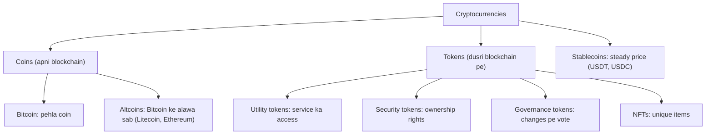
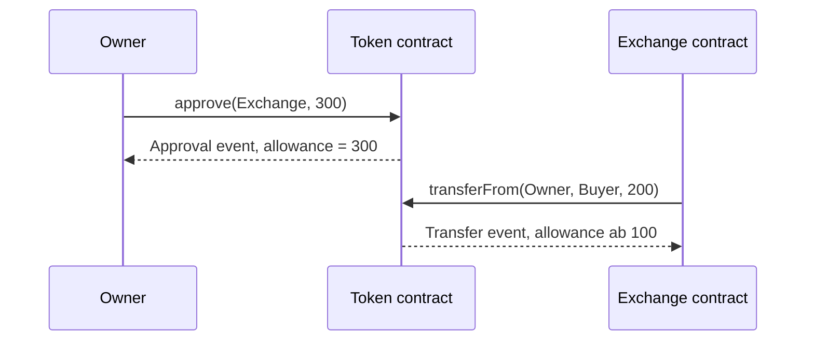
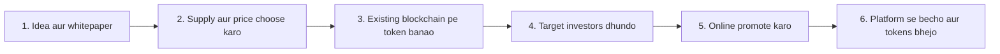
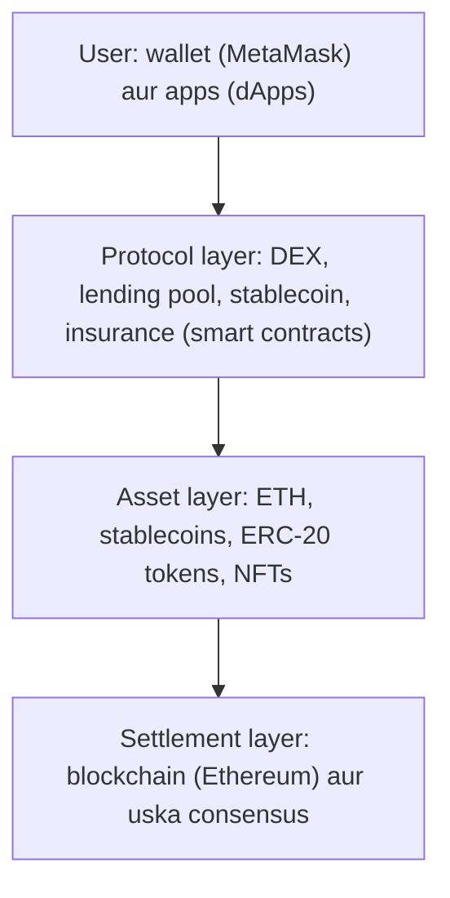

Ye note syllabus <Syl m="5" />, section 5.1 cover karta hai: cryptocurrency basics aur types, ERC20 aur ERC721 tokens aur unka comparison, ICO (basics, launch, pros aur cons), STO, DeFi, metaverse, aur cryptocurrency ke types (Bitcoin, altcoin, utility aur security tokens). Wallets, UTXO aur double spending ka alag note hai.

## Pehle basics

- **Blockchain** blocks ki shared list hai jo bahut saare computers pe copy hoti hai, aur har block mein pichle block ka hash hota hai. <Cite id="blockchain-fundamentals-nakamoto" />
- **Smart contract** blockchain pe stored ek chhota program hai jo bilkul waise hi chalta hai jaise likha gaya hai. Ethereum sabse jaani-maani blockchain hai jo inhe chalati hai. <Cite id="ethereum-whitepaper" />
- **Fungible** matlab "har unit same hai aur dusre se badla ja sakta hai". 100 rupees ka note fungible hai: koi bhi note chalega. **Non-fungible** cheez unique hoti hai, jaise signed cricket bat: aapko farak padta hai ki kaunsa mila. <Cite id="cryptocurrencies-tokens-me-ch10" />
- **Standard** functions ki agreed list hai. Agar har token contract mein same functions hon, to har wallet aur exchange bina extra kaam ke use handle kar leta hai.

## Cryptocurrency kya hai

<Box kind="definition">

**Cryptocurrency** ek digital asset hai jo blockchain (shared, cryptography se jude hue ledger) ka use karke record karta hai ki kiske paas kya hai aur transactions ko secure banata hai, bina bank ya kisi central party ke. Ise aam taur par alag asset class maana jaata hai, normal paisa nahi. <Cite id="cryptocurrencies-tokens-wiki-crypto" /> <Cite id="cryptocurrencies-tokens-gfg-coins-tokens" />

</Box>

**Ye kyun zaroori hai.** Online payments mein aam taur par ek trusted beech wala (bank) chahiye jo ek hi paisa do baar kharch hone se roke. Bitcoin ne 2009 mein dikhaya ki computers ka network ye kaam cryptography aur consensus se kar sakta hai. <Cite id="blockchain-fundamentals-nakamoto" /> <Cite id="cryptocurrencies-tokens-wiki-crypto" />

**Short mein kaise kaam karta hai.**

1. Aapke wallet mein private key (secret jo kharch karne deti hai) aur public address (jahan log coins bhejte hain) hota hai.
2. Aap private key se transaction sign karke broadcast karte ho.
3. Nodes use check karte hain aur miners ya validators use block mein daalte hain.
4. Block chain se jud jaata hai, isliye record chupke se badla nahi ja sakta. <Cite id="cryptocurrencies-tokens-wiki-crypto" />

**Usage.** Payments aur transfers, saving ya speculation, network fees dena, paisa jutana (ICO), lending aur trading (DeFi), aur digital items ka owner banna (NFTs).

**Risks.** Price bahut upar-neeche hota hai (May 2022 ke ek hafte mein bitcoin lagbhag 20 percent aur ether lagbhag 26 percent gira), scams aur exchange failures hote hain, kho gayi key wapas nahi aati, aur saare transactions dikhte hain jabki owners sirf pseudonymous hote hain. <Cite id="cryptocurrencies-tokens-wiki-crypto" />

<PYQ id="2024-12-ce/q3a" /> <PYQ id="2024-12/q1e" />

## Cryptocurrency ke types

Alag-alag sources thoda alag tareeke se group karte hain aur groups overlap karte hain (jaise stablecoin coin bhi ho sakta hai aur token bhi). Exam mein neeche wala grouping likho aur bolo ki groups overlap karte hain. <Cite id="cryptocurrencies-tokens-gfg-coins-tokens" />

<Cite id="cryptocurrencies-tokens-gfg-coins-tokens" loc="diagram" /> <Cite id="cryptocurrencies-tokens-wiki-crypto" loc="diagram" />

| Type | Kya hai | Examples |
| --- | --- | --- |
| Bitcoin | Pehli cryptocurrency, January 2009 mein pseudonymous Satoshi Nakamoto ne banayi; peer-to-peer electronic cash jaisa kaam karti hai, proof of work ke saath. <Cite id="cryptocurrencies-tokens-wiki-crypto" /> <Cite id="blockchain-fundamentals-nakamoto" /> | BTC |
| Altcoins | "Alternative coins": bitcoin ke alawa har cryptocurrency. Kuch bitcoin ka design copy karte hain; Ethereum smart contracts jodta hai. <Cite id="cryptocurrencies-tokens-wiki-crypto" /> | Litecoin (LTC), Bitcoin Cash (BCH), Ether (ETH), Cardano (ADA) |
| Smart contract coins | Wo coins jo ek platform chalate hain jis pe developers decentralized apps banate hain. <Cite id="cryptocurrencies-tokens-gfg-coins-tokens" /> | ETH, ADA |
| Privacy coins | Chhupate hain ki kisne kisko kitna diya. <Cite id="cryptocurrencies-tokens-gfg-coins-tokens" /> | Monero (XMR), Zcash (ZEC) |
| Stablecoins | US dollar jaise reference ke against value steady rakhne ki koshish. Ye hamesha stable nahi hote: Terra ka UST May 2022 mein peg kho baitha. <Cite id="cryptocurrencies-tokens-wiki-stablecoin" /> | USDT, USDC |
| Memecoins | Internet jokes se bane coins; bahut volatile aur aksar scams mein use hote hain. <Cite id="cryptocurrencies-tokens-wiki-crypto" /> | Dogecoin |
| Tokens | Existing blockchain pe smart contract se bane assets (agla section dekho). <Cite id="cryptocurrencies-tokens-me-ch10" /> | Ethereum pe USDC, BAT |

**Stablecoin ke types.** Fiat-backed (reserve dollars ya treasury bills mein; zyada tar stablecoins), crypto-backed (collateral mein koi aur cryptocurrency) aur algorithmic (reserve nahi ya adhoora, supply ko program adjust karta hai). <Cite id="cryptocurrencies-tokens-wiki-stablecoin" />

<Box kind="exam">

"Types of cryptocurrencies" poocha jaye to likho: Bitcoin, altcoins, stablecoins, aur tokens (utility, security, payment, governance, NFT). Har ek ki ek line aur ek example do, aur upar wala tree banao.

</Box>

<PYQ id="2023-12/q5b" /> <PYQ id="2025-05/q2b" /> <PYQ id="2023-05-ce/q2b" /> <PYQ id="2025-05-ce/q2a" />

## Coins versus tokens

**Coin** apni blockchain pe chalta hai aur us chain ka native paisa hota hai (Bitcoin pe BTC, Ethereum pe ETH). **Token** ki apni blockchain nahi hoti: wo kisi dusri chain pe smart contract ka rakha hua record hai, isliye koi bhi network banaye bina token bana sakta hai. <Cite id="cryptocurrencies-tokens-gfg-coins-tokens" /> <Cite id="cryptocurrencies-tokens-me-ch10" />

| Point | Coin | Token |
| --- | --- | --- |
| Blockchain | Apni | Dusri pe (jaise Ethereum) |
| Kaun banata hai | Protocol code aur miners ya validators | Smart contract jo koi bhi deploy kar sake |
| Main use | Paisa, network fees | Access, ownership, voting, collectibles |
| Examples | BTC, ETH, LTC | USDC, UNI, NFTs |

### Tokens ke kinds

- **Utility token:** ecosystem mein service ya resource ka access deta hai, jaise storage space ya app features. <Cite id="cryptocurrencies-tokens-me-ch10" />
- **Security (equity) token:** company share jaisa kaam karta hai: ownership, voting ya profit ka hissa, aur ye securities law ke andar aata hai. <Cite id="cryptocurrencies-tokens-me-ch10" /> <Cite id="cryptocurrencies-tokens-gfg-security-token" />
- **Payment token:** saaman aur services ke payment ke liye, fast settlement ke saath. <Cite id="cryptocurrencies-tokens-gfg-coins-tokens" />
- **Governance token:** holder protocol ke changes pe vote karta hai. <Cite id="cryptocurrencies-tokens-gfg-coins-tokens" />
- **NFT:** ek item ke liye unique token. <Cite id="cryptocurrencies-tokens-eth-nft" />

Line aksar dhundhli hoti hai: bahut se "utility" tokens mainly speculation ke liye kharide jaate hain, aur regulators kisi token ko security maan sakte hain chahe uska naam kuch bhi ho. <Cite id="cryptocurrencies-tokens-me-ch10" />

## ERC-20: fungible tokens

<Box kind="definition">

**ERC-20** fungible tokens ka Ethereum standard hai: functions aur events ki standard list jo token contract ko deni hoti hai, taaki har unit baaki sab jaisi ho aur saare wallets aur exchanges token ko ek hi tareeke se use kar saken. <Cite id="cryptocurrencies-tokens-eip20" /> <Cite id="cryptocurrencies-tokens-eth-erc20" />

</Box>

**Ye kyun zaroori hai.** Standard se pehle har token ke function names alag the, to har wallet aur exchange ko har token ke liye alag code likhna padta tha. ERC-20 ke saath ek hi code saare tokens ke liye chalta hai. <Cite id="cryptocurrencies-tokens-eth-erc20" />

**Functions** (contract address se balance ki table rakhta hai):

| Function | Kya karta hai |
| --- | --- |
| `totalSupply()` | Tokens ki total sankhya |
| `balanceOf(owner)` | Kisi address ka balance |
| `transfer(to, value)` | Apne tokens dusre address ko bhejo |
| `approve(spender, value)` | Dusre address ko `value` tak aapke tokens kharch karne ki permission |
| `allowance(owner, spender)` | Spender abhi kitna aur kharch kar sakta hai |
| `transferFrom(from, to, value)` | Spender allowance use karke `from` se tokens nikalta hai |
| `name()`, `symbol()`, `decimals()` | Optional: label, ticker aur decimal places |

Events: `Transfer` aur `Approval`. <Cite id="cryptocurrencies-tokens-eip20" /> <Cite id="cryptocurrencies-tokens-me-ch10" />

Tokens bhejne ke do tareeke hain. **Ek step:** `transfer`. **Do steps:** owner `approve` call karta hai, phir ek contract (jaise exchange) `transferFrom` call karta hai. <Cite id="cryptocurrencies-tokens-me-ch10" />

<Cite id="cryptocurrencies-tokens-eth-erc20" loc="diagram" /> <Cite id="cryptocurrencies-tokens-me-ch10" loc="diagram" />

**Examples aur uses.** DAI jaise stablecoins, reward ya reputation points, in-game items aur tokenized shares. <Cite id="cryptocurrencies-tokens-eth-erc20" />

**Dhyan rakho.** Jo contract tokens handle nahi kar sakta, usko seedha tokens bhej do to wo hamesha ke liye kho sakte hain. <Cite id="cryptocurrencies-tokens-eth-erc20" />

## ERC-721: non-fungible tokens (NFTs)

<Box kind="definition">

**ERC-721** **non-fungible tokens** ka Ethereum standard hai. Har token ka unique `tokenId` hota hai, wo ek hi address ka hota hai, aur dusre token se badla nahi ja sakta. <Cite id="cryptocurrencies-tokens-eip721" /> <Cite id="cryptocurrencies-tokens-eth-erc721" />

</Box>

- Contract `tokenId` se owner ki table rakhta hai. (contract address, `tokenId`) ki jodi globally unique hoti hai. <Cite id="cryptocurrencies-tokens-eth-erc721" /> <Cite id="cryptocurrencies-tokens-me-ch10" />
- **Functions:** `balanceOf`, `ownerOf`, `transferFrom`, `safeTransferFrom`, `approve` (ek token ke liye), `setApprovalForAll` (owner ke saare tokens ke liye), `getApproved`, `isApprovedForAll`. Events: `Transfer`, `Approval`, `ApprovalForAll`. <Cite id="cryptocurrencies-tokens-eth-erc721" />
- **Metadata** (name, symbol, `tokenURI` jo description ya image ki taraf point karta hai) optional extension hai. Badi file aksar off-chain rakhi jaati hai, aur IPFS recommended hai kyunki ek server band ho sakta hai. <Cite id="cryptocurrencies-tokens-eip721" /> <Cite id="cryptocurrencies-tokens-me-ch10" />
- **Uses:** royalties ke saath digital art, game items, tickets, identity aur domain names. <Cite id="cryptocurrencies-tokens-eth-nft" />

Teesra standard **ERC-1155** ek hi contract mein fungible, non-fungible aur semi-fungible tokens rakhne deta hai aur ek call mein bahut saare move karta hai, jisse gas bachti hai. <Cite id="cryptocurrencies-tokens-eip1155" /> <Cite id="cryptocurrencies-tokens-eth-erc1155" />

### ERC-20 versus ERC-721

| Point | ERC-20 | ERC-721 |
| --- | --- | --- |
| Token ka type | Fungible: har unit same | Non-fungible: har token unique |
| Identity | Har address ka sirf ek balance | Har token ka `tokenId`, owner ke saath |
| Divisible | Haan, `decimals` se | Nahi, poora token |
| Key calls | `transfer`, `approve`, `allowance`, `transferFrom` | `ownerOf`, `safeTransferFrom`, `approve` (per token), `setApprovalForAll` |
| Contracts | Har token type ka ek contract | Ek contract mein bahut saare unique tokens |
| Typical use | Currencies, stablecoins, utility aur governance tokens | Art, collectibles, tickets, game items |
| Example | USDC, DAI | Art aur collectible NFTs |

<Cite id="cryptocurrencies-tokens-gfg-erc-vs" /> <Cite id="cryptocurrencies-tokens-eth-erc20" /> <Cite id="cryptocurrencies-tokens-eth-erc721" />

<Box kind="pitfall">

GeeksforGeeks ki comparison table mein bitcoin ko ERC-20 example bataya hai aur likha hai ki ERC-721 mein built-in KYC hai. Dono galat hain: bitcoin apni chain ka native coin hai, aur kisi bhi standard mein KYC (identity check) nahi hota. Exam mein upar wali table likho aur GeeksforGeeks sirf extra examples ke liye padho. <Cite id="cryptocurrencies-tokens-gfg-erc-vs" /> <Cite id="cryptocurrencies-tokens-eip20" /> <Cite id="cryptocurrencies-tokens-eip721" />

</Box>

<PYQ id="2023-12/q1e" /> <PYQ id="2025-05/q1c" /> <PYQ id="2024-12/q4a" />

## ICO: initial coin offering

<Box kind="definition">

**ICO** (initial coin offering, ya token sale) paisa jutane ka tareeka hai jisme project naye digital tokens banata hai aur public ko bechta hai, aam taur par ether, bitcoin ya normal paise ke badle. Tokens kisi product ka access de sakte hain, network mein hissa de sakte hain, ya sirf profit ki ummeed mein trade hote hain. <Cite id="cryptocurrencies-tokens-wiki-ico" /> <Cite id="cryptocurrencies-tokens-gfg-ico" />

</Box>

**Ye kyun zaroori hai.** Naye project ko product banne se pehle paisa chahiye. Bank loan ya venture capital ki jagah wo internet pe seedha crowd ko tokens bechta hai. Mastering Ethereum ise crowdfunding method kehti hai. <Cite id="cryptocurrencies-tokens-me-ch10" />

**Short history.** Mastercoin ne 2013 mein early sale ki, Ethereum ki 2014 ki sale mein lagbhag 31,000 bitcoin aaye, aur boom 2016-2017 mein aaya. July 2017 mein US SEC ne maana ki The DAO jaise tokens securities ho sakte hain, September 2017 mein China aur South Korea ne ICOs ban kar diye, aur 2018 ke baad fundraising bahut gir gayi. <Cite id="cryptocurrencies-tokens-wiki-ico" />

### Related terms

- **Whitepaper:** wo document jo idea, token, team aur plan samjhata hai. <Cite id="cryptocurrencies-tokens-gfg-ico" />
- **Token supply aur price:** kitne tokens hain aur har ek ki kya keemat hai.
- **Private ICO:** sirf chune hue investors (jaise badi institutions) hissa le sakte hain. **Public ICO:** koi bhi. <Cite id="cryptocurrencies-tokens-gfg-ico" />
- **Teen structures:** static supply aur static price; static supply aur dynamic price (price = money raised / supply); dynamic supply aur static price (supply = money raised / price). <Cite id="cryptocurrencies-tokens-gfg-ico" />
- **Utility token versus security token:** utility token service ka access deta hai; security token ownership rights deta hai aur regulated hota hai. <Cite id="cryptocurrencies-tokens-me-ch10" />

### ICO launch karna

<Cite id="cryptocurrencies-tokens-gfg-ico" loc="diagram" />

1. **Concept set karo:** token ka purpose, wo kaunsi problem solve karta hai, aur whitepaper.
2. **Structure choose karo:** supply aur price fixed ya variable.
3. **Token banao** existing blockchain pe (Ethereum pe ERC-20 contract), nayi chain nahi.
4. **Target investors** pehchano aur material taiyar karo.
5. **Promote karo** crypto sites aur communities mein.
6. **Becho** aise platform se jo paisa collect karta hai aur badle mein tokens deta hai; sale rounds mein ho sakti hai. <Cite id="cryptocurrencies-tokens-gfg-ico" />

### ICO ke pros aur cons

| Pros | Cons |
| --- | --- |
| Fast aur simple fundraising, kam paperwork | Formal audit ya due diligence nahi |
| Duniya mein kahin se, kisi bhi time invest | Price bahut volatile |
| Online bade audience tak pahunch | Scammers aasani se copy karte hain; investors farak nahi pehchan paate |
| Transactions record aur traceable | Founders ko personal risk nahi ho sakta |
| Decentralized apps ka user base ban sakta hai | Tax aur legal rules unclear aur desh ke hisaab se alag |

<Cite id="cryptocurrencies-tokens-gfg-ico" /> <Cite id="cryptocurrencies-tokens-wiki-ico" />

**Evolution aur platforms.** Bahut se projects apna token Ethereum pe ERC-20 contract ki tarah banate hain, kyunki token ke liye sirf chhota smart contract chahiye, nayi blockchain nahi. 2017 ki scrutiny ke baad STO jaise regulated alternatives develop hue. <Cite id="cryptocurrencies-tokens-wiki-ico" /> <Cite id="cryptocurrencies-tokens-me-ch10" />

### ICO versus IPO

**IPO** (initial public offering) tab hota hai jab company pehli baar apne shares public ko bechti hai aur stock exchange pe list karti hai, underwriters (investment banks) hire karke aur regulator se approved prospectus publish karke. <Cite id="cryptocurrencies-tokens-wiki-ipo" />

| Point | IPO | ICO |
| --- | --- | --- |
| Kya bikta hai | Shares (company ki ownership) | Tokens (utility, ya security tokens) |
| Kaun issue kar sakta hai | Audited records wali established companies | Idea wala koi bhi naya project |
| Regulation | Strict (US mein SEC) | Halka, desh ke hisaab se alag |
| Beech wale | Underwriters, exchange | Aksar nahi; token platform |
| Paisa milne mein time | Lamba: due diligence aur filing | Jaldi |
| Trading | Stock exchange | Crypto exchanges |
| Investor protection | Strong: prospectus, disclosure | Kamzor; scam risk |
| Product | Aam taur par chalta hua business | Ho sakta hai product taiyar hi na ho |

<Cite id="cryptocurrencies-tokens-gfg-ico" /> <Cite id="cryptocurrencies-tokens-wiki-ipo" />

**IPO ke pros aur cons.** Pros: bada equity capital, bada investor pool aur shares ki aasan trading. Cons: banking aur legal ka high kharcha, lagatar disclosure, aur galat issue price (kam hua to paisa chhoot gaya, zyada hua to share gir jaata hai). <Cite id="cryptocurrencies-tokens-wiki-ipo" />

<PYQ id="2025-05/q5b" /> <PYQ id="2024-12/q4a" />

## STO: security token offering

<Box kind="definition">

**Security token offering (STO)** token sale hai jisme tokens **securities** hain: wo kisi asset ya business mein ownership ya rights dikhate hain (jaise shares, profit share ya real estate), isliye sale securities law follow karti hai, IPO jaisi par blockchain tokens ke saath. <Cite id="cryptocurrencies-tokens-gfg-security-token" /> <Cite id="cryptocurrencies-tokens-gfg-coins-tokens" />

</Box>

- **Ye kyun aaya:** 2017 ki warnings ke baad bahut se ICO tokens ko securities maana gaya. STO regulated raasta hai. <Cite id="cryptocurrencies-tokens-wiki-ico" />
- **Security kaise pehchane:** USA mein usual test **Howey test** hai, 1946 ke Supreme Court case se. Contract investment contract hai agar paisa lagaya gaya, common enterprise mein, profit ki ummeed ke saath, jo kisi aur ki mehnat pe depend karta hai. <Cite id="cryptocurrencies-tokens-wiki-howey" />
- **Issuers ko** register karna ya exemption lena padta hai aur buyers ki pehchan lagani pad sakti hai; traders ko national rules follow karne pad sakte hain. <Cite id="cryptocurrencies-tokens-gfg-security-token" />
- **Example:** kisi building ka tokenized share jo holders ko kiraye ka hissa deta hai.

| Point | ICO | STO |
| --- | --- | --- |
| Token | Aam taur par utility | Security (ownership ya profit rights) |
| Law | Halka ya unclear | Securities law lagu |
| Investor protection | Kam | Zyada |
| Launch time | Fast | Dheema (compliance) |

<Cite id="cryptocurrencies-tokens-gfg-ico" /> <Cite id="cryptocurrencies-tokens-gfg-security-token" /> <Cite id="cryptocurrencies-tokens-wiki-howey" />

<PYQ id="2024-12/q4a" />

## DeFi: decentralized finance

<Box kind="definition">

**DeFi** public blockchain (jaise Ethereum) pe bani financial services ka set hai (lending, borrowing, trading, saving, payments, insurance), jahan service **smart contracts** chalate hain, bank ya broker nahi. Internet wala koi bhi use kar sakta hai. <Cite id="smart-contracts-eth-defi" /> <Cite id="smart-contracts-wiki-defi" />

</Box>

**Ye kyun zaroori hai.** Traditional finance mein trusted institutions, opening hours, paperwork aur settle hone mein din lagte hain, aur kuch logon ko account hi nahi milta. DeFi institution ki jagah aisa code rakhta hai jise koi bhi inspect kar sake. <Cite id="smart-contracts-eth-defi" />

**Traditional finance versus DeFi.**

| Point | Traditional finance | DeFi |
| --- | --- | --- |
| Paisa kiske paas | Bank ya company | Aap (aapka wallet) |
| Hours | Business hours | Hamesha on |
| Settlement | Din | Minutes |
| Access | Account, identity checks | Wallet aur internet |
| Transparency | Records band | Code aur transactions inspect ho sakte hain |

<Cite id="smart-contracts-eth-defi" />

### DeFi ki architecture

DeFi layers mein bana hai, aur har layer ko upar wali layers reuse kar sakti hain, isliye pieces ko "money Legos" kehte hain. <Cite id="smart-contracts-wiki-defi" />

<Cite id="smart-contracts-wiki-defi" loc="diagram" /> <Cite id="smart-contracts-eth-defi" loc="diagram" />

### Main DeFi services

- **Lending aur borrowing:** lenders pool mein tokens daalte hain aur interest kamate hain, borrowers collateral dete hain. **Flash loan** ek hi transaction ke andar borrow aur repay hota hai. <Cite id="smart-contracts-eth-defi" /> <Cite id="smart-contracts-wiki-defi" />
- **Decentralized exchanges (DEX):** apne wallet se seedha tokens swap karo, aksar automated market maker pools se. <Cite id="smart-contracts-wiki-defi" />
- **Stablecoins:** Dai aur USDC jaise steady-value tokens, DeFi ka "paisa". <Cite id="smart-contracts-eth-defi" />
- **Baaki:** payments, wages streaming, tokenized index funds, crowdfunding aur insurance. <Cite id="smart-contracts-eth-defi" />

### DeFi mein smart contracts ka role

Smart contract rules aur funds dono rakhta hai: wo collateral check karta hai, interest nikalta hai, tokens swap karta hai aur payout karta hai, apne aap aur sabke liye same tareeke se. Isse beech wala hat jaata hai aur settlement fast hoti hai, aur contracts public hone se audit ho sakte hain. Lekin contract mein bug ho to funds ja sakte hain, aur blockchain transactions aam taur par wapas nahi hote. <Cite id="smart-contracts-eth-defi" /> <Cite id="smart-contracts-wiki-defi" />

### Benefits aur risks

| Benefits | Risks |
| --- | --- |
| Bina bank account wale logon ko access | Coding errors aur hacks; transfer undo nahi hota |
| Apne funds pe control | Volatile collateral tezi se value kho sakta hai |
| Open, inspectable code | Rug pull jaise scams (developers funds leke gayab) |
| Kam fees aur delays | Rules unclear aur bahut se "decentralized" apps mein abhi bhi admin controls |

<Cite id="smart-contracts-eth-defi" /> <Cite id="smart-contracts-wiki-defi" />

<PYQ id="2025-05/q6a" /> <PYQ id="2023-12-ce/q6d" /> <PYQ id="2023-05-ce/q6d" /> <PYQ id="2024-05-ce/q6a" />

## Metaverse aur blockchain

<Box kind="definition">

**Metaverse** shared virtual world hai, aam taur par 3D, jahan users avatars ban kar social aur economic activity mein hissa lete hain. Ye shabd Neal Stephenson ke 1992 ke novel *Snow Crash* se aaya. <Cite id="cryptocurrencies-tokens-wiki-metaverse" /> <Cite id="cryptocurrencies-tokens-gfg-metaverse" />

</Box>

**Blockchain kahan fit hota hai.** Virtual world ko batana padta hai ki kiska kya hai aur cheezon ka payment kaise ho. Blockchain deta hai:

- **Ownership:** zameen, avatars aur items NFTs hain, ownership blockchain pe recorded. Decentraland ka ek plot 2.4 million dollars mein bika. <Cite id="cryptocurrencies-tokens-wiki-metaverse" /> <Cite id="cryptocurrencies-tokens-gfg-metaverse" /> <Cite id="cryptocurrencies-tokens-eth-nft" />
- **Paisa:** cryptocurrencies aur tokens in-world currency hain; DeFi lending aur trading jod sakta hai. <Cite id="cryptocurrencies-tokens-wiki-metaverse" />
- **Portability:** Ethereum pe items principle mein dusre apps mein bhi use ho sakte hain, ek company mein locked nahi. <Cite id="cryptocurrencies-tokens-eth-nft" />
- **Examples:** The Sandbox aur Decentraland (NFT land), Illuvium (collectible NFT game). <Cite id="cryptocurrencies-tokens-gfg-metaverse" />

**Challenges.** Privacy aur data collection, safety aur addiction, unclear laws, mehenge devices, aur platforms ke beech common standards ki kami. <Cite id="cryptocurrencies-tokens-wiki-metaverse" /> <Cite id="cryptocurrencies-tokens-gfg-metaverse" />

<PYQ id="2023-12/q6c" />

## Worked sums

Is topic ke past papers theory hain, lekin neeche ke numbers wahi hain jo ICO ya tokens ke question mein aa sakte hain. Numbers apne banaye hue hain.

**Sum 1: Fixed supply wala ICO (price raised money se aata hai).**

<Sum>

<Given>

ICO mein fixed supply 1,000,000 tokens hai. Sale mein total 500,000 dollars jute. Ek investor 2,000 dollars lagata hai.

</Given>

<Find>

ek token ka price, investor ke tokens, aur supply mein investor ka hissa.

</Find>

<Steps>

1. Price per token = money raised / tokens for sale = 500,000 / 1,000,000 = 0.50 dollar. *Reason: fixed supply aur open sale mein price is baat se tay hota hai ki kitna paisa aaya.*
2. Investor ke tokens = money paid / price = 2,000 / 0.50 = 4,000 tokens. *Reason: har token ka price same hai.*
3. Supply ka hissa = 4,000 / 1,000,000 = 0.004 = 0.4 percent.

</Steps>

<Answer>

Price 0.50 dollar per token; investor ko 4,000 tokens milte hain, jo supply ka 0.4 percent hai.

</Answer>

<Box kind="verify">

Wapas multiply karo: 4,000 tokens x 0.50 = 2,000 dollars, jo diya tha. Aur 1,000,000 x 0.50 = 500,000, total raised.

</Box>

</Sum>

**Sum 2: Fixed price wala ICO (supply raised money se aati hai).**

<Sum>

<Given>

Price fixed hai 0.25 dollar per token. ICO mein 300,000 dollars jute. Soft cap (minimum zaroori) 100,000 dollars tha.

</Given>

<Find>

kitne tokens bane, aur soft cap pura hua ya nahi.

</Find>

<Steps>

1. Tokens created = money raised / price = 300,000 / 0.25 = 1,200,000 tokens. *Reason: ek chauthai se divide karna matlab 4 se multiply karna, aur 300,000 x 4 = 1,200,000.*
2. Soft cap se compare: 300,000, 100,000 se zyada hai, to cap pura hua aur sale aage badhti hai.

</Steps>

<Answer>

1,200,000 tokens bane; soft cap pura hua.

</Answer>

<Box kind="verify">

1,200,000 tokens x 0.25 = 300,000 dollars, jo raised hua.

</Box>

</Sum>

**Sum 3: approve aur transferFrom ke saath ERC-20 balances.**

<Sum>

<Given>

Ek token mein Asha ke paas 1,000 tokens aur Ravi ke paas 50 tokens hain. Asha `approve(exchange, 300)` call karti hai. Phir exchange `transferFrom(Asha, Ravi, 200)` call karta hai.

</Given>

<Find>

Asha aur Ravi ke balances, bachi hui allowance, aur in dono ki total supply.

</Find>

<Steps>

1. `approve` ke baad: koi token move nahi hota. Allowance(Asha, exchange) = 300. *Reason: approve sirf permission set karta hai.*
2. 200 ka `transferFrom` allowed hai kyunki 200, 300 se zyada nahi hai.
3. Asha: 1,000 - 200 = 800. Ravi: 50 + 200 = 250.
4. Bachi allowance = 300 - 200 = 100. *Reason: har use allowance ghatata hai.*

</Steps>

<Answer>

Asha 800, Ravi 250, allowance bachi 100, dono ka total 1,050.

</Answer>

<Box kind="verify">

Pehle: 1,000 + 50 = 1,050. Baad mein: 800 + 250 = 1,050, to koi token na bana na khatam hua. 150 ka doosra `transferFrom` fail hoga kyunki 150, bachi 100 se zyada hai.

</Box>

</Sum>

## Conclusion

Cryptocurrencies blockchain-based digital assets hain, Bitcoin se leke altcoins, stablecoins aur tokens tak. Tokens standards follow karte hain: ERC-20 same aur divisible units ke liye, ERC-721 unique ke liye. ICO aur STO se projects tokens bech kar paisa jutate hain, STO securities law follow karta hai. DeFi aur metaverse in tokens pe poore financial aur social systems banate hain, jahan smart contracts kaam karte hain aur code bugs aur kamzor regulation main risks hain.
