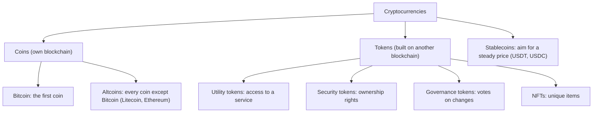
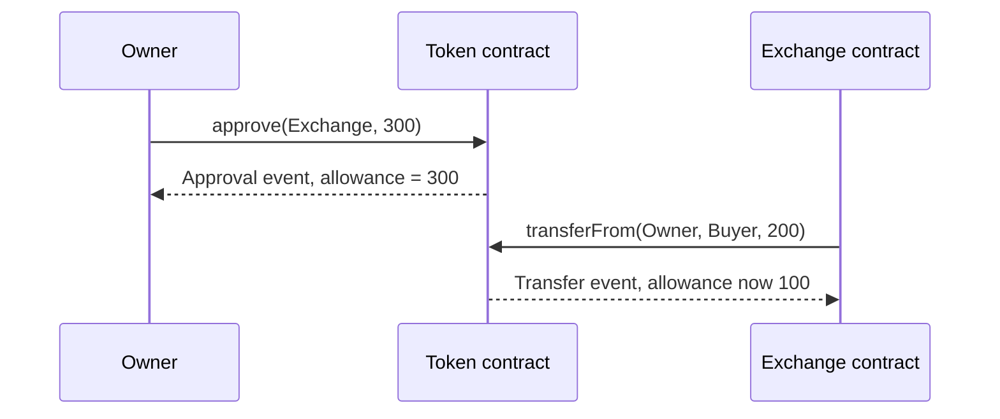
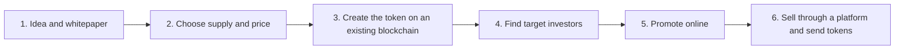
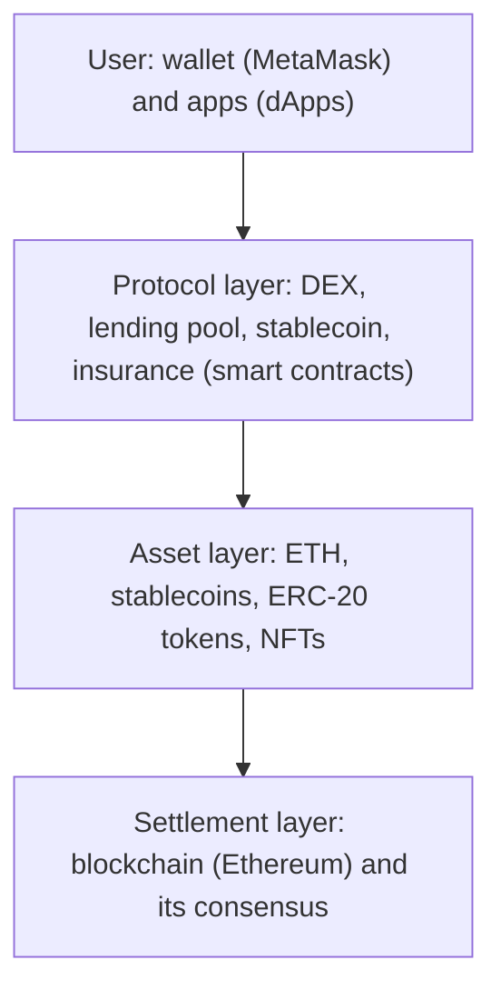

This note covers syllabus <Syl m="5" />, section 5.1: cryptocurrency basics and types, ERC20 and ERC721 tokens and their comparison, ICO (basics, launch, pros and cons), STO, DeFi, the metaverse, and the types of cryptocurrency (Bitcoin, altcoin, utility and security tokens). Wallets, UTXO and double spending have their own note.

## The basics first

- A **blockchain** is a shared list of blocks copied on many computers, each block holding the hash of the one before it. <Cite id="blockchain-fundamentals-nakamoto" />
- A **smart contract** is a small program stored on a blockchain that runs exactly as written. Ethereum is the best-known blockchain that runs them. <Cite id="ethereum-whitepaper" />
- **Fungible** means "every unit is the same and can be swapped for another". A 100-rupee note is fungible: any note will do. A **non-fungible** thing is unique, like a signed cricket bat: you care which one you get. <Cite id="cryptocurrencies-tokens-me-ch10" />
- A **standard** is an agreed list of functions. If every token contract has the same functions, every wallet and exchange can handle it without extra work.

## What is a cryptocurrency

<Box kind="definition">

A **cryptocurrency** is a digital asset that uses a blockchain (a shared, cryptographically linked ledger) to record who owns what and to make transactions secure, without a bank or other central party. It is usually treated as a distinct asset class and not as ordinary money. <Cite id="cryptocurrencies-tokens-wiki-crypto" /> <Cite id="cryptocurrencies-tokens-gfg-coins-tokens" />

</Box>

**Why it is needed.** Online payments normally need a trusted middleman (a bank) to stop the same money being spent twice. Bitcoin showed in 2009 that a network of computers can do that job using cryptography and consensus. <Cite id="blockchain-fundamentals-nakamoto" /> <Cite id="cryptocurrencies-tokens-wiki-crypto" />

**How it works, in short.**

1. Your wallet holds a private key (a secret that lets you spend) and a public address (where others send coins).
2. You sign a transaction with the private key and broadcast it.
3. Nodes check it and miners or validators add it to a block.
4. The block is linked to the chain, so the record cannot be changed quietly. <Cite id="cryptocurrencies-tokens-wiki-crypto" />

**Usage.** Payments and transfers, saving or speculating, paying fees on a network, raising money (ICO), lending and trading (DeFi), and owning digital items (NFTs).

**Risks.** Prices swing a lot (in one week of May 2022 bitcoin lost about 20 percent and ether about 26 percent), scams and exchange failures happen, lost keys cannot be recovered, and all transactions are visible although owners are only pseudonymous. <Cite id="cryptocurrencies-tokens-wiki-crypto" />

<PYQ id="2024-12-ce/q3a" /> <PYQ id="2024-12/q1e" />

## Types of cryptocurrency

Sources group them in slightly different ways and the groups overlap (for example, a stablecoin can be a coin or a token). For the exam, use the grouping below and say that the groups overlap. <Cite id="cryptocurrencies-tokens-gfg-coins-tokens" />

<Cite id="cryptocurrencies-tokens-gfg-coins-tokens" loc="diagram" /> <Cite id="cryptocurrencies-tokens-wiki-crypto" loc="diagram" />

| Type | What it is | Examples |
| --- | --- | --- |
| Bitcoin | The first cryptocurrency, created in January 2009 by the pseudonymous Satoshi Nakamoto; works as peer-to-peer electronic cash, with proof of work. <Cite id="cryptocurrencies-tokens-wiki-crypto" /> <Cite id="blockchain-fundamentals-nakamoto" /> | BTC |
| Altcoins | "Alternative coins": any cryptocurrency other than bitcoin. Some copy bitcoin's design; Ethereum adds smart contracts. <Cite id="cryptocurrencies-tokens-wiki-crypto" /> | Litecoin (LTC), Bitcoin Cash (BCH), Ether (ETH), Cardano (ADA) |
| Smart contract coins | Coins that power a platform on which developers build decentralized apps. <Cite id="cryptocurrencies-tokens-gfg-coins-tokens" /> | ETH, ADA |
| Privacy coins | Hide who paid whom and how much. <Cite id="cryptocurrencies-tokens-gfg-coins-tokens" /> | Monero (XMR), Zcash (ZEC) |
| Stablecoins | Try to keep a steady value against a reference such as the US dollar. They are not always stable: Terra's UST lost its peg in May 2022. <Cite id="cryptocurrencies-tokens-wiki-stablecoin" /> | USDT, USDC |
| Memecoins | Coins born from internet jokes; very volatile and often used in scams. <Cite id="cryptocurrencies-tokens-wiki-crypto" /> | Dogecoin |
| Tokens | Assets made by a smart contract on an existing blockchain (see next section). <Cite id="cryptocurrencies-tokens-me-ch10" /> | USDC on Ethereum, BAT |

**Types of stablecoin.** Fiat-backed (reserves in dollars or treasury bills; most stablecoins), crypto-backed (other cryptocurrency as collateral) and algorithmic (no or partial reserves, supply is adjusted by a program). <Cite id="cryptocurrencies-tokens-wiki-stablecoin" />

<Box kind="exam">

If asked for "types of cryptocurrencies", write: Bitcoin, altcoins, stablecoins, and tokens (utility, security, payment, governance, NFT). Give one line and one example each, and draw the tree above.

</Box>

<PYQ id="2023-12/q5b" /> <PYQ id="2025-05/q2b" /> <PYQ id="2023-05-ce/q2b" /> <PYQ id="2025-05-ce/q2a" />

## Coins versus tokens

A **coin** runs on its own blockchain and is the native money of that chain (BTC on Bitcoin, ETH on Ethereum). A **token** does not have its own blockchain: it is a record kept by a smart contract on another chain, so anyone can create one without building a network. <Cite id="cryptocurrencies-tokens-gfg-coins-tokens" /> <Cite id="cryptocurrencies-tokens-me-ch10" />

| Point | Coin | Token |
| --- | --- | --- |
| Blockchain | Own | Built on another (e.g. Ethereum) |
| Made by | Protocol code and miners or validators | A smart contract anyone can deploy |
| Main use | Money, paying network fees | Access, ownership, voting, collectibles |
| Examples | BTC, ETH, LTC | USDC, UNI, NFTs |

### Kinds of token

- **Utility token:** gives access to a service or resource in an ecosystem, such as storage space or app features. <Cite id="cryptocurrencies-tokens-me-ch10" />
- **Security (equity) token:** works like a company share: ownership, voting or a share of profit, and it falls under securities law. <Cite id="cryptocurrencies-tokens-me-ch10" /> <Cite id="cryptocurrencies-tokens-gfg-security-token" />
- **Payment token:** used to pay for goods and services with fast settlement. <Cite id="cryptocurrencies-tokens-gfg-coins-tokens" />
- **Governance token:** the holder votes on changes to a protocol. <Cite id="cryptocurrencies-tokens-gfg-coins-tokens" />
- **NFT:** a unique token for one item. <Cite id="cryptocurrencies-tokens-eth-nft" />

The line is often blurred: many "utility" tokens are mainly bought for speculation, and regulators may treat a token as a security whatever it is called. <Cite id="cryptocurrencies-tokens-me-ch10" />

## ERC-20: fungible tokens

<Box kind="definition">

**ERC-20** is the Ethereum standard for fungible tokens: a standard list of functions and events that a token contract must provide, so that every unit is identical to every other and all wallets and exchanges can use the token in the same way. <Cite id="cryptocurrencies-tokens-eip20" /> <Cite id="cryptocurrencies-tokens-eth-erc20" />

</Box>

**Why it is needed.** Before the standard each token had its own function names, so each wallet and exchange needed custom code for each token. With ERC-20, one piece of code works for all tokens. <Cite id="cryptocurrencies-tokens-eth-erc20" />

**Functions** (the contract keeps a table of address to balance):

| Function | What it does |
| --- | --- |
| `totalSupply()` | Total number of tokens |
| `balanceOf(owner)` | Balance of an address |
| `transfer(to, value)` | Send your own tokens to another address |
| `approve(spender, value)` | Allow another address to spend up to `value` of your tokens |
| `allowance(owner, spender)` | How much the spender may still spend |
| `transferFrom(from, to, value)` | Spender moves tokens out of `from` using the allowance |
| `name()`, `symbol()`, `decimals()` | Optional: label, ticker and number of decimal places |

Events: `Transfer` and `Approval`. <Cite id="cryptocurrencies-tokens-eip20" /> <Cite id="cryptocurrencies-tokens-me-ch10" />

There are two ways to move tokens. **One step:** `transfer`. **Two steps:** the owner calls `approve`, then a contract (for example an exchange) calls `transferFrom`. <Cite id="cryptocurrencies-tokens-me-ch10" />

<Cite id="cryptocurrencies-tokens-eth-erc20" loc="diagram" /> <Cite id="cryptocurrencies-tokens-me-ch10" loc="diagram" />

**Examples and uses.** Stablecoins such as DAI, reward or reputation points, in-game items and tokenized shares. <Cite id="cryptocurrencies-tokens-eth-erc20" />

**Caution.** Tokens sent straight to a contract that cannot handle them can be lost for ever. <Cite id="cryptocurrencies-tokens-eth-erc20" />

## ERC-721: non-fungible tokens (NFTs)

<Box kind="definition">

**ERC-721** is the Ethereum standard for **non-fungible tokens**. Each token has a unique `tokenId`, is owned by exactly one address, and is not interchangeable with another token. <Cite id="cryptocurrencies-tokens-eip721" /> <Cite id="cryptocurrencies-tokens-eth-erc721" />

</Box>

- The contract keeps a table of `tokenId` to owner. The pair (contract address, `tokenId`) is globally unique. <Cite id="cryptocurrencies-tokens-eth-erc721" /> <Cite id="cryptocurrencies-tokens-me-ch10" />
- **Functions:** `balanceOf`, `ownerOf`, `transferFrom`, `safeTransferFrom`, `approve` (for one token), `setApprovalForAll` (for all of an owner's tokens), `getApproved`, `isApprovedForAll`. Events: `Transfer`, `Approval`, `ApprovalForAll`. <Cite id="cryptocurrencies-tokens-eth-erc721" />
- **Metadata** (name, symbol, `tokenURI` pointing to a description or image) is an optional extension. The big file is usually kept off-chain, and IPFS is recommended because one server can go offline. <Cite id="cryptocurrencies-tokens-eip721" /> <Cite id="cryptocurrencies-tokens-me-ch10" />
- **Uses:** digital art with royalties, game items, tickets, identity and domain names. <Cite id="cryptocurrencies-tokens-eth-nft" />

A third standard, **ERC-1155**, lets one contract hold fungible, non-fungible and semi-fungible tokens and move many in one call, which saves gas. <Cite id="cryptocurrencies-tokens-eip1155" /> <Cite id="cryptocurrencies-tokens-eth-erc1155" />

### ERC-20 versus ERC-721

| Point | ERC-20 | ERC-721 |
| --- | --- | --- |
| Type of token | Fungible: every unit identical | Non-fungible: each token unique |
| Identity | Only a balance per address | A `tokenId` per token, with an owner |
| Divisible | Yes, by `decimals` | No, whole tokens only |
| Key calls | `transfer`, `approve`, `allowance`, `transferFrom` | `ownerOf`, `safeTransferFrom`, `approve` (per token), `setApprovalForAll` |
| Contracts | One contract per token type | One contract holds many unique tokens |
| Typical use | Currencies, stablecoins, utility and governance tokens | Art, collectibles, tickets, game items |
| Example | USDC, DAI | Art and collectible NFTs |

<Cite id="cryptocurrencies-tokens-gfg-erc-vs" /> <Cite id="cryptocurrencies-tokens-eth-erc20" /> <Cite id="cryptocurrencies-tokens-eth-erc721" />

<Box kind="pitfall">

The GeeksforGeeks comparison table lists bitcoin as an ERC-20 example and says ERC-721 has built-in KYC. Both are wrong: bitcoin is a native coin on its own chain, and neither standard contains KYC (identity checks). Write the table above in the exam and read the GeeksforGeeks page only for extra examples. <Cite id="cryptocurrencies-tokens-gfg-erc-vs" /> <Cite id="cryptocurrencies-tokens-eip20" /> <Cite id="cryptocurrencies-tokens-eip721" />

</Box>

<PYQ id="2023-12/q1e" /> <PYQ id="2025-05/q1c" /> <PYQ id="2024-12/q4a" />

## ICO: initial coin offering

<Box kind="definition">

An **ICO** (initial coin offering, also called a token sale) is a way to raise money in which a project creates new digital tokens and sells them to the public, usually for ether, bitcoin or ordinary money. The tokens may give access to a product, a share in a network, or just be traded in the hope of profit. <Cite id="cryptocurrencies-tokens-wiki-ico" /> <Cite id="cryptocurrencies-tokens-gfg-ico" />

</Box>

**Why it is needed.** A new project needs money before it has a product. Instead of a bank loan or venture capital, it sells tokens straight to the crowd over the internet. Mastering Ethereum calls it a crowdfunding method. <Cite id="cryptocurrencies-tokens-me-ch10" />

**History in short.** Mastercoin held an early sale in 2013, Ethereum's 2014 sale raised about 31,000 bitcoin, and the boom came in 2016 and 2017. In July 2017 the US SEC concluded that tokens like The DAO's could be securities, China and South Korea banned ICOs in September 2017, and fundraising fell sharply after 2018. <Cite id="cryptocurrencies-tokens-wiki-ico" />

### Related terms

- **Whitepaper:** the document that explains the idea, the token, the team and the plan. <Cite id="cryptocurrencies-tokens-gfg-ico" />
- **Token supply and price:** how many tokens exist and what each costs.
- **Private ICO:** only chosen investors (such as big institutions) may join. **Public ICO:** anyone may. <Cite id="cryptocurrencies-tokens-gfg-ico" />
- **Three structures:** static supply and static price; static supply and dynamic price (price = money raised / supply); dynamic supply and static price (supply = money raised / price). <Cite id="cryptocurrencies-tokens-gfg-ico" />
- **Utility token versus security token:** a utility token gives access to a service; a security token gives ownership rights and is regulated. <Cite id="cryptocurrencies-tokens-me-ch10" />

### Launching an ICO

<Cite id="cryptocurrencies-tokens-gfg-ico" loc="diagram" />

1. **Set the concept:** purpose of the token, the problem it solves, and a whitepaper.
2. **Choose a structure:** fixed or variable supply and price.
3. **Create the token** on an existing blockchain (for Ethereum, an ERC-20 contract) and not a new chain.
4. **Identify target investors** and prepare material.
5. **Promote** through crypto sites and communities.
6. **Sell** through a platform that collects the money and gives tokens in return; sales may run in rounds. <Cite id="cryptocurrencies-tokens-gfg-ico" />

### Pros and cons of ICO

| Pros | Cons |
| --- | --- |
| Fast and simple fundraising with little paperwork | No formal audit or due diligence |
| Anyone in the world can invest at any time | Very volatile prices |
| Reaches a large audience online | Easy for scammers to copy; many investors cannot tell the difference |
| Transactions are recorded and traceable | Founders may face no personal risk |
| Can build a user base for decentralized apps | Tax and legal rules are unclear and differ by country |

<Cite id="cryptocurrencies-tokens-gfg-ico" /> <Cite id="cryptocurrencies-tokens-wiki-ico" />

**Evolution and platforms.** Many projects create their token as an ERC-20 contract on Ethereum, because a token needs only a short smart contract and no new blockchain. After the 2017 scrutiny, regulated alternatives such as the STO developed. <Cite id="cryptocurrencies-tokens-wiki-ico" /> <Cite id="cryptocurrencies-tokens-me-ch10" />

### ICO versus IPO

An **IPO** (initial public offering) is when a company sells its shares to the public for the first time and lists them on a stock exchange, after hiring underwriters (investment banks) and publishing a prospectus approved by a regulator. <Cite id="cryptocurrencies-tokens-wiki-ipo" />

| Point | IPO | ICO |
| --- | --- | --- |
| What is sold | Shares (ownership of a company) | Tokens (utility, or security tokens) |
| Who can issue | Established companies with audited records | Any new project with an idea |
| Regulation | Strictly regulated (SEC in the US) | Light, differs by country |
| Middlemen | Underwriters, exchange | Often none; a token platform |
| Time to raise money | Long: due diligence and filing | Quick |
| Trading | Stock exchange | Crypto exchanges |
| Investor protection | Strong: prospectus, disclosure | Weak; scam risk |
| Product | Usually an existing business | May have no finished product |

<Cite id="cryptocurrencies-tokens-gfg-ico" /> <Cite id="cryptocurrencies-tokens-wiki-ipo" />

**Pros and cons of IPO.** Pros: large amounts of equity capital, a wide investor pool and easy trading of shares. Cons: high banking and legal costs, ongoing disclosure, and a wrong issue price (too low leaves money on the table, too high makes the share fall). <Cite id="cryptocurrencies-tokens-wiki-ipo" />

<PYQ id="2025-05/q5b" /> <PYQ id="2024-12/q4a" />

## STO: security token offering

<Box kind="definition">

A **security token offering (STO)** is a token sale where the tokens are **securities**: they represent ownership or rights in an asset or business (for example shares, profit share or real estate), so the sale follows securities law, like an IPO but with blockchain tokens. <Cite id="cryptocurrencies-tokens-gfg-security-token" /> <Cite id="cryptocurrencies-tokens-gfg-coins-tokens" />

</Box>

- **Why it appeared:** after the 2017 warnings, many ICO tokens were judged to be securities. The STO is the regulated route. <Cite id="cryptocurrencies-tokens-wiki-ico" />
- **How to tell a security:** in the USA the usual test is the **Howey test**, from a 1946 Supreme Court case. A contract is an investment contract if there is an investment of money, in a common enterprise, with an expectation of profit, that depends on the efforts of someone else. <Cite id="cryptocurrencies-tokens-wiki-howey" />
- **Issuers must** register or qualify for an exemption and may need to identify buyers; traders may need to follow national rules. <Cite id="cryptocurrencies-tokens-gfg-security-token" />
- **Example:** a tokenized share of a building that pays its holders part of the rent.

| Point | ICO | STO |
| --- | --- | --- |
| Token | Usually utility | Security (ownership or profit rights) |
| Law | Light or unclear | Securities law applies |
| Investor protection | Low | Higher |
| Time to launch | Fast | Slower (compliance) |

<Cite id="cryptocurrencies-tokens-gfg-ico" /> <Cite id="cryptocurrencies-tokens-gfg-security-token" /> <Cite id="cryptocurrencies-tokens-wiki-howey" />

<PYQ id="2024-12/q4a" />

## DeFi: decentralized finance

<Box kind="definition">

**DeFi** is a set of financial services (lending, borrowing, trading, saving, payments, insurance) built on a public blockchain such as Ethereum, where **smart contracts**, and not banks or brokers, run the service. Anyone with an internet connection can use it. <Cite id="smart-contracts-eth-defi" /> <Cite id="smart-contracts-wiki-defi" />

</Box>

**Why it is needed.** Traditional finance needs trusted institutions, opening hours, paperwork and days to settle, and some people cannot get an account at all. DeFi replaces the institution with code that anyone can inspect. <Cite id="smart-contracts-eth-defi" />

**Traditional finance versus DeFi.**

| Point | Traditional finance | DeFi |
| --- | --- | --- |
| Who holds your money | Bank or company | You (your wallet) |
| Hours | Business hours | Always on |
| Settlement | Days | Minutes |
| Access | Account, identity checks | Wallet and internet |
| Transparency | Records are closed | Code and transactions can be inspected |

<Cite id="smart-contracts-eth-defi" />

### Architecture of DeFi

DeFi is built in layers, and each layer can be reused by the ones above it, so people call the pieces "money Legos". <Cite id="smart-contracts-wiki-defi" />

<Cite id="smart-contracts-wiki-defi" loc="diagram" /> <Cite id="smart-contracts-eth-defi" loc="diagram" />

### Main DeFi services

- **Lending and borrowing:** lenders put tokens in a pool and earn interest, borrowers post collateral. A **flash loan** is borrowed and repaid within one transaction. <Cite id="smart-contracts-eth-defi" /> <Cite id="smart-contracts-wiki-defi" />
- **Decentralized exchanges (DEX):** swap tokens directly from your wallet, often through automated market maker pools. <Cite id="smart-contracts-wiki-defi" />
- **Stablecoins:** steady-value tokens such as Dai and USDC, used as the "money" of DeFi. <Cite id="smart-contracts-eth-defi" />
- **Other:** payments, streaming wages, tokenized index funds, crowdfunding and insurance. <Cite id="smart-contracts-eth-defi" />

### Role of smart contracts in DeFi

A smart contract holds the rules and the funds: it checks the collateral, calculates interest, swaps tokens and pays out, automatically and the same way for everyone. This removes the middleman and settles quickly, and because contracts are public, they can be audited. A bug in the contract, however, can lose funds, and blockchain transactions are usually irreversible. <Cite id="smart-contracts-eth-defi" /> <Cite id="smart-contracts-wiki-defi" />

### Benefits and risks

| Benefits | Risks |
| --- | --- |
| Access for people without bank accounts | Coding errors and hacks; transfers cannot be undone |
| You control your own funds | Volatile collateral can lose value fast |
| Open, inspectable code | Scams such as rug pulls (developers vanish with the funds) |
| Fewer fees and delays | Rules are unclear and many "decentralized" apps still have admin controls |

<Cite id="smart-contracts-eth-defi" /> <Cite id="smart-contracts-wiki-defi" />

<PYQ id="2025-05/q6a" /> <PYQ id="2023-12-ce/q6d" /> <PYQ id="2023-05-ce/q6d" /> <PYQ id="2024-05-ce/q6a" />

## Metaverse and blockchain

<Box kind="definition">

A **metaverse** is a shared virtual world, usually 3D, where users appear as avatars and take part in social and economic activity. The word comes from Neal Stephenson's 1992 novel *Snow Crash*. <Cite id="cryptocurrencies-tokens-wiki-metaverse" /> <Cite id="cryptocurrencies-tokens-gfg-metaverse" />

</Box>

**Where blockchain fits.** A virtual world needs a way to say who owns what and to pay for things. Blockchain gives:

- **Ownership:** land, avatars and items are NFTs, with ownership recorded on a blockchain. A plot in Decentraland sold for 2.4 million dollars. <Cite id="cryptocurrencies-tokens-wiki-metaverse" /> <Cite id="cryptocurrencies-tokens-gfg-metaverse" /> <Cite id="cryptocurrencies-tokens-eth-nft" />
- **Money:** cryptocurrencies and tokens are the in-world currency; DeFi can add lending and trading. <Cite id="cryptocurrencies-tokens-wiki-metaverse" />
- **Portability:** items on Ethereum can in principle be used in other apps and not locked to one company. <Cite id="cryptocurrencies-tokens-eth-nft" />
- **Examples:** The Sandbox and Decentraland (NFT land), Illuvium (collectible NFT game). <Cite id="cryptocurrencies-tokens-gfg-metaverse" />

**Challenges.** Privacy and data collection, safety and addiction, unclear laws, costly hardware, and lack of common standards between platforms. <Cite id="cryptocurrencies-tokens-wiki-metaverse" /> <Cite id="cryptocurrencies-tokens-gfg-metaverse" />

<PYQ id="2023-12/q6c" />

## Worked sums

Past papers in this topic are theory, but the numbers below are the ones a question on ICO or tokens can ask. The numbers are made up.

**Sum 1: ICO with a fixed supply (price comes from money raised).**

<Sum>

<Given>

An ICO offers a fixed supply of 1,000,000 tokens. The sale raises 500,000 dollars in total. An investor puts in 2,000 dollars.

</Given>

<Find>

the price of one token, the investor's tokens, and the investor's share of the supply.

</Find>

<Steps>

1. Price per token = money raised / tokens for sale = 500,000 / 1,000,000 = 0.50 dollar. *Reason: with a fixed supply and an open sale, the price is set by how much money came in.*
2. Investor's tokens = money paid / price = 2,000 / 0.50 = 4,000 tokens. *Reason: each token costs the same price.*
3. Share of supply = 4,000 / 1,000,000 = 0.004 = 0.4 percent.

</Steps>

<Answer>

Price 0.50 dollar per token; the investor gets 4,000 tokens, which is 0.4 percent of the supply.

</Answer>

<Box kind="verify">

Multiply back: 4,000 tokens x 0.50 = 2,000 dollars, the amount paid. Also 1,000,000 x 0.50 = 500,000, the total raised.

</Box>

</Sum>

**Sum 2: ICO with a fixed price (supply comes from money raised).**

<Sum>

<Given>

The price is fixed at 0.25 dollar per token. The ICO raises 300,000 dollars. The soft cap (minimum needed) was 100,000 dollars.

</Given>

<Find>

how many tokens are created, and whether the soft cap is met.

</Find>

<Steps>

1. Tokens created = money raised / price = 300,000 / 0.25 = 1,200,000 tokens. *Reason: dividing by a quarter is the same as multiplying by 4, and 300,000 x 4 = 1,200,000.*
2. Compare with the soft cap: 300,000 is more than 100,000, so the cap is met and the sale goes ahead.

</Steps>

<Answer>

1,200,000 tokens are created; the soft cap is met.

</Answer>

<Box kind="verify">

1,200,000 tokens x 0.25 = 300,000 dollars, the money raised.

</Box>

</Sum>

**Sum 3: ERC-20 balances with approve and transferFrom.**

<Sum>

<Given>

A token has Asha with 1,000 tokens and Ravi with 50 tokens. Asha calls `approve(exchange, 300)`. The exchange then calls `transferFrom(Asha, Ravi, 200)`.

</Given>

<Find>

the balances of Asha and Ravi, the allowance left, and the total supply of these two.

</Find>

<Steps>

1. After `approve`: no tokens move. Allowance(Asha, exchange) = 300. *Reason: approve only sets the permission.*
2. `transferFrom` of 200 is allowed because 200 is not more than 300.
3. Asha: 1,000 - 200 = 800. Ravi: 50 + 200 = 250.
4. Allowance left = 300 - 200 = 100. *Reason: each use reduces the allowance.*

</Steps>

<Answer>

Asha 800, Ravi 250, allowance left 100, total of the two 1,050.

</Answer>

<Box kind="verify">

Before: 1,000 + 50 = 1,050. After: 800 + 250 = 1,050, so no tokens were created or destroyed. A second `transferFrom` of 150 would fail because 150 is more than the 100 left.

</Box>

</Sum>

## Conclusion

Cryptocurrencies are blockchain-based digital assets, from Bitcoin to altcoins, stablecoins and tokens. Tokens follow standards: ERC-20 for identical, divisible units and ERC-721 for unique ones. ICOs and STOs let projects raise money by selling tokens, with the STO following securities law. DeFi and the metaverse build whole financial and social systems on these tokens, with smart contracts doing the work and code bugs and weak regulation as the main risks.
