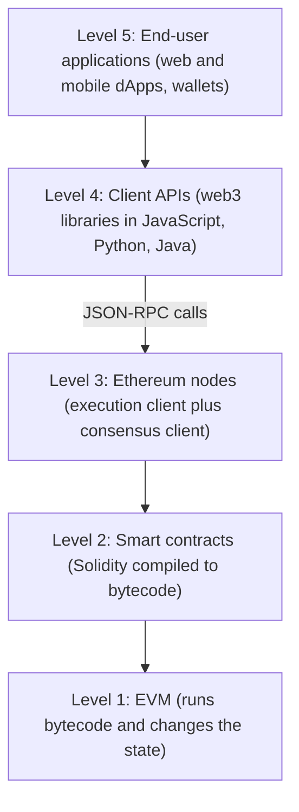
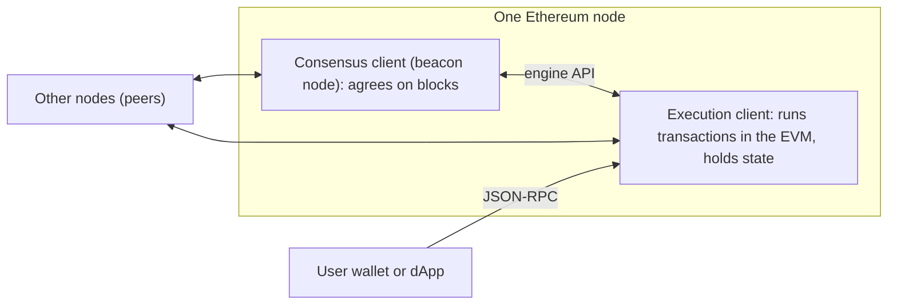
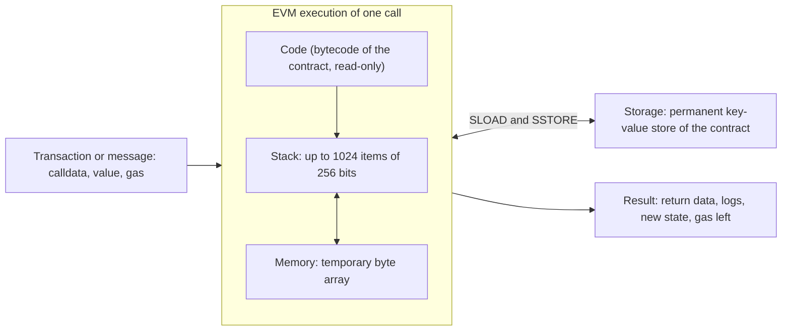
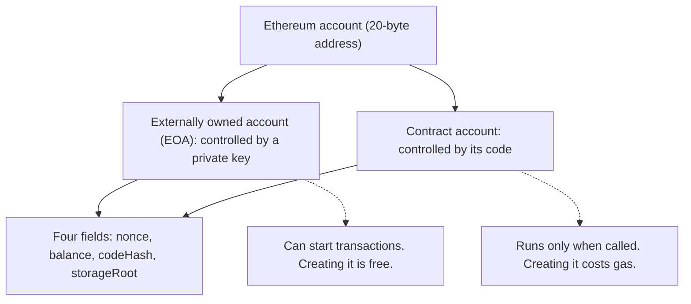
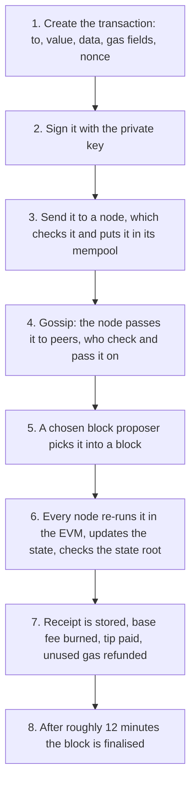
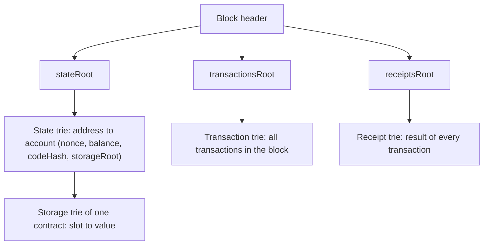
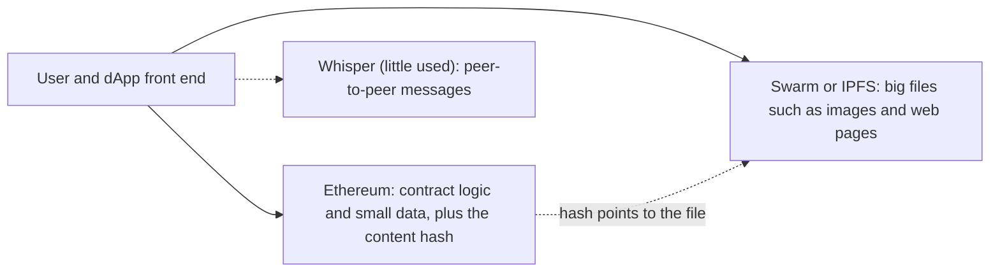
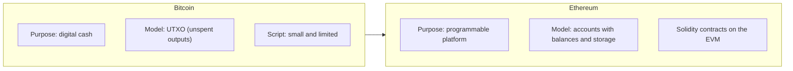

Ye note syllabus <Syl m="3" /> ke part 3.1 ko cover karta hai: history, components, architecture, consensus, miner aur mining node, EVM, ether, gas, transactions, accounts, Patricia Merkle tree, Swarm, Whisper aur IPFS, transaction ka poora flow, Ganache, Etherscan aur block structure, aur Bitcoin se comparison. Smart contracts aur Solidity ke alag notes hain.

## The basics first

- **Blockchain** blocks ki shared list hai, jo kai computers (**nodes**) pe copy hoti hai, aur har block mein pichle block ka hash hota hai. Bitcoin iska pehla bada example hai. <Cite id="blockchain-fundamentals-eth-intro" />
- **Hash** data ka fixed-size fingerprint hai. Ethereum Keccak-256 (256 bits) naam ka hash use karta hai. <Cite id="ethereum-eth-evm" />
- **Public key aur private key** ki jodi sign karne ke liye use hoti hai. Private key message sign karti hai, koi bhi public key se signature check kar sakta hai, aur private key ke bina forge nahi kar sakta.
- **State machine** wo system hai jo hamesha ek "state" mein rehta hai aur input aane par naye state mein jaata hai. Traffic light ek example hai. Ethereum ke state ko aise socho: "har account aur uska balance, plus har program aur uska data", aur transaction wo input hai jo ise badalta hai.
- **Smart contract** blockchain pe stored chhota program hai jo call hone par bilkul waise hi chalta hai jaise likha gaya hai.

Analogy: Bitcoin ek shared notebook jaisa hai jisme sab likhte hain "Asha ne Ravi ko 5 coins diye". Ethereum shared **computer** jaisa hai: notebook abhi bhi hai, par usme chhote programs (vending machine jaise) bhi rakhe ja sakte hain jinhe koi bhi use kar sakta hai aur koi band nahi kar sakta.

## What is Ethereum

<Box kind="definition">

**Ethereum** ek open, public blockchain platform hai jo global, shared computer chalata hai. Apni currency **ether (ETH)** ke saath ye smart contracts naam ke programs store aur execute kar sakta hai, isliye koi bhi bina central server ke decentralised applications (dApps) bana sakta hai. <Cite id="blockchain-fundamentals-eth-intro" /> <Cite id="ethereum-me-ch1" loc="What Is Ethereum?" />

</Box>

**Ye kyun zaroori tha.** Bitcoin ki scripting language jaanboojh kar chhoti rakhi gayi hai, to wo sirf simple spending conditions likh sakti hai. Jo developer zyada rich application chahta tha, use ya to Bitcoin mein ghusana padta, ya apna naya blockchain banana padta, apne network, rules aur consensus ke saath. Ethereum ek general-purpose blockchain deta hai jahan aap sirf application logic likhte ho. <Cite id="ethereum-me-ch1" loc="The Birth of Ethereum" /> <Cite id="ethereum-whitepaper" />

**Ledger versus state machine.** Bitcoin jaisa ledger transfers record karta hai aur simple rules lagata hai jaise "jitna mila usse zyada kharch nahi kar sakte". Ethereum ko behtar tareeke se distributed **state machine** kehte hain: iske state mein saare accounts aur balances plus contracts ka code aur data hota hai, aur code chalane wale rules state ko block se block badalte hain. <Cite id="ethereum-eth-evm" loc="From ledger to state machine" />

### History in short

| Year | Event |
| --- | --- |
| Late 2013 | Vitalik Buterin white paper mein Ethereum describe karte hain; Gavin Wood co-founder aur CTO ke roop mein judte hain; formal specification Yellow Paper hai. <Cite id="ethereum-whitepaper" /> <Cite id="ethereum-me-ch1" loc="The Birth of Ethereum" /> |
| 2014 | Crowdsale se development ko funding mili: logon ne bitcoin dekar ether kharida. <Cite id="ethereum-wiki-ethereum" /> |
| 30 Jul 2015 | **Frontier**: genesis block mine hua aur network shuru hua. <Cite id="ethereum-eth-history" /> |
| 14 Mar 2016 | **Homestead**: zyada stable, safer release. <Cite id="ethereum-eth-history" /> |
| Jun to Jul 2016 | "The DAO", ek bada investment contract, exploit hua. Community ne funds hatane ke liye hard fork kiya; jinhone fork reject kiya wo Ethereum Classic ke roop mein chalte rahe. <Cite id="ethereum-wiki-ethereum" /> <Cite id="ethereum-eth-history" /> |
| 2017 | **Metropolis** forks (Byzantium aur baad ke) ne block rewards kam kiye aur scaling ke tools jode. <Cite id="ethereum-eth-history" /> |
| 5 Aug 2021 | **London** ne EIP-1559 joda: burn hone wali base fee plus tip. <Cite id="ethereum-eth-history" /> |
| 15 Sep 2022 | **The Merge**: Ethereum proof of work se proof of stake pe gaya aur energy use 99 percent se zyada gira. <Cite id="consensus-mining-eth-merge" /> <Cite id="ethereum-wiki-ethereum" /> |

**Hard fork** protocol ka aisa upgrade hai jo backward compatible nahi hota, to har node ko update karna padta hai. <Cite id="ethereum-me-ch1" loc="Ethereum's Stages of Development" />

## Components of Ethereum

Jab question bole "explain the components of Ethereum", to neeche ke parts isi order mein describe karo. Ye Mastering Ethereum book ke standard blockchain parts hain, Ethereum ke liye bhare hue. <Cite id="ethereum-me-ch1" loc="Ethereum's Components" /> <Cite id="ethereum-gfg-components" />

| Component | What it is in Ethereum |
| --- | --- |
| Peer-to-peer (P2P) network | Hazaaron nodes jo seedhe ek-doosre se baat karte hain aur transactions aur blocks aage pass karte hain (main network TCP port 30303 aur DEVp2p protocol use karta hai). |
| Nodes and clients | Ek node do programs chalata hai: **execution client** (transactions EVM mein run karta hai aur state rakhta hai) aur **consensus client** (agle block pe agree karta hai). Examples: execution ke liye Geth aur Nethermind, consensus ke liye Prysm aur Lighthouse. |
| Accounts | System ke "log" aur "programs": EOAs aur contract accounts, har ek ka address. |
| Ether (ETH) | Native currency, fees dene aur staking collateral ke liye. |
| Transactions | EOA ke signed messages jo state badalte hain. |
| Gas | Computing ke kaam ki unit, ether mein pay hoti hai, taaki koi network overload na kar sake. |
| EVM | Virtual machine jo contract bytecode har node pe same tarah chalati hai. |
| Smart contracts | Solidity jaisi languages mein likhe programs jo EVM bytecode mein compile hote hain. |
| Data structures | State, transactions aur receipts **Merkle Patricia tries** mein rakhe jaate hain, jo local database (aksar LevelDB) mein store hote hain. |
| Consensus mechanism | Nodes next block pe kaise agree karte hain: 2022 tak proof of work (Ethash), ab proof of stake. |
| Storage and messaging helpers | Swarm aur IPFS (file storage) aur Whisper (messaging, ab kam use hota hai), jo poore "Web3" stack ka hissa banne ke liye the. |
| Tools | Wallets (jaise MetaMask), block explorers (Etherscan), test networks aur Ganache. |

<Cite id="ethereum-me-ch1" loc="Ethereum's Components" /> <Cite id="ethereum-gfg-components" />

<PYQ id="2023-12/q5a" /> <PYQ id="2024-12/q2b" /> <PYQ id="2025-05/q5a" />

## Architecture of Ethereum

Ethereum ko layers ki tarah samajhna sabse aasan hai. Neeche ki layers wo hain jo network karta hai; upar ki layers wo hain jo user dekhta hai. <Cite id="ethereum-eth-stack" />

<Cite id="ethereum-eth-stack" loc="diagram" /> <Cite id="ethereum-gfg-components" loc="diagram" />

Upar se neeche chalo:

1. **End-user application** ek normal web ya mobile app hai. User ko pata bhi nahi hota ki peeche blockchain hai.
2. Ye **client API library** (jaise JavaScript mein web3) use karke requests banata aur bhejta hai.
3. Library JSON-RPC interface se **Ethereum node** se judti hai. Us node ke through app data padh sakta hai (jaise balance) ya naya transaction broadcast kar sakta hai.
4. Node ke paas **blockchain aur state** hota hai aur wo peers ke saath network-wide agreement banaye rakhta hai.
5. **Smart contracts** chain pe stored programs hain, aur **EVM** unhe execute karta hai.

<Cite id="ethereum-eth-stack" />

### Inside the network: node ke do clients

<Cite id="ethereum-eth-nodes" loc="diagram" /> <Cite id="ethereum-me-ch1" loc="Components of a Blockchain" />

Execution client network mein aane wale naye transactions sunta hai, unhe EVM mein run karta hai aur latest state rakhta hai. Consensus client proof-of-stake algorithm chalata hai taaki network agree kare ki agla block kaunsa hoga. Ek teesra piece, **validator** software, consensus client mein jod sakte hain taaki node network ko secure karne mein madad kare. <Cite id="ethereum-eth-nodes" loc="What are nodes and clients" />

### Types of nodes

| Node | What it stores and does | Typical use |
| --- | --- | --- |
| **Full node** | Har block verify karta hai aur recent history rakhta hai (aam taur pe latest 128 blocks ka state); purana data prune ho jaata hai aur dobara bana sakte hain. | Network ka rozana chalna, doosron ko data dena. |
| **Archive node** | Full node jo kuch bhi delete nahi karta aur genesis se har past state rakhta hai. Terabytes chahiye. | Block explorers, analytics, "block 4,000,000 pe ye balance kya tha?" poochna. |
| **Light node** | Sirf block headers download karta hai aur baaki full nodes se maangta hai, jawab ko headers ke state roots se check karta hai. Validator nahi ban sakta. | Phones aur low-power devices. |

<Cite id="ethereum-eth-nodes" loc="Node types" />

<PYQ id="2023-12-ce/q1e" />

### Architecture and workflow in one view

"Architecture aur workflow explain karo" ka chhota answer: user wallet mein transaction sign karta hai, wallet use node ko bhejta hai, node check karke network mein gossip karta hai, ek block proposer use block mein daalta hai, har node use EVM mein dobara run karke resulting state root check karta hai, aur block finalise ho jaata hai. Poore aath steps neeche "Complete working of a transaction" mein diye hain.

<PYQ id="2022-12-ce/q4a" /> <PYQ id="2023-05-ce/q4a" /> <PYQ id="2023-12-ce/q3b" /> <PYQ id="2025-05-ce/q3b" />

## Consensus, miner and mining node

<Box kind="definition">

**Consensus** wo tareeka hai jisse hazaaron nodes, jo ek-doosre pe trust nahi karte, agree karte hain ki agla block kaunsa hai aur current state kya hai. **Miner** (ya **mining node**) wo computer tha jo transactions ko block mein collect karta tha aur block add karne ka haq paane ke liye proof-of-work puzzle solve karta tha. <Cite id="ethereum-eth-mining" loc="What is Ethereum mining" />

</Box>

**Proof of work (15 September 2022 tak).** Ethereum pehle **Ethash** naam ka proof-of-work algorithm use karta tha. Mining node ye karta tha: <Cite id="ethereum-me-ch1" loc="Ethereum's Components" /> <Cite id="ethereum-eth-mining" loc="How Ethereum transactions were mined" />

1. Signed transactions sunna aur unhe local waiting list (**mempool**) mein rakhna.
2. Kuch transactions chunna, sabse zyada fees wale lena par block gas limit ke andar rehna.
3. Har transaction check karna aur local EVM copy pe run karna; fees miner ko milti hain.
4. Block ka proof-of-work "certificate" banane ka kaam karna, phir finished block broadcast karna.
5. Doosre nodes certificate check karte hain, saare transactions dobara run karte hain aur dekhte hain ki unka resulting state miner ke claim kiye state se match karta hai; tabhi block add karte hain.

Mining naya ether issue karne ka bhi akela tareeka tha, aur miners hardware aur bijli pe paisa kharch karte the. Ethereum race haarne wale valid block ko bhi kam reward deta tha, jise **ommer** (uncle) block kehte hain, taaki dheemi connection wale chhote miners ko bhi kuch mile. <Cite id="ethereum-eth-mining" loc="Ommer (uncle) blocks" /> <Cite id="ethereum-whitepaper" loc="Modified GHOST Implementation" />

**Proof of stake (The Merge ke baad).** Mining band ho chuki hai. Ab **validators** 32 ETH deposit ki tarah lock (stake) karte hain. Time ko 12-second ke **slots** mein kata gaya hai; har slot mein ek validator random choose hota hai jo **block proposer** banta hai aur block banata hai, jabki baaki validators use check karke vote (attest) karte hain. Cheating karte pakda gaya validator apna stake ka kuch ya poora hissa kho deta hai. Agar ek slot ke liye do conflicting blocks aayein, to fork-choice rule wo block chunta hai jise sabse zyada staked ETH ka support ho. <Cite id="block-structure-merkle-eth-blocks" loc="Proof-of-stake protocol" /> <Cite id="consensus-mining-eth-pos" />

| | Miner (proof of work) | Validator (proof of stake) |
| --- | --- | --- |
| What you put in | Computing power aur bijli | 32 ETH deposit ki tarah locked |
| Who builds the next block | Jo miner puzzle pehle solve kare | Har slot ke liye random chuna gaya validator |
| Punishment for cheating | Kaam waste, reward nahi | Stake ka kuch ya poora hissa destroy (slashing) |
| Energy use | Bahut zyada | 99 percent se zyada kam |
| Status | 15 Sep 2022 ko khatam | Current |

<Cite id="block-structure-merkle-eth-blocks" loc="Proof-of-stake protocol" /> <Cite id="ethereum-wiki-ethereum" />

<Box kind="pitfall">

Bahut se purane GeeksforGeeks aur Javatpoint pages ab bhi kehte hain ki Ethereum proof of work use karta hai aur block time 14 se 15 seconds batate hain. Ye The Merge se pehle sach tha. Aaj proof of stake mein blocks 12-second slots mein aate hain. Exam mein dono likho: "originally PoW, now PoS". <Cite id="bitcoin-gfg-bitcoin-vs-ethereum" />

</Box>

<PYQ id="2024-12-ce/q4a" />

## Ether

<Box kind="definition">

**Ether (ETH)** Ethereum ki native cryptocurrency hai. Ye gas (fees) pay karne aur collateral ki tarah stake karne ke kaam aati hai. <Cite id="ethereum-eth-ether" />

</Box>

- Fees **gwei** mein bataayi jaati hain, jo chhoti unit hai: 1 gwei = 10^-9 ETH (ek arabwan hissa). Sabse chhoti unit **wei** hai: 1 ETH = 10^18 wei, to 1 gwei = 10^9 wei. <Cite id="ethereum-eth-gas" loc="What is gas" /> <Cite id="ethereum-eth-accounts" loc="An account examined" />
- Bitcoin ke fixed 21 million coins ke ulat, ETH ka **koi fixed cap nahi** hai: naya ETH validators ko issue hota hai, aur har fee ka ek hissa burn hota hai, to supply badh ya ghat sakti hai. <Cite id="ethereum-eth-ether" /> <Cite id="ethereum-wiki-ethereum" />

| Unit | Value in wei | Value in ETH |
| --- | --- | --- |
| wei | 1 | 10^-18 |
| gwei | 10^9 | 10^-9 |
| ether | 10^18 | 1 |

## The Ethereum Virtual Machine (EVM)

<Box kind="definition">

**Ethereum Virtual Machine (EVM)** wo software engine hai jo har Ethereum node pe chalta hai aur smart contract bytecode ko har jagah same tarah execute karta hai. Ye har step ka kaam gas mein naapta hai. <Cite id="ethereum-eth-evm" /> <Cite id="ethereum-gfg-evm" />

</Box>

**Ye kyun zaroori hai.** Alag-alag nodes alag hardware aur operating system pe chalte hain, phir bhi unhe bilkul same result chahiye. Virtual machine neeche ke computer ko chhupa deti hai, jaise Java Virtual Machine Java ke liye karti hai, isliye same bytecode har jagah same result deta hai. EVM ke andar gas program ko hamesha chalne se rokta hai. <Cite id="ethereum-eth-evm" /> <Cite id="block-structure-merkle-me-ch14" loc="What Is the EVM?" />

**Ye kaise kaam karta hai.** EVM mathematical function ki tarah behave karta hai. Formal roop mein Ethereum state transition function ye hai:

`Y(S, T) = S'`

Matlab: purana valid state `S` aur valid transactions ki list `T` di jaaye, to EVM naya valid state `S'` banata hai. Same input hamesha same output deta hai (ise **deterministic** kehte hain), isiliye saare nodes agree kar paate hain. <Cite id="ethereum-eth-evm" loc="The Ethereum state transition function" />

1. Developer Solidity jaisi language mein contract likhta hai, jise compiler **bytecode** mein badal deta hai.
2. Bytecode contract-creation transaction se chain pe rakha jaata hai.
3. Jab koi contract ko transaction bhejta hai, har node apna EVM instance shuru karta hai, contract ka code aur storage load karta hai, aur use gas supply deta hai.
4. EVM code ko ek-ek **opcode** (basic instruction) karke chalata hai, jaise `ADD`, `AND`, `SSTORE`, aur har ek pe gas kaat leta hai.
5. Agar khatam ho gaya, to state ke changes rakhe jaate hain. Agar gas khatam ho gaya ya error aaya, to uske saare changes wapas (revert) ho jaate hain, par use hua gas phir bhi pay karna padta hai.

<Cite id="ethereum-gfg-evm" /> <Cite id="ethereum-sol-intro" loc="The Ethereum Virtual Machine" /> <Cite id="block-structure-merkle-me-ch14" loc="Gas Accounting During Execution" />

<Cite id="ethereum-eth-evm" loc="diagram" /> <Cite id="ethereum-sol-intro" loc="diagram" /> <Cite id="ethereum-gfg-evm" loc="diagram" />

### The data areas of the EVM

| Area | What it is | Lasts for |
| --- | --- | --- |
| **Stack** | Last-in-first-out dher. 1024 items tak, har item 256-bit word; sirf top ke 16 seedhe reach ho sakte hain. | One call |
| **Memory** | Temporary byte array, har message call ke liye saaf hoti hai; zyada lene pe zyada gas lagta hai. | One call |
| **Storage** | 256-bit words ka key-value store jo contract ka hai aur global state ka hissa hai. Sabse mehenga area. | Permanent |
| **Transient storage** | Per-transaction store (opcodes `TSTORE` aur `TLOAD`) jo transaction ke end pe saaf ho jaata hai. | One transaction |
| **Logs** | Events ke liye indexed records; contract likh sakta hai par wapas padh nahi sakta. | Permanent on chain |

<Cite id="ethereum-eth-evm" loc="EVM instructions" /> <Cite id="ethereum-sol-intro" loc="The Ethereum Virtual Machine" />

256-bit word size isliye chuna gaya ki ye 256-bit cryptography jaise Keccak-256 hashes aur secp256k1 signatures se match karta hai. <Cite id="ethereum-eth-evm" loc="EVM instructions" /> EVM design mein **Turing-complete** hai (lagbhag kuch bhi compute kar sakta hai) par gas ise *quasi*-Turing-complete bana deta hai: ye sirf wahi program chala sakta hai jo diye gaye gas ke andar khatam ho jaaye. <Cite id="block-structure-merkle-me-ch14" loc="Turing Completeness and Gas" />

<PYQ id="2024-05-ce/q6c" /> <PYQ id="2025-05-ce/q6a" />

## Gas

<Box kind="definition">

**Gas** wo unit hai jo naapti hai ki Ethereum pe kisi operation ko kitna computing kaam chahiye. Aap jo fee dete ho wo gas used ko price per unit of gas se guna karke banti hai. <Cite id="ethereum-eth-gas" loc="What is gas" />

</Box>

**Ye kyun zaroori hai.** Har node ko har transaction run karna padta hai, to computing power shared resource hai. Price ke bina koi network ko bekaar kaam se bhar sakta hai ya infinite loop wala program likh sakta hai. Gas spam ko mehenga banata hai aur EVM ko wo program rokne deta hai jo pay kiye gas se zyada use kare. <Cite id="ethereum-eth-gas" loc="Why do gas fees exist" /> <Cite id="block-structure-merkle-me-ch14" loc="What Is Gas" />

**Gas costs ke examples** (Yellow Paper se, Mastering Ethereum mein quote kiye): do numbers jodne ka 3 gas, Keccak-256 hash ka 30 gas plus har 256 bits ke liye 6, aur transaction bhejne ka 21,000 gas. <Cite id="block-structure-merkle-me-ch14" loc="What Is Gas" />

**Jaanne wale terms.**

- **Gas limit (of a transaction):** is transaction ko kitna zyada se zyada gas use karne dete ho. Agar kaam ko zyada chahiye, to wo ruk jaata hai, changes undo ho jaate hain, aur gas phir bhi kharch ho jaata hai.
- **Block gas limit:** ek block ke saare transactions milke kitna zyada se zyada gas use kar sakte hain. Block ka target size iska aadha hota hai. <Cite id="ethereum-eth-gas" loc="Block size" />
- **Base fee:** protocol dwara set price per gas, har block ke liye alag, jo **burn** (destroy) ho jaati hai. Full block ke baad ye 12.5 percent tak badhti hai aur empty block ke baad 12.5 percent tak ghatti hai. <Cite id="ethereum-eth-gas" loc="Base fee" />
- **Priority fee (tip):** block proposer ko di jaane wali extra price per gas, taaki wo aapka transaction pehle chune.
- **Max fee (`maxFeePerGas`):** price per gas jo aap zyada se zyada dene ko ready ho. Base fee plus tip se upar jo bacha wo refund hota hai.

<Cite id="ethereum-eth-gas" loc="How are gas fees calculated" />

Formulas, pehle words mein: gas ki har unit ke liye aap base fee plus tip dete ho, aur fee wahi price guna actual use hua gas hai. Bacha hua gas wapas milta hai. <Cite id="ethereum-eth-gas" loc="How are gas fees calculated" />

`fee = gas used x (base fee + priority fee)`

`gas cost x gas price` wahi baat purane tareeke se kehta hai (Mastering Ethereum: "transaction fee = total gas used x gas price paid"). <Cite id="block-structure-merkle-me-ch14" loc="Gas cost versus gas price" />

`refund = (gas limit - gas used) x gas price`

<Sum>

<Given>

Plain ether transfer 21,000 gas use karta hai. Base fee 10 gwei hai aur sender 2 gwei ki tip jodta hai. Sender 1 ETH transfer karta hai.

</Given>

<Find>

total fee, jo hissa burn hota hai, validator ko milne wali tip, aur sender se liya gaya total ether.

</Find>

<Steps>

1. Price per gas = base fee + tip = $10 + 2 = 12$ gwei. *Reason: sender gas ki har unit ke liye dono hisse deta hai.*
2. Total fee = gas used x price = $21{,}000 \times 12 = 252{,}000$ gwei.
3. Ether mein badlo: 1 gwei = $10^{-9}$ ETH, to $252{,}000 \times 10^{-9} = 0.000252$ ETH.
4. Burn hua hissa = $21{,}000 \times 10 = 210{,}000$ gwei $= 0.00021$ ETH. *Reason: sirf base fee burn hoti hai.*
5. Validator ko tip = $21{,}000 \times 2 = 42{,}000$ gwei $= 0.000042$ ETH.
6. Sender se total liya = value + fee = $1 + 0.000252 = 1.000252$ ETH. Receiver ko exactly 1 ETH milta hai.

</Steps>

<Answer>

Fee $= 0.000252$ ETH, jisme se $0.00021$ ETH burn hota hai aur $0.000042$ ETH validator ko jaata hai. Sender $1.000252$ ETH khota hai.

</Answer>

<Box kind="verify">

Burned + tip $= 0.00021 + 0.000042 = 0.000252$ ETH, total fee ke barabar. Wei mein: $252{,}000$ gwei $\times 10^9 = 2.52 \times 10^{14}$ wei, aur $2.52 \times 10^{14} / 10^{18} = 0.000252$ ETH. Ye ethereum.org ke gas page ka example hai. <Cite id="ethereum-eth-gas" loc="How are gas fees calculated" />

</Box>

</Sum>

<Sum>

<Given>

Ek transaction ka gas limit 50,000 hai aur gas price 20 gwei (base fee plus tip dono milake). Simple transfer sirf 21,000 gas use karta hai.

</Given>

<Find>

shuru mein roka gaya amount, actually pay hui fee, aur refund, sab ETH mein.

</Find>

<Steps>

1. Shuru mein roka = gas limit x price = $50{,}000 \times 20 = 1{,}000{,}000$ gwei $= 0.001$ ETH. *Reason: sender ko worst case cover karna aana chahiye.*
2. Actually pay hui fee = gas used x price = $21{,}000 \times 20 = 420{,}000$ gwei $= 0.00042$ ETH.
3. Unused gas = $50{,}000 - 21{,}000 = 29{,}000$.
4. Refund = $29{,}000 \times 20 = 580{,}000$ gwei $= 0.00058$ ETH.

</Steps>

<Answer>

Roka $0.001$ ETH, fee $0.00042$ ETH, refund $0.00058$ ETH.

</Answer>

<Box kind="verify">

Fee + refund $= 0.00042 + 0.00058 = 0.001$ ETH, jo shuru mein roke gaye amount ke barabar hai. Gas page yahi baat kehta hai: simple transfer ke liye limit 50,000 ho to EVM 21,000 use karta hai aur baaki 29,000 wapas kar deta hai. <Cite id="ethereum-eth-gas" loc="What is the gas limit" />

</Box>

</Sum>

<Sum>

<Given>

Ethereum whitepaper ka example (purane fee rules, ek hi price per gas). Ek transaction contract ko 10 ether bhejta hai, gas limit 2000 aur gas price 0.001 ether ke saath. Data 170 bytes ka hai aur har byte ka 5 gas lagta hai. Contract code chalane mein 187 gas lagta hai.

</Given>

<Find>

miner ke paas rehne wali fee aur sender ka total ether loss.

</Find>

<Steps>

1. Shuru mein roka = $2000 \times 0.001 = 2$ ether. *Reason: gas limit guna gas price.*
2. Data ka gas = $170 \times 5 = 850$, to bacha gas = $2000 - 850 = 1150$.
3. Code chalane ke baad bacha gas = $1150 - 187 = 963$.
4. Refund = $963 \times 0.001 = 0.963$ ether.
5. Rakhi gayi fee = roka minus refund $= 2 - 0.963 = 1.037$ ether.
6. Sender ka total loss = value + fee $= 10 + 1.037 = 11.037$ ether. Contract ko 10 ether milte hain.

</Steps>

<Answer>

Fee $= 1.037$ ether. Sender $11.037$ ether khota hai aur contract $10$ ether paata hai.

</Answer>

<Box kind="verify">

Gas used se check karo: $(850 + 187) = 1037$ gas, aur $1037 \times 0.001 = 1.037$ ether, wahi fee. Saath mein $10 + 2 - 0.963 = 11.037$. <Cite id="ethereum-whitepaper" loc="Ethereum State Transition Function" />

</Box>

</Sum>

<Sum>

<Given>

Ek block mein base fee 100 gwei hai. Agle teen blocks bilkul full hain (gas limit tak pahunchte hain). Full block ke baad base fee 12.5 percent badhti hai.

</Given>

<Find>

teeno blocks ke baad base fee, aur teesre ke baad 21,000-gas transfer ka base-fee hissa.

</Find>

<Steps>

1. Block 1 ke baad: $100 \times 1.125 = 112.5$ gwei. *Reason: +12.5 percent matlab 1.125 se guna.*
2. Block 2 ke baad: $112.5 \times 1.125 = 126.5625 \approx 126.6$ gwei.
3. Block 3 ke baad: $126.5625 \times 1.125 = 142.3828 \approx 142.4$ gwei.
4. Transfer ka base-fee hissa = $21{,}000 \times 142.3828 \approx 2{,}990{,}039$ gwei.
5. Ether mein: $2{,}990{,}039 \times 10^{-9} \approx 0.00299$ ETH.

</Steps>

<Answer>

Base fee: 112.5, 126.6, 142.4 gwei. Teesre block ke baad transfer ka base fee lagbhag $0.00299$ ETH.

</Answer>

<Box kind="verify">

ethereum.org ki table full-block run ke liye wahi series deti hai (112.5, 126.6, 142.4). Saath mein $1.125^3 = 1.4238$, to $100 \times 1.4238 = 142.38$. <Cite id="ethereum-eth-gas" loc="Base fee" />

</Box>

</Sum>

<PYQ id="2024-05-ce/q1a" /> <PYQ id="2024-12-ce/q4a" />

## Accounts

<Box kind="definition">

**Ethereum account** ek entity hai jiske paas ether balance hota hai aur jo Ethereum pe messages bhej sakti hai. Accounts ya to private key wale insaan se control hote hain, ya smart contracts ke roop mein deploy hote hain. Saare accounts milke **state** banate hain. <Cite id="ethereum-eth-accounts" /> <Cite id="ethereum-whitepaper" loc="Ethereum Accounts" />

</Box>

<Cite id="ethereum-eth-accounts" loc="diagram" /> <Cite id="ethereum-gfg-components" loc="diagram" />

### The four fields

| Field | Meaning |
| --- | --- |
| `nonce` | Counter. EOA ke liye ab tak bheje transactions ki ginti; contract ke liye usne kitne contracts banaye. Ye same signed transaction ko dobara chalne se rokta hai. |
| `balance` | Owned ether ki matra, wei mein. |
| `codeHash` | Contract ke EVM code ka hash (code badla nahi ja sakta). EOA ke liye khaali data ka hash. |
| `storageRoot` | Contract ke storage wale Merkle Patricia trie ka root hash. Default mein khaali. |

<Cite id="ethereum-eth-accounts" loc="An account examined" />

### EOA versus contract account

| Point | Externally owned account (EOA) | Contract account |
| --- | --- | --- |
| Controlled by | Private key (insaan ya wallet) | Apna khud ka code |
| Created by | Key pair generate karke (free) | Contract deploy karke (gas lagta hai, kyunki storage use hota hai) |
| Can start a transaction | Haan | Nahi; call hone ke baad hi messages bhejta hai |
| Has code | Nahi | Haan |
| Typical use | Aapka MetaMask wallet | Token, voting contract, exchange |

<Cite id="ethereum-eth-accounts" loc="Key differences" /> <Cite id="ethereum-gfg-components" />

EOA ka address uski public key ke Keccak-256 hash ke last 20 bytes lekar aage `0x` lagake banta hai, jisse kul 42 characters hote hain. <Cite id="ethereum-eth-accounts" loc="Account creation" /> Dono types ETH aur tokens receive, hold aur send kar sakte hain aur contracts se interact kar sakte hain. <Cite id="ethereum-eth-accounts" loc="Account types" />

<PYQ id="2023-12/q1c" /> <PYQ id="2024-12-ce/q4a" />

## Transactions

<Box kind="definition">

**Transaction** externally owned account ka cryptographically signed instruction hai jo Ethereum state badalne ko kehta hai: ether bhejna, contract call karna, ya contract create karna. <Cite id="ethereum-eth-transactions" /> <Cite id="ethereum-me-ch6" />

</Box>

Sirf transaction hi state badal sakta hai, to Ethereum tabhi "tick" karta hai jab transactions aate hain. <Cite id="ethereum-me-ch6" />

**Transaction ke fields.** <Cite id="ethereum-eth-transactions" loc="What's a transaction" />

| Field | Meaning |
| --- | --- |
| `from` | Sender (EOA hona chahiye; wahi transaction sign karta hai) |
| `to` | Receiver: EOA (value transfer) ya contract (uska code chalta hai); contract creation mein khaali |
| `value` | Bheja jaane wala ETH, wei mein |
| `nonce` | Sender ka transaction counter |
| `signature` | Sender ki private key se bana proof ki sender ne ise approve kiya |
| `input data` | Optional data, jaise kaunsa contract function call karna hai aur uske arguments |
| `gasLimit` | Transaction zyada se zyada kitna gas use kar sakta hai |
| `maxPriorityFeePerGas` | Validator ko di jaane wali zyada se zyada tip per gas |
| `maxFeePerGas` | Sender zyada se zyada total price per gas kitna dega |

**Teen tarah ke use:** accounts ke beech simple **value transfer**, **contract call** (`to` contract hai aur data function ka naam batata hai), aur **contract creation** (`to` nahi hota, data compiled code hota hai). <Cite id="ethereum-eth-evm" loc="Transactions" />

### Complete working of a transaction

<Cite id="ethereum-me-ch6" loc="Transaction Life Cycle" /> <Cite id="ethereum-eth-mining" loc="diagram" />

1. **Create.** User (wallet ke through) upar ke fields bharta hai.
2. **Sign.** Wallet private key se sign karta hai. Signed transaction proof hai ki sender ne approve kiya aur ise badla nahi ja sakta. Signature ke bina ye invalid hai.
3. **Send.** Signed transaction ek node ko jaata hai. Node spam hatane ke liye quick check karta hai, aur ise apne **mempool** mein rakhta hai.
4. **Propagate.** Node ise apne kuch peers ko deta hai, wo check karke store karte hain aur aage pass karte hain. Kuch seconds mein lagbhag saare nodes ke paas ye aa jaata hai. (Node bandwidth bachane ke liye sab peers ko nahi, kuch ko batata hai.)
5. **Include.** Agla block propose karne ke liye chuna gaya validator apne mempool se transactions leke block mein daalta hai.
6. **Execute.** EVM transaction run karta hai: signature aur nonce check karta hai, sender se maximum fee leta hai, value move karta hai, aur receiver contract ho to contract code chalata hai. Agar kuch fail ho (ether kam, gas khatam), to fee ke alawa saare changes revert ho jaate hain. Har doosra node yahi karta hai aur resulting state root ko block ke state root se compare karta hai.
7. **Settle.** Sender ko unused gas refund hota hai, base fee burn hoti hai, aur tip proposer ko jaati hai. **Receipt** (status, gas used, logs) record hoti hai.
8. **Finalise.** Block ko kabhi-kabhi kisi alag block se replace kiya ja sakta hai (reorg). Consensus protocol dwara finalise hone ke baad (aam taur pe lagbhag 12 minute) ise revert nahi kiya ja sakta. Wallets aksar "confirmed" bahut pehle dikha dete hain.

<Cite id="ethereum-me-ch6" loc="Transaction Life Cycle" /> <Cite id="ethereum-whitepaper" loc="Ethereum State Transition Function" /> <Cite id="ethereum-eth-gas" loc="How are gas fees calculated" />

<PYQ id="2024-12-ce/q4a" /> <PYQ id="2023-12-ce/q3b" />

## Patricia Merkle tree in Ethereum

Block-structure note wale **Merkle tree** se shuru karo: leaves data ke hashes hote hain, har parent apne children ka hash hota hai, aur sabse upar ka single hash (root) kisi bhi data ke badalne par badal jaata hai. Bitcoin ke transactions likhne ke baad kabhi nahi badalte, isliye wahan plain Merkle tree kaafi hai. <Cite id="block-structure-merkle-me-ch14" loc="Merkle-Patricia Trie" />

Par Ethereum ka state **lagatar badalta rehta hai** (balances, storage), aur ye key-value pairs ka bada set hai: address se account, slot se value. Isliye Ethereum teen ideas milata hai: <Cite id="block-structure-merkle-eth-mpt" />

- **Merkle:** har node apne content ke hash se pehchana jaata hai, to ek root hash poore data set ko represent karta hai.
- **Patricia (radix trie):** key root se value tak ke path mein likhi hoti hai, aur keys ke common shuruaati hisse sirf ek baar store hote hain. Ethereum trie mein ek node ke 16 tak children ho sakte hain (har hex digit ke liye ek). <Cite id="block-structure-merkle-me-ch14" loc="Merkle-Patricia trie in Ethereum" />
- **Trie** ("retrieval" se): aisa tree jo key se cheezein dhoondhne ke liye bana hai.

Result ko **modified Merkle Patricia trie** kehte hain. Ye saare accounts ko hashes se jodke rakhta hai aur ek single root hash tak reduce karta hai jo blockchain pe stored hota hai. <Cite id="ethereum-eth-evm" loc="State" />

Mastering Ethereum ka example: `car -> Schumacher` store karo. Key `car` hex mein `6 3 6 1 7 2` hai, to root se 6th child, phir 3rd, aise neeche value tak jaate ho. <Cite id="block-structure-merkle-me-ch14" loc="Merkle-Patricia trie in Ethereum" />

<Cite id="block-structure-merkle-me-ch14" loc="diagram" /> <Cite id="block-structure-merkle-eth-mpt" loc="diagram" />

| Trie | What it stores | Where its root is kept |
| --- | --- | --- |
| State trie | Har account | Block header ka `stateRoot` |
| Transaction trie | Block ke saare transactions | Header ka `transactionsRoot` |
| Receipt trie | Har transaction ka result | Header ka `receiptsRoot` |
| Storage trie | Ek smart contract ka data | Us account ke andar `storageRoot` |

<Cite id="block-structure-merkle-me-ch14" loc="Merkle-Patricia trie in Ethereum" />

**Ye kyun important hai.** (1) Ek 32-byte root poore state ko prove karta hai, to light node chhote proof se balance verify kar sakta hai. (2) Ek account badalne par sirf badli hui branch dobara hash hoti hai, to update sasta hai. (3) Alag nodes poore database ki jagah roots compare kar sakte hain. <Cite id="block-structure-merkle-eth-mpt" />

<PYQ id="2023-12/q2a" />

## Ethereum block structure and Etherscan

Block mein ek **header** (summary), **transactions** ki list, aur Shanghai upgrade ke baad validator **withdrawals** ki list hoti hai. Purani ommers list ab hamesha khaali hoti hai. <Cite id="block-structure-merkle-eth-yellow" loc="4.4 The Block" />

| Header field | Meaning |
| --- | --- |
| `parentHash` | Pichle block ke header ka hash (chain ka link yahi hai) |
| `stateRoot` | Is block ko run karne ke baad state trie ka root |
| `transactionsRoot` | Is block ke transactions ke trie ka root |
| `receiptsRoot` | Transaction receipts ke trie ka root |
| `logsBloom` | Event logs ka compact filter taaki unhe jaldi search kar sakein |
| `number` | Block number (genesis block 0 hai) |
| `gasLimit` and `gasUsed` | Is block mein zyada se zyada kitna gas allowed, aur actually kitna use hua |
| `timestamp` | Block banne ka time |
| `baseFeePerGas` | Har unit gas pe burn hone wali base fee (wei mein) |
| `beneficiary` (fee recipient) | Address jo priority fees receive karta hai |
| `prevRandao` | Validators chunne ke liye random value |
| `extraData` | 32 bytes tak ka free data |
| `withdrawalsRoot` | Withdrawals ke trie ka root |
| `ommersHash`, `difficulty`, `nonce` | Proof of work mein use hote the; ab fixed constants hain aur deprecated |

<Cite id="block-structure-merkle-eth-yellow" loc="4.4 The Block" /> <Cite id="block-structure-merkle-eth-blocks" loc="What's in a block" />

**Etherscan** ek independent block explorer hai: Ethereum blockchain ka search engine jahan aap transactions look up aur confirm kar sakte ho. Ye public ledger padhta hai aur use website pe dikhata hai, aur API bhi deta hai. Ye wallet nahi hai, keys nahi rakhta aur kisi transaction ko reverse nahi kar sakta. <Cite id="ethereum-etherscan-about" /> etherscan.io pe aap transaction hash, address ya block number paste karke upar bataye fields dekh sakte ho (sender, receiver, value, nonce, gas limit, gas used, gas price aur fee, block number, aur block ke liye uske header values jaise gas used, base fee aur fee recipient). Contract ke page pe uska code bhi dikhta hai agar owner ne use verify kiya ho.

## Swarm, Whisper and IPFS

Bade files ko Ethereum pe hi store karna bahut mehenga hai, kyunki har full node uski copy rakhta hai. Isliye Ethereum ko decentralised "Web3" ke teen parts mein se ek banana tha: computation ke liye **Ethereum**, storage ke liye **Swarm** aur messaging ke liye **Whisper**. <Cite id="ethereum-me-ch1" loc="Ethereum: A General-Purpose Blockchain" /> <Cite id="ethereum-eth-storage" />

<Cite id="ethereum-eth-storage" loc="diagram" /> <Cite id="ethereum-ipfs-docs" loc="diagram" />

| Name | What it is | Status |
| --- | --- | --- |
| **Swarm** | Decentralised storage network jo Ethereum ke saath kaam karne ke liye bana hai. Content ka address data ke hash se hota hai, location se nahi, aur storage ka payment incentive system se hota hai. <Cite id="ethereum-swarm-home" /> | Active |
| **IPFS** (InterPlanetary File System) | Open protocols ka set jo web pe data ko address, route aur transfer karta hai content addressing aur peer-to-peer networking se. Ye protocol hai, storage provider nahi; pinning services files ko available rakhti hain. Isme built-in payment scheme nahi hai. <Cite id="ethereum-ipfs-docs" /> <Cite id="ethereum-eth-storage" /> | Ethereum ke saath widely used |
| **Whisper** | Peer-to-peer messaging protocol jo dApp-to-dApp communication ke liye tha. Ise zyada traction nahi mila, kyunki zyadatar dApps ne normal website jo smart contracts se baat kare wahi apna liya. <Cite id="ethereum-me-ch1" loc="Ethereum: A General-Purpose Blockchain" /> | Little used |

Content addressing ka matlab file ka address uska hash hai. Agar koi file badle, to hash badal jaata hai, isliye aap hamesha check kar sakte ho ki sahi file mili. <Cite id="ethereum-ipfs-docs" />

<Box kind="pitfall">

Bahut se tutorials Whisper ko Ethereum ka core part batate hain. Practice mein aaj dApp aksar ek normal website hoti hai jo smart contracts se baat karti hai, aur Whisper kam use hua. Exam ke liye describe karo, par likho ki ise "did not gain much traction". <Cite id="ethereum-me-ch1" loc="Ethereum: A General-Purpose Blockchain" />

</Box>

## Test networks and Ganache

**Test networks kyun hote hain.** Mainnet pe contract deploy karne mein asli ether lagta hai aur galti undo nahi hoti. **Testnet** alag Ethereum network hai jo same rules follow karta hai par bina value wala ether use karta hai (**faucet** se free), taaki aap contract ko waise test kar sako jaise real server se pehle staging server pe karte ho. <Cite id="ethereum-eth-networks" loc="Ethereum Testnets" />

### Types of Ethereum networks

| Network | What it is |
| --- | --- |
| **Mainnet** | Asli, public network jahan actual-value transactions hote hain. |
| **Public testnet** | Developers ke liye open test network: Sepolia aur Hoodi abhi maintain ho rahe do networks hain. |
| **Private or local network** | Aapka apna network jo mainnet ya testnet se juda nahi, jaise aapke computer pe Ganache. |

<Cite id="ethereum-eth-networks" loc="Public networks" />

### Types of test network

| Testnet | Started | Consensus | Status |
| --- | --- | --- | --- |
| Morden | 2015 | Proof of work | 2016 mein abandon |
| Ropsten | Nov 2016 | Proof of work | Retired |
| Kovan | Mar 2017 | Proof of authority (Parity) | Retired |
| Rinkeby | Apr 2017 | Clique proof of authority (Geth) | Retired |
| Goerli | 2019 | Proof of authority | Retired |
| **Sepolia** | later | Permissioned proof-of-stake validator set | **App aur contract developers ke liye recommended** |
| **Hoodi** | recent | Open proof-of-stake validators | Protocol developers aur stakers ke liye upgrades aur validating test karne ko |
| Ephemery | recent | Proof of stake | Har 28 din mein genesis pe reset |

<Cite id="ethereum-consensys-testnets" /> <Cite id="ethereum-eth-networks" loc="Ethereum Testnets" />

Sepolia application development ke liye default hai aur client aur testing teams ke chalaye permissioned validator set use karta hai. Hoodi un sab ke liye open hai jo validator chalana try karna chahte hain. Ephemery har 28 din mein khud ko mita deta hai, jo chhote experiments ke liye theek hai. **Proof of authority** ka matlab kuch named nodes pe blocks banane ka trust kiya jaata hai, jo sasta aur fast hai par kam decentralised. <Cite id="ethereum-eth-networks" loc="Which Testnet should I use" /> <Cite id="consensus-mining-eth-pos" />

<Box kind="pitfall">

Exam papers aur purane tutorials Ropsten, Kovan, Rinkeby aur Goerli ke baare mein poochte hain. Unke baare mein likho, par ye bhi likho ki wo ab retired hain aur aaj ke testnets Sepolia aur Hoodi hain.

</Box>

<PYQ id="2023-12-ce/q4a" /> <PYQ id="2025-05-ce/q5b" />

### Ganache (case study)

<Box kind="definition">

**Ganache** "personal blockchain for rapid Ethereum and Filecoin distributed application development" hai. Ye aapki apni machine pe private Ethereum network chalata hai taaki aap controlled, repeatable setup mein dApps build, deploy aur test kar sako. <Cite id="ethereum-ganache-docs" />

</Box>

- Ye **desktop app** (graphical interface ke saath) aur **command-line tool** dono mein aata hai (command-line version sirf Ethereum support karta hai par usme zyada features hain: sync kiye bina mainnet fork karna, snapshots aur reverts, time aage badhana, aur Solidity mein `console.log`). <Cite id="ethereum-ganache-docs" />
- **Quickstart** button local chain shuru karta hai. Aapko kai pre-funded test accounts milte hain (TutorialsPoint walkthrough mein har ek 100 ETH se shuru hota hai), aur har account ka transaction count dikhta hai. <Cite id="ethereum-tp-ganache" />
- Ye **instantly**, **on demand** ya **set interval** pe mine kar sakta hai, aur HTTP aur WebSockets pe JSON-RPC requests accept karta hai, isliye Remix, Truffle aur MetaMask jaise tools isse connect ho sakte hain. <Cite id="ethereum-ganache-docs" />
- Local hone ki wajah se tests free aur fast hain aur kuch bhi public network tak nahi pahunchta.

Typical use: Solidity contract likho, compile karo, wallet ya Remix ko Ganache ke address pe point karo, deploy karo, functions call karo, aur transactions aur blocks aate hue dekho. Truffle Suite, jisme Ganache hai, sunset announce ho chuka hai, to naye projects aksar doosre local tools use karte hain, par idea wahi hai. <Cite id="ethereum-ganache-docs" />

## Bitcoin versus Ethereum

<Cite id="ethereum-me-ch1" loc="Ethereum Compared to Bitcoin" /> <Cite id="bitcoin-gfg-bitcoin-vs-ethereum" loc="diagram" />

| Point | Bitcoin | Ethereum |
| --- | --- | --- |
| Main purpose | Peer-to-peer digital money | Smart contracts aur dApps ke liye general-purpose platform, apne paise (ether) ke saath |
| Described by | Nakamoto white paper, 2008; network 2009 mein shuru | Buterin white paper, 2013; 30 July 2015 ko launch |
| Currency | Bitcoin (BTC) | Ether (ETH) |
| Programming | Limited Script, simple true ya false spending conditions | Turing-complete EVM, contracts Solidity ya Vyper mein (gas se limited) |
| Data model | UTXO: unspent transaction outputs | Accounts (EOA aur contract) jinme balance, nonce, code aur storage |
| Consensus | Proof of work | 15 Sep 2022 tak proof of work, ab proof of stake |
| Hash function | SHA-256 | Keccak-256 |
| Block interval | Lagbhag 10 minutes | Har 12 seconds mein naya slot |
| Fees | Transaction size pe based | Gas (computation) pe based |
| Data structure | Transactions ka Merkle tree | State, transactions aur receipts ke liye Merkle Patricia tries |
| Supply | 21 million pe fixed | Koi fixed cap nahi; issuance minus burn |
| Energy use | Zyada (proof of work) | The Merge ke baad 99 percent se zyada kam |

<Cite id="bitcoin-gfg-bitcoin-vs-ethereum" /> <Cite id="ethereum-me-ch1" loc="Ethereum Compared to Bitcoin" /> <Cite id="ethereum-eth-ether" /> <Cite id="blockchain-fundamentals-nakamoto" />

Yaad rakhne ki ek line: Bitcoin coins ka ledger hai; Ethereum ledger plus computer hai.

<Box kind="pitfall">

GeeksforGeeks ki comparison table kehti hai ki Ethereum mein "no block limit" hai aur block time lagbhag 14 se 15 seconds. Dono purane hain: blocks block gas limit se limited hain, aur proof of stake mein slots 12 seconds ke hain. Yellow Paper aur ethereum.org pe trust karo. <Cite id="bitcoin-gfg-bitcoin-vs-ethereum" /> <Cite id="ethereum-eth-gas" loc="Block size" />

</Box>

<PYQ id="2022-12-ce/q3a" /> <PYQ id="2024-05-ce/q1e" /> <PYQ id="2024-12-ce/q1b" />

## Exam answer map

| If the question says | Write |
| --- | --- |
| Describe the architecture of Ethereum | Paanch-layer stack diagram, do clients wala node, account aur state, EVM, consensus, phir workflow pe ek line |
| Explain the components of Ethereum | Component table, phir nodes, accounts, EVM, ether, gas, tries pe ek-ek line |
| Explain gas and ether | Definitions, kyun zaroori, fee formula, ek sum, refund |
| Types of accounts | EOA versus contract table, chaar fields ke saath |
| Types of nodes | Full, archive, light |
| Types of test networks | Mainnet versus testnets, Ropsten, Kovan, Rinkeby, Goerli ki table, phir Sepolia aur Hoodi, aur Ganache |
| EVM | Definition, kyun, `Y(S, T) = S'`, stack/memory/storage diagram, gas |
| Merkle Patricia tree | Merkle tree, phir Patricia, phir chaar tries aur teen header roots |
| Compare Bitcoin and Ethereum | Comparison table |

## In short

Ethereum ek public blockchain hai jo shared computer ki tarah kaam karta hai. Accounts ether aur kabhi-kabhi code rakhte hain, signed transactions state badalte hain, EVM code ko har node pe same tarah chalata hai, gas har step ko cost deta hai, aur Merkle Patricia tries poore state ko har block mein ek root hash mein summarise karte hain. 2022 se blocks miners nahi, staked ether wale validators banate hain.
