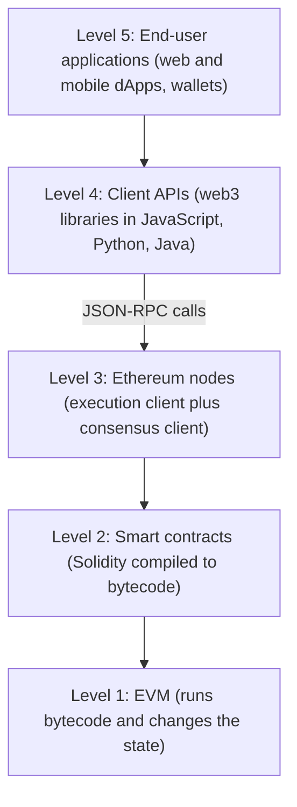
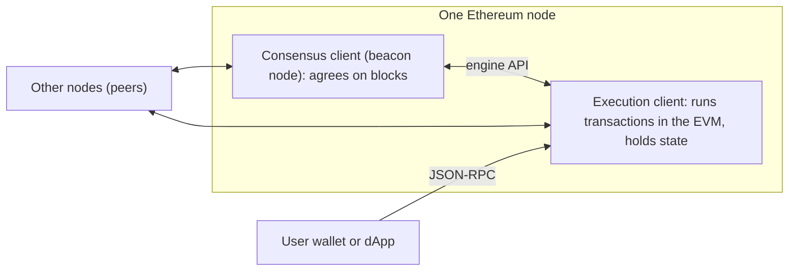
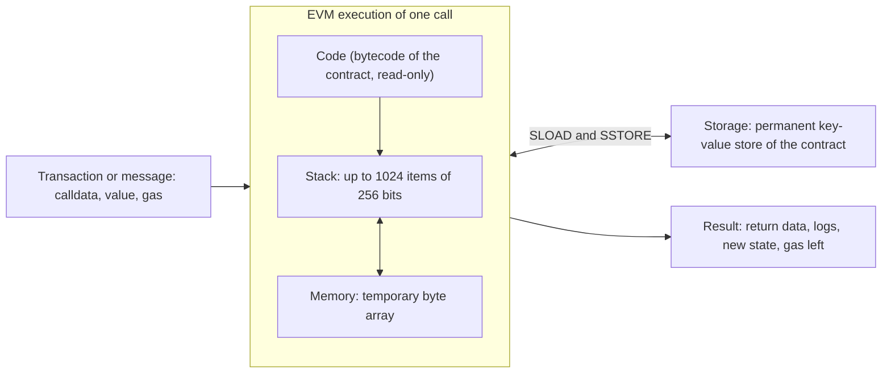
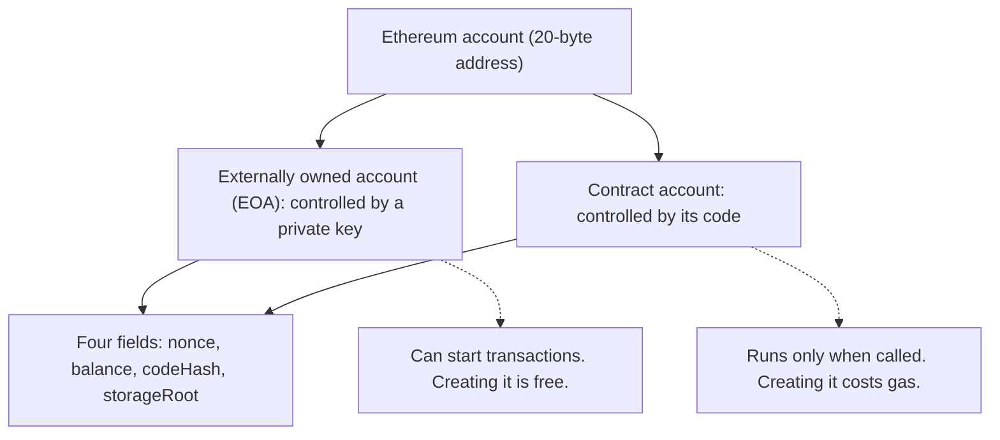
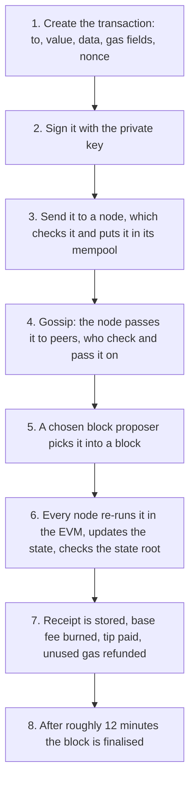
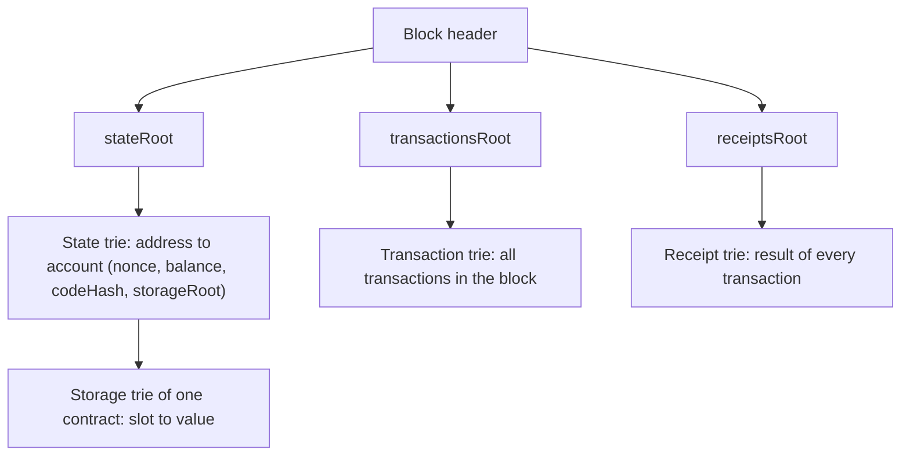
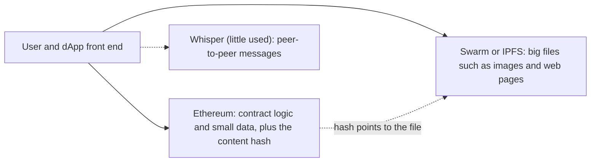
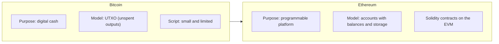

This note covers syllabus <Syl m="3" />, part 3.1: history, components, architecture, consensus, miner and mining node, the EVM, ether, gas, transactions, accounts, the Patricia Merkle tree, Swarm, Whisper and IPFS, the complete transaction flow, Ganache, Etherscan and the block structure, and the comparison with Bitcoin. Smart contracts and Solidity have their own notes.

## The basics first

- A **blockchain** is a shared list of blocks, copied on many computers (**nodes**), where every block holds the hash of the block before it. Bitcoin is the first big example. <Cite id="blockchain-fundamentals-eth-intro" />
- A **hash** is a fixed-size fingerprint of data. Ethereum uses a hash called Keccak-256 (256 bits). <Cite id="ethereum-eth-evm" />
- A **public key and private key** pair is used to sign. The private key signs a message, anyone can check the signature with the public key, and nobody can forge it without the private key.
- A **state machine** is a system that always sits in one "state" and moves to a new state when an input arrives. A traffic light is one. Think of Ethereum's state as "every account and its balance, plus every program and its data", and a transaction as the input that changes it.
- A **smart contract** is a small program stored on the blockchain that runs exactly as written when someone calls it.

Analogy: Bitcoin is like a shared notebook where everyone writes "Asha paid Ravi 5 coins". Ethereum is like a shared **computer**: the notebook still exists, but it can also hold small programs (like a vending machine) that anyone can use and nobody can switch off.

## What is Ethereum

<Box kind="definition">

**Ethereum** is an open, public blockchain platform that runs a global, shared computer. As well as its own currency, **ether (ETH)**, it can store and execute programs called smart contracts, so anyone can build decentralised applications (dApps) on it without a central server. <Cite id="blockchain-fundamentals-eth-intro" /> <Cite id="ethereum-me-ch1" loc="What Is Ethereum?" />

</Box>

**Why it was needed.** Bitcoin's scripting language is deliberately small, so it can only express simple spending conditions. A developer who wanted a richer application had to squeeze it into Bitcoin or build a brand-new blockchain with its own network, rules and consensus. Ethereum offers one general-purpose blockchain where you only write the application logic. <Cite id="ethereum-me-ch1" loc="The Birth of Ethereum" /> <Cite id="ethereum-whitepaper" />

**Ledger versus state machine.** A Bitcoin-style ledger records transfers and enforces simple rules such as "you cannot spend more than you received". Ethereum is better described as a distributed **state machine**: its state holds all accounts and balances plus the code and data of contracts, and rules that run code change that state from block to block. <Cite id="ethereum-eth-evm" loc="From ledger to state machine" />

### History in short

| Year | Event |
| --- | --- |
| Late 2013 | Vitalik Buterin describes Ethereum in a white paper; Gavin Wood joins as co-founder and CTO; the formal specification is the Yellow Paper. <Cite id="ethereum-whitepaper" /> <Cite id="ethereum-me-ch1" loc="The Birth of Ethereum" /> |
| 2014 | A crowdsale funds development: people paid in bitcoin for ether. <Cite id="ethereum-wiki-ethereum" /> |
| 30 Jul 2015 | **Frontier**: the genesis block is mined and the network starts. <Cite id="ethereum-eth-history" /> |
| 14 Mar 2016 | **Homestead**: a more stable, safer release. <Cite id="ethereum-eth-history" /> |
| Jun to Jul 2016 | "The DAO", a big investment contract, is exploited. The community hard-forks to move the funds; those who rejected the fork continue as Ethereum Classic. <Cite id="ethereum-wiki-ethereum" /> <Cite id="ethereum-eth-history" /> |
| 2017 | **Metropolis** forks (Byzantium and later) lower block rewards and add tools for scaling. <Cite id="ethereum-eth-history" /> |
| 5 Aug 2021 | **London** adds EIP-1559: a burned base fee plus a tip. <Cite id="ethereum-eth-history" /> |
| 15 Sep 2022 | **The Merge**: Ethereum moves from proof of work to proof of stake and its energy use drops by more than 99 percent. <Cite id="consensus-mining-eth-merge" /> <Cite id="ethereum-wiki-ethereum" /> |

A **hard fork** is a protocol upgrade that is not backward compatible, so every node must update. <Cite id="ethereum-me-ch1" loc="Ethereum's Stages of Development" />

## Components of Ethereum

When a question says "explain the components of Ethereum", describe the parts below, in this order. They are the standard blockchain parts from the Mastering Ethereum book, filled in for Ethereum. <Cite id="ethereum-me-ch1" loc="Ethereum's Components" /> <Cite id="ethereum-gfg-components" />

| Component | What it is in Ethereum |
| --- | --- |
| Peer-to-peer (P2P) network | Thousands of nodes that talk directly to each other and pass around transactions and blocks (the main network uses TCP port 30303 and a protocol called DEVp2p). |
| Nodes and clients | A node runs two programs: an **execution client** (runs transactions in the EVM and holds the state) and a **consensus client** (agrees on the next block). Examples: Geth and Nethermind for execution, Prysm and Lighthouse for consensus. |
| Accounts | The "people" and "programs" of the system: EOAs and contract accounts, each with an address. |
| Ether (ETH) | The native currency, used to pay fees and as collateral for staking. |
| Transactions | Signed messages from an EOA that change the state. |
| Gas | The unit that measures computing work, paid for in ether, so nobody can overload the network. |
| EVM | The virtual machine that runs contract bytecode the same way on every node. |
| Smart contracts | Programs written in languages such as Solidity and compiled to EVM bytecode. |
| Data structures | State, transactions and receipts kept in **Merkle Patricia tries**, stored locally in a database (often LevelDB). |
| Consensus mechanism | How nodes agree on the next block: proof of work (Ethash) until 2022, proof of stake since. |
| Storage and messaging helpers | Swarm and IPFS (file storage) and Whisper (messaging, now little used), which were meant to be part of a full "Web3" stack. |
| Tools | Wallets (such as MetaMask), block explorers (Etherscan), test networks and Ganache. |

<Cite id="ethereum-me-ch1" loc="Ethereum's Components" /> <Cite id="ethereum-gfg-components" />

<PYQ id="2023-12/q5a" /> <PYQ id="2024-12/q2b" /> <PYQ id="2025-05/q5a" />

## Architecture of Ethereum

Ethereum is easiest to understand as layers. The bottom layers are what the network does; the top layers are what a user sees. <Cite id="ethereum-eth-stack" />

<Cite id="ethereum-eth-stack" loc="diagram" /> <Cite id="ethereum-gfg-components" loc="diagram" />

Walk through it from the top:

1. The **end-user application** is an ordinary web or mobile app. The user may not even know a blockchain is behind it.
2. It uses a **client API library** (for example web3 in JavaScript) to build and send requests.
3. The library connects to an **Ethereum node** through the JSON-RPC interface. Through that node the app can read data (like a balance) or broadcast a new transaction.
4. The node holds the **blockchain and state** and keeps a network-wide agreement with its peers.
5. The **smart contracts** are the programs stored on the chain, and the **EVM** executes them.

<Cite id="ethereum-eth-stack" />

### Inside the network: the two clients of a node

<Cite id="ethereum-eth-nodes" loc="diagram" /> <Cite id="ethereum-me-ch1" loc="Components of a Blockchain" />

The execution client listens for new transactions, runs them in the EVM and keeps the latest state. The consensus client runs the proof-of-stake algorithm so the network agrees on which block comes next. A third piece, the **validator** software, can be added to the consensus client to let the node help secure the network. <Cite id="ethereum-eth-nodes" loc="What are nodes and clients" />

### Types of nodes

| Node | What it stores and does | Typical use |
| --- | --- | --- |
| **Full node** | Verifies every block and keeps recent history (typically the latest 128 blocks of state); old data is pruned and can be rebuilt. | Everyday running of the network, serving data to others. |
| **Archive node** | A full node that never deletes anything and keeps every past state from genesis. Needs terabytes. | Block explorers, analytics, asking "what was this balance at block 4,000,000?". |
| **Light node** | Downloads only block headers and asks full nodes for the rest, checking answers against the state roots in the headers. Cannot be a validator. | Phones and low-power devices. |

<Cite id="ethereum-eth-nodes" loc="Node types" />

<PYQ id="2023-12-ce/q1e" />

### Architecture and workflow in one view

A short answer to "explain architecture and workflow": the user signs a transaction in a wallet, the wallet sends it to a node, the node checks it and gossips it to the network, a block proposer picks it up into a block, every node re-runs it in the EVM and checks the resulting state root, and the block is finalised. The full eight steps are given under "Complete working of a transaction" below.

<PYQ id="2022-12-ce/q4a" /> <PYQ id="2023-05-ce/q4a" /> <PYQ id="2023-12-ce/q3b" /> <PYQ id="2025-05-ce/q3b" />

## Consensus, miner and mining node

<Box kind="definition">

**Consensus** is the way thousands of nodes that do not trust each other agree on which block is next and what the current state is. A **miner** (or **mining node**) was a computer that collected transactions into a block and solved a proof-of-work puzzle to earn the right to add it. <Cite id="ethereum-eth-mining" loc="What is Ethereum mining" />

</Box>

**Proof of work (until 15 September 2022).** Ethereum originally used a proof-of-work algorithm called **Ethash**. A mining node did this: <Cite id="ethereum-me-ch1" loc="Ethereum's Components" /> <Cite id="ethereum-eth-mining" loc="How Ethereum transactions were mined" />

1. Listen for signed transactions and keep them in a local waiting list (the **mempool**).
2. Pick several transactions, aiming for the highest fees while staying under the block gas limit.
3. Check each transaction and run it on a local copy of the EVM; the miner takes the fees.
4. Work to produce the proof-of-work "certificate" for the block, then broadcast the finished block.
5. Other nodes check the certificate, re-run all the transactions and confirm that their resulting state matches the state claimed by the miner; only then do they add the block.

Mining was also the only way new ether was issued, and miners spent money on hardware and electricity. Ethereum also paid a reduced reward to a valid block that lost the race, called an **ommer** (uncle) block, so smaller miners with slower connections still earned something. <Cite id="ethereum-eth-mining" loc="Ommer (uncle) blocks" /> <Cite id="ethereum-whitepaper" loc="Modified GHOST Implementation" />

**Proof of stake (since The Merge).** Mining has been switched off. Now **validators** lock up (stake) 32 ETH as a deposit. Time is cut into 12-second **slots**; in each slot one validator is chosen at random to be the **block proposer** and builds the block, while other validators check it and vote (attest). A validator caught cheating loses part or all of its stake. If two conflicting blocks appear for a slot, the fork-choice rule picks the one backed by the most staked ETH. <Cite id="block-structure-merkle-eth-blocks" loc="Proof-of-stake protocol" /> <Cite id="consensus-mining-eth-pos" />

| | Miner (proof of work) | Validator (proof of stake) |
| --- | --- | --- |
| What you put in | Computing power and electricity | 32 ETH locked as a deposit |
| Who builds the next block | The miner who first solves the puzzle | A validator chosen at random for each slot |
| Punishment for cheating | Wasted work, no reward | Part or all of the stake is destroyed (slashing) |
| Energy use | Very high | More than 99 percent lower |
| Status | Ended on 15 Sep 2022 | Current |

<Cite id="block-structure-merkle-eth-blocks" loc="Proof-of-stake protocol" /> <Cite id="ethereum-wiki-ethereum" />

<Box kind="pitfall">

Many older GeeksforGeeks and Javatpoint pages still say Ethereum uses proof of work and give block times of 14 to 15 seconds. That was true before The Merge. Today blocks come in 12-second slots under proof of stake. In an exam, mention both: "originally PoW, now PoS". <Cite id="bitcoin-gfg-bitcoin-vs-ethereum" />

</Box>

<PYQ id="2024-12-ce/q4a" />

## Ether

<Box kind="definition">

**Ether (ETH)** is the native cryptocurrency of Ethereum. It is used to pay for gas (fees) and to stake as collateral. <Cite id="ethereum-eth-ether" />

</Box>

- Fees are quoted in **gwei**, a small unit: 1 gwei = 10^-9 ETH (one billionth). The smallest unit is the **wei**: 1 ETH = 10^18 wei, so 1 gwei = 10^9 wei. <Cite id="ethereum-eth-gas" loc="What is gas" /> <Cite id="ethereum-eth-accounts" loc="An account examined" />
- Unlike Bitcoin's fixed 21 million coins, ETH has **no fixed cap**: new ETH is issued to validators, and part of each fee is burned, so supply can rise or fall. <Cite id="ethereum-eth-ether" /> <Cite id="ethereum-wiki-ethereum" />

| Unit | Value in wei | Value in ETH |
| --- | --- | --- |
| wei | 1 | 10^-18 |
| gwei | 10^9 | 10^-9 |
| ether | 10^18 | 1 |

## The Ethereum Virtual Machine (EVM)

<Box kind="definition">

The **Ethereum Virtual Machine (EVM)** is the software engine that runs on every Ethereum node and executes smart contract bytecode in the same way everywhere. It measures the work of each step in gas. <Cite id="ethereum-eth-evm" /> <Cite id="ethereum-gfg-evm" />

</Box>

**Why it is needed.** Different nodes run different hardware and operating systems, yet they must reach exactly the same result. A virtual machine hides the computer underneath, like the Java Virtual Machine does for Java, so the same bytecode gives the same result everywhere. Gas inside the EVM stops a program from running forever. <Cite id="ethereum-eth-evm" /> <Cite id="block-structure-merkle-me-ch14" loc="What Is the EVM?" />

**How it works.** The EVM behaves like a mathematical function. Written formally, the Ethereum state transition function is:

`Y(S, T) = S'`

In words: given the old valid state `S` and a list of valid transactions `T`, the EVM produces the new valid state `S'`. Same input always gives the same output (it is **deterministic**), which is what lets all nodes agree. <Cite id="ethereum-eth-evm" loc="The Ethereum state transition function" />

1. A developer writes a contract in a language such as Solidity, which the compiler turns into **bytecode**.
2. The bytecode is placed on the chain by a contract-creation transaction.
3. When someone sends a transaction to the contract, each node starts its own EVM instance, loads the contract's code and storage, and gives it a gas supply.
4. The EVM runs the code one **opcode** (basic instruction) at a time, such as `ADD`, `AND`, `SSTORE`, taking gas for each.
5. If it finishes, the changes to the state are kept. If it runs out of gas or hits an error, all its changes are rolled back (reverted), though the gas used is still paid.

<Cite id="ethereum-gfg-evm" /> <Cite id="ethereum-sol-intro" loc="The Ethereum Virtual Machine" /> <Cite id="block-structure-merkle-me-ch14" loc="Gas Accounting During Execution" />

<Cite id="ethereum-eth-evm" loc="diagram" /> <Cite id="ethereum-sol-intro" loc="diagram" /> <Cite id="ethereum-gfg-evm" loc="diagram" />

### The data areas of the EVM

| Area | What it is | Lasts for |
| --- | --- | --- |
| **Stack** | A last-in-first-out pile. Up to 1024 items, each a 256-bit word; only the top 16 can be reached directly. | One call |
| **Memory** | A temporary byte array, cleared for every message call; getting more costs more gas. | One call |
| **Storage** | A key-value store of 256-bit words that belongs to the contract and is part of the global state. The most expensive area. | Permanent |
| **Transient storage** | A per-transaction store (opcodes `TSTORE` and `TLOAD`) cleared at the end of the transaction. | One transaction |
| **Logs** | Indexed records used for events; a contract can write them but not read them back. | Permanent on chain |

<Cite id="ethereum-eth-evm" loc="EVM instructions" /> <Cite id="ethereum-sol-intro" loc="The Ethereum Virtual Machine" />

The 256-bit word size is chosen to match 256-bit cryptography such as Keccak-256 hashes and secp256k1 signatures. <Cite id="ethereum-eth-evm" loc="EVM instructions" /> The EVM is **Turing-complete** in design (it can compute almost anything) but gas makes it *quasi*-Turing-complete: it can only run a program that finishes within the gas paid for. <Cite id="block-structure-merkle-me-ch14" loc="Turing Completeness and Gas" />

<PYQ id="2024-05-ce/q6c" /> <PYQ id="2025-05-ce/q6a" />

## Gas

<Box kind="definition">

**Gas** is the unit that measures how much computing work an operation needs on Ethereum. The fee you pay is the gas used multiplied by the price per unit of gas. <Cite id="ethereum-eth-gas" loc="What is gas" />

</Box>

**Why it is needed.** Every node must run every transaction, so computing power is a shared resource. Without a price, someone could flood the network with useless work or write a program with an infinite loop. Gas makes spam expensive and lets the EVM stop a program that uses more than it paid for. <Cite id="ethereum-eth-gas" loc="Why do gas fees exist" /> <Cite id="block-structure-merkle-me-ch14" loc="What Is Gas" />

**Examples of gas costs** (from the Yellow Paper, as quoted in Mastering Ethereum): adding two numbers costs 3 gas, a Keccak-256 hash costs 30 gas plus 6 per 256 bits hashed, and sending a transaction costs 21,000 gas. <Cite id="block-structure-merkle-me-ch14" loc="What Is Gas" />

**Terms to know.**

- **Gas limit (of a transaction):** the most gas you allow this transaction to use. If the work needs more, it stops, the changes are undone, and the gas is still spent.
- **Block gas limit:** the most gas all transactions in one block may use together. The target size of a block is half of it. <Cite id="ethereum-eth-gas" loc="Block size" />
- **Base fee:** a price per gas set by the protocol, different for every block, which is **burned** (destroyed). It goes up by up to 12.5 percent after a full block and down by up to 12.5 percent after an empty one. <Cite id="ethereum-eth-gas" loc="Base fee" />
- **Priority fee (tip):** an extra price per gas you offer to the block proposer to choose your transaction first.
- **Max fee (`maxFeePerGas`):** the highest total price per gas you will accept. You are refunded anything above base fee plus tip.

<Cite id="ethereum-eth-gas" loc="How are gas fees calculated" />

The formulas, in words first: the price you pay for each unit of gas is the base fee plus the tip, and the fee is that price times the gas actually used. Unused gas is returned. <Cite id="ethereum-eth-gas" loc="How are gas fees calculated" />

`fee = gas used x (base fee + priority fee)`

`gas cost x gas price` is the older way of saying the same (Mastering Ethereum: "transaction fee = total gas used x gas price paid"). <Cite id="block-structure-merkle-me-ch14" loc="Gas cost versus gas price" />

`refund = (gas limit - gas used) x gas price`

<Sum>

<Given>

A plain ether transfer uses 21,000 gas. The base fee is 10 gwei and the sender adds a tip of 2 gwei. The sender transfers 1 ETH.

</Given>

<Find>

the total fee, the part that is burned, the tip the validator receives, and the total ether taken from the sender.

</Find>

<Steps>

1. Price per gas = base fee + tip = $10 + 2 = 12$ gwei. *Reason: the sender pays both parts for every unit of gas.*
2. Total fee = gas used x price = $21{,}000 \times 12 = 252{,}000$ gwei.
3. Convert to ether: 1 gwei = $10^{-9}$ ETH, so $252{,}000 \times 10^{-9} = 0.000252$ ETH.
4. Burned part = $21{,}000 \times 10 = 210{,}000$ gwei $= 0.00021$ ETH. *Reason: only the base fee is burned.*
5. Tip to the validator = $21{,}000 \times 2 = 42{,}000$ gwei $= 0.000042$ ETH.
6. Total taken from the sender = value + fee = $1 + 0.000252 = 1.000252$ ETH. The receiver gets exactly 1 ETH.

</Steps>

<Answer>

Fee $= 0.000252$ ETH, of which $0.00021$ ETH is burned and $0.000042$ ETH goes to the validator. The sender loses $1.000252$ ETH.

</Answer>

<Box kind="verify">

Burned + tip $= 0.00021 + 0.000042 = 0.000252$ ETH, the same as the total fee. In wei: $252{,}000$ gwei $\times 10^9 = 2.52 \times 10^{14}$ wei, and $2.52 \times 10^{14} / 10^{18} = 0.000252$ ETH. This is the example on the ethereum.org gas page. <Cite id="ethereum-eth-gas" loc="How are gas fees calculated" />

</Box>

</Sum>

<Sum>

<Given>

A transaction has a gas limit of 50,000 and a gas price of 20 gwei (base fee plus tip together). A simple transfer uses only 21,000 gas.

</Given>

<Find>

the amount held up front, the fee actually paid, and the refund, all in ETH.

</Find>

<Steps>

1. Held up front = gas limit x price = $50{,}000 \times 20 = 1{,}000{,}000$ gwei $= 0.001$ ETH. *Reason: the sender must be able to cover the worst case.*
2. Fee actually paid = gas used x price = $21{,}000 \times 20 = 420{,}000$ gwei $= 0.00042$ ETH.
3. Unused gas = $50{,}000 - 21{,}000 = 29{,}000$.
4. Refund = $29{,}000 \times 20 = 580{,}000$ gwei $= 0.00058$ ETH.

</Steps>

<Answer>

Held $0.001$ ETH, fee $0.00042$ ETH, refund $0.00058$ ETH.

</Answer>

<Box kind="verify">

Fee + refund $= 0.00042 + 0.00058 = 0.001$ ETH, which equals the amount held up front. The gas page makes the same point: with a limit of 50,000 for a simple transfer the EVM uses 21,000 and returns the other 29,000. <Cite id="ethereum-eth-gas" loc="What is the gas limit" />

</Box>

</Sum>

<Sum>

<Given>

The Ethereum whitepaper's example (old fee rules, one price per gas). A transaction sends 10 ether to a contract with a gas limit of 2000 and a gas price of 0.001 ether. The data is 170 bytes and each byte costs 5 gas. Running the contract code uses 187 gas.

</Given>

<Find>

the fee kept by the miner and the total ether the sender loses.

</Find>

<Steps>

1. Held up front = $2000 \times 0.001 = 2$ ether. *Reason: gas limit times gas price.*
2. Gas for the data = $170 \times 5 = 850$, so gas left = $2000 - 850 = 1150$.
3. Gas left after running the code = $1150 - 187 = 963$.
4. Refund = $963 \times 0.001 = 0.963$ ether.
5. Fee kept = held minus refund $= 2 - 0.963 = 1.037$ ether.
6. Total loss to the sender = value + fee $= 10 + 1.037 = 11.037$ ether. The contract receives the 10 ether.

</Steps>

<Answer>

Fee $= 1.037$ ether. The sender loses $11.037$ ether and the contract gains $10$ ether.

</Answer>

<Box kind="verify">

Check by gas used: $(850 + 187) = 1037$ gas, and $1037 \times 0.001 = 1.037$ ether, the same fee. Also $10 + 2 - 0.963 = 11.037$. <Cite id="ethereum-whitepaper" loc="Ethereum State Transition Function" />

</Box>

</Sum>

<Sum>

<Given>

The base fee in a block is 100 gwei. The next three blocks are all completely full (they reach the gas limit). A base fee rises by 12.5 percent after a full block.

</Given>

<Find>

the base fee after each of the three blocks, and the base-fee part of a 21,000-gas transfer after the third.

</Find>

<Steps>

1. After block 1: $100 \times 1.125 = 112.5$ gwei. *Reason: +12.5 percent means multiply by 1.125.*
2. After block 2: $112.5 \times 1.125 = 126.5625 \approx 126.6$ gwei.
3. After block 3: $126.5625 \times 1.125 = 142.3828 \approx 142.4$ gwei.
4. Base-fee part of a transfer = $21{,}000 \times 142.3828 \approx 2{,}990{,}039$ gwei.
5. In ether: $2{,}990{,}039 \times 10^{-9} \approx 0.00299$ ETH.

</Steps>

<Answer>

Base fee: 112.5, 126.6, 142.4 gwei. The transfer's base fee after the third block is about $0.00299$ ETH.

</Answer>

<Box kind="verify">

The ethereum.org table gives the same series for a full-block run (112.5, 126.6, 142.4). Also $1.125^3 = 1.4238$, so $100 \times 1.4238 = 142.38$. <Cite id="ethereum-eth-gas" loc="Base fee" />

</Box>

</Sum>

<PYQ id="2024-05-ce/q1a" /> <PYQ id="2024-12-ce/q4a" />

## Accounts

<Box kind="definition">

An **Ethereum account** is an entity with an ether balance that can send messages on Ethereum. Accounts are either controlled by a person with a private key or deployed as smart contracts. All accounts together make up the **state**. <Cite id="ethereum-eth-accounts" /> <Cite id="ethereum-whitepaper" loc="Ethereum Accounts" />

</Box>

<Cite id="ethereum-eth-accounts" loc="diagram" /> <Cite id="ethereum-gfg-components" loc="diagram" />

### The four fields

| Field | Meaning |
| --- | --- |
| `nonce` | A counter. For an EOA it is the number of transactions sent so far; for a contract, the number of contracts it has created. It stops the same signed transaction from being replayed. |
| `balance` | The amount of ether owned, in wei. |
| `codeHash` | Hash of the contract's EVM code (the code cannot be changed). For an EOA it is the hash of empty data. |
| `storageRoot` | Root hash of a Merkle Patricia trie holding the contract's storage. Empty by default. |

<Cite id="ethereum-eth-accounts" loc="An account examined" />

### EOA versus contract account

| Point | Externally owned account (EOA) | Contract account |
| --- | --- | --- |
| Controlled by | A private key (a person or a wallet) | Its own code |
| Created by | Generating a key pair (free) | Deploying a contract (costs gas, because it uses storage) |
| Can start a transaction | Yes | No; it only sends messages after being called |
| Has code | No | Yes |
| Typical use | Your MetaMask wallet | A token, a voting contract, an exchange |

<Cite id="ethereum-eth-accounts" loc="Key differences" /> <Cite id="ethereum-gfg-components" />

An EOA's address is made by taking the last 20 bytes of the Keccak-256 hash of its public key and adding `0x`, giving 42 characters in all. <Cite id="ethereum-eth-accounts" loc="Account creation" /> Both types can receive, hold and send ETH and tokens and can interact with contracts. <Cite id="ethereum-eth-accounts" loc="Account types" />

<PYQ id="2023-12/q1c" /> <PYQ id="2024-12-ce/q4a" />

## Transactions

<Box kind="definition">

A **transaction** is a cryptographically signed instruction from an externally owned account that asks to change the Ethereum state: to send ether, call a contract, or create a contract. <Cite id="ethereum-eth-transactions" /> <Cite id="ethereum-me-ch6" />

</Box>

Only a transaction can change the state, so Ethereum "ticks" only when transactions arrive. <Cite id="ethereum-me-ch6" />

**Fields of a transaction.** <Cite id="ethereum-eth-transactions" loc="What's a transaction" />

| Field | Meaning |
| --- | --- |
| `from` | Sender (must be an EOA; it signs the transaction) |
| `to` | Receiver: an EOA (value transfer) or a contract (runs its code); empty for contract creation |
| `value` | Amount of ETH to send, in wei |
| `nonce` | Sender's transaction counter |
| `signature` | Proof, made with the sender's private key, that the sender approved it |
| `input data` | Optional data, such as which contract function to call and its arguments |
| `gasLimit` | Most gas the transaction may use |
| `maxPriorityFeePerGas` | Highest tip per gas offered to the validator |
| `maxFeePerGas` | Highest total price per gas the sender will pay |

**Three kinds of use:** a plain **value transfer** between accounts, a **contract call** (the `to` is a contract and the data names the function), and a **contract creation** (no `to`, the data is the compiled code). <Cite id="ethereum-eth-evm" loc="Transactions" />

### Complete working of a transaction

<Cite id="ethereum-me-ch6" loc="Transaction Life Cycle" /> <Cite id="ethereum-eth-mining" loc="diagram" />

1. **Create.** The user (through a wallet) fills in the fields above.
2. **Sign.** The wallet signs with the private key. A signed transaction proves the sender approved it and cannot be altered. Without a signature it is invalid.
3. **Send.** The signed transaction goes to a node. The node does a quick check to throw out spam, and keeps it in its **mempool**.
4. **Propagate.** The node passes it to some of its peers, who check it, store it and pass it on. Within seconds nearly all nodes have it. (A node tells only some peers, not all, to save bandwidth.)
5. **Include.** The validator chosen to propose the next block takes transactions from its mempool and puts them in a block.
6. **Execute.** The EVM runs the transaction: it checks the signature and nonce, takes the maximum fee from the sender, moves the value, and runs contract code if the receiver is a contract. If anything fails (not enough ether, out of gas), all changes are reverted except the fee. Every other node does the same and compares the resulting state root with the block's.
7. **Settle.** The sender is refunded unused gas, the base fee is burned, and the tip goes to the proposer. A **receipt** (status, gas used, logs) is recorded.
8. **Finalise.** A block can still, rarely, be replaced by a different one (a reorg). After it is finalised by the consensus protocol (usually about 12 minutes) it cannot be reverted. Wallets usually show "confirmed" much earlier.

<Cite id="ethereum-me-ch6" loc="Transaction Life Cycle" /> <Cite id="ethereum-whitepaper" loc="Ethereum State Transition Function" /> <Cite id="ethereum-eth-gas" loc="How are gas fees calculated" />

<PYQ id="2024-12-ce/q4a" /> <PYQ id="2023-12-ce/q3b" />

## Patricia Merkle tree in Ethereum

Start from the **Merkle tree** you met in the block-structure note: leaves are hashes of data, each parent is a hash of its children, and the single top hash (the root) changes if any data changes. Bitcoin's transactions never change once written, so a plain Merkle tree is enough there. <Cite id="block-structure-merkle-me-ch14" loc="Merkle-Patricia Trie" />

Ethereum's state, however, **changes constantly** (balances, storage), and it is a big set of key-value pairs: address to account, slot to value. So Ethereum combines three ideas: <Cite id="block-structure-merkle-eth-mpt" />

- **Merkle:** every node is identified by the hash of its content, so one root hash stands for the whole data set.
- **Patricia (radix trie):** the key is written in the path from the root to the value, and shared starting parts of keys are stored only once. In the Ethereum trie a node can have up to 16 children (one for each hex digit). <Cite id="block-structure-merkle-me-ch14" loc="Merkle-Patricia trie in Ethereum" />
- **Trie** (from "retrieval"): a tree built for looking things up by key.

The result is called a **modified Merkle Patricia trie**. It keeps all accounts linked by hashes and reducible to a single root hash stored on the blockchain. <Cite id="ethereum-eth-evm" loc="State" />

Example from Mastering Ethereum: store `car -> Schumacher`. The key `car` in hex is `6 3 6 1 7 2`, so you follow the 6th child, then the 3rd, and so on down to the value. <Cite id="block-structure-merkle-me-ch14" loc="Merkle-Patricia trie in Ethereum" />

<Cite id="block-structure-merkle-me-ch14" loc="diagram" /> <Cite id="block-structure-merkle-eth-mpt" loc="diagram" />

| Trie | What it stores | Where its root is kept |
| --- | --- | --- |
| State trie | Every account | `stateRoot` in the block header |
| Transaction trie | All transactions in a block | `transactionsRoot` in the header |
| Receipt trie | Result of every transaction | `receiptsRoot` in the header |
| Storage trie | Data of one smart contract | `storageRoot` inside that account |

<Cite id="block-structure-merkle-me-ch14" loc="Merkle-Patricia trie in Ethereum" />

**Why it matters.** (1) One 32-byte root proves the whole state, so a light node can verify a balance with a short proof. (2) Only the changed branch is re-hashed when one account changes, so updating is cheap. (3) Different nodes can compare roots instead of whole databases. <Cite id="block-structure-merkle-eth-mpt" />

<PYQ id="2023-12/q2a" />

## Ethereum block structure and Etherscan

A block holds a **header** (a summary), a list of **transactions**, and since the Shanghai upgrade a list of validator **withdrawals**. The old ommers list is now always empty. <Cite id="block-structure-merkle-eth-yellow" loc="4.4 The Block" />

| Header field | Meaning |
| --- | --- |
| `parentHash` | Hash of the previous block's header (this is the link of the chain) |
| `stateRoot` | Root of the state trie after running this block |
| `transactionsRoot` | Root of the trie of this block's transactions |
| `receiptsRoot` | Root of the trie of the transaction receipts |
| `logsBloom` | Compact filter of the event logs so they can be searched quickly |
| `number` | Block number (genesis block is 0) |
| `gasLimit` and `gasUsed` | The most gas allowed in this block, and the total gas actually used |
| `timestamp` | Time the block was created |
| `baseFeePerGas` | The base fee (in wei) burned for each unit of gas |
| `beneficiary` (fee recipient) | Address that receives the priority fees |
| `prevRandao` | Random value used to choose validators |
| `extraData` | Up to 32 bytes of free data |
| `withdrawalsRoot` | Root of the trie of withdrawals |
| `ommersHash`, `difficulty`, `nonce` | Used by proof of work; now fixed constants and deprecated |

<Cite id="block-structure-merkle-eth-yellow" loc="4.4 The Block" /> <Cite id="block-structure-merkle-eth-blocks" loc="What's in a block" />

**Etherscan** is an independent block explorer: a search engine for the Ethereum blockchain where you can look up and confirm transactions. It reads the public ledger and shows it on a website, and it also offers an API. It is not a wallet, holds no keys and cannot reverse a transaction. <Cite id="ethereum-etherscan-about" /> On etherscan.io you can paste a transaction hash, an address or a block number and see the fields described above (sender, receiver, value, nonce, gas limit, gas used, gas price and fee, block number, and for a block its header values such as gas used, base fee and fee recipient). A contract's page also shows its code if the owner verified it.

## Swarm, Whisper and IPFS

Storing large files on Ethereum itself is very expensive, because every full node copies it. Ethereum was therefore meant to be one of three parts of a decentralised "Web3": **Ethereum** for computation, **Swarm** for storage and **Whisper** for messaging. <Cite id="ethereum-me-ch1" loc="Ethereum: A General-Purpose Blockchain" /> <Cite id="ethereum-eth-storage" />

<Cite id="ethereum-eth-storage" loc="diagram" /> <Cite id="ethereum-ipfs-docs" loc="diagram" />

| Name | What it is | Status |
| --- | --- | --- |
| **Swarm** | A decentralised storage network built to work with Ethereum. Content is addressed by a hash of the data, not by location, and storage is paid for with an incentive system. <Cite id="ethereum-swarm-home" /> | Active |
| **IPFS** (InterPlanetary File System) | A set of open protocols for addressing, routing and transferring data on the web using content addressing and peer-to-peer networking. It is a protocol, not a storage provider; pinning services keep files available. It has no built-in payment scheme. <Cite id="ethereum-ipfs-docs" /> <Cite id="ethereum-eth-storage" /> | Widely used, with Ethereum |
| **Whisper** | A peer-to-peer messaging protocol meant for dApp-to-dApp communication. It did not gain much traction, because most dApps settled on an ordinary website talking to smart contracts. <Cite id="ethereum-me-ch1" loc="Ethereum: A General-Purpose Blockchain" /> | Little used |

Content addressing means the file's address is its hash. If someone changes the file, the hash changes, so you can always check that you got the right file. <Cite id="ethereum-ipfs-docs" />

<Box kind="pitfall">

Many tutorials list Whisper as a core part of Ethereum. In practice a dApp today is usually an ordinary website that talks to smart contracts, and Whisper saw little use. Describe it for the exam, but say it "did not gain much traction". <Cite id="ethereum-me-ch1" loc="Ethereum: A General-Purpose Blockchain" />

</Box>

## Test networks and Ganache

**Why test networks exist.** Deploying a contract on mainnet costs real ether and mistakes cannot be undone. A **testnet** is a separate Ethereum network that follows the same rules but uses valueless ether (free from a **faucet**), so you can test a contract the way you would use a staging server before the real one. <Cite id="ethereum-eth-networks" loc="Ethereum Testnets" />

### Types of Ethereum networks

| Network | What it is |
| --- | --- |
| **Mainnet** | The real, public network where actual-value transactions happen. |
| **Public testnet** | An open test network for developers: Sepolia and Hoodi are the two currently maintained. |
| **Private or local network** | Your own network not connected to mainnet or a testnet, such as Ganache on your computer. |

<Cite id="ethereum-eth-networks" loc="Public networks" />

### Types of test network

| Testnet | Started | Consensus | Status |
| --- | --- | --- | --- |
| Morden | 2015 | Proof of work | Abandoned in 2016 |
| Ropsten | Nov 2016 | Proof of work | Retired |
| Kovan | Mar 2017 | Proof of authority (Parity) | Retired |
| Rinkeby | Apr 2017 | Clique proof of authority (Geth) | Retired |
| Goerli | 2019 | Proof of authority | Retired |
| **Sepolia** | later | Permissioned proof-of-stake validator set | **Recommended for app and contract developers** |
| **Hoodi** | recent | Open proof-of-stake validators | For protocol developers and stakers to test upgrades and validating |
| Ephemery | recent | Proof of stake | Resets to genesis every 28 days |

<Cite id="ethereum-consensys-testnets" /> <Cite id="ethereum-eth-networks" loc="Ethereum Testnets" />

Sepolia is the default for application development and uses a permissioned validator set run by client and testing teams. Hoodi is open to anyone who wants to try running a validator. Ephemery wipes itself every 28 days, which suits short experiments. **Proof of authority** means a few named nodes are trusted to create blocks, which is cheap and fast, but less decentralised. <Cite id="ethereum-eth-networks" loc="Which Testnet should I use" /> <Cite id="consensus-mining-eth-pos" />

<Box kind="pitfall">

Exam papers and old tutorials ask about Ropsten, Kovan, Rinkeby and Goerli. Write about them, but add that they are now retired and that Sepolia and Hoodi are today's testnets.

</Box>

<PYQ id="2023-12-ce/q4a" /> <PYQ id="2025-05-ce/q5b" />

### Ganache (case study)

<Box kind="definition">

**Ganache** is a "personal blockchain for rapid Ethereum and Filecoin distributed application development". It runs a private Ethereum network on your own machine so you can build, deploy and test dApps in a controlled, repeatable setting. <Cite id="ethereum-ganache-docs" />

</Box>

- It comes as a **desktop app** with a graphical interface and as a **command-line tool** (the command-line version supports Ethereum only but has more features: forking mainnet without syncing, snapshots and reverts, moving time forward, and `console.log` in Solidity). <Cite id="ethereum-ganache-docs" />
- A **Quickstart** button starts a local chain. You get several pre-funded test accounts (in the TutorialsPoint walkthrough, each starts with 100 ETH), with each account's transaction count shown. <Cite id="ethereum-tp-ganache" />
- It can mine **instantly**, **on demand** or at a **set interval**, and it accepts JSON-RPC requests over HTTP and WebSockets, so tools such as Remix, Truffle and MetaMask can connect to it. <Cite id="ethereum-ganache-docs" />
- Because it is local, tests are free and fast and nothing reaches a public network.

Typical use: write a Solidity contract, compile it, point your wallet or Remix to Ganache's address, deploy, call the functions, and watch the transactions and blocks appear. Truffle Suite, which includes Ganache, has been announced as sunset, so newer projects often use other local tools, but the idea is the same. <Cite id="ethereum-ganache-docs" />

## Bitcoin versus Ethereum

<Cite id="ethereum-me-ch1" loc="Ethereum Compared to Bitcoin" /> <Cite id="bitcoin-gfg-bitcoin-vs-ethereum" loc="diagram" />

| Point | Bitcoin | Ethereum |
| --- | --- | --- |
| Main purpose | Peer-to-peer digital money | General-purpose platform for smart contracts and dApps, with its own money (ether) |
| Described by | Nakamoto white paper, 2008; network started in 2009 | Buterin white paper, 2013; launched 30 July 2015 |
| Currency | Bitcoin (BTC) | Ether (ETH) |
| Programming | Limited Script, simple true or false spending conditions | Turing-complete EVM, contracts in Solidity or Vyper (limited by gas) |
| Data model | UTXO: unspent transaction outputs | Accounts (EOA and contract) with balance, nonce, code and storage |
| Consensus | Proof of work | Proof of work until 15 Sep 2022, now proof of stake |
| Hash function | SHA-256 | Keccak-256 |
| Block interval | About 10 minutes | A new slot every 12 seconds |
| Fees | Based on transaction size | Based on gas (computation) |
| Data structure | Merkle tree of transactions | Merkle Patricia tries for state, transactions and receipts |
| Supply | Fixed at 21 million | No fixed cap; issuance minus burn |
| Energy use | High (proof of work) | Over 99 percent lower after The Merge |

<Cite id="bitcoin-gfg-bitcoin-vs-ethereum" /> <Cite id="ethereum-me-ch1" loc="Ethereum Compared to Bitcoin" /> <Cite id="ethereum-eth-ether" /> <Cite id="blockchain-fundamentals-nakamoto" />

One line to remember: Bitcoin is a ledger of coins; Ethereum is a ledger plus a computer.

<Box kind="pitfall">

The GeeksforGeeks comparison table says Ethereum has "no block limit" and a block time of about 14 to 15 seconds. Both are out of date: blocks are limited by the block gas limit, and slots are 12 seconds under proof of stake. The Yellow Paper and ethereum.org are the sources to trust. <Cite id="bitcoin-gfg-bitcoin-vs-ethereum" /> <Cite id="ethereum-eth-gas" loc="Block size" />

</Box>

<PYQ id="2022-12-ce/q3a" /> <PYQ id="2024-05-ce/q1e" /> <PYQ id="2024-12-ce/q1b" />

## Exam answer map

| If the question says | Write |
| --- | --- |
| Describe the architecture of Ethereum | Five-layer stack diagram, node with two clients, account and state, EVM, consensus, then a line on the workflow |
| Explain the components of Ethereum | The component table, then one line each on nodes, accounts, EVM, ether, gas, tries |
| Explain gas and ether | Definitions, why needed, fee formula, one sum, refund |
| Types of accounts | EOA versus contract table with the four fields |
| Types of nodes | Full, archive, light |
| Types of test networks | Mainnet versus testnets, table of Ropsten, Kovan, Rinkeby, Goerli, then Sepolia and Hoodi, and Ganache |
| EVM | Definition, why, `Y(S, T) = S'`, stack/memory/storage diagram, gas |
| Merkle Patricia tree | Merkle tree, then Patricia, then the four tries and the three header roots |
| Compare Bitcoin and Ethereum | The comparison table |

## In short

Ethereum is a public blockchain that works like a shared computer. Accounts hold ether and sometimes code, signed transactions change the state, the EVM runs the code the same way on every node, gas makes every step cost something, and Merkle Patricia tries let the whole state be summed up in one root hash in each block. Since 2022 validators with staked ether, not miners, create the blocks.
