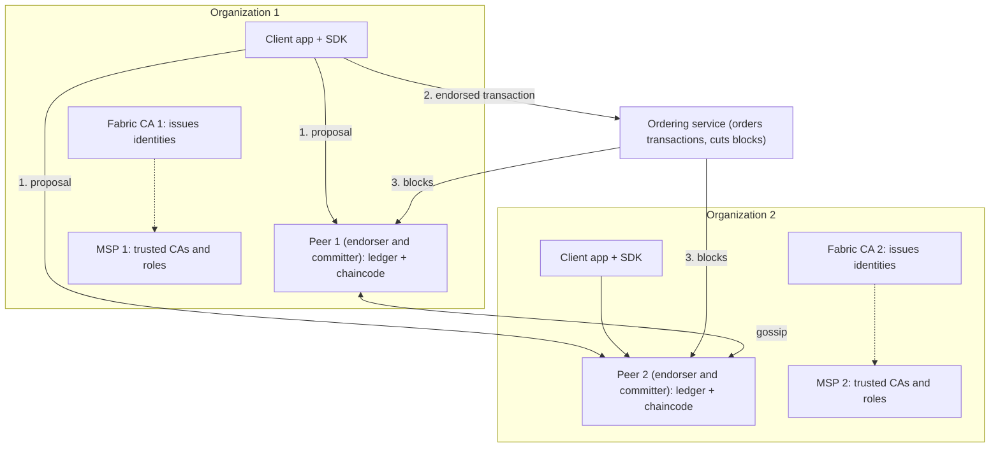
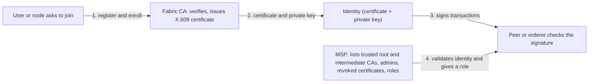
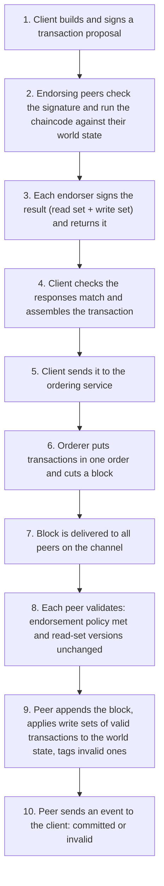

Ye note syllabus <Syl m="4" />, section 4.2 cover karta hai: Hyperledger ka introduction, tools aur frameworks, Hyperledger Fabric, aur Fabric ki dusri technologies se comparison. Paxos, Raft aur PBFT ka general idea, Ripple aur Corda ke alag notes hain; yahan sirf wahi hissa hai jo Fabric use karta hai.

## Pehle basics

- **Public blockchain** (Bitcoin, Ethereum) open hoti hai: koi bhi join kar sakta hai, kisi ko pata nahi kaun kaun hai, aur trust mining aur bahut saare anonymous nodes se aata hai. **Private ya permissioned blockchain** closed hoti hai: sirf invited, known organizations join kar sakte hain. <Cite id="blockchain-fundamentals-fabric-docs" />
- **Digital certificate** (X.509) ek signed document hai jo ek naam ko public key se jodta hai, jaise photo wala ID card. **Certificate Authority (CA)** woh office hai jo ye ID cards issue karti hai. **PKI** (public key infrastructure) CAs, certificates aur unke rules ka poora system hai. <Cite id="hyperledger-fabric-wiki-pki" />
- **Digital signature** private key se banta hai aur certificate ki matching public key se check hota hai. Ye prove karta hai ki kisne sign kiya aur message badla nahi.
- **Consortium** companies ka group hai (banks, ek manufacturer aur uske suppliers) jo milke ek shared network chalate hain.
- **Ledger** record book hai. **Smart contract** ek program hai jo ledger pe chalta hai. Fabric ise **chaincode** kehta hai. <Cite id="hyperledger-fabric-smartcontract" />

Analogy: public blockchain ek town square hai jahan koi bhi aakar bol sakta hai. Fabric ek company office building hai. Aapko front desk (CA) se ID card chahiye, security guard card ko allowed companies ki list (MSP) se check karta hai, aur har meeting room (channel) mein sirf wahi log jaate hain jo us meeting ke hain.

## Hyperledger kya hai, aur Fabric kahan fit hota hai?

<Box kind="definition">

**Hyperledger** ek open-source collaborative effort hai, jo Linux Foundation ne December 2015 mein shuru kiya, business ke liye blockchain technologies banane ke liye. **Hyperledger Fabric** uska sabse famous framework hai: ek modular, permissioned distributed ledger platform for enterprise use, jisme known organizations peers aur ordering nodes chalate hain, aur chaincode standard programming languages mein chalta hai. <Cite id="hyperledger-fabric-wiki-hyperledger" /> <Cite id="hyperledger-fabric-whatis" /> <Cite id="hyperledger-fabric-ibm-fabric" />

</Box>

Hyperledger ek blockchain nahi hai. Ye projects ki family hai, do groups mein. <Cite id="hyperledger-fabric-wiki-hyperledger" />

| Group | Examples | Kya karte hain |
|---|---|---|
| Frameworks (blockchain platforms) | Fabric, Sawtooth, Besu, Indy | Ledger chalane ke complete platforms. Sawtooth Intel ka hai (chalte network mein consensus badal sakte hain; February 2024 mein archive hua). Besu enterprise Ethereum client hai. Indy decentralized identity ke liye hai. |
| Tools | Caliper, Cello, Explorer, Aries | Caliper performance naapta hai (transactions per second, latency). Cello blockchains ko "as a service" deploy karta hai. Explorer se blocks dekh sakte hain. Aries decentralized identity ka toolkit hai. |

Idea 2016 ki shuruaat mein aaya, jab pehle proposals mein Digital Asset, Blockstream ke libconsensus aur IBM ke OpenBlockchain ka kaam joda gaya. Us code ka naam Fabric pada. Fabric ko pehle IBM aur Digital Asset ne contribute kiya; January 2019 mein uska pehla long-term-support release (v1.4) announce hua, aur September 2024 mein ye LF Decentralized Trust ka project ban gaya, jo ab Hyperledger projects host karta hai. <Cite id="hyperledger-fabric-wiki-hyperledger" /> <Cite id="hyperledger-fabric-lfdt" />

**Fabric kyun chahiye tha?** Businesses ko companies ke beech shared records chahiye the, par Bitcoin aur Ethereum fit nahi hue: sab kuch sabko dikhta hai, transactions slow hain, regulated kaam mein anonymous participants allowed nahi, aur coin plus mining ka extra cost hai. Fabric ka jawab: known members, private channels, fast agreement step, aur koi coin nahi. <Cite id="hyperledger-fabric-whatis" /> <Cite id="hyperledger-fabric-gfg-fabric" />

## Fabric ke main features

1. **Permissioned.** Har participant identified hai. Anonymous membership nahi. <Cite id="hyperledger-fabric-whatis" />
2. **Modular aur pluggable.** Consensus (ordering service), identity service (MSP) aur state database badal sakte hain, isliye ek hi design alag trust levels ke liye kaam karta hai. <Cite id="hyperledger-fabric-androulaki-2018" />
3. **Confidential.** Channels har group ko apna ledger dete hain, aur private data collections channel ke andar bhi details chhupate hain. <Cite id="hyperledger-fabric-channels" /> <Cite id="hyperledger-fabric-private-data" />
4. **Standard languages.** Chaincode Go, Node.js (JavaScript) ya Java mein likhte hain, kisi special language mein nahi. <Cite id="hyperledger-fabric-chaincode-lifecycle" />
5. **Native cryptocurrency ki zaroorat nahi.** Platform coin ya mining pe depend nahi karta. <Cite id="hyperledger-fabric-androulaki-2018" />
6. **Execute-order-validate.** Transactions order hone se pehle chalaye jaate hain, isliye sirf endorsing peers kaam karte hain, har node nahi. <Cite id="hyperledger-fabric-androulaki-2018" />

## Fabric v1 architecture

"Explain Hyperledger Fabric v1 architecture" kai papers mein aaya hai (end mein list dekho). Fabric v1 ne neeche wala design laaya: usne purane design ka kaam teen roles mein baant diya, **peers jo execute aur commit karte hain, ordering service jo order karti hai, aur clients jo propose karte hain**. Ye split hi answer ka dil hai. <Cite id="hyperledger-fabric-androulaki-2018" /> <Cite id="hyperledger-fabric-network" />

<Cite id="hyperledger-fabric-gfg-fabric" loc="diagram" /> <Cite id="hyperledger-fabric-txflow" loc="diagram" />

Components, ek ek karke:

| Component | Ye kya hai | Kya karta hai |
|---|---|---|
| Organization (member) | Network ki ek company | Peers rakhti hai, CA chalati hai, MSP define karti hai. Kai organizations milke consortium banate hain. <Cite id="hyperledger-fabric-network" /> |
| Client application | Fabric SDK (Node.js, Java, Go) use karne wala software | Transaction proposal banata aur sign karta hai, peers ko bhejta hai, phir endorsed result ordering service ko bhejta hai. <Cite id="hyperledger-fabric-txflow" /> |
| Peer | Ledger ki copy rakhne aur chaincode chalane wala node | Endorsing (chaincode chalana aur sign karna) aur blocks commit karna, dono kaam karta hai. <Cite id="hyperledger-fabric-peers" /> |
| Ordering service | Ordering nodes ka set, aksar kisi organization ya group ka | Endorsed transactions leti hai, har channel ke liye ek order mein rakhti hai, blocks banati hai aur deliver karti hai. Chaincode nahi chalati aur contents nahi dekhti. <Cite id="hyperledger-fabric-ordering" /> |
| Certificate Authority (Fabric CA) | Organization ka identity office | Users aur nodes ko register karti hai, unke certificates issue, renew ya revoke karti hai. <Cite id="hyperledger-fabric-ca-guide" /> |
| MSP | Ek definition (folders aur rules) | Batata hai ki organization kaunse CAs pe bharosa karti hai aur har identity ka role kya hai. <Cite id="hyperledger-fabric-membership" /> |
| Channel | Private sub-network | Apne members, apna ledger, apna chaincode. <Cite id="hyperledger-fabric-channels" /> |
| Ledger | World state plus blockchain | Current values aur poori history store karta hai. <Cite id="hyperledger-fabric-ledger" /> |
| Chaincode | Smart contract | Business rules; peer se alag Docker container mein chalta hai. <Cite id="hyperledger-fabric-chaincode-lifecycle" /> |

### Peers aur unke roles

Har peer ek organization ka normal node hai, par wo alag alag roles nibha sakta hai (ek peer ek saath kai roles kar sakta hai). <Cite id="hyperledger-fabric-peers" /> <Cite id="hyperledger-fabric-glossary" />

- **Endorsing peer.** Endorsement policy jiska naam leti hai. Wo proposal pe chaincode chalata hai, result sign karta hai (endorsement) aur wapas bhejta hai. Is step pe ledger mein kuch nahi badalta.
- **Committing peer.** Channel ka har peer committing peer hai. Wo har block validate karta hai aur apne ledger mein likhta hai.
- **Anchor peer.** Aisa peer jise dusri organizations hamesha dhoondh sakti hain. Gossip ise use karta hai taaki alag organizations ke peers ek dusre ko jaan sakein. Channel par har organization ke paas kam se kam ek anchor peer hona chahiye.
- **Gossip.** Peers blocks aur private data ek dusre ko gossip se pass karte hain (har peer kuch random peers ko forward karta hai), taaki ordering service kuch hi peers ko deliver kare tab bhi sab peers catch up kar lein. <Cite id="hyperledger-fabric-gossip" />

### Ledger: world state plus blockchain

Fabric ledger ke do hisse hain. <Cite id="hyperledger-fabric-ledger" />

- **World state.** Har key ki current value ka database (jaise `car42 -> owner Asha`). Programs ise fast padhte hain. Ye aksar badal sakta hai. LevelDB default hai; CouchDB rich queries ke liye option hai.
- **Blockchain (transaction log).** Blocks ki append-only chain jo har transaction record karti hai jisne world state banayi. Ise edit nahi kar sakte.

Agar world state kho jaye to blockchain replay karke wapas ban sakti hai.

### Chaincode

Chaincode Fabric mein smart contract ka naam hai. Ye ek program hai (Go, Node.js ya Java) jo world state padhta aur likhta hai, aur peer se isolated Docker container ke andar chalta hai. Ek chaincode sirf apne hisse ki state ko chhoo sakta hai, jab tak use dusre chaincode ko call karne ki permission na ho. Use se pehle organizations uska naam, version aur endorsement policy chaincode lifecycle se agree karti hain (install, kaafi organizations se approve, channel pe commit). <Cite id="hyperledger-fabric-chaincode-lifecycle" /> <Cite id="hyperledger-fabric-smartcontract" />

## Identity: Fabric CA aur MSP

<Box kind="definition">

**Fabric CA** Fabric ki certificate authority hai: ye identities register karti hai, enrollment certificates (X.509) issue karti hai, aur unhe renew ya revoke karti hai. **Membership Service Provider (MSP)** woh component hai (practically network configuration mein jode gaye folders ka set) jo define karta hai ki organization kaunse root aur intermediate CAs accept karti hai, aur har valid identity ko role mein badalta hai, taaki har node check kar sake ki kaun kya kar sakta hai. <Cite id="hyperledger-fabric-ca-guide" /> <Cite id="hyperledger-fabric-membership" />

</Box>

Docs card analogy dete hain: identities credit cards jaisi hain, aur MSP woh list hai ki shop kaunse card providers accept karti hai. CA card provider hai; MSP shop ki "accepted cards" list hai jo valid card ko permission mein badalti hai. <Cite id="hyperledger-fabric-membership" />

<Cite id="hyperledger-fabric-identity" loc="diagram" /> <Cite id="hyperledger-fabric-membership" loc="diagram" />

| Point | Fabric CA | MSP |
|---|---|---|
| Ye kya hai | Ek server (client tool ke saath) jo aap chalate ho | Ek configuration: certificates aur keys ke folders plus rules |
| Main kaam | Identities banana: register, enroll, renew, revoke | Identities ko pehchanna aur roles aur permissions dena |
| Kaunsa sawaal | "Ye kaun hai? Ye raha certificate." | "Kya ye certificate hamare trusted CA ka hai, aur ye banda kya kar sakta hai?" |
| Output | X.509 certificates (enrollment certificates) aur keys | Ek decision: valid ya nahi, aur kaunsa role (admin, peer, client, orderer, member) |
| Aur kya karta hai | LDAP ko user registry bana sakta hai; root ya intermediate CA ban sakta hai | Revoked identities ki list rakhta hai; organization ke admins define karta hai |
| Scope | Har CA server ka | Local MSP (node ya user pe) aur channel MSP (channel configuration mein) |
| Zaroori hai? | Har network ko CA chahiye; Fabric CA Fabric ke saath aata hai | Hamesha zaroori: har organization aur node ko MSP chahiye |

<Cite id="hyperledger-fabric-ca-guide" /> <Cite id="hyperledger-fabric-membership" /> <Cite id="hyperledger-fabric-identity" />

Do tarah ke MSP sirf scope mein alag hain. **Local MSP** ek node ya user ka hota hai aur batata hai ki us node ko kaun administer karta hai. **Channel MSP** channel configuration mein rehta hai aur batata hai ki kaunsi organizations channel ki members hain aur kaunsi policies lagu hain, taaki channel ke saare peers aur orderers identities ko ek jaise judge karein. MSP folders mein root CA certificates, intermediate CA certificates, administrators, revoked certificates ki list, aur (node ke liye) node ka apna signing certificate aur private key hoti hai. Docs kehte hain ki naam ke bawajood MSP khud "kuch provide nahi karta"; ye woh configuration hai jo dusre components use karte hain. <Cite id="hyperledger-fabric-membership" />

<Box kind="exam">

Exam mein English mein likho: "The Fabric CA issues and manages digital identities (certificates) for members, whereas the MSP defines which CAs and identities an organization trusts and maps each identity to a role, so that peers and orderers can authenticate and authorize every request."

</Box>

## Transaction lifecycle: execute, order, validate

Purani blockchains pehle order karti hain aur baad mein execute, isliye har node har transaction chalata hai. Fabric ise teen phases mein ulat deta hai. <Cite id="hyperledger-fabric-androulaki-2018" /> <Cite id="hyperledger-fabric-txflow" />

<Cite id="hyperledger-fabric-txflow" loc="diagram" /> <Cite id="hyperledger-fabric-gfg-fabric" loc="diagram" />

**Step by step, simple words mein.** <Cite id="hyperledger-fabric-txflow" />

1. **Proposal.** Application, SDK ke through, ek request banati hai ("is chaincode function ko in inputs ke saath chalao") aur user ki key se sign karti hai. Ise un peers ko bhejti hai jinka naam endorsement policy mein hai.
2. **Endorsement (execute).** Har endorsing peer check karta hai ki proposal sahi bana hai, pehle bheja nahi gaya (replay protection), signature valid hai (MSP se) aur bhejne wala is channel pe likh sakta hai. Phir wo apni current world state pe chaincode chalata hai. Ye sirf simulation hai: ledger mein abhi kuch nahi likha jaata.
3. **Proposal response.** Result ek **read set** (padhi gayi keys unke version numbers ke saath) aur ek **write set** (keys aur nayi values) hai, jo peer sign karta hai. <Cite id="hyperledger-fabric-readwrite" />
4. **Check aur assemble.** Client responses collect karke check karta hai ki wo same hain.
5. **Ordering.** Client transaction (channel ID, read-write set, endorsers ke signatures) ordering service ko bhejta hai. Orderer ko contents samajhne ki zaroorat nahi; wo sirf transactions order karta hai aur har channel ke liye blocks mein group karta hai.
6. **Delivery.** Blocks channel ke saare peers ko deliver hote hain.
7. **Validation.** Har peer block ki har transaction ke liye check karta hai: (a) endorsement policy satisfy hui, aur (b) read set ki koi key padhne ke baad badli nahi (ye double spending rokta hai). Transactions valid ya invalid tag hoti hain.
8. **Commit.** Peer poora block (invalid transactions bhi, invalid mark ke saath) blockchain mein append karta hai aur valid transactions ke write sets world state mein likhta hai.
9. **Event.** Peer client ko batata hai ki transaction commit hui ya invalidate hui.

**Worked example (docs ka radish market).** Client A, B se radishes khareedna chahta hai. Endorsement policy kehti hai ki peerA aur peerB dono endorse karein. Proposal dono ko jaata hai, dono simulate karke same read-write set sign karte hain, client use orderer ko bhejta hai, orderer use dusri transactions ke saath ek block mein rakhta hai, dono peers validate karke radish aur paise ke balances update karte hain. <Cite id="hyperledger-fabric-txflow" />

**Ye design kyun?** Kyunki chaincode sirf endorsing peers chalate hain, kaam baant jaata hai (better scalability), chaincode ko saare nodes pe pura deterministic hona zaroori nahi kyunki conflicting results pakde jaate hain, aur confidential logic kuch hi organizations tak rakh sakte hain. Keemat ye hai ki transaction end mein invalid mark ho sakti hai, aur application ko retry karna padta hai. <Cite id="hyperledger-fabric-androulaki-2018" />

## Ordering service aur consensus

Fabric mein proof of work jaisa ek built-in consensus algorithm nahi hai. Transaction pe agreement teen phases se milke aata hai: endorsement policy (kaun approve kare), ordering service (kaunse order mein), aur validation (us order mein ab bhi valid hai ya nahi). Ordering service pluggable hissa hai. <Cite id="hyperledger-fabric-ordering" /> <Cite id="hyperledger-fabric-whatis" />

| Ordering service | Ye kya hai | Fault tolerance | Status |
|---|---|---|---|
| Solo | Sirf ek ordering node | Koi nahi (single point of failure) | Sirf test ke liye; v2.x mein deprecated |
| Kafka | Messages order karne ke liye Apache Kafka cluster use karta hai | Crash faults | v1 mein main choice; v2.x mein deprecated, v3.x mein supported nahi |
| Raft | Leader aur followers; har channel ke liye leader elect hota hai aur followers ko replicate karta hai | Crash fault tolerant (majority chahiye) | v1.4.1 se naya; recommended |
| BFT (SmartBFT) | Malicious nodes ko bhi jhel sakta hai | Byzantine fault tolerant | v3.0 se naya |

<Cite id="hyperledger-fabric-ordering" />

v1 ke papers aur questions ka matlab Solo aur Kafka hai. Crash fault ka matlab node bas ruk jaata hai. Byzantine fault ka matlab node jhooth bol sakta hai ya malicious ho sakta hai; Paxos, Raft aur PBFT ke general ideas fault-tolerant consensus note mein hain. <Cite id="consensus-mining-wiki-bft" />

## Channels aur private data

**Channel** do ya zyada specific members ke beech communication ka private "subnet" hai. Iske apne members, apna ledger, apna chaincode aur apni ordering hoti hai. Channel A ka peer channel B ki transactions nahi dekh sakta. Channel banane ke liye members uski configuration (organizations, anchor peers, policies) pe agree karte hain, jo channel ke ledger ka pehla (genesis) block ban jaati hai. <Cite id="hyperledger-fabric-channels" /> <Cite id="hyperledger-fabric-network" />

Example: ek supply chain jisme manufacturer, transporter, bank aur ek competitor-supplier hai. Manufacturer, transporter aur bank ek channel share karte hain; manufacturer aur competitor-supplier dusra channel, taaki wo ek dusre ke prices kabhi na dekhein.

Kabhi kabhi channel ke andar bhi kuch organizations apna data apne paas rakhna chahti hain. **Private data collections** asli data sirf chuni hui organizations ke peers pe store karte hain (gossip se pass hota hai), jabki ordering service aur baaki organizations channel ledger pe sirf uska **hash** dekhte hain. Hash prove karta hai ki data tha aur badla nahi. <Cite id="hyperledger-fabric-private-data" />

## Endorsement policies

**Endorsement policy** batati hai ki transaction valid hone ke liye kaunsi organizations ko sign (endorse) karna hoga. Ye har chaincode ke liye set hoti hai jab chaincode channel pe define hota hai. Syntax `AND`, `OR` ya `OutOf(n, ...)` hai *principals* ke upar jaise `'Org1MSP.peer'` (Org1 ka ek peer). <Cite id="hyperledger-fabric-endorsement" /> <Cite id="hyperledger-fabric-policies" />

| Policy | Matlab |
|---|---|
| `AND('Org1MSP.peer', 'Org2MSP.peer')` | Dono se ek ek signature |
| `OR('Org1MSP.peer', 'Org2MSP.peer')` | Kisi ek se ek signature |
| `OutOf(2, 'Org1MSP.peer', 'Org2MSP.peer', 'Org3MSP.peer')` | Teen mein se koi bhi do |
| `OR('Org1MSP.member', AND('Org2MSP.member', 'Org3MSP.member'))` | Org1, ya Org2 aur Org3 dono |

Strong policy zyada safe hai (zyada parties ko agree karna padta hai) par slow hai aur koi organization offline ho to fail ho jaati hai. Weak policy fast aur zyada available hai par kam parties pe bharosa karti hai.

<Sum>

<Given>

Policy `OutOf(2, 'Org1MSP.peer', 'Org2MSP.peer', 'Org3MSP.peer')`. Ek block mein teen transactions aati hain, in endorsements ke saath. T1: Org1 aur Org3. T2: sirf Org2. T3: Org1, Org2 aur Org3.

</Given>

<Find>

kaunsi transactions policy satisfy karti hain, aur organizations ke kitne alag pairs policy satisfy karte hain.

</Find>

<Steps>

1. Policy ko 3 organizations mein se kam se kam 2 distinct signatures chahiye. *Reason: `OutOf(2, ...)` ka matlab listed principals mein se koi bhi 2.*
2. T1 ke 2 signatures hain (Org1, Org3). $2 \ge 2$, isliye pass.
3. T2 ka 1 signature hai (Org2). $1 < 2$, isliye fail aur invalid tag.
4. T3 ke 3 signatures hain. $3 \ge 2$, isliye pass (extra signatures se nuksan nahi).
5. Policy satisfy karne wale pairs: 3 mein se 2 organizations chuno, $\binom{3}{2} = \frac{3 \times 2}{2 \times 1} = 3$. Ye hain (Org1, Org2), (Org1, Org3) aur (Org2, Org3).

</Steps>

<Answer>

T1 aur T3 policy ke hisaab se valid hain, T2 invalid hai. Minimum signing pairs 3 hain.

</Answer>

<Box kind="verify">

Pairs haath se likho: Org1-Org2, Org1-Org3, Org2-Org3, yani 3, formula se match. T1 pair Org1-Org3 hai, jo list mein hai, isliye pass. T2 ka koi poora pair nahi, isliye fail. Docs bhi kehte hain ki `OutOf(2, A, B)` aur `AND(A, B)` same hain: 2 principals mein sirf ek pair (dono), $\binom{2}{2} = 1$ se consistent.

</Box>

</Sum>

## Double spending: read-set check

Validation ke dauran har peer transaction ke read set ke version numbers ko current world state se compare karta hai. Agar koi key padhne ke baad badal gayi, to transaction invalid mark hoti hai aur uske writes apply nahi hote. Isi wajah se ek hi block mein purane balance use karne wali do transactions dono succeed nahi kar sakti. <Cite id="hyperledger-fabric-readwrite" /> <Cite id="hyperledger-fabric-txflow" />

<Sum>

<Given>

World state: `A = 100` (version v1), `B = 50` (version v1). Dono transactions block se pehle simulate hui thi, isliye dono ne A ko v1 pe padha. T1 A se B ko 30 bhejti hai. T2 A se B ko 40 bhejti hai. Dono sahi endorse hui hain, aur orderer ek block mein pehle T1, phir T2 rakhta hai.

</Given>

<Find>

A aur B ke final balances, aur kaunsi transaction valid hai.

</Find>

<Steps>

1. T1 validate karo. Uske read set mein A v1 pe aur B v1 pe hai, aur world state abhi bhi A v1, B v1 hai. Versions match, isliye T1 valid. *Reason: T1 ke padhne ke baad kuch nahi badla.*
2. T1 ka write set apply karo: $A = 100 - 30 = 70$ aur $B = 50 + 30 = 80$. Dono keys ko naya version v2 milta hai.
3. T2 validate karo. Uske read set mein A abhi bhi v1 hai, par A ab v2 pe hai. Versions match nahi, isliye T2 invalid. *Reason: T2 ne apna result purane balance 100 se nikala tha.*
4. T2 ka write set (A = 60, B = 90) apply nahi hota. T2 block mein rehti hai par invalid tag hoti hai.
5. Final state: $A = 70$, $B = 80$.

</Steps>

<Answer>

T1 valid, T2 invalid. Final balances A = 70 aur B = 80 (agar T2 abhi bhi chahiye to application ko resubmit karna hoga).

</Answer>

<Box kind="verify">

Paisa conserve hota hai: pehle $100 + 50 = 150$; baad mein $70 + 80 = 150$. Agar T2 galti se T1 ke upar (purane 100 pe) apply hoti, to total galat aata. T2 ko naye balance 70 pe sahi tareeke se apply karne pe A = 30 aur B = 120 aata, total 150, jo resubmitted T2 (40 bhejna) karti.

</Box>

</Sum>

## Ordering service ki fault tolerance

Raft aur BFT ko kuch nodes fail hone pe bhi chalte rehne ke liye minimum ordering nodes chahiye. Raft **crash fault tolerant** hai: jab tak nodes ka **majority (quorum)** zinda hai, ye chalta rehta hai. BFT service $f$ faulty (malicious bhi) nodes tolerate karti hai agar kul nodes kam se kam $3f + 1$ hon. <Cite id="hyperledger-fabric-ordering" /> <Cite id="consensus-mining-wiki-bft" />

<Sum>

<Given>

$n = 5$ nodes wali Raft ordering service, $n = 3$ aur $n = 4$ se compare karo. Aur ek BFT ordering service jo $f = 2$ Byzantine nodes se bachni chahiye.

</Given>

<Find>

har Raft cluster ka quorum aur kitne crashed nodes wo jhel sakta hai, aur BFT nodes ki minimum sankhya.

</Find>

<Steps>

1. Raft quorum majority hai: $\lfloor n/2 \rfloor + 1$. *Reason: do majorities hamesha overlap karti hain, isliye do leaders kabhi ek saath nahi chune ja sakte.*
2. $n = 3$: quorum $= 1 + 1 = 2$, isliye jhele gaye crashes $= 3 - 2 = 1$.
3. $n = 4$: quorum $= 2 + 1 = 3$, isliye jhele gaye crashes $= 4 - 3 = 1$. Chautha node extra tolerance nahi deta.
4. $n = 5$: quorum $= 2 + 1 = 3$, isliye jhele gaye crashes $= 5 - 3 = 2$.
5. $f = 2$ ke saath BFT: $n \ge 3f + 1 = 3 \times 2 + 1 = 7$.

</Steps>

<Answer>

Raft: 3 nodes 1 crash jhelte hain, 4 nodes 1, 5 nodes 2 (5 mein se quorum 3). $f = 2$ ke liye BFT ko kam se kam 7 nodes chahiye.

</Answer>

<Box kind="verify">

Fabric docs kehte hain ki paanch nodes mein se aap do kho sakte ho (teen bachte hain, jo majority hai): match. BFT ko chhote case pe check karo: $f = 1$ se $3 \times 1 + 1 = 4$ nodes, ek Byzantine node ke liye well-known minimum. 7 nodes mein 2 faulty check karo: 5 honest nodes bachte hain, aur $5 > 2 \times 2$, isliye jab $2f + 1 = 5$ ka quorum reply kare to honest nodes faulty se zyada hote hain.

</Box>

</Sum>

## Fabric ki dusri technologies se comparison

Syllabus mein dusri technologies se comparison maanga gaya hai. <Cite id="hyperledger-fabric-whatis" /> <Cite id="hyperledger-fabric-gfg-fabric" />

| Point | Bitcoin | Ethereum | Hyperledger Fabric |
|---|---|---|---|
| Type | Public, permissionless | Public, permissionless (private versions bhi hain) | Private, permissioned |
| Participants | Anonymous, koi bhi | Anonymous, koi bhi | Known, CA aur MSP se identified |
| Consensus | Proof of work | Proof of stake (pehle proof of work) | Pluggable ordering service (Raft, BFT, pehle Kafka) plus endorsement policy |
| Native coin | Bitcoin (BTC) | Ether (ETH), gas ke liye zaroori | Zaroori nahi |
| Smart contract | Limited script | EVM pe Solidity | Docker mein Go, JavaScript ya Java ka chaincode |
| Execution model | Order-execute | Order-execute (har node har contract chalata hai) | Execute-order-validate (sirf endorsers chalate hain) |
| Privacy | Sab public | Sab public | Channels aur private data |
| Speed | Slow (lagbhag 10 minute per block) | Tez par limited | Tez, mining nahi, number setup pe depend karta hai |
| Typical use | Paisa | DApps, tokens, DeFi | Business consortia: supply chain, trade finance, healthcare |

## Advantages, limitations aur uses

**Advantages.** <Cite id="hyperledger-fabric-gfg-fabric" /> <Cite id="hyperledger-fabric-ibm-fabric" />

- Known participants aur access control, isliye regulated business ke liye theek.
- Channels aur private data competitors ke beech confidentiality dete hain.
- Mining ya coin nahi, isliye chalana sasta aur fast.
- Modular: consensus aur dusre parts badal sakte hain.
- Open source aur common languages mein chaincode, isliye teams ke liye shuru karna aasaan.

**Limitations.**

- Set up complex (CAs, MSPs, channels, orderers, policies).
- Kam decentralized: consortium ki organizations (aur jo orderers chalate hain) pe kuch had tak bharosa karna padta hai; crash-fault-tolerant orderer malicious orderer se nahi bachata.
- Performance network size, configuration aur chaincode ki complexity pe depend karti hai.
- Commit time pe transactions invalidate ho sakti hain (read-set conflicts), isliye applications ko retry logic chahiye.
- Dusri blockchains ke saath interoperability limited hai.

**Uses.** Supply chain tracking, trade finance aur paperless trading, insurance claims aur KYC, healthcare records, aur digital identity. <Cite id="hyperledger-fabric-gfg-fabric" /> <Cite id="hyperledger-fabric-ibm-fabric" />

**Conclusion.** Hyperledger Fabric businesses ke liye modular, permissioned blockchain hai: known members, private channels, normal languages mein chaincode aur pluggable ordering service ke saath teen-phase execute-order-validate flow, bina mining aur bina built-in coin ke.

## Kaunsa past-paper question kya poochta hai

- <PYQ id="2022-12-ce/q3b" />, <PYQ id="2023-05-ce/q3b" />, <PYQ id="2024-12-ce/q6b" /> aur <PYQ id="2025-05-ce/q2b" />: Fabric v1 architecture. Components table, architecture diagram, ledger, transaction flow aur ordering services (Solo aur Kafka) use karo.
- <PYQ id="2023-12/q3b" />, <PYQ id="2024-12/q3b" />, <PYQ id="2025-05/q4a" /> aur <PYQ id="2023-12-ce/q6b" />: Fabric "in detail". History, features, CA aur MSP, channels, comparison aur uses add karo.
- <PYQ id="2023-12-ce/q3a" />: MSP aur Fabric CA ko compare karo aur unka role batao. CA vs MSP table aur diagram use karo.
- <PYQ id="2024-12/q6a" />: private blockchain mein transaction lifecycle. Teen-phase flow aur uska diagram use karo.
