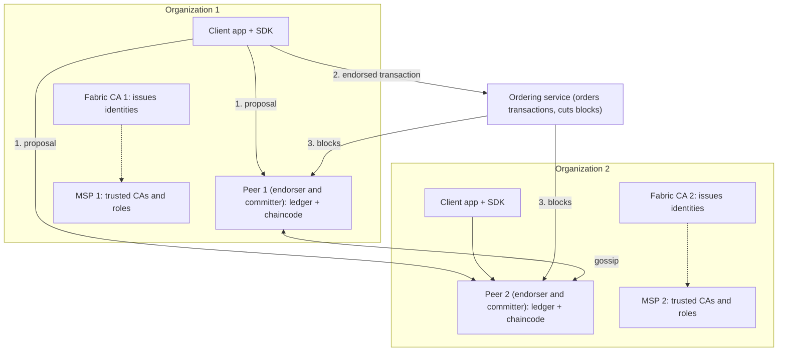
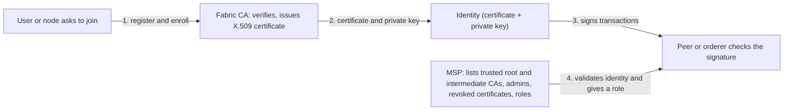
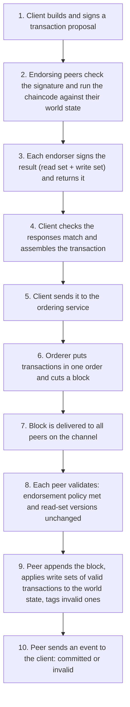

This note covers syllabus <Syl m="4" />, section 4.2: introduction to Hyperledger, tools and frameworks, Hyperledger Fabric, and the comparison between Fabric and other technologies. Paxos, Raft and PBFT in general, Ripple and Corda have their own notes; here only the parts that Fabric uses are covered.

## The basics first

- A **public blockchain** (Bitcoin, Ethereum) is open: anyone can join, nobody knows who anyone is, and trust comes from mining and many anonymous nodes. A **private or permissioned blockchain** is closed: only invited, known organizations can join. <Cite id="blockchain-fundamentals-fabric-docs" />
- A **digital certificate** (X.509) is a signed document that links a name to a public key, like an ID card with your photo. A **Certificate Authority (CA)** is the office that issues these ID cards. A **PKI** (public key infrastructure) is the whole system of CAs, certificates and rules around them. <Cite id="hyperledger-fabric-wiki-pki" />
- A **digital signature** is made with a private key and checked with the matching public key from the certificate. It proves who signed and that the message was not changed.
- A **consortium** is a group of companies (banks, a manufacturer and its suppliers) that run one shared network together.
- A **ledger** is the record book. A **smart contract** is a program that runs on the ledger. Fabric calls it **chaincode**. <Cite id="hyperledger-fabric-smartcontract" />

Analogy: a public blockchain is a town square where anyone can walk in and speak. Fabric is a company office building. You need an ID card from the front desk (the CA), the security guard checks the card against the list of allowed companies (the MSP), and each meeting room (a channel) only lets in the people who belong to that meeting.

## What is Hyperledger, and where does Fabric fit?

<Box kind="definition">

**Hyperledger** is an open-source collaborative effort, started by the Linux Foundation in December 2015, to build blockchain technologies for business. **Hyperledger Fabric** is its best-known framework: a modular, permissioned distributed ledger platform for enterprise use, in which known organizations run peers and ordering nodes, and chaincode runs in standard programming languages. <Cite id="hyperledger-fabric-wiki-hyperledger" /> <Cite id="hyperledger-fabric-whatis" /> <Cite id="hyperledger-fabric-ibm-fabric" />

</Box>

Hyperledger is not one blockchain. It is a family of projects, in two groups. <Cite id="hyperledger-fabric-wiki-hyperledger" />

| Group | Examples | What they do |
|---|---|---|
| Frameworks (blockchain platforms) | Fabric, Sawtooth, Besu, Indy | Complete platforms for running a ledger. Sawtooth is Intel's (it allows swapping consensus in a running network; it was archived in February 2024). Besu is an enterprise Ethereum client. Indy is for decentralized identity. |
| Tools | Caliper, Cello, Explorer, Aries | Caliper measures performance (transactions per second, latency). Cello deploys blockchains "as a service". Explorer lets you browse blocks. Aries is a toolkit for decentralized identity. |

The idea began in early 2016, when the first proposals joined work from Digital Asset, Blockstream's libconsensus and IBM's OpenBlockchain. That code was named Fabric. Fabric was first contributed by IBM and Digital Asset; in January 2019 its first long-term-support release (v1.4) was announced, and in September 2024 it became a project of LF Decentralized Trust, which now hosts the Hyperledger projects. <Cite id="hyperledger-fabric-wiki-hyperledger" /> <Cite id="hyperledger-fabric-lfdt" />

**Why was Fabric needed?** Businesses wanted shared records between companies, but Bitcoin and Ethereum did not fit: everything is visible to everyone, transactions are slow, anonymous participants are not allowed in regulated work, and a coin plus mining adds cost. Fabric answers with known members, private channels, a fast agreement step, and no coin. <Cite id="hyperledger-fabric-whatis" /> <Cite id="hyperledger-fabric-gfg-fabric" />

## Main features of Fabric

1. **Permissioned.** Every participant is identified. There is no anonymous membership. <Cite id="hyperledger-fabric-whatis" />
2. **Modular and pluggable.** Consensus (the ordering service), the identity service (MSP) and the state database can be swapped, so one design serves different trust levels. <Cite id="hyperledger-fabric-androulaki-2018" />
3. **Confidential.** Channels give each group its own ledger, and private data collections hide details even inside a channel. <Cite id="hyperledger-fabric-channels" /> <Cite id="hyperledger-fabric-private-data" />
4. **Standard languages.** Chaincode is written in Go, Node.js (JavaScript) or Java, not in a special language. <Cite id="hyperledger-fabric-chaincode-lifecycle" />
5. **No native cryptocurrency needed.** The platform does not depend on a coin or on mining. <Cite id="hyperledger-fabric-androulaki-2018" />
6. **Execute-order-validate.** Transactions are run before they are ordered, so only the endorsing peers do the work, not every node. <Cite id="hyperledger-fabric-androulaki-2018" />

## Fabric v1 architecture

The question "Explain Hyperledger Fabric v1 architecture" has come in several papers (see the list at the end). Fabric v1 introduced the design below: it split the work of the old design into three roles, **peers that execute and commit, an ordering service that orders, and clients that propose**. That split is the heart of the answer. <Cite id="hyperledger-fabric-androulaki-2018" /> <Cite id="hyperledger-fabric-network" />

<Cite id="hyperledger-fabric-gfg-fabric" loc="diagram" /> <Cite id="hyperledger-fabric-txflow" loc="diagram" />

The components, one by one:

| Component | What it is | What it does |
|---|---|---|
| Organization (member) | A company in the network | Owns peers, runs a CA, defines an MSP. Several organizations form a consortium. <Cite id="hyperledger-fabric-network" /> |
| Client application | Software using a Fabric SDK (Node.js, Java, Go) | Builds and signs a transaction proposal, sends it to peers, then sends the endorsed result to the ordering service. <Cite id="hyperledger-fabric-txflow" /> |
| Peer | A node that holds a copy of the ledger and runs chaincode | Does the work of endorsing (running chaincode and signing) and of committing blocks. <Cite id="hyperledger-fabric-peers" /> |
| Ordering service | A set of ordering nodes, often run by an organization or group | Receives endorsed transactions, puts them in one order per channel, cuts them into blocks and delivers the blocks. It does not run chaincode or look at the contents. <Cite id="hyperledger-fabric-ordering" /> |
| Certificate Authority (Fabric CA) | The identity office of an organization | Registers users and nodes, issues and renews or revokes their certificates. <Cite id="hyperledger-fabric-ca-guide" /> |
| MSP | A definition (folders and rules) | Says which CAs an organization trusts and what role each identity has. <Cite id="hyperledger-fabric-membership" /> |
| Channel | A private sub-network | Its own members, its own ledger, its own chaincode. <Cite id="hyperledger-fabric-channels" /> |
| Ledger | World state plus blockchain | Stores the current values and the full history. <Cite id="hyperledger-fabric-ledger" /> |
| Chaincode | The smart contract | Business rules; runs in a Docker container separate from the peer. <Cite id="hyperledger-fabric-chaincode-lifecycle" /> |

### Peers and their roles

Every peer is an ordinary node of one organization, but it can play different roles (one peer can play several at once). <Cite id="hyperledger-fabric-peers" /> <Cite id="hyperledger-fabric-glossary" />

- **Endorsing peer.** Named by the endorsement policy. It runs the chaincode on a proposal, signs the result (the endorsement) and returns it. It changes nothing on the ledger at this step.
- **Committing peer.** Every peer on the channel is one. It validates each block and writes it to its own ledger.
- **Anchor peer.** A peer that other organizations can always find. Gossip uses it so that peers of different organizations learn about each other. Each organization on a channel should have at least one anchor peer.
- **Gossip.** Peers pass blocks and private data to each other by gossip (each forwards to a few random peers) so that all peers catch up even if the ordering service delivers to only some of them. <Cite id="hyperledger-fabric-gossip" />

### The ledger: world state plus blockchain

A Fabric ledger has two parts. <Cite id="hyperledger-fabric-ledger" />

- **World state.** A database of the current value of every key (for example `car42 -> owner Asha`). Programs read it fast. It can change often. LevelDB is the default; CouchDB is the option for rich queries.
- **Blockchain (transaction log).** An append-only chain of blocks that records every transaction that produced the world state. It cannot be edited.

If the world state were lost it can be rebuilt by replaying the blockchain.

### Chaincode

Chaincode is the Fabric word for the smart contract. It is a program (Go, Node.js or Java) that reads and writes the world state, and it runs inside a Docker container, isolated from the peer. A chaincode can only touch its own part of the state, unless it is allowed to call another chaincode. Before use, the organizations agree on its name, version and endorsement policy through the chaincode lifecycle (install, approve by enough organizations, commit to the channel). <Cite id="hyperledger-fabric-chaincode-lifecycle" /> <Cite id="hyperledger-fabric-smartcontract" />

## Identity: Fabric CA and MSP

<Box kind="definition">

The **Fabric CA** is the certificate authority of Fabric: it registers identities, issues enrollment certificates (X.509), and renews or revokes them. The **Membership Service Provider (MSP)** is the component (in practice a set of folders added to the configuration) that defines which root and intermediate CAs an organization accepts and turns each valid identity into a role, so that every node can check who is allowed to do what. <Cite id="hyperledger-fabric-ca-guide" /> <Cite id="hyperledger-fabric-membership" />

</Box>

The docs use a card analogy: identities are like credit cards, and the MSP is the list of card providers the shop accepts. The CA is the card provider; the MSP is the shop's "accepted cards" list that turns a valid card into permission. <Cite id="hyperledger-fabric-membership" />

<Cite id="hyperledger-fabric-identity" loc="diagram" /> <Cite id="hyperledger-fabric-membership" loc="diagram" />

| Point | Fabric CA | MSP |
|---|---|---|
| What it is | A server (with a client tool) that you run | A configuration: folders of certificates and keys plus rules |
| Main job | Create identities: register, enroll, renew, revoke | Recognize identities and assign roles and permissions |
| Question it answers | "Who is this? Here is a certificate." | "Is this certificate from a CA we trust, and what is this person allowed to do?" |
| Output | X.509 certificates (enrollment certificates) and keys | A decision: valid or not, and which role (admin, peer, client, orderer, member) |
| Also does | Can use LDAP as user registry; can act as a root or an intermediate CA | Lists revoked identities; defines admins of an organization |
| Scope | Per CA server | Local MSP (on a node or user) and channel MSP (in channel configuration) |
| Is it required? | Every network needs a CA; Fabric CA is the one that comes with Fabric | Always required: every organization and node needs an MSP |

<Cite id="hyperledger-fabric-ca-guide" /> <Cite id="hyperledger-fabric-membership" /> <Cite id="hyperledger-fabric-identity" />

Two kinds of MSP differ only by scope. A **local MSP** belongs to one node or user and says who administers that node. A **channel MSP** lives in the channel configuration and says which organizations are members of the channel and what policies apply, so all peers and orderers on the channel judge identities the same way. The MSP folders hold the root CA certificates, intermediate CA certificates, the administrators, a list of revoked certificates, and (for a node) the node's own signing certificate and private key. The docs note that despite the name, the MSP "does not actually provide anything" itself; it is the configuration that other components use. <Cite id="hyperledger-fabric-membership" />

<Box kind="exam">

Exam mein English mein likho: "The Fabric CA issues and manages digital identities (certificates) for members, whereas the MSP defines which CAs and identities an organization trusts and maps each identity to a role, so that peers and orderers can authenticate and authorize every request."

</Box>

## Transaction lifecycle: execute, order, validate

Older blockchains order first and execute later, so every node runs every transaction. Fabric reverses it into three phases. <Cite id="hyperledger-fabric-androulaki-2018" /> <Cite id="hyperledger-fabric-txflow" />

<Cite id="hyperledger-fabric-txflow" loc="diagram" /> <Cite id="hyperledger-fabric-gfg-fabric" loc="diagram" />

**Step by step, in simple words.** <Cite id="hyperledger-fabric-txflow" />

1. **Proposal.** The application, using the SDK, builds a request ("call this chaincode function with these inputs") and signs it with the user's key. It sends it to the peers named by the endorsement policy.
2. **Endorsement (execute).** Each endorsing peer checks that the proposal is well formed, was not sent before (replay protection), has a valid signature (using the MSP) and that the sender may write on this channel. Then it runs the chaincode on its current world state. This is only a simulation: nothing is written to the ledger yet.
3. **Proposal response.** The result is a **read set** (keys read with their version numbers) and a **write set** (keys and new values), signed by the peer. <Cite id="hyperledger-fabric-readwrite" />
4. **Check and assemble.** The client collects the responses and checks they are the same.
5. **Ordering.** The client sends the transaction (channel ID, read-write set, endorsers' signatures) to the ordering service. The orderer does not need to understand the contents; it only orders transactions and groups them into blocks per channel.
6. **Delivery.** Blocks are delivered to all peers of the channel.
7. **Validation.** Each peer checks, for every transaction in the block, (a) the endorsement policy is satisfied, and (b) no key in the read set has changed since it was read (this stops double spending). Transactions are tagged valid or invalid.
8. **Commit.** The peer appends the whole block (including invalid transactions, marked invalid) to the blockchain and writes the write sets of the valid ones to the world state.
9. **Event.** The peer notifies the client whether the transaction was committed or invalidated.

**Worked example (the docs' radish market).** Client A wants to buy radishes from B. The endorsement policy says both peerA and peerB must endorse. The proposal goes to both, each simulates it and signs the same read-write set, the client sends it to the orderer, the orderer puts it in a block with other transactions, both peers validate it and update the radish and money balances. <Cite id="hyperledger-fabric-txflow" />

**Why this design?** Because only the endorsing peers run the chaincode, work is shared out (better scalability), chaincode need not be fully deterministic across all nodes since conflicting results are caught, and confidential logic can be kept to a few organizations. The price is that a transaction can be marked invalid at the end, and the application must retry. <Cite id="hyperledger-fabric-androulaki-2018" />

## The ordering service and consensus

Fabric does not have one built-in consensus algorithm like proof of work. Agreement on a transaction comes from the three phases together: the endorsement policy (who must approve), the ordering service (what order), and validation (is it still valid in that order). The ordering service is the pluggable part. <Cite id="hyperledger-fabric-ordering" /> <Cite id="hyperledger-fabric-whatis" />

| Ordering service | What it is | Fault tolerance | Status |
|---|---|---|---|
| Solo | One single ordering node | None (single point of failure) | For tests only; deprecated in v2.x |
| Kafka | Uses an Apache Kafka cluster to order messages | Crash faults | The main choice in v1; deprecated in v2.x, not supported in v3.x |
| Raft | Leader and followers; a leader is elected per channel and replicates to followers | Crash fault tolerant (needs a majority) | New in v1.4.1; the recommended one |
| BFT (SmartBFT) | Can stand malicious nodes too | Byzantine fault tolerant | New in v3.0 |

<Cite id="hyperledger-fabric-ordering" />

The v1 papers and questions mean Solo and Kafka. A crash fault means a node simply stops. A Byzantine fault means a node may lie or act maliciously; the general ideas of Paxos, Raft and PBFT are in the fault-tolerant consensus note. <Cite id="consensus-mining-wiki-bft" />

## Channels and private data

A **channel** is a private "subnet" of communication between two or more members. It has its own members, its own ledger, its own chaincode and its own ordering. A peer on channel A cannot see the transactions of channel B. To create a channel, the members agree on its configuration (organizations, anchor peers, policies), which becomes the first (genesis) block of the channel's ledger. <Cite id="hyperledger-fabric-channels" /> <Cite id="hyperledger-fabric-network" />

Example: a supply chain with a manufacturer, a transporter, a bank and a competitor-supplier. The manufacturer, transporter and bank share one channel; the manufacturer and the competitor-supplier share another, so they never see each other's prices.

Sometimes even inside a channel a few organizations want to keep data to themselves. **Private data collections** store the actual data only on the peers of the chosen organizations (passed by gossip), while the ordering service and the other organizations only see a **hash** of it on the channel ledger. The hash proves the data existed and was not changed. <Cite id="hyperledger-fabric-private-data" />

## Endorsement policies

An **endorsement policy** says which organizations must sign (endorse) a transaction for it to be valid. It is set per chaincode when the chaincode is defined on the channel. The syntax is `AND`, `OR` or `OutOf(n, ...)` over *principals* such as `'Org1MSP.peer'` (a peer of Org1). <Cite id="hyperledger-fabric-endorsement" /> <Cite id="hyperledger-fabric-policies" />

| Policy | Meaning |
|---|---|
| `AND('Org1MSP.peer', 'Org2MSP.peer')` | One signature from each of the two |
| `OR('Org1MSP.peer', 'Org2MSP.peer')` | One signature from either |
| `OutOf(2, 'Org1MSP.peer', 'Org2MSP.peer', 'Org3MSP.peer')` | Any two of the three |
| `OR('Org1MSP.member', AND('Org2MSP.member', 'Org3MSP.member'))` | Org1, or both Org2 and Org3 |

A stronger policy is safer (more parties must agree) but slower and fails if an organization is offline. A weaker one is faster and more available but trusts fewer parties.

<Sum>

<Given>

Policy `OutOf(2, 'Org1MSP.peer', 'Org2MSP.peer', 'Org3MSP.peer')`. Three transactions arrive in a block, with these endorsements. T1: Org1 and Org3. T2: Org2 only. T3: Org1, Org2 and Org3.

</Given>

<Find>

which transactions satisfy the policy, and the number of different pairs of organizations that satisfy it.

</Find>

<Steps>

1. The policy needs at least 2 distinct signatures out of the 3 organizations. *Reason: `OutOf(2, ...)` means any 2 of the listed principals.*
2. T1 has 2 signatures (Org1, Org3). $2 \ge 2$, so it passes.
3. T2 has 1 signature (Org2). $1 < 2$, so it fails and is tagged invalid.
4. T3 has 3 signatures. $3 \ge 2$, so it passes (extra signatures do no harm).
5. Pairs that satisfy the policy: choose 2 of 3 organizations, $\binom{3}{2} = \frac{3 \times 2}{2 \times 1} = 3$. They are (Org1, Org2), (Org1, Org3) and (Org2, Org3).

</Steps>

<Answer>

T1 and T3 are valid on the policy, T2 is invalid. There are 3 minimum signing pairs.

</Answer>

<Box kind="verify">

List the pairs by hand: Org1-Org2, Org1-Org3, Org2-Org3 gives 3, matching the formula. T1 is the pair Org1-Org3, which is in the list, so it passes. T2 has no complete pair, so it fails. Also the docs say `OutOf(2, A, B)` equals `AND(A, B)`: with 2 principals the only pair is both, so 1 pair, consistent with $\binom{2}{2} = 1$.

</Box>

</Sum>

## Double spending: the read-set check

During validation each peer compares the version numbers in a transaction's read set with the current world state. If a key changed after the transaction read it, the transaction is marked invalid and its writes are not applied. This is why two transactions that use the same old balance in one block cannot both succeed. <Cite id="hyperledger-fabric-readwrite" /> <Cite id="hyperledger-fabric-txflow" />

<Sum>

<Given>

World state: `A = 100` (version v1), `B = 50` (version v1). Both transactions were simulated before the block, so both read A at v1. T1 moves 30 from A to B. T2 moves 40 from A to B. Both are endorsed correctly, and the orderer puts T1 first, then T2, in one block.

</Given>

<Find>

the final balances of A and B, and which transaction is valid.

</Find>

<Steps>

1. Validate T1. Its read set has A at v1 and B at v1, and the world state is still A v1 and B v1. The versions match, so T1 is valid. *Reason: nothing changed since T1 read the keys.*
2. Apply T1's write set: $A = 100 - 30 = 70$ and $B = 50 + 30 = 80$. Both keys get a new version, v2.
3. Validate T2. Its read set still says A at v1, but A is now at v2. The versions do not match, so T2 is invalid. *Reason: T2 calculated its result from the old balance of 100.*
4. T2's write set (A = 60, B = 90) is not applied. T2 stays in the block but is tagged invalid.
5. Final state: $A = 70$, $B = 80$.

</Steps>

<Answer>

T1 valid, T2 invalid. Final balances A = 70 and B = 80 (the application must resubmit T2 if still needed).

</Answer>

<Box kind="verify">

Money is conserved: before, $100 + 50 = 150$; after, $70 + 80 = 150$. Had T2 wrongly been applied on top of T1 (using the old 100), the total would be wrong. Applying T2 properly on the new balance 70 would give A = 30 and B = 120, total 150, which is what a resubmitted T2 (move 40) would do.

</Box>

</Sum>

## Fault tolerance of the ordering service

Raft and BFT need a minimum number of ordering nodes to keep working when some fail. Raft is **crash fault tolerant**: it keeps working as long as a **majority (quorum)** of the nodes is alive. A BFT service tolerates $f$ faulty (even malicious) nodes if there are at least $3f + 1$ nodes in all. <Cite id="hyperledger-fabric-ordering" /> <Cite id="consensus-mining-wiki-bft" />

<Sum>

<Given>

A Raft ordering service with $n = 5$ nodes, compared with $n = 3$ and $n = 4$. Also, a BFT ordering service that must survive $f = 2$ Byzantine nodes.

</Given>

<Find>

the quorum and the number of crashed nodes each Raft cluster survives, and the minimum number of BFT nodes.

</Find>

<Steps>

1. Raft quorum is a majority: $\lfloor n/2 \rfloor + 1$. *Reason: two majorities always overlap, so two leaders can never both be chosen.*
2. $n = 3$: quorum $= 1 + 1 = 2$, so crashes survived $= 3 - 2 = 1$.
3. $n = 4$: quorum $= 2 + 1 = 3$, so crashes survived $= 4 - 3 = 1$. A fourth node adds no extra tolerance.
4. $n = 5$: quorum $= 2 + 1 = 3$, so crashes survived $= 5 - 3 = 2$.
5. BFT with $f = 2$: $n \ge 3f + 1 = 3 \times 2 + 1 = 7$.

</Steps>

<Answer>

Raft: 3 nodes survive 1 crash, 4 nodes survive 1, 5 nodes survive 2 (quorum 3 of 5). BFT for $f = 2$ needs at least 7 nodes.

</Answer>

<Box kind="verify">

The Fabric docs say that with five nodes you can lose two (leaving three, a majority): matches. Check BFT for the smaller case: $f = 1$ gives $3 \times 1 + 1 = 4$ nodes, the well-known minimum for one Byzantine node. Check 7 nodes with 2 faulty: 5 honest nodes remain, and $5 > 2 \times 2$ so honest nodes outnumber the faulty ones when a quorum of $2f + 1 = 5$ replies.

</Box>

</Sum>

## Fabric compared with other technologies

The syllabus asks for a comparison with other technologies. <Cite id="hyperledger-fabric-whatis" /> <Cite id="hyperledger-fabric-gfg-fabric" />

| Point | Bitcoin | Ethereum | Hyperledger Fabric |
|---|---|---|---|
| Type | Public, permissionless | Public, permissionless (private versions exist) | Private, permissioned |
| Participants | Anonymous, anyone | Anonymous, anyone | Known, identified by CA and MSP |
| Consensus | Proof of work | Proof of stake (earlier proof of work) | Pluggable ordering service (Raft, BFT, earlier Kafka) plus endorsement policy |
| Native coin | Bitcoin (BTC) | Ether (ETH), needed for gas | None required |
| Smart contract | Limited script | Solidity on the EVM | Chaincode in Go, JavaScript or Java in Docker |
| Execution model | Order-execute | Order-execute (every node runs every contract) | Execute-order-validate (only endorsers run it) |
| Privacy | Everything public | Everything public | Channels and private data |
| Speed | Slow (about 10 minutes per block) | Faster but limited | Faster, no mining, number depends on setup |
| Typical use | Money | DApps, tokens, DeFi | Business consortia: supply chain, trade finance, healthcare |

## Advantages, limitations and uses

**Advantages.** <Cite id="hyperledger-fabric-gfg-fabric" /> <Cite id="hyperledger-fabric-ibm-fabric" />

- Known participants and access control, so suited to regulated business.
- Channels and private data give confidentiality between competitors.
- No mining or coin, so cheaper to run and faster.
- Modular: consensus and other parts can be changed.
- Open source and chaincode in common languages, so easy for teams to start.

**Limitations.**

- Complex to set up (CAs, MSPs, channels, orderers, policies).
- Less decentralized: the organizations in the consortium (and whoever runs the orderers) must be trusted to some extent; a crash-fault-tolerant orderer does not protect against a malicious orderer.
- Performance depends on network size, configuration and chaincode complexity.
- Transactions can be invalidated at commit time (read-set conflicts), so applications need retry logic.
- Interoperability with other blockchains is limited.

**Uses.** Supply chain tracking, trade finance and paperless trading, insurance claims and KYC, healthcare records, and digital identity. <Cite id="hyperledger-fabric-gfg-fabric" /> <Cite id="hyperledger-fabric-ibm-fabric" />

**Conclusion.** Hyperledger Fabric is a modular, permissioned blockchain for businesses: known members, private channels, chaincode in ordinary languages and a three-phase execute-order-validate flow with a pluggable ordering service, with no mining and no built-in coin.

## Which past-paper question asks what

- <PYQ id="2022-12-ce/q3b" />, <PYQ id="2023-05-ce/q3b" />, <PYQ id="2024-12-ce/q6b" /> and <PYQ id="2025-05-ce/q2b" />: Fabric v1 architecture. Use the components table, the architecture diagram, the ledger, the transaction flow and the ordering services (Solo and Kafka).
- <PYQ id="2023-12/q3b" />, <PYQ id="2024-12/q3b" />, <PYQ id="2025-05/q4a" /> and <PYQ id="2023-12-ce/q6b" />: Fabric "in detail". Add the history, features, CA and MSP, channels, comparison and uses.
- <PYQ id="2023-12-ce/q3a" />: compare MSP and Fabric CA and their role. Use the CA versus MSP table and diagram.
- <PYQ id="2024-12/q6a" />: transaction lifecycle in a private blockchain. Use the three-phase flow and its diagram.
