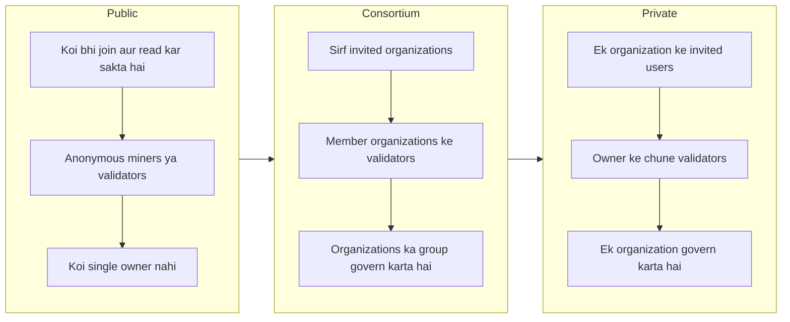
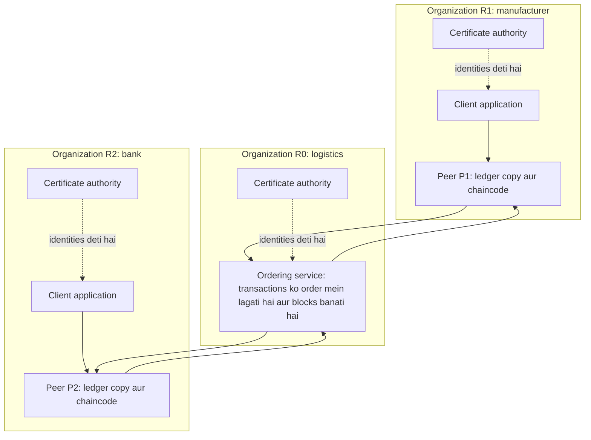
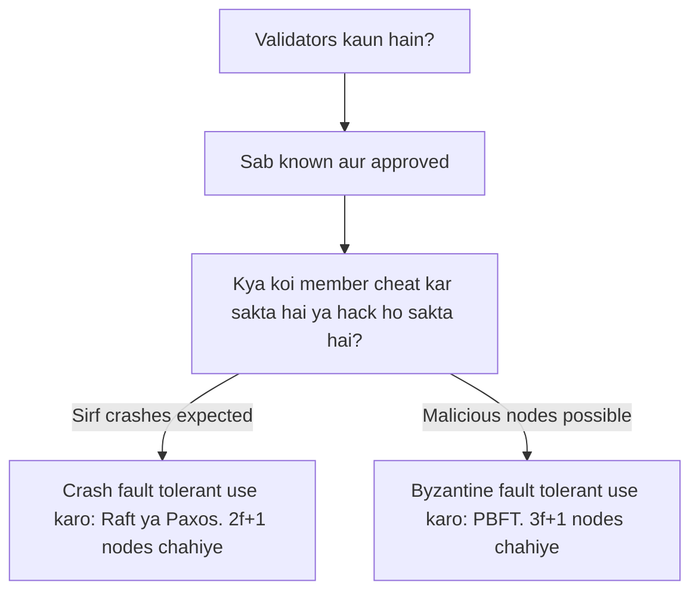
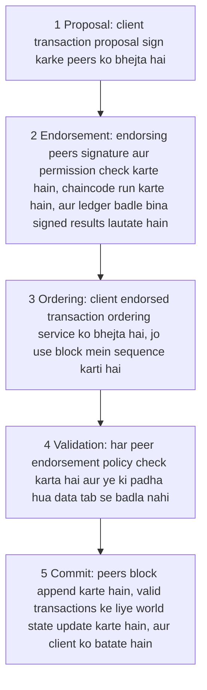

Ye note syllabus <Syl m="4" />, section 4.1 cover karta hai: private blockchain ka introduction, key characteristics, uski need, private aur consortium blockchains ke examples, aur private blockchain mein smart contracts. Hyperledger platform, Paxos, Raft, PBFT, Corda, Ripple aur Quorum ke apne notes hain; yahan wo sirf wahan aate hain jahan private chain samajhne mein madad karte hain.

## Pehle basics

- **Blockchain** ek shared ledger hai jisme records blocks mein group hote hain, aur har block pichle block ka hash rakhta hai. <Cite id="blockchain-fundamentals-nist-8202" />
- **Node** wo computer hai jo ledger ki copy rakhta hai aur network mein hissa leta hai.
- **Consensus** wo rule hai jisse nodes agree karte hain ki agla block kaunsa hoga.
- **Permissionless** ka matlab koi bhi bina poochhe join kar sakta hai (Bitcoin). **Permissioned** ka matlab invitation chahiye, aur aapki identity known hoti hai. <Cite id="blockchain-fundamentals-wiki-blockchain" />
- **Identity** yahan ek digital certificate hai jo kehta hai "ye node Bank A ka hai". Ise ek trusted authority (certificate authority, CA) deti hai. <Cite id="private-blockchain-fabric-identity" />

Analogy: public blockchain town square ka public notice board hai; koi bhi aakar padh sakta hai aur (rules ke hisaab se) likh sakta hai. Private blockchain company office ke andar ka notice board hai; sirf ID card wale staff andar aa sakte hain, aur office manager decide karta hai ki kaun likh sakta hai. Consortium blockchain ek shared building ka board hai jise wahan ki companies ki committee chalati hai.

## Private blockchain kya hai?

<Box kind="definition">

**Private blockchain** ek permissioned distributed ledger hai jo ek specific group tak limited hota hai, aam taur pe ek organization. Sirf authorized participants ise padh sakte hain, transactions bhej sakte hain ya blocks validate kar sakte hain, aur owner membership aur rules control karta hai. <Cite id="private-blockchain-gfg-private" />

</Box>

Wikipedia seedha kehta hai: "A private blockchain is permissioned. One cannot join it unless invited by the network administrators." <Cite id="blockchain-fundamentals-wiki-blockchain" /> **Consortium blockchain** bhi permissioned hai, lekin ise ek nahi balki organizations ka group chalata hai, aur wo milkar transactions validate karte hain. <Cite id="private-blockchain-gfg-consortium" />

## Private blockchain ki need

<PYQ id="2023-12/q1d" />

Jo company blockchain ke achhe parts (shared record, tamper evidence, automation) chahti hai, wo aksar public chain use nahi kar sakti. Reasons:

1. **Privacy.** Public chain pe har full node data dekh sakta hai. Bank ya hospital customer data wahan nahi rakh sakta. Fabric ka introduction kehta hai ki enterprises ko identifiable participants, privacy aur high throughput chahiye, jo open networks ke liye mushkil hai. <Cite id="private-blockchain-fabric-whatis" />
2. **Speed aur cost.** Public networks hazaron strangers ke beech slow, costly consensus (proof of work) chalate hain. Ek chhota known group bahut jaldi agree kar leta hai. <Cite id="private-blockchain-gfg-pubpriv" />
3. **Known participants aur accountability.** Business mein pata hona chahiye ki kisne kya kiya. Known identities ka matlab misconduct trace karke network ke governance ke under handle ho sakta hai. <Cite id="private-blockchain-fabric-whatis" />
4. **Control aur compliance.** Owner rules fix kar sakta hai, members add ya remove kar sakta hai aur regulations follow kar sakta hai (jaise data-protection laws), jo us chain pe possible nahi jiska koi owner nahi. <Cite id="private-blockchain-gfg-private" />
5. **Coin ki zaroorat nahi.** Private chain bina native cryptocurrency ya mining reward ke chal sakti hai. <Cite id="private-blockchain-gfg-pubpriv" />
6. **Reconciliation kam.** Business chain mein companies apne alag records rakhti hain aur phir match karti hain; ek shared ledger duplicate records hata deta hai aur legacy systems ko replace karta hai. <Cite id="private-blockchain-gfg-pubpriv" />

## Key characteristics

<PYQ id="2024-12/q1d" />

| Characteristic | Matlab |
|---|---|
| Permissioned access | Sirf approved participants join karte hain; membership network deta hai. |
| Known identities | Har node aur user ke paas certificate hota hai, kuch anonymous nahi. |
| Centralized ya shared governance | Ek owner (private) ya group (consortium) rules set karta hai, protocol changes approve karta hai aur permissions manage karta hai. |
| Fast transactions | Validators kam, isliye consensus jaldi, throughput high. |
| Low energy use | Proof-of-work mining nahi. |
| Data privacy | Sensitive data un members se chhupa sakte hain jinhe dekhna zaroori nahi (channels, private data). |
| Customizable | Consensus method aur rules business ke hisaab se chune jaate hain. |
| Selective transparency | Zaroorat pe data auditors ya partners ke saath share ho sakta hai. |
| Easy integration | Company ke existing systems ke saath fit hota hai. |
| Native token optional | Miners ko pay karne ke liye zaroori nahi. |

<Cite id="private-blockchain-gfg-private" /> <Cite id="private-blockchain-gfg-pubpriv" />

## Advantages aur disadvantages

| Advantages | Disadvantages |
|---|---|
| High throughput, kam delay | Kam decentralized: owner ya members pe trust karna padta hai |
| Data ki privacy | Nodes kam, isliye insider ya chhota colluding group zyada nuksan kar sakta hai |
| Known users, isliye fraud trace karna aasaan | Bahar ke log chain khud verify nahi kar sakte |
| Chalane mein kam energy aur cost | Setup aur upkeep costly ho sakta hai |
| Rules aur access flexible | Dusri blockchains se connect karna mushkil |
| Regulation follow karne mein madad | Participants ke beech governance disputes |

<Cite id="private-blockchain-gfg-private" /> <Cite id="private-blockchain-gfg-pubpriv" />

## Public, private aur consortium ka comparison

<PYQ id="2022-12-ce/q1a" /> <PYQ id="2023-05-ce/q1a" /> <PYQ id="2023-12-ce/q1d" /> <PYQ id="2024-05-ce/q2a" /> <PYQ id="2025-05-ce/q5a" /> <PYQ id="2025-05/q1e" />

<Cite id="private-blockchain-gfg-pubpriv" loc="diagram" />

| Point | Public | Consortium | Private |
|---|---|---|---|
| Access | Permissionless; koi bhi | Permissioned; chune hue organizations | Permissioned; ek organization ka invitation |
| Participants | Ek dusre ko nahi jaante | Known member organizations | Owner ko known |
| Control | Decentralized | Partly decentralized (shared) | Centralized |
| Consensus | Proof of work, proof of stake | Members ke beech voting ya BFT-style | Raft, PBFT-style, proof of elapsed time, Istanbul BFT |
| Speed | Slow, kam transactions per second | Fast | Sabse fast |
| Energy | High (proof of work) | Low | Low |
| Privacy | Low; data sabko dikhta hai | Medium se high; sirf members | High |
| Attack risk | Badi chains pe 51% attack mushkil | Trust chahiye; colluding members nuksan kar sakte hain | Bura insider poore network ko khatre mein daal sakta hai |
| Native token | Aam taur pe haan | Optional | Zaroori nahi |
| Examples | Bitcoin, Ethereum | Quorum, Hyperledger consortia | R3 Corda, B3i (insurance), EWF (energy) |

<Cite id="private-blockchain-gfg-pubpriv" /> <Cite id="private-blockchain-gfg-consortium" /> <Cite id="blockchain-fundamentals-wiki-blockchain" />

Sources examples ko alag-alag column mein rakhte hain, kyunki kai platforms (Fabric, Corda, Quorum) private ya consortium dono tarah chal sakte hain. Exam mein type likho aur ek-do well-known examples do.

## Private aur consortium blockchains ke examples

<PYQ id="2024-12/q5a" />

- **Hyperledger Fabric.** Linux Foundation ke under (ab LF Decentralized Trust) ek permissioned blockchain platform, jo originally IBM aur Digital Asset ne contribute kiya. <Cite id="private-blockchain-wiki-hyperledger" /> <Cite id="private-blockchain-wiki-fabric" />
- **Quorum.** Ethereum ka permissioned variant jo JPMorgan ne 2017 mein apne JPM Coin payments system ke base ke roop mein propose kiya. <Cite id="private-blockchain-wiki-eea" />
- **Hyperledger Besu.** Enterprise use ke liye bana Ethereum client. <Cite id="private-blockchain-wiki-hyperledger" />
- **R3 Corda.** Banks aur dusri firms ke liye platform jahan transaction sirf uski parties ko dikhta hai. <Cite id="private-blockchain-gfg-pubpriv" />
- **B3i (insurance) aur EWF (energy).** Industry networks jinhe GeeksforGeeks private blockchains mein list karta hai. <Cite id="private-blockchain-gfg-pubpriv" />
- **Typical uses:** supply-chain tracing, trade finance aur bank payments, healthcare records sharing, identity management, insurance claims aur company ke andar voting. <Cite id="private-blockchain-gfg-private" />

Corda, Ripple aur Quorum ki detail unke apne note mein hai.

## Case study: companies ke beech trade ke liye consortium blockchain

Teen organizations socho: ek manufacturer (R1), ek bank (R2) aur ek logistics company (R0). Ye ek dusre pe poora bharosa nahi karte aur aaj har ek orders, shipments aur payments ka apna record rakhta hai. Wo ek **consortium** banate hain aur Hyperledger Fabric pe ek shared ledger banate hain. Neeche ka structure Fabric documentation ke sample network ko follow karta hai, jahan do organizations peers deti hain aur teesra ordering service chalata hai. <Cite id="private-blockchain-fabric-network" />

<Cite id="private-blockchain-fabric-network" loc="diagram" />

Parts kaise kaam karte hain:

1. **Organizations aur consortium rules.** Organizations ek **channel configuration** pe agree karte hain: members kaun hain, har ek kya kar sakta hai aur kaunsi policies lagti hain. Naya member tabhi add hota hai jab uski permissions pe agree ho jaye aur configuration update ho. <Cite id="private-blockchain-fabric-network" />
2. **Certificate authorities (CA) aur membership service providers (MSP).** Har organization ki CA certificates deti hai jo uske logon aur nodes ko identify karte hain aur transactions sign karne mein use hote hain; MSP network ko batata hai ki kaunse certificates us organization ke valid members hain. <Cite id="private-blockchain-fabric-identity" />
3. **Peers.** Har peer ek organization ka hota hai aur ledger ki copy aur smart contract (chaincode) rakhta hai. Endorsing peers contract run karte hain; saare peers blocks validate aur commit karte hain. <Cite id="private-blockchain-fabric-peers" />
4. **Ordering service.** Orderer nodes endorsed transactions ko blocks mein sequence karte hain aur peers ko bhejte hain. Wo contract run nahi karte aur content judge nahi karte. <Cite id="private-blockchain-fabric-ordering" />
5. **Channels.** Channel ek sub-network hai: sirf uske members uske transactions aur data dekhte hain. Ek hi company kai channels pe ho sakti hai, har ek ka alag ledger. <Cite id="private-blockchain-fabric-whatis" /> <Cite id="private-blockchain-fabric-peers" />
6. **Ledger.** Har peer **blockchain** (saare transactions ka append-only log) aur **world state** (har item ki current value ka database, jo zaroorat pe chain se dobara ban sakta hai) rakhta hai. <Cite id="private-blockchain-fabric-ledger" />
7. **Private data.** Agar channel ke sabko transaction dikhna chahiye lekin uske data ka kuch hissa sirf kuch ko, to private data collection wo hissa sirf authorized peers pe rakhti hai aur ledger pe sirf uska hash daalti hai. <Cite id="private-blockchain-fabric-privatedata" />

**Consortium ke benefits:** ek shared source of truth, reconciliation nahi, jaldi settlement, members ke beech privacy, aur audit trail. **Limits:** members ko governance pe agree karna padta hai, upgrades ke liye kai members ki consent chahiye, aur kuch members collude kar sakte hain. <Cite id="private-blockchain-gfg-consortium" />

## Private blockchain mein consensus

<PYQ id="2023-12/q6b" />

Proof of work isliye hai kyunki strangers ek dusre pe trust nahi kar sakte. Private chain mein validators **known aur approved** hote hain, isliye halka method kaafi hai. Choice is pe depend karti hai ki kaunsi failure expect karte ho:

- **Crash fault tolerant (CFT).** Nodes band ya crash ho sakte hain, lekin jhooth nahi bolte. **Raft** aur **Paxos** examples hain. Raft ek leader chunta hai; leader commands apne log mein likhta hai aur followers ko copy karta hai, aur entry tab committed maani jaati hai jab majority ne use store kar liya. Base Raft Byzantine fault tolerant nahi hai, kyunki nodes chune hue leader pe trust karte hain. <Cite id="private-blockchain-wiki-raft" /> <Cite id="private-blockchain-wiki-paxos" />
- **Byzantine fault tolerant (BFT).** Kuch nodes malicious ho sakte hain ya conflicting messages bhej sakte hain. **PBFT** aur uske variants (jaise Istanbul BFT) rounds mein vote karte hain aur tab bhi agree ho jaate hain jab faulty nodes ek-tihai se kam hon. <Cite id="private-blockchain-fabric-ordering" /> <Cite id="private-blockchain-gfg-pubpriv" />
- **Dusre:** proof of authority (approved validators blocks sign karte hain) aur proof of elapsed time bhi private chains ke liye bataye jaate hain. <Cite id="private-blockchain-gfg-pubpriv" />

Fabric mein ordering consensus pluggable hai, network ke trust ke hisaab se: low-risk single-company network ke liye crash fault tolerance, multi-party network ke liye Byzantine fault tolerance. Production ke liye Raft recommended hai; BFT version 3.0 mein aaya. <Cite id="private-blockchain-fabric-whatis" /> <Cite id="private-blockchain-fabric-ordering" />

Paxos, Raft aur PBFT ki detail BFT note mein hai. Do chhoti calculations se node counts ka matlab samajh aata hai.

<Sum>

<Given>

Ek company Raft ordering service chalati hai aur chahti hai ki 2 ordering nodes crash ho jaayein tab bhi wo chalti rahe.

</Given>

<Find>

kitne ordering nodes chahiye.

</Find>

<Steps>

1. Raft ko leader chunne aur entries commit karne ke liye majority nodes alive chahiye. *Reason: majority aadhe se zyada hoti hai, isliye do alag groups kabhi dono majority nahi ho sakte.*
2. $f$ crashes survive karne ke liye bache hue nodes majority hone chahiye. $n = 2f + 1$ nodes mein $f$ crashes ke baad $f + 1$ bachte hain, jo $2f + 1$ ki majority hai.
3. $f = 2$ rakho: $n = 2 \times 2 + 1 = 5$.

</Steps>

<Answer>

5 ordering nodes.

</Answer>

<Box kind="verify">

5 mein se 2 crash: 3 bachte hain, aur 5 ki majority 3 hai, to service chalti rehti hai. 4 nodes mein majority 3 hai, to 2 crash hone par sirf 2 bachte hain aur service ruk jaati hai. Ye Fabric documentation se match karta hai: teen nodes ek failure survive karte hain aur paanch do. <Cite id="private-blockchain-fabric-ordering" />

</Box>

</Sum>

<Sum>

<Given>

10 banks ka consortium BFT chain (PBFT style) chalata hai. Rule hai $n \ge 3f + 1$, jahan $f$ faulty (shayad malicious) nodes ki wo sankhya hai jo network survive kar sakta hai.

</Given>

<Find>

sabse bada $f$ jo network tolerate karta hai, aur $f = 2$ tolerate karne ke liye sabse chhota $n$.

</Find>

<Steps>

1. $n \ge 3f + 1$ ko rearrange karo: $f \le (n - 1) / 3$. *Reason: isse diye gaye $n$ ke liye maximum faulty nodes milte hain.*
2. $n = 10$ ke liye: $f \le (10 - 1) / 3 = 3$. Ye exactly 3 hai, isliye sabse bada whole number $f = 3$ hai.
3. $f = 2$ ke liye: $n \ge 3 \times 2 + 1 = 7$.

</Steps>

<Answer>

10 banks zyada se zyada 3 faulty nodes tolerate karte hain; 2 faulty nodes tolerate karne ke liye kam se kam 7 nodes chahiye.

</Answer>

<Box kind="verify">

$f = 3$ aur $n = 10$ ke saath: $3 \times 3 + 1 = 10$, to rule barabari pe hold karta hai, aur 3 faulty 10 ke ek-tihai (3.33) se kam hain. Doosre tareeke se check: 6 nodes mein $f \le (6 - 1)/3 = 1.67$, to sirf 1 fault tolerate hota hai, 2 nahi, isliye 7 sabse chhota hai. Ye Fabric note se match karta hai ki BFT ek-tihai se kam nodes ke fail hone ko tolerate karta hai. <Cite id="private-blockchain-fabric-ordering" />

</Box>

</Sum>

## Private blockchain mein transaction lifecycle

<PYQ id="2024-12/q6a" />

Neeche ke steps Hyperledger Fabric ke hain, jo sabse jaana-maana private aur consortium platform hai. Bitcoin se main difference: transaction pehle **execute aur endorse hota hai, phir order hota hai, phir validate hota hai**. <Cite id="private-blockchain-fabric-txflow" />

<Cite id="private-blockchain-fabric-txflow" loc="diagram" />

1. **Proposal.** Client application proposal banata hai, apne credentials se sign karta hai aur endorsement policy mein bataye peers ko bhejta hai.
2. **Endorsement.** Har endorsing peer check karta hai ki proposal sahi bana hai, replay nahi hai, signature sahi hai, aur bhejne wale ko channel pe likhne ki permission hai. Wo chaincode ko current state pe run karta hai aur signed result lautata hai (jo data padha aur jo likhega). Ledger abhi nahi badalta.
3. **Ordering.** Client endorsements collect karke transaction ordering service ko bhejta hai. Orderer transactions ko fixed order mein lagata hai aur blocks mein group karta hai, andar dekhe bina.
4. **Validation.** Peers block receive karte hain aur check karte hain ki har transaction endorsement policy satisfy karta hai aur jo usne padha tha wo execute hone ke baad se badla nahi. Har transaction valid ya invalid mark hota hai.
5. **Commit.** Har peer block ko apni chain mein append karta hai aur valid transactions ke writes world state mein apply karta hai. Events client ko outcome batate hain. Invalid transactions chain pe rehte hain lekin state nahi badalte. <Cite id="private-blockchain-fabric-txflow" /> <Cite id="private-blockchain-fabric-ledger" />

**Endorsement policy** decide karti hai ki kin organizations ko sign karna hai. Fabric documentation ke examples: ek named organization ka signature, do organizations dono ka, ya channel ki organizations ki majority (default). <Cite id="private-blockchain-fabric-policies" />

<Sum>

<Given>

Ek channel mein 5 organizations hain aur default endorsement policy "majority" hai.

</Given>

<Find>

kam se kam kitni organizations ko transaction endorse karna hoga.

</Find>

<Steps>

1. 5 ki majority aadhe se zyada hoti hai, yaani 2.5 se zyada.
2. 2.5 ke upar sabse chhota whole number 3 hai.

</Steps>

<Answer>

3 organizations.

</Answer>

<Box kind="verify">

2 endorsements ke saath, 5 mein se 2 yaani 40 percent hai, jo aadhe se zyada nahi. 3 ke saath 60 percent hai, to 3 sabse chhoti majority hai.

</Box>

</Sum>

Public chain pe har node har transaction execute karta hai. Fabric endorsing, ordering aur validation ko alag karta hai, jisse alag organizations alag parts check kar sakti hain aur contracts sirf endorsers tak private rehte hain. <Cite id="private-blockchain-fabric-peers" />

## Private blockchain mein smart contracts

Smart contract blockchain pe stored ek program hai jo conditions poori hone par chalta hai. Private chains bhi inhe support karti hain, aur wahan ye aur zyada matter karte hain kyunki network organizations ke beech business rules automate karne ke liye use hota hai.

- **Fabric chaincode.** Smart contract business objects ka transaction logic define karta hai (jaise car ka owner badalna). **Chaincode** wo package hai jo related smart contracts ko channel pe deploy karne ke liye group karta hai. Contracts Go, JavaScript ya Java mein likhe ja sakte hain. Wo world state padhte aur likhte hain, aur har chaincode ki endorsement policy batati hai ki kin organizations ko sign karna hai. <Cite id="private-blockchain-fabric-smartcontract" /> <Cite id="private-blockchain-wiki-fabric" />
- **Permissioned Ethereum pe Solidity.** Quorum aur Besu Ethereum-based hain, isliye contracts Solidity mein likhe jaate hain aur Ethereum virtual machine pe chalte hain, lekin network sirf approved nodes chalate hain. <Cite id="private-blockchain-wiki-eea" /> <Cite id="private-blockchain-wiki-hyperledger" />
- **Contract ki privacy.** Fabric mein sirf endorsing peers ko chaincode chahiye, aur channels contract ka data uske members ke andar rakhte hain. Public chain har transaction har node pe run karti hai, jo confidentiality limit karta hai. <Cite id="private-blockchain-fabric-peers" /> <Cite id="private-blockchain-fabric-whatis" />

| Point | Public chain pe smart contract | Private chain pe smart contract |
|---|---|---|
| Kaun run karta hai | Har node | Approved nodes (ya sirf endorsers) |
| Code aur data kaun dekh sakta hai | Sab | Channel ya network ke members |
| Fee | Native coin mein gas | Aksar coin nahi; cost company ka apna infrastructure |
| Speed | Public network se limited | Fast, nodes kam |

<Cite id="private-blockchain-fabric-whatis" />

## Quick exam summary

- **Private blockchain:** ek organization ka chalaya permissioned ledger; known users; fast; private; kam decentralized.
- **Consortium blockchain:** kai organizations ka milkar chalaya permissioned ledger.
- **Need:** privacy, speed, accountability, control, mining nahi.
- **Consensus:** Raft ya Paxos (crash faults, 2f+1 nodes), PBFT (Byzantine faults, 3f+1 nodes), proof of authority.
- **Lifecycle (Fabric):** proposal, endorsement, ordering, validation, commit.
- **Examples:** Hyperledger Fabric, Quorum, Besu, Corda.
- **Trade-off:** open decentralization ki jagah owner ya members pe trust.

Exam mein English mein likho: "A private blockchain is a permissioned blockchain controlled by a single organization, in which only authorized and identified participants can read, write and validate."
