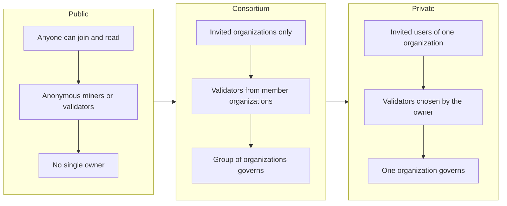
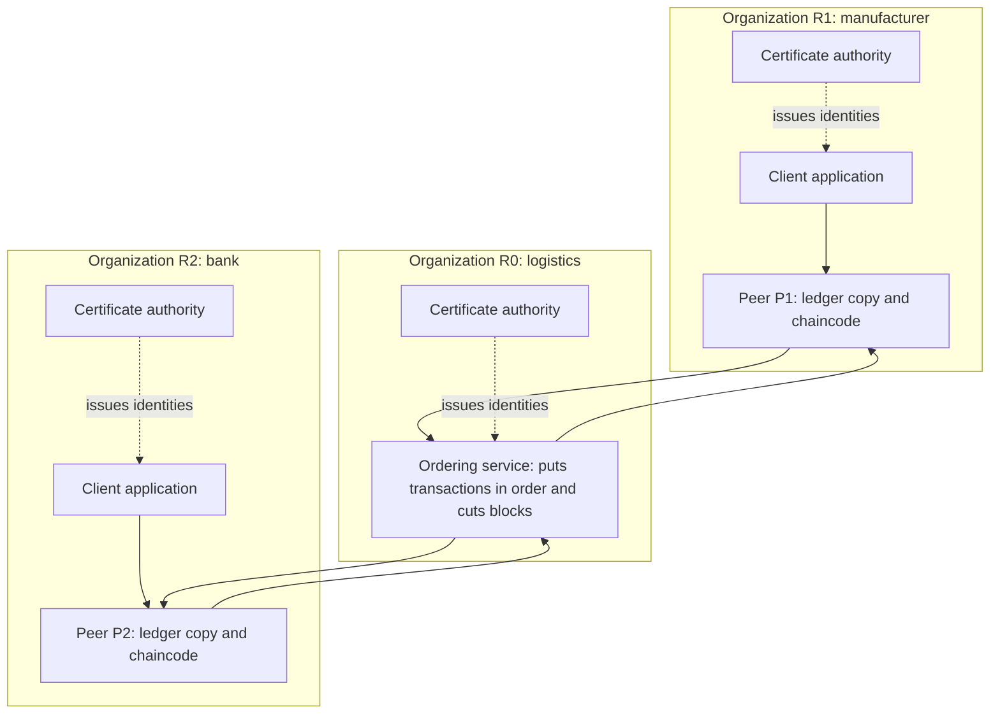
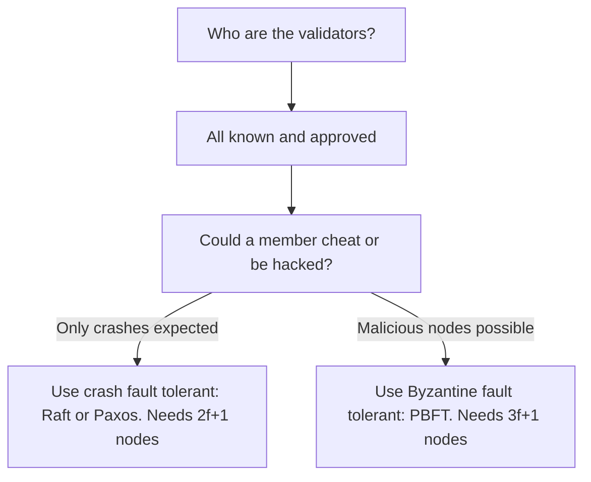
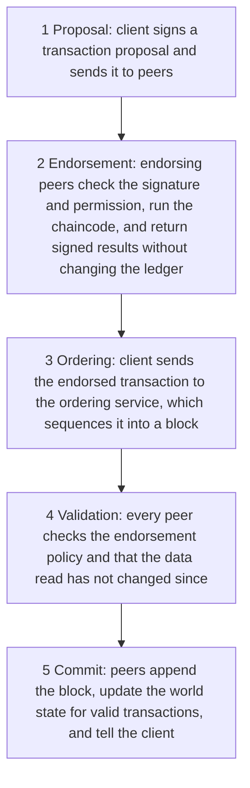

This note covers syllabus <Syl m="4" />, section 4.1: introduction to private blockchain, its key characteristics, the need for it, examples of private and consortium blockchains, and smart contracts in a private blockchain. The Hyperledger platform, Paxos, Raft, PBFT, Corda, Ripple and Quorum have their own notes; here they appear only where they explain a private chain.

## The basics first

- A **blockchain** is a shared ledger where records are grouped into blocks, and each block carries the hash of the one before it. <Cite id="blockchain-fundamentals-nist-8202" />
- A **node** is a computer that keeps a copy of the ledger and takes part in the network.
- **Consensus** is the rule by which the nodes agree on which block is next.
- **Permissionless** means anyone can join without asking (Bitcoin). **Permissioned** means you need an invitation, and your identity is known. <Cite id="blockchain-fundamentals-wiki-blockchain" />
- An **identity** here is a digital certificate that says "this node belongs to Bank A". It is issued by a trusted authority (a certificate authority, CA). <Cite id="private-blockchain-fabric-identity" />

Analogy: a public blockchain is a public notice board in a town square; anyone can walk up, read it and (by the rules) add to it. A private blockchain is the notice board inside a company office; only staff with an ID card can enter, and the office manager decides who may write on it. A consortium blockchain is a board in a shared building run by a committee of the companies that rent offices there.

## What is a private blockchain?

<Box kind="definition">

A **private blockchain** is a permissioned distributed ledger that is limited to a specific group, usually one organization. Only authorized participants can read it, send transactions or validate blocks, and the owner controls membership and the rules. <Cite id="private-blockchain-gfg-private" />

</Box>

The Wikipedia article puts it simply: "A private blockchain is permissioned. One cannot join it unless invited by the network administrators." <Cite id="blockchain-fundamentals-wiki-blockchain" /> A **consortium blockchain** is also permissioned, but it is run by a group of organizations, not one, and they validate transactions together. <Cite id="private-blockchain-gfg-consortium" />

## Need for a private blockchain

<PYQ id="2023-12/q1d" />

A company that wants the good parts of blockchain (shared record, tamper evidence, automation) often cannot use a public chain. Reasons:

1. **Privacy.** On a public chain every full node can see the data. A bank or hospital cannot put customer data there. Fabric's own introduction says enterprises need identifiable participants, privacy, and high throughput, which open networks struggle to give. <Cite id="private-blockchain-fabric-whatis" />
2. **Speed and cost.** Public networks run slow, costly consensus (proof of work) among thousands of strangers. A small known group can agree much faster. <Cite id="private-blockchain-gfg-pubpriv" />
3. **Known participants and accountability.** In business, you must know who did what. Known identities mean misconduct can be traced and handled under the network's governance. <Cite id="private-blockchain-fabric-whatis" />
4. **Control and compliance.** The owner can fix rules, add or remove members and follow regulations (for example data-protection laws), which is not possible on a chain nobody owns. <Cite id="private-blockchain-gfg-private" />
5. **No need for a coin.** A private chain can work without a native cryptocurrency or mining reward. <Cite id="private-blockchain-gfg-pubpriv" />
6. **Cut reconciliation.** Companies in a business chain each keep their own records and then reconcile them; one shared ledger removes duplicate records and replaces legacy systems. <Cite id="private-blockchain-gfg-pubpriv" />

## Key characteristics

<PYQ id="2024-12/q1d" />

| Characteristic | Meaning |
|---|---|
| Permissioned access | Only approved participants join; membership is granted by the network. |
| Known identities | Every node and user has a certificate, so nothing is anonymous. |
| Centralized or shared governance | One owner (private) or a group (consortium) sets rules, approves protocol changes and manages permissions. |
| Fast transactions | Few validators, so consensus is quick and throughput is high. |
| Low energy use | No proof-of-work mining. |
| Data privacy | Sensitive data can be hidden from members who need not see it (channels, private data). |
| Customizable | The consensus method and rules are chosen to fit the business. |
| Selective transparency | Data can be shared with auditors or partners when needed. |
| Easy integration | Fits with existing company systems. |
| Native token optional | Not needed to pay miners. |

<Cite id="private-blockchain-gfg-private" /> <Cite id="private-blockchain-gfg-pubpriv" />

## Advantages and disadvantages

| Advantages | Disadvantages |
|---|---|
| High throughput and low delay | Less decentralized: you must trust the owner or the members |
| Privacy of data | Few nodes, so an insider or a small colluding group can do more harm |
| Known users, so fraud is easier to trace | Outsiders cannot verify the chain themselves |
| Low energy and cost to run | Setup and upkeep can be costly |
| Rules and access are flexible | Hard to connect with other blockchains |
| Helps meet regulation | Governance disputes among participants |

<Cite id="private-blockchain-gfg-private" /> <Cite id="private-blockchain-gfg-pubpriv" />

## Public, private and consortium compared

<PYQ id="2022-12-ce/q1a" /> <PYQ id="2023-05-ce/q1a" /> <PYQ id="2023-12-ce/q1d" /> <PYQ id="2024-05-ce/q2a" /> <PYQ id="2025-05-ce/q5a" /> <PYQ id="2025-05/q1e" />

<Cite id="private-blockchain-gfg-pubpriv" loc="diagram" />

| Point | Public | Consortium | Private |
|---|---|---|---|
| Access | Permissionless; anyone | Permissioned; chosen organizations | Permissioned; invitation by one organization |
| Participants | Do not know each other | Known member organizations | Known to the owner |
| Control | Decentralized | Partly decentralized (shared) | Centralized |
| Consensus | Proof of work, proof of stake | Voting or BFT-style among members | Raft, PBFT-style, proof of elapsed time, Istanbul BFT |
| Speed | Slow, low transactions per second | Fast | Fastest |
| Energy | High (proof of work) | Low | Low |
| Privacy | Low; data visible to all | Medium to high; members only | High |
| Attack risk | 51% attack is hard on big chains | Needs trust; colluding members can harm | A bad insider can endanger the whole network |
| Native token | Usually yes | Optional | Not necessary |
| Examples | Bitcoin, Ethereum | Quorum, Hyperledger consortia | R3 Corda, B3i (insurance), EWF (energy) |

<Cite id="private-blockchain-gfg-pubpriv" /> <Cite id="private-blockchain-gfg-consortium" /> <Cite id="blockchain-fundamentals-wiki-blockchain" />

Sources disagree on which examples belong in which column, because many platforms (Fabric, Corda, Quorum) can be run as either a private or a consortium network. In an exam, name the type and give one or two well-known examples.

## Examples of private and consortium blockchains

<PYQ id="2024-12/q5a" />

- **Hyperledger Fabric.** A permissioned blockchain platform hosted by the Linux Foundation (now under LF Decentralized Trust), originally contributed by IBM and Digital Asset. <Cite id="private-blockchain-wiki-hyperledger" /> <Cite id="private-blockchain-wiki-fabric" />
- **Quorum.** A permissioned variant of Ethereum that JPMorgan proposed in 2017 as the base for its JPM Coin payments system. <Cite id="private-blockchain-wiki-eea" />
- **Hyperledger Besu.** An Ethereum client designed for enterprise use. <Cite id="private-blockchain-wiki-hyperledger" />
- **R3 Corda.** A platform for banks and other firms where only the parties to a transaction see it. <Cite id="private-blockchain-gfg-pubpriv" />
- **B3i (insurance) and EWF (energy).** Industry networks listed by GeeksforGeeks as private blockchains. <Cite id="private-blockchain-gfg-pubpriv" />
- **Typical uses:** supply-chain tracing, trade finance and bank payments, healthcare records sharing, identity management, insurance claims and internal company voting. <Cite id="private-blockchain-gfg-private" />

Corda, Ripple and Quorum are covered in detail in their own note.

## Case study: a consortium blockchain for trade between companies

Imagine three organizations: a manufacturer (R1), a bank (R2) and a logistics company (R0). They do not fully trust each other and today each keeps its own records of orders, shipments and payments. They form a **consortium** and build one shared ledger on Hyperledger Fabric. The structure below follows the sample network in the Fabric documentation, where two organizations contribute peers and a third runs the ordering service. <Cite id="private-blockchain-fabric-network" />

<Cite id="private-blockchain-fabric-network" loc="diagram" />

How the parts work:

1. **Organizations and consortium rules.** The organizations agree on a **channel configuration**: who the members are, what each may do and which policies apply. A new member is added only by agreeing on its permissions and updating this configuration. <Cite id="private-blockchain-fabric-network" />
2. **Certificate authorities (CA) and membership service providers (MSP).** Each organization's CA issues certificates that identify its people and nodes and are used to sign transactions; an MSP tells the network which certificates count as valid members of that organization. <Cite id="private-blockchain-fabric-identity" />
3. **Peers.** Each peer is owned by one organization and holds a copy of the ledger and the smart contract (chaincode). Endorsing peers run the contract; all peers validate and commit blocks. <Cite id="private-blockchain-fabric-peers" />
4. **Ordering service.** Orderer nodes sequence endorsed transactions into blocks and send them to peers. They do not run the contract or judge the content. <Cite id="private-blockchain-fabric-ordering" />
5. **Channels.** A channel is a sub-network: only its members see its transactions and data. The same company can be on several channels with a separate ledger for each. <Cite id="private-blockchain-fabric-whatis" /> <Cite id="private-blockchain-fabric-peers" />
6. **Ledger.** Each peer keeps the **blockchain** (an append-only log of all transactions) and the **world state** (a database of the current value of each item, rebuilt from the chain if needed). <Cite id="private-blockchain-fabric-ledger" />
7. **Private data.** If everyone on the channel should see a transaction but only some should see part of its data, a private data collection stores that part only on authorized peers and puts just its hash on the ledger. <Cite id="private-blockchain-fabric-privatedata" />

**Benefits for the consortium:** one shared source of truth, no reconciliation, quick settlement, privacy between members, and an audit trail. **Limits:** members must agree on governance, upgrades need many to consent, and a few members could collude. <Cite id="private-blockchain-gfg-consortium" />

## Consensus in a private blockchain

<PYQ id="2023-12/q6b" />

Proof of work exists because strangers cannot trust each other. In a private chain the validators are **known and approved**, so a lighter method is enough. The choice depends on what kind of failure you expect:

- **Crash fault tolerant (CFT).** Nodes may stop or crash, but they do not lie. **Raft** and **Paxos** are examples. Raft elects one leader; the leader appends commands to its log and copies them to followers, and an entry counts as committed once a majority has stored it. Base Raft is not Byzantine fault tolerant, because nodes trust the elected leader. <Cite id="private-blockchain-wiki-raft" /> <Cite id="private-blockchain-wiki-paxos" />
- **Byzantine fault tolerant (BFT).** Some nodes may be malicious or send conflicting messages. **PBFT** and its variants (for example Istanbul BFT) vote in rounds and still agree if fewer than one third of the nodes are faulty. <Cite id="private-blockchain-fabric-ordering" /> <Cite id="private-blockchain-gfg-pubpriv" />
- **Others:** proof of authority (approved validators sign blocks) and proof of elapsed time are also named for private chains. <Cite id="private-blockchain-gfg-pubpriv" />

Fabric lets you plug in the ordering consensus to match the trust in the network: crash fault tolerance for a low-risk single-company network, Byzantine fault tolerance for a multi-party network. Raft is the recommended production choice; BFT arrived in version 3.0. <Cite id="private-blockchain-fabric-whatis" /> <Cite id="private-blockchain-fabric-ordering" />

Detail on Paxos, Raft and PBFT is in the BFT note. Two small calculations show what the node counts mean.

<Sum>

<Given>

A company runs a Raft ordering service and wants it to keep working even if 2 ordering nodes crash.

</Given>

<Find>

the number of ordering nodes needed.

</Find>

<Steps>

1. Raft needs a majority of nodes alive to elect a leader and commit entries. *Reason: a majority is more than half, so two different groups can never both be a majority.*
2. To survive $f$ crashes, the nodes still alive must be a majority. With $n = 2f + 1$ nodes, $f$ crashes leave $f + 1$, which is a majority of $2f + 1$.
3. Put $f = 2$: $n = 2 \times 2 + 1 = 5$.

</Steps>

<Answer>

5 ordering nodes.

</Answer>

<Box kind="verify">

Crash 2 of 5: 3 remain, and a majority of 5 is 3, so the service still works. With 4 nodes, a majority is 3, so crashing 2 leaves only 2 and the service stops. This matches the Fabric documentation: three nodes survive one failure and five survive two. <Cite id="private-blockchain-fabric-ordering" />

</Box>

</Sum>

<Sum>

<Given>

A consortium of 10 banks runs a BFT chain (PBFT style). The rule is that $n \ge 3f + 1$, where $f$ is the number of faulty (possibly malicious) nodes the network can survive.

</Given>

<Find>

the largest $f$ the network tolerates, and the smallest $n$ needed to tolerate $f = 2$.

</Find>

<Steps>

1. Rearrange $n \ge 3f + 1$ to $f \le (n - 1) / 3$. *Reason: this gives the maximum faulty nodes for a given $n$.*
2. For $n = 10$: $f \le (10 - 1) / 3 = 3$. This is exactly 3, so the largest whole number is $f = 3$.
3. For $f = 2$: $n \ge 3 \times 2 + 1 = 7$.

</Steps>

<Answer>

10 banks tolerate up to 3 faulty nodes; tolerating 2 faulty nodes needs at least 7 nodes.

</Answer>

<Box kind="verify">

With $f = 3$ and $n = 10$: $3 \times 3 + 1 = 10$, so the rule holds with equality, and 3 faulty is below one third of 10 (3.33). Check the other way: with 6 nodes, $f \le (6 - 1)/3 = 1.67$, so only 1 fault is tolerated, not 2, which is why 7 is the smallest. This agrees with the Fabric note that BFT tolerates fewer than one third of nodes failing. <Cite id="private-blockchain-fabric-ordering" />

</Box>

</Sum>

## Transaction lifecycle in a private blockchain

<PYQ id="2024-12/q6a" />

The steps below are those of Hyperledger Fabric, the best-known private and consortium platform. The key difference from Bitcoin: a transaction is **executed and endorsed first, then ordered, then validated**. <Cite id="private-blockchain-fabric-txflow" />

<Cite id="private-blockchain-fabric-txflow" loc="diagram" />

1. **Proposal.** The client application builds a proposal, signs it with its credentials and sends it to peers named by the endorsement policy.
2. **Endorsement.** Each endorsing peer checks the proposal is well formed, not a replay, correctly signed, and that the sender is allowed to write on the channel. It runs the chaincode against the current state and returns a signed result (the data read and the data it would write). The ledger is not changed yet.
3. **Ordering.** The client collects the endorsements and sends the transaction to the ordering service. The orderer puts transactions in a fixed order and groups them into blocks, without looking inside them.
4. **Validation.** Peers receive the block and check that each transaction satisfies the endorsement policy and that nothing it read has changed since it was executed. Each transaction is marked valid or invalid.
5. **Commit.** Each peer appends the block to its chain and applies the writes of valid transactions to the world state. Events tell the client the outcome. Invalid transactions stay on the chain but do not change the state. <Cite id="private-blockchain-fabric-txflow" /> <Cite id="private-blockchain-fabric-ledger" />

An **endorsement policy** decides which organizations must sign. Examples from the Fabric documentation: a signature from one named organization, from both of two organizations, or a majority of the channel's organizations (the default). <Cite id="private-blockchain-fabric-policies" />

<Sum>

<Given>

A channel has 5 organizations and uses the default endorsement policy "majority".

</Given>

<Find>

the least number of organizations that must endorse a transaction.

</Find>

<Steps>

1. A majority is more than half of 5, which is more than 2.5.
2. The smallest whole number above 2.5 is 3.

</Steps>

<Answer>

3 organizations.

</Answer>

<Box kind="verify">

With 2 endorsements, 2 of 5 is 40 percent, which is not more than half. With 3, it is 60 percent, so 3 is the smallest majority.

</Box>

</Sum>

On a public chain every node executes every transaction. Fabric separates endorsing, ordering and validation, which lets different organizations check different parts and keeps contracts private to the endorsers. <Cite id="private-blockchain-fabric-peers" />

## Smart contracts in a private blockchain

A smart contract is a program stored on the blockchain that runs when its conditions are met. Private chains support them too, and they matter even more there because the network is used to automate business rules between organizations.

- **Fabric chaincode.** A smart contract defines the transaction logic for business objects (for example changing a car's owner). A **chaincode** is the package that groups related smart contracts for deployment on a channel. Contracts can be written in Go, JavaScript or Java. They read and write the world state, and each chaincode has an endorsement policy that says which organizations must sign. <Cite id="private-blockchain-fabric-smartcontract" /> <Cite id="private-blockchain-wiki-fabric" />
- **Solidity on permissioned Ethereum.** Quorum and Besu are Ethereum-based, so contracts are written in Solidity and run on the Ethereum virtual machine, but only approved nodes run the network. <Cite id="private-blockchain-wiki-eea" /> <Cite id="private-blockchain-wiki-hyperledger" />
- **Privacy of the contract.** In Fabric, only endorsing peers need the chaincode, and channels keep a contract's data inside its members. A public chain runs every transaction on every node, which limits confidentiality. <Cite id="private-blockchain-fabric-peers" /> <Cite id="private-blockchain-fabric-whatis" />

| Point | Smart contract on public chain | Smart contract on private chain |
|---|---|---|
| Who runs it | Every node | Approved nodes (or only endorsers) |
| Who can see the code and data | Everyone | Members of the channel or network |
| Fee | Gas paid in the native coin | Often no coin; cost is the company's own infrastructure |
| Speed | Limited by the public network | Faster, fewer nodes |

<Cite id="private-blockchain-fabric-whatis" />

## Quick exam summary

- **Private blockchain:** permissioned ledger run by one organization; known users; fast; private; less decentralized.
- **Consortium blockchain:** permissioned ledger run jointly by several organizations.
- **Need:** privacy, speed, accountability, control, no mining.
- **Consensus:** Raft or Paxos (crash faults, 2f+1 nodes), PBFT (Byzantine faults, 3f+1 nodes), proof of authority.
- **Lifecycle (Fabric):** proposal, endorsement, ordering, validation, commit.
- **Examples:** Hyperledger Fabric, Quorum, Besu, Corda.
- **Trade-off:** trust in the owner or members replaces open decentralization.
