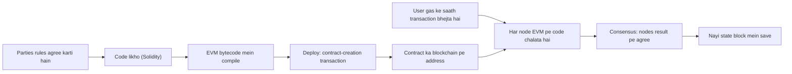
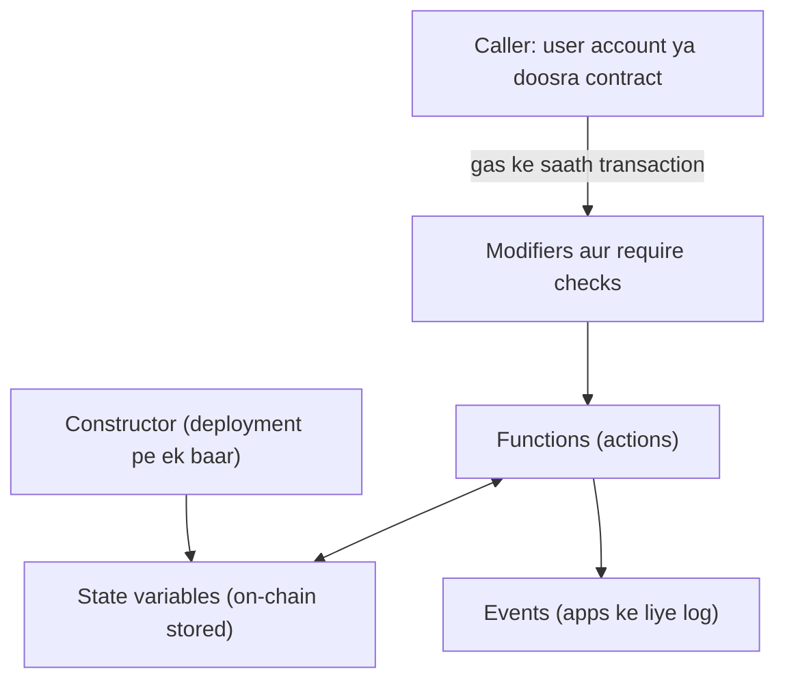
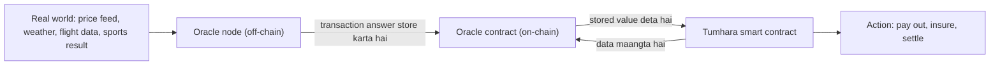
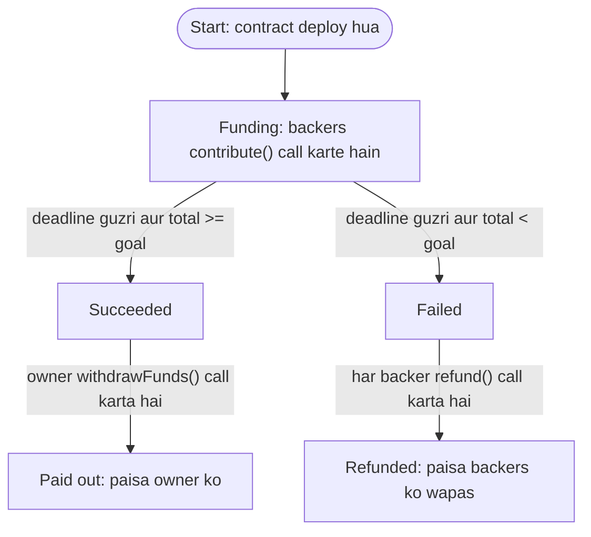

Ye note syllabus <Syl m="3" /> ke part 3.2 ko cover karta hai: smart contracts, unki history, characteristics, working, types, oracles, structure aur limitations, aur use cases, opportunities aur risks. Solidity language khud Solidity note mein hai; Ethereum, gas aur accounts Ethereum note mein hain.

## Pehle basics

- **Contract** ek agreement hota hai: "agar tum X karoge, to main Y karunga". Normally court, bank ya lawyer ye dekhta hai ki dono side apni baat nibhaayein.
- **Blockchain** ek shared record book hai jiski identical copies hazaaron computers (**nodes**) rakhte hain. Koi chupke se edit nahi kar sakta.
- Ethereum pe **account** ek address hota hai jo ether hold kar sakta hai. **User account** private key se control hota hai. **Contract account** apne code se control hota hai. <Cite id="smart-contracts-eth-docs" />
- **Transaction** ek signed message hai jo network se kuch karne ko kehta hai, jaise "1 ether bhejo" ya "ye function call karo". <Cite id="smart-contracts-me-ch7" loc="Life Cycle of a Smart Contract" />
- **EVM** (Ethereum Virtual Machine) har Ethereum node ke andar ka chhota computer hai jo contract code chalata hai. <Cite id="smart-contracts-eth-evm" />
- **Gas** computation ke har step ki fee hai. Ye isliye dete hain ki koi endless loops se network jam na kar de. <Cite id="smart-contracts-eth-gas" />
- **Deterministic** ka matlab: same input hamesha same output deta hai, har computer pe. Is note ke zyaadatar rules isi ek idea se samajh aate hain.

Analogy: **vending machine**. Tum sahi paise daalte ho aur button dabate ho; machine snack deti hai. Dukaandaar ki zaroorat nahi, kyunki rule machine ke andar built-in hai. Smart contract agreements ke liye vending machine hai. <Cite id="smart-contracts-eth-intro" />

## Smart contract kya hai

<Box kind="definition">

**Smart contract** ek computer program hai jo blockchain pe stored hota hai aur agreement ke terms ko automatically carry out karta hai jab conditions meet ho jaati hain. Ek baar deploy hone ke baad ye exactly waise hi chalta hai jaise code mein hai aur koi ek party use badal ya rok nahi sakti. <Cite id="smart-contracts-eth-intro" /> <Cite id="smart-contracts-ibm-smart-contracts" /> <Cite id="smart-contracts-gfg-smart-contracts" />

</Box>

Ye "if this, then that" logic ki tarah likha jaata hai: IF buyer price pay kare, THEN ownership transfer karo. <Cite id="smart-contracts-gfg-smart-contracts" />

**Ye kyun zaroori hai.** Normal contract mein tumhe kisi person ya office pe trust karna padta hai ki wo wahi kare jo agree hua tha. ethereum.org ke bicycle-race example mein Alice bet jeet jaati hai, lekin Bob paisa dene se mana kar deta hai aur kehta hai ki Alice ne cheat kiya. Conditions meet ho gayi, phir bhi tum Bob pe depend ho. Smart contract paisa khud hold karta hai aur code se payout karta hai, isliye koi bhi trust karne ki zaroorat nahi. <Cite id="smart-contracts-eth-intro" />

Naam ke baare mein ek note: Mastering Ethereum ke authors kehte hain ki Ethereum smart contracts "neither smart nor legal contracts" hain. Ye plain programs hain; wahan "contract" word ka koi legal meaning nahi. <Cite id="smart-contracts-me-ch7" loc="Smart Contracts and Solidity" /> Wikipedia bhi kehta hai ki smart contract aam taur pe apne aap mein legally binding agreement nahi hota. <Cite id="smart-contracts-wiki-smart-contract" />

<PYQ id="2024-12-ce/q1d" /> <PYQ id="2022-12-ce/q1b" />

## History

| Year | Kya hua |
|---|---|
| 1994 | Nick Szabo (computer scientist aur legal scholar) "smart contracts" ka pehla introduction likhte hain. <Cite id="smart-contracts-szabo-1994" /> |
| 1996 to 1997 | Szabo vending machine ko example banate hain aur batate hain ki public networks pe contracts ko secure kaise kiya ja sakta hai. <Cite id="smart-contracts-szabo-1997" /> <Cite id="smart-contracts-wiki-smart-contract" /> |
| 2009 | Bitcoin launch hota hai. Uske scripts simple conditions se coins lock kar sakte hain lekin jaanbujhkar limited hain (Turing-complete nahi). <Cite id="smart-contracts-gfg-smart-contracts" /> <Cite id="blockchain-fundamentals-nakamoto" /> |
| 2014 | Vitalik Buterin ka whitepaper Bitcoin ko smart-contract idea ka weak version kehta hai aur Turing-complete blockchain propose karta hai. <Cite id="smart-contracts-eth-whitepaper" /> <Cite id="smart-contracts-wiki-smart-contract" /> |
| 2015 | Ethereum live hota hai; koi bhi Solidity mein likhe contracts deploy kar sakta hai. |
| 2016 | The DAO, ek crowd-funded contract, US$100 million se zyada ka ether raise karta hai aur phir June 2016 mein ek bug exploit hone se lagbhag ek-tihai paisa kho deta hai. <Cite id="smart-contracts-wiki-dao" /> |

**Turing-complete** ka matlab language koi bhi computation express kar sakti hai, loops ke saath. Isi power se Ethereum contracts Bitcoin scripts se bahut zyada kar paate hain, aur isi wajah se gas chahiye taaki endless loops rukein.

## Characteristics

| Characteristic | Simple words mein matlab |
|---|---|
| Distributed | Har node contract ki copy rakhta hai aur use chalata hai. Koi single server nahi. |
| Deterministic | Same input aur same state se same result, chahe koi bhi chalaye. |
| Immutable | Deployment ke baad code edit nahi ho sakta. Badalna ho to naya contract deploy karo. |
| Autonomous | Ye khud chalta hai. Third party ki zaroorat nahi. |
| Transparent | Code aur purane calls ledger pe public hain, koi bhi inspect kar sakta hai. |
| Trustless | Tum code aur network pe trust karte ho, kisi person pe nahi. |
| Self-enforcing | Conditions true hote hi action ho jaata hai; koi mana nahi kar sakta. |
| Accurate aur fast | Utna hi accurate jitna code hai, lekin condition meet hote hi turant chalta hai. |

<Cite id="smart-contracts-gfg-smart-contracts" /> <Cite id="smart-contracts-me-ch7" loc="Smart Contracts and Solidity" /> <Cite id="smart-contracts-eth-intro" />

<Box kind="pitfall">

"Immutable" ka matlab code badal nahi sakta, ye nahi ki contract kabhi ruk nahi sakta. Purane contracts `SELFDESTRUCT` se khud ko delete kar sakte the, lekin EIP-6780 (2024 ka Dencun upgrade) ke baad wo contract ko hatata nahi, sirf tab jab wo usi transaction mein chale jisme contract bana tha. Contract ko aise switch (jaise paused flag) ke saath likha ja sakta hai jise code khud control kare. <Cite id="smart-contracts-me-ch7" loc="Smart Contracts and Solidity" />

</Box>

## Smart contract kaise kaam karta hai

Smart contracts sirf tab chalte hain jab koi transaction unhe call kare. Ye background mein "apne aap" nahi chalte; call ki kisi bhi chain ka pehla contract hamesha user account ke transaction se start hua hota hai. <Cite id="smart-contracts-me-ch7" loc="Life Cycle of a Smart Contract" />

1. **Terms agree karo.** Parties rules aur outcomes tay karti hain (jaise "goods pahunchne par paisa release karo").
2. **Code likho.** Developer rules ko Solidity jaisi language mein likhta hai.
3. **Compile karo.** Compiler code ko EVM bytecode mein badalta hai, jo low-level instructions hain jo EVM samajhta hai.
4. **Deploy karo.** Ek special contract-creation transaction ("to" field khaali) bytecode ko network pe bhejta hai. Mine hone ke baad contract ko apna address milta hai.
5. **Call karo.** User ya doosra contract us address pe transaction bhejta hai jisme function ka naam hota hai aur gas pay hoti hai.
6. **Execute karo aur agree karo.** Har node same state pe same code chalata hai. Consensus ensure karta hai ki sab same result accept karein.
7. **Ledger update karo.** Nayi state block mein record hoti hai. Ye record ab badla nahi ja sakta.

<Cite id="smart-contracts-me-ch7" loc="Life Cycle of a Smart Contract" /> <Cite id="smart-contracts-gfg-smart-contracts" />



<Cite id="smart-contracts-gfg-smart-contracts" loc="diagram" /> <Cite id="smart-contracts-me-ch7" loc="Life Cycle of a Smart Contract" />

## Smart contract ka structure

Solidity contract dusri languages ki class jaisa dikhta hai. Ye ek address pe rehta hai aur isme data (**state**) aur code (**functions**) hote hain. <Cite id="smart-contracts-eth-anatomy" /> <Cite id="smart-contracts-sol-structure" />

| Part | Kya hai | Example |
|---|---|---|
| Pragma aur licence line | Compiler ko batati hai ki kaun se Solidity versions allowed hain. | `pragma solidity ^0.8.20;` |
| State variables | Data jo blockchain pe permanently store hota hai. | `uint256 public totalRaised;` |
| Constructor | Deployment pe ek baar chalta hai, starting values set karne ke liye. | `constructor(uint256 _goal)` |
| Functions | Actions jo koi bhi call kar sakta hai. Kuch state badalte hain (gas lagti hai), kuch sirf padhte hain. | `function contribute()` |
| Modifiers | Functions mein jodne wale reusable checks, jaise "sirf owner". | `modifier onlyOwner()` |
| Events | Log mein likhe messages taaki apps dekh sakein ki kya hua. | `event Funded(address who, uint256 amount);` |
| Errors aur require checks | Rule fail ho to call rok dete hain aur uske saare changes undo kar dete hain. | `require(msg.value > 0)` |



<Cite id="smart-contracts-eth-anatomy" loc="diagram" /> <Cite id="smart-contracts-sol-structure" />

Public variable padhna node ke through free hai (transaction nahi chahiye). Jo bhi function state badalta hai uske liye transaction aur gas chahiye. <Cite id="smart-contracts-eth-anatomy" />

## Smart contracts ke types

Ek common textbook classification (GeeksforGeeks bhi use karta hai) mein teen types hain. <Cite id="smart-contracts-gfg-smart-contracts" />

| Type | Kya hai | Example |
|---|---|---|
| Smart legal contract | Legal meaning wala contract jiske terms code mein bhi hain, to "if this then that" wale parts khud chalte hain. Digital signatures use hote hain aur breach ke legal consequences ho sakte hain. | Due date aane par debt automatically pay karna. |
| DAO (decentralized autonomous organization) | Shared goals wala group jo contract code se chalta hai. Members tokens se vote karte hain; koi boss nahi. Paisa kaise kharch ho, ye code tay karta hai. | VitaDAO, ek community jo scientific research fund karti hai. |
| Application logic contract (ALC) | Application code jo doosre contracts ya devices se baat karta hai. Ye machines ke beech sign hota hai, logon ke beech nahi. | IoT sensor jo contract ke through payment trigger kare. |

<Cite id="smart-contracts-gfg-smart-contracts" /> <Cite id="smart-contracts-eth-dao" />

<Box kind="pitfall">

**Smart legal contract** (normal legal agreement jiske kuch terms code mein hain) aur Ethereum ke smart contract (sirf ek program) ko mix mat karo. Wikipedia kehta hai ki dono ko confuse nahi karna chahiye. <Cite id="smart-contracts-wiki-smart-contract" />

</Box>

Contracts ko sort karne ka ek aur useful tareeka, agar question "different types" poochhe: ye kya karte hain us hisaab se, jaise token contracts (coin ya NFT), escrow aur payment contracts, voting aur DAO contracts, aur DeFi contracts jaise lending aur exchange. <Cite id="smart-contracts-eth-intro" />

<PYQ id="2024-12-ce/q1d" />

## Oracles

**Problem.** Contract chalane par saare nodes ko same answer milna chahiye. Agar contract kisi website se "aaj ka dollar rate" khud la sakta, to ek node ko 83.10 dikhta aur doosre ko ek second baad 83.12, aur consensus toot jaata. Isliye contracts bahar ki websites ko khud call nahi kar sakte. Blockchains isolated hote hain, jaise bina internet ka computer. <Cite id="smart-contracts-eth-oracles" /> <Cite id="smart-contracts-chainlink-oracle-problem" />

<Box kind="definition">

**Oracle** ek service hai jo real-world (off-chain) information laati hai, check karti hai aur smart contracts ko bhejti hai. Isme aam taur pe ek on-chain contract aur ek off-chain "oracle node" hota hai jo data source padhta hai aur answer blockchain mein likh deta hai. <Cite id="smart-contracts-eth-oracles" /> <Cite id="smart-contracts-wiki-oracle" />

</Box>

Answer on-chain likh diya jaaye to har node wahi stored value padhta hai, isliye determinism bani rehti hai.



<Cite id="smart-contracts-eth-oracles" loc="diagram" /> <Cite id="smart-contracts-chainlink-oracle-problem" />

**Oracle ke kinds.** Direction ke hisaab se: input oracles data andar laate hain, output oracles contract ke results bahar real world mein bhejte hain (jaise payment aane par smart lock kholna), aur computational oracles bhaari kaam off-chain karte hain. Trust ke hisaab se: centralized (ek provider) ya decentralized (kai providers agree karte hain). <Cite id="smart-contracts-eth-oracles" />

**Risk.** Ek single oracle single point of failure hai. Wo jhooth bole ya hack ho jaaye to contract galat data pe action leta hai, isliye important contracts decentralized oracle networks use karte hain. Isse **oracle problem** kehte hain. <Cite id="smart-contracts-chainlink-oracle-problem" />

## State machine replication aur smart contracts

Ye part un questions ka jawab deta hai jo state machine replication describe karne aur smart contract ko state machine dikhane ko kehte hain.

### Basics: state machine kya hai

**State machine** wo cheez hai jo hamesha ek **state** mein hoti hai aur **input** aane par doosri state mein jaati hai. Traffic light ek example hai: states red, green, yellow hain aur timer input hai. Formally isme states ka set, inputs ka set, transition function (current state plus input se nayi state), output function aur ek start state hoti hai. <Cite id="smart-contracts-wiki-smr" />

State machine **deterministic** honi chahiye: agar do copies same state se start hon aur same inputs same order mein milein, to wo same state mein aur same outputs ke saath khatam hoti hain. <Cite id="smart-contracts-wiki-smr" />

### State machine replication (SMR)

<Box kind="definition">

**State machine replication** ek method hai fault-tolerant service banane ka: same deterministic state machine ki kai copies (replicas) alag servers pe rakho aur sabko same client requests same order mein process karao. <Cite id="smart-contracts-wiki-smr" /> <Cite id="smart-contracts-schneider-1990" />

</Box>

**Method ke steps:**

1. State machine ki copies kai independent servers pe rakho.
2. Client requests lo; har request ek input hai.
3. Inputs ke liye ek order pe agree ho. Ye sabse mushkil step hai aur ismein **consensus** protocol chahiye.
4. Har server inputs ko usi order mein chalata hai.
5. Client ko output se reply do, aur replicas ko differences ke liye compare karo.

<Cite id="smart-contracts-wiki-smr" />

**Function (hum ye kyun karte hain).** Ek replica crash ho jaaye ya galat answer de, to baaki agree karte rehte hain aur service chalti rehti hai. Sirf crashes ho to f faulty replicas sahne wali service ko 2f+1 copies chahiye. Agar replicas jhooth bol sakte hain (Byzantine faults), to zyada copies chahiye, aam taur pe 3f+1 (PBFT note dekho). <Cite id="smart-contracts-wiki-smr" /> <Cite id="smart-contracts-schneider-1990" />

### Blockchain SMR hai

| SMR idea | Blockchain mein |
|---|---|
| Replicas | Nodes, har ek ke paas poora ledger |
| State machine | Ledger plus contract storage, EVM se chalta hai |
| Inputs (client requests) | Transactions |
| Order pe agree hona | Consensus protocol (PoW, PoS, PBFT, ...) transactions ko ek order mein blocks mein daalta hai |
| Transition function | EVM jo contract code execute karta hai |
| Determinism | Contract code random ya off-chain data use nahi kar sakta, isliye oracles chahiye |

### Smart contract ek state machine ki tarah

Contract ki **state** uske stored variables (aur balance) hain. Function call karne wala **transaction** **input** hai. Function ka code **transition function** hai: wo rules check karta hai (`require`), variables badalta hai aur events banata hai (**output**). Contract ka deployed code aur starting values **start state** hain. Kyunki har node same code same order mein chalata hai, saare nodes ke paas hamesha same contract state hoti hai. Solidity ki apni documentation contracts ko stages wali state machines batati hai, jahan ek function call aksar ek stage khatam karke agle pe le jaata hai, aur modifiers tay karte hain ki kaun sa function kis stage mein chalega. <Cite id="smart-contracts-sol-patterns" /> <Cite id="smart-contracts-me-ch7" loc="Smart Contracts and Solidity" />

### Example: crowdfunding application

States: **Funding** (campaign open), **Succeeded** (deadline guzar gayi aur goal reach hua), **Failed** (deadline guzar gayi aur goal miss hua). Phir paisa bahar jaata hai: success ke baad owner withdraw karta hai, ya failure ke baad backers refund claim karte hain.



<Cite id="smart-contracts-sol-patterns" loc="diagram" /> <Cite id="smart-contracts-wiki-smr" />

Replication kaise hota hai: Asha ka contribution ek transaction hai. Network use baaki pending transactions ke beech order karta hai, har node uspe `contribute()` chalata hai, aur har node ki copy mein same naya total dikhta hai. Agar koi node cheat karke alag total dikhaye, to baaki nodes uska block reject kar dete hain, kyunki unke results alag hote hain. <Cite id="smart-contracts-schneider-1990" />

<Box kind="exam">

Exam mein English mein likho: "State machine replication keeps identical copies of a deterministic state machine on many nodes and feeds them the same inputs in the same order, so they always reach the same state. A blockchain does this with transactions as inputs and consensus fixing the order; a smart contract is the state machine, with its variables as state and its functions as transitions."

</Box>

<PYQ id="2023-05-ce/q3a" /> <PYQ id="2023-12-ce/q2a" />

## Example: crowdfunding platform ko manage karna

Crowdfunding ka matlab kai chhote contributors ek project ko fund karte hain. Usual platform paisa hold karta hai aur tay karta hai ki kise milega, to tumhe platform pe trust karna padta hai. Smart contract us trust ki jagah fixed rules rakhta hai: <Cite id="smart-contracts-eth-dao" />

- Creator contract deploy karte waqt ek **goal** aur ek **deadline** set karta hai.
- Backers contract ko ether bhejte hain. Contract record rakhta hai ki kisne kitna bheja.
- Deadline se pehle creator paise ko haath nahi laga sakta.
- Deadline ke baad, agar goal reach hua to sirf creator withdraw kar sakta hai. Nahi hua to har backer exactly wahi wapas le sakta hai jo usne bheja tha.
- Saare contributions aur payouts ledger pe public hain, aur gas ke alawa koi platform fee nahi.

2016 ke The DAO ka real-world case dekho, jo ek bahut bada crowd-funded contract tha: usne US$100 million se zyada raise kiye, jo dikhata hai ki idea bade scale pe chalta hai, aur phir ek code bug se exploit hua, jo dikhata hai ki code sahi hona kitna zaroori hai. <Cite id="smart-contracts-wiki-dao" />

Ye ek complete contract hai jo ye karta hai. Ye Solidity 0.8 ke liye likha gaya hai.

```solidity
// SPDX-License-Identifier: MIT
pragma solidity ^0.8.20;

contract Crowdfunding {
    address public immutable owner;      // who receives the money if the goal is met
    uint256 public immutable goal;       // target amount in wei
    uint256 public immutable deadline;   // time when funding stops
    uint256 public totalRaised;          // total received so far
    bool public fundsWithdrawn;          // stops the owner from withdrawing twice
    mapping(address => uint256) public contributions; // how much each backer sent

    constructor(uint256 _goal, uint256 durationInDays) {
        owner = msg.sender;
        goal = _goal;
        deadline = block.timestamp + durationInDays * 1 days;
    }

    function contribute() external payable {
        require(block.timestamp < deadline, "Campaign ended");
        require(msg.value > 0, "Send some ether");
        contributions[msg.sender] += msg.value;
        totalRaised += msg.value;
    }

    function withdrawFunds() external {
        require(msg.sender == owner, "Only owner");
        require(block.timestamp >= deadline, "Still running");
        require(totalRaised >= goal, "Goal not reached");
        require(!fundsWithdrawn, "Already withdrawn");
        fundsWithdrawn = true;
        (bool ok, ) = owner.call{value: address(this).balance}("");
        require(ok, "Transfer failed");
    }

    function refund() external {
        require(block.timestamp >= deadline, "Still running");
        require(totalRaised < goal, "Goal was reached");
        uint256 amount = contributions[msg.sender];
        require(amount > 0, "Nothing to refund");
        contributions[msg.sender] = 0;
        (bool ok, ) = msg.sender.call{value: amount}("");
        require(ok, "Refund failed");
    }
}
```

**Line by line, simple words mein**

- `pragma solidity ^0.8.20;` 0.8 family ke compiler versions 0.8.20 aur usse naye allow karta hai. Pehli comment line licence label hai.
- `address public immutable owner;` creator ka address store karta hai. `immutable` ka matlab constructor mein ek baar set hota hai aur kabhi nahi badalta. `public` se Solidity ek free read function bana deta hai.
- `goal` aur `deadline` bhi ek baar set hote hain. `totalRaised` aur `fundsWithdrawn` waqt ke saath badalte hain, isliye ye normal state variables hain.
- `mapping(address => uint256) public contributions;` ek table hai: har backer ke address ke liye wo amount jo usne bheja.
- `constructor` deployment pe ek baar chalta hai. `msg.sender` wo hai jo deploy kar raha hai, to wahi owner ban jaata hai. Deadline hai "abhi ka time plus days"; `1 days` Solidity ki built-in unit hai jo 86,400 seconds hai.
- `contribute()` `payable` hai, matlab ye ether receive kar sakta hai. Do `require` lines kehti hain: campaign abhi open ho aur amount zero se zyada ho. Koi `require` fail ho to poori call undo ho jaati hai. Phir amount backer ke record mein aur total mein jud jaata hai.
- `withdrawFunds()` mein chaar checks hain: caller owner ho, deadline khatam ho, goal reach hua ho, aur pehle withdraw na hua ho. Ye paisa bhejne se pehle `fundsWithdrawn = true` set karta hai, phir `call` se poora balance owner ko bhejta hai.
- `refund()` sirf deadline ke baad aur sirf tab chalta hai jab goal miss hua ho. Ye caller ka amount padhta hai, uska record pehle zero karta hai aur tabhi paisa wapas bhejta hai.
- **Pehle zero kyun?** Agar contract records update karne se pehle paisa bhejta, to malicious receiver payment ke andar se hi `refund()` dobara call karke do baar paisa le leta. Ye reentrancy attack hai. Pehle update, phir send, ise "checks-effects-interactions" pattern kehte hain. <Cite id="smart-contracts-sol-security" /> <Cite id="smart-contracts-swc-reentrancy" /> <Cite id="smart-contracts-me-ch9" />

<Box kind="verify">

Goal = 10 ether aur duration = 30 days ke saath deploy karo. Asha 3 ether bhejkar `contribute()` call karti hai: `contributions[Asha] = 3`, `totalRaised = 3`. Ravi 4.5 bhejta hai aur Meena 2.5: `totalRaised = 10`. Din 31 pe koi `contribute()` call kare to "Campaign ended" ke saath revert hota hai. Din 31 pe owner `withdrawFunds()` call karta hai: owner check pass, deadline guzar chuki, `10 >= 10` pass, abhi tak withdraw nahi hua, to 10 ether owner ko chale jaate hain aur `fundsWithdrawn` true ho jaata hai. Doosri call "Already withdrawn" ke saath revert hoti hai. Ab Asha `refund()` call kare to "Goal was reached" ke saath revert hota hai. Agar Meena ne pay nahi kiya hota, to `totalRaised = 7.5 < 10`, owner ka `withdrawFunds()` "Goal not reached" ke saath revert hota, aur Asha ka `refund()` use 3 ether wapas bhej deta.

</Box>

<PYQ id="2022-12-ce/q1b" />

## Worked sums

Smart contract ke questions zyadatar theory hote hain, lekin do chhote calculations aa sakte hain: crowdfunding goal meet hua ya nahi, aur ek contract call ka gas cost kitna hai.

### Crowdfunding goal check

<Sum>

<Given>

Ek crowdfunding contract ka goal = 10 ETH hai. Teen backers bhejte hain: Asha 3 ETH, Ravi 4.5 ETH, Meena 2.5 ETH. Deadline guzar chuki hai.

</Given>

<Find>

total raised, owner withdraw kar sakta hai ya nahi, aur agar Meena ne pay nahi kiya hota to kya hota.

</Find>

<Steps>

1. Total raised = 3 + 4.5 + 2.5 = 10 ETH. *Reason: contract har contribution ko `totalRaised` mein jodta hai.*
2. Goal se compare karo: 10 >= 10 true hai, to goal reach ho gaya. *Reason: rule `totalRaised >= goal` hai, isliye bilkul barabar bhi count hota hai.*
3. To owner ke liye `withdrawFunds()` allowed hai, use 10 ETH milte hain, aur `refund()` blocked hai.
4. Meena ke bina: total = 3 + 4.5 = 7.5 ETH. 7.5 < 10, to goal miss hua. *Reason: campaign fail hua, isliye paisa wapas jaana chahiye.*
5. Refunds: Asha ko 3 ETH aur Ravi ko 4.5 ETH. Total refunded = 3 + 4.5 = 7.5 ETH.

</Steps>

<Answer>

Total raised = 10 ETH, to owner 10 ETH withdraw kar sakta hai. Meena ke bina total 7.5 ETH hai, goal fail hota hai aur har backer ko exactly wahi amount refund hota hai jo usne bheja tha.

</Answer>

<Box kind="verify">

Ether ke tenths mein kaam karo: 30 + 45 + 25 = 100, yaani 10 ETH. Refund check: contract ke paas 7.5 ETH hota aur refunds ka total 3 + 4.5 = 7.5 ETH hai, to na ether bachta hai na kam padta hai.

</Box>

</Sum>

### Contract call ka gas cost

Har state-changing function call ka cost hai **gas used x gas price**. Gas price base fee plus priority fee (tip) hai, gwei mein. 1 gwei = 10^-9 ETH. Gas limit se jo gas use nahi hui wo wapas mil jaati hai. <Cite id="smart-contracts-eth-gas" />

<Sum>

<Given>

Ek user `contribute()` call karta hai. Transaction gas limit 60,000 set karta hai. Call actually 52,000 gas use karti hai. Base fee 18 gwei hai aur tip 2 gwei. (Ye numbers practice ke liye banaye gaye hain.)

</Given>

<Find>

user aakhir mein kitni fee pay karta hai gwei aur ETH mein, aur usmein se kitna burn hota hai.

</Find>

<Steps>

1. Gas price = base fee + tip = 18 + 2 = 20 gwei. *Reason: Ethereum gas ki har unit pe dono parts charge karta hai.*
2. Fee = gas used x gas price = 52,000 x 20 = 1,040,000 gwei. *Reason: fee asli use hui gas ki per-unit hoti hai.*
3. Convert: 1,040,000 gwei x 10^-9 = 0.00104 ETH.
4. Wallet pehle maximum alag rakhta hai, 60,000 x 20 = 1,200,000 gwei = 0.0012 ETH, phir unused 8,000 gas wapas karta hai: 8,000 x 20 = 160,000 gwei.
5. Burn hone wala hissa base fee ka share hai: 52,000 x 18 = 936,000 gwei. Tip validator ko jaati hai: 52,000 x 2 = 104,000 gwei.

</Steps>

<Answer>

Fee paid = 1,040,000 gwei = 0.00104 ETH (jisme se 936,000 gwei burn hota hai aur 104,000 gwei tip hai). `contribute()` ko bheja gaya koi bhi ether is fee se alag hai.

</Answer>

<Box kind="verify">

Reserved minus refunded: 1,200,000 - 160,000 = 1,040,000 gwei, wahi fee. Split check: 936,000 + 104,000 = 1,040,000 gwei. Ulta chalo: 1,040,000 / 52,000 = 20 gwei per gas, wahi price jisse shuru kiya tha.

</Box>

</Sum>

## Limitations

| Limitation | Kyun hota hai |
|---|---|
| Off-chain data khud nahi padh sakta | Har node ko same result nikalna hota hai, isliye bahar ka data oracle se aana chahiye. <Cite id="smart-contracts-eth-docs" /> |
| Deployment ke baad badal nahi sakta | Immutability. Bugs rehte hain jab tak contract upgradeable design na ho (jaise naye contract ko point karke). <Cite id="smart-contracts-me-ch7" loc="Smart Contracts and Solidity" /> |
| Code bugs ka matlab asli nuksaan | Transactions reverse nahi hote. The DAO ne is tarah lagbhag ek-tihai funds khoye. <Cite id="smart-contracts-wiki-dao" /> |
| Cost | Har step pe gas lagti hai, aur deploy karna simple transfer se bahut mehnga hai. <Cite id="smart-contracts-eth-docs" /> |
| Size limit | Contract maximum 24 KB ka ho sakta hai, warna gas khatam ho jaati hai. <Cite id="smart-contracts-eth-docs" /> |
| Legal status unclear | Smart contract aam taur pe apne aap mein legally binding agreement nahi hota. <Cite id="smart-contracts-wiki-smart-contract" /> |
| Code samajhna mushkil | Users aksar bina samjhe transaction sign kar dete hain ("blind signing"). <Cite id="smart-contracts-eth-intro" /> |

## DeFi mein smart contracts ka role

**DeFi** (decentralized finance) ka matlab lending, borrowing, trading aur saving jaisi financial services jo banks aur brokers ki jagah public blockchain pe smart contracts se chalti hain. <Cite id="smart-contracts-eth-defi" /> <Cite id="smart-contracts-wiki-defi" />

Smart contract DeFi ka engine hai kyunki wo wahi roles nibhata hai jo normal finance mein log aur offices nibhate hain:

| Normal finance | DeFi smart contract |
|---|---|
| Bank tumhara deposit rakhta hai aur lend karta hai | Lending contract deposits hold karta hai, track karta hai kisne lend aur borrow kiya, aur interest code se deta hai. |
| Stock exchange buyers aur sellers ko match karta hai | Decentralized exchange contract pooled funds se seedha tokens swap karta hai. |
| Clearing house settlement guarantee karta hai | Contract trade ko usi transaction mein settle karta hai ya poori tarah cancel kar deta hai. |
| Lender tumhara credit check karta hai | Borrower contract mein collateral lock karta hai, jo value bahut gir jaaye to automatically bech diya jaata hai. |
| Rupees ya dollars mein paisa | Stablecoin contracts aise tokens issue karte hain jinki value steady rakhne ka goal hota hai. |

<Cite id="smart-contracts-eth-defi" /> <Cite id="smart-contracts-wiki-defi" />

**Benefits.** Internet wala koi bhi use kar sakta hai; markets hamesha open; koi central authority payment block nahi kar sakti; code inspect ho sakta hai; contracts building blocks ki tarah jud jaate hain ("money Legos"), jise **composability** kehte hain. <Cite id="smart-contracts-eth-defi" /> <Cite id="smart-contracts-wiki-defi" />

**Risks.** Coding errors aur hacks common hain; oracle galat price de to lending contract barbaad ho sakta hai; contracts ek doosre ko call karte hain isliye ek failure phail sakta hai; aur "decentralized" kabhi-kabhi sirf aadha sach hota hai. <Cite id="smart-contracts-wiki-defi" /> <Cite id="smart-contracts-chainlink-oracle-problem" />

<PYQ id="2024-05-ce/q6a" />

## Smart contract use cases, opportunities aur risks

| Use case | Contract kaise madad karta hai |
|---|---|
| Finance aur DeFi | Lending, exchanges, stablecoins, automatic insurance payouts. <Cite id="smart-contracts-eth-intro" /> |
| Crowdfunding aur DAOs | Funds aur voting ke rules code mein. <Cite id="smart-contracts-eth-dao" /> |
| Real estate | Payment aate hi ownership move hoti hai, middlemen kam. <Cite id="smart-contracts-gfg-smart-contracts" /> |
| Supply chain | Shipment confirm hote hi supplier ko automatically pay karo. <Cite id="smart-contracts-ibm-smart-contracts" /> |
| Insurance | Oracle event confirm kare (flight delay, rainfall) to claim pay karo. <Cite id="smart-contracts-eth-oracles" /> |
| Digital assets | Tokens aur collectibles (NFTs) banana. <Cite id="smart-contracts-eth-intro" /> |
| Healthcare, music royalties, voting | Payments record karna, royalties baantna, votes log karna. <Cite id="smart-contracts-gfg-smart-contracts" /> |

**Opportunities (advantages).** Speed aur automation; intermediaries na hone se kam cost; transparency aur audit trail; predictable outcomes se kam disputes; global access. <Cite id="smart-contracts-ibm-smart-contracts" /> <Cite id="smart-contracts-eth-intro" />

**Risks (disadvantages).**

- Bugs aur exploits, jaise **reentrancy**, jahan malicious contract tumhare contract ko pehli call khatam hone se pehle hi wapas call kar deta hai. 2016 mein is tarah ki flaw se attackers The DAO ka lagbhag ek-tihai paisa nikaal le gaye. Community ne phir ek controversial hard fork chuna, jisne Ethereum ko Ethereum aur Ethereum Classic mein baant diya. <Cite id="smart-contracts-swc-reentrancy" /> <Cite id="smart-contracts-wiki-dao" /> <Cite id="smart-contracts-me-ch9" />
- Oracles se galat ya fake data.
- Immutability: galti ko aasaani se patch nahi kar sakte.
- Law unclear aur code kuch unintended kare to appeal karne ko koi nahi.
- Gas fees, aur wo users jo bina samjhe sign kar dete hain.

Safer practice: contracts chhote rakho, test karo, audit karao, well-known libraries use karo, aur checks-effects-interactions order follow karo. <Cite id="smart-contracts-sol-security" /> <Cite id="smart-contracts-me-ch9" />

## Traditional contract versus smart contract

| Point | Traditional contract | Smart contract |
|---|---|---|
| Form | Written paper ya document | Blockchain pe program code |
| Enforcement | Courts, lawyers, trusted parties | Code aur network |
| Middlemen | Aam taur pe chahiye | Nahi chahiye |
| Speed | Din ya hafte | Seconds se minutes (conditions meet hone par) |
| Interpretation | Log terms alag padh sakte hain | Code har baar same chalta hai |
| Terms badalna | Dono side renegotiate kar sakte hain | Deploy ke baad edit nahi ho sakta |
| Cost | Lawyers aur agents ki fees | Gas fees |
| Legal standing | Law mein binding | Apne aap binding nahi |

<Cite id="smart-contracts-eth-intro" /> <Cite id="smart-contracts-wiki-smart-contract" /> <Cite id="smart-contracts-ibm-smart-contracts" />

## Conclusion

Smart contract blockchain pe ek self-executing program hai jo kisi person pe trust ki jagah code pe trust rakhta hai. Ye isliye kaam karta hai ki har node same deterministic code same inputs pe same order mein chalata hai, yaani state machine replication. Iski strengths automation, transparency aur kam cost hain; limits oracle problem, immutability, gas cost aur ye hain ki bugs permanent hote hain, isliye ise bahut dhyaan se likhna aur test karna chahiye.

## Past questions on this topic

<PYQ id="2024-12-ce/q1d" /> <PYQ id="2022-12-ce/q1b" /> <PYQ id="2023-05-ce/q3a" /> <PYQ id="2023-12-ce/q2a" /> <PYQ id="2024-05-ce/q6a" />
