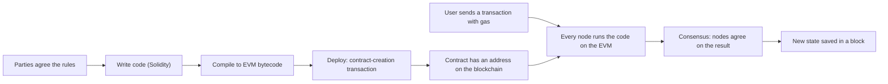
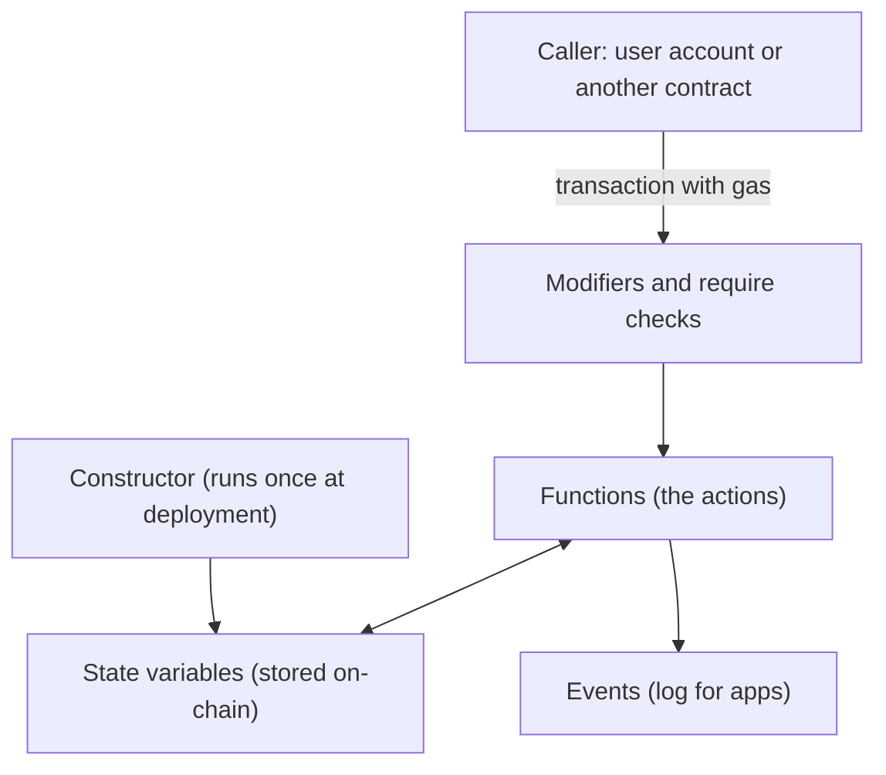
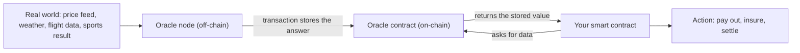
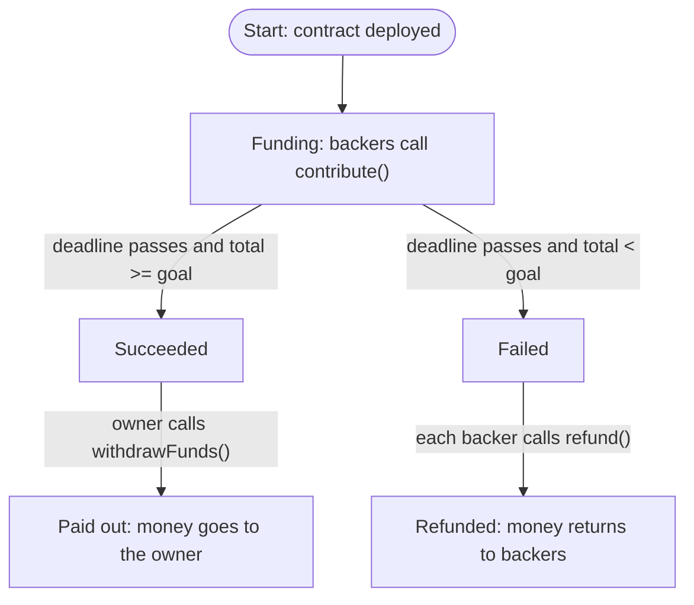

This note covers syllabus <Syl m="3" /> part 3.2: smart contracts, their history, characteristics, working, types, oracles, structure and limitations, and the use cases, opportunities and risks. The Solidity language itself is in the Solidity note; Ethereum, gas and accounts are in the Ethereum note.

## The basics first

- A **contract** is an agreement: "if you do X, I will do Y". Normally a court, a bank or a lawyer makes sure both sides keep their word.
- A **blockchain** is a shared record book that thousands of computers (**nodes**) keep identical copies of. Nobody can quietly edit it.
- An **account** on Ethereum is an address that can hold ether. A **user account** is controlled by a private key. A **contract account** is controlled by its own code. <Cite id="smart-contracts-eth-docs" />
- A **transaction** is a signed message that asks the network to do something, for example "send 1 ether" or "call this function". <Cite id="smart-contracts-me-ch7" loc="Life Cycle of a Smart Contract" />
- The **EVM** (Ethereum Virtual Machine) is the small computer inside every Ethereum node that runs contract code. <Cite id="smart-contracts-eth-evm" />
- **Gas** is the fee for each step of computation. You pay it so nobody can jam the network with endless loops. <Cite id="smart-contracts-eth-gas" />
- **Deterministic** means the same input always gives the same output, on every computer. This one idea explains most of the rules in this note.

Analogy: a **vending machine**. You put in the right money and press a button; the machine gives the snack. No shopkeeper is needed because the rule is built into the machine. A smart contract is a vending machine for agreements. <Cite id="smart-contracts-eth-intro" />

## What is a smart contract

<Box kind="definition">

A **smart contract** is a computer program stored on a blockchain that automatically carries out the terms of an agreement when its conditions are met. Once deployed, it runs exactly as coded and no single party can change or stop it. <Cite id="smart-contracts-eth-intro" /> <Cite id="smart-contracts-ibm-smart-contracts" /> <Cite id="smart-contracts-gfg-smart-contracts" />

</Box>

It is written as "if this, then that" logic: IF the buyer pays the price, THEN transfer the ownership. <Cite id="smart-contracts-gfg-smart-contracts" />


**Why it is needed.** In a normal contract you must trust a person or an office to do what was agreed. In the bicycle-race example on ethereum.org, Alice wins the bet, but Bob refuses to pay, saying she cheated. The conditions were met, yet you still depend on Bob. A smart contract holds the money itself and pays out by code, so nobody has to be trusted to hand it over. <Cite id="smart-contracts-eth-intro" />

A note on the name: in Mastering Ethereum the authors say Ethereum smart contracts are "neither smart nor legal contracts". They are plain programs; the word "contract" has no legal meaning there. <Cite id="smart-contracts-me-ch7" loc="Smart Contracts and Solidity" /> Wikipedia also says a smart contract does not typically constitute a legally binding agreement by itself. <Cite id="smart-contracts-wiki-smart-contract" />

<PYQ id="2024-12-ce/q1d" /> <PYQ id="2022-12-ce/q1b" />

## History

| Year | What happened |
|---|---|
| 1994 | Nick Szabo (computer scientist and legal scholar) writes the first introduction to "smart contracts". <Cite id="smart-contracts-szabo-1994" /> |
| 1996 to 1997 | Szabo uses the vending machine as the example and describes how contracts could be secured on public networks. <Cite id="smart-contracts-szabo-1997" /> <Cite id="smart-contracts-wiki-smart-contract" /> |
| 2009 | Bitcoin launches. Its scripts can lock coins with simple conditions but are deliberately limited (not Turing-complete). <Cite id="smart-contracts-gfg-smart-contracts" /> <Cite id="blockchain-fundamentals-nakamoto" /> |
| 2014 | Vitalik Buterin's whitepaper calls Bitcoin a weak version of the smart-contract idea and proposes a Turing-complete blockchain. <Cite id="smart-contracts-eth-whitepaper" /> <Cite id="smart-contracts-wiki-smart-contract" /> |
| 2015 | Ethereum goes live; anyone can deploy contracts written in Solidity. |
| 2016 | The DAO, a crowd-funded contract, raises more than US$100 million of ether and then loses about a third of it to a bug exploited in June 2016. <Cite id="smart-contracts-wiki-dao" /> |

**Turing-complete** means the language can express any computation, including loops. That power is what lets Ethereum contracts do far more than Bitcoin scripts, and it is also why gas is needed to stop endless loops.

## Characteristics

| Characteristic | Meaning in simple words |
|---|---|
| Distributed | Every node holds a copy of the contract and runs it. No single server. |
| Deterministic | Same input and same state give the same result, whoever runs it. |
| Immutable | After deployment the code cannot be edited. To change it you deploy a new contract. |
| Autonomous | It runs by itself. No third party is needed. |
| Transparent | Code and past calls are public on the ledger, so anyone can inspect them. |
| Trustless | You trust the code and the network, not a person. |
| Self-enforcing | When the conditions are true the action happens; nobody can refuse. |
| Accurate and fast | Only as accurate as the code, but once the condition is met it runs at once. |

<Cite id="smart-contracts-gfg-smart-contracts" /> <Cite id="smart-contracts-me-ch7" loc="Smart Contracts and Solidity" /> <Cite id="smart-contracts-eth-intro" />

<Box kind="pitfall">

"Immutable" means the code cannot change, not that a contract can never stop. Older contracts could delete themselves with `SELFDESTRUCT`, but since EIP-6780 (the 2024 Dencun upgrade) it no longer removes a contract, except when it runs in the same transaction that created the contract. A contract can still be written with a switch (such as a paused flag) that the code itself controls. <Cite id="smart-contracts-me-ch7" loc="Smart Contracts and Solidity" />

</Box>

## How a smart contract works

Smart contracts only run when a transaction calls them. They never run "on their own" in the background; the first contract in any chain of calls was started by a transaction from a user account. <Cite id="smart-contracts-me-ch7" loc="Life Cycle of a Smart Contract" />

1. **Agree the terms.** The parties decide the rules and the outcomes (for example "release the money if the goods arrive").
2. **Write the code.** A developer writes the rules in a language such as Solidity.
3. **Compile.** The compiler turns the code into EVM bytecode, the low-level instructions the EVM understands.
4. **Deploy.** A special contract-creation transaction (empty "to" field) sends the bytecode to the network. Once mined, the contract gets its own address.
5. **Call.** A user or another contract sends a transaction to that address that names a function and pays the gas.
6. **Execute and agree.** Every node runs the same code on the same state. Consensus makes sure they all accept the same result.
7. **Update the ledger.** The new state is recorded in the block. The record can no longer be changed.

<Cite id="smart-contracts-me-ch7" loc="Life Cycle of a Smart Contract" /> <Cite id="smart-contracts-gfg-smart-contracts" />



<Cite id="smart-contracts-gfg-smart-contracts" loc="diagram" /> <Cite id="smart-contracts-me-ch7" loc="Life Cycle of a Smart Contract" />

## Structure of a smart contract

A Solidity contract looks like a class in other languages. It lives at one address and has data (**state**) and code (**functions**). <Cite id="smart-contracts-eth-anatomy" /> <Cite id="smart-contracts-sol-structure" />


| Part | What it is | Example |
|---|---|---|
| Pragma and licence line | Tells the compiler which Solidity versions may be used. | `pragma solidity ^0.8.20;` |
| State variables | Data stored permanently on the blockchain. | `uint256 public totalRaised;` |
| Constructor | Runs once, at deployment, to set the starting values. | `constructor(uint256 _goal)` |
| Functions | The actions anyone can call. Some change state (cost gas), some only read. | `function contribute()` |
| Modifiers | Reusable checks added to functions, such as "only the owner". | `modifier onlyOwner()` |
| Events | Messages written to the log so apps can watch what happened. | `event Funded(address who, uint256 amount);` |
| Errors and require checks | Stop the call and undo all its changes when a rule fails. | `require(msg.value > 0)` |



<Cite id="smart-contracts-eth-anatomy" loc="diagram" /> <Cite id="smart-contracts-sol-structure" />

Reading a public variable is free when done through a node (no transaction). Any function that changes state needs a transaction and gas. <Cite id="smart-contracts-eth-anatomy" />

## Types of smart contracts

A common textbook classification (also used by GeeksforGeeks) has three types. <Cite id="smart-contracts-gfg-smart-contracts" />

| Type | What it is | Example |
|---|---|---|
| Smart legal contract | A contract with a legal meaning whose terms are also coded, so the "if this then that" parts run by themselves. Digital signatures are used and a breach can have legal consequences. | Pay a debt automatically when the due date arrives. |
| DAO (decentralized autonomous organization) | A group with shared goals that is run by contract code. Members vote with tokens; there is no boss. The code decides how money is spent. | VitaDAO, a community funding scientific research. |
| Application logic contract (ALC) | Application code that talks to other contracts or devices. It is signed between machines, not people. | An IoT sensor that triggers a payment through a contract. |

<Cite id="smart-contracts-gfg-smart-contracts" /> <Cite id="smart-contracts-eth-dao" />

<Box kind="pitfall">

Do not mix up a **smart legal contract** (a normal legal agreement with some terms in code) with a smart contract on Ethereum (just a program). Wikipedia says the two should not be confused. <Cite id="smart-contracts-wiki-smart-contract" />

</Box>

Another useful way to sort contracts, if the question asks "different types": by what they do, for example token contracts (a coin or NFT), escrow and payment contracts, voting and DAO contracts, and DeFi contracts such as lending and exchange. <Cite id="smart-contracts-eth-intro" />

<PYQ id="2024-12-ce/q1d" />

## Oracles

**The problem.** All nodes must reach the same answer when they run a contract. If a contract could fetch "today's dollar rate" from a website, one node might see 83.10 and another 83.12 a second later, and consensus would break. So contracts cannot call outside websites by themselves. Blockchains are isolated, like a computer with no internet. <Cite id="smart-contracts-eth-oracles" /> <Cite id="smart-contracts-chainlink-oracle-problem" />

<Box kind="definition">

An **oracle** is a service that fetches, checks and sends real-world (off-chain) information to smart contracts. It usually has an on-chain contract plus an off-chain "oracle node" that reads the data source and writes the answer into the blockchain. <Cite id="smart-contracts-eth-oracles" /> <Cite id="smart-contracts-wiki-oracle" />

</Box>

Once the answer is written on-chain, every node reads the same stored value, so determinism is kept.



<Cite id="smart-contracts-eth-oracles" loc="diagram" /> <Cite id="smart-contracts-chainlink-oracle-problem" />

**Kinds of oracle.** By direction: input oracles bring data in, output oracles send contract results out to the real world (for example, unlock a smart lock when a payment arrives), and computational oracles do heavy work off-chain. By trust: centralized (one provider) or decentralized (many providers agree). <Cite id="smart-contracts-eth-oracles" />

**Risk.** A single oracle is a single point of failure. If it lies or is hacked, the contract acts on false data, so important contracts use decentralized oracle networks. This is called the **oracle problem**. <Cite id="smart-contracts-chainlink-oracle-problem" />

## State machine replication and smart contracts

This part answers the questions that ask you to describe state machine replication and show a smart contract as a state machine.

### Basics: what is a state machine

A **state machine** is anything that is always in one **state** and moves to another state when an **input** arrives. A traffic light is one: states are red, green and yellow, and the timer is the input. Formally it has a set of states, a set of inputs, a transition function (current state plus input gives the new state), an output function and a start state. <Cite id="smart-contracts-wiki-smr" />

A state machine must be **deterministic**: if two copies start in the same state and receive the same inputs in the same order, they end in the same state with the same outputs. <Cite id="smart-contracts-wiki-smr" />

### State machine replication (SMR)

<Box kind="definition">

**State machine replication** is a method for building a fault-tolerant service by keeping several copies (replicas) of the same deterministic state machine on different servers and making them all process the same client requests in the same order. <Cite id="smart-contracts-wiki-smr" /> <Cite id="smart-contracts-schneider-1990" />

</Box>

**The steps of the method:**

1. Place copies of the state machine on several independent servers.
2. Receive client requests; each request is an input.
3. Agree on one order for the inputs. This is the hard step and needs a **consensus** protocol.
4. Every server runs the inputs in that order.
5. Reply to the client with the output, and compare the replicas for differences.

<Cite id="smart-contracts-wiki-smr" />

**Function (why we do it).** If one replica crashes or gives a wrong answer, the others still agree and the service carries on. With plain crashes, a service that must survive f faulty replicas needs 2f+1 copies. If replicas can lie (Byzantine faults), more copies are needed, typically 3f+1 (see the PBFT note). <Cite id="smart-contracts-wiki-smr" /> <Cite id="smart-contracts-schneider-1990" />

### A blockchain is SMR

| SMR idea | In a blockchain |
|---|---|
| Replicas | The nodes, each holding the full ledger |
| State machine | The ledger plus contract storage, run by the EVM |
| Inputs (client requests) | Transactions |
| Agreeing the order | Consensus protocol (PoW, PoS, PBFT, ...) puts transactions into blocks in one order |
| Transition function | The EVM executing the contract code |
| Determinism | Contract code cannot use random or off-chain data, which is why oracles are needed |

### A smart contract as a state machine

The contract's **state** is its stored variables (and its balance). A **transaction** that calls a function is the **input**. The function code is the **transition function**: it checks the rules (`require`), changes the variables and produces events (the **output**). The contract's deployed code and starting values are the **start state**. Because every node runs the same code in the same order, all nodes always hold the same contract state. Solidity's own documentation describes contracts as state machines with stages, where a function call often ends a stage and moves to the next one, and modifiers guard which functions work in which stage. <Cite id="smart-contracts-sol-patterns" /> <Cite id="smart-contracts-me-ch7" loc="Smart Contracts and Solidity" />

### Example: a crowdfunding application

States: **Funding** (campaign open), **Succeeded** (deadline passed and goal reached), **Failed** (deadline passed and goal missed). Then the money moves out: the owner withdraws after success, or backers claim refunds after failure.



<Cite id="smart-contracts-sol-patterns" loc="diagram" /> <Cite id="smart-contracts-wiki-smr" />

Replication in action: Asha's contribution is a transaction. The network orders it among all pending transactions, every node runs `contribute()` on it, and every node's copy shows the same new total. If a node cheated and showed a different total, the other nodes would reject its block, because their results differ. <Cite id="smart-contracts-schneider-1990" />

<Box kind="exam">

Exam mein English mein likho: "State machine replication keeps identical copies of a deterministic state machine on many nodes and feeds them the same inputs in the same order, so they always reach the same state. A blockchain does this with transactions as inputs and consensus fixing the order; a smart contract is the state machine, with its variables as state and its functions as transitions."

</Box>

<PYQ id="2023-05-ce/q3a" /> <PYQ id="2023-12-ce/q2a" />

## Example: managing a crowdfunding platform

Crowdfunding means many small contributors fund one project. The usual platform holds the money and decides who gets it, so you must trust the platform. A smart contract replaces that trust with fixed rules: <Cite id="smart-contracts-eth-dao" />

- The creator sets a **goal** and a **deadline** when the contract is deployed.
- Backers send ether to the contract. The contract records who sent how much.
- Before the deadline the creator cannot touch the money.
- After the deadline, if the goal was reached, only the creator can withdraw. If not, every backer can take back exactly what they sent.
- All contributions and payouts are public on the ledger, and there is no platform fee beyond gas.

Compare with the real-world case of The DAO in 2016, a huge crowd-funded contract: it raised more than US$100 million, which shows the idea works at scale, and it was then exploited through a code bug, which shows why the code must be right. <Cite id="smart-contracts-wiki-dao" />

Here is a complete contract that does this. It is written for Solidity 0.8.

```solidity
// SPDX-License-Identifier: MIT
pragma solidity ^0.8.20;

contract Crowdfunding {
    address public immutable owner;      // who receives the money if the goal is met
    uint256 public immutable goal;       // target amount in wei
    uint256 public immutable deadline;   // time when funding stops
    uint256 public totalRaised;          // total received so far
    bool public fundsWithdrawn;          // stops the owner from withdrawing twice
    mapping(address => uint256) public contributions; // how much each backer sent

    constructor(uint256 _goal, uint256 durationInDays) {
        owner = msg.sender;
        goal = _goal;
        deadline = block.timestamp + durationInDays * 1 days;
    }

    function contribute() external payable {
        require(block.timestamp < deadline, "Campaign ended");
        require(msg.value > 0, "Send some ether");
        contributions[msg.sender] += msg.value;
        totalRaised += msg.value;
    }

    function withdrawFunds() external {
        require(msg.sender == owner, "Only owner");
        require(block.timestamp >= deadline, "Still running");
        require(totalRaised >= goal, "Goal not reached");
        require(!fundsWithdrawn, "Already withdrawn");
        fundsWithdrawn = true;
        (bool ok, ) = owner.call{value: address(this).balance}("");
        require(ok, "Transfer failed");
    }

    function refund() external {
        require(block.timestamp >= deadline, "Still running");
        require(totalRaised < goal, "Goal was reached");
        uint256 amount = contributions[msg.sender];
        require(amount > 0, "Nothing to refund");
        contributions[msg.sender] = 0;
        (bool ok, ) = msg.sender.call{value: amount}("");
        require(ok, "Refund failed");
    }
}
```

**Line by line, in simple words**

- `pragma solidity ^0.8.20;` allows compiler versions 0.8.20 and newer in the 0.8 family. The first comment line is the licence label.
- `address public immutable owner;` stores the creator's address. `immutable` means it is set once in the constructor and never changes. `public` makes Solidity build a free read function for it.
- `goal` and `deadline` are also set once. `totalRaised` and `fundsWithdrawn` change over time, so they are normal state variables.
- `mapping(address => uint256) public contributions;` is a table: for each backer's address it keeps the amount they sent.
- The `constructor` runs once at deployment. `msg.sender` is whoever deploys, so they become the owner. The deadline is "now plus the number of days"; `1 days` is Solidity's built-in unit for 86,400 seconds.
- `contribute()` is `payable`, which means it can receive ether. The two `require` lines say: the campaign must still be open and the amount must be more than zero. If a `require` fails, the whole call is undone. Then the amount is added to the backer's record and to the total.
- `withdrawFunds()` has four checks: caller is the owner, deadline is over, goal is reached, and it has not been done before. It sets `fundsWithdrawn = true` before sending the money, then sends the whole balance to the owner with `call`.
- `refund()` works only after the deadline and only if the goal was missed. It reads the caller's amount, sets their record to zero first and only then sends the money back.
- **Why zero first?** If the contract sent money before updating its records, a malicious receiver could call `refund()` again from inside the payment and be paid twice. This is the reentrancy attack. Updating first, then sending, is the "checks-effects-interactions" pattern. <Cite id="smart-contracts-sol-security" /> <Cite id="smart-contracts-swc-reentrancy" /> <Cite id="smart-contracts-me-ch9" />

<Box kind="verify">

Deploy with goal = 10 ether and duration = 30 days. Asha calls `contribute()` sending 3 ether: `contributions[Asha] = 3`, `totalRaised = 3`. Ravi sends 4.5 and Meena sends 2.5: `totalRaised = 10`. If anyone calls `contribute()` on day 31 it reverts with "Campaign ended". On day 31 the owner calls `withdrawFunds()`: owner check passes, deadline passed, `10 >= 10` passes, not yet withdrawn, so the 10 ether goes to the owner and `fundsWithdrawn` becomes true. A second call reverts with "Already withdrawn". If Asha calls `refund()` now, it reverts with "Goal was reached". If instead Meena had not paid, `totalRaised = 7.5 < 10`, the owner's `withdrawFunds()` reverts with "Goal not reached", and Asha's `refund()` sends her 3 ether back.

</Box>

<PYQ id="2022-12-ce/q1b" />

## Worked sums

Smart contract questions are mostly theory, but two small calculations can appear: whether a crowdfunding goal is met, and what a contract call costs in gas.

### Crowdfunding goal check

<Sum>

<Given>

A crowdfunding contract has goal = 10 ETH. Three backers send: Asha 3 ETH, Ravi 4.5 ETH, Meena 2.5 ETH. The deadline has passed.

</Given>

<Find>

the total raised, whether the owner can withdraw, and what happens if Meena had not paid.

</Find>

<Steps>

1. Total raised = 3 + 4.5 + 2.5 = 10 ETH. *Reason: the contract adds every contribution to `totalRaised`.*
2. Compare with the goal: 10 >= 10 is true, so the goal is reached. *Reason: the rule is `totalRaised >= goal`, so exactly equal also counts.*
3. So `withdrawFunds()` is allowed for the owner, who receives 10 ETH, and `refund()` is blocked.
4. Without Meena: total = 3 + 4.5 = 7.5 ETH. 7.5 < 10, so the goal is missed. *Reason: the campaign fails, so the money must go back.*
5. Refunds: Asha gets 3 ETH and Ravi gets 4.5 ETH. Total refunded = 3 + 4.5 = 7.5 ETH.

</Steps>

<Answer>

Total raised = 10 ETH, so the owner can withdraw 10 ETH. Without Meena the total is 7.5 ETH, the goal fails and each backer is refunded the exact amount they sent.

</Answer>

<Box kind="verify">

Work in tenths of an ether: 30 + 45 + 25 = 100, which is 10 ETH. Refund check: the contract would hold 7.5 ETH and the refunds add up to 3 + 4.5 = 7.5 ETH, so no ether is left over and none is missing.

</Box>

</Sum>

### Gas cost of a contract call

Every call to a state-changing function costs **gas used x gas price**. The gas price is the base fee plus the priority fee (tip), measured in gwei. 1 gwei = 10^-9 ETH. Unused gas from the gas limit is returned. <Cite id="smart-contracts-eth-gas" />

<Sum>

<Given>

A user calls `contribute()`. The transaction sets a gas limit of 60,000. The call actually uses 52,000 gas. The base fee is 18 gwei and the tip is 2 gwei. (These numbers are made up for practice.)

</Given>

<Find>

the fee the user finally pays in gwei and in ETH, and how much of that is burned.

</Find>

<Steps>

1. Gas price = base fee + tip = 18 + 2 = 20 gwei. *Reason: Ethereum charges both parts for each unit of gas.*
2. Fee = gas used x gas price = 52,000 x 20 = 1,040,000 gwei. *Reason: the fee is per unit of gas actually used.*
3. Convert: 1,040,000 gwei x 10^-9 = 0.00104 ETH.
4. The wallet first sets aside the maximum, 60,000 x 20 = 1,200,000 gwei = 0.0012 ETH, then returns the unused 8,000 gas: 8,000 x 20 = 160,000 gwei.
5. The burned part is the base fee share: 52,000 x 18 = 936,000 gwei. The tip goes to the validator: 52,000 x 2 = 104,000 gwei.

</Steps>

<Answer>

Fee paid = 1,040,000 gwei = 0.00104 ETH (of which 936,000 gwei is burned and 104,000 gwei is the tip). Any ether sent to `contribute()` is separate from this fee.

</Answer>

<Box kind="verify">

Reserved minus refunded: 1,200,000 - 160,000 = 1,040,000 gwei, the same fee. Split check: 936,000 + 104,000 = 1,040,000 gwei. Going back: 1,040,000 / 52,000 = 20 gwei per gas, the price we started with.

</Box>

</Sum>

## Limitations

| Limitation | Why it happens |
|---|---|
| Cannot read off-chain data by itself | Every node must compute the same result, so outside data must come through an oracle. <Cite id="smart-contracts-eth-docs" /> |
| Cannot be changed after deployment | Immutability. Bugs stay unless the contract was designed to be upgradeable (for example by pointing to a new contract). <Cite id="smart-contracts-me-ch7" loc="Smart Contracts and Solidity" /> |
| Code bugs mean real losses | Transactions cannot be reversed. The DAO lost about a third of its funds this way. <Cite id="smart-contracts-wiki-dao" /> |
| Cost | Every step costs gas, and deploying costs far more than a simple transfer. <Cite id="smart-contracts-eth-docs" /> |
| Size limit | A contract can be at most 24 KB or it runs out of gas. <Cite id="smart-contracts-eth-docs" /> |
| Legal status unclear | A smart contract is usually not a legally binding agreement by itself. <Cite id="smart-contracts-wiki-smart-contract" /> |
| Clear reading of code is hard | Users often sign a transaction without understanding what the contract will do ("blind signing"). <Cite id="smart-contracts-eth-intro" /> |

## Role of smart contracts in DeFi

**DeFi** (decentralized finance) means financial services such as lending, borrowing, trading and saving that run on a public blockchain through smart contracts instead of banks and brokers. <Cite id="smart-contracts-eth-defi" /> <Cite id="smart-contracts-wiki-defi" />

The smart contract is the engine of DeFi because it plays the roles that people and offices play in normal finance:

| Normal finance | DeFi smart contract |
|---|---|
| Bank holds your deposit and lends it | A lending contract holds deposits, tracks who lent and borrowed, and pays interest by code. |
| Stock exchange matches buyers and sellers | A decentralized exchange contract swaps tokens directly from pooled funds. |
| Clearing house guarantees settlement | The contract settles the trade in the same transaction or cancels it completely. |
| Lender checks your credit | A borrower locks collateral in the contract, which is sold automatically if its value falls too low. |
| Money in rupees or dollars | Stablecoin contracts issue tokens meant to hold a steady value. |

<Cite id="smart-contracts-eth-defi" /> <Cite id="smart-contracts-wiki-defi" />

**Benefits.** Open to anyone with an internet connection; markets are always open; no central authority can block a payment; the code can be inspected; contracts connect like building blocks ("money Legos"), which is called **composability**. <Cite id="smart-contracts-eth-defi" /> <Cite id="smart-contracts-wiki-defi" />

**Risks.** Coding errors and hacks are common; an oracle that gives a wrong price can wreck a lending contract; because contracts call each other, one failure can spread; and "decentralized" is sometimes only partly true. <Cite id="smart-contracts-wiki-defi" /> <Cite id="smart-contracts-chainlink-oracle-problem" />

<PYQ id="2024-05-ce/q6a" />

## Smart contract use cases, opportunities and risks

| Use case | How a contract helps |
|---|---|
| Finance and DeFi | Lending, exchanges, stablecoins, automatic insurance payouts. <Cite id="smart-contracts-eth-intro" /> |
| Crowdfunding and DAOs | Rules for funds and voting are in code. <Cite id="smart-contracts-eth-dao" /> |
| Real estate | Ownership moves when the payment arrives, with fewer middlemen. <Cite id="smart-contracts-gfg-smart-contracts" /> |
| Supply chain | Pay a supplier automatically when a shipment is confirmed. <Cite id="smart-contracts-ibm-smart-contracts" /> |
| Insurance | Pay a claim when an oracle confirms the event (flight delay, rainfall). <Cite id="smart-contracts-eth-oracles" /> |
| Digital assets | Create tokens and collectibles (NFTs). <Cite id="smart-contracts-eth-intro" /> |
| Healthcare, music royalties, voting | Record payments, split royalties, log votes. <Cite id="smart-contracts-gfg-smart-contracts" /> |


**Opportunities (advantages).** Speed and automation; lower cost because there are no intermediaries; transparency and an audit trail; fewer disputes because outcomes are predictable; global access. <Cite id="smart-contracts-ibm-smart-contracts" /> <Cite id="smart-contracts-eth-intro" />

**Risks (disadvantages).**

- Bugs and exploits, for example **reentrancy**, where a malicious contract calls back into yours before the first call has finished. In 2016 this kind of flaw let attackers drain about a third of The DAO. The community then chose a controversial hard fork, which split Ethereum into Ethereum and Ethereum Classic. <Cite id="smart-contracts-swc-reentrancy" /> <Cite id="smart-contracts-wiki-dao" /> <Cite id="smart-contracts-me-ch9" />
- Wrong or fake data from oracles.
- Immutability: a mistake cannot be patched easily.
- Unclear law and no one to appeal to when code does something unintended.
- Gas fees, and users who sign without understanding.

Safer practice: keep contracts small, test them, get them audited, use well-known libraries, and follow the checks-effects-interactions order. <Cite id="smart-contracts-sol-security" /> <Cite id="smart-contracts-me-ch9" />

## Traditional contract versus smart contract

| Point | Traditional contract | Smart contract |
|---|---|---|
| Form | Written paper or document | Program code on a blockchain |
| Enforcement | Courts, lawyers, trusted parties | The code and the network |
| Middlemen | Usually needed | Not needed |
| Speed | Days or weeks | Seconds to minutes (when conditions are met) |
| Interpretation | Humans can read terms differently | Code runs the same every time |
| Changing terms | Both sides can renegotiate | Cannot be edited after deployment |
| Cost | Fees for lawyers and agents | Gas fees |
| Legal standing | Binding at law | Not automatically binding |

<Cite id="smart-contracts-eth-intro" /> <Cite id="smart-contracts-wiki-smart-contract" /> <Cite id="smart-contracts-ibm-smart-contracts" />

## Conclusion

A smart contract is a self-executing program on a blockchain that replaces trust in a person with trust in code. It works because every node runs the same deterministic code on the same inputs in the same order, which is state machine replication. Its strengths are automation, transparency and lower cost; its limits are the oracle problem, immutability, gas cost and the fact that bugs are permanent, so it must be written and tested with great care.

## Past questions on this topic

<PYQ id="2024-12-ce/q1d" /> <PYQ id="2022-12-ce/q1b" /> <PYQ id="2023-05-ce/q3a" /> <PYQ id="2023-12-ce/q2a" /> <PYQ id="2024-05-ce/q6a" />
