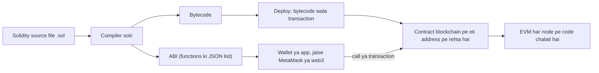
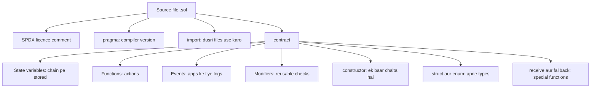
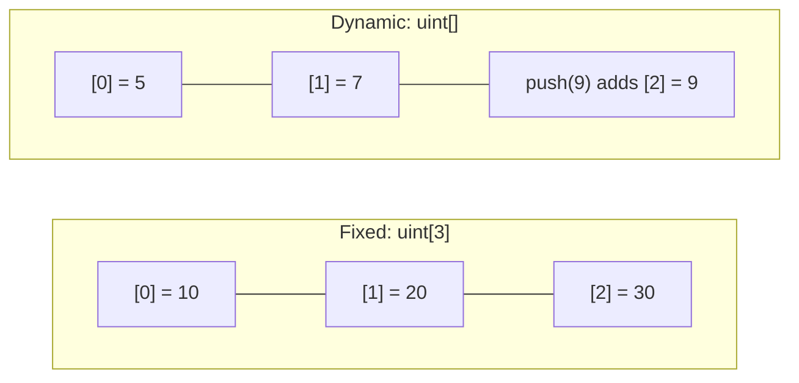
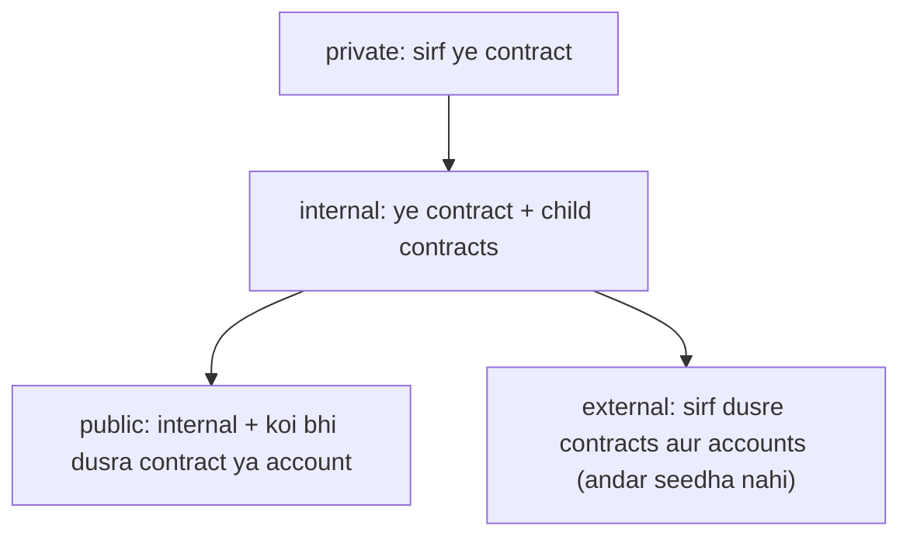
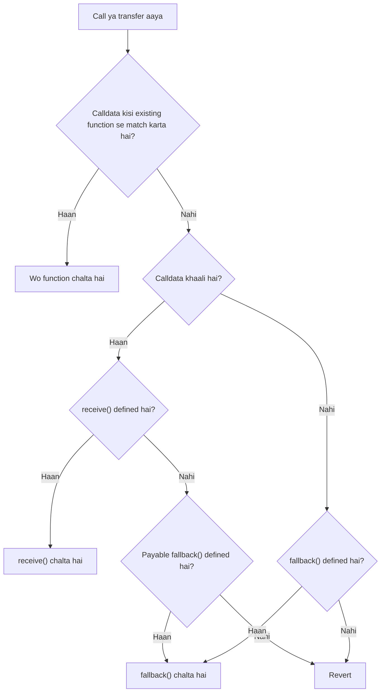
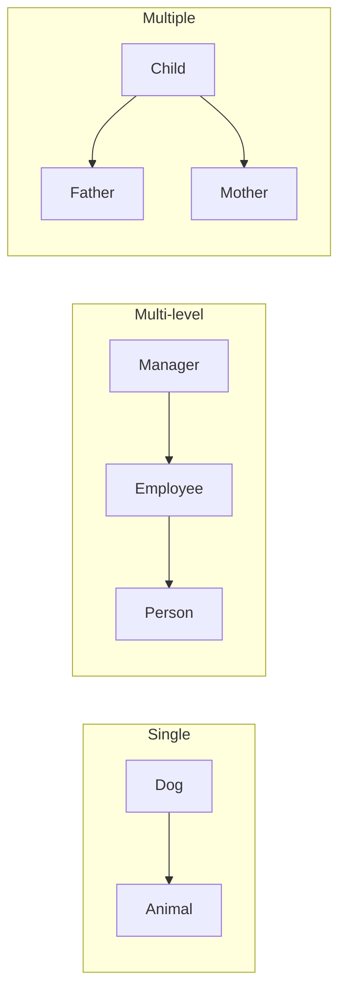

Ye note syllabus <Syl m="3" />, section 3.2 cover karta hai: Solidity set-up tools aur installation, basics, functions, visibility aur activity qualifiers, Ethereum networks, Solidity compiler, files aur contracts ka structure, data types, storage, arrays, aur smart contracts develop aur execute karna. Smart contract kya hota hai, uske types aur limits smart-contracts note mein hain; gas aur EVM Ethereum note mein hain.

## Pehle basics

- **Smart contract** ek program hai jo blockchain pe ek address pe stored rehta hai. Koi bhi transaction bhejkar uske functions call kar sakta hai, aur har node wahi code chalata hai aur wahi result paata hai.
- **Solidity** Ethereum pe smart contracts likhne ki sabse zyada use hone wali language hai. Ye JavaScript aur C++ ke mix jaisi dikhti hai. <Cite id="solidity-docs-intro" /> <Cite id="solidity-wiki-solidity" />
- Computer Solidity ko seedha run nahi kar sakta. **Compiler** (`solc`) use **bytecode** mein badalta hai jo **EVM** (Ethereum Virtual Machine) chalati hai, aur ek **ABI** (Application Binary Interface) deta hai, jo contract ke functions ki JSON list hoti hai aur wallets aur apps isse contract se baat karte hain. <Cite id="solidity-mastering-ethereum-ch7" />
- **Transaction** blockchain ko badalta hai aur **gas** lagti hai (computing ki fee, Ether mein). **Call** sirf data padhta hai aur bahar se free hota hai. <Cite id="solidity-ethereum-org-contracts" />
- Analogy: contract ek vending machine jaisa hai. Rules andar fix hain, koi bhi button daba sakta hai (function call), aur machine lagne ke baad maker bhi cheating nahi kar sakta.

<Box kind="definition">

**Solidity** ek statically typed, contract-oriented, high-level language hai jisse Ethereum Virtual Machine pe chalne wale smart contracts likhte hain. Solidity **contract** code (functions) aur data (state) ka collection hai jo blockchain pe ek address pe rehta hai. <Cite id="solidity-docs-intro" />

</Box>

## Set-up tools aur installation

Shuru karne ke liye kuch install karna zaroori nahi. Paanch tareeke, aasaan se professional tak:

| Tool | Ye kya hai | Use |
|---|---|---|
| **Remix IDE** (remix.ethereum.org) | Browser-based editor, compiler aur deployer | Seekhne aur exam ke liye best: ek hi page pe likho, compile, deploy aur test karo <Cite id="solidity-remix-docs" /> |
| **solc** | Command-line compiler (npm, package manager, ya binary se install) | Files compile karo aur bytecode aur ABI lo <Cite id="solidity-docs-install" /> |
| **Hardhat / Truffle / Foundry** | Development frameworks: project folder, tests, scripts, local network | Real projects <Cite id="solidity-ethereum-org-remix" /> |
| **Ganache** | Aapke computer pe personal blockchain jisme 10 funded test accounts hote hain | Fast, free testing (Ethereum note mein cover hai) |
| **MetaMask** | Browser wallet | Transactions sign karo aur Remix ko real ya test network se jodo |

Remix ke saath typical steps: Remix kholo, `MyContract.sol` file banao, code likho, `pragma` line se match karta compiler version chuno, **Compile** dabao, environment chuno, **Deploy** dabao, phir Remix har function ke liye jo buttons banata hai unhe use karo. <Cite id="solidity-remix-docs" /> <Cite id="solidity-gfg-intro" />

## Ethereum networks

**Network** wo blockchain hai jis pe aap deploy karte ho. Seekhte waqt free wala use karo.

| Network | Real paisa? | Use |
|---|---|---|
| **Remix VM** (in-browser) ya **Ganache** (local) | Nahi | Apne computer pe instant tests |
| **Testnet** (jaise Sepolia, Hoodi) | Nahi, faucet se free test Ether | Public network jo real jaisa behave karta hai |
| **Mainnet** | Haan | Live Ethereum network, jahan real value move hoti hai |

<Cite id="solidity-ethereum-org-networks" />

## Solidity compiler aur code se blockchain tak ka path



<Cite id="solidity-gfg-intro" loc="diagram" />

Steps simple words mein:

1. **Likho:** code `.sol` file mein likho.
2. **Compile:** `solc` types aur syntax check karta hai aur bytecode aur ABI banata hai. Compiler version `pragma` line ko satisfy karna chahiye. <Cite id="solidity-docs-install" />
3. **Deploy:** aap ek special transaction bhejte ho jisme bytecode hota hai. Network contract ko ek address deta hai aur constructor ek baar chalata hai.
4. **Interact:** aap (ya app) state badalne wale functions ke liye transactions bhejte ho, ya padhne ke liye free calls karte ho.

## Solidity file aur contract ka structure

```solidity
// SPDX-License-Identifier: MIT
pragma solidity ^0.8.20;

contract Counter {
    uint public count;                 // state variable
    event Increased(uint newCount);    // event (log)

    constructor(uint start) {          // runs once, at deployment
        count = start;
    }

    function increase() public {       // changes state: needs a transaction
        count += 1;
        emit Increased(count);
    }

    function get() public view returns (uint) {   // only reads state
        return count;
    }
}
```

Line by line:

1. `// SPDX-License-Identifier: MIT` ek comment hai jo code ka licence batata hai. Missing ho to compiler warning deta hai. <Cite id="solidity-docs-layout" />
2. `pragma solidity ^0.8.20;` batata hai ki is file ko kaun se compiler versions compile kar sakte hain. `^0.8.20` matlab 0.8.20 ya naya, lekin 0.9.0 se neeche.
3. `contract Counter { ... }` contract declare karta hai. Ye dusri languages ki class jaisa hai.
4. `uint public count;` ek **state variable** hai. Ye blockchain pe permanently store hota hai. `uint` unsigned whole number hai (0 aur upar) aur `public` se compiler free getter function `count()` bana deta hai.
5. `event Increased(...)` ek log message declare karta hai jise apps sun sakte hain. `emit` use fire karta hai.
6. `constructor(uint start)` sirf ek baar chalta hai, jab contract deploy hota hai, aur starting value set karta hai.
7. `increase()` `count` mein 1 jodta hai. State badalta hai isliye transaction chahiye aur gas lagti hai.
8. `get()` `view` hai: sirf padhta hai, isliye bahar se call karna free hai.

<Box kind="verify">

`start = 5` ke saath deploy karo. `count` padhne pe 5 aata hai. `increase()` ko transaction bhejo: `count` 6 ho jaata hai aur event `Increased(6)` log hota hai. Ab `get()` call karo to 6 milta hai. `get()` dobara call karne se kuch nahi badalta, isliye phir 6 hi milta hai.

</Box>

Contract mein kya-kya ho sakta hai: <Cite id="solidity-docs-structure" />



<Cite id="solidity-docs-structure" loc="diagram" />

**Modifier** function se pehle lagne wala reusable check hai, jaise `onlyOwner`. **Library** shared code hai aur **interface** bina code ke function names ki list hai. Ye file ke valid members hain lekin syllabus mein is mention se zyada nahi poochhe jaate. <Cite id="solidity-tp-tutorial" />

## Data types

Solidity mein har variable ka type declare karna padta hai (static typing). <Cite id="solidity-docs-types" />

**Value types** khud value rakhte hain aur assign karne pe copy hote hain:

| Type | Matlab | Example |
|---|---|---|
| `bool` | true ya false | `bool open = true;` |
| `uint` / `uint8` ... `uint256` | unsigned whole number (`uint` matlab `uint256`) | `uint age = 20;` |
| `int` / `int8` ... `int256` | signed whole number | `int temp = -5;` |
| `address` | 20-byte account address | `address owner = msg.sender;` |
| `address payable` | address jo Ether le sakta hai | neeche dekho |
| `bytes1` ... `bytes32` | fixed-size raw bytes | `bytes32 tag = "sem";` |
| `enum` | choices ki naamed list | `enum Status { Pending, Done }` |

**Reference types** aise data ko point karte hain jo kahin na kahin rehta hai (data location zaroori hai):

| Type | Matlab |
|---|---|
| array | ek hi type ke items ki list, fixed ya dynamic length |
| `string` aur `bytes` | text aur dynamic raw bytes (special arrays) |
| `struct` | aapka apna record jisme kai fields hote hain |
| `mapping(K => V)` | keys se values ka lookup table, dictionary jaisa (sirf storage mein) |

Solidity 0.8 se arithmetic checked hai: `uint8 x = 255; x + 1` chupchap 0 pe wrap hone ke bajay revert karta hai. Floating-point numbers nahi hote, isliye fractions whole numbers se handle karte hain (jaise percent `x * 18 / 100`). <Cite id="solidity-docs-types" />

```solidity
// SPDX-License-Identifier: MIT
pragma solidity ^0.8.20;

contract DataTypes {
    bool public isOpen = true;
    uint public age = 20;
    int public temp = -5;
    address public owner = msg.sender;
    string public greeting = "Hello";
    enum Status { Pending, Done }
    Status public status = Status.Pending;

    struct Student { string name; uint marks; }
    Student public topper = Student("Asha", 92);

    mapping(address => uint) public balances;   // address -> number

    function finish() public {
        status = Status.Done;
        balances[msg.sender] = 100;
    }
}
```

<Box kind="verify">

Deploy ke baad `age` 20 hai, `status` 0 hai (enums numbers ki tarah store hote hain, `Pending` = 0) aur `topper` ("Asha", 92) deta hai. Account A se `finish()` call karo: `status` 1 (`Done`) ho jaata hai aur `balances(A)` 100 deta hai, jabki kisi aur account B ke liye `balances(B)` abhi bhi 0 deta hai (mapping ek aisi key ke liye 0 deta hai jo kabhi set nahi hui).

</Box>

## Data kahan store hota hai: storage, memory aur calldata

Reference types ko batana padta hai ki wo kahan rehte hain. <Cite id="solidity-docs-datalocation" />

| Location | Kitni der | Cost | Use |
|---|---|---|---|
| **storage** | Permanent, blockchain pe | Sabse zyada (likhne pe bahut gas) | State variables |
| **memory** | Sirf ek function call ke dauran | Kam | Temporary arrays aur strings, wo function arguments jo aap badalte ho |
| **calldata** | Sirf ek external call ke dauran, read-only | Sabse kam | External functions ka input jo sirf padhna ho |

State variables hamesha storage mein hote hain. Local variables memory mein hote hain (ya stack pe value types). Analogy: storage aapki hard disk hai, memory RAM hai, calldata ek printed question paper hai jise padh sakte ho par usme likh nahi sakte. <Cite id="solidity-mastering-ethereum-ch7" />

## Arrays: fixed aur dynamic

**Array** ek hi type ke items ki ordered list hai, index 0 se number hoti hai. <Cite id="solidity-docs-types" loc="Arrays" /> <Cite id="solidity-tp-arrays" />

| | Fixed-size array | Dynamic array |
|---|---|---|
| Declaration | `uint[3] a;` | `uint[] b;` |
| Length | Compile time pe set, badal nahi sakti | Run time pe badalti hai |
| `push` / `pop` | Allowed nahi | Allowed (sirf storage arrays) |
| Memory array | `uint[3] memory m;` | `new uint[](n)`, phir length hamesha ke liye fix |
| Range ke bahar index | Revert hota hai (transaction fail) | Revert hota hai |



<Cite id="solidity-gfg-arrays" loc="diagram" />

```solidity
// SPDX-License-Identifier: MIT
pragma solidity ^0.8.20;

contract ArrayDemo {
    uint[3] public fixedArr = [10, 20, 30];    // fixed size, in storage
    uint[] public dynArr;                      // dynamic size, in storage
    uint[2][2] public matrix = [[1, 2], [3, 4]];   // 2D fixed array

    function addItem(uint x) public {
        dynArr.push(x);                        // add at the end
    }

    function removeLast() public {
        dynArr.pop();                          // remove the last item
    }

    function dynLength() public view returns (uint) {
        return dynArr.length;
    }

    function setFixed(uint i, uint v) public {
        fixedArr[i] = v;                       // change an item, not the size
    }

    function sumFixed() public view returns (uint total) {
        for (uint i = 0; i < fixedArr.length; i++) {
            total += fixedArr[i];
        }
    }

    function squares(uint n) public pure returns (uint[] memory) {
        uint[] memory a = new uint[](n);       // memory array: size set once
        for (uint i = 0; i < n; i++) {
            a[i] = i * i;
        }
        return a;
    }
}
```

Explanation:

1. `fixedArr` mein exactly teen slots hain, pehle se bhare hue. Slot badal sakte ho par chautha add nahi kar sakte.
2. `dynArr` khaali shuru hota hai. `push(x)` end mein `x` jodta hai aur `pop()` aakhri item delete karta hai, isliye length badalti hai.
3. `matrix` 2 arrays ka array hai, har ek mein 2 numbers. `uint[2][2]` ko "2 rows, har ek mein 2 items" padho, aur `matrix[1][0]` 3 hai.
4. `sumFixed` index 0 se length minus 1 tak loop chalakar jodta hai. `total` named return variable hai jo 0 se shuru hota hai.
5. `squares` `new uint[](n)` se length `n` ka temporary memory array banata hai. Memory arrays mein `push` nahi hota, isliye length pehle se pata honi chahiye.

<Box kind="verify">

`sumFixed()` deta hai 10 + 20 + 30 = 60. `addItem(5)`, phir `addItem(7)` call karo: `dynArr` [5, 7] hai aur `dynLength()` 2 deta hai. `removeLast()` call karo: `dynArr` [5] hai aur `dynLength()` 1 hai. `squares(4)` deta hai [0, 1, 4, 9]. `setFixed(5, 1)` fail hota hai kyunki index 5 3-item array ke bahar hai, aur transaction revert ho jaata hai. `matrix(1, 0)` 3 deta hai.

</Box>

## Functions

**Function** code ka naamed block hai. General form: <Cite id="solidity-docs-functions" />

```solidity
function name(parameters) visibility mutability returns (type) { ... }
```

Example: `function add(uint a, uint b) public pure returns (uint) { return a + b; }`.

Parts: keyword `function`, ek naam, typed parameters, **visibility** (kaun call kar sakta hai), **state mutability** (blockchain ke saath kya kar sakta hai), aur return type.

Functions do tarah se call hote hain. Bahar se state badalne wali call ek **transaction** hai (gas lagti hai, block mein mine hoti hai). Bahar se bulaya gaya `view` ya `pure` function free **call** hai jo bas value return karta hai. Functions contract ke andar ek dusre ko bhi call kar sakte hain.

### Visibility specifiers

Visibility decide karti hai ki function ko kaun call kar sakta hai ya state variable kaun padh sakta hai. <Cite id="solidity-docs-visibility" /> <Cite id="solidity-gfg-visibility" />

| Specifier | Is contract ke andar se | Child contract se | Dusre contracts aur bahar ke accounts se |
|---|---|---|---|
| `public` | Haan | Haan | Haan |
| `external` | Sirf `this.f()` ki tarah | Sirf `this.f()` ki tarah | Haan |
| `internal` | Haan | Haan | Nahi |
| `private` | Haan | Nahi | Nahi |

- **Public state variable** ko automatic getter function milta hai. State variables `external` nahi ho sakte.
- State variables ka default `internal` hai. 0.8 mein functions ka default nahi hota: likhna padta hai.
- `private` data ko chhupata nahi. Blockchain ka saara data sabko padhne ko milta hai, `private` sirf dusre contracts ko code mein use karne se rokta hai. Secrets kabhi chain pe store mat karo. <Cite id="solidity-docs-visibility" />



<Cite id="solidity-gfg-visibility" loc="diagram" />

```solidity
// SPDX-License-Identifier: MIT
pragma solidity ^0.8.20;

contract Base {
    uint private secret = 1;     // only Base
    uint internal shared = 2;    // Base and children
    uint public open = 3;        // everyone (free getter)

    function pubFn() public pure returns (string memory) { return "public"; }
    function extFn() external pure returns (string memory) { return "external"; }
    function intFn() internal pure returns (string memory) { return "internal"; }
    function privFn() private pure returns (string memory) { return "private"; }

    function total() public view returns (uint) {
        return secret + shared + open;          // all three visible inside Base
    }

    function callInside() public view returns (string memory, string memory, string memory, string memory) {
        return (pubFn(), this.extFn(), intFn(), privFn());   // external needs this.
    }
}

contract Child is Base {
    function fromChild() public view returns (string memory, uint) {
        // privFn() and secret would cause a compile error here
        return (intFn(), shared);
    }
}
```

Explanation: `Base` ke andar har function call ho sakta hai; `extFn` ko `this.` chahiye kyunki ye bahar se call hone ke liye bana hai, isliye call contract ke address se hokar jaati hai. `Child`, `Base` ko inherit karta hai, isliye wo `intFn()` aur `shared` use kar sakta hai, lekin compiler `privFn()` aur `secret` ko mana kar deta hai. Remix mein user ko `pubFn`, `extFn`, `open`, `total`, `callInside` ke buttons dikhte hain (aur `Child` pe `fromChild`), lekin `intFn` ya `privFn` ka koi button nahi.

<Box kind="verify">

`total()` deta hai 1 + 2 + 3 = 6. `callInside()` deta hai ("public", "external", "internal", "private"). `Child` deploy karke `fromChild()` call karo to ("internal", 2) milta hai. Agar `Child` mein `return secret;` likho, to compile fail hota hai aur error aata hai ki `secret` visible nahi hai, jisse `private` ka kaam saabit hota hai.

</Box>

### State mutability ("activity qualifiers")

Syllabus mein "visibility and activity qualifiers" likha hai. Ye qualifiers batate hain ki function contract ki state ke saath kya karta hai: <Cite id="solidity-docs-view-pure" /> <Cite id="solidity-gfg-view-pure" />

| Qualifier | State padhta hai | State likhta hai | Ether leta hai | Bahar se call pe gas |
|---|---|---|---|---|
| (none) | Haan | Haan | Nahi | Gas lagti hai (transaction) |
| `view` | Haan | Nahi | Nahi | Free |
| `pure` | Nahi | Nahi | Nahi | Free |
| `payable` | Haan | Haan | Haan | Gas lagti hai (transaction) |

- **View** function promise karta hai ki kuch nahi badlega: state variables assign nahi, `emit` nahi, Ether nahi bhejna. Ye state variables aur `block.timestamp` padh sakta hai.
- **Pure** function promise karta hai ki wo koi state na padhega na likhega. Uska jawab sirf uske arguments pe depend karta hai.
- **Payable** function call ke saath bheja gaya Ether accept kar sakta hai (`msg.value`). `payable` ke bina function Ether reject kar deta hai.
- Compiler in promises ko enforce karta hai. `view` ke andar state variable mein likhna compile error hai.

```solidity
// SPDX-License-Identifier: MIT
pragma solidity ^0.8.20;

contract ViewPure {
    uint public price = 100;

    function getPrice() public view returns (uint) {                // reads state
        return price;
    }

    function priceWithTax(uint taxPercent) public view returns (uint) {
        return price + (price * taxPercent) / 100;                  // reads state
    }

    function add(uint a, uint b) public pure returns (uint) {       // no state at all
        return a + b;
    }

    function setPrice(uint p) public {                              // changes state
        price = p;
    }
}
```

<Box kind="verify">

`getPrice()` deta hai 100. `priceWithTax(18)` deta hai 100 + (100 x 18) / 100 = 100 + 18 = 118. `add(3, 4)` deta hai 7, `price` kuch bhi ho, yahi "pure" ka matlab hai. `setPrice(150)` ek transaction hai jisme gas lagti hai; uske baad `getPrice()` 150 deta hai aur `priceWithTax(18)` deta hai 150 + 27 = 177.

</Box>

<Box kind="pitfall">

`view` function sirf bahar se call karne pe free hai. Agar koi transaction use state likhne wale dusre function ke andar call kare, to uski gas us transaction ka hissa hoti hai. Aur `view` aur `pure` alag hain: `pure` `price` ko padh bhi nahi sakta.

</Box>

### Transaction ki gas cost

Har transaction **gas used x gas price** pay karta hai. Gas used computation ki matra hai (gas units mein). Gas price wo hai jo aap har unit ke liye dete ho, **gwei** mein (1 gwei = 0.000000001 ETH, yaani 10^-9 ETH). Do accounts ke beech simple Ether transfer 21,000 gas leta hai. <Cite id="solidity-ethereum-org-contracts" /> <Cite id="solidity-docs-units-globals" />

<Sum>

<Given>

Simple Ether transfer 21,000 gas leta hai. Gas price 20 gwei hai. 1 gwei = 10^-9 ETH.

</Given>

<Find>

fee gwei mein aur ETH mein.

</Find>

<Steps>

1. Fee $=$ gas used $\times$ gas price $= 21{,}000 \times 20$ gwei. *Reason: har gas unit ke liye aap price dete ho.*
2. $21{,}000 \times 20 = 420{,}000$ gwei.
3. ETH mein badlo: $420{,}000 \times 10^{-9} = 0.00042$ ETH.

</Steps>

<Answer>

fee $= 420{,}000$ gwei $= 0.00042$ ETH

</Answer>

<Box kind="verify">

Ulta chalo: $0.00042$ ETH $= 420{,}000 \times 10^{-9}$ ETH. Gas used se divide karo: $420{,}000 / 21{,}000 = 20$ gwei, wahi price jisse humne shuru kiya tha.

</Box>

</Sum>

## Address aur address payable

**Address** 20-byte value hai jo ek account (user wallet ya contract) ko identify karti hai. Isme `.balance` jaise members hote hain (rakha hua Ether, wei mein). **address payable** wahi hai, saath mein extra members `.transfer(amount)` aur `.send(amount)` jo usse Ether bhejte hain. (`.call{value: amount}("")` plain `address` pe bhi chalta hai, par receivers ko `payable` rakhne se matlab saaf rehta hai.) <Cite id="solidity-docs-types" loc="Address" /> <Cite id="solidity-mastering-ethereum-ch7" />

| | `address` | `address payable` |
|---|---|---|
| Rakhta hai | 20-byte account address | Wahi |
| `.balance` padho | Haan | Haan |
| `transfer` ya `send` se Ether bhejo | Nahi | Haan |
| Kab use karein | Owners, approvers, ids | Paisa paane waale |
| Convert | `address payable` se `address` automatic | `payable(addr)` ek `address` ko payable banata hai |

Do types kyun? Isse programmer ko saaf batana padta hai ki kaun se addresses paisa le sakte hain, taaki galti se aisi jagah Ether na chala jaye jo use accept nahi kar sakti.

Ether bhejne ke tareeke: `transfer` fail hone pe revert karta hai, `send` fail hone pe false return karta hai, aur dono sirf 2,300 gas forward karte hain, jo receiving contract ke liye kam ho sakti hai. Mastering Ethereum book kehti hai ki ab inka use discouraged hai aur `call` prefer karo, jiska result hamesha check karna chahiye. <Cite id="solidity-mastering-ethereum-ch7" />

```solidity
// SPDX-License-Identifier: MIT
pragma solidity ^0.8.20;

contract AddressDemo {
    address public owner;                // plain address: identity only
    address payable public wallet;       // can be paid

    constructor(address payable _wallet) {
        owner = msg.sender;              // whoever deploys is the owner
        wallet = _wallet;
    }

    function deposit() public payable {}     // accepts Ether into the contract

    function contractBalance() public view returns (uint) {
        return address(this).balance;        // Ether held by this contract
    }

    function sendToWallet(uint amount) public {
        require(msg.sender == owner, "Only owner");
        require(amount <= address(this).balance, "Not enough balance");
        (bool ok, ) = wallet.call{value: amount}("");
        require(ok, "Transfer failed");
    }

    function makePayable(address a) public pure returns (address payable) {
        return payable(a);                   // explicit conversion
    }
}
```

Explanation:

1. `owner` plain `address` hai. Hum sirf use compare karte hain, paisa nahi dete, isliye `address` kaafi hai.
2. `wallet` `address payable` hai kyunki contract use paisa bhejega.
3. `deposit()` `payable` hai aur body khaali hai: call ke saath aaya koi bhi Ether contract mein rehta hai.
4. `address(this).balance` contract ke paas jo Ether hai wo hai.
5. `sendToWallet` mein do `require` lines ajnabiyon ko aur zyada kharch ko rokti hain. `wallet.call{value: amount}("")` paisa bhejta hai aur success flag return karta hai, jise hum check karte hain.
6. `payable(a)` plain address ko payable address mein convert karta hai.

<Box kind="verify">

Account A contract ko `_wallet` = B ke saath deploy karta hai. Tab `owner` A hai. A 2 ether ke saath `deposit()` call karta hai: `contractBalance()` 2 ether deta hai. A `sendToWallet(1 ether)` call karta hai: B ko 1 ether milta hai aur `contractBalance()` 1 ether deta hai. Agar account C `sendToWallet(1)` call kare to "Only owner" ke saath fail hota hai. Agar A `sendToWallet(5 ether)` call kare to "Not enough balance" ke saath fail hota hai.

</Box>

## Receive aur fallback functions

Contract mein do special, bina naam wale functions ho sakte hain. Ye hamesha `external` hote hain aur `receive() external payable` aur `fallback() external [payable]` ki tarah declare hote hain. <Cite id="solidity-docs-fallback" /> <Cite id="solidity-gfg-fallback" />

- **receive()** tab chalta hai jab contract ko empty calldata ke saath plain Ether mile (wallet se simple transfer, ya bina data ke `transfer`/`send`/`call`). Ye `payable` hona chahiye.
- **fallback()** tab chalta hai jab koi aisa function name call kare jo contract mein nahi hai, ya data ke saath Ether bheje jab koi matching function nahi, ya plain Ether bheje jab `receive()` nahi hai (tab ye `payable` hona chahiye).
- Kyun zaroori hai: inke bina contract plain Ether aur unknown calls reject kar deta hai. Inse contract payments accept kar sakta hai, ajeeb calls log kar sakta hai, ya calls ko dusre contract ko forward kar sakta hai (proxy pattern jo upgradable contracts mein use hota hai). <Cite id="solidity-mastering-ethereum-ch7" />
- Agar contract mein dono nahi hain, ya Ether aane pe koi payable nahi hai, to call revert hoti hai aur Ether wapas ho jaata hai.



<Cite id="solidity-gfg-fallback" loc="diagram" />

```solidity
// SPDX-License-Identifier: MIT
pragma solidity ^0.8.20;

contract FallbackDemo {
    event Received(address from, uint amount);
    event FallbackCalled(address from, uint amount, bytes data);

    receive() external payable {                 // plain Ether, empty calldata
        emit Received(msg.sender, msg.value);
    }

    fallback() external payable {                // unknown function call
        emit FallbackCalled(msg.sender, msg.value, msg.data);
    }

    function getBalance() public view returns (uint) {
        return address(this).balance;
    }
}
```

Explanation: `msg.sender` call bhejne wala hai, `msg.value` bheja gaya Ether hai (wei mein) aur `msg.data` raw call data hai. Dono functions sirf log likhte hain, isliye sasti aur safe hain. In functions ko chhota rakho: `transfer` ya `send` ke saath sender sirf 2,300 gas deta hai, aur lamba fallback gas khatam kar dega.

<Box kind="verify">

Remix mein Low level interactions box se deployed address pe 1 ether bhejo, empty calldata ke saath: `receive()` chalta hai, event `Received(sender, 1 ether)` log hota hai aur `getBalance()` 1 ether deta hai. Ab calldata `0x12345678` bhejo (aisa koi function nahi): `fallback()` chalta hai aur us data ke saath `FallbackCalled` log karta hai. Agar `receive()` delete kar do, to pehla transfer payable `fallback()` handle karta hai. Agar dono delete kar do, to transfer revert hota hai.

</Box>

## Control structures aur do exam programs

Solidity `if`/`else`, `for`, `while`, `do-while`, `break`, `continue` aur `return` use karti hai, matlab C aur JavaScript jaisa hi. `require(condition, "message")` condition false hone pe ruk jaata hai aur transaction undo kar deta hai. <Cite id="solidity-docs-control" />

### Program 1: number prime hai ya nahi check karo

**Prime** number 1 se bada hota hai aur sirf 1 aur khud se divisible hota hai. Idea: agar `n` ka koi factor hai, to uska ek factor `n` ke square root se bada nahi hoga, isliye hum `i` ko 2 se tab tak test karte hain jab tak `i * i` zyada se zyada `n` ho.

```solidity
// SPDX-License-Identifier: MIT
pragma solidity ^0.8.20;

contract PrimeCheck {
    function isPrime(uint n) public pure returns (bool) {
        if (n < 2) {
            return false;               // 0 and 1 are not prime
        }
        for (uint i = 2; i * i <= n; i++) {
            if (n % i == 0) {
                return false;           // found a divisor: not prime
            }
        }
        return true;                    // no divisor found: prime
    }
}
```

Explanation:

1. `isPrime` `pure` hai kyunki jawab sirf `n` pe depend karta hai; state nahi chahiye aur call free hai.
2. 2 se chhote numbers prime nahi hote, isliye turant `false` return karte hain.
3. Loop `i = 2, 3, 4...` try karta hai aur jab `i * i`, `n` se bada ho jaye tab ruk jaata hai.
4. `n % i` remainder hai. Agar wo 0 hai, to `i`, `n` ko divide karta hai, isliye `n` prime nahi hai.
5. Agar loop bina divisor ke khatam ho, to `true` return karte hain.

<Box kind="verify">

`isPrime(29)` call karo: loop i = 2 se 5 tak chalta hai (5 x 5 = 25, 29 se kam ya barabar hai; 6 x 6 = 36 zyada hai). Remainders: 29 % 2 = 1, 29 % 3 = 2, 29 % 4 = 1, 29 % 5 = 4. Koi bhi 0 nahi, isliye result `true`. `isPrime(21)` call karo: i = 2 pe 1; i = 3 pe 21 % 3 = 0, isliye `false` return hota hai (21 = 3 x 7). Saath hi `isPrime(1)` `false` hai aur `isPrime(2)` `true` hai (loop chalta hi nahi kyunki 2 x 2 = 4, 2 se zyada hai).

</Box>

### Program 2: array ka second largest element dhundo

```solidity
// SPDX-License-Identifier: MIT
pragma solidity ^0.8.20;

contract SecondLargest {
    function secondLargest(uint[] memory arr) public pure returns (uint) {
        require(arr.length >= 2, "Need at least 2 elements");
        uint first = 0;                    // largest so far
        uint second = 0;                   // second largest so far
        for (uint i = 0; i < arr.length; i++) {
            if (arr[i] > first) {
                second = first;            // old largest becomes second
                first = arr[i];
            } else if (arr[i] > second && arr[i] != first) {
                second = arr[i];
            }
        }
        return second;
    }
}
```

Explanation: hum ek baar scan karte hain aur ab tak ki do sabse badi values rakhte hain. Jab naya maximum aata hai, purana maximum second place pe khisak jaata hai. Warna, jo value `second` se badi hai (aur `first` ke barabar nahi hai, taaki maximum ke duplicates ignore hon) wo `second` ko replace karti hai. `require` 2 se kam items wale arrays reject karta hai. Agar saare items barabar hain, to koi doosri distinct value nahi hai aur function 0 return karta hai. Array `memory` hai kyunki ye temporary input hai.

<Box kind="verify">

Input [12, 35, 1, 10, 34, 1]. Shuru: first = 0, second = 0. 12, first se bada hai: second = 0, first = 12. 35, first se bada hai: second = 12, first = 35. 1, 12 se upar nahi hai, skip. 10, 12 se upar nahi hai, skip. 34, 35 se upar nahi hai lekin 12 se upar hai aur 35 ke barabar nahi: second = 34. Aakhri 1 skip. Result 34 hai, jo \{1, 1, 10, 12, 34, 35\} ka second largest hai.

</Box>

## Inheritance

**Inheritance** child contract ko parent contract ke state variables aur functions reuse karne deti hai, aur apne add ya change karne deti hai. Ye `contract Child is Parent` likhkar hota hai. Idea OOP jaisa hi hai: common code ek baar likho. <Cite id="solidity-docs-inheritance" /> <Cite id="solidity-gfg-inheritance" />

Rules:

- Parent ka jo function children badal sakte hain use `virtual` likhna padta hai. Child ka version `override` likha hona chahiye.
- Child parent ke `public` aur `internal` members use kar sakta hai, `private` nahi.
- Agar parent ke constructor mein arguments hain, to child ko wo dene padte hain.
- Solidity parent ka code child ke compiled contract mein copy kar deti hai; sirf ek contract deploy hota hai, do nahi.



<Cite id="solidity-gfg-inheritance" loc="diagram" /> <Cite id="solidity-tp-inheritance" />

### Single inheritance

Ek child, ek parent.

```solidity
// SPDX-License-Identifier: MIT
pragma solidity ^0.8.20;

contract Animal {
    string public name;

    constructor(string memory _name) {
        name = _name;
    }

    function speak() public pure virtual returns (string memory) {
        return "Some sound";
    }
}

contract Dog is Animal {
    constructor() Animal("Tommy") {}          // pass the argument to the parent

    function speak() public pure override returns (string memory) {
        return "Woof";                        // replaces the parent version
    }
}
```

Explanation: `Dog` ko `Animal` se `name` aur `speak()` milte hain. Wo parent constructor ke through name set karta hai aur `speak()` ko replace karta hai (isse **overriding** kehte hain). Parent mein `virtual` ise allow karta hai aur child mein `override` confirm karta hai.

<Box kind="verify">

Sirf `Dog` deploy karo. `name()` "Tommy" deta hai, jabki `Dog` ne `name` kabhi declare nahi kiya: wo inherit hua. `speak()` "Woof" deta hai. Agar `Animal` ko akele naam "Cat" ke saath deploy karo, to `speak()` "Some sound" deta hai.

</Box>

### Multi-level inheritance

Ek chain: grandparent, parent, child. Har level apne upar ki har cheez inherit karta hai.

```solidity
// SPDX-License-Identifier: MIT
pragma solidity ^0.8.20;

contract Person {
    string public name;
    uint public age;

    function setPerson(string memory _name, uint _age) public {
        name = _name;
        age = _age;
    }
}

contract Employee is Person {
    uint public salary;

    function setSalary(uint _salary) public {
        salary = _salary;
    }
}

contract Manager is Employee {
    uint public bonus;

    function setBonus(uint _bonus) public {
        bonus = _bonus;
    }

    function totalPay() public view returns (uint) {
        return salary + bonus;               // salary comes from Employee
    }
}
```

Explanation: `Employee`, `Person` ka child hai. `Manager`, `Employee` ka child hai, isliye uske paas `Person` ki bhi har cheez hai. Sirf `Manager` deploy karo: uske buttons mein teeno levels ke `setPerson`, `setSalary`, `setBonus` aur `totalPay` hain.

<Box kind="verify">

`Manager` deploy karo. `setPerson("Asha", 30)`, `setSalary(50000)` aur `setBonus(5000)` call karo. Phir `name()` "Asha" hai, `age()` 30 hai, `salary()` 50000 hai, `bonus()` 5000 hai aur `totalPay()` deta hai 50000 + 5000 = 55000.

</Box>

### Multiple inheritance

Ek child jiske ek se zyada parents hon, `contract Child is Father, Mother` ki tarah likha jaata hai. <Cite id="solidity-docs-inheritance" loc="Multiple Inheritance and Linearization" />

```solidity
// SPDX-License-Identifier: MIT
pragma solidity ^0.8.20;

contract Father {
    function eyes() public pure returns (string memory) { return "Brown eyes"; }
    function skill() public pure virtual returns (string memory) { return "Father: carpentry"; }
}

contract Mother {
    function hobby() public pure returns (string memory) { return "Mother: music"; }
    function skill() public pure virtual returns (string memory) { return "Mother: cooking"; }
}

contract Child is Father, Mother {
    // both parents have skill(), so the child must override both
    function skill() public pure override(Father, Mother) returns (string memory) {
        return super.skill();                  // goes to the last base: Mother
    }
}
```

Explanation: `Child` ko `Father` se `eyes()` aur `Mother` se `hobby()` milta hai. Dono parents `skill()` define karte hain, jo ek clash hai, isliye Solidity child se `override(Father, Mother)` likhwati hai. Solidity **C3 linearization** use karti hai (Python jaisi): bases ko "most base-like" se "most derived" ke order mein likhte hain, aur `super` us order mein agle contract ko call karta hai, jo yahan sabse right wala parent `Mother` hai. Ek hi parent kabhi do baar copy nahi hota, isliye diamond problem (ek grandparent tak do raaste) solve ho jaati hai. <Cite id="solidity-docs-inheritance" />

<Box kind="verify">

`Child` deploy karo. `eyes()` "Brown eyes" deta hai aur `hobby()` "Mother: music" deta hai, dono inherit hue. `skill()` "Mother: cooking" deta hai kyunki `super` sabse right wala base chunta hai. Agar order `is Mother, Father` hota, to `super.skill()` "Father: carpentry" deta. Agar `override(Father, Mother)` wala function hata do, to compile conflict ke error ke saath fail hota hai.

</Box>

## Remix mein contract develop aur execute karna

1. Code ko nayi file mein paste karo, jaise `Counter.sol`.
2. Solidity compiler tab mein `pragma` se match karta version chuno aur **Compile** dabao. Red errors fix karo.
3. **Deploy and run** mein environment chuno (Remix VM, ya testnet ke liye Injected Provider MetaMask) aur account chuno. Constructor arguments ho to daalo, phir **Deploy** dabao.
4. Deployed contract ke neeche, blue buttons `view`/`pure` calls hain (free), orange buttons transactions hain (gas lagti hai) aur red buttons `payable` functions hain (Ether value set kar sakte ho).
5. Output panel aur logs mein events, gas used aur decoded results dekho. <Cite id="solidity-remix-docs" /> <Cite id="solidity-by-example" />

## Comparison aur conclusion

| Idea | Ek line mein |
|---|---|
| `view` vs `pure` | `view` state padhta hai; `pure` state ko chhuta hi nahi |
| `public` vs `external` | `public` andar se bhi call ho sakta hai; `external` sirf bahar se (andar sirf `this.f()`) |
| `internal` vs `private` | `internal` children ke saath shared; `private` sirf ye contract |
| `address` vs `address payable` | `payable` Ether le sakta hai |
| `receive` vs `fallback` | `receive` empty-data Ether ke liye; `fallback` unknown calls ke liye |
| Fixed vs dynamic array | Length compile time pe fix vs push/pop se badalti hai |
| Single vs multi-level vs multiple | Ek parent; parents ki chain; ek saath kai parents |

Short mein, Solidity ek typed language hai jisme contract state aur functions rakhta hai; visibility, mutability, data locations aur inheritance ka dhyaan se use contracts ko correct aur run karne mein sasta rakhta hai.

Exam mein English mein likho: "Solidity is a statically typed, contract-oriented, high-level language used to write smart contracts that run on the Ethereum Virtual Machine."

## Exam mein kya poochha jaata hai

| Question | Kya likhna hai | Past papers |
|---|---|---|
| "Write a program in Solidity to check whether a number is prime" | Poora `PrimeCheck` contract, line-by-line explanation, ek traced example (29 aur 21) | <PYQ id="2022-12-ce/q1e" /> <PYQ id="2025-05-ce/q1b" /> <PYQ id="2025-05/q1d" /> |
| "Find the second largest element in an array" | `SecondLargest` contract, explanation, example ka trace | <PYQ id="2023-05-ce/q1e" /> |
| "Multi-level inheritance program" | Person, Employee, Manager contracts, explanation, verify box | <PYQ id="2022-12-ce/q4b" /> <PYQ id="2024-12-ce/q4b" /> <PYQ id="2025-05-ce/q3a" /> |
| "Single inheritance program" | Animal aur Dog contracts, virtual aur override ke saath | <PYQ id="2023-05-ce/q4b" /> |
| "Multiple inheritance with an example" | Father, Mother, Child, C3 linearization, super | <PYQ id="2024-05-ce/q1d" /> |
| "Fixed and dynamic arrays with examples" aur "various types of arrays" | Comparison table, `ArrayDemo` contract, push, pop, memory array, 2D array | <PYQ id="2022-12-ce/q5b" /> <PYQ id="2023-05-ce/q5b" /> <PYQ id="2023-12/q3a" /> |
| "Fallback function" | Definition, kab chalta hai, flowchart, receive vs fallback, `FallbackDemo` | <PYQ id="2022-12-ce/q6d" /> <PYQ id="2025-05-ce/q4b" /> |
| "Visibility specifiers" aur "visibility and activity qualifiers" | Visibility table, `Base` aur `Child` contract, phir view, pure aur payable ke saath mutability table | <PYQ id="2023-12-ce/q4b" /> <PYQ id="2024-05-ce/q4a" /> |
| "View and pure functions" | Table, `ViewPure` contract, numbers ke saath verify | <PYQ id="2024-05-ce/q4b" /> <PYQ id="2024-12-ce/q5b" /> |
| "Role of address and address payable" | Comparison table, `AddressDemo` contract, Ether kaise bhejte hain | <PYQ id="2023-12-ce/q5b" /> |
