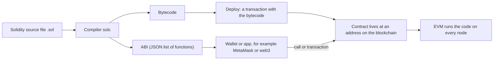
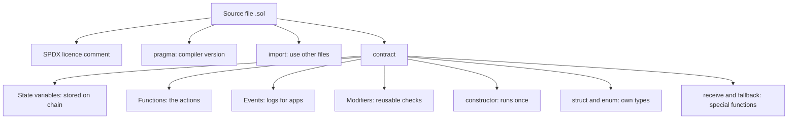
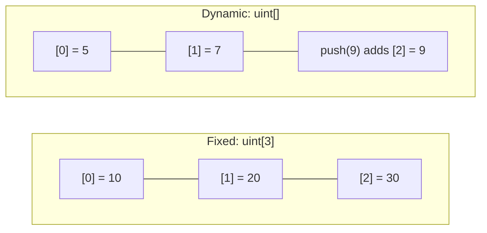
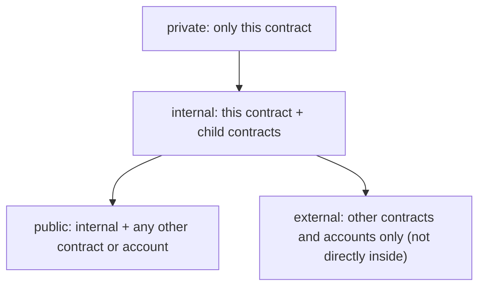
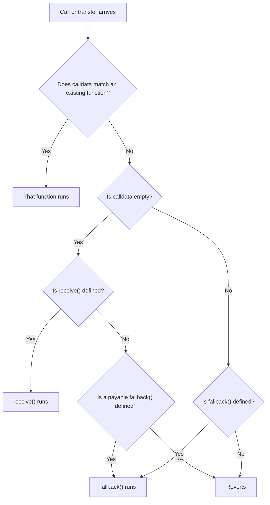
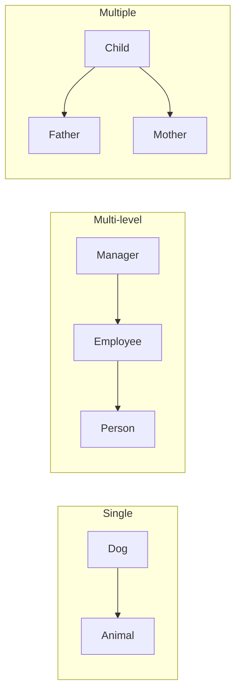

This note covers syllabus <Syl m="3" />, section 3.2: Solidity set-up tools and installation, basics, functions, visibility and activity qualifiers, Ethereum networks, the Solidity compiler, files and structure of contracts, data types, storage, arrays, and developing and executing smart contracts. What a smart contract is, its types and limits are in the smart-contracts note; gas and the EVM are in the Ethereum note.

## The basics first

- A **smart contract** is a program stored on the blockchain at an address. Anyone can call its functions by sending a transaction, and every node runs the same code and gets the same result.
- **Solidity** is the most widely used language for writing smart contracts on Ethereum. It looks like a mix of JavaScript and C++. <Cite id="solidity-docs-intro" /> <Cite id="solidity-wiki-solidity" />
- A computer cannot run Solidity directly. The **compiler** (`solc`) turns it into **bytecode** that the **EVM** (Ethereum Virtual Machine) runs, and an **ABI** (Application Binary Interface), a JSON list of the contract's functions that wallets and apps use to talk to it. <Cite id="solidity-mastering-ethereum-ch7" />
- A **transaction** changes the blockchain and costs **gas** (the fee for computing, paid in Ether). A **call** only reads data and is free when made from outside. <Cite id="solidity-ethereum-org-contracts" />
- Analogy: a contract is like a vending machine. The rules are fixed inside, anyone can press a button (call a function), and nobody, not even the maker, can cheat the machine after it is installed.

<Box kind="definition">

**Solidity** is a statically typed, contract-oriented, high-level language for writing smart contracts that run on the Ethereum Virtual Machine. A Solidity **contract** is a collection of code (functions) and data (state) that lives at one address on the blockchain. <Cite id="solidity-docs-intro" />

</Box>

## Set-up tools and installation

You do not have to install anything to start. Five ways, from easiest to most professional:

| Tool | What it is | Use |
|---|---|---|
| **Remix IDE** (remix.ethereum.org) | A browser-based editor, compiler and deployer | Best for learning and for exams: write, compile, deploy and test in one page <Cite id="solidity-remix-docs" /> |
| **solc** | The command-line compiler (install with npm, a package manager, or a binary) | Compile files and get bytecode and ABI <Cite id="solidity-docs-install" /> |
| **Hardhat / Truffle / Foundry** | Development frameworks: project folder, tests, scripts, local network | Real projects <Cite id="solidity-ethereum-org-remix" /> |
| **Ganache** | A personal blockchain on your computer with 10 funded test accounts | Fast, free testing (covered in the Ethereum note) |
| **MetaMask** | A browser wallet | Sign transactions and connect Remix to a real or test network |

Typical set-up steps with Remix: open Remix, create a file `MyContract.sol`, write the code, choose a compiler version that matches the `pragma` line, click **Compile**, choose an environment, click **Deploy**, then use the buttons that Remix draws for each function. <Cite id="solidity-remix-docs" /> <Cite id="solidity-gfg-intro" />

## Ethereum networks

A **network** is the blockchain you deploy to. Use a free one while learning.

| Network | Real money? | Use |
|---|---|---|
| **Remix VM** (in-browser) or **Ganache** (local) | No | Instant tests on your own computer |
| **Testnet** (for example Sepolia, Hoodi) | No, free test Ether from a faucet | A public network that behaves like the real one |
| **Mainnet** | Yes | The live Ethereum network, where real value moves |

<Cite id="solidity-ethereum-org-networks" />

## The Solidity compiler and the path from code to blockchain



<Cite id="solidity-gfg-intro" loc="diagram" />

Steps in words:

1. **Write** the code in a `.sol` file.
2. **Compile.** `solc` checks the types and syntax and produces bytecode and ABI. The compiler version must satisfy the `pragma` line. <Cite id="solidity-docs-install" />
3. **Deploy.** You send a special transaction that contains the bytecode. The network gives the contract an address and runs the constructor once.
4. **Interact.** You (or an app) send transactions to call functions that change state, or make free calls to read.

## Structure of a Solidity file and contract

```solidity
// SPDX-License-Identifier: MIT
pragma solidity ^0.8.20;

contract Counter {
    uint public count;                 // state variable
    event Increased(uint newCount);    // event (log)

    constructor(uint start) {          // runs once, at deployment
        count = start;
    }

    function increase() public {       // changes state: needs a transaction
        count += 1;
        emit Increased(count);
    }

    function get() public view returns (uint) {   // only reads state
        return count;
    }
}
```

Line by line:

1. `// SPDX-License-Identifier: MIT` is a comment that names the licence of the code. The compiler warns if it is missing. <Cite id="solidity-docs-layout" />
2. `pragma solidity ^0.8.20;` says which compiler versions may compile this file. `^0.8.20` means 0.8.20 or newer, but below 0.9.0.
3. `contract Counter { ... }` declares the contract. It is like a class in other languages.
4. `uint public count;` is a **state variable**. It is stored permanently on the blockchain. `uint` is an unsigned whole number (0 and above) and `public` makes the compiler add a free getter function `count()`.
5. `event Increased(...)` declares a log message that apps can listen to. `emit` fires it.
6. `constructor(uint start)` runs only once, when the contract is deployed, and sets the starting value.
7. `increase()` adds 1 to `count`. Because it changes state it needs a transaction and costs gas.
8. `get()` is `view`: it only reads, so calling it from outside costs nothing.

<Box kind="verify">

Deploy with `start = 5`. Reading `count` gives 5. Send a transaction to `increase()`: `count` becomes 6 and the event `Increased(6)` is logged. Calling `get()` now returns 6. Calling `get()` again changes nothing, so it still returns 6.

</Box>

The parts a contract can contain: <Cite id="solidity-docs-structure" />



<Cite id="solidity-docs-structure" loc="diagram" />

A **modifier** is a reusable check placed before a function, for example `onlyOwner`. A **library** is shared code and an **interface** lists function names without code. They are valid file members but are not asked in the syllabus beyond this mention. <Cite id="solidity-tp-tutorial" />

## Data types

Solidity needs every variable to have a declared type (static typing). <Cite id="solidity-docs-types" />

**Value types** hold the value itself and are copied when assigned:

| Type | Meaning | Example |
|---|---|---|
| `bool` | true or false | `bool open = true;` |
| `uint` / `uint8` ... `uint256` | unsigned whole number (`uint` means `uint256`) | `uint age = 20;` |
| `int` / `int8` ... `int256` | signed whole number | `int temp = -5;` |
| `address` | 20-byte account address | `address owner = msg.sender;` |
| `address payable` | an address that can receive Ether | see below |
| `bytes1` ... `bytes32` | fixed-size raw bytes | `bytes32 tag = "sem";` |
| `enum` | a named list of choices | `enum Status { Pending, Done }` |

**Reference types** point to data that lives somewhere (a data location is required):

| Type | Meaning |
|---|---|
| array | a list of items of one type, fixed or dynamic length |
| `string` and `bytes` | text and dynamic raw bytes (special arrays) |
| `struct` | your own record with several fields |
| `mapping(K => V)` | a lookup table from keys to values, like a dictionary (storage only) |

Since Solidity 0.8, arithmetic is checked: `uint8 x = 255; x + 1` reverts instead of silently wrapping to 0. There are no floating-point numbers, so fractions must be handled with whole numbers (for example percent as `x * 18 / 100`). <Cite id="solidity-docs-types" />

```solidity
// SPDX-License-Identifier: MIT
pragma solidity ^0.8.20;

contract DataTypes {
    bool public isOpen = true;
    uint public age = 20;
    int public temp = -5;
    address public owner = msg.sender;
    string public greeting = "Hello";
    enum Status { Pending, Done }
    Status public status = Status.Pending;

    struct Student { string name; uint marks; }
    Student public topper = Student("Asha", 92);

    mapping(address => uint) public balances;   // address -> number

    function finish() public {
        status = Status.Done;
        balances[msg.sender] = 100;
    }
}
```

<Box kind="verify">

After deployment `age` is 20, `status` is 0 (enums are stored as numbers, `Pending` = 0) and `topper` returns ("Asha", 92). Call `finish()` from account A: `status` becomes 1 (`Done`) and `balances(A)` returns 100, while `balances(B)` for any other account still returns 0 (a mapping gives 0 for a key never set).

</Box>

## Where data is stored: storage, memory and calldata

Reference types must say where they live. <Cite id="solidity-docs-datalocation" />

| Location | Lifetime | Cost | Use |
|---|---|---|---|
| **storage** | Permanent, on the blockchain | Highest (writing costs a lot of gas) | State variables |
| **memory** | Only during one function call | Cheaper | Temporary arrays and strings, function arguments that you change |
| **calldata** | Only during one external call, read-only | Cheapest | Input of external functions you only read |

State variables are always in storage. Local variables are in memory (or are value types on the stack). Analogy: storage is your hard disk, memory is RAM, calldata is a printed question paper you can read but not write on. <Cite id="solidity-mastering-ethereum-ch7" />

## Arrays: fixed and dynamic

An **array** is an ordered list of items of the same type, numbered from index 0. <Cite id="solidity-docs-types" loc="Arrays" /> <Cite id="solidity-tp-arrays" />

| | Fixed-size array | Dynamic array |
|---|---|---|
| Declaration | `uint[3] a;` | `uint[] b;` |
| Length | Set at compile time, cannot change | Changes at run time |
| `push` / `pop` | Not allowed | Allowed (storage arrays only) |
| Memory array | `uint[3] memory m;` | `new uint[](n)`, then the length is fixed for life |
| Out-of-range index | Reverts (transaction fails) | Reverts |



<Cite id="solidity-gfg-arrays" loc="diagram" />

```solidity
// SPDX-License-Identifier: MIT
pragma solidity ^0.8.20;

contract ArrayDemo {
    uint[3] public fixedArr = [10, 20, 30];    // fixed size, in storage
    uint[] public dynArr;                      // dynamic size, in storage
    uint[2][2] public matrix = [[1, 2], [3, 4]];   // 2D fixed array

    function addItem(uint x) public {
        dynArr.push(x);                        // add at the end
    }

    function removeLast() public {
        dynArr.pop();                          // remove the last item
    }

    function dynLength() public view returns (uint) {
        return dynArr.length;
    }

    function setFixed(uint i, uint v) public {
        fixedArr[i] = v;                       // change an item, not the size
    }

    function sumFixed() public view returns (uint total) {
        for (uint i = 0; i < fixedArr.length; i++) {
            total += fixedArr[i];
        }
    }

    function squares(uint n) public pure returns (uint[] memory) {
        uint[] memory a = new uint[](n);       // memory array: size set once
        for (uint i = 0; i < n; i++) {
            a[i] = i * i;
        }
        return a;
    }
}
```

Explanation:

1. `fixedArr` has exactly three slots, already filled. You can change a slot but not add a fourth.
2. `dynArr` starts empty. `push(x)` adds `x` at the end and `pop()` deletes the last item, so the length changes.
3. `matrix` is an array of 2 arrays of 2 numbers. Note that `uint[2][2]` is read "2 rows, each with 2 items", and `matrix[1][0]` is 3.
4. `sumFixed` loops over indexes 0 to length minus 1 and adds them up. `total` is the named return variable, which starts at 0.
5. `squares` builds a temporary memory array of length `n` with `new uint[](n)`. Memory arrays have no `push`, so the length must be known first.

<Box kind="verify">

`sumFixed()` gives 10 + 20 + 30 = 60. Call `addItem(5)`, then `addItem(7)`: `dynArr` is [5, 7] and `dynLength()` returns 2. Call `removeLast()`: `dynArr` is [5] and `dynLength()` is 1. `squares(4)` returns [0, 1, 4, 9]. `setFixed(5, 1)` fails because index 5 is outside a 3-item array, and the transaction is reverted. `matrix(1, 0)` returns 3.

</Box>

## Functions

A **function** is a named block of code. The general form is: <Cite id="solidity-docs-functions" />

```solidity
function name(parameters) visibility mutability returns (type) { ... }
```

Example: `function add(uint a, uint b) public pure returns (uint) { return a + b; }`.

Parts: the keyword `function`, a name, the typed parameters, the **visibility** (who can call it), the **state mutability** (what it may do to the blockchain), and the return type.

Functions are called in two ways. A call from outside that changes state is a **transaction** (costs gas, mined into a block). A `view` or `pure` function called from outside is a free **call** that just returns a value. Functions can also call each other inside the contract.

### Visibility specifiers

Visibility decides who can call a function or read a state variable. <Cite id="solidity-docs-visibility" /> <Cite id="solidity-gfg-visibility" />

| Specifier | Called from inside this contract | From a child contract | From other contracts and outside accounts |
|---|---|---|---|
| `public` | Yes | Yes | Yes |
| `external` | Only as `this.f()` | Only as `this.f()` | Yes |
| `internal` | Yes | Yes | No |
| `private` | Yes | No | No |

- A **public state variable** gets an automatic getter function. State variables cannot be `external`.
- Default for state variables is `internal`. Functions have no default in 0.8: you must write one.
- `private` does not hide data. All blockchain data is readable by anyone, `private` only stops other contracts from using it in code. Never store secrets on chain. <Cite id="solidity-docs-visibility" />



<Cite id="solidity-gfg-visibility" loc="diagram" />

```solidity
// SPDX-License-Identifier: MIT
pragma solidity ^0.8.20;

contract Base {
    uint private secret = 1;     // only Base
    uint internal shared = 2;    // Base and children
    uint public open = 3;        // everyone (free getter)

    function pubFn() public pure returns (string memory) { return "public"; }
    function extFn() external pure returns (string memory) { return "external"; }
    function intFn() internal pure returns (string memory) { return "internal"; }
    function privFn() private pure returns (string memory) { return "private"; }

    function total() public view returns (uint) {
        return secret + shared + open;          // all three visible inside Base
    }

    function callInside() public view returns (string memory, string memory, string memory, string memory) {
        return (pubFn(), this.extFn(), intFn(), privFn());   // external needs this.
    }
}

contract Child is Base {
    function fromChild() public view returns (string memory, uint) {
        // privFn() and secret would cause a compile error here
        return (intFn(), shared);
    }
}
```

Explanation: inside `Base` every function can be called; `extFn` needs `this.` because it is meant to be called from outside, so the call goes through the contract's address. `Child` inherits `Base`, so it may use `intFn()` and `shared` but the compiler refuses `privFn()` and `secret`. A user in Remix sees buttons for `pubFn`, `extFn`, `open`, `total`, `callInside` (and `fromChild` on `Child`), but none for `intFn` or `privFn`.

<Box kind="verify">

`total()` returns 1 + 2 + 3 = 6. `callInside()` returns ("public", "external", "internal", "private"). Deploying `Child` and calling `fromChild()` returns ("internal", 2). If you add `return secret;` in `Child`, compilation fails with an error that `secret` is not visible, which proves `private` works.

</Box>

### State mutability (the "activity qualifiers")

The syllabus says "visibility and activity qualifiers". These qualifiers say what a function does with the contract's state: <Cite id="solidity-docs-view-pure" /> <Cite id="solidity-gfg-view-pure" />

| Qualifier | Reads state | Writes state | Receives Ether | Gas when called from outside |
|---|---|---|---|---|
| (none) | Yes | Yes | No | Costs gas (a transaction) |
| `view` | Yes | No | No | Free |
| `pure` | No | No | No | Free |
| `payable` | Yes | Yes | Yes | Costs gas (a transaction) |

- A **view** function promises not to change anything: no assigning state variables, no `emit`, no sending Ether. It may read state variables and `block.timestamp`.
- A **pure** function promises not to read or write any state. Its answer depends only on its arguments.
- A **payable** function can accept Ether sent with the call (`msg.value`). A function without `payable` rejects Ether.
- The compiler enforces these promises. Writing to a state variable inside `view` is a compile error.

```solidity
// SPDX-License-Identifier: MIT
pragma solidity ^0.8.20;

contract ViewPure {
    uint public price = 100;

    function getPrice() public view returns (uint) {                // reads state
        return price;
    }

    function priceWithTax(uint taxPercent) public view returns (uint) {
        return price + (price * taxPercent) / 100;                  // reads state
    }

    function add(uint a, uint b) public pure returns (uint) {       // no state at all
        return a + b;
    }

    function setPrice(uint p) public {                              // changes state
        price = p;
    }
}
```

<Box kind="verify">

`getPrice()` returns 100. `priceWithTax(18)` returns 100 + (100 x 18) / 100 = 100 + 18 = 118. `add(3, 4)` returns 7 whatever `price` is, which is what "pure" means. `setPrice(150)` is a transaction that costs gas; after it `getPrice()` returns 150 and `priceWithTax(18)` returns 150 + 27 = 177.

</Box>

<Box kind="pitfall">

A `view` function is free only when called from outside. If a transaction calls it inside another function that writes state, its gas is part of that transaction. Also, `view` and `pure` are different: `pure` cannot even read `price`.

</Box>

### Gas cost of a transaction

Every transaction pays **gas used x gas price**. Gas used is the amount of computation (in gas units). Gas price is what you pay for each unit, quoted in **gwei** (1 gwei = 0.000000001 ETH, that is 10^-9 ETH). A plain Ether transfer between two accounts uses 21,000 gas. <Cite id="solidity-ethereum-org-contracts" /> <Cite id="solidity-docs-units-globals" />

<Sum>

<Given>

A plain Ether transfer uses 21,000 gas. The gas price is 20 gwei. 1 gwei = 10^-9 ETH.

</Given>

<Find>

the fee in gwei and in ETH.

</Find>

<Steps>

1. Fee $=$ gas used $\times$ gas price $= 21{,}000 \times 20$ gwei. *Reason: you pay the price for each unit of gas.*
2. $21{,}000 \times 20 = 420{,}000$ gwei.
3. Convert to ETH: $420{,}000 \times 10^{-9} = 0.00042$ ETH.

</Steps>

<Answer>

fee $= 420{,}000$ gwei $= 0.00042$ ETH

</Answer>

<Box kind="verify">

Work backwards: $0.00042$ ETH $= 420{,}000 \times 10^{-9}$ ETH. Dividing by the gas used: $420{,}000 / 21{,}000 = 20$ gwei, the price we started with.

</Box>

</Sum>

## Address and address payable

An **address** is a 20-byte value that identifies an account (a user wallet or a contract). It has members such as `.balance` (Ether held, in wei). **address payable** is the same, plus the extra members `.transfer(amount)` and `.send(amount)` that send Ether to it. (`.call{value: amount}("")` also works on a plain `address`, but marking receivers as `payable` keeps the intent clear.) <Cite id="solidity-docs-types" loc="Address" /> <Cite id="solidity-mastering-ethereum-ch7" />

| | `address` | `address payable` |
|---|---|---|
| Holds | A 20-byte account address | The same |
| Read `.balance` | Yes | Yes |
| Send Ether with `transfer` or `send` | No | Yes |
| Use for | Owners, approvers, ids | Receivers of money |
| Convert | `address payable` to `address` is automatic | `payable(addr)` makes an `address` payable |

Why two types? It makes the programmer say clearly which addresses are allowed to receive money, so Ether is not sent to a place that cannot accept it by mistake.

Ways to send Ether: `transfer` reverts on failure, `send` returns false on failure, and both forward only 2,300 gas, which can be too little for a receiving contract. The book Mastering Ethereum says their use is now discouraged in favour of `call`, whose result must always be checked. <Cite id="solidity-mastering-ethereum-ch7" />

```solidity
// SPDX-License-Identifier: MIT
pragma solidity ^0.8.20;

contract AddressDemo {
    address public owner;                // plain address: identity only
    address payable public wallet;       // can be paid

    constructor(address payable _wallet) {
        owner = msg.sender;              // whoever deploys is the owner
        wallet = _wallet;
    }

    function deposit() public payable {}     // accepts Ether into the contract

    function contractBalance() public view returns (uint) {
        return address(this).balance;        // Ether held by this contract
    }

    function sendToWallet(uint amount) public {
        require(msg.sender == owner, "Only owner");
        require(amount <= address(this).balance, "Not enough balance");
        (bool ok, ) = wallet.call{value: amount}("");
        require(ok, "Transfer failed");
    }

    function makePayable(address a) public pure returns (address payable) {
        return payable(a);                   // explicit conversion
    }
}
```

Explanation:

1. `owner` is a plain `address`. We only compare it, never pay it, so `address` is enough.
2. `wallet` is `address payable` because the contract will send money to it.
3. `deposit()` is `payable` with an empty body: any Ether sent with the call stays in the contract.
4. `address(this).balance` is the Ether held by the contract itself.
5. In `sendToWallet`, the two `require` lines stop strangers and over-spending. `wallet.call{value: amount}("")` sends the money and returns a success flag, which we check.
6. `payable(a)` converts a plain address to a payable one.

<Box kind="verify">

Account A deploys the contract with `_wallet` = B. Then `owner` is A. A calls `deposit()` with 2 ether: `contractBalance()` returns 2 ether. A calls `sendToWallet(1 ether)`: B gains 1 ether and `contractBalance()` returns 1 ether. If account C calls `sendToWallet(1)`, it fails with "Only owner". If A calls `sendToWallet(5 ether)` it fails with "Not enough balance".

</Box>

## Receive and fallback functions

A contract can have two special, nameless functions. They are always `external` and are declared as `receive() external payable` and `fallback() external [payable]`. <Cite id="solidity-docs-fallback" /> <Cite id="solidity-gfg-fallback" />

- **receive()** runs when the contract gets plain Ether with empty calldata (a simple transfer from a wallet, or `transfer`/`send`/`call` with no data). It must be `payable`.
- **fallback()** runs when someone calls a function name that does not exist in the contract, or sends Ether with data when there is no matching function, or sends plain Ether when there is no `receive()` (then it must be `payable`).
- Why it is needed: without them a contract rejects plain Ether and unknown calls. They let a contract accept payments, log odd calls, or forward calls to another contract (the proxy pattern used for upgradable contracts). <Cite id="solidity-mastering-ethereum-ch7" />
- If a contract has neither, or has no payable one when Ether arrives, the call reverts and the Ether is returned.



<Cite id="solidity-gfg-fallback" loc="diagram" />

```solidity
// SPDX-License-Identifier: MIT
pragma solidity ^0.8.20;

contract FallbackDemo {
    event Received(address from, uint amount);
    event FallbackCalled(address from, uint amount, bytes data);

    receive() external payable {                 // plain Ether, empty calldata
        emit Received(msg.sender, msg.value);
    }

    fallback() external payable {                // unknown function call
        emit FallbackCalled(msg.sender, msg.value, msg.data);
    }

    function getBalance() public view returns (uint) {
        return address(this).balance;
    }
}
```

Explanation: `msg.sender` is who sent the call, `msg.value` is the Ether sent (in wei) and `msg.data` is the raw call data. Both functions only write a log, so they are cheap and safe. Keep these functions short: with `transfer` or `send` the sender gives only 2,300 gas, and a long fallback would run out of gas.

<Box kind="verify">

In Remix, send 1 ether to the deployed address with the Low level interactions box and empty calldata: `receive()` runs, event `Received(sender, 1 ether)` is logged and `getBalance()` returns 1 ether. Now send calldata `0x12345678` (no such function): `fallback()` runs and logs `FallbackCalled` with that data. If you delete `receive()`, the first transfer is handled by the payable `fallback()` instead. If you delete both, the transfer reverts.

</Box>

## Control structures and two exam programs

Solidity uses `if`/`else`, `for`, `while`, `do-while`, `break`, `continue` and `return` with the same meaning as in C and JavaScript. `require(condition, "message")` stops and undoes the transaction when the condition is false. <Cite id="solidity-docs-control" />

### Program 1: check whether a number is prime

A **prime** number is greater than 1 and divisible only by 1 and itself. Idea: if `n` has a factor, it has one not bigger than the square root of `n`, so we only test `i` from 2 while `i * i` is at most `n`.

```solidity
// SPDX-License-Identifier: MIT
pragma solidity ^0.8.20;

contract PrimeCheck {
    function isPrime(uint n) public pure returns (bool) {
        if (n < 2) {
            return false;               // 0 and 1 are not prime
        }
        for (uint i = 2; i * i <= n; i++) {
            if (n % i == 0) {
                return false;           // found a divisor: not prime
            }
        }
        return true;                    // no divisor found: prime
    }
}
```

Explanation:

1. `isPrime` is `pure` because the answer depends only on `n`; it needs no state and is free to call.
2. Numbers below 2 are not prime, so we return `false` at once.
3. The loop tries `i = 2, 3, 4...` and stops when `i * i` is bigger than `n`.
4. `n % i` is the remainder. If it is 0, `i` divides `n`, so `n` is not prime.
5. If the loop ends with no divisor, we return `true`.

<Box kind="verify">

Call `isPrime(29)`: the loop runs for i = 2 to 5 (5 x 5 = 25 is at most 29; 6 x 6 = 36 is more). Remainders: 29 % 2 = 1, 29 % 3 = 2, 29 % 4 = 1, 29 % 5 = 4. None is 0, so the result is `true`. Call `isPrime(21)`: i = 2 gives 1; i = 3 gives 21 % 3 = 0, so it returns `false` (21 = 3 x 7). Also `isPrime(1)` is `false` and `isPrime(2)` is `true` (the loop does not run because 2 x 2 = 4 is more than 2).

</Box>

### Program 2: find the second largest element of an array

```solidity
// SPDX-License-Identifier: MIT
pragma solidity ^0.8.20;

contract SecondLargest {
    function secondLargest(uint[] memory arr) public pure returns (uint) {
        require(arr.length >= 2, "Need at least 2 elements");
        uint first = 0;                    // largest so far
        uint second = 0;                   // second largest so far
        for (uint i = 0; i < arr.length; i++) {
            if (arr[i] > first) {
                second = first;            // old largest becomes second
                first = arr[i];
            } else if (arr[i] > second && arr[i] != first) {
                second = arr[i];
            }
        }
        return second;
    }
}
```

Explanation: we scan once, keeping the two biggest values seen. When a new maximum arrives, the old maximum slides down to second place. Otherwise, a value that beats `second` (and is not equal to `first`, so duplicates of the maximum are ignored) replaces `second`. `require` rejects arrays with fewer than 2 items. If all items are equal, no second distinct value exists and the function returns 0. The array is `memory` because it is a temporary input.

<Box kind="verify">

Input [12, 35, 1, 10, 34, 1]. Start first = 0, second = 0. 12 beats first: second = 0, first = 12. 35 beats first: second = 12, first = 35. 1 is not above 12, skip. 10 is not above 12, skip. 34 is not above 35 but is above 12 and not equal to 35: second = 34. Last 1 skip. The result is 34, which is the second largest of \{1, 1, 10, 12, 34, 35\}.

</Box>

## Inheritance

**Inheritance** lets a child contract reuse the state variables and functions of a parent contract and add or change its own. It is written `contract Child is Parent`. The idea is the same as in OOP: write common code once. <Cite id="solidity-docs-inheritance" /> <Cite id="solidity-gfg-inheritance" />

Rules:

- A parent function that children may change must be marked `virtual`. The child's version must be marked `override`.
- A child can use the parent's `public` and `internal` members, not `private` ones.
- If the parent's constructor takes arguments, the child must supply them.
- Solidity copies the parent code into the child's compiled contract; only one contract is deployed, not two.



<Cite id="solidity-gfg-inheritance" loc="diagram" /> <Cite id="solidity-tp-inheritance" />

### Single inheritance

One child, one parent.

```solidity
// SPDX-License-Identifier: MIT
pragma solidity ^0.8.20;

contract Animal {
    string public name;

    constructor(string memory _name) {
        name = _name;
    }

    function speak() public pure virtual returns (string memory) {
        return "Some sound";
    }
}

contract Dog is Animal {
    constructor() Animal("Tommy") {}          // pass the argument to the parent

    function speak() public pure override returns (string memory) {
        return "Woof";                        // replaces the parent version
    }
}
```

Explanation: `Dog` gets `name` and `speak()` from `Animal`. It sets the name through the parent constructor and replaces `speak()` (this is called **overriding**). `virtual` in the parent allows it and `override` in the child confirms it.

<Box kind="verify">

Deploy only `Dog`. `name()` returns "Tommy", although `Dog` never declared `name`: it was inherited. `speak()` returns "Woof". If you deploy `Animal` alone with the name "Cat", `speak()` returns "Some sound".

</Box>

### Multi-level inheritance

A chain: grandparent, parent, child. Each level inherits everything above it.

```solidity
// SPDX-License-Identifier: MIT
pragma solidity ^0.8.20;

contract Person {
    string public name;
    uint public age;

    function setPerson(string memory _name, uint _age) public {
        name = _name;
        age = _age;
    }
}

contract Employee is Person {
    uint public salary;

    function setSalary(uint _salary) public {
        salary = _salary;
    }
}

contract Manager is Employee {
    uint public bonus;

    function setBonus(uint _bonus) public {
        bonus = _bonus;
    }

    function totalPay() public view returns (uint) {
        return salary + bonus;               // salary comes from Employee
    }
}
```

Explanation: `Employee` is a child of `Person`. `Manager` is a child of `Employee`, so it also has everything from `Person`. Deploy only `Manager`: its buttons include `setPerson`, `setSalary`, `setBonus` and `totalPay` from all three levels.

<Box kind="verify">

Deploy `Manager`. Call `setPerson("Asha", 30)`, `setSalary(50000)` and `setBonus(5000)`. Then `name()` is "Asha", `age()` is 30, `salary()` is 50000, `bonus()` is 5000 and `totalPay()` returns 50000 + 5000 = 55000.

</Box>

### Multiple inheritance

A child with more than one parent, written `contract Child is Father, Mother`. <Cite id="solidity-docs-inheritance" loc="Multiple Inheritance and Linearization" />

```solidity
// SPDX-License-Identifier: MIT
pragma solidity ^0.8.20;

contract Father {
    function eyes() public pure returns (string memory) { return "Brown eyes"; }
    function skill() public pure virtual returns (string memory) { return "Father: carpentry"; }
}

contract Mother {
    function hobby() public pure returns (string memory) { return "Mother: music"; }
    function skill() public pure virtual returns (string memory) { return "Mother: cooking"; }
}

contract Child is Father, Mother {
    // both parents have skill(), so the child must override both
    function skill() public pure override(Father, Mother) returns (string memory) {
        return super.skill();                  // goes to the last base: Mother
    }
}
```

Explanation: `Child` receives `eyes()` from `Father` and `hobby()` from `Mother`. Both parents define `skill()`, which is a clash, so Solidity forces the child to write `override(Father, Mother)`. Solidity uses **C3 linearization** (the same as Python): bases are listed from "most base-like" to "most derived", and `super` calls the next contract in that order, which here is the right-most parent, `Mother`. The same parent is never copied twice, so the diamond problem (two paths to one grandparent) is solved. <Cite id="solidity-docs-inheritance" />

<Box kind="verify">

Deploy `Child`. `eyes()` returns "Brown eyes" and `hobby()` returns "Mother: music", both inherited. `skill()` returns "Mother: cooking" because `super` picks the right-most base. If the order were `is Mother, Father`, `super.skill()` would return "Father: carpentry". If you remove the `override(Father, Mother)` function, compilation fails with an error about the conflict.

</Box>

## Developing and executing a contract in Remix

1. Paste the code in a new file, for example `Counter.sol`.
2. In the Solidity compiler tab choose a version that matches `pragma` and press **Compile**. Fix any red errors.
3. In **Deploy and run**, choose the environment (Remix VM, Injected Provider MetaMask for a testnet) and the account. Enter constructor arguments if any, then press **Deploy**.
4. Under the deployed contract, blue buttons are `view`/`pure` calls (free), orange buttons are transactions (cost gas) and red buttons are `payable` functions (you can set the Ether value).
5. Read the logs and the output panel to see events, gas used and decoded results. <Cite id="solidity-remix-docs" /> <Cite id="solidity-by-example" />

## Comparison and conclusion

| Idea | One-line summary |
|---|---|
| `view` vs `pure` | `view` reads state; `pure` touches no state |
| `public` vs `external` | `public` can be called inside too; `external` is outside-only (inside only as `this.f()`) |
| `internal` vs `private` | `internal` is shared with children; `private` is this contract only |
| `address` vs `address payable` | `payable` can receive Ether |
| `receive` vs `fallback` | `receive` is for empty-data Ether; `fallback` is for unknown calls |
| Fixed vs dynamic array | Length fixed at compile time vs changeable with push/pop |
| Single vs multi-level vs multiple | One parent; a chain of parents; several parents at once |

In short, Solidity is a typed language where a contract holds state and functions; careful use of visibility, mutability, data locations and inheritance keeps contracts correct and cheap to run.

## What the exam asks

| Question | What to write | Past papers |
|---|---|---|
| "Write a program in Solidity to check whether a number is prime" | Complete `PrimeCheck` contract, line-by-line explanation, a traced example (29 and 21) | <PYQ id="2022-12-ce/q1e" /> <PYQ id="2025-05-ce/q1b" /> <PYQ id="2025-05/q1d" /> |
| "Find the second largest element in an array" | `SecondLargest` contract, explanation, trace of an example | <PYQ id="2023-05-ce/q1e" /> |
| "Multi-level inheritance program" | Person, Employee, Manager contracts, explanation, verify box | <PYQ id="2022-12-ce/q4b" /> <PYQ id="2024-12-ce/q4b" /> <PYQ id="2025-05-ce/q3a" /> |
| "Single inheritance program" | Animal and Dog contracts with virtual and override | <PYQ id="2023-05-ce/q4b" /> |
| "Multiple inheritance with an example" | Father, Mother, Child, C3 linearization, super | <PYQ id="2024-05-ce/q1d" /> |
| "Fixed and dynamic arrays with examples" and "various types of arrays" | The comparison table, `ArrayDemo` contract, push, pop, memory array, 2D array | <PYQ id="2022-12-ce/q5b" /> <PYQ id="2023-05-ce/q5b" /> <PYQ id="2023-12/q3a" /> |
| "Fallback function" | Definition, when it runs, flowchart, receive versus fallback, `FallbackDemo` | <PYQ id="2022-12-ce/q6d" /> <PYQ id="2025-05-ce/q4b" /> |
| "Visibility specifiers" and "visibility and activity qualifiers" | Visibility table, `Base` and `Child` contract, then mutability table with view, pure and payable | <PYQ id="2023-12-ce/q4b" /> <PYQ id="2024-05-ce/q4a" /> |
| "View and pure functions" | Table, `ViewPure` contract, verify with numbers | <PYQ id="2024-05-ce/q4b" /> <PYQ id="2024-12-ce/q5b" /> |
| "Role of address and address payable" | Comparison table, `AddressDemo` contract, how to send Ether | <PYQ id="2023-12-ce/q5b" /> |
