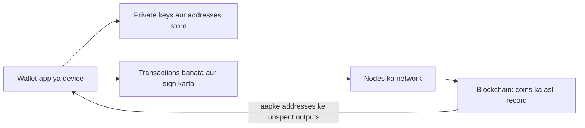
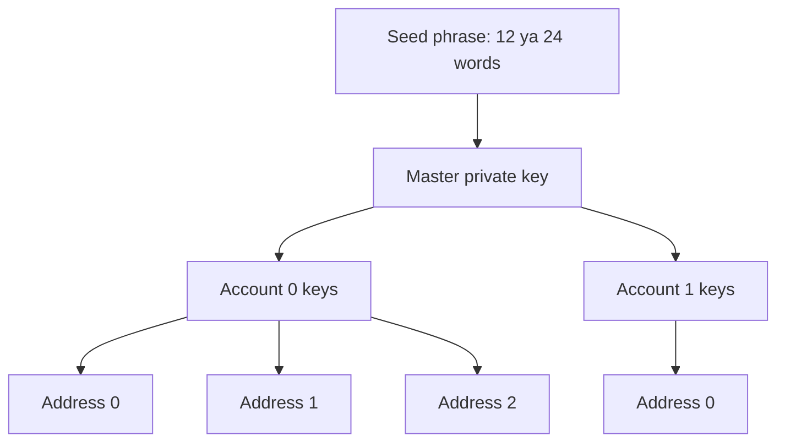
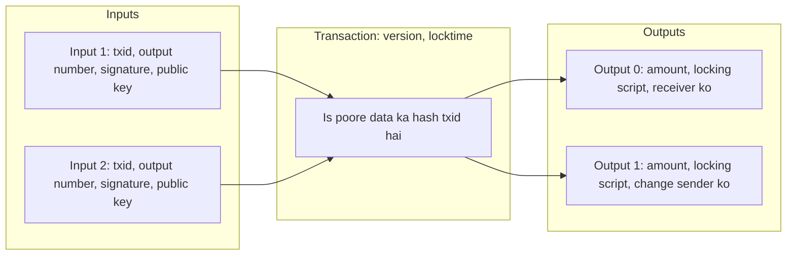
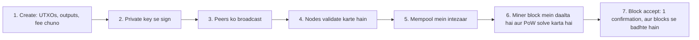
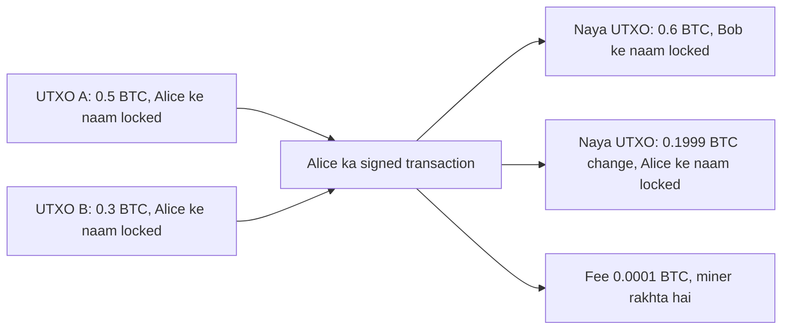
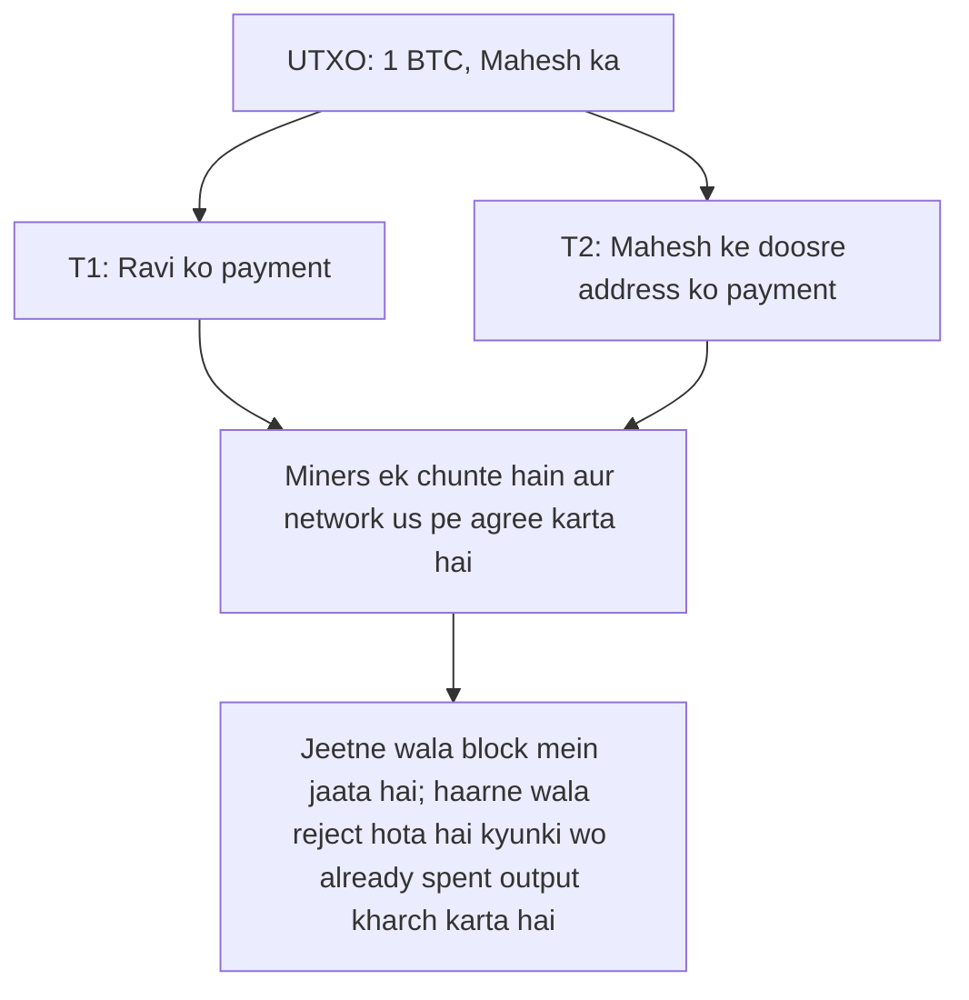
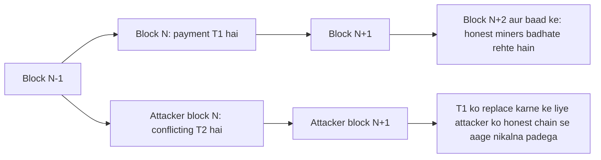

Ye note syllabus <Syl m="5" /> cover karta hai: cryptocurrency wallets (hot aur cold), blockchain mein transactions, UTXO model aur double-spending problem.

## Pehle basics

- **Private key** ek secret number hai. **Public key** usse calculate hoti hai, aur **address** public key ka chhota fingerprint (hash) hai jo aap share kar sakte ho, account number ki tarah. <Cite id="bitcoin-mb-ch04-keys" />
- **Digital signature** private key se bana proof hai ki owner ek particular transaction approve karta hai. Public key se koi bhi ise check kar sakta hai. Ise kisi doosre transaction pe copy nahi kiya ja sakta.
- **Node** wo computer hai jo blockchain software chalata hai, ledger ki copy rakhta hai aur har transaction check karta hai.
- **Block** transactions ka batch hai; blocks hashes se chain mein jude hote hain. **Proof of work (PoW)** wo puzzle hai jo miners block jodne ke liye solve karte hain, isliye block jodne mein asli mehnat lagti hai. <Cite id="blockchain-fundamentals-nakamoto" loc="§4" />
- **1 BTC = 100,000,000 satoshis.**

Analogy: cash socho. Kagaz ka note ek saath do dukaanon mein nahi ho sakta. Digital file bina rok-tok copy ho jaati hai, isliye blockchain ka poora kaam digital "note" ko aise cash jaisa banana hai jo sirf ek baar kharch ho.

## Wallet kya hai?

<Box kind="definition">

**Cryptocurrency wallet** wo software ya device hai jo aapki private keys store karta hai, dikhata hai ki un keys ke control mein kitne coins hain, aur transactions sign karta hai taaki aap bhej sako. Wo coins ko khud store **nahi** karta; coins sirf blockchain pe records ki tarah hote hain. <Cite id="wallets-utxo-double-spending-wiki-crypto-wallet" /> <Cite id="bitcoin-btcwiki-transaction" />

</Box>

**Ye kyun zaroori hai.** 256-bit random key koi yaad nahi rakh sakta, aur handling mein galti ka matlab paisa gaya, aur call karne ke liye koi bank nahi. Wallet keys safely banata hai, track karta hai ki kaunse outputs aapke hain (aapka balance), transaction banata hai, sign karta hai aur network ko bhejta hai. <Cite id="wallets-utxo-double-spending-bitcoin-org-devguide-wallets" />

**Not your keys, not your coins.** Agar private key kisi aur ke paas hai (jaise exchange), to coins ko wahi control karta hai. Agar aapne key kho di, to coins koi recover nahi kar sakta.

### Wallet kya karta hai

1. **Keys generate aur store karta hai** aur unse bane addresses.
2. **Balance nikalta hai** blockchain scan karke, un unspent outputs ke liye jo aapki keys unlock kar sakti hain.
3. **Transaction banata hai**: kharch karne ke outputs chunta hai, receiver, change aur fee jodta hai.
4. **Private key se sign karta hai.**
5. **Broadcast karta hai** nodes ko, ya full node ko deta hai jo broadcast karta hai.
6. **Backup aur restore** seed phrase se.

<Cite id="wallets-utxo-double-spending-gfg-hot-cold" loc="diagram" />

## Wallets ke types

Wallets ko teen tareeke se group kiya jaata hai, ek saath. Answer likhte waqt groups mix mat karo.

**Internet se connection ke hisaab se**

- **Hot wallet**: keys online device pe hoti hain (phone app, desktop program, browser extension ya exchange account).
- **Cold wallet**: keys offline rakhi jaati hain (hardware device, paper ya metal plate). Transaction offline sign hota hai aur sirf signed result online jaata hai.

**Form ke hisaab se**

| Type | Kya hai | Hot ya cold | Achha | Bura |
|---|---|---|---|---|
| Desktop wallet | PC pe program (jaise Bitcoin Core, Electrum) | Hot | Poora control, full node ban sakta hai | PC pe malware ka risk |
| Mobile wallet | Phone pe app, aksar QR code scan karta hai | Hot | Roz ke payments ke liye handy | Phone kho ya infect ho sakta hai |
| Web / browser wallet | Browser ya website pe chalta hai (jaise MetaMask extension) | Hot | Jaldi khulta hai, kisi bhi device pe | Phishing aur website ka risk |
| Hardware wallet | Chhota device jo keys andar rakhta hai aur device pe hi sign karta hai (jaise Ledger, Trezor) | Cold | Keys device se bahar nahi jaati; strong protection | Paise lagte hain; kho ya kharab ho sakta hai |
| Paper wallet | Keys ya seed paper pe print ya likhi | Cold | Hack karne ko electronics nahi | Jal, fade ya kho sakta hai; import ke baad unsafe |
| Exchange / custodial wallet | Exchange keys rakhta hai aur aapko balance dikhata hai | Hot | Simple, password recovery | Keys aapke paas nahi; exchange hack ya fail ho sakta hai |

<Cite id="wallets-utxo-double-spending-bitcoin-org-wallet" /> <Cite id="wallets-utxo-double-spending-wiki-hw-wallet" /> <Cite id="wallets-utxo-double-spending-btcwiki-cold" />

**Keys kiske paas hain, uske hisaab se**

- **Non-custodial**: keys aapke paas (poora control, poori zimmedari).
- **Custodial**: company ke paas (aasan, par company pe bharosa).

**Keys kaise bani, uske hisaab se**

- **Non-deterministic** ("just a bunch of keys"): har key random hai, isliye har nayi key ka naya backup chahiye.
- **Deterministic / HD (hierarchical deterministic)**: saari keys ek **seed** se aati hain, isliye ek backup se har key restore hoti hai, purani bhi aur aane wali bhi. <Cite id="wallets-utxo-double-spending-bip32" />
- **Multisignature (multisig)**: payment ke liye n keys mein se m approvals chahiye (jaise 3 mein se 2), jo ek chori ya kho gayi key se bachata hai. <Cite id="wallets-utxo-double-spending-btcwiki-cold" />

### Seed phrase aur HD wallets

**Seed phrase** (recovery phrase, mnemonic) 12 ya 24 aam words ki list hai jo 2,048 words ki fixed list se li jaati hai. Words ek random number (seed) ko encode karte hain. Seed se wallet private keys ka poora tree har baar ek hi tarah se calculate karta hai. Isliye jiske paas words hain wo saari keys aur coins rebuild kar sakta hai, aur isiliye words ko secret aur offline rakhna chahiye. <Cite id="wallets-utxo-double-spending-bip39" /> <Cite id="wallets-utxo-double-spending-mb-ch05-wallets" />

<Cite id="wallets-utxo-double-spending-bip32" loc="diagram" />

Itne addresses kyun? Har payment ke liye naya address privacy badhata hai (aapke payments ko jodna mushkil hota hai).

### Hot wallet versus cold wallet

<Box kind="definition">

**Hot wallet** apni private keys internet se jude device pe rakhta hai. **Cold wallet** unhe offline rakhta hai, isliye hacker network se unhe chhu nahi sakta. <Cite id="wallets-utxo-double-spending-gfg-hot-cold" /> <Cite id="cryptocurrencies-tokens-gfg-wallets" />

</Box>

| Point | Hot wallet | Cold wallet |
|---|---|---|
| Internet | Hamesha ya aksar online | Offline; sirf signed transactions online jaate hain |
| Security | Kam: malware, phishing, exchange hacks ka exposure | Zyada: attacker ko physical device ya paper chahiye |
| Convenience | Zyada, seconds mein send | Kam, sign aur send ke extra steps |
| Cost | Aksar free | Hardware device mehnga; paper free |
| Typical use | Roz ka kharch, trading, chhoti amounts | Lambe time ki savings, badi amounts |
| Examples | Mobile app, MetaMask, exchange account | Ledger ya Trezor device, paper wallet, metal seed plate |
| Main risk | Hacking | Device ya seed ka kho jaana, kharab hona ya chori |
| Recovery | Seed phrase | Seed phrase (safely rakhna zaroori) |

**Best practice.** Chhoti amount hot wallet mein rakho, jeb kharch ki tarah, aur baaki cold wallet mein, bank locker ki tarah. Cold wallet jaadui dhaal nahi hai: agar seed phrase ki photo li gayi, online type ho gayi ya kho gayi, to coins bhi saath jaate hain.

<Box kind="exam">

Exam mein English mein likho: "A hot wallet stores private keys on an internet-connected device, so it is convenient but exposed to online attacks. A cold wallet stores them offline, so it is more secure but less convenient."

</Box>

Related PYQ: <PYQ id="2023-05-ce/q1c" />, <PYQ id="2023-12-ce/q1b" />, <PYQ id="2024-05-ce/q1b" />, <PYQ id="2025-05-ce/q1d" />, <PYQ id="2024-12/q6b" />.

<Sum>

<Given>

Ek wallet recovery phrase use karta hai jo 2,048 words ki list ke words se bana hai. BIP 39 phrase mein random seed (entropy) plus entropy $\div$ 32 bits ka checksum hota hai.

</Given>

<Find>

har word kitne bits carry karta hai, aur 12-word aur 24-word phrase mein kitne entropy bits aur checksum bits hain.

</Find>

<Steps>

1. **Bits per word.** $2048 = 2^{11}$, to ek word $2^{11}$ values mein se ek chunta hai aur 11 bits carry karta hai. *Reason: $2^n$ barabar options mein se choice $n$ bits hai.*
2. **12 words.** Total bits $= 12 \times 11 = 132$.
3. **12 words ka split.** Entropy $E$ plus checksum $E/32$ barabar 132, to $E \times (1 + 1/32) = 132$ aur $E = 132 \times 32/33 = 128$. Checksum $= 128/32 = 4$ bits.
4. **24 words.** Total bits $= 24 \times 11 = 264$. Entropy $= 264 \times 32/33 = 256$ aur checksum $= 256/32 = 8$ bits.

</Steps>

<Answer>

Har word 11 bits carry karta hai. 12-word phrase = 128 entropy bits + 4 checksum bits. 24-word phrase = 256 entropy bits + 8 checksum bits.

</Answer>

<Box kind="verify">

Wapas jodo: $128 + 4 = 132 = 12 \times 11$ aur $256 + 8 = 264 = 24 \times 11$. 24-word entropy (256 bits) Bitcoin private key ke size ke barabar hai, jaisa hona chahiye. <Cite id="wallets-utxo-double-spending-bip39" />

</Box>

</Sum>

## Blockchain mein transactions

<Box kind="definition">

**Transaction** ek signed message hai jo value ek ya zyada owners se ek ya zyada receivers ko move karta hai. Block mein aane ke baad wo permanent public record ka hissa ban jaata hai. <Cite id="bitcoin-btcwiki-transaction" /> <Cite id="blockchain-fundamentals-nakamoto" loc="§2" />

</Box>

Nakamoto ki apni definition: "We define an electronic coin as a chain of digital signatures." Owner pichhle transaction ka hash aur agle owner ki public key sign karta hai, aur coin mein jod deta hai. <Cite id="blockchain-fundamentals-nakamoto" loc="§2" />

### Bitcoin transaction ka structure

| Field | Matlab |
|---|---|
| Version | Transaction kaunse rules follow karta hai |
| Inputs (list) | Har input pichhle output ko point karta hai (previous transaction id plus output number) aur unlocking data carry karta hai: signature aur public key |
| Outputs (list) | Har output mein amount (satoshis mein) aur locking script hoti hai jo batati hai ki agla kharch kaun kar sakta hai, aam taur pe "is public-key hash ka owner" |
| Locktime | Sabse jaldi kab ya kaunse block pe transaction mine ho sakta hai (aam taur pe 0 = abhi) |
| Transaction id (txid) | Transaction data ka hash; wahi uska naam hai |

<Cite id="bitcoin-mb-ch06-transactions" /> <Cite id="bitcoin-devguide-transactions" /> <Cite id="bitcoin-lmab-p2pkh" />

<Cite id="bitcoin-mb-ch06-transactions" loc="diagram" />

### Transaction life cycle

1. **Create.** Wallet kharch karne ke liye UTXOs chunta hai, outputs (receiver, change) likhta hai aur fee set karta hai.
2. **Sign.** Har input ke liye wallet us private key se sign karta hai jo us UTXO ko unlock karti hai. Signature transaction data ko cover karta hai, isliye baad mein koi badlav ise tod deta hai.
3. **Broadcast.** Wallet transaction ek node ko bhejta hai, wo apne peers ko deta hai (gossip), aur jaldi hi zyadatar nodes ke paas pahunch jaata hai.
4. **Validate.** Har node check karta hai: sahi format, signatures valid, har input ek maujood **unspent** output hai, koi input do baar use nahi hua, aur total outputs total inputs se zyada nahi.
5. **Mempool.** Valid transactions har node ki memory pool (mempool) mein miner ka intezaar karte hain.
6. **Mine.** Miner transactions chunta hai, aam taur pe sabse zyada fee per byte wale, block banata hai aur proof-of-work puzzle solve karta hai.
7. **Confirm.** Naya block broadcast hota hai, nodes dobara check karke jodte hain. Transaction ko ab **1 confirmation** mil gaya; uske upar har naya block ek aur jodta hai. Spent outputs UTXO set se hat jaate hain aur naye outputs jud jaate hain.

<Cite id="bitcoin-og-tx-lifecycle" loc="diagram" /> <Cite id="consensus-mining-btcwiki-confirmation" />

Related PYQ: <PYQ id="2023-12-ce/q5a" />.

## UTXO model

<Box kind="definition">

**UTXO** ka full form **Unspent Transaction Output**. Bitcoin mein har transaction outputs banata hai; jo output abhi tak kisi baad ke transaction ka input nahi bana, wo UTXO hai. Kisi insaan ka balance un sab UTXOs ka sum hai jo uski keys unlock kar sakti hain. Stored balance wala koi account nahi hota. <Cite id="wallets-utxo-double-spending-wiki-utxo" /> <Cite id="wallets-utxo-double-spending-gfg-utxo" /> <Cite id="wallets-utxo-double-spending-learnmeabitcoin-utxo" />

</Box>

**Analogy: physical cash.** Aapke wallet mein 500, 200 aur 100 ke note hain. 350 dene ke liye aap 500 ka note dete ho, aur dukaandaar 150 change lauta deta hai. Aap note ko "ghatate" nahi; poora note de dete ho aur naye note paate ho. UTXOs bhi aise hi chalte hain: **output poora kharch hota hai**, aur bacha hua aapko naye output (**change**) ki tarah wapas milta hai.

### Kaise kaam karta hai

1. Har output mein ek **amount** aur ek **lock** (script jo batati hai ki kaun kharch kar sakta hai) hota hai.
2. Kharch karne ke liye naya transaction jin outputs ko consume karta hai unhe **inputs** ki tarah list karta hai aur har lock kholne ke liye **signature** jodta hai.
3. Transaction **naye outputs** banata hai: ek receiver ke liye aur ek change output sender ko wapas.
4. Miners transaction ko block mein daalte hain. Consume hue outputs ab **spent** hain aur UTXO set se hat jaate hain; naye outputs usme jud jaate hain.
5. Har full node **UTXO set** rakhta hai, yani saare unspent outputs ki list, taaki naya transaction jaldi check ho sake. <Cite id="bitcoin-mb-ch06-transactions" />

<Cite id="wallets-utxo-double-spending-gfg-utxo" loc="diagram" />

### Har node ye rules check karta hai

- Har input aise output ko refer kare jo UTXO set mein **maujood aur unspent** ho.
- Signature us output ko unlock kare.
- Inputs ka sum outputs ke sum se kam na ho. Difference **fee** hai: $\text{fee} = \sum \text{inputs} - \sum \text{outputs}$. <Cite id="bitcoin-mb-ch06-transactions" />
- Koi output amount negative na ho, aur ek hi output input mein do baar na aaye.

### Change aur fee

Agar aapke paas 0.5 BTC ka output hai aur 0.2 BTC dene hain, to poora 0.5 kharch karna padega. Do outputs banao: 0.2 receiver ko aur 0.3 (fee ghatakar) khud ko wapas. Agar change output bhool gaye, to poora difference bahut badi fee ban jaata hai, aur miner rakh leta hai.

### Advantages aur disadvantages

| Advantages | Disadvantages |
|---|---|
| Double spending check karna aasan: output ya to UTXO set mein hai ya nahi | Program karna mushkil; simple "balance" variable nahi hota |
| Alag UTXOs use karne wale transactions independent hain, isliye parallel check ho sakte hain | Bahut saare chhote UTXOs ("dust") wale wallet ko unhe kharch karne ke liye bada, mehnga transaction chahiye |
| Achhi privacy habit: har change output ke liye naya address | Balance outputs scan karke nikalna padta hai |
| Simple, auditable history: har coin apne origin tak trace hota hai | Complex smart contracts ka limited support |

### UTXO model versus account model

| Point | UTXO model (Bitcoin) | Account model (Ethereum) |
|---|---|---|
| Kya store hota hai | Unspent outputs ka set | Har account ka balance aur nonce |
| Spending | Poore outputs consume, naye banao | Sender ka balance ghatao, receiver ka badhao |
| Balance | Aapke UTXOs ka sum | Seedha account se padho |
| Double spending kaise rokta hai | Output sirf ek baar spend ho sakta hai | Nonce: account ke har transaction ka unique, badhta number |
| Smart contracts | Limited script | Rich, general contracts |

<Cite id="wallets-utxo-double-spending-eth-accounts" /> <Cite id="wallets-utxo-double-spending-wiki-utxo" />

<Box kind="exam">

Exam mein English mein likho: "UTXO is an unspent transaction output. A Bitcoin transaction consumes whole UTXOs as inputs and creates new UTXOs as outputs, one for the receiver and one as change for the sender. The user's balance is the sum of the UTXOs they can unlock."

</Box>

Related PYQ: <PYQ id="2023-12-ce/q1a" />, <PYQ id="2022-12-ce/q6b" />, <PYQ id="2023-05-ce/q6b" />, <PYQ id="2025-05-ce/q6d" />, <PYQ id="2025-05/q6b" />, <PYQ id="2024-12/q3a" />.

<Sum>

<Given>

Alice ke paas do UTXOs hain: 0.5 BTC aur 0.3 BTC. Wo Bob ko 0.6 BTC dena chahti hai. Fee 0.0001 BTC set karti hai. Transaction 250 virtual bytes (vB) lamba hai.

</Given>

<Find>

wo kaunse UTXOs kharch karti hai, change output, aur fee rate satoshis per vB mein.

</Find>

<Steps>

1. **Inputs chuno.** Akela 0.5, 0.6 + fee se kam hai, isliye dono kharch karo: $0.5 + 0.3 = 0.8$ BTC. *Reason: output poora kharch hota hai.*
2. **Change.** $\text{change} = 0.8 - 0.6 - 0.0001 = 0.1999$ BTC, Alice ke naye address pe.
3. **Outputs.** $0.6 + 0.1999 = 0.7999$ BTC.
4. **Fee check.** $0.8 - 0.7999 = 0.0001$ BTC $= 10{,}000$ satoshis.
5. **Fee rate.** $10{,}000 / 250 = 40$ sat/vB. *Reason: miners transactions ko size ke hisaab se fee se rank karte hain.*

</Steps>

<Answer>

Dono UTXOs kharch karo (0.8 BTC); outputs: 0.6 BTC Bob ko aur 0.1999 BTC change; fee $= 0.0001$ BTC $= 10{,}000$ sat, rate 40 sat/vB.

</Answer>

<Box kind="verify">

Inputs outputs plus fee ke barabar hain: $0.8 = 0.6 + 0.1999 + 0.0001$. Agar change chhoot jaata, to fee chupchaap $0.8 - 0.6 = 0.2$ BTC ban jaati, isse samajh aata hai ki change output kyun zaroori hai.

</Box>

</Sum>

<Sum>

<Given>

UTXO set mein ye unspent outputs hain: U1 = 2 BTC (Alice), U2 = 1 BTC (Alice), U3 = 4 BTC (Carol). Alice ek saath do transactions sign karti hai. T1 U1 aur U2 kharch karta hai aur 2.9 BTC Bob ko, 0.09 BTC change Alice ko deta hai. T2 sirf U1 kharch karta hai aur 1.9 BTC Dave ko, 0.05 BTC change Alice ko deta hai.

</Given>

<Find>

har transaction ki fee, aur agar T1 pehle miners tak pahunche to network kaunsa accept karta hai.

</Find>

<Steps>

1. **T1 ki fee.** Inputs $2 + 1 = 3$ BTC. Outputs $2.9 + 0.09 = 2.99$ BTC. Fee $= 3 - 2.99 = 0.01$ BTC. T1 abhi tak valid hai.
2. **T2 ki fee.** Input $2$ BTC. Outputs $1.9 + 0.05 = 1.95$ BTC. Fee $= 2 - 1.95 = 0.05$ BTC. T2 bhi akele valid hai.
3. **Clash dhoondho.** T1 aur T2 dono U1 ko input banate hain. Output sirf ek baar kharch ho sakta hai, isliye dono transactions **conflict** karte hain. *Reason: yahi double spend hai.*
4. **Pehle T1 lagao.** Wo block mein aata hai. U1 aur U2 UTXO set se hat jaate hain; naye outputs (2.9 Bob ko, 0.09 Alice ko) jud jaate hain. Set ab U3 plus do naye outputs hai.
5. **T2 check karo.** Uska input U1 ab UTXO set mein nahi hai, isliye har node T2 ko invalid maan ke reject karta hai.

</Steps>

<Answer>

T1 ki fee $= 0.01$ BTC; T2 ki fee $= 0.05$ BTC. Network T1 accept karta hai aur T2 reject, kyunki U1 pehle hi spent hai. (T2 zyada fee deta hai, isliye agar T2 pehle miner tak pahunchta, to T2 jeet'ta aur T1 reject hota. Dono mein se sirf ek hi confirm ho sakta hai.)

</Answer>

<Box kind="verify">

Pehle ke total coins: $2 + 1 + 4 = 7$ BTC. T1 ke baad: Carol ka U3 (4) + Bob (2.9) + Alice change (0.09) + miner fee (0.01) $= 7.00$ BTC. Koi coin na bana na gaya, aur Alice ne U1 do baar kharch nahi kiya. Rules ko ye jaanne ki zaroorat nahi ki Alice beimaan hai; sirf UTXO set hi doosra spend mana kar deta hai.

</Box>

</Sum>

## Double-spending problem

<Box kind="definition">

**Double spending** ka matlab ek hi digital money ko ek se zyada baar kharch karna. Digital systems mein ye possible hai kyunki file copy ho sakti hai, aur receiver dekh ke nahi bata sakta ki coin pehle hi kisi aur ko diya ja chuka hai ya nahi. <Cite id="blockchain-fundamentals-wiki-doublespend" /> <Cite id="wallets-utxo-double-spending-gfg-double-spending" />

</Box>

**Ye central problem kyun hai.** Physical cash do jagah ek saath nahi ho sakta. Digital coin sirf data hai, isliye rule ke bina use do dukaanon mein paste kiya ja sakta hai. Bitcoin se pehle rule trusted bank ya mint thi jo ek sachchi ledger rakhti thi. Nakamoto ke paper ke mutabik aam digital coins ki problem ye hai ki "the payee can't verify that one of the owners did not double-spend the coin", aur aam ilaaj central mint hai, jo phir trusted third party ban jaata hai. Unka solution public, timestamped, agreed order of transactions hai. <Cite id="blockchain-fundamentals-nakamoto" loc="§2" />

### Example

Mahesh ke paas ek 1 BTC output hai.

1. 10:00 baje wo shopkeeper Ravi ko 1 BTC deta hai (transaction T1) aur Ravi laptop de deta hai.
2. 10:01 baje Mahesh doosra transaction T2 sign karta hai jo wahi 1 BTC uske apne doosre address pe bhejta hai.
3. Agar T2 mine ho jaaye aur T1 nahi, to Ravi ki payment gayab ho jaati hai, par laptop ja chuka hai.

Rule ke bina dono transactions barabar valid dikhte hain. Bitcoin sirf ek ko jeetne deta hai.

<Cite id="wallets-utxo-double-spending-gfg-double-spending" loc="diagram" />

### Kin tareeko se koshish ho sakti hai

| Attack | Kaise kaam karta hai | Kisse rukta hai |
|---|---|---|
| Race attack | Attacker shop ko ek payment aur network ko usi waqt conflicting payment bhejta hai, ummeed mein ki doosra mine ho | Kam se kam ek confirmation ka intezaar (keemti saaman ke liye zero-confirmation payment accept mat karo) |
| Finney attack | Attacker pehle se ek block mine karke rakhta hai jisme khud ko payment hai, phir shop mein wahi coin kharch karta hai aur block release kar deta hai | Confirmations ka intezaar |
| Majority (51%) attack | Jo attacker mining power ke aadhe se zyada control karta hai wo payment chhod kar ek lambi private chain banata hai aur release kar deta hai | Hash power ki cost; zyada confirmations ka intezaar; bada honest network |
| Reversal / chain reorganization | Wahi idea payment block mein aane ke baad, honest chain ko out-mine karke | Depth: har extra block ise bahut mushkil banata hai |

<Cite id="wallets-utxo-double-spending-btcwiki-weaknesses" /> <Cite id="consensus-mining-btcwiki-majority" /> <Cite id="wallets-utxo-double-spending-btcwiki-double-spending" />

### Bitcoin ise kaise solve karta hai

1. **UTXO rule.** Output sirf ek baar spend ho sakta hai. Har full node UTXO set rakhta hai aur aise kisi bhi transaction ko reject karta hai jiska input usme nahi hai. Pehle spend ke record hone ke baad ye same coin ka doosra spend rokta hai.
2. **Blocks se public ordering.** Saare transactions publicly broadcast hote hain aur ek agreed order mein blocks mein likhe jaate hain. Jab do transactions conflict karte hain, accepted chain mein jo pehle aata hai wo jeetta hai, aur doosra invalid hai. <Cite id="blockchain-fundamentals-nakamoto" loc="§2" />
3. **Proof of work order chunta hai.** Network sabse lambi chain accept karta hai, yani jisme sabse zyada accumulated work ho. Block banane mein asli computing lagti hai, isliye koi sasta mein order rewrite nahi kar sakta. <Cite id="blockchain-fundamentals-nakamoto" loc="§4" /> <Cite id="consensus-mining-wiki-pow" />
4. **Chain depth (confirmations).** Payment ke block ke upar har naya block reversal ko bahut mushkil banata hai, kyunki attacker ko us block aur har baad ke block ka kaam dobara karna padta hai, jabki honest miners aur jodte rehte hain. Lagbhag 6 confirmations ke baad chance bahut kam hota hai, jab tak attacker ke paas mining power ka bada hissa na ho. <Cite id="blockchain-fundamentals-nakamoto" loc="§11" /> <Cite id="consensus-mining-btcwiki-confirmation" />
5. **Honest majority assumption.** Security tab tak rehti hai jab tak honest nodes ke paas computing power ka aadhe se zyada hissa hai.

<Cite id="wallets-utxo-double-spending-gfg-prevent-double" loc="diagram" />

**Receiver khud ko kaise bachaye.** Value ke hisaab se confirmations ka intezaar karo: chai ke liye koi nahi, chhote saaman ke liye ek se teen, badi payments ke liye lagbhag chhe. Ethereum-type systems mein nonce bhi wahi signed transaction dobara chalne (replay) se rokta hai. <Cite id="wallets-utxo-double-spending-eth-accounts" />

**Limits.** Proof of work absolute certainty nahi deta; wo probability deta hai jo depth ke saath tezi se girti hai. 51% attacker abhi bhi double spend kar sakta hai, par doosron ke coins chura nahi sakta aur rules badal nahi sakta. Kam hash power wali chhoti chains sabse zyada risk mein hain.

<Box kind="exam">

Exam mein English mein likho: "Double spending is spending the same digital coin twice. Bitcoin prevents it because each output can be spent only once, all transactions are ordered in a public blockchain, and proof of work makes it very expensive to rewrite that order. Waiting for confirmations makes a double spend practically impossible."

</Box>

Related PYQ: <PYQ id="2022-12-ce/q2b" />, <PYQ id="2023-05-ce/q1b" />, <PYQ id="2024-12-ce/q5a" />, <PYQ id="2025-05-ce/q1c" />, <PYQ id="2024-12/q3a" />.

### Successful double spend ka chance

Nakamoto race ko random walk ki tarah model karte hain. Honest chain probability $p$ se blocks jodti hai, aur attacker probability $q = 1 - p$ se, jahan $q$ attacker ka hash power share hai. Agar attacker $z$ blocks peeche hai, to uske pakad lene ka chance $(q/p)^z$ hai jab $q < p$ (aur $q \ge p$ ho to 1). Jab tak honest miners $z$ blocks dhoondhte hain, attacker random $k$ blocks dhoondhta hai, Poisson mean $\lambda = z \cdot q/p$ ke saath. Attacker ke safal hone ki probability

$$
P = 1 - \sum_{k=0}^{z} \frac{\lambda^k e^{-\lambda}}{k!}\left(1 - (q/p)^{z-k}\right)
$$

Shabdon mein: jodo "attacker ne chupke se $k$ blocks bana liye" ka chance guna "baaki bache $z-k$ blocks se wo pakad leta hai" ka chance, aur uska complement lo. <Cite id="blockchain-fundamentals-nakamoto" loc="§11" />

<Sum>

<Given>

Attacker hash power ka $q = 10\%$ control karta hai, to $p = 0.9$. Payment ke $z = 6$ confirmations hain. $e^{-\lambda}$ use karo, $\lambda = z\,q/p$ ke saath.

</Given>

<Find>

attacker payment rewrite kar paaye uski probability.

</Find>

<Steps>

1. **Ratio.** $q/p = 0.1/0.9 = 1/9 = 0.1111$. *Reason: ye ek block ki zameen jeetne ka chance hai.*
2. **Poisson mean.** $\lambda = 6 \times 0.1111 = 0.6667$, aur $e^{-\lambda} = 0.51342$.
3. **Poisson term** $e^{-\lambda}\lambda^k/k!$, $k = 0..6$ ke liye: 0.51342, 0.34228, 0.11409, 0.02535, 0.00423, 0.00056, 0.00006.
4. **Catch-up chance** $1 - (q/p)^{6-k}$, $k = 0..6$ ke liye: 1.0, 0.99998, 0.99985, 0.99863, 0.98765, 0.88889, 0.
5. **Products.** 0.51342, 0.34227, 0.11408, 0.02532, 0.00417, 0.00050, 0. *Reason: har ek "attacker ne k blocks banaye" guna "wo pakad nahi paata" hai.*
6. **Sum.** $0.51342 + 0.34227 + 0.11408 + 0.02532 + 0.00417 + 0.00050 = 0.99976$.
7. **Complement.** $P = 1 - 0.99976 = 0.00024$.

</Steps>

<Answer>

$P \approx 0.00024$, yani lagbhag 0.024 percent (Nakamoto ki table 0.0002428 deti hai).

</Answer>

<Box kind="verify">

Edge cases se compare karo. $z = 0$ pe koi confirmation nahi aur formula $P = 1$ deta hai, jaisa hona chahiye. 6 blocks peeche se simple catch-up chance $(1/9)^6 = 0.0000019$ hai, bahut chhota, to answer iske aur 1 ke beech hona chahiye; 0.00024 hai, aur ye bada isliye hai kyunki attacker ke paas pehle se kuch blocks ho sakte hain. Result $q = 0.1$, $z = 6$ ke liye Nakamoto ki published value se bhi match karta hai. <Cite id="blockchain-fundamentals-nakamoto" loc="§11" />

</Box>

</Sum>

## Summary

- Wallet keys rakhta hai, coins nahi; hot wallets convenient aur online hote hain, cold wallets offline aur safer, aur 12 ya 24 word seed phrase unhe restore karti hai.
- Bitcoin unspent outputs track karta hai. Transaction poore UTXOs consume karta hai, naye banata hai (receiver aur change), aur difference fee hai.
- Double spending ek coin ka dobara use hai. UTXO rule, public blockchain order, proof of work aur confirmations ka intezaar milkar ise impractical bana dete hain jab tak attacker ke paas zyadatar mining power na ho.
