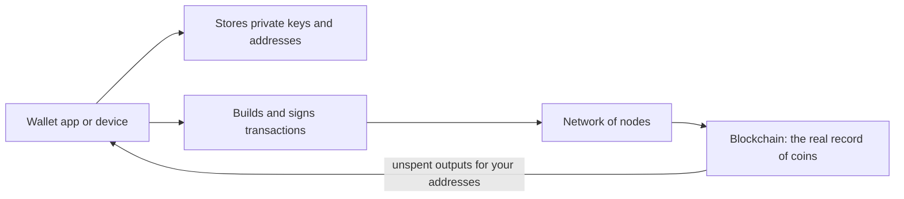
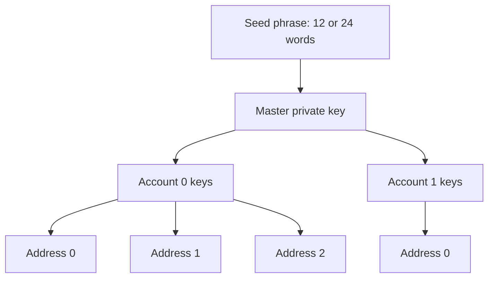
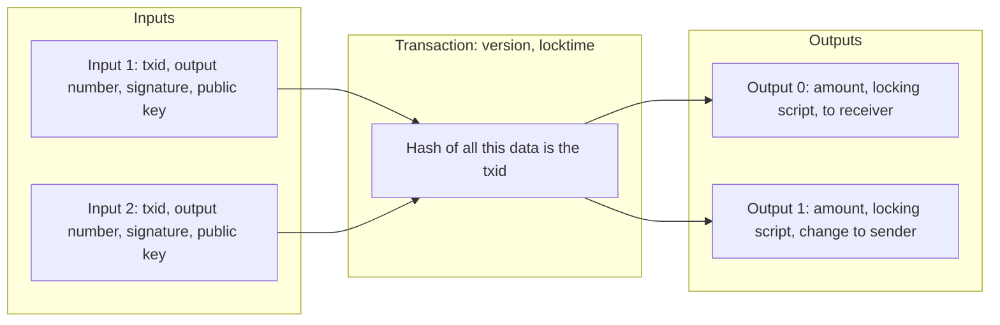
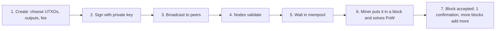
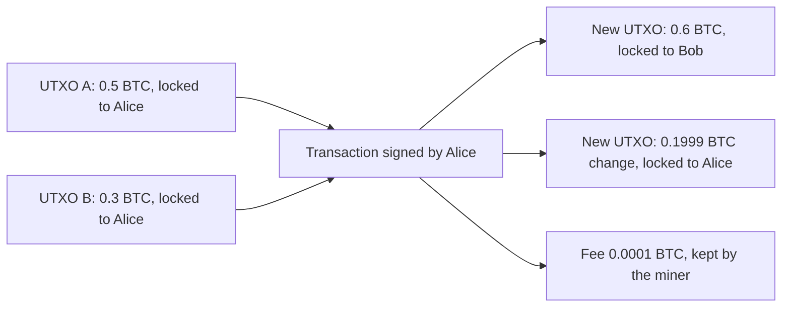
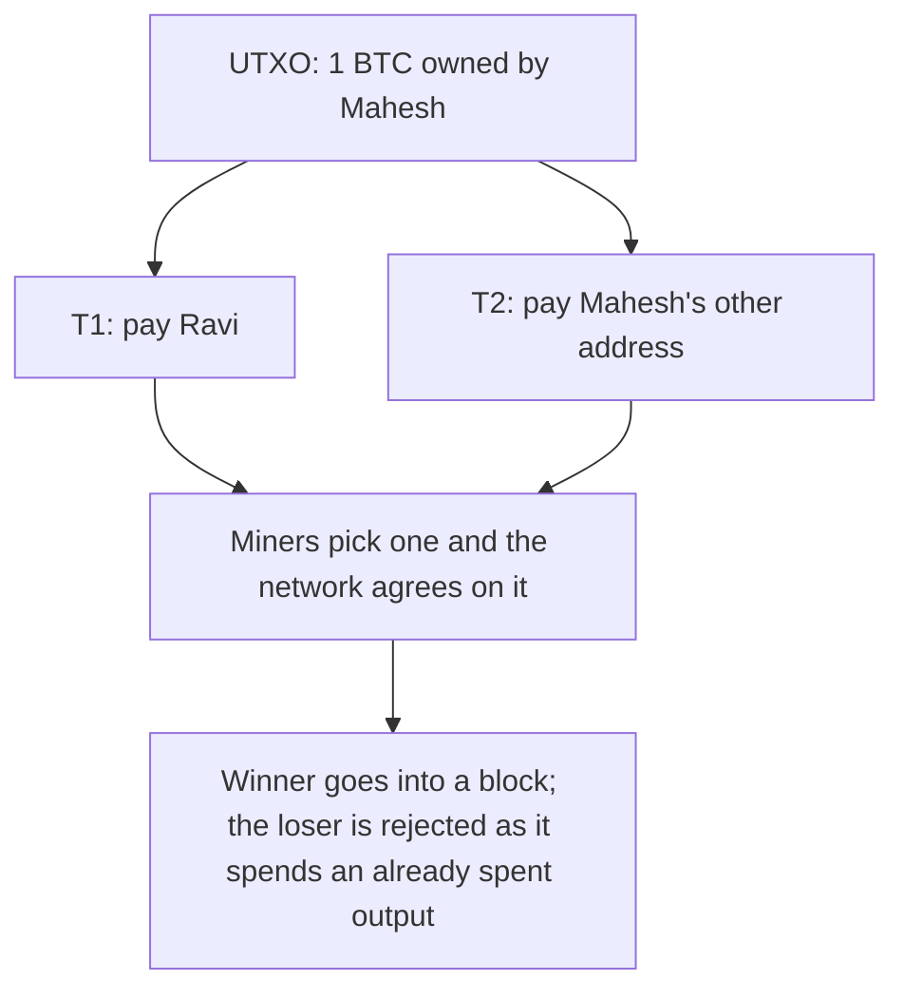
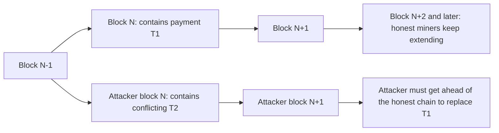

This note covers syllabus <Syl m="5" />: cryptocurrency wallets (hot and cold), transactions in a blockchain, the UTXO model and the double-spending problem.

## The basics first

- A **private key** is a secret number. A **public key** is calculated from it, and an **address** is a short fingerprint (hash) of the public key that you can share, like an account number. <Cite id="bitcoin-mb-ch04-keys" />
- A **digital signature** is proof, made with the private key, that the owner approves one particular transaction. Anyone can check it with the public key. It cannot be copied onto a different transaction.
- A **node** is a computer that runs the blockchain software, keeps a copy of the ledger and checks every transaction.
- A **block** is a batch of transactions; blocks are chained by hashes. **Proof of work (PoW)** is the puzzle miners solve to add a block, so adding a block costs real effort. <Cite id="blockchain-fundamentals-nakamoto" loc="§4" />
- **1 BTC = 100,000,000 satoshis.**

Analogy: think of cash. A paper note cannot be in two shops at once. A digital file can be copied freely, so the whole job of a blockchain is to make a digital "note" behave like cash that can be spent only once.

## What is a wallet?

<Box kind="definition">

A **cryptocurrency wallet** is software or a device that stores your private keys, shows the coins those keys control, and signs transactions so you can send them. It does **not** store the coins themselves; the coins exist only as records on the blockchain. <Cite id="wallets-utxo-double-spending-wiki-crypto-wallet" /> <Cite id="bitcoin-btcwiki-transaction" />

</Box>

**Why it is needed.** Nobody can remember a 256-bit random key, and a mistake in handling it means lost money with no bank to call. A wallet creates keys safely, tracks which outputs belong to you (your balance), builds the transaction, signs it and sends it to the network. <Cite id="wallets-utxo-double-spending-bitcoin-org-devguide-wallets" />

**Not your keys, not your coins.** If someone else holds the private key (for example an exchange), then that someone controls the coins. If you lose the key, nobody can recover the coins.

### What a wallet does

1. **Generates and stores keys** and the addresses made from them.
2. **Finds your balance** by scanning the blockchain for unspent outputs that your keys can unlock.
3. **Builds a transaction**: picks outputs to spend, adds the receiver, the change and the fee.
4. **Signs it** with the private key.
5. **Broadcasts it** to nodes, or hands it to a full node that does.
6. **Backs up and restores** keys using a seed phrase.

<Cite id="wallets-utxo-double-spending-gfg-hot-cold" loc="diagram" />

## Types of wallets

Wallets are grouped in three ways at once. Do not mix the groups up when you answer.

**By connection to the internet**

- **Hot wallet**: the keys live on a device that is online (a phone app, a desktop program, a browser extension or an exchange account).
- **Cold wallet**: the keys are kept offline (a hardware device, paper or a metal plate). The transaction is signed offline and only the signed result goes online.

**By form**

| Type | What it is | Hot or cold | Good | Bad |
|---|---|---|---|---|
| Desktop wallet | Program on a PC (for example Bitcoin Core, Electrum) | Hot | Full control, can be a full node | Risk of malware on the PC |
| Mobile wallet | App on a phone, often scans QR codes | Hot | Handy for daily payments | Phone can be lost or infected |
| Web / browser wallet | Runs in a browser or on a website (for example MetaMask extension) | Hot | Quick to open, works on any device | Phishing and website risk |
| Hardware wallet | Small device that keeps keys inside and signs on the device (for example Ledger, Trezor) | Cold | Keys never leave the device; strong protection | Costs money; can be lost or damaged |
| Paper wallet | Keys or seed printed or written on paper | Cold | No electronics to hack | Can burn, fade or be lost; unsafe to import once |
| Exchange / custodial wallet | The exchange keeps the keys and shows you a balance | Hot | Simple, password recovery | You do not hold the keys; exchange can be hacked or fail |

<Cite id="wallets-utxo-double-spending-bitcoin-org-wallet" /> <Cite id="wallets-utxo-double-spending-wiki-hw-wallet" /> <Cite id="wallets-utxo-double-spending-btcwiki-cold" />

**By who holds the keys**

- **Non-custodial**: you hold the keys (full control, full responsibility).
- **Custodial**: a company holds them (easy, but you trust the company).

**By how keys are made**

- **Non-deterministic** ("just a bunch of keys"): each key is random, so every new key needs a new backup.
- **Deterministic / HD (hierarchical deterministic)**: all keys come from one **seed**, so one backup restores every key, past and future. <Cite id="wallets-utxo-double-spending-bip32" />
- **Multisignature (multisig)**: a payment needs m approvals out of n keys (for example 2 of 3), which protects against one stolen or lost key. <Cite id="wallets-utxo-double-spending-btcwiki-cold" />

### Seed phrase and HD wallets

A **seed phrase** (recovery phrase, mnemonic) is a list of 12 or 24 ordinary words picked from a fixed list of 2,048 words. The words encode a random number (the seed). From the seed, the wallet computes a whole tree of private keys, one after another, always the same way. So anyone who has the words can rebuild all keys and coins, which is why the words must be kept secret and offline. <Cite id="wallets-utxo-double-spending-bip39" /> <Cite id="wallets-utxo-double-spending-mb-ch05-wallets" />

<Cite id="wallets-utxo-double-spending-bip32" loc="diagram" />

Why many addresses? Using a fresh address for every payment improves privacy (it is harder to link your payments together).

### Hot wallet versus cold wallet

<Box kind="definition">

A **hot wallet** keeps its private keys on a device connected to the internet. A **cold wallet** keeps them offline, so a hacker cannot reach them over the network. <Cite id="wallets-utxo-double-spending-gfg-hot-cold" /> <Cite id="cryptocurrencies-tokens-gfg-wallets" />

</Box>

| Point | Hot wallet | Cold wallet |
|---|---|---|
| Internet | Always or often online | Offline; only signed transactions go online |
| Security | Weaker: exposed to malware, phishing, exchange hacks | Stronger: attacker needs the physical device or paper |
| Convenience | High, send in seconds | Lower, extra steps to sign and send |
| Cost | Usually free | Hardware devices cost money; paper is free |
| Typical use | Daily spending, trading, small amounts | Long-term savings, large amounts |
| Examples | Mobile app, MetaMask, exchange account | Ledger or Trezor device, paper wallet, metal seed plate |
| Main risk | Hacking | Loss, damage or theft of the device or the seed |
| Recovery | Seed phrase | Seed phrase (must be stored safely) |

**Best practice.** Keep a small amount in a hot wallet, like pocket money, and the rest in a cold wallet, like a bank locker. A cold wallet is not a magic shield: if the seed phrase is photographed, typed online or lost, the coins go with it.

<Box kind="exam">

Exam mein English mein likho: "A hot wallet stores private keys on an internet-connected device, so it is convenient but exposed to online attacks. A cold wallet stores them offline, so it is more secure but less convenient."

</Box>

Related PYQ: <PYQ id="2023-05-ce/q1c" />, <PYQ id="2023-12-ce/q1b" />, <PYQ id="2024-05-ce/q1b" />, <PYQ id="2025-05-ce/q1d" />, <PYQ id="2024-12/q6b" />.

<Sum>

<Given>

A wallet uses a recovery phrase made of words from a list of 2,048 words. A BIP 39 phrase carries the random seed (entropy) plus a checksum of entropy $\div$ 32 bits.

</Given>

<Find>

how many bits each word carries, and how many entropy bits and checksum bits a 12-word and a 24-word phrase hold.

</Find>

<Steps>

1. **Bits per word.** $2048 = 2^{11}$, so one word picks one of $2^{11}$ values and carries 11 bits. *Reason: a choice among $2^n$ equal options is $n$ bits.*
2. **12 words.** Total bits $= 12 \times 11 = 132$.
3. **Split for 12 words.** Entropy $E$ plus checksum $E/32$ equals 132, so $E \times (1 + 1/32) = 132$ and $E = 132 \times 32/33 = 128$. Checksum $= 128/32 = 4$ bits.
4. **24 words.** Total bits $= 24 \times 11 = 264$. Entropy $= 264 \times 32/33 = 256$ and checksum $= 256/32 = 8$ bits.

</Steps>

<Answer>

Each word carries 11 bits. A 12-word phrase = 128 entropy bits + 4 checksum bits. A 24-word phrase = 256 entropy bits + 8 checksum bits.

</Answer>

<Box kind="verify">

Add back: $128 + 4 = 132 = 12 \times 11$ and $256 + 8 = 264 = 24 \times 11$. The 24-word entropy (256 bits) equals the size of a Bitcoin private key, as expected. <Cite id="wallets-utxo-double-spending-bip39" />

</Box>

</Sum>

## Transactions in a blockchain

<Box kind="definition">

A **transaction** is a signed message that moves value from one or more owners to one or more receivers. Once it is in a block it becomes part of the permanent public record. <Cite id="bitcoin-btcwiki-transaction" /> <Cite id="blockchain-fundamentals-nakamoto" loc="§2" />

</Box>

Nakamoto's own definition: "We define an electronic coin as a chain of digital signatures." The owner signs a hash of the previous transaction and the next owner's public key, and adds that to the coin. <Cite id="blockchain-fundamentals-nakamoto" loc="§2" />

### Structure of a Bitcoin transaction

| Field | Meaning |
|---|---|
| Version | Which rules the transaction follows |
| Inputs (list) | Each input points to an earlier output (previous transaction id plus output number) and carries the unlocking data: the signature and public key |
| Outputs (list) | Each output has an amount (in satoshis) and a locking script that says who may spend it next, usually "the owner of this public-key hash" |
| Locktime | Earliest time or block at which the transaction may be mined (usually 0 = now) |
| Transaction id (txid) | The hash of the transaction data; it names the transaction |

<Cite id="bitcoin-mb-ch06-transactions" /> <Cite id="bitcoin-devguide-transactions" /> <Cite id="bitcoin-lmab-p2pkh" />

<Cite id="bitcoin-mb-ch06-transactions" loc="diagram" />

### Transaction life cycle

1. **Create.** The wallet picks UTXOs to spend, writes the outputs (receiver, change) and sets the fee.
2. **Sign.** For each input the wallet signs with the private key that unlocks that UTXO. The signature covers the transaction data, so any later change breaks it.
3. **Broadcast.** The wallet sends the transaction to a node, which passes it to its peers (gossip), and soon most nodes have it.
4. **Validate.** Every node checks it: correct format, signatures valid, every input is an existing **unspent** output, no input is used twice, and total outputs do not exceed total inputs.
5. **Mempool.** Valid transactions wait in each node's memory pool (mempool) for a miner.
6. **Mine.** A miner picks transactions, usually those with the highest fee per byte, builds a block and solves the proof-of-work puzzle.
7. **Confirm.** The new block is broadcast, nodes re-check it and add it. The transaction has now **1 confirmation**; each later block on top adds one more. The spent outputs leave the UTXO set and the new outputs join it.

<Cite id="bitcoin-og-tx-lifecycle" loc="diagram" /> <Cite id="consensus-mining-btcwiki-confirmation" />

Related PYQ: <PYQ id="2023-12-ce/q5a" />.

## The UTXO model

<Box kind="definition">

**UTXO** stands for **Unspent Transaction Output**. In Bitcoin every transaction creates outputs; an output that has not yet been used as an input of a later transaction is a UTXO. The balance of a person is the sum of all UTXOs that their keys can unlock. There is no account with a stored balance. <Cite id="wallets-utxo-double-spending-wiki-utxo" /> <Cite id="wallets-utxo-double-spending-gfg-utxo" /> <Cite id="wallets-utxo-double-spending-learnmeabitcoin-utxo" />

</Box>

**Analogy: physical cash.** Your wallet holds notes of 500, 200 and 100. To pay 350 you hand over a 500 note, and the shopkeeper returns 150 as change. You never "reduce" a note; you give the whole note away and receive new ones. UTXOs work the same way: **an output is spent whole**, and the leftover returns to you as a new output (the **change**).

### How it works

1. Every output has an **amount** and a **lock** (a script that names who can spend it).
2. To spend, a new transaction lists the outputs it consumes as **inputs** and adds a **signature** that opens each lock.
3. The transaction creates **new outputs**: one for the receiver and one change output back to the sender.
4. Miners put the transaction in a block. The consumed outputs are now **spent** and removed from the UTXO set; the new outputs are added to it.
5. Every full node keeps the **UTXO set**, a list of all unspent outputs, so it can check a new transaction quickly. <Cite id="bitcoin-mb-ch06-transactions" />

<Cite id="wallets-utxo-double-spending-gfg-utxo" loc="diagram" />

### Rules every node checks

- Each input must refer to an output that exists **and is unspent** in the UTXO set.
- The signature must unlock that output.
- The sum of inputs must be at least the sum of outputs. The difference is the **fee**: $\text{fee} = \sum \text{inputs} - \sum \text{outputs}$. <Cite id="bitcoin-mb-ch06-transactions" />
- No output amount may be negative, and the same output cannot appear twice as an input.

### Change and fee

If you have a 0.5 BTC output and want to pay 0.2 BTC, you must spend the whole 0.5. You make two outputs: 0.2 to the receiver and 0.3 (less the fee) back to yourself. If you forget the change output, the whole difference becomes a very large fee, and the miner keeps it.

### Advantages and disadvantages

| Advantages | Disadvantages |
|---|---|
| Double spending is easy to check: an output is either in the UTXO set or not | Harder to program; there is no simple "balance" variable |
| Transactions that use different UTXOs are independent, so they can be checked in parallel | A wallet with many tiny UTXOs ("dust") needs a big, costly transaction to spend them |
| Good privacy habit: a new address for every change output | Balance must be computed by scanning outputs |
| Simple, auditable history: every coin traces back to its origin | Limited support for complex smart contracts |

### UTXO model versus account model

| Point | UTXO model (Bitcoin) | Account model (Ethereum) |
|---|---|---|
| What is stored | A set of unspent outputs | A balance and a nonce for each account |
| Spending | Consume whole outputs, create new ones | Subtract from the sender balance, add to the receiver |
| Balance | Sum of your UTXOs | Read directly from the account |
| Stops double spending by | An output can be spent only once | The nonce: each transaction from an account has a unique, increasing number |
| Smart contracts | Limited script | Rich, general contracts |

<Cite id="wallets-utxo-double-spending-eth-accounts" /> <Cite id="wallets-utxo-double-spending-wiki-utxo" />

<Box kind="exam">

Exam mein English mein likho: "UTXO is an unspent transaction output. A Bitcoin transaction consumes whole UTXOs as inputs and creates new UTXOs as outputs, one for the receiver and one as change for the sender. The user's balance is the sum of the UTXOs they can unlock."

</Box>

Related PYQ: <PYQ id="2023-12-ce/q1a" />, <PYQ id="2022-12-ce/q6b" />, <PYQ id="2023-05-ce/q6b" />, <PYQ id="2025-05-ce/q6d" />, <PYQ id="2025-05/q6b" />, <PYQ id="2024-12/q3a" />.

<Sum>

<Given>

Alice owns two UTXOs: 0.5 BTC and 0.3 BTC. She wants to pay Bob 0.6 BTC. She sets a fee of 0.0001 BTC. The transaction is 250 virtual bytes (vB) long.

</Given>

<Find>

which UTXOs she spends, the change output, and the fee rate in satoshis per vB.

</Find>

<Steps>

1. **Choose inputs.** 0.5 alone is less than 0.6 + fee, so spend both: $0.5 + 0.3 = 0.8$ BTC. *Reason: an output must be spent whole.*
2. **Change.** $\text{change} = 0.8 - 0.6 - 0.0001 = 0.1999$ BTC, sent to a new address of Alice.
3. **Outputs.** $0.6 + 0.1999 = 0.7999$ BTC.
4. **Fee check.** $0.8 - 0.7999 = 0.0001$ BTC $= 10{,}000$ satoshis.
5. **Fee rate.** $10{,}000 / 250 = 40$ sat/vB. *Reason: miners rank transactions by fee per size.*

</Steps>

<Answer>

Spend both UTXOs (0.8 BTC); outputs are 0.6 BTC to Bob and 0.1999 BTC change; fee $= 0.0001$ BTC $= 10{,}000$ sat, a rate of 40 sat/vB.

</Answer>

<Box kind="verify">

Inputs equal outputs plus fee: $0.8 = 0.6 + 0.1999 + 0.0001$. If the change were left out, the fee would silently become $0.8 - 0.6 = 0.2$ BTC, which shows why the change output matters.

</Box>

</Sum>

<Sum>

<Given>

The UTXO set holds these unspent outputs: U1 = 2 BTC (Alice), U2 = 1 BTC (Alice), U3 = 4 BTC (Carol). Alice signs two transactions at the same time. T1 spends U1 and U2 and pays 2.9 BTC to Bob and 0.09 BTC change to Alice. T2 spends U1 only and pays 1.9 BTC to Dave and 0.05 BTC change to Alice.

</Given>

<Find>

the fee of each transaction, and which transaction the network accepts if T1 reaches the miners first.

</Find>

<Steps>

1. **Fee of T1.** Inputs $2 + 1 = 3$ BTC. Outputs $2.9 + 0.09 = 2.99$ BTC. Fee $= 3 - 2.99 = 0.01$ BTC. T1 is valid so far.
2. **Fee of T2.** Input $2$ BTC. Outputs $1.9 + 0.05 = 1.95$ BTC. Fee $= 2 - 1.95 = 0.05$ BTC. T2 is also valid on its own.
3. **Look for a clash.** Both T1 and T2 use U1 as an input. An output can be spent only once, so the two transactions **conflict**. *Reason: this is the double spend.*
4. **Apply T1 first.** It enters a block. U1 and U2 are removed from the UTXO set; the new outputs (2.9 to Bob, 0.09 to Alice) are added. The set is now U3 plus the two new outputs.
5. **Check T2.** Its input U1 is no longer in the UTXO set, so every node rejects T2 as invalid.

</Steps>

<Answer>

Fee of T1 $= 0.01$ BTC; fee of T2 $= 0.05$ BTC. The network accepts T1 and rejects T2 because U1 is already spent. (T2 pays the higher fee, so if T2 reached a miner first, T2 would win and T1 would be rejected instead. Only one of the two can ever be confirmed.)

</Answer>

<Box kind="verify">

Total coins before: $2 + 1 + 4 = 7$ BTC. After T1: Carol's U3 (4) + Bob (2.9) + Alice change (0.09) + miner fee (0.01) $= 7.00$ BTC. No coin appeared or disappeared, and Alice never spent U1 twice. Nothing in the rules needs to know Alice is dishonest; the UTXO set alone refuses the second spend.

</Box>

</Sum>

## The double-spending problem

<Box kind="definition">

**Double spending** is spending the same digital money more than once. It is possible in digital systems because a file can be copied, and the receiver cannot tell by looking whether the coin was already given to someone else. <Cite id="blockchain-fundamentals-wiki-doublespend" /> <Cite id="wallets-utxo-double-spending-gfg-double-spending" />

</Box>

**Why it is the central problem.** Physical cash cannot be in two places at once. A digital coin is just data, so without a rule it could be pasted to two shops. Before Bitcoin the rule was a trusted bank or mint that kept the one true ledger. Nakamoto's paper says the problem with ordinary digital coins is that "the payee can't verify that one of the owners did not double-spend the coin", and the usual cure is a central mint, which then becomes a trusted third party. His solution is a public, timestamped, agreed order of transactions. <Cite id="blockchain-fundamentals-nakamoto" loc="§2" />

### Example

Mahesh has one 1 BTC output.

1. At 10:00 he pays 1 BTC to a shopkeeper Ravi (transaction T1) and Ravi hands over a laptop.
2. At 10:01 Mahesh signs a second transaction T2 that sends the same 1 BTC to his own other address.
3. If T2 is mined and T1 is not, Ravi's payment disappears, but the laptop is gone.

Without a rule, both transactions look equally valid. Bitcoin lets only one win.

<Cite id="wallets-utxo-double-spending-gfg-double-spending" loc="diagram" />

### Ways it can be attempted

| Attack | How it works | Stopped by |
|---|---|---|
| Race attack | Attacker sends one payment to the shop and a conflicting payment to the network at the same moment, hoping the second gets mined | Waiting for at least one confirmation (do not accept zero-confirmation payments for valuable goods) |
| Finney attack | Attacker pre-mines a block holding a payment to himself, then spends the same coin in a shop and releases the block | Waiting for confirmations |
| Majority (51%) attack | Attacker who controls more than half of the mining power builds a longer private chain that leaves out the payment and releases it | Cost of hash power; waiting for more confirmations; large honest network |
| Reversal / chain reorganization | Same idea after the payment is already in a block, by out-mining the honest chain | Depth: each extra block makes it much harder |

<Cite id="wallets-utxo-double-spending-btcwiki-weaknesses" /> <Cite id="consensus-mining-btcwiki-majority" /> <Cite id="wallets-utxo-double-spending-btcwiki-double-spending" />

### How Bitcoin solves it

1. **UTXO rule.** An output can be spent only once. Every full node keeps the UTXO set and rejects any transaction whose input is not in it. This stops a second spend of the same coin after the first is recorded.
2. **Public ordering by blocks.** All transactions are broadcast publicly and written into blocks in one agreed order. When two transactions conflict, the one that appears first in the accepted chain wins, and the other is invalid. <Cite id="blockchain-fundamentals-nakamoto" loc="§2" />
3. **Proof of work chooses the order.** The network accepts the longest chain, meaning the chain with the most accumulated work. Making a block needs real computing, so nobody can cheaply rewrite the order. <Cite id="blockchain-fundamentals-nakamoto" loc="§4" /> <Cite id="consensus-mining-wiki-pow" />
4. **Chain depth (confirmations).** Each new block on top of the payment's block makes reversal much harder, because an attacker must redo the work of that block and every later block, while the honest miners keep adding more. After about 6 confirmations the chance is tiny unless the attacker has a big share of the mining power. <Cite id="blockchain-fundamentals-nakamoto" loc="§11" /> <Cite id="consensus-mining-btcwiki-confirmation" />
5. **Honest majority assumption.** Security holds as long as honest nodes control more than half of the computing power.

<Cite id="wallets-utxo-double-spending-gfg-prevent-double" loc="diagram" />

**How a recipient should protect himself.** Wait for confirmations that match the value: none for coffee, one to three for small items, about six for large payments. On Ethereum-style systems the nonce also stops the same signed transaction being replayed. <Cite id="wallets-utxo-double-spending-eth-accounts" />

**Limits.** Proof of work does not give absolute certainty; it gives a probability that falls quickly with depth. A 51% attacker can still double spend, though cannot steal other people's coins or change the rules. Small chains with little hash power are the most at risk.

<Box kind="exam">

Exam mein English mein likho: "Double spending is spending the same digital coin twice. Bitcoin prevents it because each output can be spent only once, all transactions are ordered in a public blockchain, and proof of work makes it very expensive to rewrite that order. Waiting for confirmations makes a double spend practically impossible."

</Box>

Related PYQ: <PYQ id="2022-12-ce/q2b" />, <PYQ id="2023-05-ce/q1b" />, <PYQ id="2024-12-ce/q5a" />, <PYQ id="2025-05-ce/q1c" />, <PYQ id="2024-12/q3a" />.

### Chance of a successful double spend

Nakamoto models the race as a random walk. The honest chain adds blocks with probability $p$, and the attacker with probability $q = 1 - p$, where $q$ is the attacker's share of the hash power. If the attacker is $z$ blocks behind, the chance he ever catches up is $(q/p)^z$ when $q < p$ (and 1 if $q \ge p$). While the honest miners find the $z$ blocks, the attacker finds a random number $k$ of blocks, with Poisson mean $\lambda = z \cdot q/p$. The attacker succeeds with probability

$$
P = 1 - \sum_{k=0}^{z} \frac{\lambda^k e^{-\lambda}}{k!}\left(1 - (q/p)^{z-k}\right)
$$

In words: add up the chance that the attacker already made $k$ blocks in secret, times the chance he catches up from the $z-k$ blocks still missing, and take the complement. <Cite id="blockchain-fundamentals-nakamoto" loc="§11" />

<Sum>

<Given>

An attacker controls $q = 10\%$ of the hash power, so $p = 0.9$. The payment has $z = 6$ confirmations. Use $e^{-\lambda}$ with $\lambda = z\,q/p$.

</Given>

<Find>

the probability that the attacker can rewrite the payment.

</Find>

<Steps>

1. **Ratio.** $q/p = 0.1/0.9 = 1/9 = 0.1111$. *Reason: this is the chance of gaining one block of ground.*
2. **Poisson mean.** $\lambda = 6 \times 0.1111 = 0.6667$, and $e^{-\lambda} = 0.51342$.
3. **Poisson term** $e^{-\lambda}\lambda^k/k!$ for $k = 0..6$: 0.51342, 0.34228, 0.11409, 0.02535, 0.00423, 0.00056, 0.00006.
4. **Catch-up chance** $1 - (q/p)^{6-k}$ for $k = 0..6$: 1.0, 0.99998, 0.99985, 0.99863, 0.98765, 0.88889, 0.
5. **Products.** 0.51342, 0.34227, 0.11408, 0.02532, 0.00417, 0.00050, 0. *Reason: each is "attacker made k blocks" times "he does not catch up".*
6. **Sum.** $0.51342 + 0.34227 + 0.11408 + 0.02532 + 0.00417 + 0.00050 = 0.99976$.
7. **Complement.** $P = 1 - 0.99976 = 0.00024$.

</Steps>

<Answer>

$P \approx 0.00024$, about 0.024 percent (Nakamoto's table gives 0.0002428).

</Answer>

<Box kind="verify">

Compare with the cases at the edges. With $z = 0$ there are no confirmations and the formula gives $P = 1$, as it should. The simple catch-up chance from 6 blocks behind is $(1/9)^6 = 0.0000019$, far smaller, so the answer must lie between that and 1; 0.00024 does, and it is larger because the attacker may already hold some blocks. The result also matches Nakamoto's published value for $q = 0.1$, $z = 6$. <Cite id="blockchain-fundamentals-nakamoto" loc="§11" />

</Box>

</Sum>

## Summary

- A wallet holds keys, not coins; hot wallets are convenient and online, cold wallets are offline and safer, and a 12 or 24 word seed phrase restores them.
- Bitcoin tracks unspent outputs. A transaction consumes whole UTXOs, creates new ones (receiver and change), and the difference is the fee.
- Double spending is the reuse of one coin. The UTXO rule, the public blockchain order, proof of work and waiting for confirmations together make it impractical unless an attacker controls most of the mining power.
