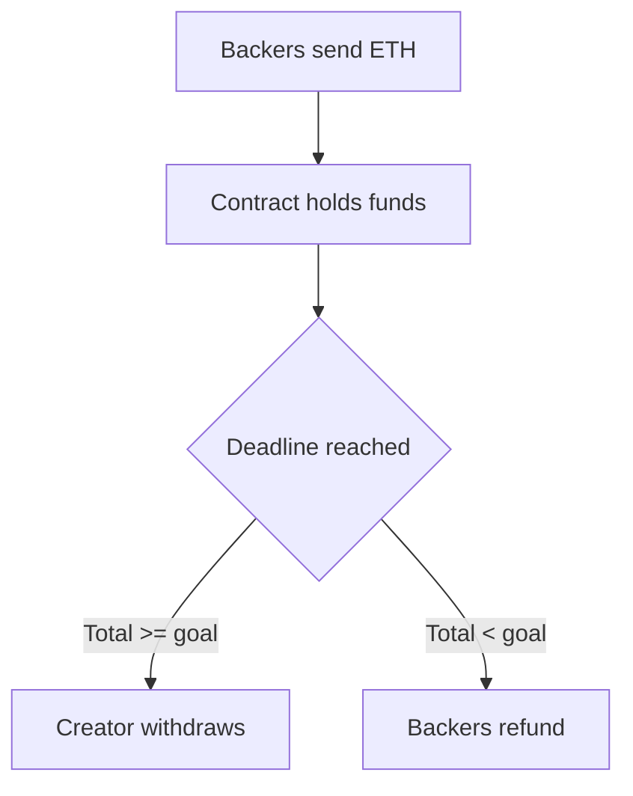

**In simple words:** smart contract blockchain pe stored ek chhota program hai jo conditions poori hone par apne aap chalta hai. Vending machine socho: paisa daalo, button dabao, aur machine bina dukandar ke item de deti hai.

**Definition:** smart contract blockchain ke ek address pe rakha hua code aur data hai. Code sab dekh sakte hain, aur network use har node pe same tarah chalata hai, isliye koi cheating ya rokna nahi kar sakta. <Cite id="smart-contracts-eth-intro" /> <Cite id="smart-contracts-szabo-1994" />

**Smart contract se crowdfunding:**

1. Creator ek contract deploy karta hai jisme ek **goal** (maan lo 100 ETH) aur ek **deadline** hoti hai.
2. Backers contract ko ETH bhejte hain. Contract har backer aur amount record karta hai.
3. Deadline pe contract total check karta hai.
4. **Goal reach hua:** creator saara fund withdraw kar sakta hai.
5. **Goal miss hua:** har backer refund call karke apna paisa wapas le sakta hai.

**Benefits:** beech ka platform fee nahi leta, rules public hain, goal se pehle fund nikal nahi sakta, aur refund automatic hai. **Limit:** code mein bug ho to paisa kho sakta hai, aur deploy ke baad code aasani se badal nahi sakta. <Cite id="smart-contracts-gfg-smart-contracts" /> <Cite id="solidity-by-example" />

Exam mein English mein likho: "A smart contract is self-executing code on the blockchain that releases funds only when the agreed conditions are met."
