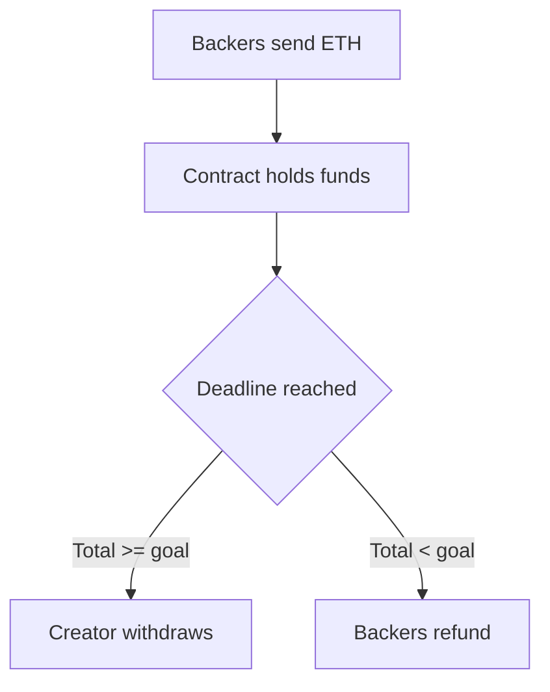

**In simple words:** a smart contract is a small program stored on the blockchain that runs by itself when its conditions are met. Think of a vending machine: put in the money, press the button, and the machine gives the item with no shopkeeper.

**Definition:** a smart contract is code and data kept at an address on a blockchain. Everyone can see the code, and the network runs it the same way on every node, so no one can cheat or stop it. <Cite id="smart-contracts-eth-intro" /> <Cite id="smart-contracts-szabo-1994" />

**Crowdfunding with a smart contract:**

1. The creator deploys a contract with a **goal** (say 100 ETH) and a **deadline**.
2. Backers send ETH to the contract. It records each backer and amount.
3. At the deadline, the contract checks the total.
4. **Goal reached:** the creator can withdraw all the funds.
5. **Goal missed:** each backer can call a refund and get their own money back.

**Benefits:** no middle platform takes a fee, the rules are public, funds cannot be taken before the goal, and refunds are automatic. **Limit:** a bug in the code can lose money, and the code cannot be changed easily after deployment. <Cite id="smart-contracts-gfg-smart-contracts" /> <Cite id="solidity-by-example" />
