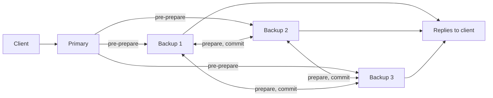

**In simple words:** PBFT mein computers (replicas) ke do roles hote hain. Ek leader hota hai, jise **primary** kehte hain. Baaki sab **backups** hain. Backup primary ko check karta hai aur follow karta hai, aur primary galat kare to uski jagah leta hai.

**Definition:** backup woh replica hai jo current view mein primary nahi hai. Woh requests ka order khud decide nahi karta. Woh primary ka propose kiya hua order accept karta hai, lekin pehle check karke. <Cite id="bft-paxos-raft-pbft-paper" />

**Backup kya karta hai:**

1. **Pre-prepare:** primary ka proposal (view, sequence number, request) leta hai aur check karta hai ki valid hai aur duplicate nahi hai.
2. **Prepare:** proposal theek ho to woh baaki sab replicas ko PREPARE message bhejta hai aur dusron ke matching prepares ka wait karta hai.
3. **Commit:** pre-prepare aur 2f matching prepares milne par woh sabko COMMIT bhejta hai, aur 2f + 1 matching commits ke baad request run karke client ko reply deta hai.
4. **Primary pe nazar:** woh ek timer chalata hai. Primary chup rahe ya conflicting orders bheje to backup **view change** maangta hai, taaki naya primary chuna jaye.

**Numbers:** f faulty replicas sahne ke liye PBFT ko n >= 3f + 1 replicas chahiye. f = 1 ho to 4 replicas: 1 primary aur 3 backups. <Cite id="bft-paxos-raft-gfg-pbft" />

Exam mein English mein likho: "A backup is a replica other than the primary that validates the primary's proposal, takes part in the prepare and commit phases, and triggers a view change if the primary fails."
