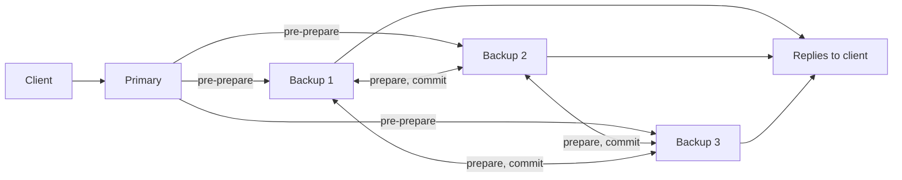

**In simple words:** in PBFT the computers (replicas) take two roles. One is the leader, called the **primary**. All the others are **backups**. A backup checks and follows the primary, and takes over if the primary misbehaves.

**Definition:** a backup is any replica that is not the primary in the current view. It does not pick the order of requests. It accepts the order that the primary proposes, but only after checking it. <Cite id="bft-paxos-raft-pbft-paper" />

**What a backup does:**

1. **Pre-prepare:** receives the primary's proposal (view, sequence number, request) and checks it is valid and not a duplicate.
2. **Prepare:** if the proposal is fine, it sends a PREPARE message to all other replicas and waits for matching prepares from others.
3. **Commit:** once it has the pre-prepare and 2f matching prepares, it sends a COMMIT to all, and after 2f + 1 matching commits it runs the request and replies to the client.
4. **Watch the primary:** it starts a timer. If the primary is silent or sends conflicting orders, the backup asks for a **view change** so a new primary is chosen.

**Numbers:** PBFT needs n >= 3f + 1 replicas to tolerate f faulty ones. With f = 1 there are 4 replicas: 1 primary and 3 backups. <Cite id="bft-paxos-raft-gfg-pbft" />
