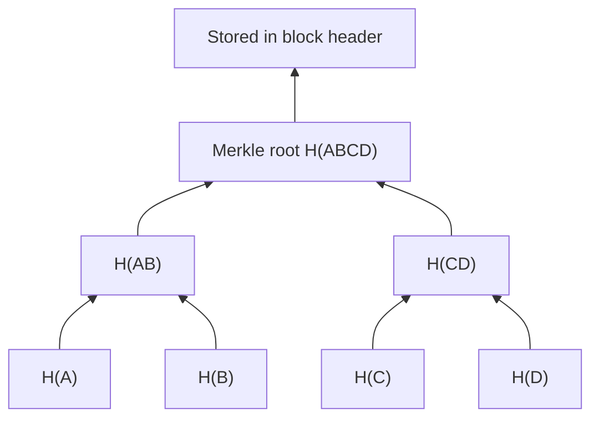

**In simple words:** Merkle tree transactions ki badi list ko ek chhote hash se fingerprint karne ka tareeka hai, taaki baad mein bina poori list bheje yeh prove kar sako ki ek transaction list mein hai.

**Definition:** Merkle tree (hash tree) ek binary tree hai jisme har leaf ek data block (transaction) ka hash hota hai aur har parent node apne do children ko jodkar unka hash hota hai. Sabse upar ka ek hash **Merkle root** kehlata hai. <Cite id="block-structure-merkle-wiki-merkle" />

**Structure, neeche se upar:**

1. **Leaves:** har transaction ko hash karo: H(A), H(B), H(C), H(D).
2. **Pair banao:** padosi hashes ke pair ko hash karo: H(AB) = H(H(A) + H(B)) aur H(CD) = H(H(C) + H(D)).
3. **Repeat** karo naye level pe jab tak ek hash bache: H(ABCD), yaani Merkle root.
4. Kisi level pe nodes odd hon to aakhri hash ko uski hi copy ke saath pair karte hain (Bitcoin aisa karta hai).

**Kyun useful hai:**

- **Tamper detection:** transaction C badlo to H(C), H(CD) aur root sab badal jaate hain.
- **Quick proof (Merkle proof):** C block mein hai yeh prove karne ke liye sirf H(D) aur H(AB) bhejo. Verifier do hashes mein root dobara bana leta hai, isliye n transactions ke proof mein lagbhag log2(n) hashes lagte hain.
- **Chhota header:** block header mein sirf 32-byte root hota hai, jisse light (SPV) wallets har transaction download kiye bina payment check kar lete hain. <Cite id="block-structure-merkle-mb-ch11" /> <Cite id="blockchain-fundamentals-nakamoto" />

**Conclusion:** Merkle tree bahut saari transactions ko ek root hash mein summarise karta hai aur checking aur tamper detection ko fast banata hai. <Cite id="block-structure-merkle-gfg-merkle-intro" />

Exam mein English mein likho: "A Merkle tree is a binary hash tree whose leaves are transaction hashes and whose root summarises all transactions in the block."
