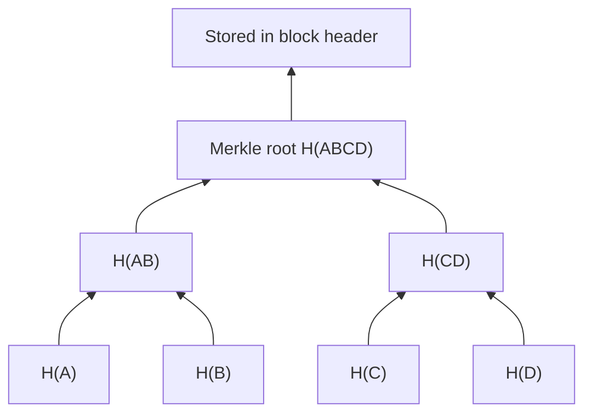

**In simple words:** a Merkle tree is a way to fingerprint a big list of transactions with one short hash, so you can later prove that one transaction is in the list without sending the whole list.

**Definition:** a Merkle tree (hash tree) is a binary tree in which every leaf is the hash of a data block (a transaction) and every parent node is the hash of its two children joined together. The single hash at the top is the **Merkle root**. <Cite id="block-structure-merkle-wiki-merkle" />

**Structure, bottom to top:**

1. **Leaves:** hash each transaction: H(A), H(B), H(C), H(D).
2. **Pair up:** hash each pair of neighbours: H(AB) = H(H(A) + H(B)) and H(CD) = H(H(C) + H(D)).
3. **Repeat** on the new level until one hash is left: H(ABCD), the Merkle root.
4. If a level has an odd number of nodes, the last hash is paired with a copy of itself (Bitcoin does this).

**Why it is useful:**

- **Tamper detection:** change transaction C and H(C), H(CD) and the root all change.
- **Quick proof (Merkle proof):** to prove C is in the block, send only H(D) and H(AB). The verifier rebuilds the root in two hashes, so a proof of n transactions needs about log2(n) hashes.
- **Small header:** the block header stores only the 32-byte root, which lets light (SPV) wallets check payments without downloading every transaction. <Cite id="block-structure-merkle-mb-ch11" /> <Cite id="blockchain-fundamentals-nakamoto" />

**Conclusion:** a Merkle tree summarises many transactions in one root hash and makes checking and tamper detection fast. <Cite id="block-structure-merkle-gfg-merkle-intro" />
