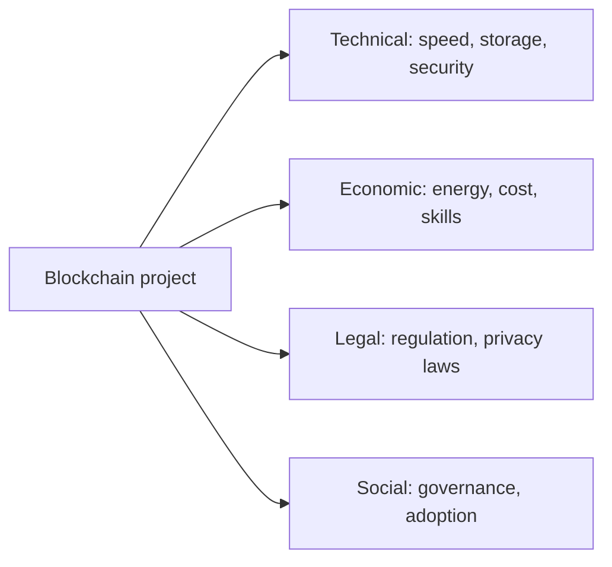

**In simple words:** blockchain powerful hai, lekin real business mein use karna aasan nahi. Jab team sach mein build karti hai to kai technical, cost aur legal problems aati hain.

**Challenges in implementing blockchain:**

1. **Scalability and speed.** Har node har transaction store aur check karta hai, aur blocks ki size limit hoti hai. Bitcoin sirf kuch transactions per second (lagbhag 7) handle karta hai, jabki card network hazaaron karta hai. <Cite id="blockchain-fundamentals-nist-8202" />
2. **Energy use.** Proof of Work bahut bijli khaata hai; Bitcoin mining ki bijli ek mid-sized desh ke level ki hoti hai. Proof of Stake aur permissioned chains isse kam karte hain. <Cite id="blockchain-fundamentals-ccaf-cbeci" />
3. **Storage growth.** Ledger sirf badhta hai, isliye har full node ko time ke saath zyada disk chahiye.
4. **Security risks.** Chhoti chain pe 51% attack, private keys chori hona (key kho gayi to paisa gaya, reset nahi hota) aur smart contract bugs (DAO hack) loss kara sakte hain.
5. **Privacy versus transparency.** Public chain sab transactions dikhati hai, jo companies ko pasand nahi aata. Immutability GDPR jaise laws se bhi takrati hai jo "right to erasure" dete hain.
6. **Regulation and legal doubt.** Crypto, tax, contracts aur responsibility ke rules kai deshon mein abhi clear nahi hain.
7. **Interoperability.** Alag blockchains aapas mein ya purane company systems se aasani se baat nahi kar paati.
8. **Cost and skills.** Solidity ya Fabric jaanne wale developers kam hain, existing software se integration mushkil hai, aur blockchain pe move karne mein paisa lagta hai.
9. **Governance and adoption.** Members ko rules, upgrades aur kaun pay karega is pe agree karna padta hai. Users ko wallets aur keys mushkil lagte hain.
10. **Oracle problem.** Contract real-world data khud nahi padh sakta, to use bahar ke feed pe trust karna padta hai.

| Challenge | Common way to reduce it |
|---|---|
| Scalability | Layer 2, sharding, bigger blocks |
| Energy | Proof of Stake, permissioned chain |
| Privacy | Private channels, zero-knowledge proofs |
| Smart contract bugs | Audits, testing, formal checks |
| Interoperability | Bridges, standards |

**Conclusion:** blockchain wahan fit hai jahan parties ke beech trust kam hai, lekin choose karne se pehle in challenges ko tolna chahiye. <Cite id="blockchain-fundamentals-gfg-advantages" /> <Cite id="blockchain-fundamentals-ibm-blockchain" /> <Cite id="blockchain-applications-gfg-industries" />

Exam mein English mein likho: "The main challenges are scalability, energy use, security, privacy versus transparency, regulation, interoperability, cost and skills."
