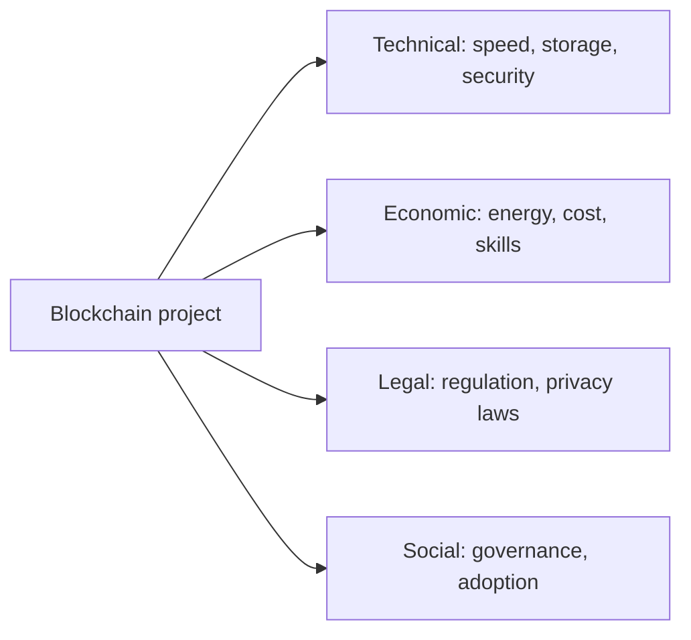

**In simple words:** blockchain is powerful, but it is not easy to use in a real business. Several technical, cost and legal problems come up when a team actually builds it.

**Challenges in implementing blockchain:**

1. **Scalability and speed.** Every node stores and checks every transaction, and blocks have a size limit. Bitcoin handles only a few transactions per second (about 7), while a card network handles thousands. <Cite id="blockchain-fundamentals-nist-8202" />
2. **Energy use.** Proof of Work burns a lot of electricity; Bitcoin mining uses power on the scale of a mid-sized country. Proof of Stake and permissioned chains reduce this. <Cite id="blockchain-fundamentals-ccaf-cbeci" />
3. **Storage growth.** The ledger only grows, so each full node needs more disk over time.
4. **Security risks.** A 51% attack on a small chain, stolen private keys (lost keys mean lost money with no reset) and bugs in smart contracts (the DAO hack) can all cause loss.
5. **Privacy versus transparency.** Public chains show all transactions, which companies may not accept. Immutability also clashes with laws like GDPR that allow "right to erasure".
6. **Regulation and legal doubt.** Rules on crypto, taxes, contracts and who is responsible are still unclear in many countries.
7. **Interoperability.** Different blockchains cannot easily talk to each other or to old company systems.
8. **Cost and skills.** Few developers know Solidity or Fabric, integration with existing software is hard, and moving to blockchain costs money.
9. **Governance and adoption.** Members must agree on rules, upgrades and who pays. Users also find wallets and keys hard to use.
10. **Oracle problem.** A contract cannot read real-world data by itself, so it must trust an outside feed.

| Challenge | Common way to reduce it |
|---|---|
| Scalability | Layer 2, sharding, bigger blocks |
| Energy | Proof of Stake, permissioned chain |
| Privacy | Private channels, zero-knowledge proofs |
| Smart contract bugs | Audits, testing, formal checks |
| Interoperability | Bridges, standards |

**Conclusion:** blockchain suits cases where trust between parties is low, but teams must weigh these challenges before choosing it. <Cite id="blockchain-fundamentals-gfg-advantages" /> <Cite id="blockchain-fundamentals-ibm-blockchain" /> <Cite id="blockchain-applications-gfg-industries" />
