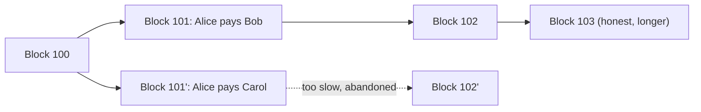

**In simple words:** double spending ka matlab ek hi digital coin ko do baar kharch karna. Paper note ek saath do dukaanon mein nahi ho sakta, lekin digital file copy ho sakti hai, isliye ek rule chahiye jo copy ko accept hone se roke.

**Double spending problem:** digital data copy karna aasan hai. Bank ke bina ek beimaan user wahi coin do logon ko bhej sakta hai. Example: Alice ke paas 1 coin hai. Woh Bob ko phone ke liye bhejti hai, aur usi time wahi coin Carol ko bhi bhejti hai. Agar dono payments accept ho jaayein to coin do baar kharch ho gaya. Normally bank balance check karta hai. Blockchain mein bank nahi hai, isliye network ko decide karna padta hai ki kaun si payment pehle aayi. <Cite id="blockchain-fundamentals-nakamoto" /> <Cite id="wallets-utxo-double-spending-gfg-double-spending" />

**Proof of Work isse kaise solve karta hai:**

1. Transactions broadcast hote hain aur miners unhe ek block mein collect karte hain.
2. Block add karne ke liye miner ko aisa nonce dhundhna padta hai ki block hash target se chhota ho. Isme bahut computing work lagta hai, lekin koi bhi ek hash se verify kar sakta hai. <Cite id="bitcoin-gfg-pow" />
3. Har block mein pichle block ka hash hota hai, aur network **longest chain** (jisme sabse zyada work ho) ko follow karta hai.
4. Chain mein jo transaction pehle aaya woh jeet jaata hai. Wahi coin kharch karne wali doosri transaction invalid ho kar reject hoti hai, kyunki woh coin pehle hi spent hai.
5. Alice Bob wali payment tabhi undo kar sakti hai jab woh us block aur uske baad ke har block ka proof of work dobara kare, aur phir saare honest miners se aage nikle. Jab tak uske paas network ki 50% se zyada computing power na ho, iske kaamyab hone ka chance bahut kam hai.
6. Isliye merchants **confirmations** (upar ke blocks) ka wait karte hain. 6 confirmations ke baad reversal ka chance bahut kam hota hai; Nakamoto dikhate hain ki blocks badhne par yeh exponentially girta hai. <Cite id="consensus-mining-btcwiki-confirmation" />

| Without PoW | With PoW |
|---|---|
| Koi bhi keh sakta hai ki uski transaction pehle aayi | Sabse zyada work wali chain order decide karti hai |
| Cheat karna sasta | Cheat karne ke liye bahut zyada hash power chahiye, aur 50% se kam ho to lagbhag hamesha fail hota hai |

**Conclusion:** PoW transactions ke order ko dobara likhna mehnga bana deta hai, isliye wahi coin do baar kharch nahi ho sakta. Yeh perfect nahi hai: 51% attacker phir bhi double spend kar sakta hai. <Cite id="wallets-utxo-double-spending-btcwiki-double-spending" />

Exam mein English mein likho: "Proof of Work prevents double spending because rewriting a confirmed transaction needs redoing the work of its block and all later blocks, which needs over half of the network's hash power."
