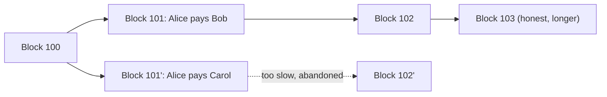

**In simple words:** double spending means spending the same digital coin twice. A paper note cannot be in two shops at once, but a digital file can be copied, so we need a rule that stops the copy from being accepted.

**Double spending problem:** digital data is easy to copy. Without a bank, a dishonest user could send the same coin to two people. For example, Alice has 1 coin. She sends it to Bob for a phone, and at the same time sends the same coin to Carol. If both payments were accepted, the coin would be spent twice. Normally a bank checks balances. A blockchain has no bank, so the network must decide which payment comes first. <Cite id="blockchain-fundamentals-nakamoto" /> <Cite id="wallets-utxo-double-spending-gfg-double-spending" />

**How Proof of Work solves it:**

1. Transactions are broadcast and collected by miners into a block.
2. To add the block, a miner must find a nonce so that the block hash is below a target. This takes huge computing work, but anyone can verify it in one hash. <Cite id="bitcoin-gfg-pow" />
3. Each block holds the previous block's hash, and the network follows the **longest chain** (the one with the most work).
4. The first transaction in the chain wins. The second one that spends the same coin is rejected as invalid, because that coin is already spent.
5. Alice cannot undo the Bob payment unless she redoes the proof of work of that block and every block after it, and then outpaces all honest miners. Unless she has more than 50% of the network's computing power, her chance of doing this is tiny.
6. So merchants wait for **confirmations** (blocks on top). With 6 confirmations the chance of reversal is tiny; Nakamoto shows it falls exponentially as blocks pile up. <Cite id="consensus-mining-btcwiki-confirmation" />

| Without PoW | With PoW |
|---|---|
| Anyone can claim a transaction came first | The chain with the most work decides the order |
| Cheap to cheat | Cheating needs a huge share of the hash power, and with less than 50% it almost always fails |

**Conclusion:** PoW makes the order of transactions costly to rewrite, so the same coin cannot be spent twice. It is not perfect: a 51% attacker could still double spend. <Cite id="wallets-utxo-double-spending-btcwiki-double-spending" />
