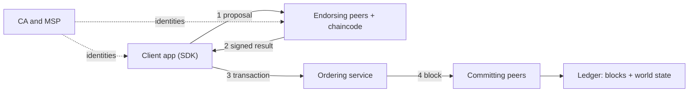

**In simple words:** Hyperledger Fabric businesses ke liye permissioned blockchain hai. Sirf known, identified members join kar sakte hain. Har node sab kuch karne ki jagah Fabric kaam ko alag roles mein baant deta hai: peers ledger chalate aur rakhte hain, aur ek alag ordering service transactions ka order decide karti hai. <Cite id="hyperledger-fabric-whatis" />

**Fabric v1 ke main components:**

1. **Membership Service Provider (MSP) and CA:** certificate authority har member ko identity deti hai, aur MSP check karta hai ki kaun kya kar sakta hai.
2. **Peers:** nodes jo ledger ki copy rakhte hain. *Endorsing peers* chaincode chalate hain aur result sign karte hain. *Committing peers* blocks validate karke likhte hain. <Cite id="hyperledger-fabric-peers" />
3. **Chaincode:** smart contract (Go, Java ya JavaScript mein) jo endorsing peers pe container mein chalta hai.
4. **Ordering service:** transactions ko blocks mein order karti hai aur blocks peers ko bhejti hai. Woh chaincode nahi chalati. <Cite id="hyperledger-fabric-ordering" />
5. **Channel:** apne alag ledger wala private sub-network; sirf uske members uska data dekhte hain.
6. **Ledger:** do hisse, blockchain (blocks ka append-only log) aur **world state** (current values, key-value database mein).
7. **Client application (SDK):** network ko transaction proposals bhejta hai.

**Execute-order-validate flow:**

1. Client endorsing peers ko ek **proposal** bhejta hai.
2. Endorsers chaincode ko apne world state pe **execute** karte hain, aur signed result (read-write set) wapas dete hain.
3. Client endorsement policy ke hisaab se kaafi endorsements collect karke transaction ordering service ko bhejta hai.
4. Orderer transactions ko block mein **order** karke channel ke saare peers ko bhejta hai.
5. Har peer block ko **validate** karta hai (policy aur read-write conflicts check) aur apne ledger mein commit karta hai. <Cite id="hyperledger-fabric-txflow" />

**Advantages:** high throughput, channels se private data, pluggable consensus, cryptocurrency ki zaroorat nahi. **Limitation:** members pe kuch had tak trust chahiye aur network public chain jitna open nahi hota. <Cite id="hyperledger-fabric-gfg-fabric" /> <Cite id="hyperledger-fabric-androulaki-2018" />

Exam mein English mein likho: "Fabric v1 uses an execute-order-validate flow: endorsing peers execute chaincode, the ordering service orders transactions into blocks, and committing peers validate and commit them."
