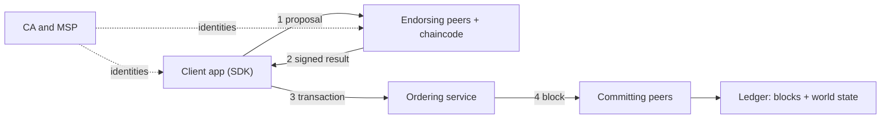

**In simple words:** Hyperledger Fabric is a permissioned blockchain for businesses. Only known, identified members can join. Instead of every node doing everything, Fabric splits the work between different roles: peers run and keep the ledger, and a separate ordering service decides the order of transactions. <Cite id="hyperledger-fabric-whatis" />

**Main components of Fabric v1:**

1. **Membership Service Provider (MSP) and CA:** a certificate authority gives every member an identity, and the MSP checks who is allowed to do what.
2. **Peers:** nodes that hold a copy of the ledger. *Endorsing peers* run the chaincode and sign the result. *Committing peers* validate and write blocks. <Cite id="hyperledger-fabric-peers" />
3. **Chaincode:** the smart contract (written in Go, Java or JavaScript) that runs in a container on endorsing peers.
4. **Ordering service:** orders transactions into blocks and sends the blocks to peers. It does not run chaincode. <Cite id="hyperledger-fabric-ordering" />
5. **Channel:** a private sub-network with its own ledger; only its members see its data.
6. **Ledger:** two parts, the blockchain (an append-only log of blocks) and the **world state** (the current values, in a key-value database).
7. **Client application (SDK):** sends transaction proposals to the network.

**Execute-order-validate flow:**

1. The client sends a **proposal** to endorsing peers.
2. Endorsers **execute** the chaincode against their world state, and return a signed result (read-write set).
3. The client collects enough endorsements (as per the endorsement policy) and sends the transaction to the ordering service.
4. The orderer **orders** transactions into a block and sends it to all peers on the channel.
5. Each peer **validates** the block (checks policy and read-write conflicts) and commits it to its ledger. <Cite id="hyperledger-fabric-txflow" />

**Advantages:** high throughput, private data through channels, pluggable consensus, no cryptocurrency needed. **Limitation:** members must be trusted to some degree and the network is less open than a public chain. <Cite id="hyperledger-fabric-gfg-fabric" /> <Cite id="hyperledger-fabric-androulaki-2018" />
