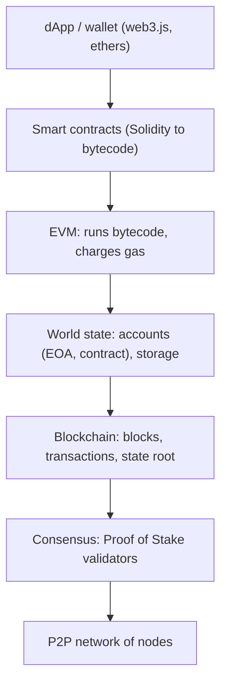

**In simple words:** Ethereum ek world computer hai jo hazaaron nodes share karte hain. Sab same state (accounts aur contract data) rakhte hain, aur state mein har change ek transaction hai jise sab check karte hain. <Cite id="ethereum-whitepaper" />

**Ethereum architecture ke components:**

1. **Accounts.** Do types: *externally owned accounts* (EOA, private key se control) aur *contract accounts* (code se control). Har ka address, balance aur nonce hota hai; contract ka code aur storage bhi hota hai. <Cite id="ethereum-eth-accounts" />
2. **Transactions and messages.** EOA ki signed transaction ether bhejti hai ya contract call karti hai. Contract doosre contracts ko messages bhej sakta hai.
3. **Ethereum Virtual Machine (EVM).** Sandbox jo contract bytecode chalata hai. Har node ise chalata hai aur sabko same result aana chahiye. <Cite id="ethereum-eth-evm" />
4. **Gas.** Har operation ki gas lagti hai, jo ether mein pay hoti hai (fee = gas used x gas price). Isse validators ko payment milti hai aur infinite loops rukte hain.
5. **World state.** Merkle Patricia trie jo har address ko uske account se map karta hai, isliye block header ka state root sab kuch summarise karta hai.
6. **Blocks and blockchain.** Blocks mein transactions, state root aur parent hash hota hai.
7. **Consensus.** Merge (2022) ke baad Proof of Stake: ETH stake karne wale validators blocks propose aur attest karte hain. Pehle Proof of Work tha.
8. **Network and nodes.** Nodes ka peer-to-peer network, har node execution client aur consensus client chalata hai. <Cite id="ethereum-eth-stack" />
9. **Developer layer.** Contracts Solidity mein likhe jaate hain, bytecode mein compile hote hain, aur dApps unhe web3.js ya ethers jaisi libraries se use karte hain.

**Transaction kaise chalti hai:** user transaction sign karta hai, node use broadcast karta hai, validator use block mein daalta hai, har node use EVM mein chalata hai, aur naya state state trie mein save hota hai.

**Conclusion:** Ethereum blockchain, state aur virtual machine ko jodta hai, isliye woh koi bhi program chala sakta hai, sirf payments nahi. <Cite id="ethereum-gfg-components" /> <Cite id="ethereum-me-ch1" />

Exam mein English mein likho: "Ethereum consists of accounts, transactions, the EVM, gas, the world state, blocks, a consensus layer and a peer-to-peer network."
