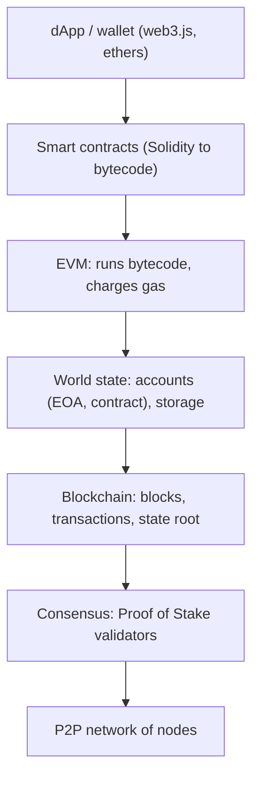

**In simple words:** Ethereum is a world computer shared by thousands of nodes. Everyone keeps the same state (accounts and contract data), and every change to that state is a transaction checked by all. <Cite id="ethereum-whitepaper" />

**Components of the Ethereum architecture:**

1. **Accounts.** Two kinds: *externally owned accounts* (EOA, controlled by a private key) and *contract accounts* (controlled by code). Each has an address, balance and nonce; a contract also has code and storage. <Cite id="ethereum-eth-accounts" />
2. **Transactions and messages.** A signed transaction from an EOA sends ether or calls a contract. A contract can send messages to other contracts.
3. **Ethereum Virtual Machine (EVM).** The sandbox that runs contract bytecode. Every node runs it and must get the same result. <Cite id="ethereum-eth-evm" />
4. **Gas.** Every operation costs gas, paid in ether (fee = gas used x gas price). It pays the validators and stops infinite loops.
5. **World state.** A Merkle Patricia trie that maps each address to its account, so the state root in the block header summarises everything.
6. **Blocks and blockchain.** Blocks hold transactions, the state root and the parent hash.
7. **Consensus.** Proof of Stake since the Merge (2022): validators who stake ETH propose and attest blocks. Before that it was Proof of Work.
8. **Network and nodes.** A peer-to-peer network of nodes, each running an execution client and a consensus client. <Cite id="ethereum-eth-stack" />
9. **Developer layer.** Contracts are written in Solidity, compiled to bytecode, and used by dApps through libraries like web3.js or ethers.

**How a transaction moves:** a user signs a transaction, a node broadcasts it, a validator includes it in a block, every node runs it in the EVM, and the new state is saved in the state trie.

**Conclusion:** Ethereum combines a blockchain, a state and a virtual machine, so it can run any program, not only payments. <Cite id="ethereum-gfg-components" /> <Cite id="ethereum-me-ch1" />
