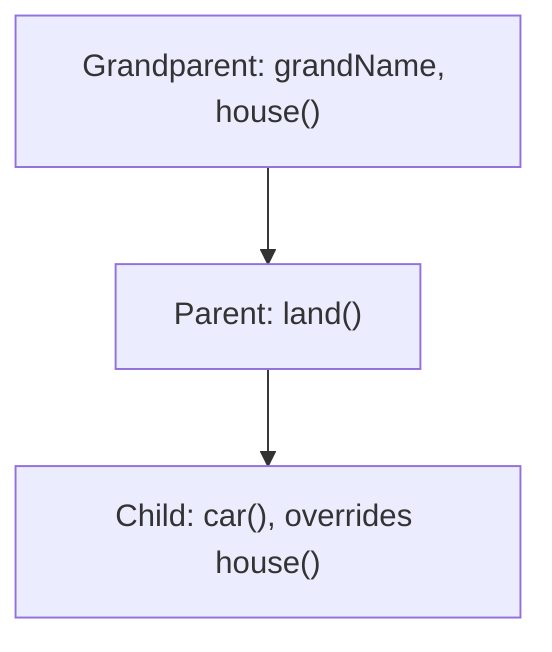

**In simple words:** inheritance se naya contract purane contract ka code reuse kar sakta hai, jaise bachcha parent aur grandparent se cheezein pata hai. **Multi-level inheritance** mein chain mein teen ya zyada levels hote hain: Grandparent, phir Parent jo Grandparent ko inherit karta hai, phir Child jo Parent ko inherit karta hai. To Child ko apne upar ke dono se sab kuch milta hai. <Cite id="solidity-docs-inheritance" />

```solidity
// SPDX-License-Identifier: MIT
pragma solidity ^0.8.0;

contract Grandparent {
    string public grandName = "Grandparent";

    function house() public pure virtual returns (string memory) {
        return "House from Grandparent";
    }
}

contract Parent is Grandparent {
    function land() public pure returns (string memory) {
        return "Land from Parent";
    }
}

contract Child is Parent {
    function house() public pure override returns (string memory) {
        return "House renovated by Child";
    }

    function car() public pure returns (string memory) {
        return "Car bought by Child";
    }
}
```



**Line by line:**

- `contract Grandparent` sabse upar ka (base) contract hai. Isme public variable `grandName` aur function `house()` hai.
- `house()` pe `virtual` ka matlab child contract ise change kar sakta hai.
- `contract Parent is Grandparent` mein `is` keyword inherit karne ke liye hai. Parent ke paas ab `grandName` aur `house()` hain, aur apna `land()` bhi.
- `contract Child is Parent` Parent se inherit karta hai, aur isliye Grandparent se bhi. Yeh doosra level hai, jo ise multi-level banata hai.
- Child ke `house()` pe `override` grandparent ke version ko naye version se replace karta hai.
- `car()` naya function hai jo sirf Child ke paas hai.
- `pure` ka matlab functions blockchain ka data nahi padhte, aur `memory` woh jagah hai jahan returned text temporarily rehta hai. <Cite id="solidity-gfg-inheritance" />

<Box kind="verify">

**Sirf `Child` deploy karo, phir call karo:**

- `land()` returns **"Land from Parent"**, ek level upar se inherit hua.
- `grandName()` returns **"Grandparent"**, do level upar se inherit hua.
- `house()` returns **"House renovated by Child"**, kyunki Child grandparent ka version override karta hai.
- `car()` returns **"Car bought by Child"**.

To ek deployed contract mein chaaron members hain. Compiled without errors with solc 0.8.38.

</Box>

**Note:** deploy hone par teeno contracts ek address pe ek contract mein merge ho jaate hain, aur function ka sabse derived version hi chalta hai. <Cite id="solidity-tp-inheritance" /> <Cite id="solidity-by-example" />

Exam mein English mein likho: "In multi-level inheritance a contract inherits from a contract that itself inherits from another, using the is keyword at each level."
