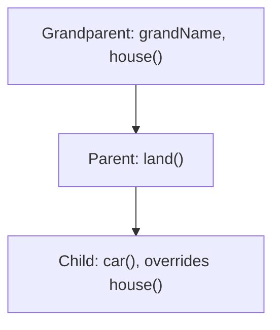

**In simple words:** inheritance lets a new contract reuse the code of an older one, like a child getting things from the parent and the grandparent. In **multi-level inheritance** the chain has three or more levels: Grandparent, then Parent inherits Grandparent, then Child inherits Parent. So Child gets everything from both above it. <Cite id="solidity-docs-inheritance" />

```solidity
// SPDX-License-Identifier: MIT
pragma solidity ^0.8.0;

contract Grandparent {
    string public grandName = "Grandparent";

    function house() public pure virtual returns (string memory) {
        return "House from Grandparent";
    }
}

contract Parent is Grandparent {
    function land() public pure returns (string memory) {
        return "Land from Parent";
    }
}

contract Child is Parent {
    function house() public pure override returns (string memory) {
        return "House renovated by Child";
    }

    function car() public pure returns (string memory) {
        return "Car bought by Child";
    }
}
```



**Line by line:**

- `contract Grandparent` is the top (base) contract. It has a public variable `grandName` and a function `house()`.
- `virtual` on `house()` means a child contract is allowed to change it.
- `contract Parent is Grandparent` uses the keyword `is` to inherit. Parent now has `grandName` and `house()` plus its own `land()`.
- `contract Child is Parent` inherits from Parent, and so also from Grandparent. This is the second level, which makes it multi-level.
- `override` on Child's `house()` replaces the grandparent's version with a new one.
- `car()` is a new function that only Child has.
- `pure` means the functions read no blockchain data, and `memory` is where the returned text lives temporarily. <Cite id="solidity-gfg-inheritance" />

<Box kind="verify">

**Deploy only `Child`, then call:**

- `land()` returns **"Land from Parent"**, inherited from one level up.
- `grandName()` returns **"Grandparent"**, inherited from two levels up.
- `house()` returns **"House renovated by Child"**, because Child overrides the grandparent's version.
- `car()` returns **"Car bought by Child"**.

So one deployed contract has all four members. Compiled without errors with solc 0.8.38.

</Box>

**Note:** when deployed, the three contracts are merged into one contract at one address, and the most-derived version of a function is the one that runs. <Cite id="solidity-tp-inheritance" /> <Cite id="solidity-by-example" />
