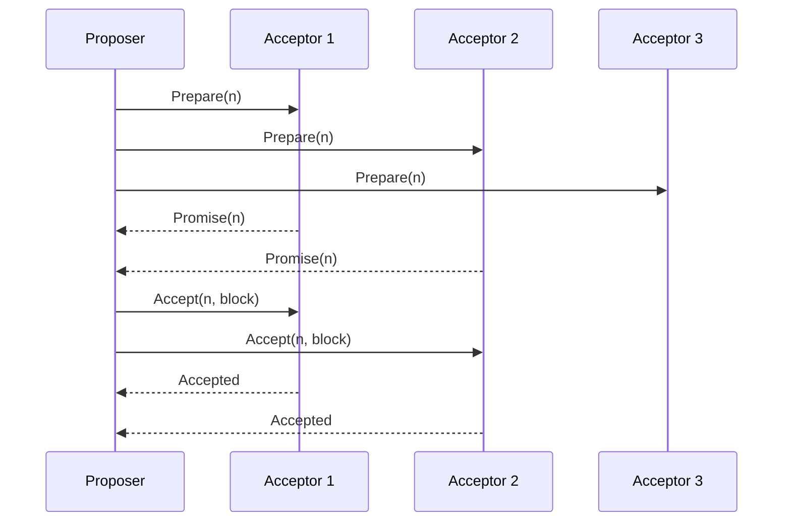

**In simple words:** Paxos computers ke group ke liye ek value pe agree karne ka tareeka hai, chahe kuch crash ho jaayein ya messages kho jaayein. Private blockchain mein saare nodes known hote hain aur jhooth nahi bolte, isliye woh Paxos se agree karte hain ki agla block kaun sa hoga. <Cite id="bft-paxos-raft-paxos-simple" />

**Kyun zaroori hai:** private chains mein mining nahi hoti. Do nodes alag blocks propose karein to bhi group ko ek hi answer chahiye. Paxos yeh answer deta hai jab tak nodes ka **majority** alive hai. Yeh sirf crash faults sahta hai, jhooth bolne wale (Byzantine) nodes ko nahi. <Cite id="bft-paxos-raft-wiki-paxos" />

**Roles:** *Proposer* value (block) suggest karta hai. *Acceptor* proposals pe vote karta hai. *Learner* chosen value jaan leta hai. Ek node teeno roles nibha sakta hai.

**Kaise kaam karta hai (do phases):**

1. **Prepare (phase 1a):** proposer ek unique, higher proposal number n chunta hai aur acceptors ko PREPARE(n) bhejta hai.
2. **Promise (phase 1b):** jis acceptor ne isse bada number nahi dekha woh PROMISE(n) reply karta hai. Woh vaada karta hai ki lower numbers ignore karega, aur jo value pehle accept ki ho woh bhi proposer ko batata hai.
3. **Accept request (phase 2a):** majority se promises milne par proposer ACCEPT(n, value) bhejta hai. Kisi acceptor ne pehle value accept ki ho to proposer ko sabse high number wali woh value use karni padti hai; warna apna block use kar sakta hai.
4. **Accepted (phase 2b):** acceptor accept karta hai agar usne isse bade number ka promise nahi kiya, aur learners ko batata hai.
5. **Chosen:** jab majority ek hi value accept kar le, woh decided hai, aur nodes woh block append kar dete hain.

**Example:** 5 nodes mein majority 3 hai, to 2 nodes down hone par bhi network agree karta hai. Aam taur pe 2f + 1 nodes f crashes sah lete hain. Yahan A3 slow tha lekin dikhaye gaye teen mein se 2 acceptors ne jawab diya, jo majority hai.

**Limits:** samajhna aur banana mushkil hai, bina leader ke competing proposers livelock kar sakte hain, aur yeh malicious nodes ko nahi rokta (PBFT rokta hai). Raft simple alternative hai jo kai private chains mein use hota hai. <Cite id="bft-paxos-raft-gfg-paxos" />

Exam mein English mein likho: "Paxos lets a majority of nodes agree on one value in two phases, prepare/promise and accept/accepted, and tolerates crash faults but not Byzantine faults."
