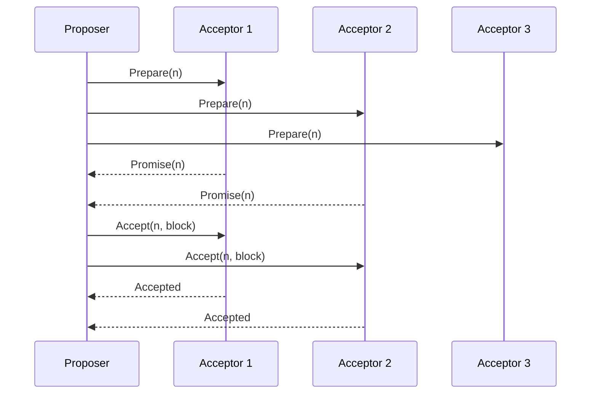

**In simple words:** Paxos is a way for a group of computers to agree on one value even if some of them crash or messages are lost. In a private blockchain, all nodes are known and trusted not to lie, so they use Paxos to agree on which block comes next. <Cite id="bft-paxos-raft-paxos-simple" />

**Why it is needed:** private chains have no mining. If two nodes propose different blocks, the group still needs one answer. Paxos gives that answer as long as a **majority** of nodes is alive. It tolerates crash faults only, not lying (Byzantine) nodes. <Cite id="bft-paxos-raft-wiki-paxos" />

**Roles:** *Proposer* suggests a value (a block). *Acceptor* votes on proposals. *Learner* finds out the chosen value. One node can play all three roles.

**How it works (two phases):**

1. **Prepare (phase 1a):** a proposer picks a unique, higher proposal number n and sends PREPARE(n) to the acceptors.
2. **Promise (phase 1b):** an acceptor that has not seen a higher number replies PROMISE(n). It promises to ignore lower numbers, and also tells the proposer any value it has already accepted.
3. **Accept request (phase 2a):** once the proposer gets promises from a majority, it sends ACCEPT(n, value). If some acceptor already accepted a value, the proposer must use that value with the highest number; otherwise it may use its own block.
4. **Accepted (phase 2b):** an acceptor accepts if it has not promised a higher number, and tells the learners.
5. **Chosen:** when a majority has accepted the same value, it is decided, and the nodes append that block.

**Example:** with 5 nodes, a majority is 3, so the network still agrees when 2 nodes are down. In general 2f + 1 nodes tolerate f crashes. Here A3 was slow but 2 of 3 acceptors answered, which is a majority of the three shown.

**Limits:** it is hard to understand and build, competing proposers can livelock without a leader, and it does not stop malicious nodes (PBFT does). Raft is a simpler alternative used in many private chains. <Cite id="bft-paxos-raft-gfg-paxos" />
