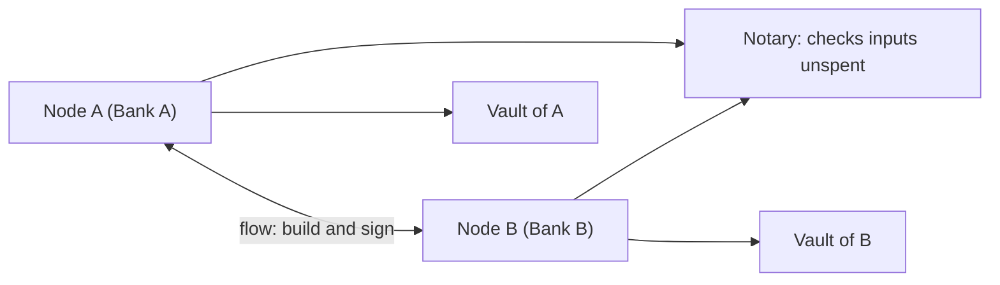

**In simple words:** Corda banks aur dusre businesses ke liye blockchain-style platform hai. Bitcoin ya Ethereum ki tarah yeh har transaction sabko nahi bhejta. Sirf involved parties (aur ek notary) deal dekhte hain. <Cite id="corda-ripple-quorum-corda-intro-wp" />

**Definition:** Corda R3 ka open-source distributed ledger platform hai, jo finance, insurance aur trade jaisi regulated industries ke liye bana hai. Yeh permissioned hai, JVM (Kotlin aur Java) pe chalta hai, aur known parties ke beech agreements record karta hai. <Cite id="corda-ripple-quorum-corda-github" />

**Key concepts:**

1. **State:** kisi point of time pe ek fact ka immutable record, jaise "Bank A owes Bank B 100". State kabhi edit nahi hoti; naya state use replace karta hai, UTXO ki tarah. <Cite id="corda-ripple-quorum-corda-tech-wp" />
2. **Contract:** code jo batata hai transaction kab valid hai, aur har party use chalakar transaction check karti hai.
3. **Flow:** woh steps jo nodes aapas mein transaction build, sign aur finalise karne ke liye follow karte hain.
4. **Vault:** har node ka private database un states ka jo woh dekh sakta hai. Koi single global ledger nahi hota.
5. **Notary:** service jo transaction tabhi sign karti hai jab uske input states pehle spent na hue hon. Yeh double spending rokti hai aur time bhi check kar sakti hai.
6. **Network map and doorman:** doorman har node ko identity certificate deta hai, aur network map members ki list rakhta hai.

**Advantages:** privacy (point-to-point sharing), mining ya cryptocurrency nahi, legal agreements ko code se jod sakte hain, high throughput. **Limitation:** data sirf participants ke paas hota hai, isliye global transparency iska goal nahi. <Cite id="corda-ripple-quorum-xoriant-corda" />

**Example:** do banks ke beech trade loan, jo sirf unke do vaults mein record hota hai aur notarised hota hai.

Exam mein English mein likho: "Corda is a permissioned distributed ledger platform from R3 where states, contracts, flows and a notary let only the parties involved share and validate a deal."
